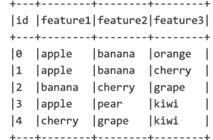
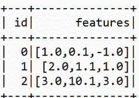
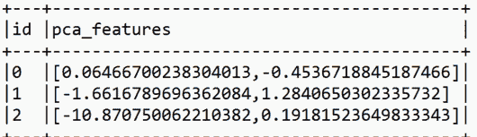
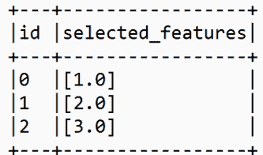

## 特征提取与转换

特征提取器和转换器是机器学习和数据预处理领域的关键组件。它们有助于将原始数据转换为适合训练机器学习模型的更有效格式。特征提取器通过将数据转换为低维空间来简化数据输入。相反，特征转换涉及修改或转换特征本身，使其成为更适合机器学习算法的格式。

理解这些概念对于构建高效且准确的预测模型至关重要。

在本章中，我们将介绍以下主要主题：

- 了解特征提取器
- 使用特征转换器
- 探索特征选择器

本章结束时，您将了解通过数据转换提取特征的几种不同技术。

### 技术要求

本章的代码文件可在 GitHub 上找到，网址为 https://github.com/PacktPublishing/Apache-Spark-for-Machine-Learning/tree/main/Chapter03。

### 了解特征提取器

在本节中，我们将了解什么是特征提取器、它在机器学习中为何非常重要，以及其各种技术。机器学习和数据处理中的特征提取器是一种方法或算法，它能从原始数据中自动识别并提取相关特征，以用于构建机器学习模型。特征提取提高了后续分析和预测的效率和准确性。

### 特征提取器的关键方面

特征提取是机器学习和数据分析中的关键过程，其目标是将输入变量的数量减少到与手头任务最相关的变量。这涉及将原始数据转换为一组用于建模的高效且有效的特征。

以下是特征提取的关键方面：

- 捕获相关信息：有效的特征提取旨在从原始数据中捕获最相关的信息。这涉及识别哪些特征最具信息性，并能代表数据中的底层模式或结构。
- 数据简化：通过提取关键特征，降低数据的复杂性，使其更易于处理。这种简化可以带来更高效的数据处理和分析，尤其是在处理大型数据集时。
- 提高模型准确性和性能：通过专注于最重要的特征，特征提取可以提高模型的准确性和性能。它有助于模型专注于数据中最具预测性的方面，而不是被噪声或无关信息分散注意力。
- 处理多样的数据类型：特征提取技术因数据类型而异，例如数值型、分类型、文本或图像。每种数据类型都需要不同的方法来有效提取特征。
- 上下文和领域知识：引入领域知识可以显著增强特征提取过程。了解数据的上下文和特定特征可以指导选择合适的特征和提取技术。
- 平衡信息丢失和效率：信息保留与效率之间往往存在权衡。虽然减少特征空间可以使模型更高效，但也可能导致潜在重要信息的丢失。挑战在于在不显著影响信息质量的前提下，找到最大化效率的平衡点。
- 促进更好的数据可视化和解释：提取的特征通常可以使数据可视化和解释更加容易和有洞察力，因为它们将数据提炼为最具信息性的组件。

### 特征提取算法

让我们回顾一下特征提取器中使用的一些算法：

- 文本数据：
  - 词袋模型：将文本转换为固定长度的特征集，表示某些单词的频率。


- **Term Frequency-Inverse Document Frequency (TF-IDF):** 这是衡量词在文档集合中某一文档重要性的指标。它根据词在整个数据集中出现的频率调整词的频率计数，突出特定文档独有的词。
- **Word embeddings (for example, Word2Vec and GloVe):** 将词转换为高维向量，捕捉词之间的语义关系，使模型能够根据上下文理解词义。
- **Image data:**
  - **Histogram:** 用于图像处理和计算机视觉中的目标检测，统计图像局部区域梯度方向的出现次数
- **Audio data:**
  - **Mel-frequency cepstral coefficients:** 广泛用于语音和音频处理，表示声音的短时功率谱
  - **Spectral centroid and spectral roll-off:** 分别测量声音频谱的“亮度”和“形状”
  - **Zero crossing rate:** 信号从正变负或从负变正的速率，有助于分析音频信号的噪声程度
- **Time series data:**
  - **Fourier transform:** 将时间序列数据转换为频域，用于识别循环模式
  - **Statistical features:** 均值、中位数、标准差等，在时间序列的窗口上计算
  - **Autocorrelation:** 测量序列的值在不同时间滞后下与自身的相关性
- **Signal processing:**
  - **Wavelet transform:** 对信号进行多分辨率分析，捕捉频率和位置信息
  - **Short-time Fourier transform:** 对信号的短而重叠的窗口应用傅里叶变换，适用于非平稳信号分析

- General data processing:

- **Principal Component Analysis (PCA):** 通过将数据转换为一组线性不相关的分量来降低数据维度

- **t-Distributed Stochastic Neighbor Embedding (t-SNE):** 一种非线性降维技术，特别擅长将高维数据可视化为二维或三维

### Spark algorithms for feature extractors

Apache Spark，通过 MLlib（即机器学习库的缩写），提供了一个全面的特征提取工具，这对于将原始数据转换为机器学习算法能够有效使用的格式至关重要。这些工具旨在高效处理大规模数据集，并涵盖广泛的特征提取需求。以下是 Spark 提供的关键特征提取算法概述：

- **TF-IDF:**
  - **Purpose:** 反映术语在文档及整个语料库语境中的重要性
  - **Use case:** 用于文本挖掘和信息检索

- **Word2Vec:**
  - **Purpose:** 将词映射到高维向量
  - **Use case:** 对于自然语言处理任务很有用，其中具有相似含义的词具有相似的表示

- **CountVectorizer:**
  - **Purpose:** 将文档集合转换为标记计数向量
  - **Use case:** 经常用于文本分类和聚类，以从文本数据中提取特征

- **FeatureHasher:**
  - **Purpose:** 将一组分类或数值特征转换为指定维度的特征向量
  - **Use case:** 经常用于分类和聚类，以从数值或分类数据中提取特征

在下一节中，我们将学习特征转换器。

### Code examples for feature extractors

让我们通过代码示例了解不同的特征提取算法及其工作原理。

#### TF-IDF

在表格的语境下，文档对应表格中的单行，语料库指表格的所有行。

解释如下：

- TF-IDF 向量捕捉每个术语在文档中相对于整个语料库的重要性
- 特定文档独有的术语（在语料库中罕见）获得更高的 TF-IDF 分数

以下代码段导入所有所需的函数，创建 Spark 会话，并创建 Spark DataFrame 来实现 TF-IDF：

```
from pyspark.sql import SparkSession
from pyspark.ml.feature import HashingTF, IDF, Tokenizer
spark = SparkSession.builder.appName("TF-IDF Example").getOrCreate()

data = [
    (0, "This is the first document"),
    (1, "This document is the second document"),
    (2, "And this is the third one"),
    (3, "Is this the first document?"),
    (4, "The last document is the fifth one")
]

df = spark.createDataFrame(data, ["id", "text"])
df.show()
```

以下是输出：

| id | text |
|---|---|
| 0 | 这是第一个文档 |
| 1 | 该文档是第二个文档 |
| 2 | 这是第三个文档 |
| 3 | 这是第一个文档吗？ |
| 4 | 最后一个文档是第五个文档 |

图 3.1 – Spark DataFrame 中的数据

我们使用 Tokenizer 对文本进行分词：

```
tokenizer = Tokenizer(inputCol="text", outputCol="words")
words_df = tokenizer.transform(df)
```

我们应用 HashingTF 将单词转换为特征向量：

```
hashingTF = HashingTF(inputCol="words",
 outputCol="rawFeatures", numFeatures=15)
featurized_df = hashingTF.transform(words_df)
```

我们使用 IDF 计算 IDF：

```
idf = IDF(inputCol="rawFeatures", outputCol="features")
idf_model = idf.fit(featurized_df)
tfidf_df = idf_model.transform(featurized_df)
```

最后，我们选择相关列，包括 TF-IDF 特征。

```
result_df = tfidf_df.select( "id", "text", "features")
result_df.show(truncate=False, vertical=False)
```

以下是输出：

| id | text | features |
|---|---|---|
| 0 | 这是第一个文档 | ... |
| 1 | 该文档是第二个文档 | ... |
| 2 | 这是第三个文档 | ... |
| 3 | 这是第一个文档吗？ | ... |
| 4 | 最后一个文档是第五个文档 | ... |

图 3.2 – Spark DataFrame 中的 TF-IDF 特征

#### Word2Vec

以下代码段导入所有所需的函数，创建 Spark 会话，并为 Word2Vec 创建 Spark DataFrame：

```
from pyspark.sql import SparkSession
from pyspark.ml.feature import Word2Vec, Tokenizer

##### Create a Spark session
spark = SparkSession.builder.appName("Word2Vec Example").getOrCreate()

##### Sample data (documents with tokenized words)
data = [
    (0, ["apple", "banana", "orange", "grape"]),
    (1, ["apple", "banana", "cherry", "pear"]),
    (2, ["banana", "cherry", "grape", "kiwi"]),
    (3, ["apple", "pear", "kiwi", "orange"]),
    (4, ["cherry", "grape", "kiwi", "orange"])
]

##### Create a DataFrame from the sample data
df = spark.createDataFrame(data, ["id", "words"])
df.show()
```

以下是输出：

| id | words |
|---|---|
| 0 | [apple, banana, orange, grape] |
| 1 | [apple, banana, cherry, pear] |
| 2 | [banana, cherry, grape, kiwi] |
| 3 | [apple, pear, kiwi, orange] |
| 4 | [cherry, grape, kiwi, orange] |

图 3.3 – Spark DataFrame 中的数据

`vectorSize` 参数设置为 3，这意味着每个词将由三维向量表示。

```
word2vec = Word2Vec(vectorSize=3, minCount=0,
inputCol="words", outputCol="features")
```

模型根据数据集中词的共现模式学习了词之间的语义关系。生成的 features 列包含每个文档的 Word2Vec 嵌入。这些嵌入捕捉了词的上下文和含义。

```
model = word2vec.fit(df)
result = model.transform(df)
result.select("id", "features").show(truncate=False)
```

| id | features |
|---|---|
| 0 | [0.09411134896799922, -0.04479349683970213, -0.004068313166499138] |
| 1 | [0.05274438951164484, -0.010796030052006245, -0.009934199508279562] |
| 2 | [0.02878595981746912, 0.008933417033404112, 0.01161392591893673] |
| 3 | [8.476478978991508E-5, -0.0047785197384655476, 0.013960199896246195] |
| 4 | [-0.007121491711586714, 0.017444119323045015, 0.036641841754317284] |

图 3.4 – Spark DataFrame 中的 Word2Vec 特征


我们可以理解，每一行（文档）现在都拥有一个 Word2Vec 特征向量。这些嵌入可用于各种 NLP 任务，例如寻找同义词、聚类相关词汇，甚至训练下游模型。

#### CountVectorizer

以下代码段导入所有所需函数，创建 Spark 会话，并为 CountVectorizer 创建 Spark DataFrame：

```
from pyspark.sql import SparkSession
from pyspark.ml.feature import CountVectorizer, Tokenizer
spark = SparkSession.builder.appName(
    "CountVectorizer Example").getOrCreate()
data = [
    (0, ["apple", "banana", "orange", "grape"]),
    (1, ["apple", "banana", "cherry", "pear"]),
    (2, ["banana", "cherry", "grape", "kiwi"]),
    (3, ["apple", "pear", "kiwi", "orange"]),
    (4, ["cherry", "grape", "kiwi", "orange"])
]
df = spark.createDataFrame(data, ["id", "words"])
df.show(truncate=False)
```

输出如下：

| ID | 单词 |
|---|---|
| 0 | [apple, banana, orange, grape, apple] |
| 1 | [apple, banana, cherry, pear, banana] |
| 2 | [banana, cherry, grape, kiwi, cherry] |
| 3 | [apple, pear, kiwi, orange, orange] |
| 4 | [cherry, grape, kiwi, orange, kiwi] |

图 3.5 – Spark DataFrame 中的数据

以下是关键代码解释：

- CountVectorizer 模型：我们使用 CountVectorizer 模型为每个文档生成词频计数。vocabSize 参数设置为 7（0 到 6，共 7 个词），这意味着词汇表大小（唯一词）将限制为 7。该模型统计了每个词在每个文档中出现的次数。

- 词频计数（特征）：生成的 features 列包含每个文档的词频计数。例如，如果单词“apple”在第一个文档中出现了两次，其计数将为 2。

每一行（文档）现在都有一个词计数向量：

```
cv = CountVectorizer(inputCol="words",
 outputCol="features", vocabSize=7)
model = cv.fit(df)
result = model.transform(df)
result.select("id", "features").show(truncate=False)
```

输出如下：

| ID | 特征 |
|---|---|
| 0 | (7,[0,3,4,5],[2.0,1.0,1.0,1.0]) |
| 1 | (7,[0,1,4,6],[1.0,1.0,2.0,1.0]) |
| 2 | (7,[1,2,4,5],[2.0,1.0,1.0,1.0]) |
| 3 | (7,[0,2,3,6],[1.0,1.0,2.0,1.0]) |
| 4 | (7,[1,2,3,5],[1.0,2.0,1.0,1.0]) |

图 3.6 – Spark DataFrame 中的向量化特征

以第一个文档为例：

- 原始文本：["apple", "banana", "orange", "grape", "apple"]
- 词计数：{ "apple": 2, "banana": 1, "orange": 1, "grape": 1, "cherry": 0, "kiwi": 0 }

该文档的向量表示可能是 [2, 1, 1, 1, 0, 0]。

> 注意
> 请注意，每个 token 都分配了一个随机索引。例如，“apple”的索引是 0，
> 而“kiwi”的索引是 2。

CountVectorizer 特征可用于各种 NLP 任务：

- **文本分类**：将文档表示为机器学习模型的特征向量
- **聚类**：根据词频对相似文档进行分组
- **主题建模**：识别语料库中的主导主题

请记住，`CountVectorizer` 捕获词的出现频率，这对于理解文档内容和相似性很有价值。

#### FeatureHasher

以下代码段导入所有所需函数，创建 Spark 会话，并为 FeatureHasher 创建 Spark DataFrame：

```
from pyspark.sql import SparkSession
from pyspark.ml.feature import FeatureHasher, Tokenizer
spark = SparkSession.builder.appName(
"FeatureHasher Example").getOrCreate()
data = [
(0, "apple", "banana", "orange"),
(1, "apple", "banana", "cherry"),
(2, "banana", "cherry", "grape"),
(3, "apple", "pear", "kiwi"),
(4, "cherry", "grape", "kiwi")
]
df = spark.createDataFrame(data,
["id", "feature1", "feature2", "feature3"])
df.show(truncate=False)
```



图 3.7 – Spark DataFrame 中的数据

让我们来了解各个代码组件：

- **FeatureHasher 模型**：我们使用 FeatureHasher 模型为分类特征生成哈希表示。numFeatures 参数设置为 10，这意味着每个特征将被哈希为一个 10 维向量。哈希是一种将分类值映射到固定大小向量的技术。

- **哈希特征**：生成的 features 列包含每个文档的哈希向量：

```
hasher = FeatureHasher(
inputCols=["feature1", "feature2", "feature3"],
outputCol="features", numFeatures=10)
result = hasher.transform(df)
result.select("id", "features").show(truncate=False)
```

| ID | 特征 |
|---|---|
| 0 | ([10, [3,7,9], [1.0, 1.0, 1.0]) |
| 1 | ([10, [3,6,7], [1.0, 1.0, 1.0]) |
| 2 | ([10, [0,4,7], [1.0, 1.0, 1.0]) |
| 3 | ([10, [0,7,8], [1.0, 1.0, 1.0]) |
| 4 | ([10, [0,2,6], [1.0, 1.0, 1.0]) |

图 3.8 – Spark DataFrame 中的 FeatureHasher

解释如下：

- 每一行（文档）现在都有一个哈希特征向量
- 哈希使我们能够以数值方式表示分类特征
- 相似的分类值可能映射到相似的向量，但确切的映射由哈希函数决定

FeatureHasher 用于以下场景：

- 处理高基数分类特征（许多唯一值）时很有用
- 它通常用于机器学习流水线中，将分类数据转换为算法适合的格式

至此，关于特征提取器示例的部分结束。

### Working with feature transformers

在本节中，我们将了解什么是特征转换器，为什么它在机器学习中非常重要，以及其各种技术。特征转换器是指用于将原始数据修改为更适合分析（特别是用于训练机器学习模型）的格式的技术或工具。特征转换是数据预处理阶段的关键步骤，因为它可以显著影响模型的性能。

如前所述，在 Apache Spark 的 MLlib 中，特征转换器是预处理数据的关键工具，可将其转换为更适合机器学习算法使用的格式。这些转换器对数据集执行各种操作，例如缩放、归一化、转换和提取，以使数据更兼容且更适合建模。

#### The key aspects of feature transformers

特征转换器的目标是将原始、可能难以处理的数据转化为精炼、结构化的格式，以便机器学习算法能够有效地用于进行准确预测并发现有意义的见解。

以下是特征转换器的一些关键方面：

- **归一化和标准化**：将数值特征的范围调整到标准范围或分布。这对于许多对输入数据范围敏感的机器学习算法（如支持向量机或 k-近邻）至关重要。
- **对分类变量进行编码**：将分类数据转换为数值格式，因为大多数机器学习模型需要数值输入。技术包括独热编码、标签编码和二进制编码。
- **处理缺失值**：处理数据集中的缺失数据，这可能会影响模型性能。处理缺失值的策略包括插补（用均值、中位数或其他统计量替换缺失值）、为缺失值创建指示器，或省略含有缺失值的行或列。
- **离散化**：通过分箱或分桶将连续特征转换为分类特征，这对某些类型的模型或处理非线性关系可能有好处。
- **特征创建和提取**：从现有特征生成新特征，以更好地捕捉数据中的潜在模式，例如创建多项式特征或交互项。
- **时间和空间特征工程**：对于时间序列或空间数据，提取捕捉时间或空间动态的相关特征（例如滞后特征、移动平均值和空间网格）。
- **降维**：减少特征空间有助于提高机器学习模型的性能，通过降低过拟合风险并降低计算复杂度。

#### Use cases and Spark algorithms for feature transformers

特征转换器在为机器学习模型准备数据方面至关重要，其应用涵盖广泛的行业和场景。以下是一些特征转换器至关重要的实际用例：

- 金融 – 信用评分：
  - **归一化/标准化**：收入、贷款金额和年龄等金融变量可能处于截然不同的尺度。使用 StandardScaler 可确保这些特征对预测信用度的模型做出同等贡献。
  - **独热编码**：将就业状态或教育水平等分类变量转换为适合机器学习模型的格式。


- 电子商务 – 推荐系统：
    - TF-IDF 向量化：在基于内容的推荐系统中，商品描述可以转换为 TF-IDF 向量，以便理解和比较文本内容
    - MinMaxScaler：用户评分通常在 1 到 5 的范围内，可以归一化，以确保不同规模或平台之间的一致性
- 医疗保健 – 患者风险分层：
    - 缺失值填充：使用均值或中位数填充缺失值，以处理患者记录中的缺失值，这在医疗数据集中很常见
    - PCA（主成分分析）：降低患者数据（如各种生物标志物）的维度，以识别影响健康结果的关键因素
- 制造业 – 预测性维护：
    - 分箱/分桶：将温度或压力等连续传感器读数转换为离散类别，以简化异常状况的检测
    - 多项式特征：在不同传感器读数之间创建交互项，以捕捉可能预测设备故障的复杂关系
- 房地产 – 房产价格预测：
    - 特征创建：从现有日期或位置数据生成新特征，例如房产年龄或距最近地铁站的距离
    - StandardScaler：归一化特征，如建筑面积、卧室数量或房产税率，用于预测房产价格的回归模型
- 在线广告 – 点击率预测：
    - 独热编码：将用户位置、设备类型和广告类别等分类数据转换为二进制格式，适用于预测广告点击可能性的逻辑回归模型

#### Spark 用于特征变换器的算法

Apache Spark 的 MLlib 提供了一套强大的特征变换器，对于机器学习工作流中的数据预处理至关重要。以下是 Spark 中可用的一些值得注意的特征变换器示例：

- **向量组装器**：将多个数据列（特征）合并为单个向量列。这对于将原始特征和其他变换器生成的特征合并为单个特征向量非常有用，这是 Spark 机器学习算法的常见要求。

- **字符串索引器**：将字符串标签列转换为标签索引列。它通常用于将分类文本数据转换为机器学习模型可处理的数值索引。

- **独热编码器**：将类别索引列映射为二进制向量列。在使用字符串索引器之后，这对于将分类变量进一步转换为机器学习算法可利用的格式特别有用。

- **分词器和正则分词器**：将文本拆分为单个单词或标记。这些是文本分析和 NLP 任务中的基本步骤。

- **停用词移除器**：从一组分词后的单词中删除常见的、无信息量的单词。这有助于降低文本数据的维度，并专注于更有意义的单词。

- **分桶器**：基于用户指定的分割点，将连续特征列转换为特征桶列。这对于将连续变量转换为分类变量很有用。

- **标准化缩放器**：通过去除均值并将其缩放为单位方差来标准化特征。这对于许多假设输入特征处于相似尺度的机器学习模型至关重要。

- **最小-最大缩放器**：将每个特征转换为给定范围，通常是 [0, 1]。当您需要将特征归一化到特定范围而不扭曲值范围差异时，这很有用。

- **归一化器**：转换向量行数据集，将每个向量归一化为单位范数。当您希望将向量观测值缩放为单位范数时使用此方法，这在聚类算法中可能很有用。

- **PCA（主成分分析）**：通过将数据投影到较小的一组正交特征上来降低数据维度。PCA 用于探索性数据分析，并用于使预测模型更高效。

- **多项式扩展**：将特征向量扩展到多项式空间，该空间由原始维度的 n 度组合构成。这有助于捕捉原始特征之间的交互。

#### 特征变换器的代码示例

现在，让我们通过一些代码示例来了解特征变换器。

##### 向量组装器

以下代码片段创建一个带有四列（也称为特征）的示例 Spark DataFrame：

```
from pyspark.ml.feature import VectorAssembler
data = [
(1, 2, 3, 4),
(5, 6, 7, 8),
(9, 10, 11, 12)
]
columns = ["feature1", "feature2", "feature3", "feature4"]
df = spark.createDataFrame(data, columns)
df.show()
```

| feature1 | feature2 | feature3 | feature4 |
|---|---|---|---|
| 1 | 2 | 3 | 4 |
| 5 | 6 | 7 | 8 |
| 9 | 10 | 11 | 12 |

图 3.9 – Spark DataFrame 中的数据

向量组装器是 PySpark 中的一个特征变换器，它将给定的列列表合并为单个向量列：

```
assembler = VectorAssembler(inputCols=columns, outputCol="features")
output_df = assembler.transform(df)
output_df.show()
```

| feature1 | feature2 | feature3 | feature4 | features |
|---|---|---|---|---|
| 1 | 2 | 3 | 4 | [1.0, 2.0, 3.0, 4.0] |
| 5 | 6 | 7 | 8 | [5.0, 6.0, 7.0, 8.0] |
| 9 | 10 | 11 | 12 | [9.0, 10.0, 11.0, 12.0] |

图 3.10 – Spark DataFrame 中的向量组装器特征

features 列包含来自所有列的合并值。

向量组装器特征用于以下用例：

- 特征工程：将原始特征合并为单个向量，供 ML 模型使用
- 逻辑回归和决策树：为 ML 算法准备输入特征
- 管道构建：在管道中组装特征
- 稀疏特征：将稀疏特征转换为密集向量

##### 字符串索引器

字符串索引器是 PySpark 中的一项功能，用于将 DataFrame 中的分类字符串列转换为数值索引。需要进行此转换的原因是，大多数机器学习算法无法直接处理字符串数据。字符串索引器为输入列中的每个不同字符串值分配一个唯一索引，并将其映射到新的整数索引输出列。

以下代码片段创建一个带有两列的示例 Spark DataFrame，其中一列为分类列：

```
from pyspark.ml.feature import StringIndexer
data = [("X", 100), ("X", 200), ("Y", 300), ("Y", 200),
        ("Y", 300), ("C", 400), ("Z", 100), ("Z", 100)]
columns = ["Categories", "Value"]
df = spark.createDataFrame(data, columns)
df.show()
```

| Categories | Value |
|------------|-------|
| X | 100 |
| X | 200 |
| Y | 300 |
| Y | 200 |
| Y | 300 |
| C | 400 |
| Z | 100 |
| Z | 100 |

图 3.11 – Spark DataFrame 中的数据

让我们看看字符串索引器的工作原理。字符串索引器根据数据集中值的频率来计算输入列的字符串值。

默认情况下，适用以下规则：

- 出现频率最高的标签接收索引 0
- 出现频率第二高的标签接收索引 1，依此类推

如果两个类别的频率相同，则按字母顺序分配索引值。

您还可以使用 stringOrderType 参数对标签使用自定义顺序：

```
indexer = StringIndexer(inputCol="Categories",
                       outputCol="Categories_Indexed")
indexerModel = indexer.fit(df)
indexed_df = indexerModel.transform(df)
indexed_df.show()
```

| Categories | Value | Categories_Indexed |
|---|---|---|
| X | 100 | 1.0 |
| X | 200 | 1.0 |
| Y | 300 | 0.0 |
| Y | 200 | 0.0 |
| Y | 300 | 0.0 |
| C | 400 | 3.0 |
| Z | 100 | 2.0 |
| Z | 100 | 2.0 |

图 3.12 – Spark DataFrame 中的字符串索引器特征

##### 独热编码器

独热编码器是 PySpark 中的一个特征变换器，它将分类变量（字符串标签）转换为二进制向量格式。它创建一个稀疏向量，其中每个唯一类别对应一个二进制值（0 或 1）。

以下代码片段创建一个带有两列的示例 Spark DataFrame：

```
from pyspark.ml.feature import OneHotEncoder
data = [(0.0, 1.0), (1.0, 0.0), (2.0, 1.0)]
columns = ["input1", "input2"]
df = spark.createDataFrame(data, columns)
df.show()
```

| input1 | input2 |
|---|---|
| 0.0 | 1.0 |
| 1.0 | 0.0 |
| 2.0 | 1.0 |

图 3.13 – Spark DataFrame 中的数据

以下代码片段通过应用独热编码器模型处理输入列。然后它转换输入列。

```
encoder = OneHotEncoder(
    inputCols=["input1", "input2"],
    outputCols=["output1", "output2"])
```


encoded_df = encoder.fit(df)
encoded_df = encoded_df.transform(df)
encoded_df.select("output1", "output2").show(truncate=False)

| output1 | output2 |
|---|---|
| (2,[0],[1.0]) | (1,[],[]) |
| (2,[1],[1.0]) | (1,[0],[1.0]) |
| (2,[],[]) | (1,[],[]) |

图 3.14 – Spark DataFrame 中的 OneHotEncoder 特征

#### Tokenizer 和 RegexTokenizer

以下代码片段创建一个包含两列的示例 Spark DataFrame：

```
from pyspark.ml.feature import Tokenizer, RegexTokenizer
spark = SparkSession.builder.appName("TokenizerExample").getOrCreate()
data = [("This is a sample sentence.",)]
columns = ["text"]
df = spark.createDataFrame(data, columns)
df.show(truncate=False)
```

| text |
|---|
| This is a sample sentence. |

图 3.15 – Spark DataFrame 中的数据

Tokenizer 使用空格作为分隔符，将句子拆分为标记。

另一方面，RegexTokenizer 使用自定义 `\\W+` 模式（匹配非单字符）将句子拆分为标记：

```
tokenizer = Tokenizer(inputCol="text", outputCol="tokens")
tokenized_df = tokenizer.transform(df)
regex_tokenizer = RegexTokenizer(inputCol="text", outputCol="tokens", pattern="\\W+")
regex_tokenized_df = regex_tokenizer.transform(df)
tokenized_df.select("tokens").show(truncate=False)
regex_tokenized_df.select("regex_tokens").show(truncate=False)
```

```
+-------+
|tokens |
+-------+
|[this, is, a, sample, sentence.]|
+-------+
```

```
+-------------+
|regex_tokens |
+-------------+
|[this, is, a, sample, sentence]|
+-------------+
```

图 3.16 – Spark DataFrame 中的标记

#### StopWordsRemover

以下代码片段创建一个包含两列的示例 Spark DataFrame：

```
from pyspark.sql import SparkSession
from pyspark.ml.feature import StopWordsRemover, Tokenizer
data = [("This is the first sentence.",),
    ("And here's another sentence.",),
    ("A third sentence for the DataFrame.",)]
columns = ["text"]
df = spark.createDataFrame(data, columns)
tokenizer = Tokenizer(inputCol="text", outputCol="words")
df = tokenizer.transform(df)
df.show(truncate=False)
```

| text | words |
|---|---|
| This is the first sentence. | [this, is, the, first, sentence.] |
| And here's another sentence. | [and, here's, another, sentence.] |
| A third sentence for the DataFrame. | [a, third, sentence, for, the, dataframe.] |

图 3.17 – Spark DataFrame 中的数据

StopWordsRemover 从输入句子中删除常见的停用词（“This”、“is”、“the”、“And”、“another”、“A”和“for”）。

输出仅包含有意义的单词（“first”、“sentence”、“another”、“third”和“DataFrame”）。

以下代码片段将 StopWordsRemover 函数应用于输入列，以转换停用词的过滤：

```
stopwords_remover = StopWordsRemover(
    inputCol="words", outputCol="filtered_words")
filtered_df = stopwords_remover.transform(df)
filtered_df.select("filtered_words").show(truncate=False)
```

| filtered_words |
|---|
| [first, sentence.] |
| [another, sentence.] |
| [third, sentence, dataframe.] |

图 3.18 – Spark DataFrame 中过滤后的单词

停用词移除器用于文本分析和 NLP，以提高 NLP 任务的文本数据质量。

#### Bucketizer

Bucketizer 是 PySpark 中的一个特征转换器，用于将连续特征离散化为桶（bin）。它根据指定的分割点（边界）将每个值分配到特定的桶中。对连续特征进行分桶可以通过捕获非线性关系来提高模型性能。

以下代码片段创建一个包含两列的示例 Spark DataFrame：

```
from pyspark.sql import SparkSession
from pyspark.ml.feature import Bucketizer
from pyspark.sql.functions import col
data = [(0, 1.5), (1, 2.5), (2, 3.5), (3, 4.5), (4, 5.5)]
columns = ["id", "value"]
df = spark.createDataFrame(data, columns)
df.show()
```

| id | value |
|---|---|
| 0 | 1.5 |
| 1 | 2.5 |
| 2 | 3.5 |
| 3 | 4.5 |
| 4 | 5.5 |

图 3.19 – Spark DataFrame 中的数据

以下代码片段应用 bucketizer 函数来转换数据：

```
splits = [0.0, 2.0, 4.0, float("inf")]
bucketizer = Bucketizer(splits=splits, inputCol="value",
    outputCol="bucket")
bucketized_df = bucketizer.transform(df)
bucketized_df.select("id", "value", "bucket").show()
```

| id | value | bucket |
|---|---|---|
| 0 | 1.5 | 0.0 |
| 1 | 2.5 | 1.0 |
| 2 | 3.5 | 1.0 |
| 3 | 4.5 | 2.0 |
| 4 | 5.5 | 2.0 |

图 3.20 – Spark DataFrame 中分桶后的值

value 列基于定义的分割点被分桶为三个桶：

- 桶 0: (-∞, 2.0]
- 桶 1: (2.0, 4.0]
- 桶 2: (4.0, ∞)

#### StandardScaler

StandardScaler 是 PySpark 中的一个特征转换器，通过去除均值并缩放到单位方差来标准化（缩放）特征。它将连续特征转换为零均值和单位标准差。标准化对于许多假设特征服从正态分布的机器学习算法至关重要。

以下代码片段创建一个示例 Spark DataFrame：

```
from pyspark.sql import SparkSession
from pyspark.ml.feature import StandardScaler
from pyspark.ml.linalg import Vectors
data = [(0, Vectors.dense([1.0, 0.1, -1.0])),
        (1, Vectors.dense([2.0, 1.1, 1.0])),
        (2, Vectors.dense([3.0, 10.1, 3.0]))]
columns = ["id", "features"]
df = spark.createDataFrame(data, columns)
df.show()
```

| id | features |
|---|---|
| 0 | [1.0,0.1,-1.0] |
| 1 | [2.0,1.1,1.0] |
| 2 | [3.0,10.1,3.0] |

图 3.21 – Spark DataFrame 中的数据

以下代码片段通过应用 StandardScaler 函数将输入列转换为缩放后的特征：

```
scaler = StandardScaler(
    inputCol="features", outputCol="scaled_features",
    withStd=True, withMean=True)
scaler_model = scaler.fit(df)
scaled_df = scaler_model.transform(df)
scaled_df.select("id", "features",
    "scaled_features").show(truncate=False)
```

| id | features | scaled_features |
|---|---|---|
| 0 | [1.0,0.1,-1.0] | [-1.0,-0.6657502859356826,-1.0] |
| 1 | [2.0,1.1,1.0] | [0.0,-0.4841820261350419,0.0] |
| 2 | [3.0,10.1,3.0] | [1.0,1.1499323120707245,1.0] |

图 3.22 – Spark DataFrame 中缩放后的特征

StandardScaler 通过去除均值并缩放到单位方差来标准化 features 列。scaled_features 列包含标准化后的值。

#### MinMaxScaler

这将每个特征线性转换以符合指定的最小值和最大值。MinMax 缩放对对特征缩放敏感的算法很有用，例如基于梯度的优化方法。

以下代码片段创建一个示例 Spark DataFrame：

```
from pyspark.sql import SparkSession
from pyspark.ml.feature import MinMaxScaler
from pyspark.ml.linalg import Vectors
data = [(0, Vectors.dense([1.0, 0.1, -1.0]),),
    (1, Vectors.dense([2.0, 1.1, 1.0]),),
    (2, Vectors.dense([3.0, 10.1, 3.0]),)]
columns = ["id", "features"]
df = spark.createDataFrame(data, columns)
df.show()
```

| id | features |
|---|---|
| 0 | [1.0,0.1,-1.0] |
| 1 | [2.0,1.1,1.0] |
| 2 | [3.0,10.1,3.0] |

图 3.23 – Spark DataFrame 中的数据

以下代码片段通过应用 MinMaxScaler 函数转换输入列：

```
scaler = MinMaxScaler(
    inputCol="features", outputCol="scaled_features")
scaler_model = scaler.fit(df)
scaled_df = scaler_model.transform(df)
scaled_df.select("id", "features",
    "scaled_features").show(truncate=False)
```

| id | features | scaled_features |
|---|---|---|
| 0 | [1.0,0.1,-1.0] | [0.0,0.0,0.0] |
| 1 | [2.0,1.1,1.0] | [0.5,0.1,0.5] |
| 2 | [3.0,10.1,3.0] | [1.0,1.0,1.0] |

图 3.24 – Spark DataFrame 中经过 MinMax 缩放的特征

MinMaxScaler 将 features 列缩放到 [0, 1] 范围。scaled_features 列包含缩放后的值。

#### Normalizer

它通过将每个值除以欧几里得范数（L2 范数）来归一化特征向量。当你希望根据方向而非大小来比较向量时，归一化很有用。

以下代码片段创建一个示例 Spark DataFrame：

```
from pyspark.sql import SparkSession
from pyspark.ml.feature import Normalizer
from pyspark.ml.linalg import Vectors
data = [(0, Vectors.dense([1.0, 0.1, -1.0])),
    (1, Vectors.dense([2.0, 1.1, 1.0])),
    (2, Vectors.dense([3.0, 10.1, 3.0]))]
columns = ["id", "features"]
df = spark.createDataFrame(data, columns)
df.show()
```


| id | features |
|---|---|
| 0 | [[1.0, 0.1, -1.0]] |
| 1 | [[2.0, 1.1, 1.0]] |
| 2 | [[3.0, 10.1, 3.0]] |

图 3.25 – Spark DataFrame 中的数据

```python
normalizer = Normalizer(inputCol="features",
outputCol="normalized_features", p=2.0)
normalized_df = normalizer.transform(df)
normalized_df.select("id", "features",
"normalized_features").show(truncate=False)
```

| id | features | normalized_features |
|---|---|---|
| 0 | [[1.0, 0.1, -1.0]] | [[0.7053456158585983, 0.07053456158585983, -0.7053456158585983]] |
| 1 | [[2.0, 1.1, 1.0]] | [[0.8025723539051279, 0.4414147946478204, 0.40128617695256397]] |
| 2 | [[3.0, 10.1, 3.0]] | [[0.27384986857909926, 0.9219612242163009, 0.27384986857909926]] |

图 3.26 – Spark DataFrame 中的归一化特征

Normalizer 会将每个特征向量缩放为具有单位范数（L2 范数）。normalized_features 列包含归一化后的向量。

#### PCA

PCA 是一种降维技术，用于将高维数据转换为低维空间，同时保留其基本信息。它能识别最重要的特征（主成分），这些成分能解释数据中的最大方差。

以下代码片段会创建一个示例 Spark DataFrame：

```python
from pyspark.sql import SparkSession
from pyspark.ml.feature import PCA
from pyspark.ml.linalg import Vectors
data = [(0, Vectors.dense([1.0, 0.1, -1.0])),
        (1, Vectors.dense([2.0, 1.1, 1.0])),
        (2, Vectors.dense([3.0, 10.1, 3.0]))]
columns = ["id", "features"]
df = spark.createDataFrame(data, columns)
df.show()
```



图 3.27 – Spark DataFrame 中的数据

以下代码片段在输入列上应用 PCA 函数以拟合并将数据转换为 PCA 特征：

```python
pca = PCA(k=2, inputCol="features", outputCol="pca_features")
pca_model = pca.fit(df)
pca_df = pca_model.transform(df)
pca_df.select("id", "pca_features").show(truncate=False)
```



图 3.28 – Spark DataFrame 中的 PCA 特征

PCA 模型将 features 列的维度降低为两个主成分。pca_features 列包含低维空间中的转换后数据。

#### PolynomialExpansion

它可以帮助我们捕获特征之间的非线性关系。PySpark 中的 PolynomialExpansion 通过将现有特征提升到指定次幂来创建新特征。

以下代码片段会创建一个示例 Spark DataFrame：

```python
from pyspark.sql import SparkSession
from pyspark.ml.feature import PolynomialExpansion
from pyspark.ml.linalg import Vectors
data = [
    (0, Vectors.dense([1.0, 2.0])),
    (1, Vectors.dense([2.0, 3.0])),
    (2, Vectors.dense([3.0, 4.0]))]
columns = ["id", "features"]
df = spark.createDataFrame(data, columns)
df.show()
```

| id | features |
|---|---|
| 0 | [1.0, 2.0] |
| 1 | [2.0, 3.0] |
| 2 | [3.0, 4.0] |

图 3.29 – Spark DataFrame 中的数据

以下代码片段应用 PolynomialExpansion 函数将输入列转换为多项式特征：

```python
poly_expansion = PolynomialExpansion(inputCol="features",
                                    outputCol="expanded_features", degree=2)
expanded_df = poly_expansion.transform(df)
expanded_df.select("id", "expanded_features").show(truncate=False)
```

| id | expanded_features |
|---|---|
| 0 | [1.0, 1.0, 2.0, 2.0, 4.0] |
| 1 | [2.0, 4.0, 3.0, 6.0, 9.0] |
| 2 | [3.0, 9.0, 4.0, 12.0, 16.0] |

图 3.30 – Spark DataFrame 中的多项式特征

PolynomialExpansion 通过创建原始特征的多项式组合来生成新特征。例如，第一行的特征为 [1.0, 2.0]，扩展后的特征包含 [1.0, 2.0, 1.0, 4.0, 0.0, 0.0]。

### 探索特征选择器

在本节中，我们将了解什么是特征选择器，它在机器学习中为何非常重要，以及其各种技术。机器学习中的特征选择器是一种工具或方法，用于自动选择用于模型构建的相关特征子集（变量和预测因子）。这一过程是特征工程阶段的重要组成部分，并对机器学习模型的性能产生显著影响。

Apache Spark 的 MLlib 提供了若干对选择模型训练中最相关特征至关重要的特征选择工具。这些特征选择器有助于提升模型性能、降低复杂度并提高计算效率。

#### 特征选择器的关键方面

特征选择器通常用于数据预处理阶段。在初步数据清洗和转换后，会应用特征选择器来选取最相关的特征，然后再将数据输入机器学习算法。

选择过程通常由统计检验（如卡方检验）指导，或基于领域知识和数据探索。

#### 特征选择器的用例和 Spark 算法

以下是 Apache Spark 中提供的主要特征选择器：

- Chi-Squared Selector (ChiSqSelector):
  - 函数：基于卡方统计检验，选择用于预测分类标签的分类特征。该检验用于判断两个事件的独立性，因此适用于选择与标签关系最强的特征。
  - 用例：适用于特征为分类型的分类任务。它有助于选择与标签具有强关联的特征。

- Vector slicer:
  - 函数：从特征向量中选择一组索引的特征转换器。它适用于从向量列中提取特征。
  - 用例：当需要根据索引从大型特征向量中切片和提取特征时非常有用。它可用于基于领域知识或先前分析进行手动特征选择。

- RFormula:
  - 函数：提供类似 R 的公式，用于定义涉及特征和交互项的模型规范。尽管从传统意义上不属于特征选择器，但它允许你指定模型中包含哪些特征。
  - 用例：适用于创建包含变量间交互关系的复杂模型，并对变量进行转换。

- UnivariateFeatureSelector:
  - 函数：UnivariateFeatureSelector 是机器学习中用于从数据集中选择最相关特征的特征选择技术，依据是各特征的个体统计特性及其与目标变量的关系。由于它独立考虑每个特征而不考虑特征之间的交互，因此属于单变量特征选择方法。
  - 用例：在分类和回归任务中，可以使用单变量特征选择器来选择最具信息量的特征，以提高模型准确性并减少过拟合。

在任务中，它有助于识别相关预测因子并提高模型的预测性能。

#### 特征选择器的代码示例

现在让我们来看看特征选择器算法，并通过一些代码示例进行讲解。

##### 卡方选择器

ChiSqSelector 是 PySpark 中的一种特征选择器，它使用卡方统计检验来选择最重要的特征。它通常用于具有分类特征的分类问题中的特征选择。卡方检验用于衡量分类变量之间的独立性。

以下代码片段导入所需库，创建示例 Spark DataFrame，并显示输出：

```python
from pyspark.sql import SparkSession
from pyspark.ml.feature import ChiSqSelector
from pyspark.ml.linalg import Vectors
from pyspark.sql.functions import col
data = [(0, Vectors.dense([1.0, 0.1, -1.0]), 1.0),
           (1, Vectors.dense([2.0, 1.1, 1.0]), 0.0),
           (2, Vectors.dense([3.0, 10.1, 3.0]), 0.0)]
columns = ["id", "features", "label"]
df = spark.createDataFrame(data, columns)
df.show()
```

| id | features | label |
| --- | --- | --- |
| 0 | [1.0, 0.1, -1.0] | 1.0 |
| 1 | [2.0, 1.1, 1.0] | 0.0 |
| 2 | [3.0, 10.1, 3.0] | 0.0 |

图 3.31 – Spark DataFrame 中的数据


以下代码片段使用 ChiSqSelector 算法拟合数据以生成模型。然后使用该模型转换数据以提取特征。

```
selector = ChiSqSelector(
    numTopFeatures=1, featuresCol="features",
    outputCol="selected_features", labelCol="label")
selector_model = selector.fit(df)
selected_df = selector_model.transform(df)
selected_df.select("id", "selected_features").show(truncate=False)
```



图 3.32 - Spark DataFrame 中 ChiSqSelector 选定的特征

ChiSqSelector 基于卡方检验选择前 k 个特征。在此示例中，我们选择了最重要的单个特征。

##### VectorSlicer（向量切片器）

VectorSlicer 是 PySpark 中的一个特征转换器，用于从向量列中提取特征子集。它允许你根据特征的索引或名称选择特定特征。VectorSlicer 对于使用原始特征的子集创建新特征向量很有用。

以下代码片段导入所需的库，创建示例 Spark DataFrame，并显示输出：

```
from pyspark.sql import SparkSession
from pyspark.ml.feature import VectorSlicer
from pyspark.ml.linalg import Vectors
data = [(0, Vectors.dense([1.0, 2.0, 3.0, 4.0, 5.0])),
        (1, Vectors.dense([2.0, 3.0, 4.0, 5.0, 6.0])),
        (2, Vectors.dense([3.0, 4.0, 5.0, 6.0, 7.0]))]
columns = ["id", "features"]
df = spark.createDataFrame(data, columns)
df.show()
```

| ID | 特征 |
|----|----------|
| 0 | [1.0,2.0,3.0,4.0,... |
| 1 | [2.0,3.0,4.0,5.0,... |
| 2 | [3.0,4.0,5.0,6.0,... |

图 3.33 – Spark DataFrame 中的数据

以下代码片段使用 VectorSlicer 转换数据以提取特征：

```
slicer = VectorSlicer(inputCol="features",
 outputCol="selected_features", indices=[1, 3, 4])
sliced_df = slicer.transform(df)
sliced_df.select("id", "selected_features").show(truncate=False)
```

| ID | 选定的特征 |
|----|-------------------|
| 0 | [2.0,4.0,5.0] |
| 1 | [3.0,5.0,6.0] |
| 2 | [4.0,6.0,7.0] |

图 3.34 – Spark DataFrame 中的 VectorSlicer 特征

VectorSlicer 从原始特征向量中选择特定特征（索引 1、3 和 4）。selected_features 列包含提取的特征。

##### RFormula（R 公式）

RFormula 是 PySpark 中的一个特征转换器，允许你根据 R 模型公式表达拟合数据集所需的转换。它支持有限的 R 运算符子集，包括 ~、.、:、+、-、* 和 ^。RFormula 对于从现有列的组合中创建特征很有用。

以下代码片段导入所需的库，创建示例 Spark DataFrame，并显示输出：

```
from pyspark.sql import SparkSession
from pyspark.ml.feature import RFormula
spark = SparkSession.builder.appName("RFormulaExample").getOrCreate()
data = [(1.0, 1.0, "a"),
       (0.0, 2.0, "b"),
       (0.0, 0.0, "a")]
columns = ["y", "x", "s"]
df = spark.createDataFrame(data, columns)
df.show()
```

| y | x | s |
|---|---|---|
| 1.0 | 1.0 | a |
| 0.0 | 2.0 | b |
| 0.0 | 0.0 | a |

图 3.35 – Spark DataFrame 中的数据

以下代码片段使用 RFormula 转换数据以提取特征：

```
rf = RFormula(formula="y ~ x + s")
model = rf.fit(df)
transformed_df = model.transform(df)
transformed_df.select("y", "x", "s", "features",
"label").show(truncate=False)
```

| y | x | s | 特征 | 标签 |
|---|---|---|---|---|
| 1.0 | 1.0 | a | [1.0,1.0] | 1.0 |
| 0.0 | 2.0 | b | [2.0,0.0] | 0.0 |
| 0.0 | 0.0 | a | [0.0,1.0] | 0.0 |

图 3.36 – Spark DataFrame 中的 RFormula 特征

RFormula 根据指定的公式（y ~ x + s）创建特征向量。features 列包含组合特征，label 列包含目标变量。

##### UnivariateFeatureSelector（单变量特征选择器）

UnivariateFeatureSelector 是 PySpark 中的一个特征选择器，基于单变量统计检验选择最重要的特征。它独立评估每个特征，并根据其与目标变量的相关性对其进行排名。UnivariateFeatureSelector 对于分类或回归任务中的特征选择很有用。

以下代码片段导入所需的库，创建示例 Spark DataFrame，并显示输出：

```python
from pyspark.sql import SparkSession
from pyspark.ml.feature import UnivariateFeatureSelector
from pyspark.ml.linalg import Vectors
data = [(1.0, Vectors.dense([1.0, 0.1, -1.0])),
        (0.0, Vectors.dense([2.0, 1.1, 1.0])),
        (0.0, Vectors.dense([3.0, 10.1, 3.0]))]
columns = ["label", "features"]
df = spark.createDataFrame(data, columns)
df.show()
```

| 标签 | 特征 |
|---|---|
| 1.0 | [1.0,0.1,-1.0] |
| 0.0 | [2.0,1.1,1.0] |
| 0.0 | [3.0,10.1,3.0] |

图 3.37 – Spark DataFrame 中的数据

以下代码片段使用 UnivariateFeatureSelector 转换数据以提取特征：

```python
selector = UnivariateFeatureSelector(
    featuresCol="features", outputCol="selected_features")
selector.setFeatureType("continuous") \
    .setLabelType("categorical") \
    .setSelectionThreshold(1)
selected_df = selector.fit(df).transform(df)
selected_df.select(
    "label", "selected_features").show(truncate=False)
```

| 标签 | 选定的特征 |
|---|---|
| 1.0 | [1.0] |
| 0.0 | [2.0] |
| 0.0 | [3.0] |

图 3.38 – Spark DataFrame 中的单变量特征

UnivariateFeatureSelector 基于统计检验选择单个最重要的特征。在此示例中，我们选择了与目标变量相关性最高的特征。

### 摘要

有效的特征工程显著影响模型的准确性和效率。在本章中，我们介绍了 PySpark 的几种特征转换算法，以及它们的用例和代码示例。同样，我们还学习了特征选择算法、它们的用例和代码示例。最后，我们学习了特征提取算法及其代码示例。数据科学家可以创建信息丰富的特征并构建强大的机器学习模型。请记住，根据问题领域、数据特征和模型要求选择适当的技术。

在下一章中，我们将探讨回归，这是一种监督学习类型。
