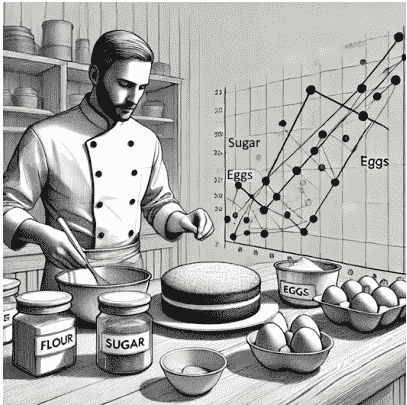
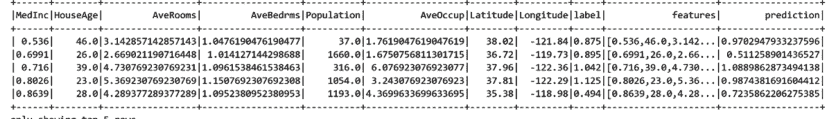

## 构建回归系统

监督学习的核心在于在标记数据集上训练模型，每个示例都与正确的输出配对，使模型能够学习从输入到输出的映射。线性回归是一种统计方法，用于寻找最佳拟合的线性方程，以根据自变量的值预测因变量。学习回归在统计学和数据科学领域至关重要，原因有多个令人信服的方面，因为它是理解变量之间关系、进行预测以及为各个领域的决策过程提供信息的基础工具。

首先，我们将了解回归及其优点的一般洞察。然后，重点将转向深入理解各种回归算法。每个算法都将配合真实世界的案例研究和代码示例，阐明其实际应用。我们将学习如何制定回归问题，选择合适的模型和算法，训练和评估模型，并将模型应用于新数据。多种机器学习用例可以使用回归技术来解决。许多复杂的机器学习解决方案将回归作为解决问题一部分的组成部分之一。

本章将涵盖以下主题：

- 了解回归
- 学习回归算法
- 评估模型性能
- 提高模型性能

在本章结束时，你将能够了解并使用多种算法构建回归模型，获得实践洞察，并评估模型的输出。

### 技术要求

你可以在 GitHub 上找到本章的代码文件，网址为 https://github.com/PacktPublishing/Apache-Spark-for-Machine-Learning/tree/main/Chapter04。


### 关于回归的学习

在本节中，我们将对回归有一个总体概述，并回顾其优点和实际用例。这将帮助我们对回归打下坚实基础，并能够识别回归用例。

#### 回归概述

回归是一种受监督的机器学习技术，允许你根据一个或多个输入特征预测连续或数值输出。回归模型从标记数据中学习输入和输出变量之间的关系，并利用这种关系对新的或未见数据进行预测。回归与机器学习相关，因为它是解决各种预测、估计和优化问题的基本方法之一。回归还可以帮助你了解不同特征如何影响输出，以及如何提高模型的性能和准确性。当你想要执行以下操作时，可以使用回归：

- 探索不同变量之间如何相互关联以及它们如何影响某个结果
- 测试关于一个或多个变量对另一个变量影响的假设
- 控制可能影响变量之间关系的混淆因素
- 基于历史数据和当前条件预测未来趋势或值

如果你正在考虑解决以下问题，那么应该考虑回归技术：

- 根据房屋大小、位置和设施预测房价
- 基于历史数据和市场趋势估计产品或服务的需求
- 基于各种因素预测企业的销售额、收入或利润

#### 机器学习中回归的*一些用例*

以下是多个领域中回归的用例：

- **商业**：回归可以帮助你分析客户行为、优化营销策略、评估政策、预测销售额和检测异常
- **医学**：回归可以帮助你测量药物效果、测试假设、调整混淆因素和预测结果
- **农业**：回归可以帮助你研究肥料、水以及其他因素对作物产量的影响，并优化资源利用
- **工程**：回归可以帮助你测试和改进机器、流程和系统的性能，并估计失效时间
- 教育：回归可以帮助你评估社会经济地位、种族等因素对教育成就的影响，并设计有效的干预措施
- 科学：回归可以帮助你探索物理、化学、生物等现象之间的关系，并测试理论和模型

#### 回归技术的陷阱

回归分析是一种用于估计变量间关系的强大统计方法。然而，为了确保有效且可靠的结果，必须考虑几种潜在的陷阱和假设。以下是回归分析中的一些常见陷阱：

- 假设违背：回归分析（尤其是线性回归）基于几个关键假设，包括线性性、误差独立性、同方差性（误差项的方差恒定）和误差项的正态分布。违背这些假设可能导致有偏或误导的结果。
- 多重共线性：当回归模型中的自变量彼此高度相关时会发生这种情况。多重共线性会使很难评估单个变量对因变量的影响，并可能膨胀系数估计的方差，使其不稳定且不可靠。
- 过拟合：当模型过于复杂并同时捕获数据中的噪声和底层模式时会发生过拟合。这使得模型在训练数据上表现良好，但在新的未见数据上表现不佳。在模型复杂性和泛化能力之间取得平衡很重要。
- 欠拟合：相反，当模型过于简单无法捕获数据的底层结构时会发生欠拟合，导致在训练数据和新数据上都表现不佳。
- 外推：在用于拟合模型的数据范围之外进行预测（外推）可能非常不可靠，因为变量之间的关系在观察数据范围之外可能不成立。
- 测量误差：自变量或因变量的测量误差可能导致有偏且不一致的估计。
- 内生性：当自变量与误差项相关时会发生这种情况。它通常源于遗漏变量偏差、测量误差或同时性（变量之间的因果关系无法区分）。内生性可能导致有偏且不一致的参数估计。
- 样本量：样本量太小可能导致缺乏检测显著关系的统计功效，而样本量太大可能会将微不足道的效果检测为显著。
- 非线性关系：除非进行适当变换或使用非线性模型，否则线性回归模型可能无法捕获非线性关系。
- 数据质量：数据质量差（包括异常值、缺失值和错误数据）可能导致误导性的回归结果。

为了缓解这些陷阱，进行彻底的探索性数据分析、测试回归模型的假设、考虑使用正则化技术防止过拟合以及在必要时探索替代建模方法至关重要。

接下来，我们将了解更多关于回归算法的内容。

### 学习回归算法

现在，让我们了解各种回归算法。Apache Spark中提供以下回归算法：

- 线性回归
- 广义线性回归（注意线性回归和广义线性回归是两种不同的算法）
- 决策树回归
- 随机森林回归
- 梯度增强树回归
- 生存回归
- 分解机回归器

接下来我们将详细回顾它们。

#### 线性回归

线性回归是统计学和机器学习中的基本算法，通过将线性方程拟合到观测数据来建模因变量与一个或多个自变量之间的关系。线性回归的主要结果是找到穿过观测数据点的最佳拟合直线。

线性回归可以类比为厨师为招牌菜制作食谱。想象一位厨师正在尝试完善蛋糕食谱。蛋糕的最终味道（结果或因变量）受到各种配料（自变量或预测变量）的影响，例如面粉、糖、鸡蛋和黄油。

在这个类比中，厨师尝试不同数量的这些配料，以找到能做出最好吃蛋糕的完美平衡。每种配料对味道的影响不同，这类似于线性回归中每个预测变量都有不同的权重或系数。

正如厨师知道加太多面粉可能会让蛋糕太密（一种偏差），或者完美的甜度每次可能略有不同（捕获随机误差）一样，线性回归利用回归系数和误差项来考虑这些变化，旨在最小化预测结果与实际结果之间的差异。

总而言之，正如厨师反复修改食谱以找到能持续做出美味蛋糕的正确配方一样，线性回归通过迭代数据来找到能最好预测结果的正确系数：



图 4.1 – 线性回归类比

##### 应用

有三个显著的应用：

- **金融和经济**：
  - **风险评估：** 它预测贷款违约并评估影响投资组合的风险因素
  - **需求预测：** 用于预测产品和服务的消费者需求
- **房地产**：
  - **房产定价：** 广泛用于根据位置、面积、卧室数量等特征预测房产价格


- 市场营销：
  - 销售预测：基于各种预测因子（如广告支出、市场状况和竞争对手行为）来预测未来销售。
  - 广告投资回报率：线性回归有助于通过将营销支出与销售增长相关联，衡量不同营销渠道的投资回报率（ROI），从而使营销人员能够更有效地分配预算。

##### 优势

线性回归的三大优势，强调其在数据分析和预测建模中的广泛应用和重要性，如下所示：

- 简单性和可解释性：线性回归模型易于理解，因此具有很高的可解释性。
- 高效性：由于其计算简单，线性回归效率高，尤其适用于大型数据集。
- 理解更复杂模型的基础模型：线性回归作为许多高级建模技术和算法的基准模型。

##### 局限性

在线性回归的局限性中，通常带来重大挑战的前三项如下：

- 线性假设：线性回归假设自变量和因变量之间存在线性关系。这是一个关键局限性，因为许多现实世界的现象表现出非线性关系。
- 异常值的影响：异常值的存在会显著影响线性回归模型的性能，因为它们可能会扭曲回归直线，导致拟合效果差。
- 多重共线性：当多元线性回归模型中的两个或多个自变量高度相关时，就会发生多重共线性，这使得难以将每个自变量与因变量之间的个体效应相隔离。这可能导致不稳定。系数估计中，数据的微小变化可能导致模型发生重大变化，使解释和预测的可靠性降低。

#### 广义线性回归

广义线性回归方法使用广义线性模型（GLM）算法，该算法扩展了传统的线性回归，以适应不服从正态分布的响应变量。GLM 由三个组件组成：指定响应变量分布的随机组件、定义自变量线性预测值的系统组件，以及将响应期望值与线性预测值相连接的链接函数。该框架允许使用二项分布或泊松分布等分布来对各种数据类型（例如二元、计数等）进行建模，使 GLM 能够适应生物学、经济学和社会科学等领域中多样的分析需求。

想象你是一名厨师，正试图完善一道汤的食谱。在基本的汤食谱（线性回归）中，你可能会调整盐和胡椒等简单食材，它们会以一种直接的方式影响味道：加入一茶匙盐会让汤可预测地变得更咸，这种关系是线性且直接的。

现在，假设你正在尝试一种更复杂的食谱，其中涉及的食材对汤的味道没有直接影响，例如需要彼此平衡的香料，或者在不同烹饪条件下会改变风味的食材（广义线性回归）。在这种情况下，加入一种香料的效果可能取决于其他香料的存在和数量，而烹饪温度可能会以非线性方式改变风味。

在广义线性回归中，你仍在努力完善你的汤（预测结果），但现在，你使用的是更广泛的食材（预测因子），它们可能与味道（结果）具有复杂的非线性关系。就像你会针对不同食材调整烹饪技巧（例如炖番茄以使其变甜或烤香料以增强其风味）一样，广义线性回归通过使用链接函数和不同类型的分布（例如用于是/否结果的二项分布、用于计数数据的泊松分布等）来调整预测因子与结果之间的不同关系，从而为“烹饪”完美的预测模型提供了更灵活、更细致的方法：


图 4.2 – GLM 类比

##### 应用

由于 GLM 在处理各种数据类型方面具有灵活性，因此在不同领域广泛应用。其三大应用如下：

- **经济学**：在经济学中，GLM 可用于建模消费者行为、劳动力市场动态以及其他变量之间关系不一定是线性或正态分布的现象。
- **保险**：GLM 用于建模索赔频率和金额，通常遵循泊松或伽马分布等分布，而非正态分布。这些模型有助于设定保费、了解风险因素和管理储备金。
- **环境科学**：在环境科学中，GLM 用于建模计数数据或比率，例如某一区域的物种数量（泊松回归）或某个事件发生前的时间（指数回归）。这些应用对于了解生物多样性、预测自然事件和管理资源至关重要。

##### 优势

GLM 通过允许在数据建模中具有更多灵活性，扩展了线性回归的实用性和适用性。让我们来看看 GLM 的三大优势：

- **对不同类型数据建模的灵活性**：GLM 可以通过允许不同的分布（例如，二元数据使用二项分布，计数数据使用泊松分布，等等）来容纳各种类型的响应变量，包括二元、计数和连续结果。
- **处理非正态误差分布的能力**：与假设残差服从正态分布的传统线性回归不同，GLM 可以对误差分布非正态的数据进行建模，例如二项分布、泊松分布和伽马分布。这种能力允许更准确地建模底层数据结构，从而获得更好的预测和推断。
- **直接建模响应变量的均值**：通过链接函数，GLM 使能够将响应变量的均值直接建模为预测因子的函数。这种直接关系使我们能够解释预测因子对响应变量的影响。

##### 局限性

GLM 是统计建模中强大且灵活的工具，但它们也存在需要考虑的某些局限性：

- **关于正确分布和链接函数的假设**：使用 GLM 时的一个关键挑战是为响应变量选择合适的分布，并选择正确的链接函数，该函数将线性预测值与分布的均值相关联。
- 对异常值和有影响力数据点的敏感性：与线性回归一样，GLM 对异常值和有影响力的观测值也可能敏感。
- 解释和传达的复杂性：虽然 GLM 扩展了线性回归的灵活性，但也可能引入额外的复杂性，尤其是在使用非规范链接函数或对非标准分布进行建模时。这种复杂性可能使解释模型系数和预测变得更加具有挑战性。

##### 应用

决策树算法具有各种应用：

- 房地产定价：根据位置、面积和配套设施等特征预测房产价格。


- **Energy consumption**: 预测基于历史使用数据和环境因素的建筑物能源使用量
- **Supply chain optimization**: 预测产品需求以优化库存水平

##### Benefits

其优势如下：

- **Interpretability**: 易于理解和可视化，即使对非技术用户也是如此
- **Non-linearity**: 无需转换即可捕获非线性关系
- **No distribution assumption**: 不假设数据具有任何特定分布

##### Limitations

除了优势之外，还存在一些局限性：

- **Overfitting**: 容易过拟合，尤其是对于复杂树
- **Instability**: 数据的小变化可能导致截然不同的树
- **Bias**: 决策树可能偏向主导类别，影响回归准确性

#### Random forest regression

随机森林回归是一种集成学习方法，其工作原理是在训练期间创建多个决策树，然后生成各棵树预测的平均值或中位数。它将决策树的简洁性与灵活性相结合，提高了准确性和稳健性。

想象你正在策划一场大型户外活动，试图预测参会人数。仅依靠自己或某个朋友的猜测可能过于简单且容易出错。因此，你决定成立一个委员会，每位成员基于不同因素（如天气预报、星期几、活动受欢迎程度、过去活动的出席情况和促销工作）带来其独特的视角。

每位委员会成员使用其特定的考虑因素进行预测。一位成员可能关注天气和星期几，预测晴朗的周末出席人数较高。另一位可能考虑活动主题及其历史受欢迎程度，做出不同的预测。这一过程类似于随机森林回归中决策树的运作方式，专注于特征子集以进行预测。

每位委员会成员做出预测后，你不会只将任何单个预测作为最终估计。相反，你会汇总所有预测，可能取平均值，以得出更稳健、更集体的出席预测。这种方法可能更准确、更可靠，因为它结合了多元视角并减少了任何异常预测的影响。

这种基于委员会的方法映射了随机森林回归算法。在这种情况下，会生长许多决策树（委员会成员），每棵树都会考虑随机特征子集和数据点来预测结果（活动出席情况）。最终预测是所有这些单棵树预测的汇总（即平均值），从而产生一个更准确、更稳定的模型，不太容易出现如果依赖单个决策树（或委员会成员的猜测）可能发生的过拟合。这种集成方法利用“群体智慧”的力量得出更可靠的预测，就像你的委员会共同预测活动出席情况比任何单个成员都更有效一样。

##### Applications

随机森林回归具有以下应用：

- **Market analysis and prediction:** 基于历史数据估算未来销售额、股票价格和市场趋势
- **Medical diagnostics:** 基于临床变量预测疾病进展和患者预后
- **Environmental modeling:** 使用历史传感器数据预测空气质量、温度和其他气候变量

##### Benefits

让我们回顾一下优势：

- **Accuracy:** 结合多棵树可减少方差并提高预测准确性
- **Robustness:** 比单个决策树更不容易过拟合
- **Feature importance:** 提供关于哪些预测因素在决定结果中最具影响力的见解

##### Limitations

随机森林回归相关的局限性如下：

- **Complexity:** 比单个决策树计算密集度更高，需要更多资源
- **Interpretability:** 其集成性质使得模型比单个决策树更难以解释
- **Tuning required:** 需要仔细调谐参数（如树的数量）以避免过拟合并确保最佳性能

#### Gradient-boosted tree regression

梯度增强树回归是一种集成技术，按顺序构建多个决策树，每棵树都试图纠正前一棵树的错误。通过组合弱学习器（通常是浅层树），它通过迭代优化逐渐提高准确性，最小化损失函数。

想象你正在教一组新手射箭选手射中远处的靶子。第一位选手射出一箭，但箭没射到。你记录了它偏离多少以及偏向哪个方向，并将这一洞察提供给第二位选手。第二位选手根据第一位选手的错误调整瞄准，但仍然未中，只是偏差较小。每位随后的选手都会从所有先前选手的累积错误中学习，调整瞄准以纠正这些错误。随着时间的推移，箭越来越接近靶子，因为每位选手都在前任尝试的集体知识基础上进行构建。

在这个类比中，每位射手代表梯度增强树回归模型中的一个单独决策树。第一棵树（射手）做出粗略估计（射箭），旨在预测目标值（射中靶子）。然后使用预测误差（未中的距离和方向）来告知下一棵树（下一位射手的射击）。每棵新树都专注于纠正先前树集合的残差误差（未中）。

梯度增强将这些按顺序改进的树组合成一个集成，其中每棵树纠正其之前树的错误。“梯度”部分来自使用梯度下降来最小化损失函数（预测值与实际值之间的差异），指导模型如何在每棵新树中调整错误。

到过程结束时，所有这些渐进式改进的集体智慧（所有射手调整后的射击）导致一个模型，它比做出准确预测（射中靶子）更接近，即使每棵树（射手）本身可能并不完美。这种迭代改进使梯度增强树回归成为减少偏差和方差的强大技术，从而产生高度准确的预测模型。

##### Applications

让我们回顾这种回归的应用：

- **Financial modeling:** 通过分析众多市场因素来预测股票价格、信用评分和风险管理
- **Real estate:** 基于位置、大小、设施和市场趋势估算房产价值
- **Energy consumption forecasting:** 预测家庭或行业的未来能源需求以优化供应并降低成本

##### Benefits

其优势如下：

- **High accuracy**: 与其他算法相比，通常能提供更优的预测准确性
- **Flexibility**: 可以处理各种类型的数据，包括数值型和类别型数据
- **Handling of complex non-linearities**: 有效捕获特征与目标之间的复杂非线性关系

##### Limitations

局限性如下：

- **Overfitting risk**: 尤其是在数据有噪声且没有适当正则化，或者树的数量过多时
- **Computationally intensive**: 训练可能耗费资源且耗时，特别是在大型数据集上
- **Model complexity**: 其序列特性使得模型比简单模型更难以解释，使理解和解释预测的过程复杂化。

#### Survival regression

生存回归，特别是 Cox 比例风险模型，是一种统计方法，用于研究各种因素对特定事件（如死亡、故障或流失）发生时间的影响。与处理连续或类别结果的标准回归不同，生存回归旨在处理时间到事件数据，这类数据常常是删失的。删失发生在研究期间某些受试者尚未发生感兴趣的事件，使得其确切的时间到事件未知。

该模型不对生存时间假设任何特定的统计分布。相反，它将风险率建模为协变量的函数。任何时间的风险率被假设为基线风险函数与协变量的指数函数的乘积。这种公式允许估计风险比，提供与协变量相关的相对风险的见解。

想象你是一名园丁，种植着各种植物，由于阳光、水、土壤类型和害虫暴露等因素，每种植物的生存率都不同。你试图在考虑这些多样条件的同时，预测每种植物能生长多长时间。在这个场景中，每种植物代表数据集中的一个个体，影响其生长的因素类似于生存分析中的协变量。

为了解决这个问题，你决定为每种植物创建一张详细的图表（“生存树”），绘制各种条件及其对植物寿命的影响。例如，你注意到每天阳光少于 6 小时的植物会更早枯萎，因此你在图表中创建一个“阳光 < 6 小时”的分支，导向“寿命较短”。如果一种植物阳光充足但种植在黏土重的土壤中，那可能形成另一个分支，显示这些植物相比种植在壤土中的植物也有缩短的生存时间。


当你扩展图表时，你会根据观察创建更多分支，从而在特定条件下将植物有效地分组为具有相似生存预期的群体。这个决策与结果的“树”可以帮助你根据植物条件预测新植物可能存活多长时间，从而指导你的园艺策略以提升其寿命。

这种园艺策略反映了生存树回归的概念，其中个体（植物）根据其协变量（例如阳光和土壤等条件）被划分为同质群体（分支）。这种树结构可以直观地理解不同条件如何交互作用以影响生存，就像不同的园艺实践影响植物寿命一样。正如你会根据图表调整养护策略以最大限度地提高植物存活率，生存树回归有助于基于预测模型理解并制定干预措施以改善结果。

##### 应用

生存回归在以下领域有应用：

- **医学研究**：广泛用于比较治疗效果，其中事件可能是死亡、复发或康复
- **客户分析**：在分析客户流失时，了解不同因素如何导致客户离开服务的时间
- **可靠性工程**：应用于预测产品或组件的寿命，从而为维护计划和产品设计提供依据

##### 优势

它带来以下优势：

- **删失数据处理**：有效纳入时间至事件研究中常见的右删失数据，且不丢弃信息
- **风险评估**：提供一种机制来评估各种协变量对事件发生风险（风险率）的影响，为风险管理提供有价值的见解
- **通用性**：可应用于各种具有时间至事件数据的领域，使其成为统计分析的多功能工具

##### 局限性

然而，它也有其陷阱：

- **比例风险假设**：协变量效应随时间呈乘积且恒定的假设在所有情况下可能不成立，可能导致结果偏差
- **解释挑战**：模型的复杂性和风险率概念可能使得结果解释和传播变得具有挑战性，尤其是对于非专业受众
- **数据和事件要求**：可靠的分析需要足够数量的事件和多样的协变量值范围，这限制了其在小型或狭窄定义的数据集中的适用性

#### 分解机回归

分解机回归是一种多功能的机器学习算法，能够高效地捕捉高维稀疏数据集中变量之间的交互作用。它通过对数据集中所有交互作用进行二次多项式建模，超越了矩阵分解的能力，因此在涉及稀疏数据的任务（如推荐系统）中特别强大，因为在这些任务中，传统算法可能会由于可能的特征交互数量庞大而遇到困难。

想象你正在组织一次自助晚宴，每位客人带来一道菜，你希望根据菜品组合来预测活动的整体成功程度。每位客人都有自己的偏好和烹饪技巧，每道菜都有其独特的风味。自助晚宴的成功不仅取决于单道菜品，还取决于这些菜品之间彼此搭配得如何，以创造一顿令人满意的餐食。

在这个类比中，每位客人和每道菜都代表数据集中的特征，而自助晚宴的整体成功就是你试图预测的目标变量。正如有些菜品搭配得很好（例如红酒和奶酪），而有些则不然（例如冰淇淋和番茄酱），数据中特征之间的交互作用也会显著影响结果。

分解机回归就像一位精明的自助晚宴策划者，不仅考虑每位客人烹饪技巧和菜品偏好的个体品质，还考虑每种菜品组合对餐食成功的贡献程度。它通过建模不仅包括个体特征，还包括特征之间的交互作用来实现这一点，就像你会考虑餐食中风味、口感和颜色的平衡，以确保其令人愉悦一样。

通过考虑这些交互作用，分解机回归能够对自助晚宴的成功做出更准确的预测，就像精心策划并考虑菜品如何互相搭配能带来更成功、更愉快的餐食一样。这种方法能够更细致地理解不同元素如何对结果做出贡献，捕捉现实世界情境的复杂性，因为在这些情境中，因素之间的相互作用往往是理解结果的关键。

##### 应用

分解机回归有以下应用：

- **推荐系统**：分解机特别擅长处理推荐系统中典型的用户-物品矩阵稀疏数据，能根据用户行为和物品属性提供个性化推荐
- **点击预测**：在在线广告中，分解机通过学习用户人口统计信息、广告特征和历史点击数据来预测用户点击广告的可能性，从而优化广告投放和定位
- **评分预测**：它们用于电影或产品评论等评分系统，根据过去的交互以及用户和物品的特征来预测用户评分，增强内容个性化。

##### 优势

以下是优势：

- **稀疏数据处理效率高**：分解机在处理稀疏数据集方面表现出色，能够用较少的参数捕捉复杂的交互作用
- **通用性**：它们可用于回归、分类和排名任务，因此能高度适应各种预测建模挑战
- **可扩展性**：尽管建模复杂的交互作用，分解机仍具有相对较好的可扩展性，能够有效处理大型数据集

##### 局限性

让我们也来看看局限性：

- **计算复杂度**：训练分解机（尤其是在非常大的数据集上）可能计算量很大，因为需要建模所有特征之间的交互作用
- **超参数敏感性**：分解机的性能对超参数选择（如分解维度）可能非常敏感，因此需要仔细调优
- **数据预处理**：要有效地应用分解机，可能需要大量的特征工程和预处理，以便恰当地构建数据，从而捕捉有意义的交互作用

既然我们已经了解了几种回归算法，让我们来学习如何评估回归模型的性能。

### 评估模型性能

在本节中，我们将了解可用于评估回归模型性能的几种评估指标。

评估回归模型是建模过程中的关键步骤，能够提供关于模型在预测连续结果方面表现如何的见解。这种评估涉及使用各种指标来量化模型的准确性、可靠性和预测能力。评估回归模型的核心在于量化其准确性和预测性能，重点在于根据输入特征来估计连续结果变量的效果。理解这些指标及其含义，有助于优化模型、为给定任务选择最合适的模型，并确保预测结果对决策有用。以下是对回归模型评估过程和关键指标的深入探讨：

- **均方误差 (MSE)**：MSE 衡量误差平方的平均值，即估计值与实际值之间平均平方差。它清晰地表明回归模型的预测与实际值相差多少。MSE 值越低，表明模型对数据的拟合越好。MSE 对异常值敏感，因为在求平均之前先对误差进行平方，当存在较大误差时，这会显著增加误差值。

- **均方根误差 (RMSE)**：RMSE 是均方误差的平方根。它是回归分析中最广泛使用的指标之一，因为开平方根将误差的尺度带回输出变量的原始单位，使解释更加容易。与 MSE 类似，RMSE 对较大误差的惩罚更重，但其单位相对于目标变量更易于理解。

- **平均绝对误差 (MAE)**：MAE 衡量预测值与实际观察值之间绝对误差的平均值。它提供一个线性得分，反映预测中误差的平均大小，而不考虑其方向。与 MSE 和 RMSE 不同，MAE 对异常值不那么敏感，因此在数据集包含许多异常值或离群值时，它是一个有用的指标。

- **R平方 (R²)**：决定系数，即 R²，衡量因变量中可由自变量预测的方差比例。它根据模型解释的结果总变异比例，说明观察结果被模型复制得有多好。R² 值范围从 0 到 1，其中 1 表示完美拟合，0 表示模型未解释目标变量中的任何变异性。虽然 R² 因其可解释性而被广泛使用，但有时可能会产生误导，尤其是在预测因子较多的模型中，或在模型开发所用数据的上下文之外使用时。

- **调整后的 R平方**：调整后的 R平方 是 R² 的修改版本，已根据模型中的预测因子数量进行了调整。与 R² 不同，R² 可能会随着向模型添加更多变量而增加（即使这些变量不显著），调整后的 R平方 只有在新变量改进模型的程度超过偶然因素所能预期的程度时才会增加。这使得调整后的 R平方 成为比较具有不同数量自变量的模型时的更可靠指标。

在了解了可用于评估模型的不同指标之后，我们还需要知道如何为我们的模型选择合适的指标。


#### 选择评估指标

为回归模型选择合适的评估指标取决于与问题特定上下文、数据性质以及建模任务目标相关的多种因素。以下是一些可帮助您为回归模型选择合适评估指标的注意事项：

- **预测任务性质：**
  - **准确性的重要性：** 如果准确预测至关重要且误差后果严重，请考虑使用对较大误差惩罚较重的指标，例如 MSE 或 RMSE
  - **相对误差敏感性：** 如果理解误差与实际值的比例很重要（例如在预测中），MAPE 或 **平均绝对标度误差 (MASE)** 等指标可能更合适

- **数据特征：**
  - **异常值敏感性：** 如果您的数据容易出现异常值或呈偏态分布，MAE 可能是更好的选择，因为它相比于 MSE 或 RMSE 对异常值不那么敏感
  - **尺度依赖性：** 如果数据跨越多个数量级，基于百分比的误差（如 MAPE）可以提供模型性能的尺度独立视图

- **模型比较与复杂性：**
  - **模型比较：** 如果需要比较预测器数量不同的模型，调整后的 R 平方（adjusted R-squared）很有用，因为它会根据模型中的预测器数量进行调整。这不同于 R²，R² 会随预测器数量增加而增加，无论其对模型的贡献如何。
  - **模型复杂性：** 对于存在过拟合风险的模型，请考虑使用可帮助正则化的指标，例如 **赤池信息量准则 (AIC)** 或 **贝叶斯信息量准则 (BIC)**，它们会惩罚不必要的复杂性。

- **可解释性与沟通：**
  - **利益相关者理解：** 选择利益相关者易于理解和解释的指标。例如，MAE 非常直观，可以轻松向非技术受众传达。
  - **解释便捷性：** 与目标变量单位相同的指标（例如 MAE 和 RMSE）在问题上下文中可能更易于解释。

- **特定目标或约束：**
  - **业务或领域特定目标：** 指标的选择也可能取决于特定的业务目标或约束。例如，在金融领域，最小化大误差可能比在其他领域更为关键，因此更倾向于使用 RMSE。
  - 代价敏感学习：在某些情况下，不同类型误差的代价可能不尽相同。可以开发并使用自定义损失函数或反映过预测与欠预测不对称代价的指标。

总而言之，回归模型不存在放之四海而皆准的指标，通常需要结合多个指标来全面了解模型性能。关键在于将指标与任务的特定需求相匹配，同时考虑误差的影响、数据的性质以及相关利益相关者的要求。同样重要的是要了解每个指标的局限性，避免过度依赖任何单一指标。

下一部分将介绍如何提高模型性能。

#### 提高模型性能

提高回归模型性能涉及数据预处理、特征工程、模型选择和调优的结合。以下是几种可实施的策略，以增强模型的预测能力：

- **数据质量与预处理：**
  - 处理缺失数据：使用插值技术填充缺失值，或考虑删除缺失数据过多的行或列
  - 异常值检测与处理：识别并移除可能扭曲模型的异常值，或使用稳健方法降低其影响
  - 特征缩放：对特征进行归一化或标准化，特别是对于对数据尺度敏感的算法（如基于梯度下降的方法）

- **特征工程：**
  - 特征选择：使用后向消去、前向选择或正则化方法（lasso、ridge）等技术，仅保留最相关的特征。
  - 特征变换：应用对数、平方根或 Box-Cox 等变换，使数据分布更接近正态分布。这对线性模型尤其有帮助。
  - 特征构建：通过领域知识或自动化特征工程工具从现有特征创建新特征。多项式特征可以建模非线性关系。

- **模型复杂性：**
  - 简化：简化复杂模型以防止过拟合。这可能涉及减少参数数量、使用更简单的模型或应用正则化技术。
  - 集成：组合多个模型以改进预测。袋装、提升和堆叠等技术可以减少方差和偏差，从而构建更稳健的模型。

- **算法选择**：探索不同的回归算法，选择针对您特定数据集和问题表现最好的算法。每种算法都有其优缺点，具体取决于数据的性质和任务。
- **超参数调优**：使用网格搜索、随机搜索、贝叶斯优化或自动化超参数调优工具，为模型的超参数找到最优设置。
- **交叉验证**：实施交叉验证技术，以评估模型在独立数据集上的泛化能力。K 折交叉验证是一种标准方法，可确保原始数据集中的每个观测值都有机会出现在训练集和测试集中。
- **融入领域知识**：利用领域知识来指导特征选择、模型设计和解释。领域特定变量可以显著提高模型性能。
- **正则化技术**：应用 lasso（L1 正则化）、ridge（L2 正则化）或 elastic net 等正则化方法，通过惩罚大系数来减少过拟合。

提高回归模型性能是一个迭代过程，涉及探索各种技术并理解偏差和方差之间的权衡。根据新数据、反馈和变化的条件，持续监控模型性能并根据需要进行调整至关重要。

接下来，让我们回顾一些特定于模型的策略，以便我们可以提高模型性能：

- **线性回归和广义线性回归**：
  - 正则化（lasso、ridge、elastic net）可以通过惩罚大系数来防止过拟合
  - 对于广义线性模型，请确保链接函数和分布族适合数据
- **决策树回归**：
  - 控制树的深度以防止过拟合
  - 剪枝以移除对实例分类贡献很小的部分
- **随机森林和梯度增强树回归**：
  - 调整树的数量和深度，以平衡模型复杂性和性能
  - 调整学习率（适用于梯度增强树回归），以控制模型适应“难”观测值的速度
- **生存回归**：
  - 对于 Cox 模型，验证比例风险假设。如果被违反，请考虑分层或时变系数模型。
  - 如有必要，使用特征工程包含时变协变量。
- **分解机回归器**：
  - 调整分解空间的维度，以捕捉足够的交互作用而不发生过拟合
  - 对模型进行正则化，以管理高维稀疏数据带来的复杂性

提高回归模型性能是一个迭代过程，通常需要在模型复杂性、可解释性和计算效率之间取得平衡。将这些策略定制为数据集的特定特征和任务要求，可以构建出更准确、更可靠的模型。

#### 实际实现

### 关于数据集

加州住房数据集是数据科学和机器学习中广泛使用的数据集，用于演示回归分析的算法和技术。该数据集通常作为预测建模任务的基准，其目标是根据各种特征预测加州各地区的中位数房价。该数据集源于 1990 年代，最初是为一项基于加州各种住房需求特征的住房需求研究而编制的，此后已成为机器学习社区中常见的示例，尤其是对于刚开始学习数据科学的人来说。

### 背景与特征

加州住房数据集包含来自 1990 年美国人口普查的信息，按街区组层级汇总，在该数据集的上下文中通常称为“地区”。街区组是美国人口普查局发布样本数据的最小地理单元，通常包含 600 至 3000 人。该数据集涵盖了若干描述每个地区内住房和人口特征的特征。这些特征包括以下内容：

- **中位数收入**：街区内家庭的中位数收入，已进行缩放和封顶。这是房价的关键预测指标，因为它反映了居民的购买力。
- **住房中位数年龄**：街区内房屋的中位数年龄。这可以表明建筑物的新旧程度或破旧程度。
- **总房间数**：街区内所有房屋的房间总数（不包括卧室）。
- **总卧室数**：街区内所有房屋的卧室总数。
- **人口**：街区内居住的总人口数。
- **家庭户数**：街区内家庭户的总数，家庭户被定义为居住在一起的群体，通常在一个住房单元内。


- **纬度和经度**: 块的中心点地理坐标，用于映射和空间分析。

- **目标变量**: California Housing 数据集中的主要目标变量是每个地区的房价中位数。该变量表示自住住房的中位数值，作为响应变量，用于基于其他特征建模预测。

California Housing 数据集广泛用于教学和测试回归模型，是一种预测建模技术，用于理解自变量（特征）与连续因变量（目标）之间的关系。在本数据集的背景下，回归模型是根据地区层级特征构建的，以预测房价中位数。

#### 加载 California Housing 数据

以下代码行主要专注于加载数据集，将其转换为 pandas DataFrame，然后从中创建 Spark DataFrame：

```
from pyspark.sql import SparkSession
spark = SparkSession.builder.appName("Regression").getOrCreate()
from pyspark.ml.feature import VectorAssembler
from pyspark.ml.regression import (
    LinearRegression, GeneralizedLinearRegression,
    DecisionTreeRegressor, RandomForestRegressor, GBTRegressor)
from pyspark.ml import Pipeline
from pyspark.ml.evaluation import RegressionEvaluator
from sklearn.datasets import fetch_california_housing
housing = fetch_california_housing()
import pandas as pd
df = pd.DataFrame(
    data=housing.data, columns=housing.feature_names)
df['label'] = housing.target
df_data = spark.createDataFrame(df)
df_data.show(5)
```

前面的代码片段将以 DataFrame 格式输出内容，如下所示：

| MedInc | HouseAge | AveRooms | AveBedrms | Population | AveOccup | Latitude | Longitude | label |
| :--- | :--- | :--- | :--- | :--- | :--- | :--- | :--- | :--- |
| 8.3252 | 41.0 | 6.984126984126984 | 1.0238095238095237 | 322.0 | 2.5555555555555554 | 37.88 | -122.23 | 4.526 |
| 8.3014 | 21.0 | 6.238137086201054 | 0.9718804920913884 | 2401.0 | 2.109841827768014 | 37.86 | -122.22 | 3.585 |
| 7.2574 | 52.0 | 8.288135593220339 | 1.073446327683616 | 496.0 | 2.8022598870056497 | 37.85 | -122.24 | 3.521 |
| 5.6431 | 52.0 | 5.8173515981735155 | 1.0730593609730593 | 558.0 | 2.547945205479452 | 37.85 | -122.25 | 3.413 |
| 3.8462 | 52.0 | 6.281653281853282 | 1.081081081081081 | 565.0 | 2.1841671814671813 | 37.85 | -122.25 | 3.422 |

仅显示前 5 行

图 4.3 – California Housing 数据集 – DataFrame 输出

以下是代码各部分的作用详解：

- 首先，导入所有必需的库。
- housing = fetch_california_housing(): 此行获取 California Housing 数据集并将其存储在 housing 变量中。
- df = pd.DataFrame(data=housing.data, columns=housing.feature_names): 此行从 housing.data 创建一个名为 df 的 pandas DataFrame，其中包含数据集的特征。DataFrame 的列名使用 housing.feature_names 设置。
- df['label'] = housing.target: 此行向 DataFrame df 添加一个名为 label 的新列。
- df_data = spark.createDataFrame(df): 此行将 pandas DataFrame df 转换为 Spark DataFrame df_data。
- df_data.show(5): 此行显示 Spark DataFrame df_data 的前 5 行。

#### 准备特征列

以下代码片段通过将特征列转换为与 Spark MLlib 算法兼容的格式，为机器学习准备数据集，从而允许在大规模数据上训练模型：

```
feature_cols = df_data.columns[:-1]
assembler = VectorAssembler(
    inputCols=feature_cols, outputCol="features")
df_data = assembler.transform(df_data)
df_data.show(5,100)
```

这一次，我们得到以下输出：

|MedInc|HouseAge|AveRooms|AveBedrms|Population|AveOccup|Latitude|Longitude|label|features|
|---|---|---|---|---|---|---|---|---|---|
|8.3252|41.0|6.984126984|1.0238095238095237|322.0|2.5555555555555554|37.88|-122.23|4.526|[8.3252,41.0,6.98...|
|8.3014|21.0|6.238137082061094|0.9718804928091384|2401.0|2.109841827768014|37.86|-122.22|3.585|[8.3014,21.0,6.23...|
|7.2574|52.0|8.288135599322039|1.073446327683616|496.0|2.8022598870056497|37.85|-122.24|3.521|[7.2574,52.0,8.28...|
|5.6431|52.0|8.173515981735155|1.0730593607305936|558.0|2.547945205479452|37.85|-122.25|3.413|[5.6431,52.0,8.5...|
|3.8462|52.0|6.281855281855282|1.0810810810810811|565.0|2.1814671814671813|37.85|-122.25|3.422|[3.8462,52.0,6.28...|

图 4.4 - 显示特征的 DataFrame 输出

以下是代码详解：

- feature_cols = df_data.columns[:-1]: 此行选择 df_data DataFrame 中除最后一列以外的所有列，并将其存储在 feature_cols 列表中。
- assembler = VectorAssembler(inputCols=feature_cols, outputCol="features"): 此处创建 VectorAssembler 转换器的实例。请注意，VectorAssembler 是 PySpark MLlib 的一个特征转换器，用于将 DataFrame 的多列合并为单个向量列。这通常是一个必要步骤，因为 Spark MLlib 中的许多机器学习算法期望输入数据采用此格式：
- inputCols 参数设置为 feature_cols，这意味着 feature_cols 中列出的列将合并为单个向量
- outputCol 参数指定将包含合并向量的新列（features）的名称
- df_data = assembler.transform(df_data): 此行将 VectorAssembler 转换器应用于 df_data。VectorAssembler 的 transform 方法获取原始 df_data DataFrame，将指定的 inputCols 合并为单个向量，并将该向量作为名为 features 的新列追加到 DataFrame 中。

#### 特征缩放和归一化

特征缩放和归一化是机器学习和数据建模数据准备阶段中的重要预处理步骤。这些技术调整数据中特征（变量）的规模或分布，以提高模型性能、确保更快收敛并提供平衡的正则化。

以下代码片段使用 StandardScaler，这是一种特征转换工具，用于在机器学习模型的数据预处理中对特征进行缩放和归一化：

```
from pyspark.ml.feature import StandardScaler
scaler = StandardScaler(inputCol="features",
    outputCol="scaledFeatures", withStd=True, withMean=True)
scalerModel = scaler.fit(df_data)
scaledData = scalerModel.transform(df_data)
```

以下是代码详解：

- scaler = StandardScaler(inputCol="features", outputCol="scaledFeatures", withStd=True, withMean=True): 此行初始化一个 StandardScaler 对象。
- 首先，inputCol="features" 指定包含要缩放的特征向量的输入列的名称。
- 然后，outputCol="scaledFeatures" 指定存储缩放特征的新列的名称。
- 接下来，withStd=True 表示缩放器将数据缩放到单位标准差。
- 最后，withMean=True 表示缩放器在缩放前将数据以均值为中心。这意味着它会减去每个特征的均值，使其围绕零中心。
- scalerModel = scaler.fit(df_data): 此行将 StandardScaler 拟合到数据 (df_data) 上，计算数据集中每个特征的均值和标准差。结果是一个模型 (scalerModel)，包含这些统计量。
- scaledData = scalerModel.transform(df_data): 此行使用 scalerModel 将缩放转换应用到原始数据 (df_data) 上。它根据拟合阶段计算的均值和标准差缩放 inputCol 中的特征。

缩放后的特征存储在由 outputCol 指定的新列中，在此例中为 scaledFeatures。

#### 将数据集拆分为训练集和测试集

拆分数据是机器学习中验证模型的基本做法。它有助于防止过拟合，即模型在训练数据上表现良好但在新的未见数据上表现不佳：

```
(trainingData, testData) = scaledData.randomSplit([0.8, 0.2])
```

前面的代码片段将 df_data DataFrame 拆分为两个独立的 DataFrame：trainingData 和 testData。这是使用 Apache Spark 提供的 randomSplit 方法实现的，该方法将 DataFrame 随机分区为子集。

#### 初始化回归模型

初始化机器学习模型（如代码片段中的模型）是机器学习工作流中的关键步骤。

以下代码片段从 Apache Spark 的 MLlib 初始化五个不同的回归模型，每个模型都针对不同类型的回归任务设计。所有这些模型都配置了名为 features 的指定特征列和名为 label 的标签列。在 Spark MLlib 中，featuresCol 参数用于指定包含特征向量的输入列，而 labelCol 参数指定包含目标变量的列：

```
lr = LinearRegression(featuresCol="features", labelCol="label")
glr = GeneralizedLinearRegression(featuresCol="features",
labelCol="label")
dt = DecisionTreeRegressor(featuresCol="features", labelCol="label")
rf = RandomForestRegressor(featuresCol="features", labelCol="label")
gbt = GBTRegressor(featuresCol="features", labelCol="label")
```

每个模型都适合不同的回归任务，具体取决于数据的性质和问题的具体要求。


#### 为每个回归算法定义管道

Pipelines in Spark MLlib are powerful tools for building machine learning workflows. They allow you to chain multiple transformation and model training stages, ensuring that all the steps are executed in the correct order. This is particularly useful for data preprocessing, feature transformation, and model training and evaluation to be bundled together into a single, reusable workflow. Pipelines also help in maintaining clean code and facilitate the deployment and reuse of machine learning models.

The following code snippet creates five separate pipelines using Apache Spark’s Pipeline API, with each pipeline containing one of the machine learning regression models shown previously:

```
pipeline_lr = Pipeline(stages=[lr])
pipeline_glr = Pipeline(stages=[glr])
pipeline_dt = Pipeline(stages=[dt])
pipeline_rf = Pipeline(stages=[rf])
pipeline_gbt = Pipeline(stages=[gbt])
```

In this case, the pipeline contains only one stage: the regression models themselves.

#### 拟合管道

The following code snippet trains the machine learning models on a dataset. Each line of code fits a different regression model to the training data, creating trained models that can be used for predictions:

```
model_lr = pipeline_lr.fit(trainingData)
model_glr = pipeline_glr.fit(trainingData)
model_dt = pipeline_dt.fit(trainingData)
model_rf = pipeline_rf.fit(trainingData)
model_gbt = pipeline_gbt.fit(trainingData)
```

This approach allows different regression models’ performance to be evaluated and compared on the same training dataset.

#### 进行预测

The following code snippet takes the model that’s been trained on the training data and applies it to unseen test data to evaluate the model’s performance. The transform method in Spark MLlib is used for this purpose, and it adds a column (typically named prediction) to the input DataFrame that contains the predicted values for each row:

```
predictions_lr = model_lr.transform(testData)
predictions_glr = model_glr.transform(testData)
predictions_dt = model_dt.transform(testData)
predictions_rf = model_rf.transform(testData)
predictions_gbt = model_gbt.transform(testData)
```

We'll get the following output:



Figure 4.5 – DataFrame output with prediction

#### 评估模型

The following code snippet evaluates the performance of different regression models on the test dataset using the RMSE metric:

```
evaluator = RegressionEvaluator(labelCol="label",
    predictionCol="prediction", metricName="rmse")
rmse_lr = evaluator.evaluate(predictions_lr)
rmse_glr = evaluator.evaluate(predictions_glr)
rmse_dt = evaluator.evaluate(predictions_dt)
rmse_rf = evaluator.evaluate(predictions_rf)
rmse_gbt = evaluator.evaluate(predictions_gbt)

print("Linear Regression RMSE:", rmse_lr)
print("General Linear Regression RMSE:", rmse_glr)
print("Decision Tree Regression RMSE:", rmse_dt)
print("Random Forest Regression RMSE:", rmse_rf)
print("Gradient Boosted Tree Regression RMSE:", rmse_gbt)
```

The output is as follows:

```
Linear Regression RMSE: 0.7187607164753942
General Linear Regression RMSE: 0.7187607164753942
Decision Tree Regression RMSE: 0.7313670844226426
Random Forest Regression RMSE: 0.6845742384733482
Gradient Boosted Tree Regression RMSE: 0.5693840814678601
```

#### 交叉验证与超参数微调

Each paramGrid object is built using ParamGridBuilder and specifies a set of parameters and their values to be considered during the tuning process of the respective machine learning models. This process is critical for finding the optimal model parameters that will yield the best performance:

```
from pyspark.ml.tuning import ParamGridBuilder, CrossValidator
paramGrid_lr = ParamGridBuilder() \
.addGrid(lr.regParam, [0.1, 0.01]) \
.addGrid(lr.elasticNetParam, [0.0, 0.5, 1.0]) \
.build()

paramGrid_glr = ParamGridBuilder() \
.addGrid(glr.regParam, [0.1, 0.01]) \
.addGrid(glr.maxIter, [10, 20]) \
.build()

paramGrid_dt = ParamGridBuilder() \
.addGrid(dt.maxDepth, [5, 10, 20]) \
.addGrid(dt.maxBins, [16, 32, 64]) \
.build()

paramGrid_rf = ParamGridBuilder() \
.addGrid(rf.numTrees, [5, 10, 20]) \
.addGrid(rf.maxDepth, [4, 6, 8]) \
.build()

paramGrid_gbt = ParamGridBuilder() \
.addGrid(gbt.maxDepth, [4, 6, 8]) \
.addGrid(gbt.maxIter, [2, 4, 6]) \
.build()
```

Here's a breakdown of the code for linear regression:

- Import statement: Here, ParamGridBuilder is used to build a grid of parameters to search over during model tuning, and CrossValidator (though not used in this snippet) is typically used to perform cross-validation over a set of parameters.
- Parameter grid for linear regression (paramGrid_lr):
  - `.addGrid(lr.regParam, [0.1, 0.01])`: This adds a grid of regularization parameters (regParam) to the parameter grid for a linear regression model. The regularization parameters that are being considered are 0.1 and 0.01.
  - `.addGrid(lr.elasticNetParam, [0.0, 0.5, 1.0])`: This adds a grid of elastic net mixing parameters (elasticNetParam) to the parameter grid. The parameters being considered are 0.0 (L2 regularization only), 0.5 (equal mix of L1 and L2), and 1.0 (L1 regularization only).

#### 定义评估器和交叉验证器

The following code snippet sets up cross-validation for different machine learning algorithms. Cross-validation is a technique that's used to evaluate a machine learning model's predictive performance and ensure that it does not overfit the training data:

```
##### Define evaluator
evaluator = RegressionEvaluator(labelCol="label",
    predictionCol="prediction", metricName="rmse")
```

The following code snippet is the cross-validator for linear regression:

```
##### Define CrossValidator for each algorithm
cv_lr = CrossValidator(estimator=pipeline_lr,
    estimatorParamMaps=paramGrid_lr,
    evaluator=evaluator,
    numFolds=3)
```

The following code snippet is the cross-validator for generalized linear regression:

```
cv_glr = CrossValidator(estimator=pipeline_glr,
    estimatorParamMaps=paramGrid_glr,
    evaluator=evaluator,
    numFolds=3)
```

The cross-validator code snippet for the decision tree is as follows:

```
cv_dt = CrossValidator(estimator=pipeline_dt,
    estimatorParamMaps=paramGrid_dt,
    evaluator=evaluator,
    numFolds=3)
```

The following code snippet is the cross-validator for random forest:

```
cv_rf = CrossValidator(estimator=pipeline_rf,
    estimatorParamMaps=paramGrid_rf,
    evaluator=evaluator,
    numFolds=3)
```

The following code snippet is the cross-validator for gradient-boosted trees:

```
cv_gbt = CrossValidator(estimator=pipeline_gbt,
    estimatorParamMaps=paramGrid_gbt,
    evaluator=evaluator,
    numFolds=3)
```

Let's break down the linear regression code block. The CrossValidator(estimator=pipeline_lr, estimatorParamMaps=paramGrid_lr, evaluator=evaluator, numFolds=3) line creates a cross-validator for a linear regression model. It specifies that the linear regression model is part of pipeline_lr, uses the parameter grid defined as paramGrid_lr for hyperparameter tuning, evaluates models using the previously defined evaluator, and performs three-fold cross-validation (the dataset is divided into three parts, with each part being used as a test set once).

## 拟合 CrossValidator 实例

The following code snippet executes the fitting process for each defined CrossValidator instance on a training data dataset. This process involves training and evaluating the machine learning models using cross-validation with the specified parameter grids and pipelines for different algorithms:

```
cvModel_lr = cv_lr.fit(trainingData)
cvModel_glr = cv_glr.fit(trainingData)
cvModel_dt = cv_dt.fit(trainingData)
cvModel_rf = cv_rf.fit(trainingData)
cvModel_gbt = cv_gbt.fit(trainingData)
```

Here, cvModel_lr = cv_lr.fit(trainingData) runs the cross-validation process for the linear regression model pipeline (cv_lr), which includes training and validating the model across different parameter combinations specified in paramGrid_lr (from the previous code snippet provided). The fitting process uses the trainingData dataset. The best model that's found through this cross-validation process is stored in cvModel_lr.

## 进行预测

The following code snippet applies trained models to a test dataset to generate predictions:

```
predictions_lr = cvModel_lr.transform(testData)
predictions_glr = cvModel_glr.transform(testData)
predictions_dt = cvModel_dt.transform(testData)
predictions_rf = cvModel_rf.transform(testData)
predictions_gbt = cvModel_gbt.transform(testData)
```

Here, predictions_lr = cvModel_lr.transform(testData) uses the linear regression model (cvModel_lr), which was trained using cross-validation on the training dataset, to predict the outcomes for testData. The transform method applies the trained model to the test dataset, generating predictions stored in predictions_lr.


### 评估模型

以下代码使用 RMSE 在测试数据集上评估各种机器学习模型的性能：

```
rmse_lr = evaluator.evaluate(predictions_lr)
rmse_glr = evaluator.evaluate(predictions_glr)
rmse_dt = evaluator.evaluate(predictions_dt)
rmse_rf = evaluator.evaluate(predictions_rf)
rmse_gbt = evaluator.evaluate(predictions_gbt)

##### Print the RMSE of each model
print("Linear Regression RMSE:", rmse_lr)
print("Linear Regression RMSE:", rmse_glr)
print("Decision Tree Regression RMSE:", rmse_dt)
print("Random Forest Regression RMSE:", rmse_rf)
print("Gradient Boosted Tree Regression RMSE:", rmse_gbt)
```

这将生成如下输出：

```
Linear Regression RMSE: 0.7154279207799202
General Linear Regression RMSE: 0.7154279207799202
Decision Tree Regression RMSE: 0.7062000747791418
Random Forest Regression RMSE: 0.6589518171055013
Gradient Boosted Tree Regression RMSE: 0.5691318856290677
```

图 4.6 – RMSE 输出

至此，本章内容已结束。

### 总结

回归分析在监督学习中发挥着至关重要的作用，使我们能够理解变量之间的关系并做出明智的预测。本章深入探讨了各种回归算法，包括线性回归、广义线性回归、决策树回归、随机森林回归、梯度增强树回归、生存回归和分解机回归器。每种算法在商业、医学、农业、工程、教育和科学等不同领域都提供独特的优势和应用。

理解回归技术的陷阱和假设对于确保准确可靠的结果至关重要。使用 MSE、RMSE、MAE 和 R² 等指标评估模型性能，有助于为特定任务选择最佳模型。通过遵循数据预处理、特征工程和模型调优的最佳实践，您可以显著提高回归模型性能，从而做出更准确的预测和更好的决策。

在下一章中，我们将探讨监督分类算法。
