## 构建分类系统

在本章中，我们将探讨分类，它是监督学习的一种类型，也是机器学习的基石，彻底改变了我们解释和分类数据的方式。如前一章所讨论的，监督学习的核心在于在标记的数据集上训练模型，其中每个示例都与正确的输出配对，使模型能够学习从输入到输出的映射。在这个广阔领域中，分类作为一项关键任务脱颖而出，它将输入分配给两个或多个类别，使其在从电子邮件过滤到医疗诊断等众多应用中不可或缺。

我们将首先阐述监督学习的基础概念。在打好理论基础后，我们将深入探讨各种分类算法的工作原理，例如决策树、支持向量机（SVM）、K 近邻等，每种算法都有其独特的优势和应用。

为了理解这些概念，我们将探讨实际案例研究和现实世界示例，展示分类在金融、医疗保健和网络安全等领域的变革力量。通过动手练习，您将获得预处理数据、选择合适模型以及微调参数以优化性能的技能。

此外，我们还将探讨评估分类器性能的关键方面，介绍准确率、精确率、召回率和混淆矩阵等指标，确保您拥有严格评估和改进模型所需的工具。最后，我们将探讨提高模型性能的方法。我们将学习数据质量、处理数据不平衡、超参数调优、正则化等内容。

在本章中，我们将涵盖以下主题：

- 了解分类
- 了解分类算法
- 评估模型性能
- 提高模型性能

在本章结束时，您不仅将全面理解分类，还将获得将这些技术应用于解决复杂问题的实际经验，标志着您在机器学习这个迷人世界中的旅程迈出了重要的一步。

### 技术要求

您可以在 GitHub 上找到本章的代码文件：https://github.com/PacktPublishing/Apache-Spark-for-Machine-Learning/tree/main/Chapter05。

### 了解分类

本节将提供分类的一般概述，包括其优点、缺点和实际用例。

#### 分类概述

分类是机器学习中监督学习的一项基本任务，涉及将数据点分类到预定义的类别或组中。此过程对于理解多样化的数据集至关重要，并在电子邮件垃圾邮件检测、社交媒体情感分析和医疗保健疾病诊断等各个领域广泛应用。

其核心，分类依赖于标记的数据集，其中每个实例都与已知类别相关联。分类算法的目标是分析此数据集并开发一个模型，该模型能够根据实例的属性预测新的、未见实例的类别。这些模型将输入特征映射到输出类别，并通过调整其参数的算法进行训练，以尽量减少训练数据中预测类标签与实际类标签之间的差异。

下图提供了使用分类进行电子邮件垃圾邮件检测的示例：

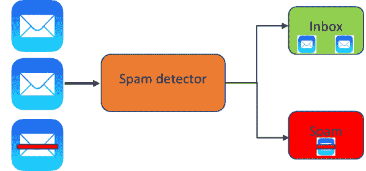

让我们进一步探讨分类。

#### 何时使用分类技术

当您需要预测特定数据点属于哪个类别或类时，应使用分类。它最适合输出变量为类别的场景，这意味着它表示离散标签或类别。以下是分类是理想选择的一些常见情况：

- **二元决策**：当只有两个可能的类别时，例如是/否、真/假、垃圾邮件/非垃圾邮件，或通过/不通过场景。例如，确定是否应批准或拒绝贷款申请。

- **多类分类**：当存在两个以上的类别，并且每个实例需要被分类到其中之一时。例如，将新闻文章分类为体育、政治或技术等主题。

#### 机器学习中分类的一些用例

机器学习中的分类在各个行业和领域提供了广泛的实际应用。以下是一些著名的用例：

- **电子邮件垃圾邮件检测**：机器学习模型基于电子邮件内容、特定词汇出现频率和发件人信息等特征进行训练，以准确分类传入的电子邮件。

- **客户细分**：企业利用分类根据购买行为、人口统计信息和偏好将客户分组为不同的细分市场。

- **疾病诊断**：在医疗保健领域，分类模型用于通过分析患者数据（包括症状、测试结果和医学影像）来诊断疾病。

- **欺诈检测**：金融机构应用分类来识别欺诈交易。通过从历史交易数据中学习，模型可以标记偏离典型模式的交易，从而帮助防止信用卡交易、保险索赔等方面的欺诈行为。

- **情感分析**：在自然语言处理中，分类用于确定文本数据（例如评论、社交媒体帖子和客户反馈）的情感。

- **信用评分**：通过分析申请人的财务记录、人口统计信息和其他相关特征，模型可以将个人分类到不同的风险类别中，从而帮助贷款审批的决策过程。

#### 分类技术的缺点

虽然分类技术是机器学习中的强大工具，但它们也带来了一系列可能影响性能、适用性和伦理考量的缺点和挑战。了解这些缺点对于有效的模型开发和应用至关重要：

- **过拟合**：最常见的问题之一，过拟合发生在模型过于学习训练数据（包括其噪声和异常值）时，导致其在未见数据上的表现不佳。


- **Imbalanced data**: 当训练数据中的类别分布不均匀时，模型倾向于偏向多数类，导致在少数类上表现不佳。
- **Bias and fairness**: 分类模型可能会无意中学习并延续训练数据中存在的偏见，导致不公平或歧视性的结果。
- **Simplicity versus complexity**: 简单模型可能无法捕捉数据中的复杂模式（欠拟合），而过度复杂的模型可能难以解释且计算成本高昂。找到合适的平衡是关键。
- **Feature selection and engineering**: 输入特征的选择和质量显著影响模型性能。无关或冗余特征可能会让模型困惑，而重要特征可能被忽略或编码不当。
- **Data quality and availability**: 数据质量差，包括缺失值、异常值和错误，可能导致模型不准确。

Let's learn more about classification algorithms.

### Learning about classification algorithms

Now, let's understand various classification algorithms. Classification algorithms are fundamental tools in machine learning. They enable us to categorize data points into predefined classes or labels. Whether you’re solving a spam detection problem, predicting customer churn, or diagnosing diseases, understanding classification algorithms is essential. In this section, we’ll go through the classification algorithms available in Apache Spark.

#### Logistic regression classification

Logistic regression is a predictive analysis algorithm that’s used in the field of statistics and machine learning for binary classification problems. It models the probability that a given input belongs to a particular category, typically returning an output between 0 and 1 through the logistic function. This method is widely favored for cases where the outcome needs to be divided into two distinct classes, such as “yes” versus “no” or “success” versus “failure.”

Unlike linear regression, which predicts continuous outcomes, logistic regression is designed for categorical outcomes. It estimates the odds of an event occurring by applying the logistic function to a linear combination of the input features, ensuring that the output probabilities are confined within the 0 to 1 range. This is particularly useful for problems where you’re more interested in the likelihood of outcomes rather than their numerical values.

Imagine you’re the coach of a soccer team and you’re trying to predict whether your team will win the next match. You consider various factors: the team’s overall health, the number of practice hours, the morale of the team, and whether the game is at home or away. In this scenario, each factor can be thought of as a feature in a logistic regression model, and the outcome (win or not win) is binary.

Logistic regression works like you weighing the importance of each factor based on past games. You might notice that games played at home with high team morale significantly increase the chances of winning. So, in your mental model, you give more “weight” to these factors. However, not every factor is straightforward; the relationship isn’t purely additive. Increasing practice hours from 1 hour to 2 might significantly boost the likelihood of winning but increasing from 10 hours to 11 might not make much difference. Logistic regression captures this through the logistic function, which scales the weighted sum of the features to a probability (between 0 and 1).

When you predict the outcome of the next game, you’re essentially calculating the odds of winning based on your weighted factors, much like logistic regression computes the probability of the target class (winning) based on the input features. If the computed probability is above a certain threshold (say, 0.5), you’d predict a win; otherwise, you’d brace for a loss. This process mirrors how logistic regression classifies instances based on the predicted probabilities derived from the model.

The following figure explains the working of the logistic regression classifier by showing several components that can yield weight, such as the input data and activation function:

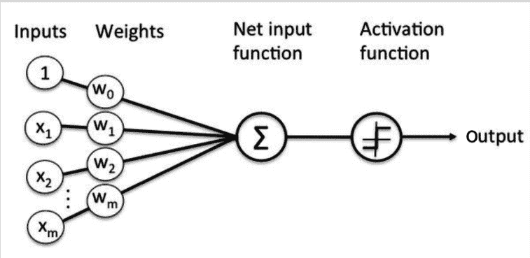

Figure 5.2 – Working mechanism of the logistic regression classifier

The input data represents the characteristics of the data points. The weights determine the importance of each feature in predicting the output. Finally, the activation function maps the linear combination of features and weights to a probability value between 0 and 1.

The following figure shows a sigmoid curve, which can be used to map all the data point values between 0 and 1. The labels are assigned based on the threshold value.

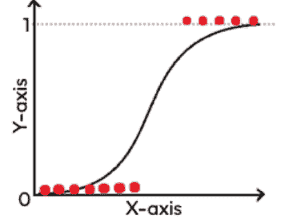

Figure 5.3 – Sigmoid curve

##### Applications

Here are three notable applications:

- **Medical diagnosis**: In healthcare, logistic regression is extensively used to predict the presence or absence of diseases, such as diabetes or cancer, based on patient data such as age, weight, genetic markers, and blood parameters. It helps in early detection and preventive healthcare planning.
- **Credit scoring**: Financial institutions leverage logistic regression to evaluate the creditworthiness of individuals. By analyzing various factors, such as income level, credit history, and employment status, the model predicts the likelihood of a borrower defaulting on a loan, aiding in risk assessment and decision-making.
- **Customer churn prediction**: Businesses use logistic regression to forecast customer retention, identifying which customers are likely to discontinue a service or product. This insight allows companies to implement targeted retention strategies and improve customer satisfaction.

##### Benefits

The top three benefits of logistic regression are as follows:

- **Interpretability**: One of the key strengths of logistic regression is its interpretability; the model’s coefficients can be directly associated with the odds of the dependent variable, providing clear insights into how each feature influences the outcome.
- **Simple and efficient**: Logistic regression is computationally straightforward and efficient, making it a quick solution for binary classification problems, especially with smaller datasets or when a baseline model is needed.
- **Probabilistic predictions**: The algorithm provides not just classifications but also the probabilities of those classifications, offering a quantified confidence level in its predictions. This can be crucial for decision-making processes.

##### Limitations

Among the limitations of logistic regression, the following are the top three that often pose significant challenges:

- **Linearity assumption**: Logistic regression expects a linear relationship between the independent variables and the dependent variable, which might not always accurately represent real-world complexities
- **Limited to binary outcomes**: While it excels in binary classification tasks, logistic regression is not suitable for predicting continuous outcomes or multi-class classification problems without modifications
- **Overfitting risk**: In scenarios with a large number of features or insufficient data, logistic regression is prone to overfitting, leading to models that perform well on training data but generalize poorly to new, unseen data

Despite its limitations, logistic regression remains a popular algorithm for statisticians and data scientists for its simplicity, interpretability, and efficacy in binary classification tasks across diverse applications.

#### Decision tree classifier

A decision tree classifier is a non-parametric supervised learning method that's used for classification tasks. It resembles a tree structure, where each internal node represents a “test” on an attribute, each branch represents the outcome of the test, and each leaf node represents a class label. The paths from root to leaf represent classification rules.

In essence, a decision tree splits the dataset into subsets based on the most significant attributes, making the decision-making process transparent. This process is recursive and is known as **recursive partitioning**. The tree is built by selecting the attribute that best separates the data into classes, using measures such as Gini impurity or information gain in a process called **splitting criteria**. The process continues until it meets a stopping criterion, such as the maximum depth of the tree or no further improvement in the splitting criteria.

Imagine you're planning an outdoor picnic and need to decide whether to go based on the day's weather conditions. You create a simple decision-making process, much like a flowchart, to help you decide.

First, you consider the weather: if it's raining, you decide against the picnic. If it's not raining, you move to the next consideration: the temperature. If it's too cold, you decide against it; if it's warm, you then consider the wind speed. If it's too windy, you might decide it's not a good day for a picnic; if there's little to no wind, you decide to go ahead with the picnic.

This process, where you make a series of binary decisions (yes/no) based on certain conditions, closely resembles how a decision tree classifier works. Each “node” in your decision process (rain, temperature, and wind speed) is analogous to the nodes in a decision tree where a feature is evaluated. The final “decisions” (go on a picnic or not) are akin to the leaves of the decision tree, representing the outcome or classification based on the input features.


正如你在考虑每个条件时野餐决策过程会变得更加精细，决策树分类器会根据最能有效分类数据的特征，将数据迭代划分为越来越同质的组（或节点），直到做出决策（或到达叶节点）。

以下图示展示了决策树分类器的示例：

##### 此人是否健康（或不健康）？


图 5.4 – 决策树分类器示例

##### 应用

- 客户细分：决策树在营销和商业策略中被广泛用于根据特定标准（如人口统计、购买行为和产品偏好）将客户细分为不同的群体。这有助于企业为不同的客户群体定制营销活动和产品供应。

- 欺诈检测：在银行和金融领域，决策树被用于通过分析交易数据中的模式来识别可疑活动。树的分支可能代表交易的不同方面，如金额、位置和频率，从而帮助高效检测欺诈交易。

- 医疗诊断：决策树可以通过分析患者的症状和测试结果，协助医疗专业人员诊断疾病。树中的每个节点可能代表一个症状或测试结果，而叶节点可能代表潜在诊断，从而指导诊断过程。

##### 优势

- **可解释性**：决策树的主要优势之一是其简单性和易解释性。树结构直观且易于可视化，使决策过程透明且易于理解，即使对于非专业人士也是如此。

- **处理非线性关系**：决策树可以在无需转换的情况下捕捉特征之间的非线性关系，因此适用于线性判别效果不佳的复杂数据集。

- **无需数据预处理**：与许多其他算法不同，决策树不要求数据进行归一化或缩放，并且可以有效处理数值数据和类别数据。

##### 局限性

- **过拟合**：如果没有适当的调优，决策树可能会创建过于复杂的树，这些树对未见数据的泛化能力较差。可以通过修剪树、设置最大深度或要求每个叶节点的最小样本数来缓解过拟合。

- **不稳定性**：决策树对数据的微小变化可能比较敏感，从而导致不同的树结构。可以通过使用随机森林等集成方法来降低这种不稳定性，随机森林会构建多棵树并聚合它们的预测。

- **对主导类的偏倚**：决策树可能会偏向于实例数量较多的类别，从而导致有偏的预测。平衡数据集或调整类别权重可以帮助解决此问题。

尽管存在这些局限性，决策树因其简单性、可解释性和灵活性而依然流行，使其成为广泛分类任务中的宝贵工具。

#### 随机森林分类器

随机森林分类器是一种集成学习方法，因其在处理各种分类任务时的准确性和鲁棒性而备受推崇。它在训练阶段构建多个决策树，并输出各个决策树中的多数类别。随机森林有助于减少对训练集的过拟合，使其具有更好的泛化能力。

该算法以两种方式引入随机性。首先，森林中的每棵树都是从数据的随机样本中构建的，并且是有放回抽样，称为**自助采样（bootstrapping）**。其次，在每个节点上，会考虑随机子集的特征进行分割。这些随机性因素确保树与树之间不相关，在不显著增加偏差的情况下降低方差，从而得到在未见数据上表现良好的模型。

想象一下，你正在尝试与一群朋友决定电影之夜要看哪部完美的电影。每个人都有不同的品味和偏好，这使得决策变得复杂。为了解决这个问题，你决定咨询几位电影迷朋友，他们各自在不同的电影类型中拥有独特的品味和专业知识。

每位朋友都充当“专家”，并根据某些标准提出电影推荐：有人可能会根据导演推荐电影，有人可能会考虑主演，而另有人则可能关注类型或电影的奖项。这类似于随机森林中的单个决策树，其中每棵树根据特征子集（标准）进行预测。

与其依赖单个朋友的推荐（这可能有偏或有限），你决定让所有电影迷朋友进行投票，得票最多的电影将被选为电影之夜的观影片。这种集体决策过程反映了随机森林分类器如何通过多数投票或平均过程聚合多个决策树的预测，从而得出比任何单个决策树都更强大、更准确的预测。

正如你的朋友群体带来多元的视角和专业知识以做出全面的电影选择，如图所示的随机森林结合了许多决策树的预测，每棵树都在不同的数据和特征子集上训练，从而降低偏倚或过拟合的风险，并增强整体决策过程：

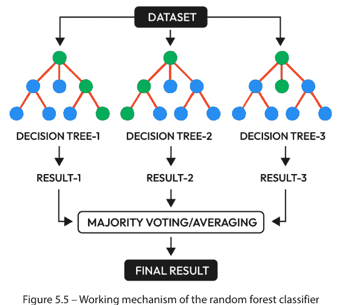

##### 应用

- **生物医学工程**：随机森林用于基因表达数据分析，以分类疾病并识别重要生物标志物，帮助诊断和个性化医疗。

- **银行业**：在金融领域，随机森林分类器在检测欺诈活动方面发挥着重要作用，因为它们可以分析交易模式并识别偏离常态的异常情况。

- **电子商务**：它们通过根据用户偏好和浏览历史对产品进行分类，帮助推荐系统，并通过个性化推荐提升购物体验。

##### 优势

- **准确性**：随机森林分类器最显著的优势之一是其高准确性。集成方法通过聚合多棵树的预测过程，往往比单个决策树产生更准确的结果。

- **抗过拟合能力强**：由于对多棵树进行平均，随机森林相比单个决策树不易过拟合，因此在实际应用中更可靠。

- **多功能性**：随机森林可以处理数值数据和类别数据，并且即使在数据存在缺失值或未进行缩放/归一化的情况下也能表现良好。它们还能有效处理不平衡数据集。

##### 局限性

- **模型复杂性和可解释性**：随机森林可能包含数百棵树，创建的模型比单个决策树更复杂，从而导致模型解释和可视化方面的挑战。

- **计算密集**：训练大量具有许多特征的树在计算上要求很高，需要更多内存和处理能力，并增加训练时间。

- **高维空间中的性能**：虽然随机森林通常表现良好，但在特征数量非常多而样本数量相对较少的情况下，由于维度灾难，其效果可能会下降。


尽管存在这些局限性，随机森林分类器因其在广泛应用中的强健性能而备受推崇，使其成为数据科学家处理复杂分类问题的热门选择。

#### 梯度提升树分类器

梯度提升树（GBT）分类器是一种精巧的机器学习技术，属于集成家族，具体属于提升方法。它基于提升的原理，其中多个弱学习器（通常是决策树）被按顺序组合，以创建强大的预测模型。序列中的每棵树都旨在纠正其前身的错误，专注于前几棵树难以处理的最具挑战性的案例。该过程涉及使用损失函数的梯度来训练树，这就是为什么它被称为梯度提升的原因。

GBT 背后的核心思想是构建新模型来预测先前模型的残差或错误，然后通过加权求和组合这些预测，使最终预测更加准确。“梯度”部分来源于对损失函数使用梯度下降来最小化预测错误。树是一次添加一棵的，模型中现有的树不会被更改。每添加一棵树后，数据权重会被更新，以更多地关注难以预测的实例。这种迭代改进使 GBT 方法非常有效，尽管计算密集。

想象你正在教练一支接力赛跑队，队员技能水平各异。团队的目标是赢得比赛，但在第一次练习后，很明显存在弱点：有些跑步员较慢，有些接力棒交接不佳，还有些容易疲劳。

为了帮助他们提高，你首先专注于最重要的问题：最慢的跑步员。通过有针对性的训练，你设法提高了他们的速度。然而，团队仍然无法获胜，因为现在接力棒交接成了最大的弱点。因此，接下来你专注于改进这一点。每一轮练习和改进都针对上一次练习中最紧迫的问题，逐步提升团队的整体表现。

每次练习后识别并改进最薄弱环节的这种迭代过程，类似于 GBT 分类器的工作方式。“团队”是你的模型，“跑步员”是决策树。第一棵树（跑步员）被训练并分析其错误。然后，下一棵树被训练以纠正这些错误，本质上是给被误分类的实例赋予更多权重。这个过程持续进行，每棵新树都专注于之前树组成的集成模型的错误，就像每一轮有针对性的训练都关注团队当前的最大弱点一样。

就像你的接力队通过每一次有针对性的改进迭代变得更强大、更有可能获胜一样，GBT 分类器在每次添加新树时会变得更加准确，因为它从之前树的错误中学习，从而形成一个强健且高度准确的模型。下图展示了 GBT 分类器的工作机制：

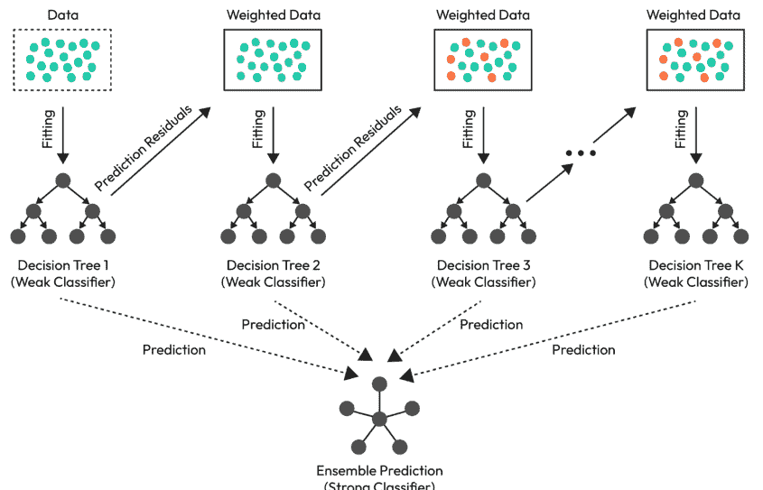

图 5.6 – GBT 分类器的工作机制

##### 应用

GBT 分类器有三个值得注意的应用：

- **搜索引擎**：GBT 分类器在 Web 搜索算法中至关重要，因为它们根据各种特征（例如关键词相关性、页面浏览量和指向页面的链接）对页面进行排名。它们有助于提高搜索查询结果的准确性和相关性。

- **金融建模**：在金融领域，GBT 模型用于信用评分，根据借款人的历史和交易数据预测贷款违约的可能性。它们还用于算法交易，以预测市场走势并做出交易决策。

- **生物医学数据分析**：GBT 分类器在基因组学和药物发现中用于将患者样本分类为疾病类别，或根据遗传信息预测药物反应，大大辅助个性化医疗和治疗干预。

##### 优势

GBT 分类器的三大优势如下：

- **高准确性**：GBT 分类器以其高预测准确性而闻名，即使在结构复杂的复杂数据集上也是如此。通过专注于纠正之前树的错误，它们可以建模复杂的决策边界。

- **灵活性**：它们可以处理各种类型的数据（数值、类别），并且在未经转换的数据集上表现良好，包括缺失值和不同尺度的变量。其灵活性还扩展到损失函数，可以针对特定问题进行定制，从而增强其在不同领域的适用性。

- **特征重要性**：GBT 模型固有地执行特征选择，对更相关的特征赋予更高重要性。这不仅提高了模型性能，还提供了关于哪些特征在预测结果中最具影响力的见解。

##### 局限性

在 GBT 分类器的局限性中，通常会带来重大挑战的三大局限性如下：

- **训练时间和计算成本**：由于提升方法的顺序性质，GBT 模型训练可能非常耗时，尤其是在处理大型数据集和大量树木时。这可能导致显著的计算开销和能源消耗。

- **过拟合**：虽然 GBT 分类器比某些其他模型更不容易过拟合，但如果树的数量过多或树过于复杂，它们仍然可能过拟合训练数据。这需要仔细调整超参数，例如树深度和学习率。

- **可解释性**：与大多数集成方法一样，GBT 模型的复杂性使其比决策树等简单模型更难以解释。数百或数千棵树的预测的聚合性质可能会掩盖决策过程，使得难以理解模型的依据。

GBT 分类器凭借其强大的预测能力和适应性，已成为机器学习工具箱中的主流方法。然而，其有效性伴随着模型复杂性增加和计算需求的警示，突出了从业者在应用中必须权衡的利弊。

#### 多层感知机分类器

多层感知机（MLP）分类器是一类前馈人工神经网络（ANN），由至少三层节点组成：输入层、一个或多个隐藏层和输出层。一层中的每个节点（或神经元）都以一定权重连接到下一层中的每个节点，使网络完全连接。MLP 使用一种称为反向传播的监督学习技术来训练其网络；它涉及根据前一个时代（即迭代）获得的错误率来调整网络中连接的权重。

MLP 的关键特征是存在一个或多个隐藏层，这使网络能够对输入变量和输出变量之间的复杂非线性关系进行建模。这些层中的神经元对接收到的加权输入应用激活函数（例如 sigmoid、tanh 或 ReLU），为网络的功能引入非线性特性。这对于学习和建模数据中的复杂模式至关重要。

想象你和朋友在一个大型多层游乐园里，试图决定去玩哪些项目。游乐园被分为不同的区域（层），每个区域都有自己的一组项目（神经元）。你从入口（输入层）开始，你和朋友在那里讨论你们在项目中寻找什么：刺激、速度、高度等等。这些偏好就是你的输入特征。

当你进入第一个区域（第一个隐藏层）时，一群导游（神经元）迎接你。每个导游都专精于你期望的某些特征组合：一个可能了解同时适合速度和刺激的最佳项目，另一个可能专注于高度和速度，依此类推。根据你的偏好，每个导游都会给你一个关于下一步去哪里的加权推荐。

听取这些建议后，你来到下一个区域（下一个隐藏层），那里有新的一组导游在等待。这些导游采纳第一组的建议并将其组合，进一步完善建议。这个过程在多个区域（隐藏层）中重复，每一组导游都整合从前一组传递过来的信息，逐步锁定最适合你的项目。

最后，你到达最后一个区域（输出层），那里的终极导游（输出神经元）采纳所有完善的建议，并指引你去那个最符合你初始偏好的项目。这个最终推荐就是网络的分类结果。

在这个类比中，MLP 分类器的工作方式就像在游乐园中导航，每一层导游（神经元）处理并传递信息，根据输入特征（你的项目偏好）在每一步完善决策，直到达到最合适的结果（最适合你和朋友的项目）。

##### 应用

MLP 分类器有三个值得注意的应用：

- **图像识别和分类**：MLP 在计算机视觉中被广泛用于识别图像中的对象、人脸识别以及手写字符识别等任务。其处理和从像素模式中学习的能力使其在这些领域非常有效。

- **语音识别**：在自然语言处理领域，MLP 在将语音转换为文本、理解口语命令，甚至通过分析语音信号的频谱特性来识别说话者身份或情绪状态方面发挥着重要作用。


- **金融预测**：MLPs 用于预测股票价格、市场趋势和信用风险评估。它们可以分析大量历史财务数据，预测未来的财务状况，从而帮助投资决策和风险管理。

##### 优势

MLP 分类器的三大优势如下：

- **建模复杂关系**：MLP 的架构包含多层和非线性激活函数，使其能够学习并建模数据中高度复杂的关系，捕捉简单模型可能遗漏的细微差别。

- **通用性和适应性**：MLPs 可以处理多种数据类型，并可应用于从回归到分类的各种任务，因此具有很强的通用性。还可以通过调整其架构、激活函数和训练算法，使其适应特定问题。

- **泛化能力**：经过适当训练和正则化后，MLPs 可以很好地泛化到未见数据，对超出其训练数据集范围的数据做出可靠预测。这对于模型在现实世界中遇到新实例的实际应用至关重要。

##### 局限性

在 MLP 分类器的局限性中，以下三项通常会带来重大挑战：

- **易受过拟合影响**：由于其复杂性和大量参数，MLPs 容易发生过拟合，尤其是在有限或带有噪声的数据上训练时。通常需要采用丢弃法（dropout）和早停法（early stopping）等正则化技术来缓解此问题。

- **不透明的决策过程**：MLP 的“黑盒”特性使得难以解释其决策方式，这在需要透明度和可解释性的应用（如医疗或法律决策）中可能是一个重大缺点。

- **计算密集型**：训练 MLPs（尤其是具有多层的深层网络）可能计算量大且耗时，需要大量硬件资源（如 GPU）和高效的训练算法，以便在合理的时间内实现收敛。

总之，MLP 分类器凭借其深层且复杂的架构，为在各种应用中捕获和建模数据中的复杂模式提供了强大的工具。然而，其有效性与过拟合、可解释性和计算需求等挑战相抵消，因此需要精心设计、正则化和资源分配，以充分发挥其潜力。

#### 线性 SVM

线性 SVM 是一种强大的监督机器学习算法，主要用于分类任务，在某些条件下也可用于回归。其原理是在特征空间中找到最能分隔各类别的超平面。在分类背景下，SVM 的目标是找到最大间隔的超平面，即超平面与任一类别最近数据点之间的最大距离。这种方法有助于确保分类器不仅在训练数据上准确，而且也能很好地泛化到未见数据。

想象一下，你和你的朋友们在一个大公园里，带来了各种球来玩：足球和篮球。你想组织一场比赛，但为了公平和有趣，你决定将足球和篮球分成两组。你在地上铺一根长绳，试图划出一条将这两种球分开的线。目标是将这根绳子放置好，使得所有足球都在一边，所有篮球都在另一边，并最大化球与绳子之间的空间，以便在选球时避免混淆。

这根绳子就像线性 SVM 中的决策边界。正如你调整绳子以最大化球与绳子之间的间隔一样，线性 SVM 算法试图找到超平面（在高维空间中，“绳子”变成“平面”或“表面”），以最大间隔最佳地分隔数据中的不同类别（在此示例中为足球和篮球）。最靠近绳子的球直接影响其位置，类似于 SVM 中的“支持向量”，它们是定义决策边界的数据集中的关键元素。正如球分得好时游戏会更清晰公平一样，当决策边界以宽间隔分隔不同类别时，分类问题会变得更加稳健和准确。

下图显示了有助于定义分类边界的支持向量：

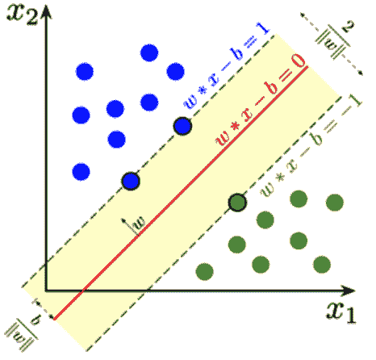

##### 图 5.7 – 线性 SVM 分类器的工作机制

线性 SVM 分类器的关键机制如下：

- **超平面**：在二维空间中，超平面只是一条直线，但在高维空间中，它是将数据点分隔成不同类别的平面或表面。最佳超平面是与任何类别最近点之间留有最宽间隔的超平面，这些最近点称为支持向量。

- **支持向量**：这些是距离超平面最近的数据点，对于定义超平面在特征空间中的位置和方向至关重要。算法关注这些点，因为它们是最难分类的点，并提供了关于决策边界的最多信息。

- **间隔最大化**：线性 SVM 算法寻求最大化类别与超平面之间的间隔，从而得到一个更稳健的分类器。这是通过调整权重和偏置以最大化此间隔的优化过程来实现的。

##### 应用

以下是线性 SVM 分类器的三个显著应用：

- **文本和超文本分类**：SVM 在分类文本和超文本方面非常有效，适用于电子邮件垃圾邮件检测、新闻文章主题分类以及社交媒体内容情感分析等应用。

- **图像分类**：线性 SVM 通常与其他特征提取方法结合使用，用于计算机视觉任务中的图像分类，例如安全系统中的人脸检测和自动化系统中的物体识别。

- **生物信息学**：在生物信息学领域，SVM 被应用于对蛋白质、基于基因组的患者进行分类，以及其他可以线性分隔的生物问题。

##### 优势

线性 SVM 分类器的三大优势如下：

- **高维空间中的有效性**：即使在维度数量超过样本数量的情况下，SVM 也以表现良好而闻名，因此特别适用于文本分类和生物信息学，因为在这些领域这种情况经常发生。

- **内存效率高**：由于仅依赖于训练点的子集（支持向量），SVM 内存效率高，无需存储整个数据集。

- **通用性**：使用不同核函数的能力使 SVM 具有很高的通用性。虽然我们在此专注于线性 SVM 分类器，但通过应用适当的核函数，SVM 不仅可以解决线性可分问题，还可以解决复杂的非线性问题。

##### 局限性

在线性 SVM 分类器的局限性中，以下三项通常会带来重大挑战：

- **对过于复杂数据的性能较差**：当数据严重重叠或不可线性分离时，线性 SVM 可能难以找到最优超平面，导致性能不佳。

- **选择核函数**：核函数是一种灵活表示数据样本的方法，以便我们在复杂空间中比较它们。线性 SVM 分类器使用线性核，但为非线性 SVM 选择合适的核函数并调整其参数可能很复杂，并且对算法的性能至关重要。

- **可扩展性**：一般来说，随着数据集大小的增加，SVM 可能变得计算密集且效率较低，尤其是在训练时间方面，因此不太适合非常大的数据集。

总之，线性 SVM 分类器在处理高维数据和二分类任务方面表现出色且高效，能够在从文本分类到生物信息学的各个领域提供精确可靠的预测建模。然而，其有效性可能受到数据线性可分性、非线性问题中核函数选择的挑战以及大数据集可扩展性问题的制约。

#### 一对其余分类器（又称一对所有分类器）

一对其余（OvR）分类器，又称一对所有分类器，是一种多类分类策略，通过为每个类训练一个分类器，将该类的样本作为正样本、其他所有样本作为负样本来实现。这种方法广泛用于扩展二进制分类器，使其能够有效地处理多类问题，而二进制分类器天生用于区分两个类别。

在 OvR 方案中，如果有 N 个类别，则会训练 N 个独立的二进制分类器。例如，在有 A、B、C 三个类别的场景中，会训练三个分类器：一个用于区分 A 与非 A（B 和 C），另一个用于区分 B 与非 B（A 和 C），第三个用于区分 C 与非 C（A 和 B）。对于给定的测试实例，应用所有 N 个分类器，选择以最高置信度（通常作为概率或距离决策边界的距离来衡量）分类该实例的分类器作为预测类别。

想象你正在组织一场大型才艺表演，节目种类繁多：歌手、舞者、魔术师和喜剧演员。为了顺利管理活动，你决定为每种表演者设立单独的队列，以便由各自领域专长的评委团队进行评审。然而，你只能同时设立一个评审团队的资源。


那么，你从歌手开始：你设置一个歌手队列和一个非歌手队列，后者包含所有其他表演者。歌手表演，评委对他们进行评价。评价完成后，你将评审团切换到评判舞者。此时，舞者队列已形成，其他所有人——包括之前被评判的歌手和尚待评判的魔术师与喜剧演员——都进入非舞者队列。此过程重复进行，直到每个类别的表演者都由其专门的评审团评判完毕。

这种方法呼应了机器学习中使用的一对其余（OvR）分类策略。在多类分类问题中，OvR 方法涉及为每个类别训练一个独立的二分类器，用以将该类别与所有其他类别区分开来。例如，一个分类器可以被训练用于通过将歌手与非歌手（舞者、魔术师、喜剧演员）区分开来来识别歌手；另一个用于识别舞者与非舞者，以此类推。每个分类器的任务是专注于将其目标类别与其余类别分开，这就像为每种才艺表演节目设立专门的评审团一样。这样一来，尽管存在多个类别，你仍能高效地通过一系列二进制（即两组）决策来评估每个类别：

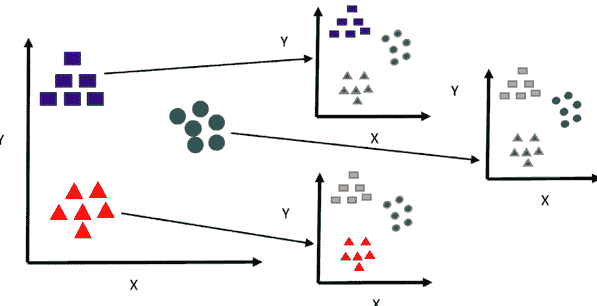

图 5.8 – OvR 分类器的工作机制

##### 应用

以下是 OvR 分类器的三个显著应用：

- **文本分类**：OvR 通常用于根据内容将文档或电子邮件分类到多个类别中。每个类别都被视为一个独立的类，OvR 分类器被训练用于识别属于每个类别的文档，以区别于所有其他文档。

- **图像识别**：在每个图像需要被分类到多个类别中的一个（例如动物、车辆和风景）的场景中，可以应用 OvR 来训练单独的分类器，以识别每个类别，并将其与所有其他图像区分开来。

- **医疗诊断**：OvR 分类器可用于从医学影像或患者数据中诊断多种疾病，其中每种疾病代表一个不同的类，而每种疾病的分类器将其与健康状况和其他疾病区分开来。

##### 优点

OvR 分类器的三大优点如下：

- **简单性和可扩展性**：OvR 策略实现和理解都很简单，使其成为将二进制分类算法扩展到多类问题的一种可及方法。它在处理大量类别时尤其有效，因为它随类别数量线性扩展。

- **灵活性**：OvR 可以应用于几乎任何二进制分类算法，使实践者能够利用大量现有算法，并根据其数据集和问题的特定特征定制其方法。

- **并行化**：由于每个分类器都是独立于其他分类器训练的，OvR 非常适合并行化，在计算资源允许同时训练多个分类器时，可显著缩短训练时间。

##### 局限性

在 OvR 分类器的局限性中，以下三个常常带来重大挑战：

- **类别不平衡**：在 OvR 方法中，每个分类器都是在故意设计为不平衡的数据集上训练的，即一个类别对抗所有其他类别。这可能导致分类器偏向多数“负”类别，尤其是在类别大小存在显著差异的情况下。

- **计算负担增加**：训练多个分类器可能计算成本高昂，尤其是随着类别数量的增加。这不仅包括训练期间的计算成本，还包括多个模型的存储要求以及进行预测时的推理时间。

- **类间相关性**：OvR 分类器将每个类视为孤立处理，这在类别之间存在相关性或依赖性时可能是一个缺点。这种隔离意味着分类器可能无法利用关于类别之间关系的潜在有用信息，可能导致与同时考虑所有类别的方法相比性能欠佳。

尽管存在这些局限性，OvR 策略仍然是多类分类的一种流行且有效的方法，在简单性、灵活性和性能之间取得了平衡，使其适用于广泛的应用。

#### 朴素贝叶斯

朴素贝叶斯分类器是一类基于贝叶斯定理的简单“概率分类器”，特征之间具有强独立性假设。它们效率极高，特别适合高维数据集。尽管简单，朴素贝叶斯模型在各种任务中都表现出了卓越的性能。

朴素贝叶斯分类器假设，在给定类别变量的情况下，某个特征的值与任何其他特征值都是独立的。这种假设称为**类条件独立性**。例如，如果一种水果是红色的、圆形的，直径约为 2 到 3 英寸，则被认为是苹果。朴素贝叶斯分类器认为这些特征独立地促成该水果是苹果的概率，而不考虑颜色、圆度和直径特征之间可能存在的任何相关性。

该模型基于输入特征，使用贝叶斯定理计算每个类别的后验概率。在实践中，分母对所有类别都保持不变，因此只需关注分子，分子涉及类别的先验概率和给定类别下数据的似然性。后验概率最高的类别被视为预测类别。

想象你是一名侦探，正在根据一组线索解开一个谜团。每个线索单独看可能指向各种嫌疑人，但真正的技巧在于结合这些线索来找出最可能的罪魁祸首。

下图展示了朴素贝叶斯分类器的工作原理，即将多个形状分类为正方形、三角形和圆形：

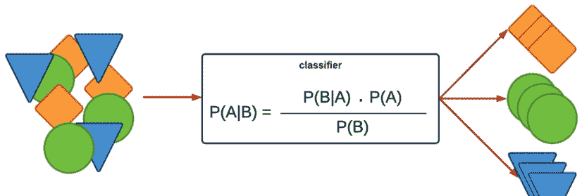

图 5.9 – 朴素贝叶斯分类器的工作机制

考虑一种情况，你正在试图确定某人是否是被盗画作的窃犯。你有各种线索，包括窃犯鞋子上有油漆、他们在现场留下了一只手套，以及一名目击者看到一个高个子的人在四处溜达。你见过很多案例，因此很好地了解这些线索在窃犯和无辜者中各有多常见。

你首先考虑某人鞋子上有油漆的可能性有多大。也许在画家中很常见，但在其他人中则很少见。然后，你考虑手套。现在是冬天，很多人可能戴着手套，但也许这种手套很独特。最后，你考虑身高。个子高可能并不罕见。

在你的侦探工作中，你假设每个线索独立地贡献于某人是窃犯的可能性，而不考虑线索之间可能存在的关联。例如，你不会假设仅仅因为某人个子高，他就更可能鞋子上有油漆。这就是朴素贝叶斯中“朴素”的部分。

就像拼凑线索一样，朴素贝叶斯分类器根据每个线索（或特征）的独立贡献，计算某人是窃犯（或分类问题中某个类别）的概率。它结合这些概率来找出最可能的类别，就像你会结合线索来找出最可能的嫌疑人一样。尽管其简单性和“朴素”的独立性假设，就像一名熟练的侦探一样，朴素贝叶斯在解决手头的谜题——或分类问题——时可能出奇地有效。

##### 应用

以下是朴素贝叶斯分类器的三个显著应用：

- **垃圾邮件检测**：朴素贝叶斯的经典应用之一是电子邮件垃圾邮件过滤。该算法评估某些表明是垃圾邮件或非垃圾邮件的单词的存在或不存在，并相应地对其进行分类。

- **文档分类**：朴素贝叶斯分类器广泛用于文本分类，根据特定单词或短语的频率来确定文档是否属于一个或多个类别（例如体育、政治或娱乐）。

- **情感分析**：它们还被用于分析文本数据（如评论或社交媒体帖子）的情感，根据特定关键词的存在将其分类为积极、消极或中性。

##### 优点

朴素贝叶斯分类器的三大优点如下：

- **简单性和高效性**：朴素贝叶斯分类器实现简单，只需要少量训练数据来估计所需参数，因此效率极高，尤其是在处理大型数据集时

- **性能**：尽管简单且带有“朴素”假设，朴素贝叶斯分类器可以胜过更复杂的算法，尤其是在文本分类任务中以及当独立性假设在相当程度上成立时


- **处理高维数据**：它们特别擅长高效处理高维数据，使其成为文本分类的理想选择，其中特征空间可能非常大（例如，词袋模型）

##### 局限性

在朴素贝叶斯分类器的局限性中，以下三项通常带来重大挑战：

- **朴素假设**：特征独立性的假设在现实应用中很少成立，这可能会限制分类器的准确性。在特征关系重要的复杂问题中，此假设可能导致次优性能。

- **概率估计数据稀缺**：朴素贝叶斯分类器依赖于特征值的频率来计算概率。当频率为零时（因为训练数据不包含特定的特征-类组合），可能会导致错误的预测。这通常通过拉普拉斯平滑等技术来缓解。

- **处理连续特征存在困难**：朴素贝叶斯本质上使用频数计数。在处理连续数据时，必须做出假设来拟合模型（例如，假设高斯分布），这可能并不总是与数据的实际分布吻合。

尽管存在这些局限性，朴素贝叶斯分类器因其简单性、效率以及在各种任务（特别是文本处理和分析）中出乎意料的良好性能，仍然是一种流行的选择。

#### 因子化机器分类器

**因子化机器（FMs）** 是多功能的机器学习模型，旨在高效捕获高维稀疏数据集中变量之间的交互。在涉及通过独热编码等技术转换为大量二进制特征的类别变量的场景中，它们尤其强大。FMs 结合了支持向量机（SVM）与因子化模型的优点，使其在处理推荐系统、计算广告和自然语言处理中常见的数据方面非常擅长。

FMs 使用因子化参数来建模变量之间的交互。这意味着，而不是为每个交互项拥有单独的参数（在高维空间中这在计算上是不可行的），FMs 为每个变量学习一个低维向量。然后，任何两个变量之间的交互都建模为它们对应向量的点积。这种方法显著减少了要学习的参数数量，使模型能够扩展到非常高维的数据集，同时仍能捕获变量之间的复杂交互。

想象你正在策划一场盛大的自助晚餐，旨在根据每位客人的已知饮食偏好、他们之前喜欢的自助餐菜肴以及类似客人对菜肴的评分，为每位客人个性化推荐菜肴。这个涉及多个相互作用因素的复杂场景，可以类比为 FMs 分类器的工作原理。

将每位客人的偏好视为一个独特的特征，将每道菜的属性（例如菜系类型、关键配料和辛辣程度）视为另一组特征。一种简单的方法可能是根据偏好和菜肴属性的直接重叠来匹配客人与菜肴（例如，某人喜欢辛辣食物，因此推荐一道辛辣菜肴）。然而，这忽略了更微妙的交互——也许一位客人喜欢辛辣食物，但仅限于墨西哥菜，或者他们特别喜欢其他口味相似的客人喜欢的菜肴。

FMs 在这种情境中大放异彩，因为它们不仅考虑这些直接关系，还学习特征之间交互的隐藏模式。例如，FM 分类器可能会发现，喜欢辛辣墨西哥菜的客人通常也喜欢某些印度咖喱，即使他们没有明确表示偏好印度食物。它通过将所有可能的客人-菜肴交互的庞大复杂矩阵因子化为低维表示来实现这一点，以更易管理的形式捕获这些交互的本质。

在自助餐类比中，使用 FMs 分类器就像有一位超级聪明的组织者，他记得每位客人过去的菜肴评分，详细了解每道菜，并知道客人偏好之间微妙的关联。然后，这位组织者为每位客人做出微妙的菜肴推荐，不仅考虑他们的直接偏好，还考虑他们和类似客人过去喜欢的东西的更深层模式。

正如这位组织者通过将个性化提升到前所未有的程度来提升自助餐体验一样，FMs 在机器学习中为处理具有丰富相互关联特征的问题提供了一种强大的工具，提供高度个性化和准确的分类。

以下图示展示了 FMs 分类器的工作机制。在此示例中，将用户对项目的评分矩阵作为输入，以生成隐含因子嵌入。这些嵌入用于预测评分。

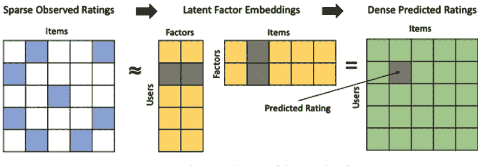

##### 应用

以下是 FMs 分类器的三个显著应用：

- **推荐系统**：FMs 广泛应用于推荐系统，在基于过去的交互预测用户偏好方面表现出色。它们可以高效处理此类系统中用户-项目矩阵典型的庞大稀疏数据集，捕获用户和项目之间的微妙交互。

- **点击率（CTR）预测**：在计算广告中，FMs 被用来预测给定广告被用户点击的概率。它们可以考虑用户人口统计信息、广告特征和上下文信息，建模这些特征之间的交互以提高预测准确性。

- **情感分析和文本挖掘**：通过将文本表示为高维稀疏向量（例如，使用 TF-IDF），FMs 可以应用于情感分析和其他文本挖掘任务，捕获不同单词或短语之间的交互，以更好地理解文本的上下文和情感。

##### 优势

FMs 分类器的三大优势如下：

- **高维空间中的效率**：FMs 专为在数据高维且稀疏的情况下高效工作而设计。由于其交互的因子化表示，它们可以处理数百万个特征，而无需显著增加计算需求。

- **建模交互的能力**：与线性模型不同，FMs 可以捕获任何两个特征之间的交互，而无需手动指定这些交互项。这使它们在发现数据中并非一眼就能看出的复杂模式方面非常强大。

- **泛化性**：FMs 是一种通用模型，可以适应分类以外的各种任务，包括回归和排序。这种多功能性与其可扩展性相结合，使它们成为广泛应用中的宝贵工具。

##### 局限性

在 FMs 分类器的局限性中，以下三项通常带来重大挑战：

- **模型复杂性和过拟合**：虽然 FMs 在参数数量方面很高效，但模型本身可能会变得复杂，尤其是当隐含因子数量较大时。这种复杂性可能导致过拟合，特别是在训练数据量不足以支持模型时。

- **训练计算成本**：尽管在处理高维数据方面很高效，但 FMs 的训练过程，尤其是在大型数据集和大量隐含因子的情况下，与简单模型相比可能计算密集且耗时。

- **超参数敏感性**：FMs 的性能对超参数的选择（例如隐含因子数量和正则化项）可能非常敏感。找到最佳超参数集通常需要大量搜索和交叉验证，这可能是一个耗时的过程。

总之，FMs 为处理高维稀疏数据集提供了一种强大且灵活的方法，特别是在特征之间的交互起着关键作用时。它们在推荐系统、CTR 预测和文本挖掘中的应用展示了其多功能性和有效性。然而，其复杂性和计算需求凸显了仔细调整模型并考虑可用计算资源的必要性。

### 评估模型性能

评估分类模型的性能对于理解其有效性和特定任务的适用性至关重要。已开发出各种指标来捕捉模型性能的不同方面，每个指标都有其独特的见解和应用。

#### 二元分类

在 Apache Spark 中，对于二元分类任务，MLlib 库提供了多种关键评估指标，可用于评估模型性能。这些指标有助于了解模型的各个方面，包括其准确性、精确率、召回率以及它们之间的权衡。Spark 中可用于二元分类的主要评估指标包括以下内容：

- 准确率：虽然在二元分类中（尤其是在不平衡数据集中）不一定是最具信息量的指标，但准确率衡量的是所有预测中正确预测（真正例和真反例）的比例。它的计算公式为 ((TP + TN) / (TP + FP + FN + TN))。

- 精确率：精确率（或阳性预测值）衡量模型做出的所有正预测中真正例的比例。它指示模型在识别正例方面的准确性。它的计算公式为 (TP / (TP + FP))。

- 召回率（灵敏度或真阳性率，TPR）：召回率衡量所有实际正例中真正例预测的比例。它评估模型捕捉或识别正例的能力。它的计算公式为 (TP / (TP + FN))。

- F1 分数：F1 分数是精确率和召回率的调和平均数。当你需要平衡精确率和召回率时，它特别有用。


- 接收者操作特征曲线下面积（ROC 曲线下面积，AUC-ROC）：AUC-ROC 是一种广泛使用的指标，用于衡量模型区分正类和负类的能力。ROC 曲线在不同阈值设置下绘制真正率（TPR）与假正率（FPR）。AUC 表示随机选取的正实例排名高于随机选取的负实例的概率：

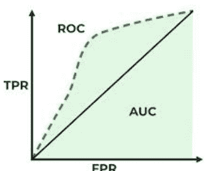

图 5.11 – ROC 曲线和 AUC

- 查准率-查全率曲线下面积（AUC-PR）：查准率-查全率曲线对于不平衡数据集尤其有信息量，在这类数据集中，正类远比负类稀少。AUC-PR 总结了不同阈值下查准率与查全率之间的权衡，重点关注少数类的性能。

在 Spark 中计算这些指标时，可以使用 BinaryClassificationEvaluator 计算 AUC-ROC，使用 MulticlassClassificationEvaluator 计算查准率、查全率、F1 分数和准确率。虽然 BinaryClassificationEvaluator 专为二分类任务设计，但 MulticlassClassificationEvaluator 可用于二分类和多分类问题，且需指定要计算的指标名称。

选择与特定问题的目标和背景最契合的评估指标非常重要，尤其是在考虑类别不平衡或不同类型错误（假阳性与假阴性）的代价等因素时。Spark 提供了计算和分析这些指标的灵活性，有助于全面评估和调优二分类模型。

以下图展示了模型评估的基础知识。在此示例中，当预测值和真实值均为“晴天”时，则为真阳性：

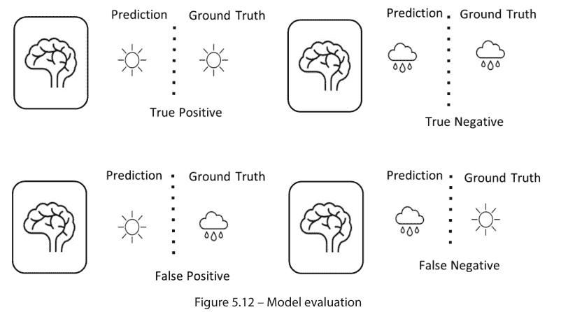

#### 多分类

在 Apache Spark 中，对于多分类任务，MLlib 库提供了多个可用于评估模型性能的关键指标。

Apache Spark 的 MLlib 为分类任务提供了多种评估指标，所有这些指标都可以从不同角度帮助评估模型性能：

- 混淆矩阵：一个显示实际分类与预测分类对比的表格。它包括 **真阳性（TP）**、**假阳性（FP）**、**真阴性（TN）** 和 **假阴性（FN）**，全面概述了模型的性能：

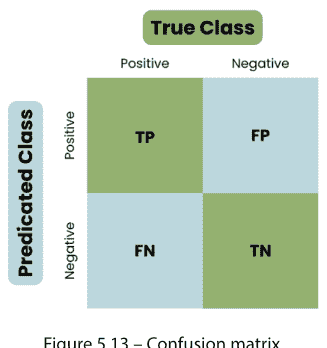

- **对数损失**：虽然 Spark 的 MLlib 未直接提供，但它用于衡量分类模型的性能，其中预测值为 0 到 1 之间的概率。它根据预测的置信度对错误分类进行惩罚。

- **加权 F-度量**：F-度量的一个变体，通过按每个类的真实实例数量对各类的 F1 分数进行加权来考虑类别不平衡，从而提供更能反映真实世界性能的指标。

- **加权假正率**：所有类别的 FPR 平均值，按每个类别的真实实例数量加权。它在评估负实例被错误分类为正实例的频率时考虑了类别不平衡。

- **加权查准率**：类似于查准率，但按每个类别的真实实例数量加权，从而在评估正预测的准确性时考虑类别不平衡。

- **加权查全率（加权 TPR）**：每个类别的查全率，按每个类别的真实实例数量加权。它在考虑类别不平衡的同时，提供了模型正确识别正实例能力的总体度量。

- **汉明损失**：汉明损失是多标签分类模型的一种度量，其中预测错误是被错误预测的标签所占的比例，即错误标签数与标签总数的比例。

在 Spark 中计算这些指标时，通常会使用 MulticlassClassificationEvaluator，并指定感兴趣的指标名称（例如，`f1`、`precision`、`recall` 或 `accuracy`）。Spark 允许针对整个模型或特定类别评估这些指标，从而全面了解模型在多个类别上的性能。

在 Spark 中评估多分类模型时，选择与特定问题需求相契合的指标非常重要，尤其是在考虑类别的相对重要性或不同类型误分类所关联的代价等因素时。

以下是 Spark 支持的评估指标列表：

| Accuracy | weightedFalsePositiveRate | PrecisionByLabel |
| :--- | :--- | :--- |
| WeightedPrecision | WeightedFMeasure | RecallByLabel |
| WeightedRecall | truePositiveRateByLabel | fMeasureByLabel |
| weightedTruePositiveRate | falsePositiveRateByLabel | LogLoss |
| F1 | hammingLoss | confusionMatrix |
| | falsePositiveRate | truePositiveRate |
| weightedFMeasure | weightedFalsePositiveRate | weightedPrecision |
| weightedRecall | weightedTruePositiveRate | |

#### 算法特定注意事项

请注意，模型性能评估指标并非适用于所有算法。以下是基于算法选择指标时的注意事项：

- 决策树、随机森林和 GBT：鉴于这些模型既能处理二分类问题也能处理多分类问题，您可以根据具体用例使用相应的二分类或多分类指标。

- MLP 分类器：主要用于多分类，因此适用多分类指标。

- OvR：根据其是设置为二分类问题还是多分类问题，您可以使用二分类指标或多分类指标。

- FMs 分类器：虽然 Spark 的 MLlib 原生不包含 FMs，但如果通过扩展实现或使用，您可以根据具体应用使用二分类或多分类指标对其进行评估。

#### 选择技巧

以下是一些可供选择合适评估指标的技巧：

- 考虑问题类型：根据分类问题的性质选择二分类或多分类指标。

- 不平衡数据集：在数据不平衡的情况下，AUC-PR、加权 F1 分数或少数类的查准率和查全率等指标变得更加关键。

- 领域特定要求：将指标选择与领域需求保持一致。例如，如果假阴性的代价高于假阳性，则应优先考虑查全率。

#### 选择评估指标

为分类任务选择合适的评估指标需要考虑与您要解决的具体问题、数据集性质以及业务或研究目标相关的几个关键因素。以下是一份帮助您选择最合适指标的指南。

#### 了解业务目标

指标的选择应与项目的最终目标保持一致。不同的应用可能会优先考虑不同类型的错误：

- 在垃圾邮件检测系统中，假阳性（将重要邮件标记为垃圾邮件）可能比假阴性（让部分垃圾邮件漏过）更成问题。

- 在医疗诊断中，漏诊阳性病例（假阴性）可能比误报（假阳性）严重得多。

#### 考虑数据性质

在选择合适的指标之前，非常重要的一点是了解数据分布和背景：

- **类别分布**：如果您的数据集不平衡（即一个类显著多于另一个类），准确率可能不是可靠的指标。在这种情况下，查准率、查全率、F1 分数或 AUC 可能提供更多洞察。

- **多分类与二分类**：对于多分类问题，您可能需要考虑能够有效处理多个类别的指标，例如宏平均或微平均 F1 分数，或混淆矩阵以可视化所有类别的性能。

#### 需优先考虑的错误类型

决定在应用中哪种错误类型的减少更为关键：

- **假阳性**：如果减少误报至关重要，则应优先考虑查准率

- **假阴性**：如果捕获所有阳性病例更为重要，则应关注查全率

您可能需要在这两者之间取得平衡，在这种情况下，F1 分数可能是理想的选择，因为它协调了查准率和查全率。

#### 模型比较与选择

如果您在比较多个模型或需要一个单一的汇总指标，请考虑以下几点：

- AUC-ROC 适用于比较不同模型，尤其是在不平衡数据集中，因为它可以评估模型在所有分类阈值下的性能

- 对数损失提供了一种基于模型输出概率比较模型的方法，会更严厉地惩罚置信度高的错误预测

#### 现实约束

请考虑以下运营约束：

- **可解释性**：在某些应用中，理解模型做出特定预测的原因至关重要。源自混淆矩阵的指标（如查准率和查全率）更具可解释性。

- **计算资源**：某些指标的计算可能更加密集，尤其是在处理大型数据集或实时应用时。


#### 统计考量

在指标的统计特性至关重要的场景中（例如，进行显著性检验或构建置信区间时），由于日志损失（log loss）或 MCC 等指标具有广为人知的统计特性，因此可能更倾向于使用它们。

#### 监管与伦理考量

在受监管的行业（如金融或医疗保健）或当伦理考量至关重要时（如公平性或对特定群体的偏见），选择能够捕捉并突出这些方面的指标非常重要。

#### 实现与验证

选择指标后，必须正确实现并验证其可靠性：

- 使用社区中经过充分验证且广泛接受的库和工具
- 对结果进行交叉验证，以确保所选指标在数据的不同子集中提供一致的见解

关于评估指标的学习到此结束。在下一节中，我们将探讨可用于提升模型性能的各种方法。

#### 提升模型性能

提升分类模型性能涉及在模型开发过程的不同阶段应用多种技术的组合。以下是您可以用来增强模型准确性和有效性的一些策略：

- 数据质量与数量：
  - 增加数据量：更多的数据可以帮助模型更好地学习，并很好地泛化到未见数据。如果可能，请考虑增强您的数据集。
  - 数据清洗：移除异常值，处理缺失值，并纠正数据集中的错误，以提高模型准确性。
  - 特征工程：通过领域知识从现有特征创建新特征。设计良好的特征可显著提升模型性能。
- 特征选择与降维：
  - 特征选择：识别并保留最具信息量的特征，同时移除无关或冗余的特征，以减少过拟合并提升模型性能。
  - 降维：主成分分析（PCA）等技术可以减少特征空间，通过去除噪声，可能提升模型效率和性能。
- 选择合适的模型：
  - 尝试不同的模型：不同模型有不同的优势和劣势。尝试各种算法（如决策树、SVM 和集成方法），以找到最适合您数据的模型。
- 超参数调优：
  - 网格搜索和随机搜索：这些是系统地搜索多个参数值组合的方法，用于为模型找到最佳设置。
  - 交叉验证：使用交叉验证，确保模型在数据集的不同子集上具有稳健的性能。
- 处理不平衡数据：
  - 重采样技术：对少数类进行过采样，或对多数类进行欠采样，以平衡数据集并提升模型在少数类上的性能。
  - 代价敏感学习：修改算法，使其对少数类的误分类比多数类施加更高的惩罚。
  - 使用合适的指标：选择能提供关于模型在不平衡数据集上性能见解的评估指标，例如 F1 分数、精确率-召回率 AUC 或 Matthews 相关系数。
- 高级特征工程：
  - 交互项：如果怀疑特征之间的交互可能具有预测性，请考虑添加捕获此类交互的特征。
  - 多项式特征：使用多项式特征来建模非线性关系。
- 模型正则化：
  - 应用正则化技术：L1（Lasso）和 L2（Ridge）正则化等技术可以通过惩罚模型中的大系数来防止过拟合。
- 数据变换：
  - 特征缩放：标准化或归一化特征，使它们处于同一尺度。这对于对数据尺度敏感的模型（如 SVM 或 KNN）尤为重要。
  - 数据编码：使用独热编码、目标编码或嵌入式等技术正确编码分类变量，尤其是对于需要数值输入的算法。
- 模型更新：
  - 增量学习：使用新数据持续更新模型，以便其能随时间适应变化。
  - 反馈循环：将模型预测重新纳入训练，以纠正错误并适应新模式。
- 特定领域技术：
  - 利用领域知识：融入专家知识可以指导特征工程、模型选择和结果解释。
  - 自定义损失函数：设计专门解决业务问题细微差别的损失函数。
- 集成技术：集成方法可以减少偏差和方差，并提高泛化能力。尝试这些技术以提升模型性能：
  - 装袋法（Bootstrap Aggregating）：
    - 随机森林：通过平均预测来结合决策树。
    - 自助采样：为每棵树创建多样化的数据子集。
  - 提升法：
    - AdaBoost：迭代训练弱模型，强调被误分类的样本。
    - 梯度提升（GBM）：按顺序构建树，纠正前一棵树的错误。
    - XGBoost 和 LightGBM：具有正则化和并行化的增强版 GBM。
  - 堆叠法：使用元模型结合不同模型的预测。

提升分类模型是一个迭代过程，涉及尝试不同策略、持续监控性能，并适应新数据和见解。在模型复杂性、可解释性和性能之间权衡利弊，是开发有效且可靠的分类模型的关键。

在下一节中，我们将使用真实世界数据集来解决分类问题。

#### 代码示例

在本示例中，我们将使用 AI4I 2020 预测性维护数据集（2020）UCI 机器学习库（https://doi.org/10.24432/C5H55C）。该合成数据集模拟了一台现有的铣床，包含 10,000 个存储为行、带有 14 个列特征的数据点：

- UID：唯一标识符
- product ID
- type：仅产品类型 L、M 或 H
- air temperature [K]
- process temperature [K]
- rotational speed [rpm]
- torque [Nm]
- tool wear [min]：质量变体 H/M/L 会为流程中使用的工具增加 5/3/2 分钟的工具磨损
- The machine failure label：如果以下任一故障模式为真，则指示机器在特定数据点中是否已失败

以下代码行导入所有所需的包和库：

```
from pyspark.sql import SparkSession
spark = SparkSession.builder.appName(
  "ClassificationExample"
).getOrCreate()
```

以下代码片段加载数据集并打印 DataFrame 及其架构：

```
train_df = spark.read.csv("s3a:///test234/machine_failure_data.csv",
  header=True, inferSchema=True)
train_df.show(3, truncate=False)
```

输出如下：

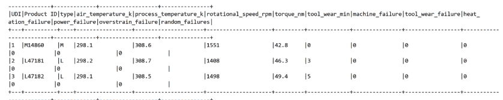

图 5.14 – DataFrame 输出

以下代码片段将整数列转换为浮点数，删除空值，并打印数据架构：

```
##### Convert all integer columns in train_df to float
from pyspark.sql.types import IntegerType, FloatType
for col in train_df.columns:
    if train_df.schema[col].dataType == IntegerType() :
        train_df = train_df.withColumn(col,
            train_df[col].cast (FloatType ()))
##### remove null values
train_df = train_df.dropna()
train_df.printSchema()
```

让我们看看输出：

```
root
 |-- UDI: float (nullable = true)
 |-- Product ID: string (nullable = true)
 |-- type: string (nullable = true)
 |-- air_temperature_k: double (nullable = true)
 |-- process_temperature_k: double (nullable = true)
 |-- rotational_speed_rpm: float (nullable = true)
 |-- torque_nm: double (nullable = true)
 |-- tool_wear_min: float (nullable = true)
 |-- machine_failure: float (nullable = true)
 |-- tool_wear_failure: float (nullable = true)
 |-- heat_dissipation_failure: float (nullable = true)
 |-- power_failure: float (nullable = true)
 |-- overstrain_failure: float (nullable = true)
 |-- random_failures: float (nullable = true)
```

图 5-15 – 数据架构

以下代码片段通过删除不需要的列、替换缺失值，并将分类列转换为数值列来执行特征工程：

```
train_df = train_df.drop("UDI","Product ID",
            "heat_dissipation_failure","power_failure",
            "overstrain_failure","random_failures", "tool_wear_failure")
train_df.show(3,truncate=False)
#replace the missing values with 0
train_df = train_df.fillna(0)
##### convert the type column to index
from pyspark.ml.feature import StringIndexer
indexer = StringIndexer(inputCol="type", outputCol="type_index")
train_df = indexer.fit(train_df).transform(train_df)
train_df.show(3)
```


|type|air_temperature_k|process_temperature_k|rotational_speed_rpm|torque_nm|tool_wear_min|machine_failure|type_index|
|---|---|---|---|---|---|---|---|
| M | 298.1| 308.6| 1551.0| 42.8| 0.0| 0.0| 1.0|
| L | 298.2| 308.7| 1408.0| 46.3| 3.0| 0.0| 0.0|
| L | 298.1| 308.5| 1498.0| 49.4| 5.0| 0.0| 0.0|

图 5.16 – DataFrame 输出

以下代码片段通过向量函数生成特征并对列进行归一化：

```
from pyspark.ml.feature import VectorAssembler
assembler = VectorAssembler(inputCols=["air_temperature_k",
 "process_temperature_k", "rotational_speed_rpm",
 "torque_nm", "tool_wear_min","type_index"],
 outputCol="features")
train_df = assembler.transform(train_df)
##### apply standard scaler
from pyspark.ml.feature import StandardScaler
scaler = StandardScaler(inputCol="features", outputCol="scaledFeatures")
scalerModel = scaler.fit(train_df)
train_df = scalerModel.transform(train_df)
##### show the scaled features
train_df.select("scaledFeatures", "machine_failure").show(3)
```

将看到以下输出：

| scaledFeatures|machine_failure|
|---|---|
|[149.030724148837...| 0.0|
|[149.080717682600...| 0.0|
|[149.030724148837...| 0.0|

仅显示前 3 行

图 5.17 – 缩放特征

以下代码片段将数据集拆分为训练集和测试集。然后使用 LogisticRegression 训练模型并评估模型性能。

```
##### split the data
train_df, test_df = train_df.randomSplit([0.7, 0.3])
##### select the features and label
train_df = train_df.select("scaledFeatures", "machine_failure")
test_df = test_df.select("scaledFeatures", "machine_failure")
##### train the model
from pyspark.ml.classification import LogisticRegression
lr = LogisticRegression(
    featuresCol="scaledFeatures", labelCol="machine_failure")
lrModel = lr.fit(train_df)
##### evaluate the model
from pyspark.ml.evaluation import BinaryClassificationEvaluator
evaluator = BinaryClassificationEvaluator(
    labelCol="machine_failure")
evaluator.evaluate(lrModel.transform(test_df))
```

输出结果为 0.918577395158542。

至此，代码示例的讲解结束。

## 总结

本章在监督学习领域探讨了分类的基本概念和技术。分类是机器学习中的一项关键任务，可将数据分类到预定义的类别中。这对于电子邮件过滤、医疗诊断和客户细分等广泛应用至关重要。

我们深入探讨了各种分类算法，包括决策树、SVM、KNN、逻辑回归、朴素贝叶斯和 FMs。本文讨论了每种算法的独特优势、应用、优点和局限性，从而全面了解其实际用例。

通过实际案例研究和现实世界示例，我们展示了分类在金融、医疗保健和网络安全等不同领域中的变革性影响。我们还介绍了使用准确率、精确率、召回率、F1 分数和混淆矩阵等指标评估分类器性能的关键方面，以确保对模型进行严格评估和改进。

此外，我们还探讨了提高模型性能的高级技术，例如数据预处理、特征工程、处理数据不平衡、超参数调优和正则化。通过 Apache Spark 中的代码示例进行的实践练习，为您提供了实现和优化分类模型所需的实用技能。

到此，您应该已对分类有扎实的理解，并准备好运用这些技术解决复杂问题，标志着您在机器学习这个迷人世界中的旅程迈出了重要一步。

在下一章中，我们将学习聚类。
