## 构建聚类系统

在不断发展的机器学习领域，无监督学习犹如探索的灯塔，算法在其中深入原始、未标记的数据，在没有明确标签或指令的情况下寻找模式、结构和洞察。本章专门探讨聚类的艺术与科学，聚类是一种无监督学习类型，根据相似性对数据点进行分组，揭示数据集的底层结构。

聚类算法是数据的制图师，绘制数据集内隐藏的领域。它们基于一个简单而深刻的前提运作：将相似的数据点聚合在一起，并将显著不同的数据点分开。这项看似简单直接的任务充满复杂性和细微差别，因为“相似性”的定义会根据上下文、数据类型和预期结果而有很大差异。

本章通过考察多种算法来探索聚类技术，以揭示数据景观中独特的模式。我们深入探讨其机制、假设、优势和局限性。挑战包括确定最佳聚类数量、处理高维数据以及评估聚类质量。指标用于指导评估，而实际应用涵盖市场细分、异常检测、生物信息学和社交网络分析。聚类提取价值、为决策提供信息并揭示隐藏模式。

本章将涵盖以下主题：

- 了解聚类
- 学习聚类算法
- 评估模型性能
- 提高模型性能

通过理解聚类的原理、挑战和应用，您将能够在自己的工作中发挥其潜力，拓展在没有预定义标签或结构的数据集中可以发现的边界。

### 技术要求

本章的代码文件可在 GitHub 上找到：https://github.com/PacktPublishing/Apache-Spark-for-Machine-Learning/tree/main/Chapter06。

### 了解聚类

聚类是无监督机器学习和数据挖掘中的一项基本技术，旨在将一组对象分组，使同一组（或簇）中的对象比其他簇中的对象更相似。它是一种探索性数据分析方法，广泛应用于各个领域和应用中，用于发现底层模式、对数据进行分类，并通过将相似项目分组来总结数据集。

### 理解聚类

与监督学习不同，监督学习中模型从标记数据中学习，而聚类使用未标记数据。其目标不是预测结果，而是通过基于数据相似性识别组或簇来理解数据结构。相似性通常使用欧氏距离、曼哈顿距离或针对数据类型量身定制的更复杂的度量来计算。

让我们参考下图了解聚类的工作机制：

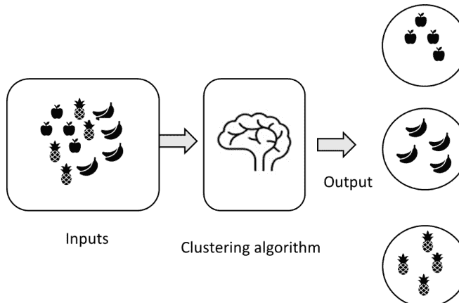

图 6.1 – 聚类的工作机制

在了解聚类的工作机制后，让我们了解可以应用聚类的各种场景。


### 何时使用聚类技术

聚类可用于以下场景：

- **探索性数据分析**：当你处于数据分析的初期，希望了解数据的潜在结构或模式时，聚类可以在无需预定义标签的情况下揭示自然分组、趋势和异常。

- **没有可用标签数据**：在没有标签数据（即你预先不知道每个数据点的类别/类）的情况下，聚类是一种首选技术，因为它不需要此类标签来根据数据点的相似性对其进行分组。

- **发现隐藏模式**：如果目标是发现数据中未预先已知的隐藏模式或关系，聚类可以帮助有机地识别这些结构，提供通过分类等监督方法可能无法察觉的洞察。

- **数据预处理**：聚类可作为预处理步骤，将数据分割成更易管理的组。这种分割随后可以指导或改进下游任务（包括分类）的性能，例如在每个簇上训练独立的分类器。

- **特征工程**：聚类也可用于特征工程，以创建能够提升分类算法性能的新特征。例如，将簇 ID 作为新特征分配，可以为监督学习模型提供额外上下文。

- **降低监督任务的复杂性**：如果数据集过于复杂或庞大，可以使用聚类通过对相似数据点进行分组来简化它。这可以使随后的分类任务更易于处理，并提高分类模型的性能和可解释性。

- **用户或项目画像**：在推荐引擎等系统中，聚类可以根据行为或属性帮助对用户或项目进行画像。这些画像随后可以增强个性化策略，而无需为每个用户或项目提供显式标签。

由此可见，当你需要探索数据、发现自然分组或处理无标签数据时，聚类最有益。它是一种强大的工具，用于发现不明显的洞察和模式，使其成为许多数据分析工作流中的宝贵第一步，尤其是在与分类和其他机器学习技术相辅相成时。

### 机器学习中聚类的一些用例

聚类是无监督机器学习的关键技术，广泛应用于各个领域，用于发现固有结构、对相似实体进行分组并从无标签数据中提取洞察。以下是聚类特别有益的一些显著用例：

- **客户细分**：在市场营销和销售中，聚类有助于根据购买行为、偏好、人口统计学及其他因素识别客户群中的不同群体。这使企业能够定制营销策略、产品推荐和服务，以满足不同客户细分群体的特定需求。

- **异常检测**：通过对相似数据点进行分组，聚类可以突出显示不属于任何簇的异常值或离群点。这在银行和金融领域的欺诈检测、网络安全中的可疑活动识别以及制造业中的缺陷产品检测中至关重要。

- **图像分割**：在计算机视觉中，聚类算法根据像素相似性将图像分割为区域。这对于对象识别、医学影像分析（例如，在 MRI 扫描中识别肿瘤）以及增强图像压缩技术至关重要。

- **基因组数据分析**：在生物信息学中，聚类用于将表达模式相似的基因分组，这可以指示共同调控或功能相似性。这对于理解基因功能、识别疾病生物标志物以及探索进化关系至关重要。

- **推荐系统**：聚类可以通过对相似项目或用户进行分组来改进推荐系统。例如，在电子商务中，可将相似客户群购买的产品推荐给同一簇中的其他人，从而增强推荐的个性化。

- **文本挖掘和自然语言处理 (NLP)**：聚类用于对相似文档进行分组、组织大量文本数据并提取文本语料中的主题模式。应用包括新闻聚合、情感分析和主题建模。

- **社交网络分析**：聚类算法可以根据用户交互和共同兴趣检测社交网络中的社区。这有助于理解网络中的社会动态、信息流和影响模式。

- **市场研究**：聚类通过对相似产品、服务或公司进行分组，提供市场结构和竞争格局的洞察。这有助于市场细分、趋势分析和战略规划。

- **运营效率**：在物流和供应链管理中，聚类可以通过对地理位置接近的配送或取件进行分组来优化路线和日程安排，从而降低成本并提高服务水平。

- **环境研究**：聚类有助于分析环境数据，例如对气候模式或污染水平相似的区域进行聚类，有助于生态研究、保护工作和气候变化研究。

在每个用例中，聚类都是一种强大的工具，用于揭示数据中的模式和相似性，从而带来可操作的洞察、增强的决策以及各种应用中的创新解决方案。

### 聚类技术的陷阱

聚类技术虽然在探索性数据分析和无监督学习中的模式识别方面功能强大，但存在几个陷阱，可能影响其有效性和结果的可解释性。了解这些陷阱对于恰当应用聚类方法并确保有意义的结果至关重要。

- **选择簇的数量**：许多聚类算法（如 K-means）要求用户预先指定簇的数量。确定最佳簇数量并非总是简单明了，且会显著影响结果。肘部法、轮廓分析和间隙统计等方法有所帮助，但并不总是能提供明确的答案。

- **对簇形状的假设**：不同的聚类算法对簇的形状和大小有不同的假设。例如，K-means 假设簇是球形且大小相似，但这并不适用于所有数据集。当实际簇具有不规则形状或大小差异显著时，这可能导致次优聚类。

- **对初始条件的敏感性**：K-means 等算法对簇中心的初始选择敏感。不同的初始化可能导致不同的聚类结果，并可能使算法陷入局部最优。K-means++ 或带有共识聚类的多次初始化等技术可以缓解此问题。

- **噪声和离群点**：聚类算法对数据中的噪声和离群点可能敏感。噪声会扭曲数据的真实结构，导致无法准确反映潜在模式的簇。稳健的聚类技术和删除离群点的预处理步骤有助于应对这一挑战。

- **特征缩放**：许多聚类算法的性能受数据特征规模的影响。较大规模的变量可能会不当影响聚类中使用的距离度量，导致偏差结果。归一化或标准化数据有助于确保每个特征对聚类过程做出等同贡献。

- **可解释性**：聚类算法生成的簇有时难以解释，尤其是在高维空间中。理解每个簇在原始数据背景下代表的含义可能具有挑战性，需要降维技术或领域专业知识才能进行有意义的解释。


- 集群验证：与受监督学习不同，在受监督学习中，模型性能可以根据带标签的测试数据进行评估，而聚类缺乏明确的客观成功度量。验证往往是主观的，依赖于领域知识或轮廓得分、凝聚度和分离度等间接度量。

- 忽略特征之间的相关性：许多聚类算法将特征视为独立的，忽略了潜在的相关性。这可能导致集群无法反映数据中的复杂关系。在聚类之前使用主成分分析（PCA）等降维技术可以帮助发现这些关系。

- 高维数据：在高维空间中进行聚类（“维度灾难”）可能会出现问题。随着维度的增加，距离度量变得越来越不具意义，数据点的稀疏性会使识别密集区域或有意义的集群变得困难。降维或使用专为高维数据设计的算法等技术可以提供帮助。

- 算法复杂度和可扩展性：某些聚类算法计算量很大，尤其是在处理大型数据集或高维数据时。在大数据应用中，可扩展性成为一个问题，需要高效的算法或近似方法。

意识到这些陷阱并仔细考虑算法、参数和预处理步骤的选择，从业者可以缓解与聚类技术相关的一些挑战，从而获得更可靠、更具可解释性的聚类结果。

在下一节中，您将了解更多关于聚类算法的信息。

### 学习聚类算法

Apache Spark 中提供了不同的聚类算法。让我们现在详细了解它们。

#### K-means

K-means 是一种广泛使用的无监督机器学习聚类算法，它将数据集划分为 K 个不同的、非重叠的集群。它旨在最小化每个集群内部的方差，本质上是根据特征空间的相似性对数据点进行分组。K-means 中的“均值”指的是 K 个集群的质心（平均点），数据点围绕这些质点进行聚集。

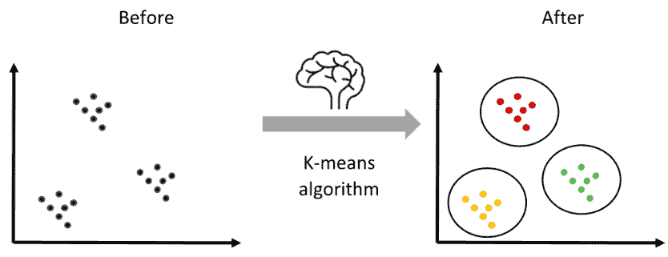

图 6.2 – K-means 聚类概览

##### K-means 的工作原理

K-means 聚类包含以下步骤：

- 1. **初始化**：算法首先从数据集中随机选择 K 个点作为初始质心。
- 2. **分配步骤**：每个数据点被分配到最近的质心。这形成了 K 个集群。
- 3. **更新步骤**：质心被重新计算为分配到每个集群的所有点的平均值。
- 4. **迭代**：重复步骤 2 和 3，直到质心不再发生显著变化，表明已收敛。

##### 应用

K-means 可应用于以下用例：

- **客户细分**：企业使用 K-means 进行市场细分，根据购买历史、行为和偏好对客户进行聚类，以制定营销策略并改善客户服务。
- **图像压缩**：K-means 用于图像处理中，以减少图像中的颜色数量。每个集群质心代表一种颜色，像素被分配到最近的质心颜色，从而在不显著降低质量的情况下大幅减小图像大小。
- **文档聚类**：在文本挖掘中，K-means 帮助将相似文档组织成群，通过使查找相关文档更加容易，增强了信息检索系统。

##### 优势

- **简单性和效率**：K-means 易于理解和实现，使其适用于广泛的应用。对于中小型到大型数据集，它在计算上效率较高，适合快速探索性数据分析。

- **通用性**：只要能定义距离度量，该算法即可用于任何类型的特征，使其适用于各种数据类型和领域。

- **适应性**：与层次聚类相比，K-means 可以产生更紧凑的集群，尤其是在集群呈球形时。

##### 局限性

- **选择 K**：如前所述，最大的挑战之一是确定最优的集群数量 K。对 K 的不当选择可能导致聚类性能不佳。肘部法、轮廓分析和间隙统计等方法可以提供帮助，但并不总能给出明确的答案。

- **对初始质心的敏感性**：最终的集群在很大程度上取决于最初随机选择的质心。初始化不当可能导致次优解。

- **球形集群假设**：K-means 假设集群是球形的且大小相似，但这并不总是成立。如果实际集群具有不同的大小、密度或非球形形状，这可能导致性能不佳。

由于其简单性、高效性和在许多实际应用中的有效性，K-means 仍然是一种流行的聚类算法。然而，了解其局限性并考虑数据集的性质对于确保有意义的聚类结果至关重要。

#### 代码示例

在探索了聚类概念之后，我们将逐步讲解 K-means 聚类的代码示例。

以下代码导入所需的库并创建 Spark 会话：

```python
from sklearn.datasets import make_blobs
import numpy as np
from pyspark.sql.functions import monotonically_increasing_id
from pyspark import SparkFiles
from pyspark.sql import SparkSession
from pyspark.ml.feature import (
    VectorAssembler, StandardScaler)
from pyspark.ml.clustering import KMeans
from pyspark.ml.evaluation import ClusteringEvaluator
import matplotlib.pyplot as plt
import pyspark
```

```python
spark = pyspark.sql.SparkSession.builder.appName(
    "K-means Clustering"
).getOrCreate()
```

以下代码创建合成数据：

```python
features, true_labels = make_blobs (
    n_samples=200,
    centers=3,
    cluster_std=2.75,
    random_state=42
)
```

以下代码将通过 Spark DataFrame 输出生成的数据：

```python
df1 = spark.createDataFrame(features, ['feature1', 'feature2'])
df1 = df1.withColumn("id1", monotonically_increasing_id())
df2 = spark.createDataFrame(true_labels, ['label'])
df2 = df2.withColumn("id1", monotonically_increasing_id())
df = df1.join(df2, on="id1")
df.show(5)
```

我们将得到以下结果：

| id1 | feature1 | feature2 | label |
|---|---|---|---|
| 0 | 9.770758741876183 | 3.2762102164481477 | 1 |
| 1 | -9.713496659299548 | 11.274518015230187 | 0 |
| 2 | -6.913305816480285 | -9.347559114861983 | 2 |
| 3 | -10.861859130268911 | -10.750634972811474 | 2 |
| 4 | -8.50038027274785 | -4.543703826468128 | 2 |

仅显示前 5 行

图 6.3 - 生成数据的输出

下一段代码片段将特征组装成向量列，然后使用标准化对这些特征进行缩放：

```python
assembler = VectorAssembler(
    inputCols=["feature1", "feature2"],
    outputCol="features")
data_df = assembler.transform(df)
scaler = StandardScaler(inputCol="features",
    outputCol="scaled_features")
```

```python
scaler_model = scaler.fit(data_df)
data_df = scaler_model.transform(data_df)
data_df.show(5)
```

生成的 DataFrame (data_df) 包含原始特征和缩放后的特征：

| id1 | feature1 | feature2 | label | features | scaled_features |
|---|---|---|---|---|---|
| 0 | 9.770758741876183 | 3.2762102164481477 | 1 | [9.77075874187618... | [1.82968666370121... |
| 1 | -9.713496659299548 | 11.274518015230187 | 0 | [-9.7134966592995... | [-1.8189636818331... |
| 2 | -6.913305816480285 | -9.347559114861983 | 2 | [-6.9133058164802... | [-1.2945958229721... |
| 3 | -10.861859130268911 | -10.750634972811474 | 2 | [-10.861859130268... | [-2.0340077284354... |
| 4 | -8.500838027274785 | -4.543703826468128 | 2 | [-8.5008380272747... | [-1.5917937216868... |

图 6.4 – 显示原始特征和缩放特征的 DataFrame

以下代码片段应用 K-means 算法来显示每个数据点的集群：

```python
kmeans = KMeans(k=3, featuresCol="scaled_features",
               predictionCol="cluster")
model = kmeans.fit(data_df)
predictions = model.transform(data_df)
predictions.show(5)
```

它将产生以下输出：

| id1 | feature1 | feature2 | label | features | scaled_features | cluster |
|---|---|---|---|---|---|---|
| 0 | 9.770758741876183 | 3.2762102164481477 | 1 | [9.77075874187618... | [1.82968666370121... | 1 |
| 1 | -9.713496659299548 | 11.274518015230187 | 0 | [-9.7134966592995... | [-1.8189636818331... | 0 |
| 2 | -6.913305816480285 | -9.347559114861983 | 2 | [-6.9133058164802... | [-1.2945958229721... | 2 |
| 3 | -10.861859130268911 | -10.750634972811474 | 2 | [-10.861859130268... | [-2.0340077284354... | 2 |
| 4 | -8.500838027274785 | -4.543703826468128 | 2 | [-8.5008380272747... | [-1.5917937216868... | 2 |

图 6.5 – 显示集群分配的 DataFrame 输出

下一段代码片段评估聚类输出：

```python
evaluator = ClusteringEvaluator(predictionCol='cluster',
    featuresCol='scaled_features', \
    metricName='silhouette', \
    distanceMeasure='squaredEuclidean')
silhouette_score = evaluator.evaluate(predictions)
print(f"Silhouette Score: {silhouette_score:.4f}")
```

我们收到的轮廓得分输出为：0.7851。


现在，让我们找到最佳聚类数量：

```
wssse_values = []
evaluator = ClusteringEvaluator(predictionCol='cluster',
    featuresCol='scaled_features',
    metricName='silhouette',
    distanceMeasure='squaredEuclidean')
for i in range(2, 8):
    KMeans_mod = KMeans(k=i, featuresCol="scaled_features",
    predictionCol="cluster")
    KMeans_fit = KMeans_mod.fit(data_df)
    output = KMeans_fit.transform(data_df)
    score = evaluator.evaluate(output)
    wssse_values.append(score)
    print("Silhouette Score:", score)
```

这将生成如下所示的输出：

```
Silhouette Score: 0.7178670008193637
Silhouette Score: 0.7851032706829328
Silhouette Score: 0.6726486143551612
Silhouette Score: 0.5810267089116743
Silhouette Score: 0.5446619451331941
Silhouette Score: 0.5228633085259329
```

## 图 6.6 – 轮廓分数输出

以下代码片段绘制了显示一系列聚类大小的 WSSSE 值的图表：

```
# Plotting WSSSE values
plt.plot(range(1, 7), wssse_values)
plt.xlabel('Number of Clusters (K)')
plt.ylabel('Within Set Sum of Squared Errors (WSSSE)')
plt.title('Elbow Method for Optimal K')
plt.grid()
plt.show()
```

使用肘部法寻找最佳聚类数量的图表如下所示：

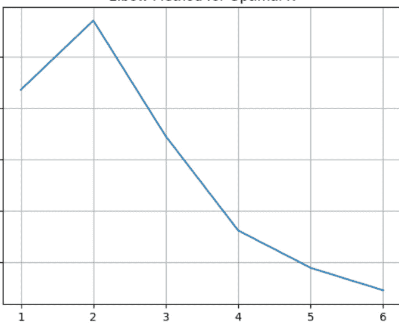

图 6.7 – 寻找最佳 K 的图表

接下来，我们将绘制所有数据点及聚类中心以可视化聚类：

```
plt.figure(figsize=(8, 6))
for i in range(3):
    cluster_data = predictions.filter(
        predictions["cluster"] == i
    ).select("scaled_features").collect()
    cluster_points = [point[0] for point in cluster_data]
    plt.scatter(*zip(*cluster_points), label=f"Cluster {i}")
plt.scatter(*zip(*model.clusterCenters()), c='black',
            s=200, alpha=0.5, label="Cluster Centers")
plt.title("K-Means Clustering")
plt.xlabel("PCA Component 1")
plt.ylabel("PCA Component 2")
plt.legend()
plt.show()
```

这里是生成的输出：

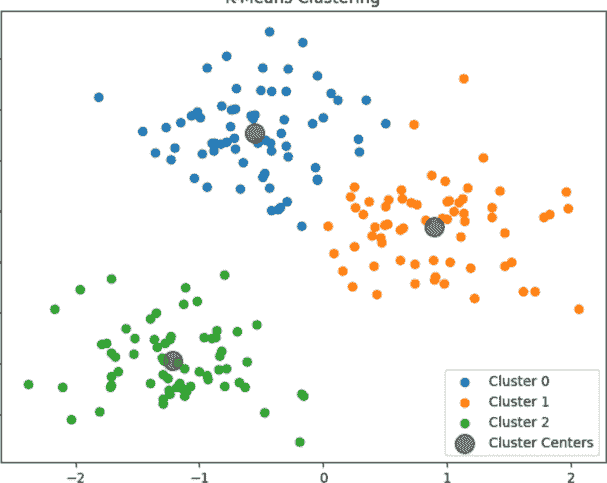

图 6.8 – 聚类可视化

#### 潜狄里克莱分配（LDA）

LDA 是一种生成性统计模型，它使用未观察到的组来解释一组观测结果。它帮助我们理解为什么数据的某些部分表现出相似性。在文本分析的语境下，LDA 假设文档是由主题混合生成的，其中主题被理解为在固定词汇表上的分布。关键思想是文档以不同程度表现出多个主题，而 LDA 旨在揭示这些潜在的主题结构。

##### LDA 模型

LDA 将文档聚类为潜在主题上的随机混合，其中每个主题由词汇上的分布表示。LDA 假设语料库中每个文档有以下生成过程。

##### 选择主题上的分布

对于文档中的每个词，执行以下操作：

- 从文档的主题分布中选择一个主题
- 从主题的词汇分布中选择一个词

这些分布由狄里克莱分布确定，由通常在推理开始前固定的超参数参数化。推理过程旨从文档回溯，找到一组可能生成语料库的主题。以下图片解释了潜狄里克莱分配（LDA）的概念：

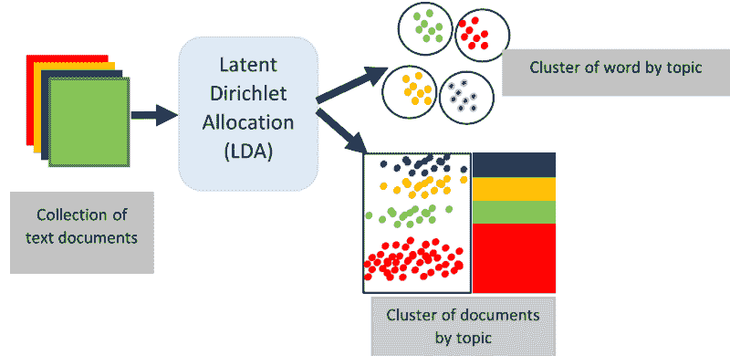

图 6.9 – LDA 概览

##### LDA 的应用

LDA 可用于以下用例：

- **文本数据中的主题建模**：LDA 广泛用于在大量文本集合中发现潜在的主题结构，通过将它们总结为主题，使管理和浏览大型数据集变得更加容易
- **内容推荐**：通过理解文章或产品中存在的主题，系统可以根据用户过去对某些主题的偏好来推荐新内容
- **信息检索**：这涉及增强搜索引擎，以返回不仅是关键词匹配而且在主题上相关的文档，方法是根据文档的主题分布对其进行索引

##### 优势

- **无监督学习**：作为一种无监督技术，LDA 不需要标记数据，使其成为探索手动标记不可行的大型数据集的宝贵工具
- **降维**：LDA 通过将文档表示为较少数量主题的混合来降低文本数据的维度，简化后续分析和可视化
- **可解释性**：LDA 产生的主题通常连贯且可解释，使人类能够理解并标记数据中的主题，从而深入了解大型文本语料库的结构和内容

##### 局限性

- **选择主题数量**：与其他聚类技术一样，确定最佳主题数量（K）具有挑战性。存在各种启发式方法，但没有万能的解决方案，选择会显著影响结果。

- **主题独立性假设**：LDA 假设主题之间相互独立且不相互影响，这在现实世界数据中可能并不总是成立，因为主题可能是层级化的或相关的。

- **多义词和近义词的处理**：LDA 将每个词视为一个独立的标记，不考虑多义词（具有多种含义的词）或近义词（具有相似含义的不同词），这可能导致不太有意义的主题。

总的来说，LDA 是一种强大的工具，用于揭示大型文本语料库中潜在的主题结构，为探索性数据分析、内容推荐和信息检索提供有价值的见解。其无监督特性和生成可解释主题的能力使其广泛适用，尽管在模型规范、超参数选择和结果解释方面必须谨慎，以解决其固有的局限性。

#### 代码示例

首先，我们将导入所需的库并创建 Spark 会话：

```
from sklearn.datasets import fetch_20newsgroups
from pyspark.sql import SparkSession
from pyspark.sql.functions import udf,expr
from pyspark.sql.types import StringType
from pyspark.ml.feature import (
    StopWordsRemover, Tokenizer,CountVectorizer,IDF)
import re
##### Create a Spark session
spark = SparkSession.builder.appName(
    "NewsgroupsPreprocessing"
).getOrCreate()
spark.sparkContext.setLogLevel("ERROR")
num_features = 8000 #vocabulary size
num_topics = 20
```

然后我们将加载 20newsgroups 数据集：

```
##### Load the 20-Newsgroups dataset
newsgroups = fetch_20newsgroups(
    subset="all", remove=("headers", "footers", "quotes"))

df = spark.createDataFrame(
    [(doc,) for doc in newsgroups.data], ["doc"])
```

以下代码片段使用正则表达式函数删除非字母字符：

```
from pyspark.sql.functions import regexp_replace
##### Define a UDF to apply regex and remove non-alphabetic characters
def clean_text(doc):
    cleaned_doc = re.sub(r"[^A-Za-z]", " ", doc)
    return " ".join(cleaned_doc.split()) # Remove extra spaces

##### Register the UDF
clean_text_udf = udf(clean_text, StringType())

##### Apply regex
df_cleaned = df.withColumn("cleaned_doc", clean_text_udf("doc"))
##### Replace newline characters with a space
df_cleaned = df.withColumn("cleaned_text",
    regexp_replace("doc", "\\n", " "))
df_cleaned.select("cleaned_text").show(1,truncate=False)
```

然后我们使用分词器、停用词移除器和计数向量化器函数来生成特征：

```
##### Apply Tokenizer
tokenizer = Tokenizer(inputCol="cleaned_text", outputCol="tokens")
df_tokenized = tokenizer.transform(df_cleaned)
##### Apply StopWordsRemover
stopwords_remover = StopWordsRemover(
    inputCol="tokens", outputCol="filtered_doc")
df_filtered = stopwords_remover.transform(
    df_tokenized
).select("filtered_doc")
##### Filter array elements with at least 4 characters
df_filtered = df_filtered.withColumn(
    "filtered_array",
    expr("filter(filtered_doc, x -> len(x) >= 4)"))
df_filtered = df_filtered.select("filtered_array")
df_filtered.show(1,truncate=False)
```


##### 应用 CountVectorizer
count_vec = CountVectorizer(inputCol="filtered_array",
 outputCol="count_vec", vocabSize=num_features, minDF=2.0)
count_vec_model = count_vec.fit(df_filtered)
```

我们将获得以下输出：

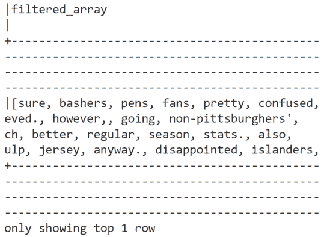

图 6.10 – Spark DataFrame 输出

下面的代码片段使用 IDF 函数将数据转换为向量化特征：

```
vocab = count_vec_model.vocabulary
newsgroups = count_vec_model.transform(df_filtered)
#newsgroups = newsgroups.drop('filtered_array')
##### Apply IDF
idf = IDF(inputCol="count_vec", outputCol="features")
newsgroups = idf.fit(newsgroups).transform(newsgroups)
newsgroups = newsgroups.drop('tf_features')
```

现在是生成 LDA 模型的时候了：

```
from pyspark.ml.clustering import LDA
lda = LDA(k=num_topics, featuresCol="features", seed=0)
model = lda.fit(newsgroups)
transformed_data = model.transform(newsgroups)
transformed_data.show(5)
topics = model.describeTopics()
topics.show(5)
```

```
model.topicsMatrix()

topics_rdd = topics.rdd
topics_words = topics_rdd\
    .map(lambda row: row['termIndices'])\
    .map(lambda idx_list: [vocab[idx] for idx in idx_list])\
    .collect()
```

下面的代码片段显示主题：

```
for idx, topic in enumerate(topics_words):
    print ("topic: ", idx)
    print ("-------------")
    for word in topic:
        print (word) # word
    print ("-------------")
```

```
-------
topic: 1
-------
armenian
armenians
jews
turkish
people
rights
jewish
israeli
right
government
-------
```

图 6.11 – 主题 1 中包含的关键词

#### 二分 K-means

二分 K-means 是一种聚类算法，是传统 K-means 算法的变体，旨在生成数据集的层次分解。它结合了 K-means 与分裂（自顶向下）层次聚类方法的特点，使其在操作和应用上独具特色。

##### 二分 K-means 的工作原理

二分 K-means 的过程涉及反复拆分集群，直到达到所需的集群数量。步骤可概述如下：

- 1. **初始化**：将所有数据点放在一个集群中开始。
- 2. **二分**：选择要拆分的集群。这可以是最大的集群、平方误差和（SSE）最高的集群，或根据其他标准选择的集群。
- 3. **K-means**：在选定的集群上应用 K=2 的 K-means 算法，将其拆分为两个子集群。
- 4. **迭代**：重复二分步骤，从新创建的集群和现有集群中进行选择，直到达到所需的集群数量。

在整个过程中，算法会迭代优化集群以提高其一致性，使用最小化集群内方差的标准 K-means 优化准则。下图展示了此过程：

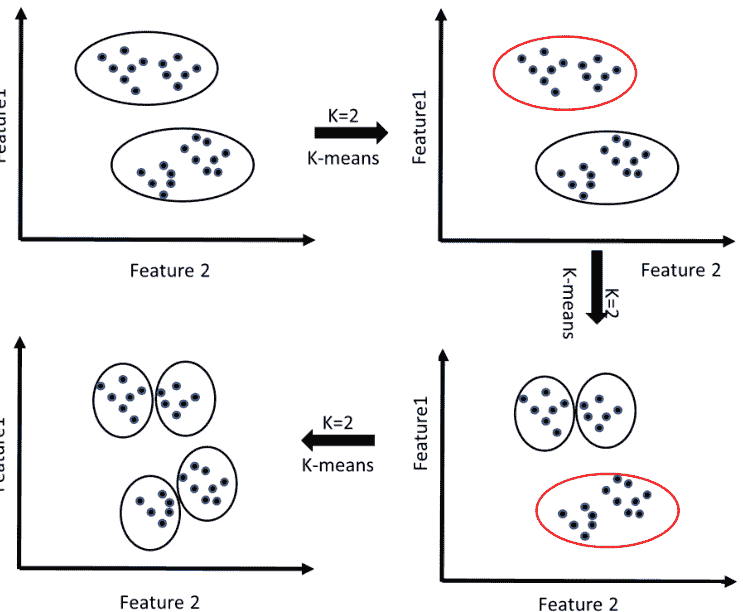

图 6.12 – 二分 K-means 的工作原理

##### **应用**

此技术可应用于以下场景：

- **文档聚类**：在文本挖掘和信息检索中，二分 K-means 用于根据内容相似性将大量文档组织成层次结构分组，增强文档导航和主题发现
- **图像分割**：该算法可以将数字图像分割为连贯区域，有助于对象识别、压缩和详细图像分析
- **市场研究**：二分 K-means 有助于客户细分，根据购买模式、偏好或人口统计将客户划分为不同群体，从而实现定向营销策略

##### **优势**

- **层次结构**：分裂方法提供层次聚类结构，可在不同粒度级别上提供数据分组的详细视图，这对于理解复杂数据集尤其有价值
- **对初始条件的鲁棒性**：与对初始质心高度敏感且可能收敛到局部最小值的传统 K-means 不同，二分 K-means 由于其迭代二分方法，往往更稳定，对初始化的依赖性更低
- **可扩展性和效率**：二分 K-means 可能比标准层次聚类方法更高效，特别是对于大型数据集，因为它在数据的较小子集上应用计算效率更高的 K-means 算法

##### **局限性**

- **选择要拆分的集群**：每个步骤中选择哪个集群进行二分，可能会显著影响最终的聚类结果。不同的选择标准可能导致不同的层次结构，且没有适用于所有数据集的普遍最优规则。
- **集群数量**：确定适当的集群数量仍然是一项挑战，与许多聚类算法一样。虽然层次聚类提供了一些见解，但在层次结构中选择切割点来定义集群并不总是简单直接，可能需要领域知识或启发式方法。
- **集群形状假设**：二分 K-means 继承了 K-means 的假设，即集群是球形和各向同性的，这对于具有复杂形状或不同集群大小的数据集可能不成立。这可能会导致此类数据的次优聚类。

可以看出，二分 K-means 通过将 K-means 的效率与层次结构相结合，为聚类提供了一种独特的方法，是一种用于数据分析的多功能工具。其生成层次聚类的能力，加上其鲁棒性和效率，使其适用于广泛的应用。然而，仔细考虑其局限性和实现细节对于充分发挥其潜力并实现有意义的聚类结果至关重要。

#### 高斯混合模型（GMM）

##### 理解高斯混合模型

高斯混合模型由两个主要组分特征：混合系数和组分的高斯分布。每个组分分布由其均值和协方差定义，决定了分布在数据空间中的位置、形状和方向。混合系数表示混合物中每个高斯组分的权重，表明属于每个组分的人口比例。

GMM 属于期望-最大化（EM）算法家族，其中期望步骤估计每个数据点在每个集群中的隶属度权重（基于当前参数估计），而最大化步骤更新高斯的参数以最大化给定这些隶属度的数据似然性。

在下图中，三个集群由三条高斯曲线表示。每个集群的质心以每条曲线中心的垂直点线显示。

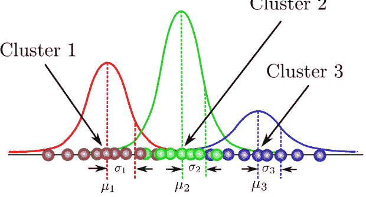

图 6.13 – GMM 概览

##### 应用

- **图像分割**：GMM 用于计算机视觉中，将图像分割为具有相似纹理或颜色的区域。每个高斯组分可以建模不同图像区域的像素强度，从而实现详细且灵活的图像分割。
- **说话人验证**：在语音处理领域，GMM 可以建模单个说话人的声音特征。通过学习说话人声音特征的分布，GMM 可以通过在其模型下比较观测特征的似然性来验证说话人身份。
- **金融市场分析**：GMM 可以建模金融资产的行为，捕捉资产回报的多模态分布。这有助于识别不同的市场制度，如高波动或稳定增长时期，并可为风险管理和投资策略提供参考。

##### 优势

- **集群形状的灵活性**：与假设球形集群的 K-means 不同，GMM 由于其参数特性，可以容纳不同大小和方向的椭球集群，提供更细致的聚类解决方案。
- **软聚类**：GMM 提供概率性集群分配，这意味着数据点可以以不同程度的隶属度属于多个集群。这种软聚类方法捕捉了数据分组中的不确定性，在许多数据本质上属于重叠类别的实际场景中非常有价值。
- **密度估计**：除了聚类之外，GMM 在估计复杂数据集的密度方面也很有效。它们可以建模高维空间中数据点的分布，使其在异常检测、生成模型以及其他需要理解底层数据分布的应用中非常有用。

##### 局限性

- **对初始化的敏感性**：GMM 的结果可能对参数的初始选择非常敏感。初始化不当可能导致 EM 算法收敛到局部最优解，从而导致次优聚类。**K-Means++** 或多次随机初始化等技术有助于缓解此问题。
- **计算复杂度**：为每个组分使用完整的协方差矩阵会增加计算负担，特别是对于高维数据。与 K-means 等更简单的模型相比，这可能使 GMM 的可扩展性较差。
- **组件数量的选择**：确定混合物中高斯组件的最优数量是一项非平凡的任务。**贝叶斯信息准则（BIC）** 或 **赤池信息准则（AIC）** 等标准可以指导这一选择，但它们不一定总是能提供明确的答案，并且对多个模型进行比较时计算起来可能很昂贵。


GMMs 提供了一个强大且灵活的聚类和密度估计框架，能够捕捉复杂的数据结构。其概率基础以及模拟不同聚类形状的能力，使其成为广泛应用中的宝贵工具。然而，仔细关注其局限性和实现细节对于充分发挥其潜力并从数据中获得有意义的洞察至关重要。

#### 使用高斯混合模型进行聚类的代码示例

我们首先导入所需的库并创建合成数据：

```
import numpy as np
from sklearn.datasets import make_blobs
import matplotlib.pyplot as plt
X, y = make_blobs(n_samples=300, centers=3, random_state=42)
plt.scatter(X[:, 0], X[:, 1], c=y, cmap='viridis')
plt.xlabel('Feature 1')
plt.ylabel('Feature 2')
plt.title('Synthetic Data with 3 Clusters')
plt.show()
```

输出如下：

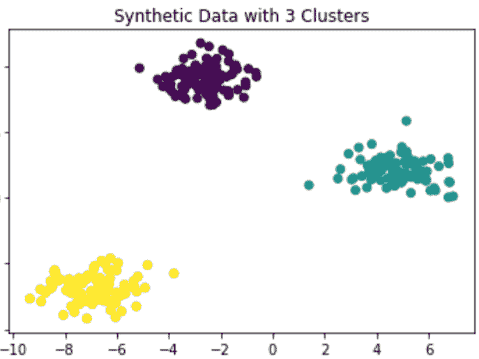

图 6.14 – 聚类可视化

下一个代码片段导入所有所需的库，创建 Spark 会话，将数据拟合到模型，并显示预测输出：

```
from pyspark.ml.clustering import GaussianMixture
from pyspark.ml.linalg import Vectors
from pyspark.sql import SparkSession
spark = SparkSession.builder.appName(
    "GMMClustering"
).getOrCreate()
data = [Vectors.dense(X[i],) for i in range(len(X))]
df = spark.createDataFrame(data, ["features"])
gm = GaussianMixture(k=3, tol=0.0001, seed=10)
model = gm.fit(df)
transformed = model.transform(df).select("features", "prediction")
transformed.show()
```

输出如下所示：

| 特征 | 预测 |
| --- | --- |
| [-7.3389880906915... | 1 |
| [-7.7400405564352... | 1 |
| [-1.6866527109495... | 2 |
| [4.42219763300088... | 0 |
| [-8.9177517263291... | 1 |
| [5.49753845943012... | 0 |
| [-2.3360166972015... | 2 |

图 6.15 – 带有特征的 GMM 预测输出

下一个代码片段评估模型性能并打印指标输出：

```
from pyspark.ml.evaluation import ClusteringEvaluator
evaluator = ClusteringEvaluator()
silhouette_score = evaluator.evaluate(transformed)
print(f"Silhouette Score: {silhouette_score}")
```

我们得到以下输出：轮廓系数：0.9696628776463786。

以下代码片段绘制聚类图：

```
transformed_pd = transformed.toPandas()
plt.scatter(transformed_pd["features"].apply(lambda x: x[0]),
           transformed_pd["features"].apply(lambda x: x[1]),
           c=transformed_pd["prediction"], cmap='viridis')
plt.xlabel('Feature 1')
plt.ylabel('Feature 2')
plt.title('Clusters from GMM')
plt.show()
```

让我们看看输出：

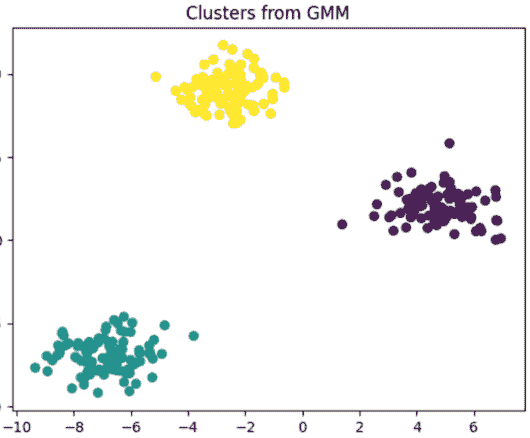

图 6.16 – 使用 GMM 的聚类可视化

#### 幂迭代聚类 (PIC)

**幂迭代聚类 (PIC)** 是一种可扩展且高效的图聚类算法，它采用幂迭代概念（一种常用于特征值求解器的方法），将高维数据点投影到低维空间。这种投影基于数据的相似矩阵，将数据点之间的成对相似性表示为图中的边，从而将聚类问题转换为图分区问题。

##### _PIC 的工作原理_

PIC 首先构建一个相似矩阵，将数据集表示为一个图，其中节点对应数据点，边反映这些点之间的相似性。然后，算法在此图上执行幂迭代，以计算图的修改归一化拉普拉斯矩阵的主特征向量。生成的特征向量反映了图上随机游走的稳态分布，捕获了数据的基本结构。随后，根据数据点在主特征向量中的分量将其映射到低维空间，并可以在此降维空间中应用传统的聚类技术（如 K-means）来识别聚类。

##### 应用

PIC 技术用于以下场景：

- **图像分割**：PIC 可应用于基于像素相似性将图像分割为连贯区域。通过将图像表示为图（像素为节点，边编码相邻像素之间的相似性），PIC 能够有效地将图像分割为代表不同对象或区域的片段。

- **社交网络分析**：在社交网络分析中，PIC 可以根据用户的交互和连接对其进行聚类，从而识别社区。该算法可以处理大规模网络，揭示网络中的潜在社区结构。

- **生物信息学**：PIC 在生物信息学中用于基于基因或蛋白质的表达模式或功能相似性对其进行聚类。这有助于识别功能相关的基因或蛋白质群组，这对于理解生物过程和疾病机制至关重要。

##### 优势

- **可扩展性**：PIC 的一个关键优势是其可扩展性。它可以高效地处理大规模数据集和高维数据，使其适用于大数据应用，在这些应用中，传统聚类算法可能会因计算限制而失效。

- **对噪声的鲁棒性**：PIC 的基于图的方法关注由主特征向量表示的数据全局结构，因此相比于依赖原始高维空间中局部信息或距离度量的方法，它对噪声和异常值更具鲁棒性。

- **定义相似性的灵活性**：该算法允许在定义数据点之间的相似性度量时具有灵活性，使其可以针对特定类型的数据或应用进行定制。这可以包括欧氏空间中的线性相似性，或针对图或流形等结构化数据的更复杂度量。

##### 局限性

- **对相似性度量的依赖**：PIC 的有效性在很大程度上取决于相似性度量的选择和相似矩阵的构建。不合适的相似性度量可能导致聚类结果不佳，因为它可能无法捕获数据点之间的真实关系。

- **参数选择**：PIC 涉及选择诸如聚类数量和相似矩阵的缩放参数等参数。不合适的选择可能会影响聚类质量，且可能没有简单的方法来最优地选择这些参数。

- **结果的可解释性**：PIC 获得的低维表示和生成的聚类并不总是易于解释，尤其是在原始特征空间具有清晰且有意义结构的应用中。图表示的抽象以及随后的基于特征向量的投影可能会模糊对聚类成员的直观理解。

PIC 通过利用图表示和特征向量计算，为聚类大规模和高维数据提供了一种强大的方法。其可扩展性和对噪声的鲁棒性使其适用于从图像分析到社交网络探索的广泛应用。然而，其有效性取决于对相似性度量、参数以及聚类结果可解释性的仔细选择，因此需要一种深思熟虑且知情的实施策略。

#### 使用幂迭代聚类的代码示例

现在我们已经了解了 PIC，让我们通过一个代码示例进行演示：

```
from sklearn.datasets import load_iris
##### Load the Iris dataset
iris = load_iris()
##### Features (sepal length, sepal width, petal length, petal width)
X = iris.data
##### Target labels (0: Setosa, 1: Versicolour, 2: Virginica)
y = iris.target
import seaborn as sns
import matplotlib.pyplot as plt
##### Load the Iris dataset
iris = sns.load_dataset("iris")
##### Scatter plot of Sepal Length vs. Petal Length
sns.scatterplot(x="sepal_length", y="petal_length",
                hue="species", data=iris)
plt.xlabel("Sepal Length (cm)")
plt.ylabel("Petal Length (cm)")
plt.title("Iris Dataset: Sepal Length vs. Petal Length")
plt.show()
```


这段代码将生成以下输出：

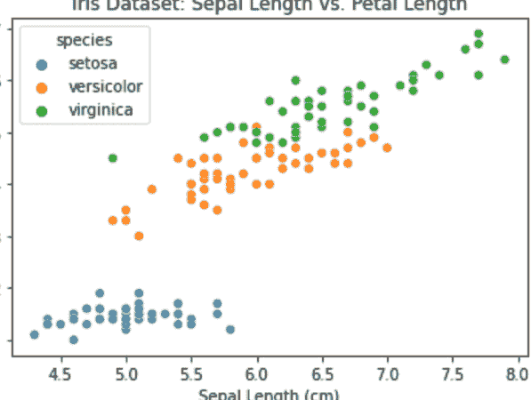

图 6.17 – 数据集可视化

以下代码片段导入所有所需库，创建 Spark 会话，并构建 PIC 聚类模型：

```
from pyspark.ml.clustering import PowerIterationClustering
from pyspark.sql import SparkSession
##### Create a Spark session
spark = SparkSession.builder.appName(
    "PICCClustering"
).getOrCreate()
##### Convert the scikit-learn data to a DataFrame
data = [(i, j, 1.0)
    for i in range(len(X))
    for j in range(len(X)) if i != j]
df = spark.createDataFrame(data, ["src", "dst", "weight"])
##### Create a PowerIterationClustering model
pic = PowerIterationClustering(k=3, weightCol="weight")
##### Run the PIC algorithm and get cluster assignments
assignments = pic.assignClusters(df)
##### Show the cluster assignments
assignments.show()
```

我们将得到以下输出：

| id | 簇 |
|----|---------|
| 96 | 0 |
| 56 | 2 |
| 112 | 2 |
| 120 | 2 |

在学习了几种不同的聚类技术和算法后，让我们来看看如何评估模型性能。

### 评估模型性能

在本节中，我们将查看几种评估指标来评估聚类模型的性能。

#### 评估聚类算法

评估聚类算法需要衡量算法识别出的不同集群是否有意义且分离良好。评估指标的选择可能取决于基准真值标签的可用性以及聚类技术的具体特征。以下是各种评估指标如何应用于您提到的聚类技术。

在评估聚类结果时，必须考虑应用程序的上下文和数据的特征。通常，会使用一组指标来全面评估聚类质量。此外，多次运行中的可视化检查、特定于领域的验证和稳定性评估可以补充这些定量指标，从而进行更强健的评估。

#### 选择评估指标

在评估聚类结果时，必须考虑应用程序的上下文和数据的特征。通常，会使用一组指标来全面评估聚类质量。此外，多次运行中的可视化检查、特定于领域的验证和稳定性评估可以补充这些定量指标，从而进行更强健的评估。

为本章讨论的聚类技术选择合适的评估指标，需要理解聚类算法的性质和数据的具体特征。不同的指标可以提供关于聚类质量的各种洞察，例如聚合度、分离度、与预定义类别的相关性，或（如果可用）与已知基准真值的匹配程度。

#### 常见评估指标

让我们来看看不同的评估指标：

- **轮廓系数**：如前所述，它衡量对象与其自身集群的相似度相对于其他集群的情况。轮廓系数范围从 -1 到 1。较高的值表示对象与其自身集群匹配良好，与邻近集群匹配较差。它适用于 K-means、二分 K-means、GMM 和 PIC，尤其是在没有基准真值可用的情况下。

- **Davies-Bouldin 指数**：一个评估集群内相似度和集群间差异的指标。较低的值表示更好的聚类。它适用于 K-means、二分 K-means 和 GMM 等方法，在这些方法中，希望将集群定义为紧凑且分离良好。

- **Calinski-Harabasz 指数**：也称为**方差比准则**（**VRC**），该指标评估所有集群之间分散度之和与集群内分散度之和的比率。较高的值通常表示定义更明确的集群，可用于 K-means、二分 K-means、GMM 和 PIC。

- **调整兰德指数 (ARI)**：通过考虑所有样本对，并计算预测聚类和真实聚类中被分配到同一集群或不同集群的样本对数量，来衡量两个聚类之间的相似度。当您有基准真值时，它特别有用。当有标记数据可用于比较时，ARI 可用于所有提到的聚类技术。

- **归一化互信息 (NMI)**：这是 **互信息**（MI）得分的归一化，用于将结果缩放到 0（无互信息）和 1（完美相关）之间。与 ARI 类似，它在有基准真值标签时使用，因此适用于在受监督环境下评估所有提到的聚类方法。

- **困惑度**：常用于 LDA 等主题模型，困惑度衡量概率分布预测样本的能力。较低的困惑度表示更好的泛化性能。

- **对数似然**：这表示在给定模型参数的情况下，观察到的数据的可能性。较高的值表明模型更好，但需要仔细解读，尤其是在比较参数数量不同的模型时。这在 GMM 中使用。

- **Dunn 指数**：它衡量不在同一集群中的观测值之间最小距离与最大集群内距离的比率。较高的值表示更好的聚类。

在 Spark 中使用轮廓系数来评估聚类模型，可以遵循以下一般步骤：

- 1. Import `ClusteringEvaluator` from Spark MLlib.
- 2. Instantiate `ClusteringEvaluator`, specifying the metric name as `silhouette` if necessary (this is the default metric).
- 3. Evaluate your model by passing the predictions DataFrame to the evaluate method of ClusteringEvaluator. The predictions DataFrame should include a prediction column indicating the cluster assigned to each instance.

虽然 Spark 内置的聚类评估指标支持目前主要集中在轮廓系数上，但 Spark 可扩展的特性允许根据需要实现其他指标，以满足您的特定评估标准和聚类分析目标。

#### 选择标准和条件

让我们了解使用不同评估指标的上下文：

- **缺乏基准真值**：在完全无监督的场景中，没有可用的外部标签时，内在指标（如轮廓系数、Davies–Bouldin 指数或 Calinski–Harabasz 指数）更为合适，因为它们仅依赖于聚类结果和数据本身。

- **存在基准真值**：当外部标签或基准真值可用时（即使仅针对数据子集），外在指标（如 ARI 或 NMI）能直接衡量聚类与已知标签匹配的程度。

- **集群的性质**：考虑预期的集群形状和分布。假设球形集群的指标（例如轮廓系数的一些解释）可能不适用于评估 GMM 生成的集群，因为 GMM 可以捕捉更复杂的椭圆分布。

- **可扩展性和计算成本**：对于非常大的数据集，计算密集型指标可能不实用。选择可以大规模高效计算的指标，或考虑使用数据样本进行评估。

- **可解释性**：指标的选择也应与利益相关者对可解释性的需求保持一致。例如，轮廓系数可以为非技术受众提供更直观的集群聚合度和分离度洞察。

- **多指标**：通常，依赖单一指标可能会产生误导。考虑使用一组指标来获得聚类性能的更全面视图。每个指标都可以突出聚类质量的不同方面，提供更细致的理解。

总结来说，为聚类技术选择评估指标涉及在算法的方法学特性、数据性质、计算上下文和聚类任务的具体目标之间取得平衡。了解每个指标的优势和局限性对于做出与分析目标一致的明智选择至关重要。

#### 提高模型性能

提高聚类模型性能需要多方面的方法。这些策略涵盖从数据预处理到算法特定调整和聚类后评估。


#### 所有模型的通用策略

提高模型性能的策略大致可分为以下几类：

- **数据预处理：**
  - **归一化/标准化：**通过缩放数据，确保所有特征平等贡献，尤其是对于 K-means 和 GMM 等对数据尺度敏感的算法
  - **噪声消除：**移除异常值和噪声，防止它们扭曲聚类结果
  - **降维：**使用 PCA 或 t-SNE 等算法降低维度，有助于缓解维度灾难并提高聚类质量

- **特征选择与工程：**
  - 识别并选择与聚类任务最相关的特征
  - 构建新特征，可能更好地捕捉数据中的固有结构

- **超参数调优：**
  - 尝试不同的超参数，例如 K-means 中的簇数量或 LDA 中的狄里克莱分布参数，以找到最佳设置

#### 特定模型策略

我们可以基于聚类技术关注以下策略：

- **K-means：**
  - **智能初始化：**使用 K-means++ 等方法进行更智能的质心初始化，以避免糟糕的局部极小值
  - **多次运行：**执行多次初始化并选择收敛效果最好的运行，以减轻随机初始化的影响
  - **肘部法则：**使用肘部法则帮助确定最佳簇数量，在模型复杂度与解释方差之间取得平衡

- **LDA：**
  - **优化主题连贯性：**调整主题数量和超参数（alpha 和 beta）以最大化主题连贯性，确保主题具有意义且可解释
  - **融入先验知识：**如果可用，通过先验知识融入领域知识以指导主题发现过程

- 二分 K-means：
  - 簇分割选择：制定或采用选择分割哪些簇的标准，例如选择 SSE 最高或规模最大的簇，以提高整体聚类质量
  - 停止准则：基于簇稳定性、SSE 或预定义的簇数量定义明确的停止准则，以避免过度分割

- **GMM：**
  - 协方差矩阵类型：尝试不同类型的协方差矩阵（全、共轭、对角、球形），以找到最适合数据分布的类型
  - 正则化：向协方差矩阵添加正则化项以确保数值稳定性，尤其在高维空间中

- PIC：
  - 相似度度量：仔细选择或设计用于构建图的相似度度量，确保其捕捉数据中的实际关系
  - 图稀疏化：考虑对图进行稀疏化以仅保留有意义的边，这可以降低计算复杂度并将聚类集中在强数据关系上

- 聚类后策略：
  - 聚类验证：使用内部和外部验证指标评估聚类质量并指导改进
  - 结果解读：邀请领域专家解读聚类结果，这可以提供模型是否捕捉到有意义分组的洞察
  - 迭代优化：聚类可以是一个迭代过程，初始结果可为后续的特征选择、算法调优甚至数据收集提供参考

改进聚类模型是一个迭代和探索性过程，通常需要在模型复杂度、可解释性和计算效率之间取得平衡。将这些策略根据数据集的特定特征和任务要求进行定制，可以带来更有意义和更有用的聚类结果。

提高分类模型性能涉及在模型开发过程的不同阶段应用多种技术。以下是一些增强模型准确性和有效性的策略：

- 数据质量和数量：
  - 增加数据量：更多的数据可以帮助模型更好地学习并良好地推广到未见数据。如果可能，考虑扩充您的数据集。
- **数据清洗**：移除异常值、处理缺失值并纠正数据集中的错误，以提高模型准确性。
- **特征工程**：通过领域知识从现有特征创建新特征。设计良好的特征可以显著提高模型性能。
- **特征选择与降维：**
  - **特征选择**：识别并保留最有信息量的特征，同时移除不相关或冗余的特征，以减少过拟合并提高模型性能。
  - **降维**：PCA 等技术可以减少特征空间，通过移除噪声来潜在地提高模型效率和性能。
- **选择合适的模型：**
  - **尝试不同的算法**：不同的模型有各自的优势和劣势。尝试各种算法（例如决策树、SVM 和集成方法），以找到最适合您数据的模型。
  - **集成方法**：结合多个模型的预测通常比任何单一模型产生更好的结果。袋装、提升和堆叠等技术是强大的集成方法，可用于提高分类性能。
- **超参数调优：**
  - **网格搜索和随机搜索**：这些是搜索多个参数值组合的系统方法，可为您的模型找到最佳设置。
  - **交叉验证**：使用交叉验证确保模型在数据集的不同子集上的性能是稳健的。
- **处理不平衡数据：**
  - **重采样技术**：对少数类进行过采样或对多数类进行欠采样以平衡数据集，并提高模型在少数类上的表现。
  - **代价敏感学习**：修改算法，使其对少数类的误分类惩罚重于多数类。
  - **使用合适的指标**：选择能提供模型在不平衡数据集上表现洞察的评估指标，例如 F1 分数、Precision-Recall AUC 或 Matthews 相关系数。

- **高级特征工程：**
  - 交互项：如果怀疑特征之间的交互可能具有预测性，请考虑添加捕捉此类交互的特征。
  - 多项式特征：使用多项式特征来建模非线性关系。
- **模型正则化：**
  - 应用正则化技术：L1（Lasso）和 L2（Ridge）等正则化技术可以通过惩罚模型中的大系数来防止过拟合。
- **数据变换：**
  - 特征缩放：标准化或归一化您的特征，使其处于相同的尺度。这对于对数据尺度敏感的模型（例如 SVM 或 KNN）尤为重要。
  - 数据编码：使用 one-hot 编码、目标编码或嵌入等技术正确编码类别变量，尤其对于需要数值输入的算法。
- **模型更新：**
  - 增量学习：使用新数据持续更新模型，以适应随时间的变化。
  - 反馈循环：将模型预测结果重新纳入训练，以纠正错误并适应新模式。
- **领域特定技术：**
  - 利用领域知识：融入专家知识可以指导特征工程、模型选择和结果解读。
  - 自定义损失函数：设计专门针对业务问题细微差别的损失函数。
- **实验严谨性：**
  - 系统性实验：详细记录实验日志，包括模型配置、结果和观察。实验跟踪工具和平台对此大有裨益。
  - 同行评审与协作：与同行协作进行代码评审和讨论。新视角可以提供新的洞察和改进想法。

改进分类模型是一个迭代过程，涉及尝试不同的策略、持续监控性能，并适应新数据和洞察。在模型复杂度、可解释性和性能之间取得平衡是开发有效且可靠的分类模型的关键。


### 摘要

本章我们了解到，聚类作为一种无监督学习形式，为在原始未标记数据中发现模式和结构提供了强大工具。通过将相似数据点分组，K-means、LDA、二分 K-means、GMM 和 PIC 等聚类技术揭示了跨市场细分到生物信息学等多个领域至关重要的隐藏洞察。我们在本章中进一步探讨了这一点。此外，我们了解到每种算法都有其独特的优势和挑战，无论是处理高维数据、确定最佳簇数量，还是管理模型复杂度。理解并应用正确的评估指标对于评估聚类质量和提升模型性能至关重要，如我们在本章所学。

随着数据复杂度的增加，稳健的聚类技术在提取有价值信息并辅助决策方面的重要性无论如何强调都不为过。随着持续进步和谨慎应用，聚类仍然是数据科学家工具箱中不可或缺的一部分，正如我们在本章所学。

在下一章中，我们将探讨构建推荐系统。
