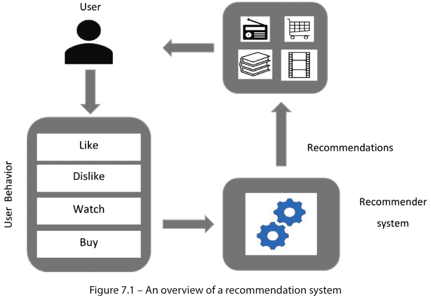
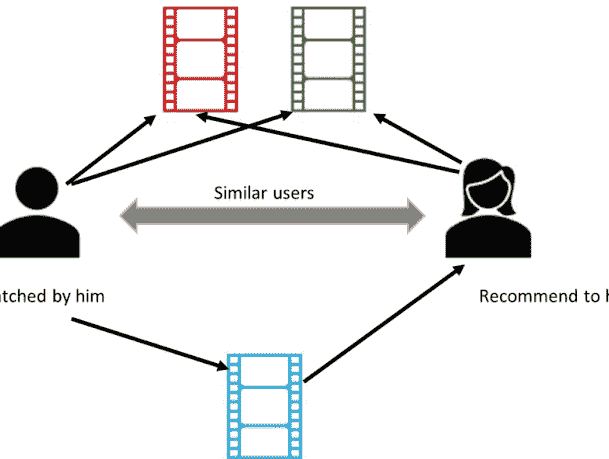
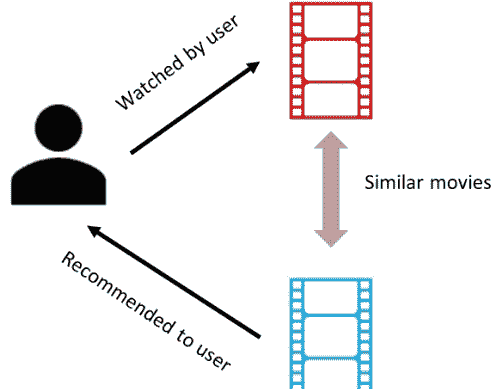
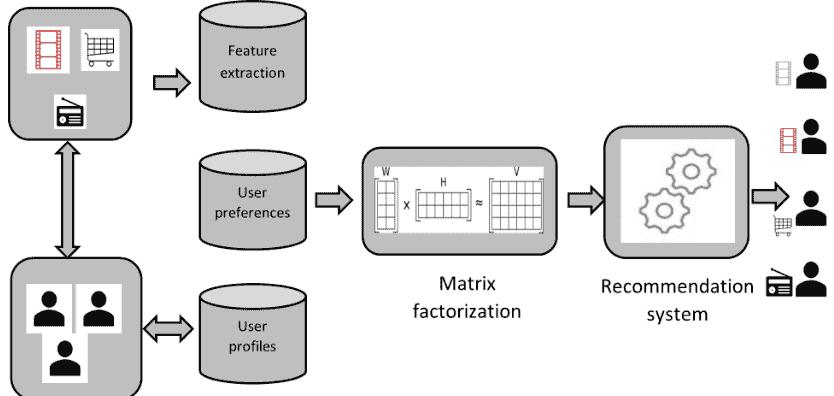
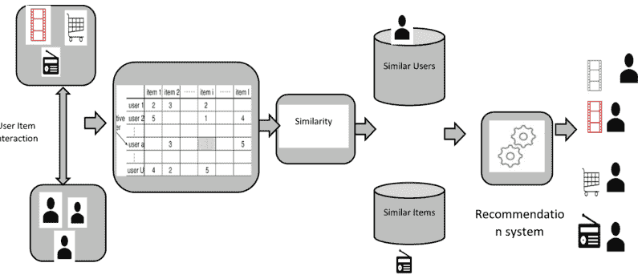

## 8 构建推荐系统

推荐系统是推动用户参与度、转化率和客户满意度的关键方面。难以想象没有个性化电影推荐的 Netflix 服务，或没有“购买了此商品的用户还喜欢……”推荐的 Amazon。个性化推荐是用户留存和收入增长的关键。eBay 和 Alibaba 等电子商务平台从个性化商品推荐中受益，Spotify 等音乐流媒体服务则根据用户偏好策划播放列表。推荐系统不仅仅是算法；它们是提升用户满意度、创造收入并塑造数字格局的战略工具。利用推荐系统从用户活动和洞察中获取动力的企业将获得竞争优势。

在本章中，我们将涵盖以下主要主题：

- 推荐系统概述
- 推荐系统的必要性
- 推荐系统的工作机制
- 推荐系统中的关键问题与挑战
- 提高推荐质量
- 使用 Apache Spark 构建推荐系统

本章结束时，您将扎实掌握使用 Apache Spark 构建推荐系统所需的理解和技能。

### 技术要求

您可以在 GitHub 上找到本章的代码文件，网址为 https://github.com/PacktPublishing/Apache-Spark-for-Machine-Learning/tree/main/Chapter07。

### 推荐系统概述

推荐系统是一种向用户提供个性化建议的智能算法。该系统的主要目标是帮助用户从海量选项中找到相关项目。如下图所示，这些系统利用用户偏好、行为和过去交互的数据来生成个性化推荐：



无论是在流媒体平台推荐电影、在电子商务网站推荐商品，还是策划音乐播放列表，推荐系统都能提升用户满意度和参与度。它们在数据驱动的世界中发挥着关键作用，帮助用户在海量在线选择中发现内容。

### 了解推荐系统的目的和重要性

推荐系统在我们的数字旅程中充当智能向导，根据用户的偏好和行为推荐相关项目。其目的跨越多个领域：

- **提升用户体验和参与度：**
  - **目的：** 推荐系统分析用户行为、偏好和历史交互，为每个人推荐量身定制的相关产品、内容或信息。
  - **影响：** 通过提供定制化推荐，企业可以提升客户参与度并建立忠诚度。无缝体验能让用户保持参与和满意。
  - 示例：
    - Netflix：个性化电影和电视节目建议让观众欲罢不能
    - Spotify：精选播放列表迎合个人音乐品味
    - YouTube：视频推荐引导用户浏览庞大的内容库

- 提高销售额和收入：
  - 目的：推荐能带动收入。当用户快速发现相关产品时，他们更有可能进行购买。
  - 影响：推荐能带动转化。当用户被引导至相关商品时，他们更有可能购买。
  - 示例：Amazon 将其 35% 的收入归功于推荐算法。

- 减少信息过载：
  - 目的：在选择无限的世界中，推荐系统过滤噪声
  - 影响：用户欣赏简化决策的平台，从而提高满意度并带来回头访问
  - 示例：
    - Google News：根据用户兴趣和行为筛选新闻文章，Google News 简化了信息消费。
    - eBay：提供个性化商品推荐可大大改善购物体验，尤其是对于库存种类繁多的类别。
    - PubMed：推荐系统向医疗专业人士推荐相关研究论文，根据其专业和兴趣提供定制建议，而无需他们手动搜索数千篇文章。

- 业务指标与品牌忠诚度：
  - 目的：推荐影响关键绩效指标 (KPI) 和客户忠诚度。
  - 影响：
    - 点击率、转化率和平均订单价值均受益于个性化建议
    - 由于有效推荐而在平台上花费更多时间的用户将成为忠实客户
  - 示例：Amazon 的推荐引擎对收入产生显著影响。通过推荐相关产品（交叉销售）和互补商品（追加销售），他们提高了平均订单价值。个性化推荐让用户保持参与，鼓励重复购买并培养忠诚度。

在当今竞争激烈的环境中，了解推荐系统对于调优算法的数据科学家或创建初创企业的企业家至关重要。此类系统对于提升用户满意度、推动收入和塑造数字交互至关重要。

### 各种推荐方法概述

推荐系统是通过推荐相关内容、产品或服务来提升用户体验的必要工具。这些系统利用不同技术提供个性化推荐。让我们探讨一些常见方法。

### 协同过滤方法

协同过滤是一种流行的推荐技术，利用用户-项目交互来进行个性化推荐。此方法的几个特点如下：

- 协同过滤是一种根据其他用户对项目的偏好和行为相似性来向用户推荐项目的推荐方法
- 核心思想是根据用户行为对用户进行分组，并利用一般群体特征向目标用户推荐相关项目
- 其运行原则是：行为相似的用户具有相似的兴趣和品味

下图展示了协同过滤的机制：



图 7.2 – 协同过滤的工作机制

协同过滤方法的不同类型如下：

- 基于内存的协同过滤：基于内存的协同过滤是一种仅依赖过去用户-项目交互的方法。您可以将其可视化为一个矩阵，其中行代表用户，列代表项目，每个单元格包含评分等交互数据。该方法有两种方法——用户-用户方法和项目-项目方法。这两种方法都根据这些交互计算用户或项目之间的相似性。使用这些相似性，将项目推荐给用户。但是，需要注意的是，这些方法不构建显式模型。

- 基于模型的协同过滤：推荐系统的基于模型的方法与基于内存的方法不同，它们利用交互数据创建预测模型。矩阵分解和隐因模型等技术属于此类方法。这些模型捕获数据中的潜在模式和关系，从而得出更准确的推荐。然而，这些模型需要更多计算资源，并且容易受到冷启动问题的影响，当新用户或项目缺乏足够数据时就会出现此问题。

### 基于内容的方法

基于内容的过滤是一种根据项目属性而非用户交互来推荐项目的推荐系统。例如，如果用户喜欢观看动作电影，系统将推荐类似的动作电影，如下图所示。该方法关注类型、关键词或描述等项目特征。当有大量项目元数据可用时，基于内容的方法效果较好，但它们难以推荐超出用户偏好的多样化项目，也称为偶然发现。



图 7.3 – 基于内容的推荐的工作机制


### 混合推荐系统

混合推荐系统旨在通过结合协同过滤和基于内容的方法来克服单一方法的局限性。这些系统同时利用用户-项目交互和项目属性，提供兼顾个性化与多样性的稳健推荐。加权混合模型和特征组合方法是可用于此目的的混合系统示例。

### 基于深度学习的推荐

推荐系统领域深受近期深度学习进步的影响。得益于从大规模数据中学习复杂模式的能力，神经网络已被证明是一种有价值的工具。神经协同过滤（NCF）和循环神经网络（RNN）等技术在提升推荐质量方面尤其有效。不过需要注意的是，这些方法需要大量数据和计算资源才能发挥作用。

总之，推荐系统在各个领域提供个性化体验方面至关重要。它们在无声中引导您的选择，无论您是在 Netflix 上连续观看节目还是在线购物，都能让您的数字之旅更加愉快且高效。

### 推荐系统的必要性

推荐系统的必要性和价值可以从多种角度来理解，例如个性化、用户参与度、业务增长、数据利用、内容发现以及供需匹配。我们将在以下子章节中进一步探讨。

#### 个性化

在当今信息爆炸的世界里，个性化不仅是一种可有可无的功能，更是一种必需品。推荐系统使用先进算法分析大量数据，为每位用户提供个性化体验。通过定制内容以适应个人偏好和品味，这些系统有助于创造独特且令人满意的用户体验。个性化促进用户与平台之间建立更深层的联系，从而产生更有意义且更相关的交互。

#### 用户参与度

推荐系统在提升用户参与度方面发挥着关键作用。通过展示与用户偏好和之前活动相匹配的选项，这些系统增加了用户交互的机会。这可能意味着在流媒体服务上观看另一个视频、在新闻网站上阅读另一篇文章，或在网上商店购买更多商品。提高参与度不仅能提升用户满意度，还能延长会话时长并增加访问频率，进而增强用户忠诚度。

#### 业务增长

从商业角度来看，推荐系统价值极高。它们可以通过提供准确且及时的建议来增加销售额和内容消耗，从而带来更高的转化率和更高的平均订单价值。例如，Amazon 的推荐引擎基于浏览历史、购买历史以及其他客户浏览或购买的商品来推荐产品，从而负责其相当一部分销售额。这种有针对性的方法不仅能提升销售额，还能通过使产品摆放与消费者倾向相匹配来提高营销效率。

#### 数据利用

用户每天产生的数据是企业的宝贵资源，而推荐系统则是挖掘其全部潜力的关键。这些系统使用用户数据（如交易历史、浏览习惯、评分和社交互动）来开发预测用户偏好的高级模型。这不仅有助于根据需求预测优化库存和内容管理，还能识别新兴趋势和用户细分群体，从而为产品开发和战略决策提供依据。

#### 内容发现

推荐系统对用户的最大好处之一就是内容发现。面对琳琅满目的产品、服务和内容，用户容易感到困惑或只坚持自己熟悉的选择。推荐系统帮助用户发现自己可能无法独立找到的新奇内容，拓宽视野并提升整体体验。这一点在 Netflix 或 Spotify 等平台上尤为明显，发现新电影、节目或音乐是用户体验中至关重要的一部分。

#### 供需匹配

推荐系统在将用户与提供商库存中合适的产品或内容连接起来方面发挥着至关重要的作用。这有助于确保有价值的产品或内容触达目标受众，同时最大限度地利用可用资源，从而促进更高效的市场。

推荐系统是当今数字世界不可或缺的一部分。它们通过推动个性化、参与度和业务增长，在用户体验中发挥着关键作用。这些系统利用数据来理解和预测用户偏好，帮助企业更有效地满足用户需求。它们还能促进内容发现并提升整体满意度。随着技术的进步，推荐系统的重要性和复杂性可能会增加，凸显其在塑造数字格局中不可或缺的作用。

### 推荐系统的工作机制

让我们了解推荐系统的工作机制，包括每种推荐系统类型的工作流程、优点、缺点及应用。

#### 基于内容的推荐系统

基于内容的推荐系统是一种向用户提供个性化推荐的流行方式。这类系统基于这样一种原理：可根据用户与项目的交互（如浏览历史或购买行为）来预测其兴趣。这种方法的主要目标是推荐与用户先前表现出兴趣的项目相似的项目。

#### 基于内容的推荐系统的工作流程

该系统的工作流程如下：

- 1. **特征提取与预处理：**
  - **特征提取**：我们首先确定推荐所需的基本特征。这些特征描述电影、文章和产品等项目，可包括类型、关键词、标签或文本描述。
  - **预处理**：通过分词、去除停用词并将特征转换为合适格式来清理和预处理数据。

- 2. **创建用户画像：**
  - 每个用户都由一个捕获其偏好的画像表示。该画像是根据用户交互过的项目提取的特征构建的。
  - 如果用户经常观看科幻电影，其画像将突出科幻类型。

- 3. **提取用户偏好：**
  - 根据用户交互（例如评分、点击和浏览），从其参与过的项目中提取相关特征
  - 这些偏好有助于构建用户画像

- 4. **通过矩阵代数学习用户画像：**
  - 使用矩阵代数技术（如矩阵分解）来学习用户画像
  - 目标是将用户偏好映射到捕获其品味的潜在因子上

- 5. **构建推荐：**
  - 根据用户画像，提供匹配其偏好的项目推荐
  - 使用各种相似度量（例如余弦相似度和皮尔逊相关系数）计算用户画像与其他项目之间的相似度
  - 推荐相似度得分高的项目

- 6. **部署推荐系统：**
  - 将推荐系统集成到应用程序或平台中
  - 随着新交互的发生持续更新用户画像
  - 监控系统性能并收集反馈以供进一步改进

下图展示了基于内容的推荐系统中涉及的各种元素、步骤和流程：



图 7.4 – 基于内容的推荐系统概览

#### 基于内容的推荐系统的优点

- 针对特定用户的推荐：
- 基于内容的系统为单个用户个性化推荐，无需依赖其他用户的数据，因此适用于大规模用户群。
- 这类系统旨在识别用户的特定兴趣并推荐符合其品味的小众项目。这种个性化方法旨在为用户提供更量身定制、更愉快的体验。


- 域知识利用：
  - 基于内容的系统使用手工构建的特征（如类型、关键词和描述）来个性化推荐
  - 当有可用的域知识时，它们可以通过创建用户偏好的精确模型来表现出色

- 避免“新物品问题”：
  - 基于内容的方法在处理新物品方面比协同过滤更有效。这意味着它们可以为之前未被评分或评论过的新物品提供准确的推荐
  - 基于内容的系统可以根据物品的描述来推荐物品，而无需依赖历史交互

#### 基于内容的推荐系统的缺点

- 探索有限：基于内容的推荐系统根据用户的先前兴趣向用户推荐物品。这些系统分析用户的过去行为和偏好以识别模式和相似性，然后推荐与这些模式匹配的物品。然而，由于无法超越用户当前的偏好，它们可能会错过多样化的推荐。

- 依赖手工构建的特征：推荐的质量取决于手工制作的特征的质量。如果这些特征次优，系统的性能可能会受到限制。

- 相关性与新颖性的平衡：在提供熟悉的推荐和引入新内容之间找到完美的平衡可能是一项困难的任务。基于内容的系统有时可能只推荐熟悉的选项，这可能会限制推荐的多样性。

#### 基于内容的推荐系统的应用及其影响

- 电子商务平台：Amazon 的推荐系统使用高级算法分析产品元数据，其中包括类型、描述和客户评论。根据用户的浏览历史、过去的购买记录和显式评分，系统会推荐相关产品。例如，如果你购买一本科幻书，系统会推荐类似的书名或你可能感兴趣的相关周边商品。

- 流媒体服务：Netflix 的推荐系统同时利用基于内容的方法和协同过滤。系统在用户观看电影或节目后，分析类型、演员和导演等元数据来推荐类似内容。例如，如果某人喜欢动作电影，系统会推荐其他动作紧凑的片名。

- 音乐平台：Spotify 使用节奏、类型和艺术家等歌曲特征来创建个性化播放列表。例如，如果你听欢快的流行歌曲，它会策划包含类似曲目的播放列表。这能提高用户满意度和参与度。

- 新闻聚合器和社交媒体：Facebook 的推荐算法分析用户互动（如点赞、分享和评论）以及主题和关键词等内容属性，以推荐相关的帖子、文章和朋友，使用户保持参与。

- 视频分享平台：YouTube 根据内容相似性推荐视频。例如，如果你观看烹饪教程，它会推荐更多烹饪相关内容。系统会随时间适应用户偏好，以最大化满意度。

- 在线广告：Google Ads 使用基于内容的推荐，通过分析网站内容、用户行为和关键词来定位特定受众，从而展示相关广告。例如，搜索徒步装备会显示与户外设备相关的广告。

总结：基于内容的推荐系统能改善各个领域的用户体验、推动销售，并简化内容发现。

#### 协同过滤推荐系统

协同过滤是一种根据与其他具有相似品味的用户的偏好和行为来向用户推荐物品的技术。与依赖物品特征的传统推荐方法不同，协同过滤分析用户之间的互动及其偏好来生成推荐。该方法基于这样一个概念：相似的用户倾向于喜欢相似的事物，旨在捕捉这些相似性，为用户提供更准确的推荐。

### 推荐系统中协同过滤的工作流程

该方法的工作方式如下：

1. **数据收集和用户行为：**
   - 使用大量用户的数据开发全面的用户行为数据库。
   - 收集评分、点击、浏览或显式偏好（例如电影评分和产品购买）等数据。

2. **用户-物品交互矩阵：**
   - 构建一个矩阵，每一行代表一个用户，每一列代表一个物品（例如电影和产品）。
   - 用用户反馈填充矩阵——显式（数值评分）或隐式（观看、点击和点赞）。

3. 相似度计算：
   - 衡量用户或物品之间的相似度。

4. 基于用户的协同过滤：
   - 识别具有相似偏好的用户。
   - 推荐与目标用户相似的用户喜欢的物品。例如，如果用户 A 和用户 B 有相似的电影偏好，则向用户 A 推荐用户 B 喜欢的电影。

5. 基于物品的协同过滤：
   - 关注物品之间的相似性。
   - 推荐与用户已经参与过的物品相似的物品。如果用户 A 喜欢 *黑客帝国*，则推荐其他科幻电影。

6. 嵌入和自动学习：
   - 为电影和用户分配标量值（嵌入）。
   - 这些嵌入捕捉特征（例如儿童内容与成人内容）。
   - 电影和用户嵌入的乘积预测用户偏好。
   - 自动学习嵌入，无需手动特征工程。

7. 部署和推荐：
   - 将协同过滤系统集成到应用程序或平台中。
   - 持续更新用户档案并监控系统性能。
   - 基于相似性和嵌入向量为用户提供个性化推荐。

让我们来看看协同过滤的优缺点。

### 协同过滤的优点

- 推荐准确性提高：
  - 协同过滤利用用户行为模式来进行准确的推荐。通过分析过去的互动，它识别相似的用户或物品，从而获得更好的预测。

- 鲁棒性和适应性：
  - 协同过滤能很好地适应用户偏好和物品可用性的变化
  - 它不依赖显式的域知识或特征工程，使其在不同领域之间具有通用性

- 缓解冷启动问题：
  - 冷启动问题发生在新用户或新物品的交互历史有限时
  - 即使直接数据稀缺，协同过滤也可以通过依赖相似用户或物品来提供推荐

- 提高用户满意度：
  - 通过根据用户行为推荐相关物品，协同过滤提高了用户参与度和满意度
  - 用户欣赏符合其兴趣的个性化推荐

### 协同过滤的缺点

- 实现和维护复杂：
  - 协同过滤需要仔细的实现和调优
  - 由于计算需求和可扩展性问题，管理大规模推荐系统可能具有挑战性

- 参数调优和权重：
  - 精细调整参数（例如相似度指标和邻域大小）对最佳性能至关重要
  - 参数选择不当可能导致次优推荐

- 潜在偏差：
  - 由于用户-物品交互的固有性质，协同过滤可能会引入偏差
  - 偏差可能源于流行度偏差（偏爱热门物品）或用户人口统计信息

- 上下文信息有限：
  - 协同过滤主要依赖过去的行为，缺乏上下文（例如时间、位置和用户人口统计信息）
  - 在协同过滤框架中纳入其他特征（侧面信息）可能具有挑战性

下图展示了协同过滤推荐系统中涉及的各种元素、步骤和流程：




图 7.5 – 协同过滤概览

总之，协同过滤利用用户交互和相似性来提供个性化推荐，改善各个领域的用户体验。

#### 基于用户的协同过滤工作流程

个性化推荐是通过利用相似用户的偏好和行为来生成的。这种技术根据用户的兴趣和行为向用户推荐项目。

工作流程如下：

- 1. 用户相似度计算：
  - I. 首先，我们创建一个矩阵，每一行代表一个用户，每一列代表一个项目（例如，电影、产品或歌曲）。
  - II. 我们根据用户与项目的交互来计算用户之间的相似度。常见的相似度指标包括余弦相似度、皮尔逊相关系数或杰卡德指数。
  - III. 偏好相似（即相似度得分较高）的用户被视为“邻居”。
- 2. 推荐生成：
  - I. 对于目标用户（我们要向其推荐项目的用户），我们识别其邻居（相似用户）。
  - II. 我们查看邻居喜欢、评分或与之交互过的项目。
  - III. 邻居喜欢但目标用户尚未看到的项目成为潜在推荐。
  - IV. 系统将这些项目推荐给目标用户。

总之，基于用户的协同过滤通过挖掘品味相似的用户的集体智慧，帮助个性化推荐。

#### 基于用户的协同过滤的实际案例

- 电影推荐：
  - 想象两个用户，用户 A 和用户 B，他们有相似的电影偏好。
  - 如果用户 A 观看并喜欢了电影 X，系统会向用户 B 推荐电影 X。

流媒体平台（如 Netflix）广泛采用这种方法，根据相似用户的喜好来推荐电影。

- 电子商务产品推荐：
  - 假设一组用户购买了与用户购物历史相似的产品。
  - 如果这些用户也购买了某个特定商品，系统会向该用户推荐该商品。
  - 电子商务平台（如 Amazon）利用这项技术个性化产品推荐。

- 音乐推荐：
  - 当用户有相似的音乐偏好时，协同过滤可以推荐他们可能喜欢的歌曲。
  - 如果用户 C 听的艺术家与用户 D 喜欢的艺术家相似，系统会向用户 D 推荐相关音乐。

流媒体音乐服务（如 Spotify）采用协同过滤来增强用户播放列表。

#### 基于项目的协同过滤

这是一种推荐技术，关注项目之间而非用户之间的相似性。让我们探讨一下它的工作原理。

#### 推荐系统中基于项目的协同过滤工作流程

其工作原理如下：

- 1. 项目相似度计算：
  - I. 我们创建一个矩阵，每一行代表一个项目（例如，电影、产品或歌曲），每一列代表一个用户。
  - II. 项目之间的相似度根据用户交互来计算。常见的相似度指标包括余弦相似度、杰卡德指数或调整后的余弦相似度。
  - III. 倾向于被同一组用户喜欢或交互的项目被视为相似。
- 2. 推荐生成：
  - I. 对于目标用户，我们查看其已评分或交互过的项目。
  - II. 我们根据其与其他用户的交互来识别相似项目。
  - III. 与用户已喜欢项目相似的项目成为潜在推荐。
  - IV. 系统将这些相似项目推荐给用户。

#### 基于项目的协同过滤的优点

- 基于项目的过滤计算效率高，因为不需要计算用户相似度。
- 对于新用户，它能更好地处理“冷启动”问题，因为它依赖于项目与项目之间的关系。

#### 基于项目的协同过滤的缺点

- 如果用户有独特的偏好，基于项目的过滤可能会错过个性化推荐。
- 它需要大量的用户交互数据集才能进行准确的推荐。

总之，基于项目的协同过滤帮助用户根据现有偏好发现相关项目。

#### 基于项目的协同过滤的实际案例

- 电影推荐：
  - 想象一个电影流媒体平台，用户在其中对电影进行评分和交互。
  - 基于项目的协同过滤能识别与用户已喜欢电影相似的电影。
  - 如果用户喜欢电影 X，系统会推荐其他高度相似的电影。

这种方法有助于根据项目相似性个性化电影推荐，提升用户的观看体验。

- 电子商务产品推荐：
  - 亚马逊等在线零售商使用基于项目的过滤来推荐产品。
  - 如果用户购买或查看了特定产品，系统会识别相关项目。

例如，如果用户购买了相机，系统可能会根据项目相似性推荐相机配件（镜头或三脚架）。

这项技术增强了交叉销售，并帮助用户发现相关产品。

- 音乐播放列表：
  - 流媒体音乐服务使用基于项目的协同过滤来创建个性化播放列表。
  - 如果用户喜欢特定艺术家或流派的歌曲，系统会推荐类似的曲目。

例如，如果用户喜欢艺术家 A 的歌曲，系统会建议艺术家 A 的其他歌曲或相似艺术家的歌曲。

通过利用项目相似性，音乐平台增强了用户参与度和发现度。

现在，让我们来看看 Apache Spark 中的一个算法。

#### 交替最小二乘法（ALS）——Apache Spark 中的协同过滤算法

ALS 是一种矩阵分解技术，常用于推荐系统中的协同过滤。它旨在通过将大矩阵分解为两个低维矩阵来预测缺失值（例如用户-项目评分）。ALS 属于协同过滤类别。

ALS 的优点包括：

- 可扩展性：ALS 适用于大型数据集和并行处理（非常适合 Spark）。
- 隐式反馈：它能有效处理隐式反馈（例如点击和浏览）。
- 冷启动：它能处理交互历史有限的新用户或项目。

ALS 可应用于电子商务，如下所示：

- 在电子商务中，ALS 可以根据用户的历史交互（购买、点击等）向用户推荐产品。
- 通过学习隐式特征，ALS 预测缺失的评分并推荐个性化产品。
- 研究表明，ALS 能显著降低均方根误差（RMSE），提高推荐准确性。

想象一下，我们有一个大表格，包含用户及其对不同电影（或产品）的评分。有些用户对喜欢的电影进行了评分，但表格中许多单元格是空的，因为用户并未观看或评分所有电影。

目标如下：

- ALS 应该通过预测帮助我们填充这些空单元格。
- 我们想找到两个特殊矩阵——一个用于用户（我们称之为 U），另一个用于电影（我们称之为 P）。
- 当我们将这些矩阵相乘时，应该得到原始用户-电影评分的估计值。

#### ALS 的工作流程

ALS 算法的工作原理如下。ALS 轮流改进 U 和 P。

- 1. 首先，它固定 U 并调整 P 以最小化预测误差。
- 2. 然后，它固定 P 并调整 U 以进行更好的预测。
- 3. 它不断交替，直到为 U 和 P 都找到良好的估计值。

让我们借助一个示例来了解这一点。假设我们想预测用户 1 会如何为电影 B 评分：

- 1. 我们从 U 和 P 中的随机值开始（例如猜测）。
- 2. ALS 根据现有评分调整这些值。
- 3. 例如，如果用户 1 喜欢电影 A（并给了它 5 分），我们调整 U 和 P 以匹配这一点。
- 4. 我们重复此过程，改进估计值直到收敛。

#### 使用“最小二乘法”使 ALS 模型收敛的优点

- ALS 旨在最小化预测评分与实际评分之间的差异。
- 这就像拼凑拼图碎片以获得最佳匹配。
- “最小二乘法”部分意味着通过最小化误差来找到最佳匹配。

#### 推荐系统中的关键问题和挑战

在使用推荐系统时，我们可能会遇到两种类型的问题：

- **冷启动问题**：冷启动问题出现在新用户或项目缺乏足够数据用于建档时。
- **数据稀疏性**：当有许多用户和项目，但只有小部分进行交互时，就会出现数据稀疏性。

这两种挑战都会影响推荐准确性。让我们在不同推荐方法的背景下详细探讨它们，以更好地理解这一点。


##### 冷启动

冷启动在推荐系统中是指当新系统缺乏用户或物品的足够交互历史时所面临的挑战。在数据不足的情况下，进行准确预测变得困难，影响推荐质量和效率。以下是一些克服与冷启动问题相关的挑战的技术：

- **基于内容的推荐：**
  - 对于新物品（冷启动物品），利用其内容特征
  - 分析物品属性（例如，类型、关键词和描述）以推荐相似物品
  - 当物品特征定义明确时，基于内容的方法效果良好

- **基于流行度的推荐：**
  - 最初，向新用户推荐热门物品
  - 基于流行度的推荐作为基准，直到可用个性化数据
  - 例如，推荐热门电影或畅销书

- **混合方法：**
  - 结合基于内容和协同过滤技术
  - 对冷启动物品使用内容特征，对现有物品使用协同过滤
  - 混合模型平衡准确性和多样性

- **人口统计信息：**
  - 收集用户人口统计数据（年龄、性别和位置）
  - 使用此人口统计信息进行初始推荐
  - 随着用户交互增多，切换到个性化推荐

- **勘探与开发：**
  - 为新用户/物品采用勘探策略
  - 显示多样化推荐以了解用户偏好
  - 逐渐转向开发（个性化推荐）

- **隐式反馈：**
  - 对冷启动用户使用隐式反馈（点击和浏览）
  - 分析隐式交互中的模式以推断偏好
  - 即使在显式评分稀疏时，隐式反馈也有帮助

- **主动学习：**
  - 在冷启动阶段提示用户提供反馈
  - 请他们对少量物品进行评分或表明偏好
  - 使用此反馈引导推荐过程

- **上下文信息：**
  - 考虑上下文因素（时间、位置和设备）
  - 感知上下文的推荐适应用户情况
  - 例如，根据位置推荐附近的餐馆

- **预热期：**
  - 对新用户延迟个性化推荐
  - 允许一个预热期，让用户探索系统
  - 逐渐过渡到个性化建议

- **用户引导：**
  - 指导新用户使用系统
  - 解释推荐工作原理并鼓励交互
  - 提供工具提示或教程

##### 数据稀疏性

数据稀疏性发生在事务或反馈数据稀疏时，使得识别邻居变得困难。例如，新产品通常只有很少的用户评论。这一限制影响了推荐质量和推荐系统中协同过滤的有效性。以下是一些克服与数据稀疏性问题相关的挑战的技术：

- **基于内容的推荐：**
  - 利用物品内容特征（例如，类型、关键词和描述）
  - 推荐与具有已知内容特征的物品相似的物品
  - 基于内容的方法适用于新物品或评分稀疏的物品

- **基于流行度的推荐：**
  - 最初，向所有用户推荐热门物品
  - 基于流行度的建议作为基准
  - 随着更多数据积累，逐渐过渡到个性化推荐

- **混合方法：**
  - 将协同过滤（用户-物品交互）与基于内容的方法相结合
  - 对现有用户/物品使用协同过滤，对新物品使用基于内容的过滤
  - 混合模型平衡准确性和多样性

- **矩阵分解技术：**
  - ALS 等技术对用户-物品交互矩阵进行分解
  - 这些方法通过从可用数据学习隐含因子来处理稀疏性
  - 正则化有助于防止过拟合

- **隐式反馈处理：**
  - 隐式反馈（点击和浏览）对稀疏数据很有价值
  - 根据置信度对交互进行加权（例如，更多点击意味着更强的偏好）
  - 使用隐式反馈推断用户偏好

- **用户和物品嵌入：**
  - 为用户和物品学习稠密表示（嵌入）
  - 嵌入捕获隐含特征并处理稀疏性
  - 基于神经网络的模型（例如，Word2Vec 和 item2vec）能有效地学习嵌入

- **辅助信息：**
  - 引入额外数据源（即，辅助信息）
  - 用户人口统计、社交关系或上下文可以增强推荐
  - 例如，考虑用户位置或交互时间

- **主动学习：**
  - 鼓励用户提供反馈
  - 提示他们对物品进行评分或表明偏好
  - 使用此反馈改进推荐

- **时间动态：**
  - 考虑用户偏好如何随时间变化
  - 衰减旧交互以给近期交互更高权重
  - 感知时间的模型能适应不断变化的偏好

- **迁移学习：**
  - 从相关领域迁移知识
  - 如果一个领域的数据稀疏，则利用另一个领域的信息
  - 跨领域推荐增强覆盖范围

既然我们了解了与推荐相关的问题和挑战，让我们探索改进推荐的不同方法。

#### 改进推荐质量

像任何其他机器学习算法一样，推荐算法也会遇到性能问题。然而，有几种技术可以改进推荐质量。让我们逐一看看这些技术：

- **超参数调优：**
  - 为 ALS 模型尝试不同的超参数
  - 关键超参数包括 `rank`（隐含因子数量）、`maxIter`（迭代次数）和 `regParam`（正则化参数）
  - 使用网格搜索或随机搜索等技术寻找最优值

- **特征工程：**
  - 除用户-物品交互外，加入额外特征（例如，考虑用户人口统计、交互时间或上下文信息）
  - 特征工程可以显著提升模型性能

- **隐式反馈处理：**
  - ALS 常用于隐式反馈数据（例如，点击和浏览）
  - 调整模型以有效处理隐式反馈
  - 探索对交互进行加权或使用置信度分数等技术

- **冷启动策略：**
  - 解决新用户或物品的冷启动问题
  - 在有足够交互可用之前，使用基于内容的推荐或混合方法

- **集成方法：**
  - 将 ALS 与其他推荐算法相结合
  - 集成方法（例如，堆叠）可以增强整体性能

- **正则化与过拟合：**
  - 对模型进行正则化以防止过拟合
  - 仔细调整正则化参数（`regParam`）

- **模型评估：**
  - 使用适当的评估指标（例如，RMSE 和 MPR）来评估模型性能
  - 比较 ALS 变体并选择表现最好的一个

现在，是时候评估推荐质量了。

#### 评估推荐

排序算法，也称为推荐系统，旨在根据特定训练数据为用户提供一组相关物品或文档。相关性的定义可能因应用而异。排序系统的指标旨在衡量这些推荐在不同情境下的有效性。有些指标将推荐文档与预定义的相关文档集进行比较，而其他指标可以使用数值评分。


下表列出了用于评估推荐的一些常用指标：

| 指标 | 定义 |
| --- | --- |
| 在 _k_ 处的精确率 | 在 _k_ 处的精确率是用于评估推荐系统准确性的性能指标。它衡量前 _k_ 个推荐文档中与用户真正相关的文档所占比例，并对所有用户求平均值。请注意，此指标不考虑推荐的顺序。 |
| 平均精度 (MAP) | MAP 是衡量推荐文档中有多少位于真实相关文档集合的指标，其中考虑了推荐的顺序（即，对高度相关文档的惩罚更高）。 |
| 归一化折扣累积增益 (NDCG) | 在 _k_ 处的 NDCG 是一种用于衡量推荐文档相对于真实相关文档相关性的指标。它计算前 _k_ 个推荐文档中相关文档所占的百分比，并考虑推荐的顺序。这意味着文档被假设按相关性递减的顺序排列。与在 _k_ 处的精确率不同，在 _k_ 处的 NDCG 在评估推荐质量时会考虑推荐的顺序。 |

##### 表 7.1 – 评估推荐系统所用指标概览

学习如何评估推荐后，我们将现在构建一个推荐系统。

#### 使用 Apache Spark 构建推荐系统

让我们通过一个代码示例来构建推荐系统。

以下代码段导入所有必需的库并创建 Spark 会话：

```
from pyspark.sql import SparkSession
from pyspark.ml.recommendation import ALS
from pyspark.ml.evaluation import RegressionEvaluator
##### Create a Spark session
spark = SparkSession.builder\
    .appName("AmazonProductRecommendation")\
    .getOrCreate()
spark.sparkContext.setLogLevel("ERROR")
```

然后，我们将数据加载到 DataFrame 中并将其作为输出显示：

```
df = spark.read.format('csv')\
    .option('header', 'true')\
    .option('inferSchema', 'true')\
    .option('timestamp', 'true')\
    .load('s3a://test234/ratings.csv')
##### Prepare the data (assuming you have columns: 'user', 'item', 'rating')
df = df.withColumnRenamed('userId', 'user')\
    .withColumnRenamed('movieId', 'item')\
    .withColumnRenamed('rating', 'rating')
df.limit(6).toPandas()
```

以下是输出：

| userid | movieId | rating | timestamp |
|---|---|---|---|
| 1 | 1 | 4.0 | 964982703 |
| 1 | 3 | 4.0 | 964981247 |
| 1 | 6 | 4.0 | 964982224 |
| 1 | 47 | 5.0 | 964983815 |
| 1 | 50 | 5.0 | 964982931 |
| 1 | 70 | 3.0 | 964982400 |

图 7.6 – 示例推荐数据集

下一个代码段通过将数据拟合到模型来创建 ALS：

```
als = ALS(
    rank=10, maxIter=10, regParam=0.1, userCol='user',
    itemCol='item', ratingCol='rating')
model = als.fit(df)
```

以下代码段通过评估指标评估模型性能：

```
evaluator = RegressionEvaluator(metricName="rmse",
    labelCol="rating", predictionCol="prediction")
predictions = model.transform(df)
rmse = evaluator.evaluate(predictions)
print(f"Root Mean Squared Error (RMSE): {rmse}")
```

以下代码段为所有用户运行推荐。它显示推荐输出：

```
##### Make recommendations for users (for example, user 0)
user_recs = model.recommendForAllUsers(5)
user_0_recs = user_recs.where(user_recs.user == 24) \
    .select(
        "recommendations.item",
        "recommendations.rating"
    ).collect()
print(f"Recommendations for user 24: {user_0_recs}")
```

我们将获得以下结果：

均方根误差 (RMSE): 0.5933279277739512
用户 24 的推荐: [Row(item=[944, 3397, 171495, 74282, 7121], rating=[4.727833271026611, 4.6474504470825195, 4.552536265353965, 4.4093074798583958, 4.3880014419555661])]

图 7.7 – 推荐评估指标输出

这结束了我们构建推荐系统的代码示例演练。

## 总结

在本章中，我们探索了推荐系统的复杂世界，揭示了使个性化推荐成为可能的技术和方法论。我们从推荐系统的概述开始，强调了它们在当今数字经济中的重要性。从提升用户参与度到推动收入增长，这些系统的影响在包括电子商务和流媒体服务在内的各个行业中都非常深远。

我们深入探讨了推荐系统的类型，区分了基于内容的、协同过滤和混合方法。每种方法都有其独特的优势和挑战，理解这些有助于设计最适合特定需求的系统。

本章还讨论了推荐系统面临的关键问题，例如冷启动问题、数据稀疏性和可扩展性。这些挑战对于确保推荐系统的有效性和效率至关重要，尤其是在它们规模扩大以处理海量数据时。

接着，我们转向实际方面，讨论如何使用 Apache Spark 构建推荐模型。通过利用 Spark 的 MLlib 和矩阵分解技术，我们可以实现既强健又可扩展的协同过滤算法。使用诸如准确率和精确率等指标评估模型性能，可确保所提供的推荐对用户来说既可靠又有价值。

在本章中，您深入了解了构建推荐系统的基础概念和高级技术。您现在具备设计、实现和评估有效推荐模型的技能，这些模型可以显著提升用户体验和业务成果。

在下一章中，我们将了解更多关于频繁模式挖掘的内容。
