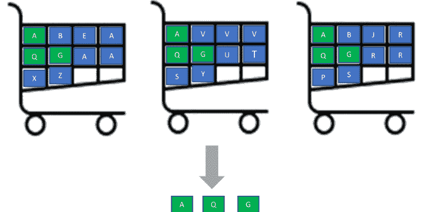
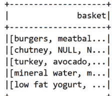
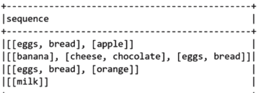
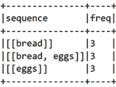

## 挖掘频繁模式

频繁模式挖掘是数据挖掘中的一项关键任务。其目标是识别数据集中重复出现的关联或关系。这些模式可能表示经常一起出现的项目、序列或子结构。通过检测频繁模式，我们可以深入了解相关项目并发现隐藏的规律。例如，在市场篮分析中，频繁模式揭示了客户经常一起购买哪些产品。理解这些模式有助于个性化推荐、异常检测和预测建模。频繁模式在从大型数据集中提取有意义的知识、指导决策以及增强各领域各种应用方面发挥着关键作用。

在本章中，我们将涵盖以下主要主题：

- 频繁模式的基本概念及发现模式和规则的重要性
- 频繁模式挖掘的应用和案例研究
- 频繁模式挖掘中的关键挑战
- 频繁模式挖掘算法
- 使用可扩展的频繁模式挖掘算法开发模型

本章结束时，您将扎实掌握使用 Apache Spark 挖掘频繁模式所需的技能。

### 技术要求

您可以在 GitHub 上找到本章的代码文件，网址为 https://github.com/PacktPublishing/Apache-Spark-for-Machine-Learning/tree/main/Chapter08。

### 频繁模式的基本概念及发现模式和规则的重要性

频繁模式挖掘 (FPM) 是数据挖掘中的一项关键任务，涉及识别数据集中频繁出现的模式或项集。这些模式有助于在各个领域（如市场篮分析、Web 挖掘、生物信息学和网络安全）中发现大型数据集之间的关联、相关性和结构。

FPM 是数据分析的强大工具，能够发现大型数据集中不易察觉的隐藏关系。其应用涵盖众多领域，帮助企业和研究人员从海量数据中提取有价值的洞察。

让我们借助下图了解市场篮分析的可视化。每个购物车中的每个方框都代表一件购买的商品。



图 8.1 – 购物车概览，每个购物车中都装有不同的商品

在这个图中，有三个购物车，里面装满了从杂货店购买的各种商品。每个商品都由购物车中的一个方框表示。检查三个购物车中的所有商品后，可以明显看出商品 A、Q 和 G 都出现在所有三个购物车中。这表明商品 A、Q 和 G 经常一起购买。基于此模式，如果有人购买商品 A 和 Q，则系统会推荐他们也购买商品 G。


频繁模式挖掘的关键概念包括以下内容：

- **项集**：项集是一个或多个项的集合。例如，在超市场景下，一个项集可能是 {牛奶, 面包, 黄油}。

- **支持度**：项集的支持度是指数据集中包含该项集的事务所占的比例或频率。它衡量项集在给定数据中的流行程度或常见程度。例如，如果 1,000 个事务中有 100 个包含 {牛奶, 面包}，那么 {牛奶, 面包} 项集的支持度为 10%。

- **频繁项集**：如果一个项集的支持度大于或等于用户指定的支持度阈值，则该项集被视为频繁项集。该阈值通常根据应用程序的具体要求设置。

- **关联规则**：这些是形式为 X => Y 的蕴含式，其中 X 和 Y 是项集。该规则表示，每当 X 项集出现时，Y 项集很可能出现在某个事务中。关联规则的两个关键指标如下：

  - **置信度**：衡量规则所做推断可靠性的指标。对于规则 X => Y，它是包含 X 的事务中同时也包含 Y 的事务所占比例。

  - **提升度**：提升度值衡量 X 和 Y 同时出现的频率比它们在统计独立时预期的频率高出多少。提升度值大于 1 表示 X 和 Y 同时出现的频率高于预期，表明存在正相关关系。

在本节中，我们了解了 FPM 的关键概念。在下一节中，我们将介绍 FPM 算法。

### 频繁模式挖掘的应用与案例研究

FPM 是数据分析中的关键技术，有助于在大型数据集中发现隐藏的结构。它在各个行业都有广泛应用，可增强决策和策略制定。以下是 FPM 的主要应用：

- **洞察客户行为**：在零售和电子商务中，分析交易数据以识别经常一起购买的商品，有助于企业了解客户的购买习惯。这些知识使公司能够优化其营销策略，例如通过定向广告、个性化推荐、交叉销售和追加销售。例如，如果面包和黄油经常一起购买，商店可能会将这些商品放在彼此附近以增加两者的销量。

- **改进商品摆放和店铺布局**：发现频繁项集有助于零售商通过将经常一起购买的商品放在彼此附近来设计更好的店铺布局。这不仅通过让购物更加便捷来提高客户满意度，还增加了冲动购买的机会，从而促进销售。

- **库存管理**：通过了解哪些商品经常一起购买，企业可以更有效地管理库存水平，确保热门商品库存充足且摆放位置得当。这减少了缺货和积压的情况，从而实现更高效的运营并降低成本。

- **制定有效的促销和折扣**：关联规则可以帮助企业开发捆绑优惠或对经常一起购买的商品提供折扣。这可以吸引更多客户并鼓励他们购买比原计划更多的商品。有效的促销直接影响销售量和客户留存率。

- **市场篮子分析**：这或许是 FPM 最经典的应用。它涉及分析客户交易数据，以找到经常一起购买的商品模式。零售商利用这些信息进行商品摆放、促销和交叉销售策略，优化商店和在线平台的布局以增加销售。

- **推荐系统**：FPM 是为电子商务网站、流媒体服务和内容提供商构建高效且准确的推荐系统的基础。通过分析用户行为模式，这些系统可以推荐用户可能喜欢的产品、电影或音乐，从而提高用户参与度和满意度。

- **医疗保健**：在医疗保健领域，模式挖掘可用于识别患者群体中出现的常见症状、诊断和治疗序列。这有助于预测疾病爆发、了解疾病共病情况，并提高诊断工具的准确性。

- **欺诈检测与安全**：银行和金融机构利用 FPM 检测可能表明欺诈活动的异常行为模式。这可能涉及识别偏离常态的不常见交易组合、账户活动或索赔。

- **制造业**：在制造业中，模式挖掘可帮助识别机器使用的频繁序列或系统故障的常见模式。这些信息对于预测性维护、质量控制以及优化生产流程以减少停机时间和提高效率至关重要。

- **Web 使用挖掘**：模式挖掘技术用于分析用户在网站上的导航模式。这可以帮助 Web 设计师优化网站架构、增强用户界面，并通过了解网站上最常访问的路径来创建更直观的用户体验。

- **生物信息学**：模式挖掘在生物信息学中用于基因序列分析和蛋白质结构预测。它有助于识别常见的序列或结构，这对于理解基因功能、进化生物学和疾病机制至关重要。

- **电信业**：在电信行业，FPM 用于了解通话记录、使用数据和服务故障中的常见模式。获得的洞察可为客户服务改进、网络维护以及使用模式中的欺诈检测提供信息。

- **客户关系管理 (CRM)**：CRM 系统利用模式挖掘分析客户数据和交互历史，以改进客户服务、个性化营销工作，并通过预测客户行为和偏好来增强客户保留策略。

- **供应链管理**：模式挖掘有助于识别供应链数据中的频繁模式，例如物流活动的常见序列或常规中断。这种理解可以带来更稳健的供应链设计、更好的库存管理和优化的物流。

这些应用展示了 FPM 在不同领域的多功能性和价值。通过提取和分析重复出现的模式，组织可以获得可操作的洞察，预见未来趋势，优化运营，并提供增强的服务或产品以满足用户需求。

FPM 是数据挖掘中的关键技术，已应用于众多领域，展示了其在从大型数据集中提取有用模式方面的多功能性和有效性。以下是一些展示 FPM 应用的最受欢迎的案例研究：

- **沃尔玛 – 市场篮子分析**：最经典的例子之一是沃尔玛利用市场篮子分析来优化其商品摆放和促销策略。通过分析交易数据，沃尔玛可以识别经常一起购买的商品，并相应调整其商店布局。这不仅通过让常购商品更容易获取来改善客户购物体验，还增加了交叉销售机会。

- **亚马逊 – 推荐系统**：亚马逊的推荐引擎使用物品对物品协同过滤，这可以被视为 FPM 的一种应用。该系统分析用户与产品交互的模式来推荐相似商品。这是亚马逊通过个性化推荐增加客户购买的关键驱动力。

- **Netflix – 流媒体内容推荐**：Netflix 使用包含 FPM 的复杂算法，根据用户的观看历史和相似用户的观看模式来推荐电影和电视节目。这种方法显著提高了用户参与度和满意度，使 Netflix 成为流媒体行业的领导者。

- **塔吉特 – 预测客户习惯**：塔吉特著名地使用了 FPM 和预测分析来预测客户购买，包括基于购买模式预测怀孕等敏感案例。通过识别购买数据中的频繁模式，塔吉特能够在最合适的时机向客户发送定制的优惠券和广告。

- **美国银行 – 欺诈检测**：美国银行等金融机构使用 FPM 检测交易数据中可能表明欺诈的异常模式。通过识别合法交易的常见模式，系统可以标记与这些模式显著偏离的交易，从而增强安全措施。

- **医疗保健 – 疾病爆发预测**：公共卫生组织使用模式挖掘分析医疗保健数据中的模式，例如症状或地理信息，以预测疾病爆发。例如，分析患者就诊和报告症状中的频繁模式，有助于早期识别和控制流感或 COVID-19 等爆发。


- eBay – Web 使用挖掘：eBay 使用 Web 使用挖掘来分析用户在其网站上的常见导航模式。从这些模式中获得的见解有助于改进网站设计、提升用户体验，并优化广告和促销的投放位置。

- Google – 搜索引擎优化：Google 使用模式挖掘技术，基于搜索查询和浏览历史记录来了解用户行为和偏好。这些信息有助于改进搜索算法，并提高搜索结果和广告的相关性。

- Spotify – 音乐推荐：Spotify 使用模式挖掘来分析用户的听歌习惯和音乐曲目的属性，以推荐用户可能喜欢的歌曲和艺术家。这不仅能让用户保持活跃，还能帮助新兴艺术家更容易被发现。

- LinkedIn – 专业人脉推荐：LinkedIn 利用模式挖掘，根据用户的职业经历、网络内的互动以及相似用户中观察到的模式，为用户推荐专业人脉和工作机会。

这些案例研究突显了 FPM 在广泛行业中推导可操作见解、提升用户体验、优化运营并推动战略决策方面的广泛适用性和有效性。

在下一节中，我们将探讨 FPM 面临的挑战。

### 频繁模式挖掘的主要挑战

FPM 是发现大数据集中关系和结构的强大工具。然而，由于数据复杂性、可扩展性和算法效率等几个固有问题，有效实现它可能面临挑战。以下是 FPM 中的一些主要挑战：

- 可扩展性与效率：FPM 中最重大的挑战之一是管理随数据规模增长而呈指数级增长的候选项集。项目的潜在组合数量随项目数量呈指数级增长，使挖掘过程在计算上昂贵且耗时。例如 Apriori 等算法会生成大量候选集并逐一检查频率，在大数据集上可能变得低效。

- 高维性：在许多现实应用中，数据集可能具有高维性，即包含大量项目或属性。这种高维性加剧了候选生成中的组合爆炸问题，并可能严重降低挖掘过程的性能。

- 稀疏数据：许多实际应用中的数据集（例如电子商务中的用户-项目交互数据或流媒体服务中的观看历史记录）都是稀疏的。这种稀疏性意味着许多项集不常出现，使得在海量可能的项目组合中识别有意义模式的任务变得复杂。

- 噪声和错误数据：噪声和错误等数据质量问题会显著影响 FPM 的结果。噪声可能导致误导性关联和无关模式，这些模式可能因其频率而在统计上显著，但在实践中并不有意义。

- 处理支持困境：确定将模式视为“频繁”的适当支持阈值（即最小频率）是一项非平凡的任务。阈值过高可能会错过有趣的模式，而阈值过低可能会产生大量模式，其中许多可能不有趣或无关。平衡这一点以在不淹没于噪声的情况下找到最具洞察力的模式是一项重大挑战。

- 融入领域知识：在许多情况下，领域知识对于解释挖掘发现的模式至关重要。将此知识融入挖掘过程以优先处理更相关的模式或指导探索可能很复杂，但通常对于获得可操作的见解是必要的。

- 模式评估与解释：即使在高效挖掘频繁项集之后，评估哪些模式真正有趣或有用仍然是一项挑战。“趣味性”的主观性以及模式的特定语境解释意味着通常需要额外的标准和后处理。

- 动态和不断发展的数据：在许多现代应用中，数据不是静态的，而是在不断演变。将 FPM 算法调整为适用于流式数据（其中旧模式可能变得无关紧要，新模式可能迅速出现），这带来了额外的挑战。

- 隐私问题：挖掘数据以发现模式可能引发隐私问题，尤其是在处理敏感个人数据时。确保挖掘过程符合隐私法规且不泄露个人用户信息变得越来越重要且具有挑战性。

- 与决策支持系统集成：最后，将 FPM 结果以决策者或最终用户易于使用和解释的方式集成到决策支持系统中并非易事。挖掘模式在实际应用中的可用性对于其实现最终价值至关重要。

应对这些挑战需要精巧的算法设计、周密的规划，以及通常结合多种技术和考量，以确保 FPM 在实际场景中既可行又有效。

### 频繁模式挖掘算法

已开发出多种算法，能够在大数据集中高效发现频繁项集和关联规则。不过，Apache Spark 提供了两种算法，我们将在下文中讨论。

#### FP-Growth

FP-Growth（即“频繁模式增长”）是一种用于在大数据集中发现频繁模式、关联和关系的强大数据挖掘技术。与也用于 FPM 的 Apriori 算法不同，FP-Growth 只需对事务数据集进行两次扫描，因此效率更高。它还不需要在频繁项集生成过程中生成候选集，从而节省计算资源和时间。

Apache Spark 中的 FP-Growth 算法有几个有价值的用例。让我们来了解前三个：

- **市场篮分析**：FP-Growth 广泛用于市场篮分析：
  - **目标**：发现经常一起购买的项目之间的关联
  - **示例**：如果客户购买花生酱，他们很可能也会购买果冻
  - **FP-Growth 的作用：**
    - 它可以高效地识别频繁项集，而无需生成候选集（与 Apriori 算法不同）
    - 它创建 FP-Tree 数据结构来表示项目共现

- **推荐系统**：FP-Growth 在构建推荐引擎方面发挥着关键作用：
  - **目标**：为用户提供个性化推荐
  - **示例**：根据用户的购买记录推荐相关产品
  - **FP-Growth 的作用：**
    - 它分析事务数据以查找模式
    - 它为项目推荐生成关联规则

- **异常检测和欺诈检测**：FP-Growth 可适配用于异常检测：
  - **目标**：识别异常模式或离群值
  - **示例**：检测欺诈性信用卡交易
  - **FP-Growth 的作用：**
    - 找到偏离正常行为的不频繁项集
    - 项目的不寻常组合可能表明存在异常

#### PrefixSpan

PrefixSpan 算法旨在解决序列模式挖掘问题，即在序列数据库中识别频繁子序列。序列模式挖掘旨在发现给定序列集合中所有频繁子序列（模式）。频繁子序列是指出现频率不低于用户指定的最小支持阈值的子序列。由于可能的子序列模式数量庞大，此任务具有挑战性。以往方法通常遵循类似 Apriori 的方法，旨在减少要检查的组合数量，但仍面临大型数据库或大量/长模式的挑战。

Apache Spark 中的 PrefixSpan 算法是挖掘频繁序列模式的强大工具。让我们来了解其主要用例：

- **序列模式挖掘：**
  - **目标**：在按时间排序的数据集中发现事件或动作的频繁序列
  - **示例**：分析点击流数据以查找网站上的常见导航路径
  - **PrefixSpan 的作用：**
    - PrefixSpan 通过投影序列前缀高效识别序列模式
    - 它避免显式生成候选集，因此更具可扩展性
    - 它适用于推荐系统、流程优化和行为分析

- **会话分析和个性化：**
  - **目标**：了解会话期间（例如网站访问或应用使用）的用户行为
  - **示例**：根据用户最近的互动推荐相关产品
  - **PrefixSpan 的作用：**
    - 它识别会话内频繁的动作序列
    - 它通过捕获用户偏好实现个性化推荐
    - 它有助于根据最近的行为定制内容或优惠

- **医疗保健和医学研究：**
  - **目标**：分析患者数据以发现反复出现的医疗模式
  - **示例**：识别常见的症状序列或治疗路径
  - **PrefixSpan 的作用：**
    - 从患者记录中挖掘频繁序列
    - 有助于疾病诊断、治疗规划和流行病学研究

### FPM 的代码示例

让我们回顾一下使用这两种讨论过的算法的代码示例。


#### 使用 FP-Growth 算法

让我们想象一个业务用例，涉及通过分析事务数据来了解哪些产品经常被一起购买，以确定商品之间的关联。例如，如果顾客经常一起购买薯片和莎莎酱，零售商可以战略性地将这些物品放在彼此附近以鼓励额外销售。使用频繁模式，我们可以根据过去的购买推荐相关产品（交叉销售），并创建产品捆绑包（例如，“买此商品获赠此商品”或“购买此商品可享受另一件商品的折扣”）以增加销售额。

以下代码段导入所有必需的库并创建 Spark 会话：

```
from pyspark.sql.functions import monotonically_increasing_id
##### Create a Spark session
spark = SparkSession.builder.appName(
    "NewsgroupsPreprocessing"
).getOrCreate()
spark.sparkContext.setLogLevel("ERROR")
```

以下代码段加载数据集并显示 DataFrame 输出：

```
store_data = spark.read.format('csv')\
  .option('header', 'true')\
  .option('inferSchema', 'true')\
  .option('timestamp', 'true')\
  .load('s3a://test234/store_data.csv')
store_data = store_data.withColumn(
    "id", monotonically_increasing_id()
)
store_data.limit(5).toPandas()
```

以下是输出：

| | _c0 | _c1 | _c2 | _c3 | _c4 | _c5 | _c6 | _c7 | _c8 | _c9 | _c10 | _c11 | _c12 | _c13 | _c14 | _c15 | _c16 |
|---|---|---|---|---|---|---|---|---|---|---|---|---|---|---|---|---|---|
| 0 | 虾仁 | 杏仁 | 牛油果 | 蔬菜 | 绿色混合菜 | 青葡萄 | 全麦面粉 | 山药 | 乳清干酪 | 能量饮料 | 番茄汁 | 低脂酸奶 | 绿茶 | 蜂蜜 | 沙拉 | 矿泉水 | 三文鱼 |
| 1 | 汉堡包 | 肉丸 | 鸡蛋 | None | None | None | None | None | None | None | None | None | None | None | None | None | None |
| 2 | 酱泥 | None | None | None | None | None | None | None | None | None | None | None | None | None | None | None | None |
| 3 | 火鸡 | 牛油果 | None | None | None | None | None | None | None | None | None | None | None | None | None | None | None |
| 4 | 矿泉水 | 牛奶 | 能量棒 | 全麦米 | 绿茶 | None | None | None | None | None | None | None | None | None | None | None | None |

图 8.2 – 通过 DataFrame 输出的数据集

以下代码段预处理数据以对齐数据结构：

```
from pyspark.sql.functions import array,array_except,array_distinct
store_data = store_data.select(
    array(
        store_data._c0, store_data._c1, store_data._c2,
        store_data._c3, store_data._c4, store_data._c5,
        store_data._c6, store_data._c7, store_data._c8,
        store_data._c9, store_data._c10, store_data._c11,
        store_data._c12, store_data._c13, store_data._c14,
        store_data._c15, store_data._c16, store_data._c17,
        store_data._c18, store_data._c19
    ).alias("basket"))
store_data.show(5,truncate=True)
```

让我们看看生成的输出：



图 8.3 – 预处理后的数据输出

接下来，代码为 FP-Growth 算法设置参数。然后将数据拟合以生成模型。它显示频繁项集和关联规则：

```
from pyspark.sql import SparkSession
from pyspark.ml.fpm import FPGrowth
##### Initialize the FP-Growth model
fp_growth = FPGrowth(
    itemsCol="basket", minSupport=0.05, minConfidence=0.2)
##### Fit the model to the transactions
model = fp_growth.fit(store_data)
##### Get frequent itemsets
frequent_itemsets = model.freqItemsets
##### Show the frequent itemsets
frequent_itemsets.show()
##### Get association rules
association_rules = model.associationRules
##### Show the association rules
association_rules.show()
```

此处显示经常购买的商品的输出：

| 项目集 | 频率 |
|---|---|
| [碎奶酪] | 393 |
| [碎奶酪, NULL] | 393 |
| [绞肉] | 737 |
| [绞肉, NULL] | 737 |
| [西红柿] | 513 |

仅显示前 5 行
图 8.4 – 显示经常购买商品的表格

以下输出通过显示每个项目的置信度、提升度和支持度来显示关联规则：

| 前件 | 后件 | 置信度 | 提升度 | 支持度 |
|---|---|---|---|---|
| [牛奶] | [null] | 1.0 | 1.0001333333333333333 | 0.12958272230369283 |
| [冷冻蔬菜] | [null] | 1.0 | 1.0001333333333333333 | 0.09532062391681109 |
| [汤] | [null] | 1.0 | 1.0001333333333333333 | 0.05052659645380616 |
| [全麦米] | [null] | 1.0 | 1.0001333333333333333 | 0.058525529929342755 |
| [碎奶酪] | [null] | 1.0 | 1.0001333333333333333 | 0.0525329929342755 |
| [松饼] | [null] | 1.0 | 1.0001333333333333333 | 0.09505599280095987 |

图 8.5 – 显示关联规则的表格

这完成了我们使用 FPGrowth 算法的 FPM 代码演练。

#### 使用 PrefixSpan 算法

让我们想象一个业务用例，涉及通过分析客户倾向于同时和按序购买的产品，来识别经常按顺序一起购买的产品。这种知识有助于定制营销工作并改进推荐系统。

让我们演练一下代码示例。以下代码段导入所有必需的库并创建 Spark 会话：

```
from pyspark.sql import SparkSession
from pyspark.sql import Row
from pyspark.ml.fpm import PrefixSpan
##### Create a Spark session
spark = SparkSession.builder.appName(
    "PrefixSpanExample"
).getOrCreate()
```

下一个代码段创建合成数据并通过 DataFrame 显示数据：

```
data = [
    Row(sequence=[["eggs", "bread"], ["apple"]]),
    Row(sequence=[["banana"], ["cheese", "chocolate"], ["eggs", "bread"]]),
    Row(sequence=[["eggs", "bread"], ["orange"]]),
    Row(sequence=[["milk"]])
]
df = spark.createDataFrame(data)
df.show(truncate=False)
```

我们将看到以下输出：



图 8.6 – 数据集输出

以下代码段为 PrefixSpan 算法设置参数，以查找频繁序列模式：

```
prefixSpan = PrefixSpan() \\
    .setMinSupport(0.5) \\
    .setMaxPatternLength(5) \\
    .setMaxLocalProjDBSize(32000000)
result = prefixSpan.findFrequentSequentialPatterns(df) \\
    .sort("sequence")
result.show(truncate=False)
```

以下是生成的输出：



图 8.7 – 频繁序列模式输出

至此，我们已完成使用 PrefixSpan 算法的 FPM 代码示例演练。

### 使用可扩展频繁模式挖掘算法开发模型

让我们想象本章前面“使用 FP-Growth 算法”部分中介绍的相同业务用例。

以下代码段导入所有必需的库并创建 Spark 会话：

```
import numpy as np
import pandas as pd
import matplotlib.pyplot as plt
from pyspark.sql.functions import monotonically_increasing_id
spark = SparkSession.builder.appName(
    "NewsgroupsPreprocessing"
).getOrCreate()
spark.sparkContext.setLogLevel("ERROR")
```

以下代码段加载并显示数据：

```
store_data = spark.read.format('csv')\\
    .option('header', 'true')\\
    .option('inferSchema', 'true')\\
    .option('timestamp', 'true')\\
    .load('s3a:///test234/store_data.csv')
store_data = store_data.withColumn(
    "id", monotonically_increasing_id() )
store_data.limit(5).toPandas()
```

然后我们得到以下输出：

| | 虾仁 | 杏仁 | 牛油果 | 蔬菜,混合 | 青葡萄 | 全麦面粉 | 山药 | 乳清干酪 | 能量饮料 | 番茄汁 | ... | 绿茶 | 蜂蜜 |
|---|---|---|---|---|---|---|---|---|---|---|---|---|---|
| 0 | 汉堡包 | 肉丸 | 鸡蛋 | None | None | None | None | None | None | None | ... | None | None |
| 1 | 酱泥 | None | None | None | None | None | None | None | None | None | ... | None | None |
| 2 | 火鸡 | 牛油果 | None | None | None | None | None | None | None | None | ... | None | None |
| 3 | 矿泉水 | 牛奶 | 能量棒 | 全麦米 | 绿茶 | None | None | None | None | None | ... | None | None |
| 4 | 低脂酸奶 | None | None | None | None | None | None | None | None | None | ... | None | None |

5 行 × 21 列

图 8.8 – 数据集概览

以下代码段执行数据预处理：

```
from pyspark.sql.functions import array, array_except, array_distinct
store_data = store_data.select(


array (
    store_data.shrimp, store_data.almonds,
    store_data.avocado, store_data.vegetables_mix,
    store_data.green_grapes, store_data.whole_wheat_flour,
    store_data.yams, store_data.cottage_cheese,
    store_data.energy_drink, store_data.tomato_juice,
    store_data.low_fat_yogurt, store_data.green_tea,
    store_data.honey, store_data.salad,
    store_data.mineral_water, store_data.salmon,
    store_data.antioxidant_juice, store_data.frozen_smoothie,
    store_data.spinach, store_data.olive_oil
    ).alias("basket")
)
store_data.limit(5).show(truncate=False)

让我们查看输出：

| 购物篮 |
|-----------|
| [虾, 杏仁,... |
| [汉堡包, 肉丸... |
| [调味酱, null, n... |
| [火鸡, 牛油果,... |
| [矿泉水, m... |

图 8.9 – 预处理后的数据输出

这结束了我们对代码示例的演示。

#### 在 Apache Spark 中实现

在 Apache Spark 中，可以使用 MLlib 库计算 MSE 和 RMSE 等指标，该库包括对 ALS 和评估实用程序的支持。如果需要针对特定指标（例如 `precision@k` 或 `recall@k`），Spark 还支持创建自定义评估器，这些指标可能需要直接从预测结果中计算。

通过利用这些指标，您可以评估 Spark 中 ALS 算法的性能，并改进模型以更好地适应用户的需求和偏好，从而最终提升推荐系统的有效性。

### 摘要

在本章中，我们广泛探讨了 FPM（频繁模式挖掘），这是数据挖掘的一个基本方面。我们首先了解了频繁模式的基本概念和重要性，强调了它们在不同领域的大型数据集中发现关联和相关性方面的实用性。我们深入研究了 FP-Growth 和 PrefixSpan 等 FPM 算法，并通过详细的案例研究，深入了解了它们的应用、优势和局限性。

评估模型性能至关重要，我们介绍了用于评估挖掘模式质量的基本指标和技术。此外，我们还讨论了各种增强模型性能的策略，以确保 FPM 过程的有效性和效率。

掌握这些技术后，您现在具备了挖掘数据中隐藏规律的能力，并可以将其应用于市场篮子分析和 Web 日志分析等实际场景，从而改进决策过程。本章获得的知识将使您能够利用 FPM 进行有见地的数据分析，并为数据驱动应用的发展做出贡献。

在下一章中，我们将探讨模型部署机制。
