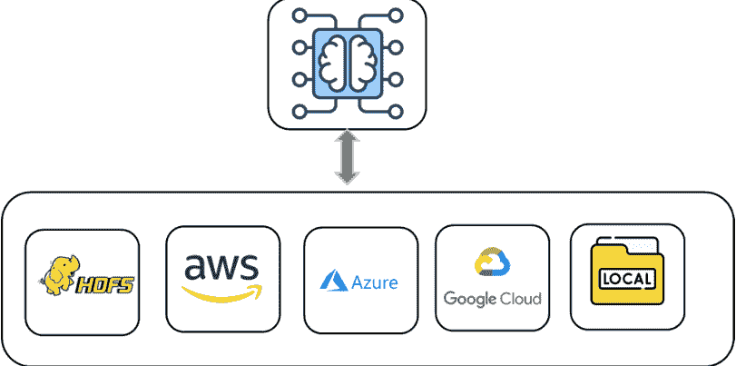

## 9 部署模型

模型部署是机器学习生命周期中的关键阶段，它弥合了模型开发与通过数据驱动决策提供实际价值之间的差距。部署是将机器学习模型集成到现有生产环境中，以便根据新数据进行实时预测的过程。了解模型部署的重要性，可以揭示其在将数据洞察转化为实际操作并实现机器学习实际效益方面的关键作用。

本章重点介绍在生产环境中部署模型的几个注意事项和策略。在本章中，我们将介绍以下主要主题：

- 模型部署的重要性
- 探索 ML 管道
- 模型序列化和存储
- 模型部署策略
- 监控和管理
- 可扩展性和性能优化

在本章结束时，您将了解部署模型所涉及的挑战以及如何克服这些挑战。

### 技术要求

本章的代码文件可在 GitHub 上获得，网址为 https://github.com/PacktPublishing/Apache-Spark-for-Machine-Learning/tree/main/Chapter09。

### 模型部署的重要性

模型部署是机器学习生命周期中的一个变革性阶段，它将理论模型转变为推动决策和业务流程的实用工具。它不仅涉及技术实现，还涉及将机器学习能力与业务目标和流程进行战略对齐。因此，确保部署成功不仅关乎技术熟练度，还关乎将分析洞察融入组织运营的方方面面。

以下是几个突出模型部署重要性的关键方面：

- **实现业务价值**：部署机器学习模型的主要目标是获取可影响业务决策和策略的实用且可操作的洞察。如果没有部署，即使是最复杂的模型也只能停留在理论层面，无法为业务目标做出贡献。部署使模型能够影响现实世界的流程和结果，提高效率、降低成本，并可能创造新的收入来源。

- **解决方案的扩展性**：部署涉及将模型集成到业务流程中，从而实现能够处理大量数据和交易的自动化、可扩展解决方案，这些数据和交易如果人工处理将不切实际。这种可扩展性确保机器学习的优势不局限于孤立的测试或小规模场景，而是扩展到更广泛的运营框架中。

- **反馈循环**：已部署的模型通过与现实世界数据交互，并生成可与实际结果进行衡量和评估的预测或结果，提供持续的信息流。这种反馈对于了解模型的有效性至关重要，并提供可用于进一步改进和优化模型性能的数据。从增量数据中持续学习为模型的自适应能力提供支持，从而随着时间的推移提高其准确性和相关性。

- **竞争优势**：在当今的数据驱动经济中，快速有效地部署机器学习模型的能力可以提供显著的竞争优势。已部署的模型可以改善客户体验、简化运营，并比仅依赖传统决策流程的竞争对手更快地适应不断变化的市场动态。

- **法规合规性和风险管理**：在许多行业中，机器学习模型被部署以确保符合法规要求或管理风险。例如，在金融领域，模型用于实时检测欺诈交易或评估信用风险。在这种情况下，部署不仅有益，而且对于满足法律和运营标准至关重要。

- **动态适应**：部署阶段允许模型在动态环境中运行，其中数据模式可能会不可预测地转移。通过持续监控模型性能并使用新数据重新训练模型，企业可以更有效地适应变化。这种动态适应对于保持机器学习解决方案的相关性和准确性至关重要。


- **与技术栈集成**: 有效的模型部署需要与现有技术栈集成，其中包括数据管道、数据库系统、应用服务器以及可能面向客户的应用程序。这种集成对于模型在业务流程中无缝运行至关重要，并且可以确保模型的洞察力可操作，并可被最终用户或决策者访问。

### 部署前注意事项

为部署选择合适的模型需要在技术性能、可扩展性、业务需求和运营限制之间取得谨慎的平衡。基于这些标准进行系统评估，有助于确保部署的模型实现预期的业务成果，并在其整个运营生命周期内保持成本效益和可维护性。

以下是几个关键考虑因素，用于指导选择适合部署的模型：

- **业务要求**: 首先清晰地理解并定义业务目标：
  - **目标对齐**: 确保模型直接有助于实现特定的业务目标，例如降低成本、增加收入、提高客户满意度或遵守监管要求。
  - **决策支持**: 评估模型输出将如何用于决策过程。考虑所需的预测类型、模型预测后将采取的行动，以及这些行动如何影响业务策略。
- **模型性能**: 评估模型性能不仅仅是查看准确率指标：
  - **准确率和误差指标**: 选择最能满足项目准确率要求的模型，同时保持其他指标（如精确率、召回率、F1 分数等，具体取决于当前问题）在可接受水平。
  - **验证技术**: 使用稳健的验证技术（如交叉验证）来确保模型能够很好地推广到未见数据。
  - **性能权衡**: 有时，如果一个更简单、准确率略低的模型在部署时速度显著更快或更具成本效益，那么它可能更可取。
- **可扩展性**: 考虑模型能够多好地扩展以满足业务需求：
  - **数据量和速度**: 评估模型处理生产环境中预期数据量和数据速度的能力。这包括其在批处理和实时预测中的性能。
  - **资源效率**: 评估模型所需的计算资源（CPU、内存和存储），以及这些资源在运营环境中是否可行。
  - **并行化和分布式**: 如果可扩展性是关键因素，请考虑利用 Apache Spark 等分布式计算框架的模型。

- **集成能力**: 模型能够轻松集成到现有业务流程和 IT 基础设施中至关重要：
  - **数据集成**: 确保模型可以轻松集成到现有的数据源和数据管道中。
  - **运营集成**: 评估将模型嵌入当前业务运营和工作流中的难易程度，而无需对现有系统进行重大更改。

- **可维护性和监控**: 已部署的模型需要持续的维护和监控：
  - **模型漂移**: 规划如何随着底层数据和关系的变化，随时间监控和处理模型漂移。
  - **更新程序**: 考虑模型更新或重新训练的难易程度。这包括新数据的可用性、重新训练的复杂性以及更新模型的部署。

- **监管和伦理考虑**: 确保遵守监管要求和伦理考虑：
  - **数据隐私**: 确保模型符合其运营所在司法管辖区相关的数据隐私法律。
  - **公平性和偏见**: 评估模型是否存在潜在偏见，并确保其在不同用户群体中公平运行。

- **成本**: 考虑部署和维护模型的总成本，包括以下内容：
  - **开发成本**: 这涵盖了开发和调优模型所花费的时间和资源。
  - **运营成本**: 这些是与基础设施、监控以及维持模型在生产环境中运行所需的人员相关的持续成本。

在探讨了选择合适模型的几个注意事项之后，让我们将重点转移到 ML 管道。

### 探索 ML 管道

ML 管道为在 Spark 中创建和管理机器学习工作流提供了一种强大的方法。它们提供了一套基于 DataFrame 构建的统一高级 API，使将多个转换和算法组合到单个管道中变得更加容易。以下是关键概念：

- **DataFrame**: ML API 使用 Spark SQL 中的 DataFrame 作为 ML 数据集。DataFrame 可以容纳多种数据类型，包括文本、特征向量、真实标签和预测值。

- Transformer: Transformer 是一种通过附加一个或多个列将一个 DataFrame 转换为另一个 DataFrame 的算法。例如，特征转换器可能将文本列映射到特征向量，从而创建一个新的 DataFrame。

- Estimator: Estimator 是一种将 DataFrame 拟合以产生 Transformer 的算法。例如，学习算法是一种 Estimator，通过在 DataFrame 上进行训练来产生模型。

- Pipeline: 管道将多个 Transformer 和 Estimator 链接在一起，以指定 ML 工作流。您在管道中定义转换和训练步骤的顺序。

- Parameter: 所有 Transformer 和 Estimator 共享一个通用 API 来指定参数。参数允许您自定义每个组件的行为。

例如，假设您想预处理文本数据、对类别特征进行编码并训练回归模型。您可以创建一个包含 StringIndexer（用于类别编码）、VectorAssembler（用于组合特征）和 LinearRegression（作为估计器）的管道。

- 模型选择（超参数调优）：管道使通过指定不同参数值并评估其对模型的影响来执行超参数调优变得容易。

请记住，Spark 中的 ML 管道受到 scikit-learn 的启发，并提供了一种构建、调优和检查实际 ML 工作流的便捷方式。

### 构建 ML 管道的代码示例

以下代码片段演示了在使用线性回归算法构建回归模型之前，对数据进行转换的几个特征工程函数。然后它展示了如何构建一个包含所有这些函数和算法的 ML 管道。

以下代码片段导入所有所需的库并创建 Spark 会话：

```
from pyspark.sql import SparkSession
from pyspark.ml.feature import (
    StringIndexer, OneHotEncoder, VectorAssembler)
from pyspark.ml.regression import LinearRegression
from pyspark.ml import Pipeline
spark = SparkSession.builder.appName(
    "MLPipelineExample"
).getOrCreate()
```

下一段代码片段加载数据（注意，此数据集仅用于演示的示例，并非真实数据集）。然后使用几个特征工程函数对数据进行预处理，以准备使用线性回归构建模型的数据。

```
data = spark.read.csv(
    "path/to/your/dataset.csv", header=True, inferSchema=True)
```

```
dest_indexer = StringIndexer(
    inputCol="destination", outputCol="dest_index")
pipeline = Pipeline(
    stages=[dest_indexer, dest_encoder, vec_assembler, lr])

dest_encoder = OneHotEncoder(
    inputCol="dest_index", outputCol="dest_vec")
vec_assembler = VectorAssembler(
    inputCols=["feature1", "feature2", "dest_vec"],
    outputCol="features")
lr = LinearRegression(featuresCol="features", labelCol="target")
```

```
pipeline = Pipeline(
    stages=[dest_indexer, dest_encoder, vec_assembler, lr])
model = pipeline.fit(data)
transformed_data = model.transform(data)
```

> 注意
> 此代码示例演示了设置 ML 管道，将多个处理步骤堆叠为 ML 管道的一部分中的一个步骤。

在下一节中，我们将了解如何存储模型。

### 模型序列化和存储

在了解了生成 ML 模型作为输出的 ML 管道之后，我们现在将了解在保存模型之前的模型序列化概念，以及在存储介质上存储模型。

#### 模型序列化

Apache Spark 中的模型序列化是指将训练好的机器学习模型保存到磁盘上的过程，以便以后可用于预测，而无需从头开始重新训练。这在生产环境中特别有用，因为模型是在大型数据集上训练的，并且需要部署以进行预测。Spark 提供了保存和加载模型的内置函数，这些函数便于轻松进行序列化，并确保模型可以在不同环境或不同时间可靠地使用。


#### Spark 中的序列化技术

Spark 中的序列化允许将模型保存为一种格式，该格式同时捕获模型的结构及其学习到的参数。其工作原理如下：

- **持久化**：使用 Spark MLlib 训练的模型可以持久化（或序列化）到存储层。这对生产系统至关重要，因为你需要在一段时间内维护模型，尽管可能会发生系统重启，或者需要在不同系统之间共享模型。
- **格式**：Spark 通常将模型保存在包含所有必要信息的目录结构中，包括关于算法的元数据和 ParamMap（参数）。数据以 Parquet 格式存储，Parquet 是一种高效的列式存储格式。

### 保存模型

在 Spark 中保存模型时，可以使用 `model` 类的一部分 `save` 方法。以下是使用 Python 代码保存模型的一般方法：

```
from pyspark.ml.classification import LogisticRegressionModel
model_path = "/path/to/save/model"
model.save(model_path)
```

这会将模型保存到指定路径，该路径可以位于本地磁盘或 HDFS 等分布式文件系统上。保存的模型包含部署模型以进行预测所需的所有信息，无需访问用于训练模型的原始代码或数据。

### 加载模型

若要加载已保存的模型，请使用与 `model` 类关联的 `load` 方法。以下是使用 Python 代码加载先前保存的模型的示例：

```
from pyspark.ml.classification import LogisticRegressionModel
model_path = "/path/to/save/model"
loaded_model = LogisticRegressionModel.load(model_path)
```

加载的模型现在已准备好进行预测，方式与原始模型保存前相同。

### 序列化的用例

序列化可应用于以下用例：

- **生产部署**：在开发环境或完整数据的子集上训练模型后，可以将模型序列化并移至生产环境，在该环境中可以对其进行反序列化并用于对新数据进行预测。
- **模型版本控制**：通过将模型保存到不同的目录或使用不同的名称，你可以保留模型的不同版本，这对于回滚、测试或合规目的非常有用。
- **分布式计算**：在训练在一个集群上进行，但需要在不同节点或集群上进行预测的环境中，序列化允许模型轻松地在系统的不同部分之间传输和使用。

### 注意事项

实现序列化时，需要考虑以下因素：

- **兼容性**：确保用于保存模型的 Spark 版本与加载模型的 Spark 版本兼容。Spark API 或底层模型表示的更改可能会导致兼容性问题。
- **安全性**：在保存可能包含敏感信息的模型时，应考虑存储介质的安全性。根据需要应采用加密和访问控制来保护序列化的数据。

#### 模型存储

Apache Spark 为序列化模型提供灵活的存储选项，使其高度适应不同的环境和存储要求。在 Spark 中序列化和保存模型时，可以从多个存储后端中进行选择，每个后端都有其自身的功能和用例。以下是一些最常用的存储选项：



图 9.1 – 模型存储选项概览

让我们来看看可用于存储模型的几种存储选项：

- **Hadoop 分布式文件系统 (HDFS)**：HDFS 是一种可扩展的分布式文件系统，旨在运行在商品硬件上。出于以下几个原因，它特别适合与 Spark 一起使用：
  - **容错性**：HDFS 提供高容错性，旨在部署在低成本硬件上。它存储多份数据副本以确保可靠性和可用性。
  - **可扩展性**：它可以扩展到数千个节点和 PB 级别的数据，非常适合存储大型机器学习模型和数据集。
  - **集成**：HDFS 与 Spark 所在的 Hadoop 生态系统原生集成，允许无缝的数据处理和存储，无需大量移动或转换数据。

- **Amazon 简单存储服务 (S3)**：Amazon S3 是一种对象存储服务，提供行业领先的可扩展性、数据可用性、安全性和性能。由于以下因素，它是存储 Spark 模型的热门选择：
  - **持久性和可用性**：Amazon S3 提供全面的安全性和合规性功能。此外，它将数据存储在多个系统上，确保高持久性和可用性。
  - **成本效益**：凭借多种存储类别和按使用量付费模式，S3 可能具有成本效益，尤其是对于不需要频繁访问的数据。
  - **全球可访问性**：存储在 S3 中的模型可以从任何位置访问，非常适合需要为不同地理位置的用户提供服务的应用程序。

- **Azure Blob 存储**：Azure Blob 存储是 Microsoft 针对云的对象存储解决方案。它经过优化，可存储大量非结构化数据，例如文本或二进制数据（包括机器学习模型）：
  - **可扩展性**：它旨在处理大量数据且没有实际限制，适合企业级应用程序。
  - **安全性**：Azure 提供强大的安全功能，有助于保护静态数据和传输中的数据。
  - **集成**：它可以轻松与其他 Azure 服务集成，是嵌入 Microsoft 生态系统的企业的首选。

- **Google Cloud Storage (GCS)**：GCS 是面向开发者和企业的统一对象存储，利用 Google 的基础架构。由于以下因素，它是存储 Spark 模型的可行选项：
  - **高性能和可扩展性**：GCS 构建在 Google 的核心基础架构上，并可根据业务需求自动扩展。
  - **数据冗余**：它提供多种数据冗余和存储位置选项，这对于灾难恢复和全球可访问性至关重要。
  - **互操作性**：GCS 支持 Google 其他存储和数据库解决方案使用的相同统一 API，确保跨各种服务的兼容性和易用性。

这些优势通常适用于所有云服务提供商。

- **本地文件系统**：对于开发或较小的非分布式应用程序，Spark 模型也可以存储在本地文件系统上。出于以下因素，这通常更简单且更快速，适合开发目的：
  - **易于使用**：本地存储模型无需配置网络权限或处理网络延迟即可管理。
  - **快速访问**：访问本地存储通常比远程存储更快，可以加快开发和测试周期。

### 注意事项

在为 Spark 模型选择存储选项时，请考虑以下因素：

- **数据安全性**：符合数据治理和安全策略
- **访问速度**：需要以多快的速度访问数据
- **成本**：存储成本可能会因服务和访问模式而有很大差异
- **地理位置**：靠近数据中心可能会影响性能

每种存储选项都有其优势，并适用于不同场景，具体取决于 Spark 应用程序的特定要求。在规划序列化和存储策略时，将这些特性与组织需求相匹配对于优化性能和成本至关重要。

##### 模型部署策略

模型部署策略在 ML 项目的成功中发挥着重要作用。基于业务需求和上下文，有多种部署模型的方法。让我们来看一些常用选项。


##### 批量评分

为 Apache Spark 模型安排批处理作业，以便在大型数据集上执行批量预测，涉及一系列步骤，用于在指定间隔或响应某些触发器时自动化和管理模型推理的执行。以下是关于如何有效设置和安排这些批处理作业的详细指南：

- 1. 定义批处理作业：在 Apache Spark 的上下文中，批处理作业通常涉及加载训练好的模型、准备数据、进行预测，然后处理输出。此作业可以封装在利用 Spark 功能的脚本中。你可以使用 Spark 支持的 Python（PySpark）、Scala 或 Java 编写此脚本。

- 2. 准备 Spark 脚本：创建一个执行以下任务的 Spark 脚本：
  - 加载模型：确保你的模型可访问，无论是本地存储还是存储在分布式文件系统（如 HDFS）或云存储（AWS S3、Azure Blob Storage 等）上。
  - 加载数据：读取要进行预测的数据。这可能是存储在数据库、数据湖中的数据，或是定期摄入的实时数据。
  - 数据预处理：应用模型期望作为输入的必要转换和特征工程步骤。
  - 运行模型：使用模型对新数据进行预测。
  - 保存/处理输出：将预测结果存储在数据库中，通过 API 发送到另一项服务，或触发另一个下游进程。

让我们看一下使用 Python 编写的 PySpark 脚本示例：

```python
from pyspark.sql import SparkSession
from pyspark.ml import PipelineModel

def batch_prediction_job():
    spark = SparkSession.builder \
        .appName("Batch Prediction Job").getOrCreate()
    model = PipelineModel.load("path/to/saved/model")
    data = spark.read.format("parquet").load("path/to/input/data")
    predictions = model.transform(data)
    predictions.write.format("parquet") \
        .save("path/to/save/predictions")
    spark.stop()

if __name__ == "__main__":
    batch_prediction_job()
```

- 3. **调度作业**：要安排和自动执行 Spark 脚本，可以使用多种作业调度工具。一些最常见的工具包括以下内容：
  - **Apache Airflow**：这是一款开源工具，旨在编排复杂的计算工作流和数据处理管道。在 Airflow 中定义 **有向无环图 (DAG)** 来调度和监控你的 Spark 作业。
  - **Cron 作业**：对于更简单的调度需求，你可以在托管 Spark 作业的 Linux 服务器上设置 Cron 作业。Cron 作业适用于按固定间隔运行脚本。
  - **Apache Oozie**：用于管理 Hadoop 作业的工作流调度程序。Oozie 可用于将 Spark 作业作为涉及其他 Hadoop 组件的更大工作流的一部分进行调度。

以下是 Cron 作业设置的 Bash 代码示例：

```bash
##### Edit the crontab: crontab -e
##### Add a line to run the script every day at 3 AM
0 3 * * * /bin/spark-submit --master local[4] /path/to/your_script.py
```

- 4. **监控和日志记录**：监控批处理作业的执行对于确保其正常运行至关重要。在 Spark 应用程序中使用日志记录来捕获关键事件和输出。此外，Airflow 等工具提供内置监控功能，允许你跟踪作业执行、重试失败的作业并对失败发出警报。

- 5. **优化和维护**：定期审查批处理作业的性能。根据作业需求优化资源分配，并随着数据或业务需求的变化更新工作流。

通过为 Spark 模型设置定时批处理作业，组织可以自动化其预测工作流，确保及时高效地处理大型数据集，以支持明智的决策和运营效率。这种设置不仅节省了时间，还有助于大规模利用大数据分析。

##### 配置调度器

让我们了解在 Apache Airflow 中配置调度器的各个步骤：

- 1. 定义指定任务顺序及其依赖关系的 DAG。
- 2. 创建一个任务来提交 Spark 作业，使用 SparkSubmitOperator 或通过调用 spark-submit 的 BashOperator。
- 3. 在 DAG 定义中定义执行频率来调度 DAG。

以下是相应的代码：

```python
from airflow import DAG
from airflow.providers.apache.spark.operators.spark_submit import (
    SparkSubmitOperator
)
from datetime import datetime

default_args = {
    'owner': 'airflow',
}

dag = DAG('spark_batch_prediction',
    default_args=default_args,
    schedule_interval='0 12 * * *',
    start_date=datetime(2021, 1, 1))

submit_job = SparkSubmitOperator(
    task_id='submit_prediction_job',
    application='/path/to/your-spark-job.jar',
    conn_id='spark_default',
    dag=dag)
```

##### RESTful API 集成

将 Spark ML 模型作为 RESTful 服务公开，使其可以轻松集成到 Web 应用程序和其他可使用 REST 服务的系统中。这对于将机器学习模型部署到生产环境中特别有用，各种客户端应用程序可以访问这些模型并使用它们进行预测。以下是将 Spark ML 模型作为 RESTful 服务公开的分步指南：

- 1. **准备你的 Spark ML 模型**：首先，确保你的 Spark ML 模型已经过训练、验证，并准备好进行部署。你应该已将模型保存为可加载并用于预测的序列化格式。
- 2. **选择 Web 框架**：选择用于创建 RESTful API 的 Web 框架。一些流行的 Python Web 框架包括 Flask 和 FastAPI。这些框架轻量且易于使用，能与基于 Python 的 Spark 应用程序良好协作。
- 3. **设置 Web 服务器**：使用 FastAPI 设置基本服务器，假设你的 Spark 环境已正确配置且 Spark 会话处于活动状态。
- 4. **使用 FastAPI**：FastAPI 是一个现代、快速且高性能的 Web 框架，用于基于标准 Python 类型提示构建 API。它尤其适用于异步操作以及对性能至关重要的场景：

```python
from fastapi import FastAPI
from pydantic import BaseModel
from pyspark.ml import PipelineModel
from pyspark.sql import SparkSession

app = FastAPI()
spark = SparkSession.builder.appName("Model Serving") \
    .getOrCreate()
model = PipelineModel.load("/path/to/saved/model")

class PredictionRequest(BaseModel):
    features: list # Adjust the request model based on your feature set

@app.post("/predict")
async def predict(request: PredictionRequest):
    feature_df = spark.createDataFrame(
        [tuple(request.features)],
        ["feature1", "feature2", "feature3"]) # Adjust schema accordingly
    prediction = model.transform(feature_df)
    prediction_result = prediction.collect()[0]["prediction"]
    return {"prediction": prediction_result}
```

- 5. **容器化应用程序**：部署应用程序时，使用 Docker 进行容器化是一种良好的做法。这使部署环境与平台无关，并简化了缩放。在 FastAPI 应用所在的同一目录中创建 Dockerfile：

```dockerfile
##### Use an official Python runtime as a parent image
FROM python:3.8-slim
##### Set the working directory in the container
WORKDIR /usr/src/app

##### Copy the current directory contents into the container at /usr/src/app
COPY . .
##### Install any needed packages specified in requirements.txt
RUN pip install --no-cache-dir -r requirements.txt
##### Make port 5000 available to the world outside this container
EXPOSE 5000
##### Define environment variable
ENV NAME World
##### Run app.py when the container launches
CMD ["python", "app.py"]
```

确保你有一个包含 Flask 和 PySpark 的 requirements.txt 文件：

```
flask
```

构建并运行你的 Docker 容器：

```bash
docker build -t spark-model-api .
docker run -p 4000:5000 spark-model-api
```

- 6. **公开端点**：设置好 API 后，公开 /predict 端点以接受特征数据并返回预测结果。如果需要，确保 API 已正确保护并经过身份验证。


- 7. **部署 API**: 在服务器上部署您的 API，以便客户端应用程序可以访问它。这可能是一个本地服务器、基于云的实例（AWS EC2、Azure VMs 或 Google Compute Engine），或者如果需要扩展，则是诸如 Kubernetes 之类的容器编排服务。

- 8. **测试和验证**: 使用诸如 Postman 之类的工具测试 RESTful API，或编写客户端代码向您的 API 发出请求。验证响应，以确保模型正确预测且 API 稳定。

- 9. **文档**: 记录您的 API 端点，包括所需的请求格式和响应结构。良好的文档对最终用户有效集成您的 API 至关重要。

> **可选 – 监控和维护**
> 为您的 API 设置监控，以跟踪其使用情况、性能和健康状况。监控将帮助您识别和纠正诸如停机、响应时间缓慢或预测错误等问题。

按照这些步骤，您可以成功地将 Spark ML 模型作为 RESTful 服务公开，使其在生产环境中可用于实时预测。这种设置允许您的模型被各种客户端应用程序使用，从而促进机器学习解决方案的更广泛集成和利用。

#### 自动化模型部署管道

在生产环境中部署机器学习模型需要仔细考虑。模型类型、大小、预期影响、敏捷性要求和托管成本等因素起着至关重要的作用。经实战检验的策略可以降低风险并优化部署速度。此外，利用容器化、自动化管道、云服务、可扩展基础架构和性能监控可以提高部署效率。

使用 Apache Spark 创建模型部署的自动化管道涉及多个步骤，以确保从模型训练到部署和维护的平稳过渡。这种设置通常利用 **持续集成和持续部署 (CI/CD)** 工具以及 Apache Spark 的功能来自动化机器学习模型的训练、评估、部署和更新。

以下是设置部署 Spark 模型的自动化管道的分步指南：

- 1. **环境设置**: 在开始之前，请确保您的开发和生产环境已正确安装 Apache Spark 以及项目所需的任何其他依赖项。这包括以下内容：
  - **Apache Spark 安装**: 确保在开发和生产环境中都已安装并配置 Spark
  - **版本控制**: 设置版本控制系统，例如 Git，以管理您的代码库
  - **项目结构**: 为 Spark 应用程序组织项目结构（包括您的训练脚本、数据架构等）

- 2. **开发**: 在本地开发您的 Spark 应用程序。这包括以下内容：
  - **数据准备**: 用于预处理和清理数据的脚本
  - **模型训练**: 用于训练模型的 Spark MLlib 脚本
  - **模型评估**: 用于评估模型性能的脚本
  - **模型序列化**: 将训练好的模型保存到存储系统的代码
  - **模型版本化**: 实施模型版本化，以跟踪不同时间或使用不同超参数集训练的不同模型版本

- 3. **部署**: 将模型部署到生产环境。这可能涉及以下内容：
  - 使用 Flask 或另一个 Web 框架设置前面讨论过的 RESTful API 层
  - 使用 Docker 容器化部署
  - 将容器部署到云服务或本地服务器

- 4. **持续集成设置**: 设置 CI 系统以自动化测试和构建您的 Spark 应用程序。可以使用诸如 Jenkins、CircleCI 或 GitHub Actions 之类的工具。

- 5. **CI 服务器配置**: 配置您的 CI 服务器以监控版本控制系统中的更改。

- 6. **构建管道**: 在您的 CI 系统中创建构建管道，执行以下操作：
  - 检出代码
  - 运行单元测试和集成测试
  - 打包应用程序（如有必要）

- 7. **自动化测试**: 实施每次将更改推送到存储库时都会运行的自动化测试：
  - **单元测试**: 为应用程序的各个组件编写测试
  - **集成测试**: 测试应用程序组件之间的集成
  - **性能测试**: （可选）包括检查更改性能影响的测试

- 8. **持续部署设置**: 设置 CD 系统以自动化部署您的 Spark 应用程序。这可以与用于 CI 的相同工具集成。

- 9. **部署脚本**: 编写将 Spark 应用程序部署到生产环境的脚本。
  这通常包括以下内容：
  - 从存储中拉取最新的模型工件
  - 将 Spark 作业部署到集群

- 10. **环境配置**: 配置您的生产 Spark 环境以接收部署。

- 11. **自动化**: 自动化部署过程，以便在 CI 管道的成功构建/测试时触发。

- 12. **监控和日志**: 实施监控和日志记录，以确保您可以跟踪应用程序的性能并诊断生产环境中的问题：
  - **日志记录**: 确保您的应用程序记录重要事件和错误
  - **监控工具**: 使用诸如 Prometheus、Grafana 或 Spark 自身的监控工具之类的工具来监控 Spark 作业的健康状况和性能

- 13. **反馈循环**: 设置机制，将生产环境中的信息反馈到开发环境。

- 14. **模型性能监控**: 定期监控模型性能和准确性。

- 15. **数据漂移检测**: 实施工具以检测输入数据中的漂移。

- 16. **重新训练管道**: 如果性能下降或检测到显著数据漂移，则自动重新训练您的模型。

  以下是使用 Jenkins 和 Docker 设置自动化 ML 管道以部署 Spark 模型的一些示例：
  - **Jenkins 管道**: 定义一个 Jenkins 管道来构建您的 Spark 作业，运行测试，并在测试成功完成后部署到生产环境。
  - **Docker**: 使用 Docker 容器化您的 Spark 环境。这可以确保不同环境之间的一致性并简化部署。

- 17. **Docker Compose**: 可选地使用 Docker Compose 来管理您的应用程序堆栈，包括 Spark 及其交互的任何其他服务。

如我们所见，构建部署 Spark 模型的自动化管道涉及集成各种工具和流程，以确保高效、可靠且易于维护的模型生命周期管理。此管道不仅自动化了常规任务，而且还有助于在机器学习应用程序扩展时保持其质量和可靠性。

#### 模型监控和管理

有几种方法可以监控模型的性能并采用管理技术来保持性能在可接受范围内。让我们详细了解这些技术。

##### 模型性能监控

监控生产环境中机器学习模型的性能至关重要，以确保它们随时间推移继续按预期运行。此过程涉及跟踪关键指标、设置实时监控仪表板以及配置警报以通知利益相关者潜在问题。以下是有效实施这些技术的方法：

- 1. **识别关键性能指标**: 在监控任何内容之前，您需要定义对您的模型而言哪些指标很重要。这些可能包括以下内容：
  - **准确率、精确率、召回率、F1 分数**: 常用于分类模型
  - **平均绝对误差 (MAE)、平均平方误差 (MSE) 和均方根误差 (RMSE)**: 常用于回归模型
  - **AUC-ROC**: 对二进制分类问题有用
  - **业务特定指标**: 示例包括转化率、用户参与度或收入影响，这些反映了模型对业务目标的实际影响

- 2. **数据日志记录**: 实施日志记录机制以捕获预测、实际结果和输入特征。这些数据对于随时间分析模型行为和诊断问题至关重要。可以记录的数据包括以下内容：
  - **输入特征**: 记录输入特征，以便日后分析哪些特征最具预测性并调试问题
  - **预测和结果**: 记录模型做出的预测以及在结果已知时记录实际结果
  - **时间戳**: 记录进行预测的时间，以跟踪随时间的变化

- 3. **设置仪表板**: 使用 Grafana 或 Kibana 等可视化工具，或 AWS CloudWatch 或 Google Cloud Monitoring 等专有工具来创建仪表板。这些仪表板可以显示关于模型性能和健康状况的实时指标。仪表板可以显示以下组件：
  - **实时监控**: 显示模型性能的实时数据，包括随时间变化的趋势和预测分布。
  - **历史分析**: 允许用户查询历史数据以识别模型性能中的模式或变化。
  - **仪表板指标**: 包含所有关键指标的可视化，例如随时间变化的准确率或 MSE，以及预测分数的直方图或箱线图。


让我们通过 Grafana 设置的一个示例：

```
##### Assuming Prometheus as the data source
datasources:
- name: Prometheus
  type: prometheus
  access: proxy
  url: http://your-prometheus-server
```

- 4. 实现异常检测和警报：设置异常检测，以识别模型性能何时显著偏离预期模式，这可能表明模型漂移、概念漂移或数据质量问题。一些方法包括以下内容：

  - **基于阈值的警报**：如果关键指标低于某个阈值或在短时间内发生剧烈变化，则触发警报
  - **统计过程控制**：使用控制图等技术监控预测性能，并根据统计标准对异常模式发出警报
  - **ML 专用监控工具**：考虑 Arize AI、Fiddler Labs 或 WhyLabs 等工具，这些工具专门用于监控 ML 模型，并可以提供高级分析和自动异常检测

以下是 Prometheus 警报规则的示例：

```
groups:
- name: model-performance
  rules:
  - alert: HighPredictionLatency
    expr: predict_latency_seconds > 0.5
    for: 1m
    labels:
      severity: page
    annotations:
      summary: High prediction latency detected
      description: Prediction latency is above 0.5 seconds for over 1 minute.
```

- 5. 定期模型评估：按固定间隔（例如每月或每季度）安排时间，针对最近的数据集对模型进行全面评估。评估模型的选项如下：

  - **必要时重新训练**：根据评估结果和模型性能下降的程度，决定是否使用新数据重新训练模型
  - **A/B 测试**：持续将当前生产模型与新训练的模型进行测试，以确定是否应该用新模型替换现有模型。

- 6. **反馈循环**：建立机制，捕获来自用户或下游系统的实时反馈，这对于评估模型的性能和影响非常宝贵。

  - **用户反馈**：在应用程序中实现允许用户对预测提供反馈的功能（例如，“此预测有帮助吗？”）
  - **反馈分析**：定期分析反馈，以确定模型中可能改进的领域

#### 模型更新与维护

维护和更新已部署的机器学习模型至关重要，以确保随着数据的演变和业务需求的变化，模型能继续发挥最佳性能。以下是有关更新和维护模型的综合策略和最佳实践，包括如何以最小或无停机时间处理重新训练和重新部署：

- **持续监控模型性能**：在考虑更新之前，必须建立强大的监控（如前所述）。持续监控有助于识别模型性能何时开始下降（模型漂移）或外部变化何时影响其准确性。需要监控的关键指标包括准确率、精确率、召回率、RMSE 和业务特定 KPI。应设置警报，以便在这些指标超过预定义阈值时通知团队。

- **定期模型评估**：定期使用当前数据集评估模型以检查其性能。这些评估可以按计划进行（例如每周或每月），也可以由输入数据模式或性能指标的重大变化触发。

- **数据管理**：要有效更新模型，需要：

  - **收集新数据**：持续收集和标记新数据以刷新训练数据集。这些数据应反映模型交互环境中的最近趋势和变化。
  - **特征修订**：当新类型的数据可用或特征的相关性发生变化时，相应更新特征工程步骤以包含或排除特征。
  - **重新训练策略**：模型重新训练有以下两种策略：

    - **增量训练**：对于支持增量训练的模型（例如某些决策树、在线学习算法），使用新数据逐步更新模型，而不是从头开始重新训练。
    - **全量重新训练**：定期使用完整的更新数据集重新训练模型，以充分融入新模式和新数据。对于不支持增量更新的复杂模型，通常需要采用这种方法。

  - **版本控制**：不仅对代码，而且对模型及其配置使用版本控制系统。此做法有助于管理模型的不同版本，并在需要时方便回滚到先前版本。

- **暗部署**：在完全替换旧模型之前，请务必执行以下操作：

  - 将新模型与现有模型并行部署（暗部署模式）。这种方法允许你在不影响系统输出的情况下，在真实条件下将新模型的预测与当前部署模型的预测进行比较。
  - 使用流量镜像技术，将传入请求复制并同时发送到旧模型和新模型，然后记录并比较结果。

- **A/B 测试**：逐步将一小部分用户暴露给新模型（A/B 测试），并衡量其性能和用户反馈，以与当前部署的模型进行对比。随着对新模型信心的增强，增加曝光度。

- **蓝绿部署**：将新版本与旧版本并行部署（绿色和蓝色环境）。一旦新版本完全运行并经过测试，只需将流量从旧版本切换到新版本即可。

  此方法可减少停机时间和风险，因为如果出现问题，可以快速回滚到旧版本。

- **自动化部署流程**：使用 CI/CD 流水线进行自动化测试和部署。自动化确保以受控、可重复的方式部署模型，并减少人为错误因素。

- **部署后监控**：新模型部署后，需密切监控其性能。确保监控系统能尽早捕获任何意外行为。如果模型在生产环境中的表现与测试环境不同，可能需要进行调整。

在下一节中，我们将学习如何扩展和优化模型。

#### 可扩展性与性能优化

部署既可扩展又性能优化的模型非常重要。让我们看看可以通过哪些方式实现这一点。

##### 资源管理

在使用 Apache Spark 部署模型时，有效管理内存和 CPU 等资源至关重要，尤其是在效率和性能可能直接影响运营成本和用户满意度的生产环境中。以下是在模型部署期间管理 Spark 资源的一些最佳实践。

###### 明智地配置 Spark 属性

调整 Spark 配置设置对于优化资源使用至关重要：

- **内存管理：**

  - `spark.executor.memory`：这控制每个执行器进程使用的内存量。
  - `spark.driver.memory`：这设置 Spark 驱动程序进程使用的内存量。

  根据可用总内存平衡这些设置至关重要，以避免内存不足错误和资源利用不足。

- **CPU 利用率：**

  - `spark.executor.cores`：这指定每个执行器使用的核心数。每个执行器更多的核心可以带来更好的吞吐量，但如果执行器数量受限，可能会降低并行度。
  - `spark.default.parallelism`：根据工作负载和可用核心数将其设置为适当级别。此设置确定由 `join` 和 `reduceByKey` 等转换返回的 RDD 中的默认分区数。

###### 动态分配

启用动态分配，以允许 Spark 根据工作负载动态调整执行器数量：

- `spark.dynamicAllocation.enabled`：设置为 `true` 以启用此功能
- `spark.dynamicAllocation.minExecutors` 和 `spark.dynamicAllocation.maxExecutors`：配置执行器的最小数量和最大数量
- `spark.dynamicAllocation.initialExecutors`：提供关于初始执行器数量的提示

动态分配对于高效处理不断变化的负载特别有用，因为它允许 Spark 在不需要资源时释放资源，并在负载增加时请求资源。

###### 持久存储优化

当模型部署涉及反复访问相同数据（例如，按固定间隔运行的批量预测）时，优化数据存储：

- 使用数据序列化来尽量减少内存使用。配置 `spark.serializer`。Kryo 序列化器（`org.apache.spark.serializer.KryoSerializer`）比默认的 Java 序列化器更高效。
- 根据访问模式和内存限制，使用适当的存储级别（`MEMORY_AND_DISK`、`MEMORY_ONLY`、`DISK_ONLY` 等）持久化数据。


##### 垃圾回收调优

调优垃圾回收器可以帮助更有效地管理内存，并减少因垃圾回收造成的停顿。

设置 `spark.executor.memoryOverhead` 以考虑线程、JRE 和其他本地开销等非堆内存使用情况。

根据应用程序的要求考虑使用不同的垃圾回收器。例如，对于堆大小较大的应用程序，G1GC 可能更合适。

##### 集群管理器中的资源分配

如果您使用集群管理器（例如 YARN、Mesos 或 Kubernetes），请配置资源分配设置，以确保 Spark 应用程序不会独占集群资源：

- 对于 YARN：`spark.yarn.executor.memoryOverhead` 指定每个执行器额外分配的内存量，该量高于 `spark.executor.memory` 中指定的值

- 对于 Kubernetes：使用资源请求和限制来指定每个 Spark 执行器 Pod 的 CPU 和内存

##### 精细调整并行度

根据数据和任务的性质调整并行度。

根据数据大小和操作设置 `spark.sql.shuffle.partitions`。默认值为 200，但您可能需要根据数据量增加或减少此值，以优化 `groupBy` 等任务期间的混洗操作。

#### 持续监控和优化

利用 Spark 的内置 Web UI 监控 Spark 应用程序的执行情况。查找完成时间异常长的阶段，或数据倾斜导致各节点工作负载不平衡的阶段。根据观察到的性能迭代优化您的设置。

遵循这些最佳实践，您可以确保 Spark 部署不仅在资源使用方面高效，而且在生产环境中保持高性能、可靠性和成本效益。

##### 性能调优

优化 Apache Spark 中已部署机器学习模型的性能对于确保高效的数据处理至关重要，尤其是在处理大型数据集时。提升模型性能的关键技术包括策略性数据分区、有效使用缓存以及精细调整其他 Spark 配置。以下是您可以实施这些策略的方法。

###### 数据分区

Spark 中的分区控制数据在集群中的分布，并对涉及混洗数据的操作（如连接、聚合和分组操作）的性能有重大影响。其中一些方法包括：

- 自定义分区：当您了解 Spark 未掌握的数据分布情况时，请使用自定义分区器。例如，如果已知某些键使用频率较高，请对数据进行分区，使具有相同键的所有记录位于同一节点上，从而最大限度地减少连接或聚合期间的数据混洗。

```
from pyspark.sql.functions import col
df = df.repartition(col("key_column"))
```

- 管理分区大小：调整分区数量，避免出现过小或过大的分区。过小的分区会导致管理大量小任务时产生过多开销，而过大的分区则可能导致内存问题并降低任务性能。

```
##### Repartition to a specific number of partitions
df = df.repartition(100)
##### Coalesce partitions when reducing the number of partitions to minimize shuffling
df = df.coalesce(50)
```

###### 缓存和持久化

将数据缓存在内存中可以显著提高 Spark 作业的性能，尤其是在需要多次访问相同数据以进行训练或预测时。

- 明智地使用缓存：根据数据集的重用情况决定哪些数据集需要缓存。不必要的缓存会导致内存使用量过高，并可能将其他所需数据逐出内存。

```
df.cache()
```

- 持久化级别：根据数据访问模式和内存可用性选择适当的存储级别。例如，当内存不足时使用 MEMORY_AND_DISK，以便 Spark 可以将数据溢出到磁盘，而不是重新计算。

```
from pyspark.storagelevel import StorageLevel
df.persist(StorageLevel.MEMORY_AND_DISK)
```

###### 广播变量

对于在多个节点上的 Spark 操作中频繁使用的小型参考数据集，请考虑使用广播变量。广播数据集可以通过在每个节点上保留一份小数据集的副本，来优化大数据集与小数据集之间连接操作的性能。

显式广播较小的 DataFrame 以优化连接操作。

Python 代码如下：

```
from pyspark.sql.functions import broadcast
large_df.join(broadcast(small_df), "key")
```

###### 优化序列化

序列化在性能中起着至关重要的作用，尤其是在数据需要跨网络混洗或缓存到磁盘时。

Spark 的 Kryo 序列化比 Java 序列化更快且更紧凑。启用 Kryo 并注册自定义类以获得最佳效果。

Python 代码如下：

```
spark.conf.set(
    "spark.serializer",
    "org.apache.spark.serializer.KryoSerializer")
spark.conf.set("spark.kryo.registrationRequired", "true")
```

###### 资源分配

正确配置资源分配至关重要，尤其是在共享环境中。

启用动态资源分配，以允许 Spark 根据工作负载调整执行器的数量。

让我们看看 Python 代码：

```
spark.conf.set("spark.dynamicAllocation.enabled", "true")
spark.conf.set("spark.dynamicAllocation.minExecutors", "1")
spark.conf.set("spark.dynamicAllocation.maxExecutors", "50")
```

###### 调优 Spark SQL

对于主要使用 Spark SQL 进行数据处理的部署，请使用以下内容：

- **SQL 配置**：调整 spark.sql.shuffle.partitions 等配置，以优化涉及混洗操作的操作性能。

Python 代码如下：

```
spark.conf.set("spark.sql.shuffle.partitions", "200")
```

- **基于代价的优化器**：为 Spark SQL 启用基于代价的优化，以便 Spark 根据数据统计信息选择最高效的查询执行计划。

Python 代码如下：

```
spark.conf.set("spark.sql.cbo.enabled", "true")
```

通过实施这些技术，您可以提升 Spark 机器学习部署的效率、速度和可扩展性，确保它们能有效处理大规模数据工作负载。

### 总结

在本章中，我们深入探讨了使用 Apache Spark 部署机器学习模型的全过程，强调了其在将数据驱动的洞察转化为实际业务价值方面所发挥的关键作用。我们从部署前的考虑因素开始，强调了在 Spark 生态系统中模型选择、数据准备和训练的重要性。然后我们探讨了模型序列化和存储选项，确保模型能够被保存并在未来使用时访问。

我们讨论了各种部署策略，包括批量评分，以及模型与 RESTful API 的集成，以实现更广泛的应用程序访问。概述了自动化部署流水线的创建和模型版本控制的最佳实践，以简化部署流程并保持一致性。

此外，我们还探讨了监控和管理已部署模型的关键方面，重点关注性能监控、更新和维护，以确保模型长期保持准确性和有效性。提供了可扩展性和性能优化技术，以高效管理资源并提升模型性能。

总而言之，健全的部署实践对机器学习项目的成功至关重要，它能使从理论模型到推动业务价值的可操作工具的过渡成为可能。通过遵循本章概述的策略和最佳实践，组织可以确保其机器学习模型得到有效的部署、维护和优化，从而实现可持续且有影响力的数据驱动决策。

至此结束。在本书中，我们探索了 Apache Spark 机器学习的迷人世界。我们深入了解了核心概念，利用 Spark 进行强大的模型开发。关键要点包括监督学习和非监督学习、推荐系统以及频繁模式挖掘。继续您的探索之旅，尝试不同的算法并将知识应用于现实世界的挑战。


