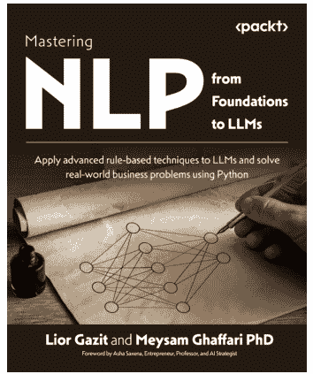

## 索引

### A

- AdaBoost 161
- 调整兰德指数 (ARI) 198
- 赤池信息量准则 (AIC) 190
- 用于特征提取的算法
  - 用于音频数据 61
  - 用于图像数据 61
  - 用于文本数据 60
- 通用数据处理 62
- 信号处理 61
- 时间序列数据 61
- MLlib 算法
  - 交替最小二乘法 (ALS) 17
  - 决策树 17
  - 高斯混合模型 (GMM) 17
  - 梯度增强树 (GBTs) 17
  - K-means 17
  - 线性回归 16
  - 逻辑回归 16
  - 朴素贝叶斯 17
  - PCA 17
  - 随机森林 17
  - SVMs 17
- 词频-逆文档频率 (TF-IDF) 17
- Word2Vec 17

- 交替最小二乘法 (ALS)
  - 算法 17, 221
  - 优势 222
  - 应用，在电子商务中 221
  - 优点 221
  - 目标 221
  - 工作流 222
- Amazon Redshift 29
- Amazon 简单存储服务 (S3) 25, 257
- 异常检测系统 42
- 反连接 50, 56, 57
- Apache Airflow 260
- Apache Hive 29
- Apache Oozie 260
- Apache Spark 11-13
  - 背景 11
  - 组件 14
  - 交叉验证 17
  - 特性 13
  - 动机 11
  - 管道 17
  - 现实世界示例 15
  - 设置 19, 20
  - 用例 15-18
  - 用于构建推荐系统 228-230

- Apache Spark，用于机器学习
  - 社区支持和生态系统 16
  - 与 Hadoop 生态系统的兼容性 16
  - 数据处理能力 16
  - 分布式计算 15
  - 易用性 16
  - 图处理 (GraphX) 16
  - 内存中处理 15
  - MLlib 16
  - 性能优化 16
  - 弹性分布式数据集 (RDDs) 15
  - 流式集成 16
  - 统一平台 15

- 人工神经网络 (ANNs) 140
- 自相关 61
- Avro 29
- Azure Blob Storage 26, 257

### B

- 词袋模型 60
- 基本聚合函数 36-38
  - 类型 36
- 贝叶斯信息准则 (BIC) 190
- 二分 K-means
  - 应用 188
  - 优点 188
  - 局限性 188, 189
- 自助采样法 136
- Bucketizer 72

### C

- Calinski-Harabasz 指数 198
- 卡方选择器 (ChiSqSelector) 85
- CI/CD 工具 263
- 类条件独立性 148

- 分类 128
  - 缺点 129, 130
  - 示例 128
  - 概述 128
  - 使用场景 129
  - 用例，在机器学习中 129

- 分类算法 130
  - 决策树分类器 133, 134
  - 分解机 (FMs) 150
  - 梯度增强树分类器 (GBT) 138
  - 逻辑回归分类 130, 131
  - 多层感知机 (MLP) 分类器 140, 141
  - 朴素贝叶斯 148
  - 一对其余分类器 (OvR) 145
  - 随机森林分类器 135, 136

- 分类模型
  - 性能，提升 159-161

- 分类模型性能评估
  - 算法特定考量 157
  - 二分类 153
  - 评估指标选择 157
  - 多分类 155, 156
  - 选择技巧 157

- 分类问题
  - 求解，使用真实世界数据集 161-165

- 聚类算法
  - 高斯混合模型 (GMM) 189
  - 线性 SVM 143
  - 幂迭代聚类 (PIC) 193

- 聚类模型性能
  - 聚类算法，评估 197
  - 评估 197
  - 评估指标选择 197
  - 提升，策略 200
  - 模型特定策略 200-203

- 特征提取器的代码示例
  - CountVectorizer 66, 67
  - FeatureHasher 68, 69
  - TF-IDF 63, 64
  - Word2Vec 64-66

- 特征转换器的代码示例 72
  - Bucketizer 78
  - MinMaxScaler 80, 81
  - Normalizer 81, 82
  - OneHotEncoder 75
  - PCA 82, 83
  - PolynomialExpansion 83, 84
  - RegexTokenizer 76
  - StandardScaler 79, 80
  - StopWordsRemover 77, 78
  - StringIndexer 73, 74
  - Tokenizer 76
  - VectorAssembler 72, 73

- 特征选择器的代码示例
  - Chi-squared Selector 86, 87
  - RFormula 88, 89
  - UnivariateFeatureSelector 89, 90
  - VectorSlicer 87, 88

- 频繁模式挖掘的代码示例
  - FP-Growth 算法，使用 240-242
  - PrefixSpan 算法，使用 242, 243

- 推荐系统的冷启动问题 223
  - 克服技术 223, 224

- 协同过滤
  - 推荐系统
    - 交替最小二乘法 (ALS) 221

- 逗号分隔值 (CSV) 29

- Apache Spark 组件
  - GraphX 14
  - MLlib 14
  - Spark Core 14
  - Spark SQL 14
  - Spark Streaming 14

- 基于成本的优化器 274
- CountVectorizer 62
- cron 作业 260
- 交叉连接 50, 55, 56
- 交叉验证 121, 122

- CrossValidator
  - 定义 123
  - 实例，拟合 124
  - 模型，评估 125
  - 预测，进行 124

### D

- 数据聚合 35
  - 基本聚合 36-38
  - 分组聚合 38-41

- 数据清洗 30
  - 数据，过滤 32
  - 重复项，删除 30, 31
  - 缺失值，填充 31
  - 缺失值，处理 31

- 数据摄入 24
  - 其他数据源 29
    - Amazon S3 25
    - Azure Blob Storage 26
    - 文件系统 25
    - NoSQL 数据库 28
    - 关系型数据库 27

- 数据连接 49
  - 因素 49

- 连接类型
  - 反连接 50, 56, 57
  - 交叉连接 50, 55, 56
  - 全连接 50, 54, 55
  - 内连接 50, 51
  - 左连接 50, 52, 53
  - 右连接 50, 53, 54
  - 类型 50, 51

- 数据日志 266
- 数据分区 272
  - 自定义分区 272
  - 分区大小，管理 272
- 数据预处理 23, 24, 200
  - 步骤 24
- 数据处理 23
- 数据平滑 42
- 推荐系统的数据稀疏性问题 224
  - 克服技术 224, 225
- 数据转换 30, 33
  - 列，重命名 33
  - 数据，排序 34
  - 数据类型，转换 33
  - 字符串，修剪 34
- 数据窗口化 42
  - 异常检测 42
  - 优点 43
  - 数据平滑和降噪 42
  - 示例问题 43-47
  - 时间序列数据的特征工程 42
  - 计算 LAG 函数值 47, 48
  - 必要性 43
  - 实时数据处理 42
  - 顺序数据，处理 42
  - 信号处理 42

- Davies-Bouldin 指数 198
- 决策树分类器
  - 应用 134
  - 优点 135
  - 局限性 135
- 决策树回归 103
  - 应用 103
  - 优点 104
  - 局限性 104

- 决策树 17
- 深度学习 10
- 深度 Q 网络 (DQNs) 10
- 有向无环图 (DAG) 260
- Docker 265
- Docker Compose 265
- Dunn 指数 198
- 动态资源分配 273

### E

- Elasticsearch 29
- 集成学习 10

- 评估指标
  - 调整兰德指数 (ARI) 198
  - Calinski-Harabasz 指数 198
  - Davies-Bouldin 指数 198
  - Dunn 指数 198
  - 对数似然 198
  - 归一化互信息 (NMI) 198
  - 困惑度 198
  - 选择准则和条件 199
  - 轮廓系数 198

- 二分类的评估指标
  - 准确率 153
  - AUC-PR 154
  - AUC-ROC 154
  - F1 分数 153
  - 精确率 153
  - 召回率 153

- 模型性能评估指标
  - 调整后的 R 平方 111
  - 平均绝对误差 (MAE) 111
  - 平均平方误差 (MSE) 111
  - 均方根误差 (RMSE) 111
  - R 平方 111
  - 选择 112

- 多分类的评估指标
  - 混淆矩阵 155
  - 汉明损失 156
  - 对数损失 156
  - 加权 F 度量 156
  - 加权 FPR 156
  - 加权精确率 156
  - 加权召回率 156

- 评估指标选择 157
  - 业务目标 157
  - 错误类型，优先级 158
  - 实现和验证 159
  - 模型比较和选择 158
  - 数据特性，考量 158
  - 现实约束 158
  - 法规和伦理考量 159
  - 统计学考量 159

- 评估指标，Spark 156
- 评估器
  - 定义 123
- Event Hubs 29
- 期望-最大化算法
  - (EM) 算法 189
- 提取、转换和加载 (ETL) 15

### F

- 分解机回归器 109
  - 应用 109, 110
  - 优点 110
  - 局限性 110

- 分解机分类器 150, 151
  - 应用 152
  - 优点 152
  - 局限性 152, 153

- 假正率 (FPR) 154
- 特征提取 60

- 特征提取器 59
  - 使用算法 60-62
    - 代码示例 63-69
    - 关键要点 60
    - 使用 Spark 算法 62
- FeatureHasher 62, 68
- 特征选择与工程 200

- 特征选择器 84
  - 代码示例 86
  - 关键要点 85
  - 使用 Spark 算法 85, 86
  - 用例 85, 86

- 特征转换器 59
  - 代码示例 72-84
  - 关键要点 70
  - 使用 Spark 算法 71, 72
  - 用例 70, 71
  - 使用 69

- 文件系统 25
- Flume 29
- 傅里叶变换 61

- 频繁模式挖掘算法 237
  - 代码示例 239

- FP-Growth 238
- PrefixSpan 238, 239
- 频繁模式增长 238

- 频繁模式挖掘
  - 应用 233-236
  - 案例研究 233-236
  - 关键挑战 236, 237
  - 关键概念 233

- 全连接 50, 54, 55

### G

- 高斯混合模型 (GMM) 17, 189
  - 应用 190
  - 优点 190
  - 局限性 190

用于代码示例
- 聚类 191-193
- 广义线性模型 (GLM)
- 算法 100
- 广义线性回归 100, 101
- 应用 102
- 优势 102
- 局限性 102
- 基因组学 42
- Google Big Query 29
- Google Cloud Storage (GCS) 257, 258
- 梯度增强树分类器 (GBT) 138
- 应用 139
- 优势 140
- 局限性 140
- 梯度增强树回归 106
- 应用 106
- 优势 107
- 局限性 107
- 梯度增强树 (GBTs) 17
- 梯度增强 138, 161
- 梯度增强机 (GBMs) 11
- GraphX 14, 16
- 分组聚合 38-41

## H
- Hadoop 分布式文件系统 (HDFS) 25, 257
- 哈希特征 68
- 直方图 61
- 超参数微调 121, 122
- 超参数调优 200

## I
- IBM Watson 肿瘤学项目 24
- 内连接 50, 51
- 物联网 (IoT) 设备 18
- 基于项的协同过滤 219
- 优势 220
- 劣势 220
- 实际示例 220
- 工作流 219

## J
- JavaScript 对象表示法 (JSON) 29
- Jenkins 流水线 265

## K
- Kafka 29
- Kinesis 29
- K-Means++ 190
- K-means 算法 17
- Kryo 序列化 273

## L
- LAG 函数值，计算 47, 48
- 左连接 50, 52, 53
- LightGBM 161
- 线性回归 16, 98
- 应用 99
- 优势 100
- 局限性 100
- 线性 SVM 143
- 应用 144
- 优势 144
- 局限性 145
- 机制 144
- 本地文件系统 258

## 逻辑回归 130, 131, 16
- 应用 132
- 优势 132
- 局限性 133

## 对数似然 198

## 长短期记忆网络 (LSTM) 42

## 模型部署流水线，
- 自动化 263-265
- RESTful API 集成 261-263
- 调度器，配置 260

## M
- 机器学习 (ML)
- 算法和用例 10, 11
- 深度学习 10
- 集成学习 10
- 强化学习 9
- 半监督学习 10
- 迁移学习 10
- 无监督学习 9

## MapReduce
- 挑战 12
- 参考链接 11

## 梅尔频率头系数 61

## MinMaxScaler 72

## MLlib (机器学习库) 14-16, 62
- 算法 16, 17

## ML 流水线 252, 253
- 构建代码示例 253
- DataFrame 252
- Estimator 253
- 模型选择 (超参数调优) 253
- 参数 253
- Transformer 253

## 模型部署 249, 250
- 关键方面 250
- 部署前注意事项 251, 252

## 模型部署策略 258
- 批量评分 259, 260

## 模型开发
- 使用可扩展 FPM 算法 244, 245

## 模型管理
- 模型维护 268, 269
- 模型更新 268, 269

## 模型性能
- 评估 110
- 改进 113
- 模型特定策略 114
- 监控 266-268

## 模型预测能力 113
- 算法选择 114
- 交叉验证 114
- 数据质量和预处理 113
- 特征工程 113
- 超参数调优 114
- 融入领域知识 114
- 模型复杂度 113
- 正则化技术 114

## 模型序列化 254
- 注意事项 256
- 模型，加载 255
- 模型，保存 255
- Spark 中的技术 255
- 用例 255, 256

## 模型特定策略
- 决策树回归 114
- 分解机回归器 115
- 线性和广义线性回归 114
- 随机森林和梯度增强树回归 114
- 生存回归 114

## 模型特定策略，聚类技术 200
- 二分 K-means 201
- GMM 201
- K-means 200
- LDA 200
- PIC 201
- 聚类后策略 201

## 模型存储 256
- 注意事项 258
- 选项 257

## 多层感知器 (MLP) 分类器 140, 141
- 应用 141, 142
- 优势 142
- 局限性 142

## 互信息 (MI) 198

## N
- 朴素贝叶斯分类器 17, 148, 149
- 应用 149
- 优势 149, 150
- 局限性 150
- 自然语言处理 (NLP) 11, 42
- 降噪 42
- 归一化互信息 (NMI) 198
- Normalizer 72
- NoSQL 数据库 28

## O
- OneHotEncoder 72
- 一对其余分类器 (OvR) 145, 146
- 应用 146
- 优势 147
- 局限性 147
- 优化行列式 (ORC) 29

## P
- Parquet 29
- 性能调优 271
- 广播变量 273
- 缓存和持久化 272
- 数据分区 272
- 资源分配 273
- 序列化 273
- Spark SQL 调优 273, 274
- 困惑度 198
- 流水线，用于回归算法
- 定义 120
- 拟合 120
- 模型评估 121
- 预测 120
- PolynomialExpansion 72
- 幂迭代聚类 (PIC) 193
- 应用 194
- 优势 194
- 局限性 194, 195
- 在代码示例中使用 195-197
- 工作原理 193
- PrefixSpan 算法 238, 239
- 主成分分析 (PCA) 10, 17, 62, 72, 159

## R
- 随机森林分类器 17, 135-137
- 应用 137
- 优势 137
- 局限性 137, 138
- 随机森林回归 104, 105
- 应用 105
- 优势 105
- 局限性 105
- 实时数据处理 42

## 推荐系统
- 使用 Apache Spark 构建 228-230
- 挑战 222
- 冷启动问题 223, 224
- 数据稀疏性问题 224, 225
- 基于项的协同过滤 219
- 推荐，评估 227, 228
- 推荐质量，改进 226, 227

## 循环神经网络 (RNNs) 11, 42

## 递归分区 133

## RegexTokenizer 72

## 回归
- 概述 96
- 陷阱 97, 98
- 用例，在机器学习中 96

## 回归算法 98
- 决策树回归 103
- 分解机回归器 109
- 广义线性回归 100
- 梯度增强树回归 106
- 线性回归 98
- 随机森林回归 104, 105
- 生存回归 107, 108

## 回归系统，实用实现 115
- 加载加州住房数据 116, 117
- 数据集 115
- 数据集，划分训练集和测试集 119
- 准备特征列 117, 118
- 特征 115, 116
- 特征缩放和标准化 118
- 初始化回归模型 119

## 强化学习 9
- 示例 9
- 游戏对弈 9
- 机器人学 9

## 关系型数据库 27

## 弹性分布式数据集 (RDDs) 15

## 资源管理 269
- 动态分配 270
- 精细化并行度 271
- 垃圾回收调优 271
- 监控和优化 271
- 持久化存储优化 270
- 集群管理器中的资源分配 271
- 配置 Spark 属性 270

## RFormula 85

## 右连接 50, 53, 54

## S

## 可扩展性和性能
- 优化 269
- 性能调优 271
- 资源管理 269

## 可扩展 FPM 算法
- 在 Apache Spark 中实现 245
- 使用该模型开发 244, 245

## 半监督学习 10

## 序列数据
- 处理 42

## 短时傅里叶变换 61

## 信号处理 42

## 轮廓系数 198

## Spark
- 数据窗口化 42

## Spark 算法，用于特征提取器 62
- CountVectorizer 62
- FeatureHasher 62
- TF-IDF 62
- Word2Vec 62

## Spark 算法，用于特征选择器
- 卡方选择器 (ChiSqSelector) 85
- RFormula 85
- UnivariateFeatureSelector 86
- VectorSlicer 85

## Spark 算法，用于特征转换器 71
- Bucketizer 72
- MinMaxScaler 72
- Normalizer 72
- OneHotEncoder 72
- PCA 72
- PolynomialExpansion 72
- RegexTokenizer 72
- StandardScaler 72
- StopWordsRemover 72
- StringIndexer 72
- Tokenizer 72
- VectorAssembler 71

- Spark Core 14
- Spark SQL 14
- Spark Streaming 14
- 频谱质心和频谱滚降 61
- 分割准则 133
- SQL 配置 273
- 堆叠 161

## StandardScaler 72

## StopWordsRemover 72

## StringIndexer 72

## 支持向量机 (SVMs) 10, 17, 127
- 应用 108
- 优势 108
- 局限性 108

- 生存回归 107, 108

## T

## t-分布随机邻域嵌入 (t-SNE) 62

## 词频-逆文档频率 (TF-IDF) 17, 61, 62

## 时间序列数据
- 特征工程 42

## Tokenizer 72

## 迁移学习 10

## U

## UnivariateFeatureSelector 86

## 无监督学习 9

## 基于用户的协同过滤
- 实际示例 219
- 工作流 218

## V

## 方差比率准则 (VRC) 198

## VectorAssembler 71

## VectorSlicer 85

## W

## 小波变换 61

## 机器学习和人工智能中的窗口类型
- 扩展窗口 43
- 滑动窗口 43
- 翻滚窗口 43

## Word2Vec 17, 62

## 词嵌入 61

## X

## XGBoost 161

## Z

## 过零率 61

订阅我们的在线数字图书馆，即可完整访问超过 7,000 本书和视频，以及行业领先的工具，帮助您规划个人发展并提升职业生涯。如需了解更多信息，请访问我们的网站。

## 为什么订阅？

- 使用来自超过 4,000 位行业专业人士的实用电子书和视频，花更少的时间学习，花更多的时间编写代码
- 使用专为您量身定制的技能计划，提升学习效果
- 每月免费获取一本电子书或视频
- 支持全文搜索，轻松获取重要信息
- 支持复制粘贴、打印和书签内容

您知道吗，Packt 为每一本出版的图书都提供电子书版本，并提供 PDF 和 ePub 文件？您可以在 packtpub.com 升级到电子书版本，作为印刷书籍客户，您有权享受电子书副本的折扣。如需了解更多详情，请通过 customercare@packtpub.com 联系我们。

在 www.packtpub.com，您还可以阅读一系列免费技术文章，注册多种免费新闻通讯，并获取 Packt 图书和电子书的独家折扣和优惠。

## 您可能还喜欢的其他图书

如果您喜欢这本书，可能会对 Packt 的这些其他图书感兴趣：

## 从基础到大语言模型精通 NLP

Lior Gazit, Meysam Ghaffari

ISBN: 978-1-80461-918-6

- 掌握机器学习和 NLP 的数学基础
- 实现文本数据预处理和分析的高级技术，在 Python 中设计 ML-NLP 系统
- 使用传统机器学习和深度学习方法对文本进行建模和分类
- 了解大语言模型的理论与设计，以及其在 AI 各种应用中的实现
- 探索有关 NLP 未来发展方向和潜力的洞察、趋势和专家意见

## 使用 LlamaIndex 构建数据驱动的应用程序

Andrei Gheorghiu

ISBN: 978-1-83508-950-7

- 了解 LlamaIndex 生态系统和常见用例
- 掌握从各种来源将数据摄取和解析到 LlamaIndex 的技术
- 了解如何创建针对您用例定制的优化索引
- 了解如何有效查询 LlamaIndex 并解释响应
- 使用 LlamaIndex、Python 和 Streamlit 构建端到端交互式 Web 应用程序
- 根据项目需求自定义 LlamaIndex 配置
- 预测成本并处理潜在的隐私问题
- 部署其他人可以使用的 LlamaIndex 应用程序

## Packt 正在寻找像您这样的作者

如果您有兴趣成为 Packt 的作者，请访问 authors.packtpub.com 并立即申请。我们与成千上万像您一样的开发人员和技术专业人士合作，帮助他们将见解分享给全球技术社区。您可以提交通用申请，申请我们正在招募作者的特定热门主题，或提交您自己的想法。

## 分享您的想法

现在您已经读完了 Apache Spark for Machine Learning，我们很想听听您的想法！如果您在 Amazon 上购买了这本书，请点击此处直接前往本书的 Amazon 评论页面并分享您的反馈，或在您购买的网站上留下评论。

您的评论对我们和技术社区很重要，将帮助我们确保提供优质内容。

## 下载本书的免费 PDF 副本

感谢购买本书！

您是否喜欢随时随地阅读，但无法随身携带印刷书籍？

您购买的电子书是否与您选择的设备不兼容？

别担心，现在每本 Packt 图书都附赠该书的免费无 DRM PDF 版本。

随时随地、在任何设备上阅读。从您喜爱的技术图书中直接搜索、复制和粘贴代码到您的应用程序中。

福利远不止于此，您每天还可以在收件箱中独家获取折扣、新闻通讯和精彩免费内容。

按照以下简单步骤即可获取这些福利：

- 1. 扫描二维码或访问以下链接
  
  https://packt.link/free-ebook/9781804618165
- 2. 提交购买证明
- 3. 完成！我们将把免费 PDF 和其他福利直接发送到您的电子邮箱

