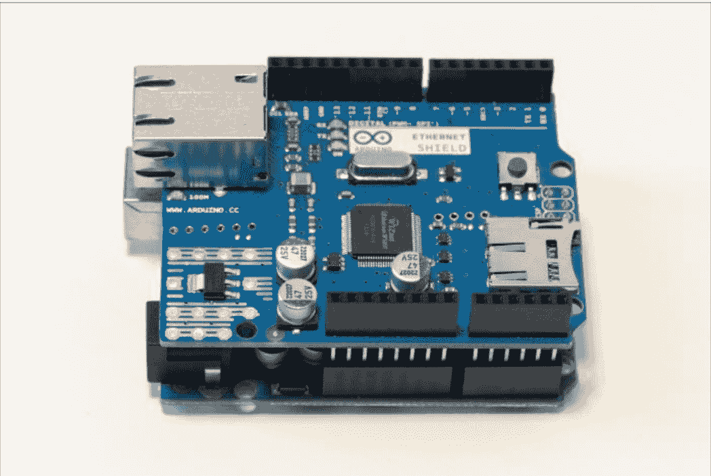
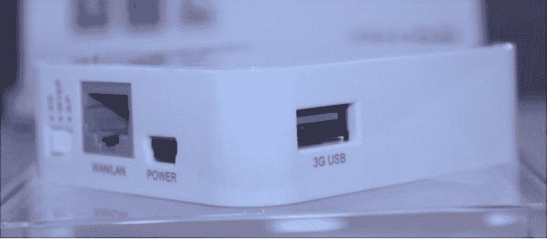
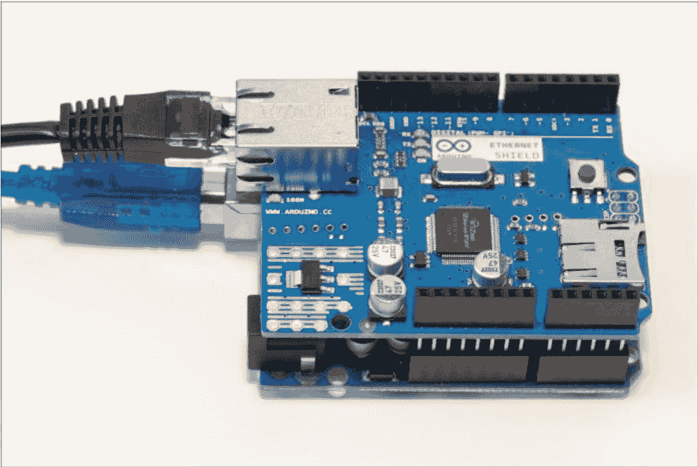

# 第 1 章 探索 Arduino 以太网扩展板

在本书的第一章中，我们将只关注基础知识并开始使用 Arduino 以太网扩展板。为了在本书后续章节中构建更复杂的项目，我们首先需要确定扩展板运行正常，并且可以连接到我们的局域网和互联网。

为确保这一点，我们将首先组装硬件，然后构建一个简单的 Arduino 草图，它将连接到互联网，抓取一个测试网页，并在 Arduino 串行监视器中显示出来。

本章的主要要点如下：

- 首先，我们会确保您拥有所有必需的硬件和软件组件。我们还将组装扩展板和 Arduino Uno 开发板，并通过路由器将所有设备连接到局域网。
- 然后，我们将编写草图，将扩展板连接到局域网以及互联网，该草图将抓取一个测试页面以确保您的连接正常工作。
- 最后，我们将测试该草图，并在 Arduino 串行监视器中监控以太网扩展板的状态。通过对扩展板的首次测试，我们将能够判断扩展板是否已正确连接到互联网。

## 硬件和软件要求

对于这个第一个项目，您不需要太多硬件。您只需要一块 Arduino Uno 开发板，当然，还需要 Arduino 以太网扩展板。其他板子（例如 Arduino Mega）也可以用于本书第一章的项目，但对于本书后续章节的项目，您可能会遇到困难。因此，我建议您在本书的所有项目中都使用 Arduino Uno 开发板。

在实际将扩展板与开发板组装之前，请务必记下扩展板的 MAC 地址（印在扩展板背面）。在项目后期编写第一个草图时，我们会用到它。

这是组装好的开发板和以太网扩展板的图片：



您还需要一根 USB B 转 USB A 电缆将 Arduino 开发板连接到计算机，以及一根以太网电缆将扩展板连接到路由器。

在软件方面，您只需要 Arduino IDE，可在以下地址找到：

http://arduino.cc/en/main/software

以太网库已包含在 Arduino 软件中，因此您无需安装任何其他组件。

## 硬件配置

本章的硬件配置非常简单。到此为止，您应该已经将 Arduino 以太网扩展板连接到了 Arduino Uno 开发板。如果不是，请立即操作。

然后您只需插入两根电缆：计算机与 Arduino Uno 开发板之间的 USB 电缆，以及以太网电缆。只需将 USB 电缆连接到计算机的一个端口即可。

对于以太网电缆，您有几种选择。最简单（也是我推荐）的做法是，将以太网电缆直接从扩展板连接到家庭的主路由器。通常，您家中会有一个 Wi-Fi 路由器，用于为计算机和其他设备启用 Wi-Fi 连接。该路由器还应有一些以太网端口，您可以将以太网扩展板连接到其中。这种方案的优点是，您的扩展板将自动获取 IP 地址，并自动获得互联网访问权限。这假设您的路由器已配置为 DHCP；请进入路由器设置启用 DHCP。由于此过程因路由器品牌而异，请参阅路由器文档，了解如何在您的特定路由器上执行此操作。

如果您没有路由器，可以直接将以太网电缆连接到计算机。我不推荐这种替代方案，因为将计算机配置为连接到扩展板并与扩展板共享互联网连接非常复杂，并且还取决于您的操作系统。

如果您确实无法使用路由器，但可以使用 Wi-Fi 网络，我建议购买带有以太网端口的小型 Wi-Fi 路由器之一。它可以连接到范围内的任何 Wi-Fi 网络，并通过以太网自动与其他设备共享连接。

例如，如下图所示，我推荐 TP-Link MR3020 路由器：



这是本章任务中组装硬件的图片，带有 USB


电缆和插在项目中的以太网电缆：



如果所有连线都正确，你应该会看到以太网扩展板上的 ON LED 已经点亮，以及以太网端口附近的 LINK LED 也已点亮。

## 测试您的连接

既然硬件已经准备就绪，我们可以编写第一个草图来测试以太网扩展板及其与网络的连接。请注意，本节中展示的代码片段仅是代码中最重要的部分，完整代码可以在本书的 GitHub 仓库中找到。

要使用该扩展板，请通过包含以下必需库来启动 Arduino 草图：

```
#include <SPI.h>
#include <Ethernet.h>
```

### 提示

### 下载示例代码

您可以从 http://www.packtpub.com 上的个人账户下载已购买的所有 Packt 图书的示例代码文件。如果您在其他地方购买了此书，可以访问 http://www.packtpub.com/support 并注册，以便文件直接发送到您的邮箱。

然后，我们需要定义以太网扩展板的 MAC 地址。该地址位于扩展板背面，您应该已经记录下来了。您需要以以下格式输入：

```
byte mac[] = { 0x90, 0xA2, 0xDA, 0x0E, 0xFE, 0x40 };
```

我们还需要定义要连接到哪里来测试连接。您可以使用任何想要的网页，甚至可以在 Google 上进行搜索，但对于这个第一个测试，我想使用一个简单的页面。

我找到了一个带有简单测试页面的网站，我们将在稍后的草图中发出请求时尝试获取该页面。如果您有在线的 Web 服务器（例如托管在某个地方的博客），也可以设置自己的页面。

网站地址存储在一个 char 变量中：

```
char server[] = "www.brainjar.com";
```

请注意，您也可以在此处使用其他页面，例如 http://www.example.com/hello。

然后，以太网扩展板将自动获取该网站的 IP 地址。

要为以太网扩展板本身获取 IP 地址，我们将使用 DHCP 从连接的路由器中自动获取一个。但是，如果 DHCP 失败，我们需要为扩展板分配一个默认地址。

这存储在一个 IPAddress 变量中。请注意，您可以在此变量中放置任何想要的内容。至于这个第一个项目，我们确实需要 DHCP 工作以连接到网络。但是，指定一个与路由器相同子网中的 IP 地址是一个良好的实践，这样扩展板至少可以连接到您的局域网。例如，我的计算机 IP 地址是 192.168.1.100，因此我为扩展板指定了一个类似的 IP 地址：

```
IPAddress ip(192, 168, 1, 50);
```

现在，我们可以使用以下代码创建以太网客户端实例：

```
EthernetClient client;
```

现在，在草图的 setup() 函数中，我们将尝试使用 DHCP 获取 IP 地址。如果您已连接到路由器，它不应该失败。但是，如果它确实失败了，我们将自动为扩展板设置默认 IP 地址：

```
if (Ethernet.begin(mac) == 0) {
  Serial.println("Failed to configure Ethernet using DHCP");
  Ethernet.begin(mac, ip);
}
```

然后，我们将出于调试目的在串行端口上打印 IP 地址：

```
Serial.begin(115200);
Serial.print("IP address: ");
Serial.println(Ethernet.localIP());
```

现在，在草图的 loop() 函数中，我们将实际连接到服务器。它首先调用 connect 函数并检查我们是否确实已连接。如果是这种情况，我们会将其打印到串行监视器上以供调试：

```
if (client.connect(server, 80)) {
  if (client.connected()) {
    Serial.println("connected");
```

既然我们已连接，可以为要访问的测试页面设置 GET 请求：

```
client.println("GET /java/host/test.html HTTP/1.1");
client.println("Host: www.brainjar.com");
client.println("Connection: close");
client.println();
```

发送请求后，我们将读取从服务器返回的数据，以检查一切是否顺利。我们还会将此数据打印到串行监视器上：

```
while (client.connected()) {
  while (client.available()) {
    char c = client.read();
    Serial.print(c);
  }
}
```

最后，当我们确定客户端不再连接时，我们将在串行监视器上打印信息，并对以太网客户端调用 close() 函数：

```
if (!client.connected()) {
  Serial.println();
  Serial.println("disconnecting.")
  client.stop();
}
```

最后，我们不想连续执行此操作，而只是每五秒重复一次。
这是通过 delay() 函数完成的：

```
delay(5000);
```

现在是时候测试该草图了。

### 注意

本章的完整代码可以在本书的 GitHub 仓库中找到：
https://github.com/openhomeautomation/arduino-networking/tree/master/chapter1

确保以太网电缆已插入扩展板和路由器，并将草图上传到 Arduino 板。现在，您还可以打开串行监视器，并选择正确的串行速度（本章 Arduino 草图为 115200）；您应该首先看到的是板子的 IP 地址：

IP 地址: 192.168.1.103

然后，Arduino 板应该连接到服务器：

正在连接...

如果成功，输出将显示它确实已连接：

已连接

现在，Arduino 板将向服务器发送 GET 请求以获取测试页面的内容。如果请求成功，服务器将以 HTTP 200 OK 状态响应，并附带页面内容：

```
HTTP/1.1 200 OK
Content-Length: 308
Content-Type: text/html
Last-Modified: Tue, 27 May 2003 15:17:04 GMT
Accept-Ranges: bytes
ETag: "6291ea76324c31:5897"
Server: Microsoft-IIS/6.0
X-Powered-By: ASP.NET
Date: Thu, 15 May 2014 17:35:40 GMT
Connection: close
```

在这个长响应中，您应该会看到许多 HTML 标签，例如 <html> 和 <head> 标签。在响应中，您还应该在 <p> 标签内获得页面内容，如下所示：

```
<p>This is a very simple HTML file.</p>
```

如果您能看到这个，恭喜！您的以太网扩展板工作正常！最后，Arduino 板还会显示以太网扩展板已从远程服务器断开连接：

断开连接

如果一切正常，这意味着您的以太网扩展板工作正常，并且可以毫无问题地连接到您的局域网和网络。

如果有些东西没有按预期工作，有几件事您可以检查。首先，确保所有连接都正确，并且以太网电缆正确插在扩展板和路由器之间。

如果草图开头 DHCP 失败且您的扩展板无法获取 IP 地址，请检查路由器的配置面板中是否已启用 DHCP 且对 MAC 地址没有限制。

最后，如果 Arduino 板无法连接到远程服务器，首先通过在浏览器中手动输入测试页面的 URL 来检查服务器本身是否正常工作。

## 总结

在本书的第一章中，我们使用 Arduino 以太网扩展板构建了第一个项目，仅为了检查扩展板是否工作正常以及是否能连接到您的局域网和互联网。我们只确认以太网扩展板确实可以连接到互联网，但这已经让您了解了使用以太网扩展板可以做的一切。您了解到使用以太网扩展板发送请求是多么容易，这是我们在本书后面将用于从以太网扩展板向远程服务器发送数据的内容。

以下是第一章的主要收获：

- 首先，我们确保所有硬件都已正确设置，并且扩展板已通过以太网电缆连接到您的路由器。
- 然后，我们构建了本书的第一个草图，仅为了测试以太网扩展板确实可以连接到局域网和网络。为此，我们构建了一个连接到网络并从远程服务器获取测试页面的草图。
- 最后，我们将代码上传到开发板，并通过在 Arduino 串行监视器中监控连接状态来检查一切是否正常。
- 我们还定义了一些策略，以防草图无法工作且扩展板无法连接到网络时该怎么办。

在本书的下一章中，我们将使用以太网扩展板构建第一个应用程序。我们还将使用以太网客户端，但这次是为了连接到运行在我们自己计算机上的服务器，并发送来自温湿度传感器的测量数据。


