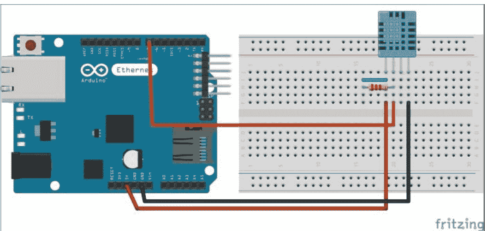
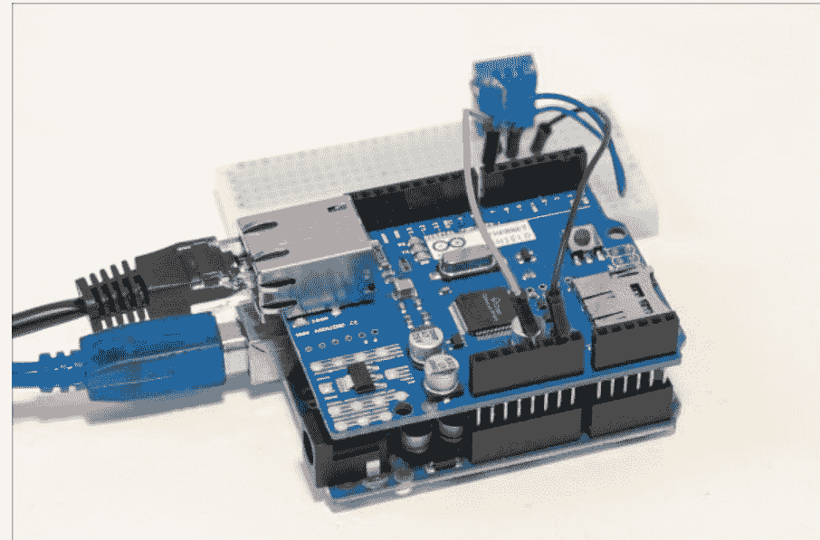
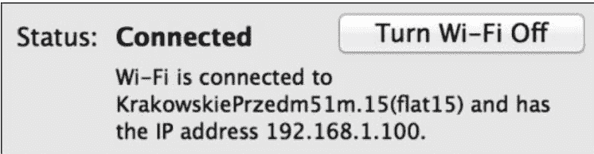
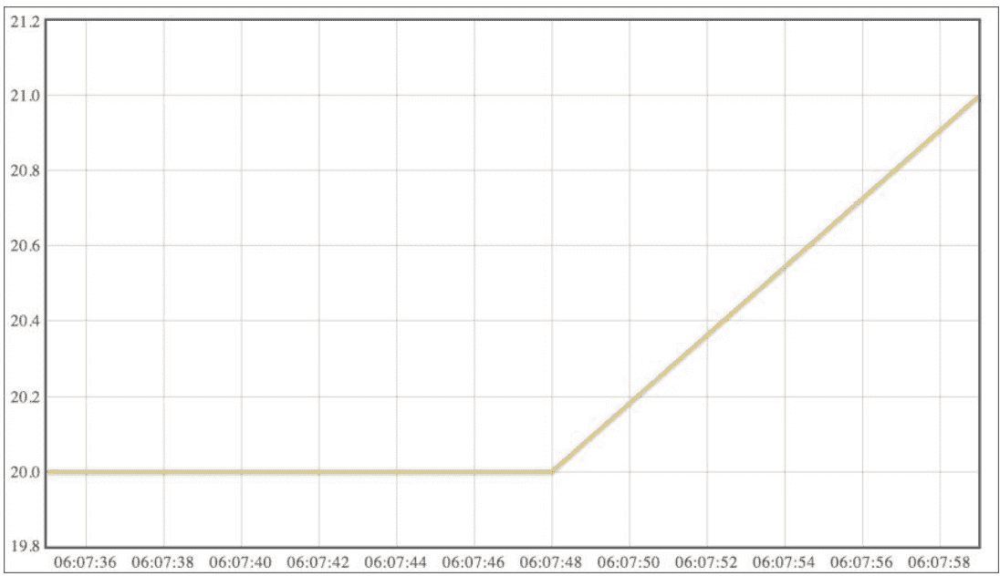
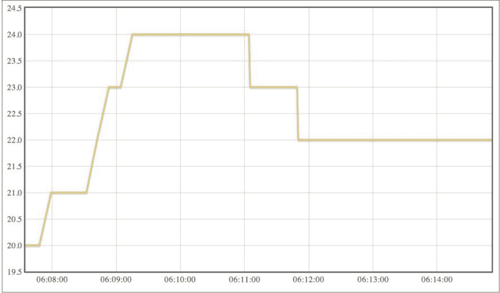
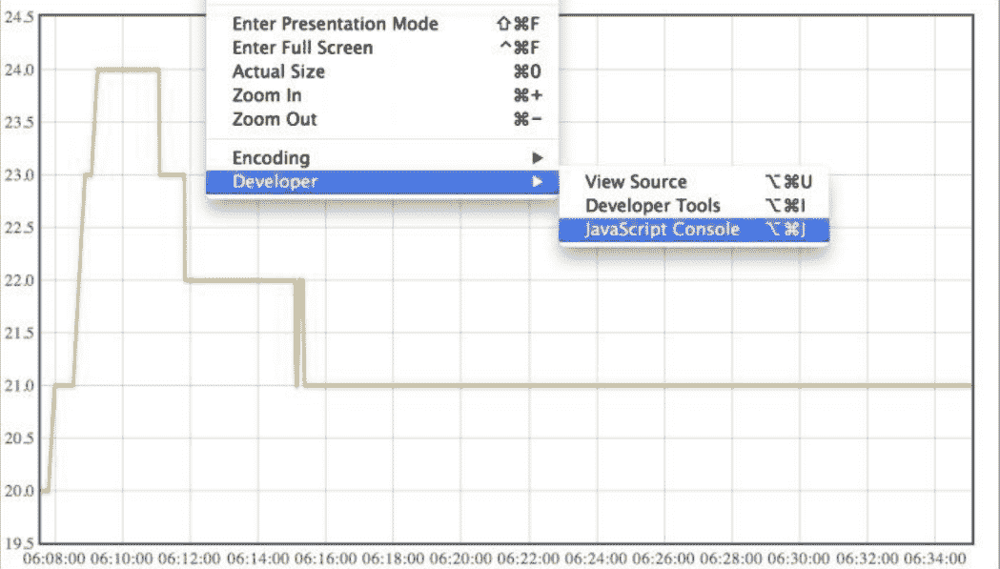

# 第 2 章 将数据发送到 Web 服务器

在上一章中，我们确保您的 Arduino 以太网扩展板可以实际连接到本地网络和 Web。在本章中，我们将在此基础上开展工作，并使用以太网扩展板构建我们的第一个应用程序。

我们将通过测量数字传感器的数据并将这些数据发送到 Web 服务器，更详细地了解以太网客户端的工作原理。在本章中，这个 Web 服务器将是运行在您自己计算机上的服务器。

本章的主要收获如下：

- 首先，我们将选择温湿度传感器，本书后面也会使用到该传感器。我们还将安装本章所需的不同软件组件，尤其是用于在计算机上绘制数据的库。
- 然后，我们将构建 Arduino 代码，以执行测量并将这些测量数据发送到运行在您计算机上的 Web 服务器。
- 之后，我们将开始构建服务器端代码。在第一部分，我们将构建负责将接收到的数据简单记录到本地数据库的代码。
- 最后，我们将数据库与实时绘图库对接，以便可以看到来自以太网扩展板并记录在数据库中的测量数据。

## 硬件和软件要求

在硬件方面，您当然需要 Arduino Uno 开发板和 Arduino 以太网扩展板。

您还需要一个传感器来测量一些数据。由于本书是关于如何使用以太网扩展板，而不是关于如何从传感器测量数据，因此您可以选择任何自己喜欢的传感器。

我使用了 DHT11 传感器，这是一个数字温湿度传感器。我为本章和本书的许多章节选择了这种传感器，因为它非常便宜且易于与 Arduino 对接。除了 DHT11 传感器，您还需要一个 4.7k 欧姆电阻。

您也可以使用其他类型的传感器。您可以使用模拟传感器，其返回的信号取决于测量的数据。例如，TMP36 传感器是一个模拟温度传感器，返回与环境温度成正比的电压。

您在此处可以使用的其他类型传感器是基于 SPI 或 I2C 协议的传感器，这些是易于与 Arduino 一起使用的数字通信协议。例如，您可以使用 BMP085 或 BMP180 传感器，它们具有 I2C 接口，您还可以测量大气压力和环境湿度。

您还需要一个面包板和一些跳线，以在传感器和以太网扩展板之间建立连接。

以下是本章使用的所有元件列表：

- [Arduino Uno](https://www.adafruit.com/products/50)
- [Arduino 以太网扩展板](https://www.adafruit.com/products/201)
- [DHT11 传感器](https://www.adafruit.com/products/386)
- [面包板](https://www.adafruit.com/product/64)
- [跳线](https://www.adafruit.com/product/758)

在软件方面，您首先需要的是用于与之前选择的传感器对接的库。由于我为这个项目选择了 DHT11 传感器，您需要下载并安装 DHT 库：

https://github.com/adafruit/DHT-sensor-library

要安装 Arduino 库，只需将下载文件的内容解压到主 Arduino 文件夹的 /libraries 文件夹中（如果该文件夹不存在，则创建它）。

您还需要一个用于绘制数据库中存储数据的库。我使用了 flot 库，它非常易于使用并允许对传入数据进行实时可视化。此库包含在本章的代码中，但如果您想了解有关该库的更多信息，可以访问 http://www.flotcharts.org/。

关于数据库本身，此项目使用 SQLite，这是一个轻量级且易于使用的数据库。它非常适合此类项目，因为它不需要在计算机上运行数据库服务器。

它在许多操作系统（如 OS X 或 Linux）上预装，但如果不是这种情况，请访问其网站下载并安装它：
http://www.sqlite.org/

如果您使用的是 Linux，最好的选择是使用 Linux 发行版的包管理器安装 SQLite。

请注意，除了 SQLite 之外，还可以使用其他关系型数据库，例如 MySQL。许多 Web 服务器也附带 MySQL 服务器，您只需对本章代码进行小幅修改即可使用 MySQL 数据库。您也可以使用非关系型数据库，例如 MongoDB (http://www.mongodb.org/)，但这将需要对代码进行更多修改。

最后，为了使此项目正常工作，您还需要有一个正在运行的 Web 服务器。您可以在本书的前言中找有关如何设置 Web 服务器的更多信息。如果您还没有安装 Web 服务器，可以访问以下链接获取一个：

- Windows: EasyPHP (http://www.easyphp.org/) 或 WAMP (http://www.wampserver.com/en/)
- OS X: MAMP (http://www.mamp.info/)
- Linux: LAMP (https://help.ubuntu.com/community/ApacheMySQLPHP)

## 硬件配置

现在是时候为这个项目设置硬件了。此时，如果您按照第一章进行了操作，您应该已经将 Arduino 以太网扩展板插入 Arduino 开发板，并使用一根以太网线将以太网扩展板与 Internet 路由器连接起来。如果还没有，请这样做。

在这个项目中，您需要连接的唯一东西是 DHT11 传感器和电阻。您可以通过查看以下原理图来概览需要建立的不同连接：



首先，将 DHT11 传感器插入面包板。然后，使用 4.7k 欧姆电阻连接传感器的引脚 1 和 2。

接下来是电源。将传感器的引脚 1 连接到 Arduino 5 V，将引脚 4 连接到 Arduino GND。最后，将 DHT 传感器的引脚 2 连接到 Arduino 引脚 7。

最终效果应该如下所示：



如果您的项目看起来相同，恭喜您，您可以进入下一部分，我们将在其中构建此项目的 Arduino 草图。

## 将数据发送到服务器

现在是时候使用 Arduino 以太网扩展板构建我们第一个应用程序的草图了。但首先，我们还需要一项数据：您计算机的本地 IP 地址。在 Arduino 草图中，我们将指定 Arduino 以太网扩展板需要将数据发送到的位置。

查找 IP 地址很容易，但这取决于您的操作系统。如果您使用的是 OS X，可以在 **网络偏好设置** 中找到 IP 地址。



如果您使用的是 Windows，所需信息可在 **控制面板** 的 **网络设置** 下找到：


在 Windows 下的另一种方法是转到 **开始**，然后 **运行**，并键入 cmd。然后，在控制台中，键入 ipconfig 并按 Enter。将显示您计算机的 IP 地址。

如果您使用的是 Linux 或 OS X，只需打开终端并键入：

```
ifconfig
```

此命令应在终端窗口中打印您的 IP 地址。它通常是 eth0 或 en0 之类的内容。以下是我在我的机器上看到的内容：

```
en0: flags=8863<UP,BROADCAST,SMART,RUNNING,SIMPLEX,MULTICAST> mtu 1500
    ether b8:f6:b1:12:c4:d7
    inet6 fe80::baf6:b1ff:fe12:c4d7%en0 prefixlen 64 scopeid 0x4
    inet 192.168.1.100 netmask 0xffffff00 broadcast 192.168.1.255
    nd6 options=1<PERFORMNUD>
    media: autoselect
    status: active
```

某些 Linux 发行版已转向名为 ip 的另一个工具。要使用它，只需打开终端并键入：

### ip addr

这也将显示您计算机的 IP 地址。

我们现在准备构建 Arduino 草图。首先，我们需要包含所需的库：

```
#include <SPI.h>
#include <Ethernet.h>
#include "DHT.h"
```

插入您以太网扩展板的 MAC 地址，您可以在扩展板背面找到它：

```
byte mac[] = { 0x90, 0xA2, 0xDA, 0x0E, 0xFE, 0x40 };
```

您还需要定义连接 DHT 传感器的引脚，以及您使用的传感器类型：

```
#define DHTPIN 7
#define DHTTYPE DHT11
```

请注意，测试此项目不需要将传感器连接到 Arduino 开发板。您可以简单地发送任何变量的内容作为测试，或使用 Arduino 的 random() 函数生成随机数据测量值。

首先，我们将为以太网扩展板定义一个默认 IP 地址。草图不应使用此地址，因为我们将尝试使用 DHCP 进行连接，但如果 DHCP 失败，我们需要这个默认 IP 地址。我建议使用与您计算机 IP 地址相同 IP 域中的地址：

```
IPAddress ip(192,168,1,50);
```

然后，我们可以定义服务器的 IP 地址，在这里就是您的计算机。您需要在此处输入之前获得的 IP 地址：

```
IPAddress server(192,168,1,100);
```

然后，我们可以创建以太网客户端的实例：

```
EthernetClient client;
```

我们还可以创建 DHT 库的实例：

```
DHT dht(DHTPIN, DHTTYPE);
```

现在，在草图的 setup() 函数中，我们首先尝试使用 DHCP 为以太网扩展板自动获取 IP 地址。这是通过以下代码片段完成的：

```
Serial.begin(115200);
if (Ethernet.begin(mac) == 0) {
 Serial.println("Failed to configure Ethernet using DHCP");
 Ethernet.begin(mac, ip);
}
```

完成此步骤后，我们在串行端口上打印 IP 地址：


Serial.print("IP address: ");
Serial.println(Ethernet.localIP());

在草图的 loop() 函数中，第一步是从 DHT11 传感器获取测量值：

```
float h = dht.readHumidity();
float t = dht.readTemperature();
```

将这些测量值转换为字符串：

```
String temp = String((int) t);
String hum = String((int) h);
```

出于调试目的，我们也会在串口上打印这些值。在测试草图时，我们稍后会检查这些值是否正确：

```
Serial.println("Temperature: " + temp);
Serial.println("Humidity: " + hum);
```

现在，我们将实际将数据发送到服务器。暂时不必担心服务器端代码的作用，稍后我们会处理。首先，我们需要连接到运行在你电脑上的服务器：

```
if (client.connect(server, 80)) {
 if (client.connected()) {
 Serial.println("connected");
}
}
```

如果成功，我们可以发送请求。如同第 1 章《发现 Arduino 以太网扩展板》中所述，我们将使用标准 GET 请求，并将温度和湿度测量值作为参数传递。此时，你还需要输入你电脑的 IP 地址。所有这些都通过以下代码片段完成：

```
client.println("GET /datalogger/datalogger.php?temp=" + temp + "&hum=" + hum + " HTTP/1.1");
 client.println("Host: 192.168.1.100");
 client.println("Connection: close");
 client.println();
```

你可以看到代码调用了名为 datalogger.php 的文件，我们将在下一节中对其进行检查。

然后，在发出请求后，我们可以读取服务器的响应：

```
while (client.connected()) {
 while (client.available()) {
 char c = client.read();
 Serial.print(c);
 }
}
```

接下来，如果客户端不再连接到服务器，我们可以关闭连接：

```
if (!client.connected()) {
 Serial.println();
 Serial.println("disconnecting.");
 client.stop();
}
```

```
delay(1000);
```

### 注意

本节的所有代码都可以在此章节的 GitHub 仓库中找到：

https://github.com/openhomeautomation/arduino-networking/tree/master/chapter2

现在，如果我们只是将代码上传到 Arduino 开发板，不会发生什么大事，因为我们在服务器端没有做任何事情。Arduino 开发板会发出请求，但由于请求文件在服务器上不存在，服务器将返回错误代码。

因此，首先我们需要在服务器上构建一个文件来处理开发板发来的请求，并将数据记录到某个地方。接下来我们要做的正是此事。

## 将传入数据记录到数据库

在本节中，我们将使用 PHP 构建项目的服务器端部分。如果你是 PHP 的完全初学者，我推荐以下资源来学习该语言的基础知识：

[PHP 语言基础教程](http://php.net/manual/en/tutorial.php)

首先，我们将查看 datalogger.php 文件的内容。该文件将处理来自 Arduino 以太网扩展板的请求，在数据库中记录数据，并返回一条简单的消息。请注意，该文件必须位于你 Web 服务器上的名为 datalogger 的文件夹中。我们将查看代码的重要部分。要获取本节的完整代码，请参阅本章的 GitHub 仓库。请注意，所有 PHP 代码都应位于 <?php ... ?> 标签之间。

该文件首先接收来自 Arduino 以太网扩展板发送的 GET 请求中的数据：

```
$temperature = intval($_GET["temp"]);
$humidity = intval($_GET["hum"]);
```

我们还实例化与 SQLite 数据库的连接：

```
$db = new SQLite3('database.db');
```

然后，如果数据库文件是全新的，我们需要为数据库赋予一些结构。如果你不熟悉 SQL 命令，我邀请你访问以下链接：

[SQL 命令参考](http://www.cs.utexas.edu/~mitra/csFall2013/cs329/lectures/sql.html)

我们将在数据库中创建四个不同的列：一个由 SQLite 自动递增的唯一 ID，一个用于记录测量时间的时间戳，以及温度和湿度数据。这是通过以下代码片段完成的：

```
$db->exec('CREATE TABLE IF NOT EXISTS measurements (id INTEGER PRIMARY KEY,
timestamp TIMESTAMP DEFAULT CURRENT_TIMESTAMP NOT NULL, temperature
INTEGER, humidity INTEGER);');
```

请注意，如果你使用更多传感器（例如，如果你也在测量环境光照度），可以在此处添加更多字段。只需向列表中添加一个新字段，例如：pressure INTEGER。

现在，我们可以将数据作为新行插入数据库。由于 SQLite 会自动添加 ID 和时间戳字段，我们只需插有关温度和湿度的数据：

```
$db->exec("INSERT INTO measurements (temperature, humidity) VALUES
('$temperature', '$humidity')");
```

如果你需要向数据库中插入更多数据，例如，如果你有另一项需要记录的测量值，可以简单地扩展此命令以将更多数据插入 SQLite 数据库。

### 提示

这段简单的代码说明将数据插入 SQLite 数据库是多么容易。然而，它使我们的服务器暴露于一种名为 SQL 注入的安全问题中。由于我们的项目仅用于你自己的本地网络，这里这并非真正的问题。然而，如果你计划将项目部署到网上，我建议修改代码以解决此安全问题。以下链接将为你提供关于此问题的更多信息 [SQL 注入](http://www.tutorialspoint.com/sqlite/sqlite_injection.htm)。

最后，我们用一条简单的消息回复 Arduino 开发板：

```
echo "Data received";
```

现在，我们尚未真正讨论数据库本身。本章代码中包含一个名为 database.db 的示例文件，但我建议你直接删除它并尝试创建自己的数据库。你可以直接在终端中进入存放所有项目文件的目录并输入：

```
sqlite3 database.db
```

### 提示

如果你使用 Windows，我建议将 Console 用作终端。你可以通过以下链接获取它 [Console 终端](http://sourceforge.net/projects/console/)。

此命令将创建你的数据库文件。你可以再次通过输入以下命令退出数据库文件：

```
.exit
```

请注意，如果你在 Linux 下，可能需要更改数据库及包含项目的文件夹的权限。为此，请通过终端进入项目文件夹并输入：

```
chmod 777 database.db
```

现在是时候对项目进行首次测试了。请确保服务器的所有文件都位于 Web 服务器上名为 datalogger 的文件夹中。你现在可以将 Arduino 草图上传到开发板并打开串行监视器。你首先应该看到草图正在连接到你的网络并接收 IP 地址，如下所示：

```
IP address: 192.168.1.103
```

然后，它应该进入 loop() 函数的第一次迭代，并打印出温度和湿度测量值：

```
Temperature: 21
Humidity: 37
```

此步骤之后，你应该看到草图已连接到你的服务器，并且服务器正在返回标准 200 OK 响应：

```
connected
HTTP/1.1 200 OK
```

```
Date: Mon, 19 May 2014 08:09:57 GMT
Server: Apache/2.2.23 (Unix) mod_ssl/2.2.23 OpenSSL/0.9.8y DAV/2 PHP/5.4.10
X-Powered-By: PHP/5.4.10
Content-Length: 13
Connection: close
Content-Type: text/html
```

此外，在该响应的末尾，你应该看到我们在 PHP 文件中定义的确认消息：

```
Data received
disconnecting.
```

如果你看到了这些消息，恭喜！这意味着你的 Arduino 以太网扩展板已成功与运行在你电脑上的 Web 服务器进行通信，并确实在记录一些数据。

如果情况并非如此，请首先检查硬件连接。确保 DHT11 传感器已正确连接到 Arduino 开发板，并且以太网电缆已插入扩展板和你的 Internet 路由器。不要犹豫，重新学习第 1 章《发现 Arduino 以太网扩展板》，以确保你的以太网扩展板正常工作。

此外，请确保 Web 服务器在你的电脑上处于活动状态，并且项目的所有文件（尤其是 `datalogger.php` 文件）都位于 Web 服务器文件夹内名为 `datalogger` 的文件夹中。你可以独立于 Arduino 以太网扩展板进行此测试。只需打开你喜欢的 Web 浏览器，并输入：

```
localhost/folder_of_the_project/datalogger.php?temp=20&hum=40
```

这将在数据库中记录一些虚拟数据，因此你可以确信 Web 服务器正常运行。

我们现在要检查服务器端是否正确记录了数据。而且我们将一举两得，因为这段代码还将在下一节中用于绘制数据。

要检查数据是否正确记录，你可以简单地创建一个名为 `readout.php` 的文件，它将从数据库读取数据、对其格式化并打印格式化后的数据，以便你查看。首先，我们需要访问 SQLite 数据库：

```
$db = new SQLite3('database.db');
```

然后，我们需要向数据库发出查询，以便它返回我们想要的数据。在此请求中，我们将获取名为 measurements 的表中的所有字段。这是通过以下代码片段完成的：

```
$results = $db->query('SELECT id, timestamp, temperature, humidity FROM measurements');
```

现在，我们需要使用 PHP 来解析包含查询所有结果的变量。我们只需为此使用一个 while 语句：

```
while($row = $results->fetchArray())
{


$dataset[] = array(strtotime($row['timestamp']) *
1000,$row['temperature']);
}
```

请注意，在解析结果的过程中，我们将数据格式化到另一个变量中，以便我们用来绘制数据的脚本可以使用它。我们还转换了时间戳列，以便绘图脚本可以使用它。在本示例中，我们只会显示并随后绘制温度，这就是为什么我们只从数据库中取出这两个变量。当然，你也可以对湿度做同样的操作。

最后，我们以 JSON 格式打印出格式化的数据：

```
echo json_encode($dataset);
```

现在，我们可以测试这个读取文件。只需打开终端，进入文件所在的文件夹，然后输入：

```
php readout.php
```

这应该会绘出到目前为止所做的所有记录：

```
[[1400486855000, 20], [1400486868000, 20], [1400486879000, 21],
[1400486890000, 21], [1400486901000, 21], [1400486912000, 21],
[1400486922000, 22], [1400486933000, 23], [1400486944000, 23]]
```

你在终端窗口中看到的是记录的温度原始数据。它由多个包含两个元素的小数组组成，这两个元素分别是时间戳和记录的温度。如果你想了解该 PHP 脚本返回的 JSON 格式的更多信息，可以访问 http://json.org/。

如果你能看到这些原始数据被显示出来，说明来自 Arduino 板的数据已被正确记录在你的计算机上。

## 显示结果

我们现在将使用数据库中记录的数据，并在图表上显示它以便更方便。为完成此任务，我们将使用一个名为 flot 的 JavaScript 库，它已经包含在本章的代码中。该库提供了在网页上绘制数据的出色功能，还允许你实时绘制数据，因此你会看到随着更多数据的输入，图表会自动更新。

一切都将发生在一个名为 plot.html 的 HTML 文件中。这里我们只会查看代码中最重要的部分。请参阅本章的 GitHub 仓库以获取完整文件。在该文件中，你首先需要包含 flot 库所需的文件：

```
<script src="flot/jquery.js"></script>
<script src="flot/jquery.flot.js"></script>
<script src="flot/jquery.flot.time.js"></script>
```

你还需要 HTML 页面中一个用于承载图表的元素。可以使用以下代码片段实现：

```
<div id="placeholder" style="width:800px; height:450px;"></div>
```

我们还为图表定义一些选项。由于现在是 JavaScript，我们必须将此代码写在 <script>...</script> 标签内。如果你想先了解更多 JavaScript 知识，我推荐这个出色的交互式教程：

http://www.codecademy.com/en/tracks/javascript

因为我们将时间戳作为 x 轴，所以需要指定该轴的数据是特定时间，并且我们想要显示小时、分钟和秒：

```
var options = {
 xaxis: {
 mode: "time",
 timeformat: "%H:%M:%S"
 }
};
```

我们还需要每次调用脚本来绘制数据时接收数据。这是通过向之前创建的 PHP 文件发送 AJAX 调用来完成的：

```
$.ajax({
 url: "readout.php",
 type: "GET",
 dataType: "json",
 success: onDataReceived
});
```

请注意，此代码必须放在 JavaScript 代码的 update() 函数内。你可以这样定义这个函数：

```
function update() {
```

你可以看到，这个 AJAX 调用如果成功，会调用另一个 JavaScript 函数。这个函数实际上会将数据作为参数，并使用我们之前定义的选项来绘制它：

```
function onDataReceived(series) {
    var data = [];
    data.push(series);
    $.plot("#placeholder", data, options);
}
```

所有这些代码都包含在 update() 函数中，并且该函数会被连续调用（每 10 毫秒一次），以便每当有新数据点输入时，图表始终保持更新：

```
setTimeout(update, 10);
```

最后，在脚本末尾，我们调用一次这个函数来启动图表：

```
update();
```

现在是时候测试我们刚刚创建的页面了。将 datalogger 文件夹中的所有文件放在你的 Web 服务器上，并确保草图仍然加载在 Arduino 板上。

为了演示目的，我在此处重置了测量数据库，但你当然也可以只保留传感器已经执行的测量数据。

打开 plot.html 文件。这是前两个测量点之后我得到的结果：



为了说明传感器在图表上的行为，我用手指捏住了它，并在稍后松开。如预期，温度先是上升，过了一段时间后又下降。以下截图是网页上的结果：



如果此时仍然不工作，你可以检查很多事项。首先，再次确保前几节的代码能正常工作，并且 Arduino Ethernet 扩展板已正确将数据发送到服务器。另外，检查所有代码文件是否都位于 Web 服务器上的同一文件夹内。并确保你在浏览器中通过 localhost URL 访问 plot.html。

然后，打开 JavaScript 控制台来检查一切是否正常。你通常会在 Web 浏览器的开发者工具中找到控制台。例如，在 Chrome 中，你会在“查看 | 开发者”菜单中找到控制台：



在这个控制台中，你可以看到页面上的 JavaScript 代码是否有任何错误，这通常会让你很好地了解页面上发生了什么以及你需要修复什么。

## 总结

在这本书的第二章中，我们基于 Arduino Ethernet 扩展板和 Ethernet 客户端类构建了第一个应用程序。我们在 Arduino 板上进行了一些基本测量，将这些测量数据发送到本地 Web 服务器，最后在图表上实时显示了这些数据。

为了继续深入学习本章，我邀请你仔细重复本章的所有步骤，以真正理解 Arduino Ethernet 扩展板如何与运行在你计算机上的 PHP 代码进行通信。你还可以向项目中添加更多传感器，并将这些数据记录在数据库中。此外，你还可以尝试在不同的图表上同时绘制多个变量。

以下是本章的主要要点：

- 首先，我们将数字温湿度传感器连接到 Arduino 板，以便可以使用 Ethernet 扩展板将测量数据发送到本地 Web 服务器。我们还安装了一些有用的软件组件，例如用于在网页上绘制数据的库。
- 然后，我们构建了一个 Arduino 草图，将数据直接发送到运行在你计算机上的 Web 服务器。
- 随后，我们开始构建服务器端代码，编写负责将数据记录到本地数据库的文件。我们还使用 Arduino Ethernet 扩展板测试了这段代码，并确保数据已正确传输到服务器并记录在数据库中。
- 最后，我们使用名为 flot 的 JavaScript 库构建了一个网页，在 Web 服务器上接收到数据时自动绘制数据。

在下一章中，我们将做类似的事情，但采用完全不同的方法：而不是在 Arduino 板上运行客户端并在本地 Web 服务器上传输数据，我们将直接在 Arduino 板上运行服务器。Arduino 项目将在网页上持续显示测量数据，并将数据本地记录在 SD 卡上。
