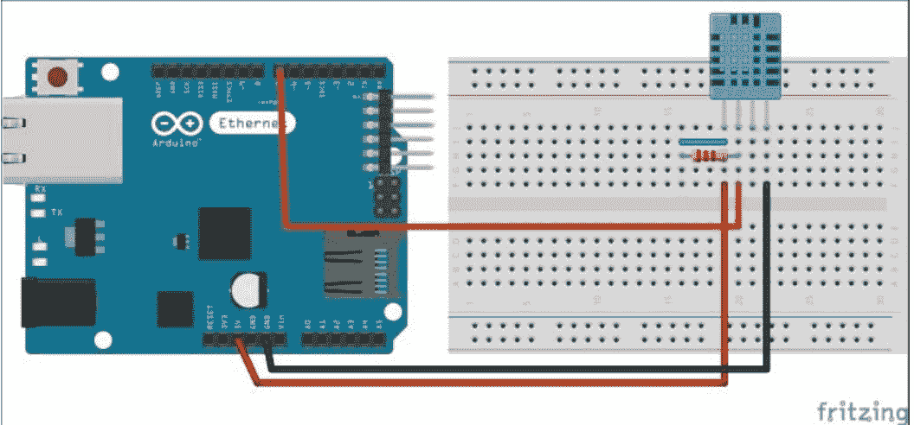
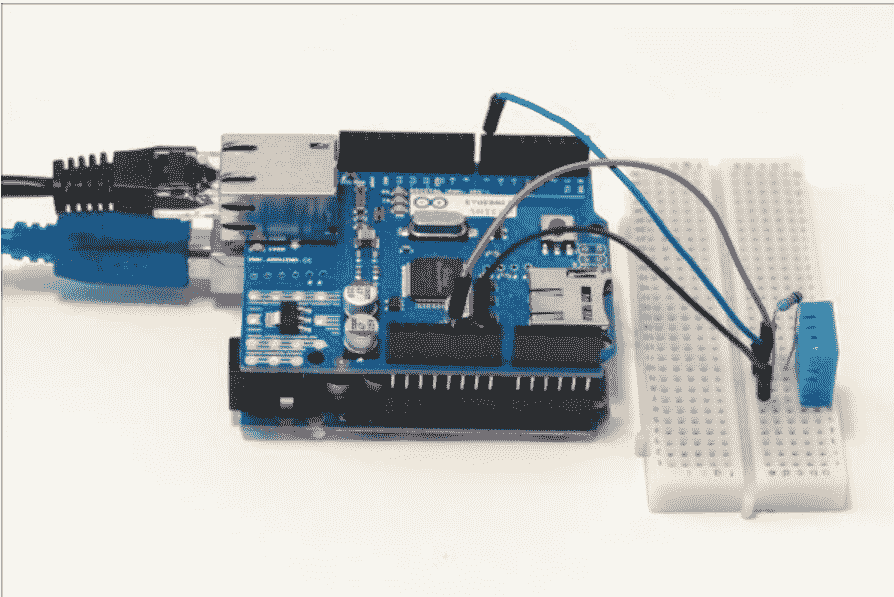
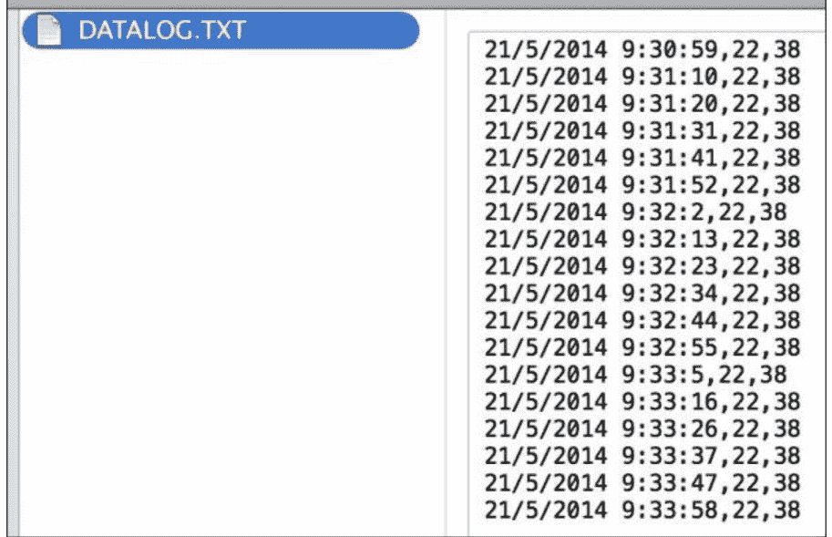
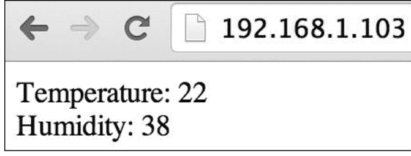
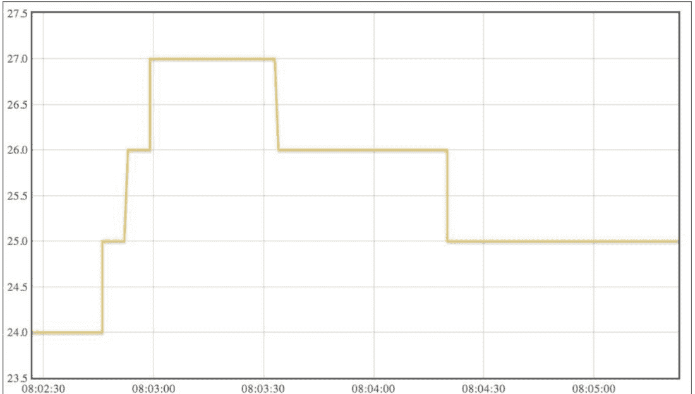

# 第 3 章 数据记录站

在本章中，我们将创建与第 2 章“将数据发送到 Web 服务器”中所做的非常相似的东西，即从传感器测量数据、存储数据，并将其发送回 Web 服务器以便绘图。

然而，事物仅在外观上会相似。我们将不再使用在 Arduino 板上运行并将数据发送到服务器的 Ethernet 客户端，而是要使 Arduino 板更加独立。在本章的第一部分，我们将使用 Ethernet 扩展板集成的 MicroSD 卡读卡器在本地记录数据。

然后，我们将直接在 Arduino 板上创建一个服务器。板子将像往常一样测量数据，但服务器将为传入的客户端提供数据。最后，我们将使用我们在第 2 章“将数据发送到 Web 服务器”中使用的代码的修改版本，在你的计算机上绘制测量数据。

以下是本章的主要要点：

- 首先，我们将构建此项目的硬件，包括温湿度传感器和用于记录测量数据的 SD 卡。
- 然后，我们将创建项目的第一部分，并自动将数据记录到插在 Ethernet 扩展板内部的 SD 卡上。此时，我们将使用 Ethernet 扩展板的 Internet 连接，从网络时间协议（NTP）时间服务器自动获取当前时间。
- 最后，我们将构建一个 Web 服务器并在 Arduino 板上运行它。然后，你只需在 Web 浏览器中输入板子的地址，即可访问板子测量的数据。我们还将修改上一章的代码，从 Arduino 板获取测量数据，并在浏览器中实时绘制它们。


## 硬件和软件要求

在硬件方面，你当然需要Arduino Ethernet扩展板和一个Arduino开发板，例如Arduino Uno。

你还需要一个传感器来测量一些数据。由于本书是关于如何使用Ethernet扩展板，而不是如何从传感器测量，你实际上可以选择任何你喜欢的传感器。

我使用了DHT11传感器，这是一个数字温湿度传感器。我为本章和书中许多章节选择了这个传感器，因为它非常便宜且易于与Arduino接口。除了DHT11传感器，你还需要一个4.7k欧姆电阻。

要记录数据，你需要一张可以插入Ethernet扩展板的MicroSD卡。我没有特定的品牌推荐，但我使用了一张SanDisk MicroSD卡，配合普通SD适配器（对我很有效），所以你也可以将其插入电脑以检查数据是否正确记录。另外，请确保SD卡使用FAT32格式格式化。

你还需要一块面包板和一些跳线来在传感器和Ethernet扩展板之间建立连接。

以下是本章使用的所有元件列表：

- Arduino Uno (https://www.adafruit.com/products/50)
- Arduino Ethernet扩展板 (https://www.adafruit.com/products/201)
- DHT11传感器 (https://www.adafruit.com/products/386)
- MicroSD卡 (http://www.amazon.com/SanDisk-Micro-SDHC-Memory-Adapter/dp/B0052MHQM6)
- 面包板 (https://www.adafruit.com/product/64)
- 跳线 (https://www.adafruit.com/product/758)

在软件方面，你首先需要的是用于与之前选择的传感器接口的库。我为这个项目选择了DHT11传感器。你需要从 https://github.com/adafruit/DHT-sensor-library 下载并安装DHT库。

安装Arduino库非常简单，只需将下载文件的内容解压到主Arduino文件夹的libraries文件夹中（如果尚未创建，则创建该文件夹）。

## 硬件配置

现在是时候为本项目设置硬件了。到此为止，如果你跟随本书的前几章操作，你应该已经将Arduino Ethernet扩展板插入Arduino开发板，并用一根以太网线将扩展板和互联网路由器连接起来。如果还没有，请务必这样做。

在本项目中，你需要连接的只有DHT11传感器和电阻。你可以通过查看下面的原理图来了解需要进行的不同连接概览：



首先，将DHT11传感器插入面包板。然后，使用4.7k欧姆电阻连接传感器的引脚1和2。

接下来是电源。将传感器的引脚1连接到Arduino 5V，引脚4连接到Arduino GND。最后，将DHT传感器的引脚2连接到Arduino引脚7。

最终，它应该看起来像下面的图片：



最后，只需将SD卡插入Ethernet扩展板上的SD卡插槽即可。

## 在SD卡上记录数据

让我们从本章的第一个主题开始——使用Ethernet扩展板集成的SD卡插槽在SD卡上记录数据。我们将在Arduino开发板上进行一些测量，并将每次测量记录到SD卡上的一个简单文本文件中。

然而，与第2章“将数据发送到Web服务器”的项目相比，我们实际上并不知道测量进行时的日期。在前一章中，我们只是使用了计算机的日期，但这里我们没有这些信息。要在Arduino开发板上获取时间，我们将采用另一种策略。我们将使用Ethernet扩展板连接到NTP时间服务器，在Arduino草图启动时获取一次时间，然后使用Time库从那里开始跟踪时间。

要了解有关Time库的更多信息，可以访问Arduino网站上的以下页面：
http://playground.arduino.cc/Code/Time

在SD卡上记录数据的过程首先是按如下方式包含正确的库：

```
#include "DHT.h"
#include <SD.h>
#include <Time.h>
#include <Ethernet.h>
#include <EthernetUdp.h>
#include <SPI.h>
```

我们还需要定义传感器类型以及传感器连接的引脚。这是通过以下代码行完成的：

```
#define DHTPIN 7
#define DHTTYPE DHT11
```

要定义Ethernet扩展板的MAC地址，请使用以下代码行：

```
byte mac[] = { 0x90, 0xA2, 0xDA, 0x0E, 0xFE, 0x40 };
```

要使用SD卡，你还需要定义chipSelect引脚，即Ethernet扩展板上的引脚4。这是通过以下行完成的：

```
const int chipSelect = 4;
```

现在，我们来处理NTP服务器。实际上，你可以使用多个NTP服务器（你可以查看Time库附带的TimeNTP示例中许多这些服务器的IP地址）。你也可以在此设置时区。要了解可以使用哪个NTP服务器以及设置哪个时区的更多信息，可以查看示例TimeNTP草图。此草图作为Time库内的一个示例提供。对于本项目，我使用了第一个可用服务器，时区编号为1，如下面的代码所示：

```
IPAddress timeServer(132, 163, 4, 101);
const int timeZone = 1;
```

要连接到此服务器，我们还需要定义一个Ethernet客户端。这一次，我们将使用一种与之前不同的协议，即UDP。UDP与TCP不同——它简单得多且更轻量。但是，它不能保证数据被正确传送，而TCP可以。你实际上不需要关心该协议的细节，因为Time库会处理一切。你可以保留默认的UDP端口，如下面的代码所示：

```
EthernetUDP Udp;
unsigned int localPort = 8888;
```

你还需要按如下方式创建DHT传感器的实例：

```
DHT dht(DHTPIN, DHTTYPE);
```

现在，在草图的setup()函数中，你需要定义以下负责为Ethernet扩展板获取IP地址的代码：

```
Serial.begin(9600);
if (Ethernet.begin(mac) == 0) {
// no point in carrying on, so do nothing forevermore:
while (1) {
Serial.println("Failed to configure Ethernet using DHCP");
delay(10000);
}
}
```

之后，我们将尝试初始化SD卡，如下面的代码所示：

```
Serial.print("Initializing SD card...");
pinMode(10, OUTPUT);
```

如果成功，我们将在串口打印一条消息，如下面的代码所示：

```
if (!SD.begin(chipSelect)) {
Serial.println("Card failed, or not present");
// don't do anything more:
return;
}
Serial.println("card initialized.");
```

我们还将按如下方式启动DHT传感器：

```
dht.begin();
```

最后，仍在setup()函数中，我们将打印Ethernet扩展板的IP地址并创建与NTP服务器的连接。请注意，此处我们正在调用一个名为getNtpTime的函数，该函数在草图的后面部分定义。由于这是Time库提供的函数，我们不会深入了解该函数的细节。以下是此部分的代码：

```
Serial.print("IP number assigned by DHCP is ");
Serial.println(Ethernet.localIP());
Udp.begin(localPort);
Serial.println("waiting for sync");
setSyncProvider(getNtpTime);
```

现在，在草图的loop()函数中，我们将首先使用以下代码从传感器测量温度和湿度：

```
float h = dht.readHumidity();
float t = dht.readTemperature();
```

其次，我们将按如下方式将这些测量值转换为字符串：

```
String temp = String((int) t);
String hum = String((int) h);
```

我们现在将使用Time库构建一个包含测量日期和时间的字符串。该库包含用于获取当前时间、日期或月份的函数，例如，这些值是根据最初调用NTP服务器计算得出的。例如，调用day()函数将返回当前日期。以下代码片段返回包含日期和时间的字符串：

```
String log_time = String(day()) + "/" +
String(month()) + "/" + String(year()) + " " +
String(hour()) + ":" + String(minute()) + ":" +
String(second());
```

然后，我们使用逗号作为不同字符串之间的分隔符，将此字符串与温度和湿度测量值组装起来，如下面的代码行所示：

```
String dataString = log_time + "," + temp + "," + hum;
```

我们现在将把这些数据写入SD卡。我们首先需要使用以下行打开卡以写入数据：

```
File dataFile = SD.open("datalog.txt", FILE_WRITE);
```

如果成功，我们将把dataString变量的内容写入名为datalog.txt的文件，如下面的代码所示：

```
if (dataFile) {
dataFile.println(dataString);
dataFile.close();
Serial.println(dataString);
} else {
Serial.println("error opening datalog.txt");
}
```

最后，我们将每10秒重复一次该操作，但你当然可以使用以下行修改此延迟：

```
delay(10000);
```

### 注意


本节的所有代码都可以在本章的 GitHub 仓库中找到 https://github.com/openhomeautomation/arduino-networking/tree/master/chapter3。

现在是时候测试这个草图了。请确保以太网电缆已插入以太网扩展板和您的互联网路由器，且 SD 卡已插入以太网扩展板的 SD 卡插槽。您现在可以将草图上传到开发板并打开串行监视器。您首先应该看到以下内容：

```
Initializing SD card...card initialized.
```

然后，您应该看到您的以太网扩展板有一个 IP 地址，如以下行所示：

```
IP number assigned by DHCP is 192.168.1.103
```

您应该看到该扩展板正在与 NTP 服务器同步时间，如以下输出所示：

```
waiting for sync
Transmit NTP Request
Receive NTP Response
```

之后，您应该看到第一次测量如下：

```
21/5/2014 9:32:13,22,38
```

在草图中设置的延迟之后，您将看到带有相应日期和时间的第二次测量。为确保草图正确将数据写入 SD 卡，您可以让它运行一段时间，然后将以太网扩展板从电源上断开。之后，取出 SD 卡，并通过适配器在计算机上读取它。您应该看到以下截图：



如您所见，所有测量值都已正确记录在 SD 卡上，我们可以清楚地看到两次测量之间的间隔为 10 秒。

## 在 Arduino 上创建 Web 服务器

在本章的其余部分，我们将采用另一种方法。我们仍将使带有以太网扩展板的 Arduino 作为独立系统工作，但这次我们甚至要在 Arduino 开发板上创建一个 Web 服务器。这实际上类似于我们在第 2 章“将数据发送到 Web 服务器”中看到的项目，但这次是 Arduino 开发板本身在测量时显示数据。

此部分的草图首先包括正确的库，如以下代码所示：

```cpp
#include "DHT.h"
#include <Ethernet.h>
#include <SPI.h>
```

请按以下方式定义引脚和传感器类型：

```cpp
#define DHTPIN 7
#define DHTTYPE DHT11
```

同样，您还需要像往常一样定义以太网扩展板的 MAC 地址，如以下代码行所示：

```cpp
byte mac[] = { 0x90, 0xA2, 0xDA, 0x0E, 0xFE, 0x40 };
```

我们还将定义一个默认 IP 地址，以防 DHCP 失败，如以下行所示：

```cpp
IPAddress ip(192,168,1,50);
```

新功能就在这里。到目前为止，我们只使用 EthernetClient 类来定义将连接到远程服务器的客户端。但是在这里，因为我们想要在 Arduino 开发板上直接创建一个服务器，所以我们将使用 EthernetServer 类，如以下代码行所示：

```cpp
EthernetServer server(80);
```

您可以为服务器使用端口 80，因为这样从 Web 浏览器访问服务器会更加容易。

我们也不应忘记创建 DHT 传感器的实例。这是使用以下行完成的：

```cpp
DHT dht(DHTPIN, DHTTYPE);
```

现在，在草图的 setup() 函数中，我们将尝试使用 DHCP 为以太网扩展板获取 IP 地址，使用以下代码：

```cpp
if (Ethernet.begin(mac) == 0) {
    Serial.println("Failed to configure Ethernet using DHCP");
    Ethernet.begin(mac, ip);
}
```

仍然在 setup() 函数中，我们还必须启动以太网服务器，并使用以下代码打印服务器的 IP 地址：

```cpp
server.begin();
Serial.print("Server is at ");
Serial.println(Ethernet.localIP());
```

最后，我们将按以下方式启动 DHT 传感器：

```cpp
dht.begin();
```

现在，在草图的 loop() 部分中，我们将执行温度和湿度测量，如以下代码所示：

```cpp
float h = dht.readHumidity();
float t = dht.readTemperature();
```

使用以下代码将测量值转换为字符串：

```cpp
String temp = String((int) t);
String hum = String((int) h);
```

然后，我们需要处理到达 Arduino 开发板的连接，例如来自 Web 浏览器的连接。为此，每次服务器可用时，我们实际上都将创建一个 EthernetClient 类的实例。由于这是我们在本书前面章节中已经见过的类，这已经是我们熟悉的操作了。

如果检测到连接，我们将创建此客户端，并将其打印到串行端口以供调试，如以下代码所示：

```cpp
EthernetClient client = server.available();
if (client) {
    Serial.println("New client");
}
```

下一部分有些技术性。我们需要读取来自客户端的请求，但也需要检测请求结束的时刻，以便我们可以关闭连接。这是通过始终检查当前行是否为空白来处理的。然后，第一步是使用以下代码片段逐个字符地读取来自客户端的请求：

```cpp
boolean currentLineIsBlank = true;
while (client.connected()) {
    // Read data
    if (client.available()) {
        char c = client.read();
        Serial.write(c);
    }
}
```

请注意，传入的请求也会打印到串行端口以供调试。现在，如果我们检测到换行符且当前行是空白，则表示请求已结束，如以下行所示：

```cpp
if (c == '\n' && currentLineIsBlank) {
```

因此，我们可以回复客户端。我们将首先发送一个标准 HTTP 头，指出一切正常，并且我们希望每 5 秒自动刷新页面一次，如以下代码所示：

```cpp
client.println("HTTP/1.1 200 OK");
client.println("Content-Type: text/html");
client.println("Connection: close");
client.println("Refresh: 5"); // Refresh the page automatically every 5 sec
client.println();
client.println("<!DOCTYPE HTML>");
client.println("<html>");
```

然后，我们将使用以下代码在页面上打印测量数据：

```cpp
client.print("Temperature: ");
client.print(temp);
client.print("<br />");
client.print("Humidity: ");
client.print(hum);
client.println("<br/>");
client.println("</html>");
```

以下其余代码用于检测是否到达了请求的末尾：

```cpp
if (c == '\n') {
 // Starting a new line
 currentLineIsBlank = true;
} else if (c != '\r') {
 // you've gotten a character on the current line
 currentLineIsBlank = false;
}
```

最后，我们将给浏览器一个小延迟以接收响应，然后关闭连接，如以下代码所示：

```cpp
// Give the web browser time to receive the data
delay(1);

// Close the connection:
client.stop();
Serial.println("Client disconnected");
```

### 注意

本节的所有代码都可以在本章的 GitHub 仓库中找到 https://github.com/openhomeautomation/arduino-networking/tree/master/chapter3。

现在是时候测试我们在本节中编写的代码了。再次，请确保以太网电缆已插入以太网扩展板和您的路由器。然后，您可以将代码上传到开发板，并打开串行监视器。您首先应该看到运行在 Arduino 开发板上的 Web 服务器的 IP 地址，如下所示：

```
Server is at 192.168.1.103
```

之后，草图将什么也不做，只等待任何传入的连接。要建立连接，只需打开 Web 浏览器并输入开发板的 IP 地址。您应该立即在 Arduino 串行监视器中看到浏览器的 GET 请求被打印出来，如以下输出所示：

```
New client
GET / HTTP/1.1
Host: 192.168.1.103
Connection: keep-alive
Cache-Control: max-age=0
Accept: text/html,application/xhtml+xml,application/xml;q=0.9,image/webp,*/*;q=0.8
User-Agent: Mozilla/5.0 (Macintosh; Intel Mac OS X 10_9_3)
AppleWebKit/537.36 (KHTML, like Gecko) Chrome/34.0.1847.137 Safari/537.36
Referer: http://192.168.1.103/
Accept-Encoding: gzip,deflate,sdch
Accept-Language: fr-FR,fr;q=0.8,en-US;q=0.6,en;q=0.4,de;q=0.2
```

如您所见，这里有大量文本，具体取决于您的浏览器。但是，重要的是请求的第一行，这意味着这是对我们 Arduino 开发板的 GET 请求。

最后，在 Arduino 回复服务器后，连接会关闭并显示以下消息：

```
Client disconnected
```

在您的浏览器中，您还应该直接看到数据正在打印在 Arduino 开发板创建的页面上，如以下截图所示：



如果您可以看到这个，恭喜，您刚刚创建了在 Arduino 开发板上运行的自己的 Web 服务器。如果您看不到页面，首先请确保 Arduino 有一个 IP 地址，并且它可以连接到您的局域网。为此，请再次重复第 1 章“发现 Arduino 以太网扩展板”的说明。

还请确保您在浏览器中正确输入了开发板的 IP 地址。您还可以检查串行监视器，确保您没有收到来自 DHT 传感器的任何错误消息，因为这会影响 Web 服务器的行为。


## 在本地绘制数据

为结束本章，我们将学习如何绘制Arduino板测量的数据。为此，我们将稍微修改Arduino草图，然后使用前一章中的部分代码直接在网页浏览器中绘制数据。

首先，我们将修改Arduino草图，使其以更有用的格式返回数据；在此示例中，即JSON格式。我们将用打印JSON格式数据的简单代码取代负责打印测量值的代码。这可通过以下代码片段完成：

```
client.println("HTTP/1.1 200 OK");
client.println("Content-Type: application/json");
client.println("Connection: close");
client.println();
client.print("{\"temperature\": ");
client.print(temp);
client.print(", \"humidity\": ");
client.print(hum);
client.println("}");
```

现在可以快速测试此项目。再次将代码上传到Arduino板，打开网页浏览器，访问之前使用过的相同IP地址。您应该在页面上看到打印的以下行：

```
{"temperature": 24, "humidity": 36}
```

现在，我们还需要构建服务器端代码来绘制数据。该代码与前一章的代码非常相似，因此我将只详细说明两个项目之间的差异。在前一章中，是板子试图连接运行在您计算机上的服务器，datalogger.php文件处理请求。在本章中，我们将采取相反的方式，从运行在您计算机上的Web服务器调用板子。为此，我们将使用名为cURL的PHP模块向给定URL发送GET请求；在此示例中，即Arduino板的URL。

我们首先要做的是修改datalogger.php文件并添加Arduino板的URL，如以下代码行所示：

```
$url = 'http://192.168.1.103';
```

启动cURL调用，如以下代码行所示：

```
$curl = curl_init();
```

我们还需要设置cURL调用的选项。我们希望调用返回来自Arduino Web服务器的数据，并且希望URL为我们之前定义的URL。这可通过以下代码完成：

```
curl_setopt_array($curl, array(
    CURLOPT_RETURNTRANSFER => 1,
    CURLOPT_URL => $url,
));
```

现在可以执行命令，如以下代码行所示：

```
$resp = curl_exec($curl);
```

关闭cURL调用，如下所示：

```
curl_close($curl);
```

我们在一个包含字符串形式数据的变量中得到响应。为了在PHP中打开它，我们需要先将其转换为JSON格式，然后提取温度和湿度字段。这可通过以下代码片段完成：

```
$json = json_decode($resp, true);
$temperature = intval($json["temperature"]);
$humidity = intval($json["humidity"]);
```

文件的其余部分与我们在前一章中开发的代码完全相同。

现在，我们还需要在plot.html文件中做一小处修改。在前一章中，由于Arduino板不断向服务器发送数据，数据会自动记录到数据库中。在此，我们需要在服务器端进行调用。这可通过在从数据库读取数据的代码之前添加以下小段代码来完成：

```
$.ajax({
  url: "datalogger.php",
  type: "GET",
});
```

这意味着，就在从数据库读取数据以进行绘制之前，我们正在调用Arduino板以获取温度和湿度测量值。

### 注意

本节的所有代码均可在本章的GitHub仓库中找到，网址为 https://github.com/openhomeautomation/arduino-networking/tree/master/chapter3。

现在可以测试本章的这部分内容。请注意，GitHub仓库中的代码包含示例数据库，因此您可以立即测试该项目，但我建议在测试项目前删除该文件，以便在测试代码时绘制您自己的测量数据。

您只需将绘制部分的所有代码放入Web服务器根目录下的一个文件夹中。然后，通过Web服务器上的localhost URL打开plot.html文件。您应能立即看到数据正在网页浏览器中被绘制。过一段时间，您应能看到类似于以下图表的图形：



如果您在浏览器中看到此图表，恭喜！这意味着您可以从运行在Arduino板上的Web服务器执行远程测量。

如果不是这样，您可以检查几件事。首先要检查的是确保Arduino板正确以JSON格式显示数据。为此，您可以在浏览器中直接输入板子的地址。然后，检查您的Web服务器是否正在计算机上运行，并且您是否已将项目中的所有文件放在Web服务器主文件夹中的一个仓库里。最后，确保您是在浏览器中通过localhost URL访问HTML文件，而不是在文件资源管理器中点击它。

## 摘要

让我们总结一下本章所做的工作。我们使用Arduino创建了一个独立的测量站，它能自动测量并以某种方式提供数据。首先，我们将数据本地记录到SD卡中，然后使用运行在Arduino板上的Web服务器提供这些数据。

本章的主要要点如下：

- 1. 首先，我们构建了本章所需的硬件，并将SD卡插入以太网扩展板。
- 2. 然后，在项目的第一部分中，我们将测量的数据记录到SD卡，并使用远程时间服务器自动获取测量时间。
- 3. 最后，我们构建了一个新的Arduino草图，在Arduino板上运行Web服务器。然后我们修改了前一章的绘图代码，使其可以调用Arduino板上的服务器来获取并绘制测量数据。

当然，有很多方法可以改进此项目。您可以向项目添加更多传感器，并将这些额外数据记录到SD卡中，或使用Arduino Web服务器将其提供在网页上。您还可以在家里甚至室外放置许多这样的板子，并让您的计算机定期轮询所有这些Arduino服务器以获取它们的测量值。

在下一章中，我们将再次使用Arduino以太网扩展板创建独立系统的理念。我们将连接一个继电器到Arduino板，因此您可以远程开关灯。该项目分为两个版本。首先，我们将制作一个草图，通过网页浏览器远程控制继电器。在本章的第二部分，我们将使用一个特殊库，以便继电器可以从世界任何地方进行控制。
