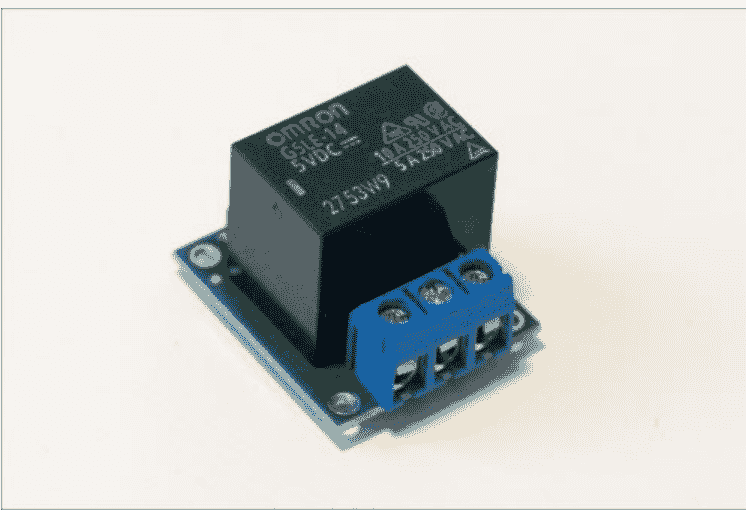
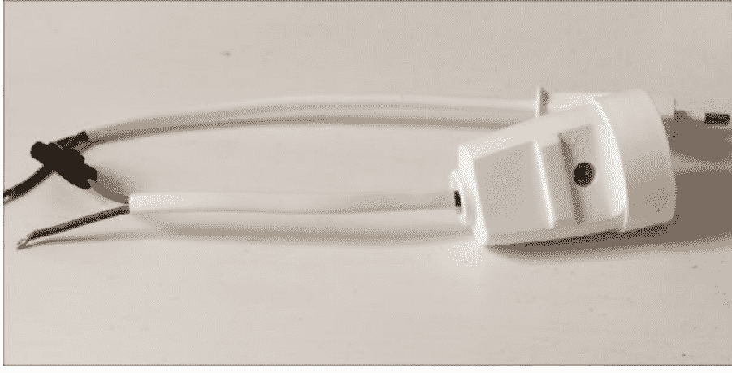
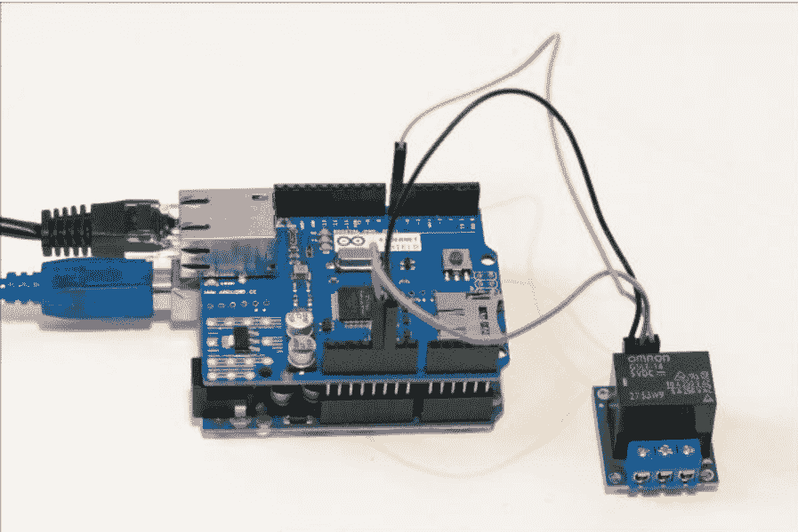
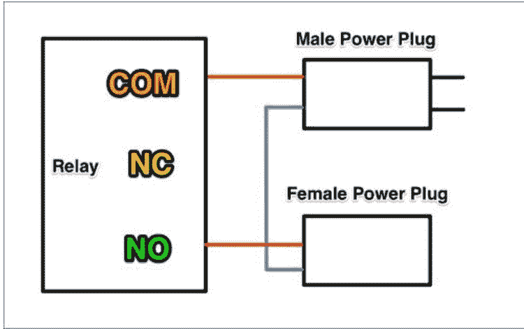
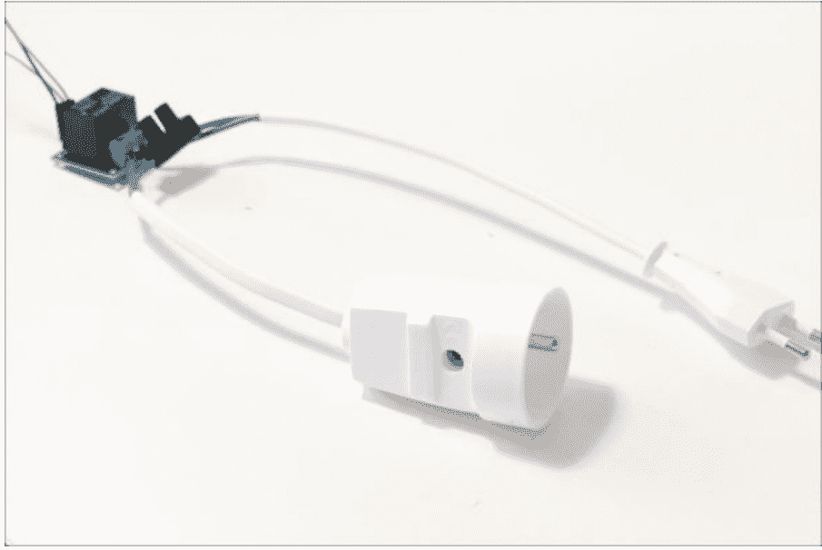
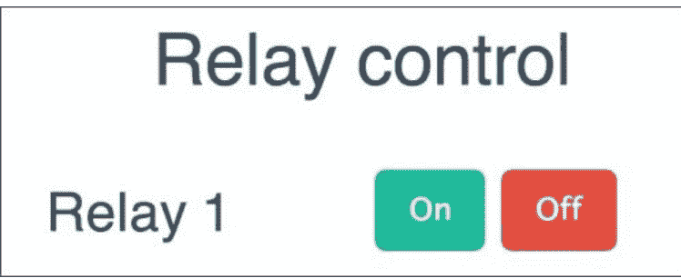

# 第 4 章 从任何地方控制对象

在本章中，我们将做一些与其他章节不同的事情。到目前为止，我们所做的是在Arduino板上测量一些数据，并使用以太网扩展板将这些数据传回网络。在本章中，我们将控制一个设备，而不是测量数据。

为此，我们将使用连接到带有以太网扩展板的Arduino板的继电器，并远程控制该继电器。我们还将连接一组电源线到该继电器，以便您可以直接将灯插入它并远程控制它。

在本章的第一部分，我们将在本地网络内远程控制此继电器。在本章的第二部分，我们将使用专用Web服务从世界任何地方控制此继电器。

以下是本章的主要要点：

- 首先，我们将了解如何为本项目选择不同的组件，包括继电器和连接设备（如灯）到继电器的电缆。
- 然后，我们将组装不同的硬件组件，将继电器连接到Arduino板，并将电源线连接到继电器。
- 之后，我们将编写一个Arduino草图来测试继电器是否工作正常以及是否已正确连接到电路。
- 当我们确定继电器正常工作时，我们将使用以太网扩展板和继电器编写一个应用程序。我们将编写一个草图通过以太网控制继电器，然后构建一个接口，从您的Web服务器控制继电器。
- 最后，在本章的最后一节中，我们将使用专用Web服务从世界任何地方控制继电器。我们还将调整我们刚刚创建的接口，以便从任何地方控制继电器。


## 硬件和软件要求

让我们先看看这个项目需要什么。与其他章节一样，你需要一块 Arduino 开发板和 Arduino Ethernet 扩展板。

你还需要一个继电器模块。我强烈建议使用集成在电路板上的继电器，电路板上包含所有必需的元件。这样可以避免你在面包板上自行搭建继电器模块，而且也更安全。事实上，以错误的方式布线继电器和其他元件没有任何风险。只需确保你选择的继电器兼容 5 V 输入电压电平即可。此外，你还需要确保继电器模块能够处理本项目中将要使用的设备的功率。例如，我使用的是一盏 30 W 的灯，而继电器能够处理超过 1000 W 的功率，只是为了保险起见。我选择了 Pololu 的 5 V 继电器模块，如图所示：



你可以直接使用继电器，并使用我们将在本项目中开发的代码来控制它，但使用继电器的目的是将设备连接到它。对于本项目，我选择将灯连接到继电器，但按照本章的说明，你将能够连接任何使用标准电源插头的设备。

为此，我使用了一组电源线，一根带有母插座，另一根带有公插座，如下图所示：



公插头将用于将继电器连接到墙上的主电源插头，而母插座将用于连接要控制的设备到继电器。

### 注意

将电线连接到主电源时，务必非常小心。确保不要触碰继电器的任何裸露部分，并且确保电缆本身没有裸露的铜线。另外，在组装项目时，最后再将插头连接到电源。

现在让我们来看看本项目的软件要求。像往常一样，你需要安装 Arduino IDE，并在计算机上运行一个 Web 服务器。

在本章的第二部分，我们将使用一个名为 Teleduino 的服务来从任何地方控制 Ethernet 扩展板。要使用此服务，你需要获取一个 API 密钥，并将其插入 Arduino 草图中。

你可以通过访问以下地址获取密钥：

https://www.teleduino.org/tools/request-key

你将被带到以下页面，你可以在那里获取你的密钥：

## 请求密钥

密钥用于唯一标识你的 Teleduino 设备。

密钥将在几分钟内生成并发送到你的电子邮件。

**你的隐私受到保护，你的电子邮件地址不会转发给第三方。**

请填写下面的表格以请求密钥。如果你需要为多个设备申请多个密钥，可以使用相同的电子邮件地址多次填写该表格。

- 名：
- 姓：
- 电子邮件地址：
- 你是人类吗？（输入 "yes"）：
- 我接受 Teleduino 服务条款
- 提交请求

你还需要为本章安装几个 Arduino 库。

你需要的第一个库是 Arduino 的 aREST 库，你可以在以下链接中找到它：

https://github.com/marcoschwartz/aREST

最后，你还需要下载并安装 Teleduino 库，你可以在此处找到它：

https://www.teleduino.org/downloads/

安装给定库，只需将文件夹解压到你的 Arduino/libraries 文件夹中（如果该文件夹不存在，则创建它）。

## 硬件配置

现在让我们看看如何连接项目的不同组件。与本书其他章节一样，你需要将 Ethernet 扩展板插入 Arduino 开发板。你还需要在 Ethernet 扩展板和路由器之间连接一根以太网电缆。

然后，你需要连接继电器模块。继电器模块有三个输入引脚：VCC、GND 和一个通常称为 SIG 的信号引脚。你需要将 VCC 引脚连接到 Arduino 5 V，GND 连接到 Arduino GND，最后将信号引脚连接到 Arduino 引脚 7（一个数字引脚）。下图显示了此时的系统：



然后，你需要将电源线连接到继电器模块。继电器模块基本上有三个输出引脚：COM（公共引脚）、NC（常闭引脚）和 NO（常开引脚）。

我们希望将继电器的 COM 引脚连接到电源插头的一根电线上，NC 不连接，NO 连接到电源插头的另一根电线。下图总结了此阶段的连接：



首先，将母电源插头的一个引脚连接到 **COM** 引脚。然后，将公电源插头的一个引脚连接到 **NO** 引脚。最后，将剩余的两根电缆连接在一起，例如，使用典型的电气螺丝端子。

完成此操作后，你可以连接要控制继电器的设备。将灯连接到母电源插座中，然后将公电源插头连接到墙上的电源插头。下图表示此时的系统，未连接要控制的设备：



如果你的情况类似，恭喜！你已完成本章的硬件连接。

## 测试继电器

我们现在将构建一个非常简单的草图来测试刚刚完成的硬件连接。该草图将简单地每秒切换继电器的开和关。

```
const int relay_pin = 7;
```

然后，我们将此引脚设置为输出：

```
pinMode(relay_pin, OUTPUT);
```

然后，在草图的 loop() 函数中，我们将继电器设置为 HIGH 状态：

```
digitalWrite(relay_pin, HIGH);
```

我们等待 5 秒：

```
delay(5000);
```

然后，我们再次将继电器引脚切换到 LOW 状态：

```
digitalWrite(relay_pin, LOW);
```

然后我们再次等待 5 秒：

```
delay(5000);
```

### 注意

本节的代码可以在本章的 GitHub 仓库中找到：https://github.com/openhomeautomation/arduino-networking/tree/master/chapter4。

现在你可以将代码上传到 Arduino 开发板。你应该能听到继电器每秒切换一次开和关。例如，如果你将灯连接到项目，你也应该看到它每秒切换一次开和关。

## 远程控制继电器

现在，我们将使用刚刚组装的系统构建第一个有趣的应用程序。我们将构建一个 Arduino 草图，以便从本地网络中的任何位置控制继电器。例如，如果你的计算机通过 Wi-Fi 连接到路由器，而 Ethernet 扩展板连接到同一个路由器，你将能够通过计算机控制继电器。本节这种方法的优势是，即使你的互联网连接中断，你仍然可以控制继电器。

```cpp
#include <SPI.h>
#include <Ethernet.h>
#include <aREST.h>
```

我们设置开发板的 MAC 地址：

```cpp
byte mac[] = { 0x90, 0xA2, 0xDA, 0x0E, 0xFE, 0x40 };
```

我们还为开发板定义了一个默认 IP 地址，如果 DHCP 失败将使用该地址：

```cpp
IPAddress ip(192, 168, 1, 150);
```

然后我们创建一个 aREST 库的实例，它将处理发送到开发板的请求：

```cpp
aREST rest = aREST();
```

你还需要创建一个以太网服务器实例：

```cpp
EthernetServer server(80);
```

在草图的 setup() 函数中，我们使用 DHCP 获取 IP 地址，如以下代码片段所示：

```cpp
if (Ethernet.begin(mac) == 0) {
  Serial.println("Failed to configure Ethernet using DHCP");
  Ethernet.begin(mac, ip);
}
```

使用以下代码在串行监视器上打印 IP 地址：

```cpp
server.begin();
Serial.print("Server is at ");
Serial.println(Ethernet.localIP());
```

最后，在草图的 loop() 函数中，我们检查是否有传入客户端，并使用 aREST 实例处理这些客户端：

```cpp
EthernetClient client = server.available();
rest.handle(client);
```

### 注意

本节的代码可以在本章的 GitHub 仓库中找到：https://github.com/openhomeautomation/arduino-networking/tree/master/chapter4。


https://github.com/openhomeautomation/arduino-networking/tree/master/chapter4.

现在可以将代码上传到 Arduino 开发板并打开串口监视器。你应该会看到开发板的 IP 地址被打印出来：

```
Server is at 192.168.1.103
```

现在可以打开 Web 浏览器并开始输入命令。aREST 库允许你通过以太网直接控制 Arduino 开发板的所有引脚。你可以在 https://github.com/marcoschwartz/aREST 上找到该库的完整文档。例如，我们首先需要将 7 号引脚设置为输出。可以使用以下命令：

```
http://192.168.1.103/mode/7/o
```

浏览器中将出现以下消息：

```
Pin D7 set to output
```

现在，要将引脚设置为 HIGH 状态，只需输入：

```
http://192.168.1.103/digital/7/1
```

浏览器中将收到确认：

```
Pin D7 set to 1
```

输入命令时，你还应该能听到继电器在两种状态之间切换。

现在，我们将构建服务器端界面，以便从计算机控制继电器，而无需在浏览器中手动输入命令。

该界面基于 HTML、JavaScript 和 PHP。在 HTML 文件中，基本上有两个按钮：一个用于打开继电器，一个用于关闭继电器。以下是其中一个按钮的代码：

```
<button class="btn btn-block btn-lg btn-primary" type="button" id="1" onClick="buttonClick(this.id)">On</button>
```

你可以看到该按钮调用了一个在 JavaScript 文件中定义的函数。现在让我们来看看这个文件。页面加载时要做的第一件事是将继电器引脚设置为输出，这与我们在浏览器中直接输入命令时所做的一样。可以使用以下代码片段：

```
window.onload = function() {
  $.get( "command.php", {command: "/mode/7/o"} );
}
```

你可以看到我们正在调用一个名为 command.php 的文件。我们稍后会看到该文件的详细内容。之前我们看到，每次单击按钮时，都会调用一个名为 buttonClick 的函数。以下函数也定义在 JavaScript 文件中：

```
function buttonClick(clicked_id){
```

根据单击的是哪个按钮，我们将相应的命令发送到 Arduino 开发板。例如，对于 **开启** 按钮，我们将继电器引脚置为 HIGH 状态，如以下代码所示：

```
if (clicked_id == "1"){
    $.get( "command.php", {command: "/digital/7/1"} );
}
```

最后，我们需要查看实际将命令发送到开发板的 PHP 文件。首先需要获取 JavaScript 文件发送的命令并将其存储在变量中：

```
$command = $_GET['command'];
```

然后，我们需要设置要发送命令的 URL。要向开发板发送命令，我们将使用名为 curl 的 PHP 模块，它将执行与我们刚才从网页浏览器中所做的完全相同的操作。

此时，你需要修改 PHP 文件中定义的 IP 地址，并将其替换为开发板的 IP 地址。以下代码片段正是如此：

```
$service_url = 'http://192.168.1.103' . $command;
$curl = curl_init($service_url);
```

然后，我们可以使用以下代码片段实际执行 cURL 调用：

```
curl_setopt($curl, CURLOPT_IPRESOLVE, CURL_IPRESOLVE_V4 );
curl_setopt($curl, CURLOPT_CONNECTTIMEOUT, 0.5);
$curl_response = curl_exec($curl);
curl_close($curl);
```

### 注意

本节的代码可以在本章的 GitHub 仓库中找到，地址为 [https://github.com/openhomeautomation/arduino-networking/tree/master/chapter4.](https://github.com/openhomeautomation/arduino-networking/tree/master/chapter4.)

我们现在可以测试界面了。确保将此界面的所有文件都存储在 Web 服务器文件夹根目录下的一个文件夹中，并且确保 Web 服务器正在运行。然后，通过浏览器中的 localhost 路径访问该文件夹并打开 HTML 文件。你应该会看到以下截图：



尝试单击其中一个按钮：你应该能听到继电器根据你单击的按钮立即切换。

### 注意

当你在浏览器中加载界面时，继电器引脚也会自动设置为输出。

## 从任何地方控制继电器

在本章的最后一部分，我们将采用另一种方法。到目前为止，我们的 Arduino 开发板上运行着一个服务器，可以接收本地网络上任何设备的命令。但是，如果你想从世界上任何地方控制设备，这并不方便。例如，当你不在家时，你想在家中按固定间隔激活一盏灯。

为此，我们将使用 Teleduino 服务，它允许你做到这一点。Arduino 以太网扩展板将始终连接到此服务，因此如果你有 Internet 连接，可以从世界上任何地方向开发板传输命令。我们将为 Arduino 开发板构建一个新的草图，然后相应地调整界面，以便你可以直接从 Web 浏览器控制来自世界上任何地方的继电器。

首先需要包含所需的库：

```
#include <EEPROM.h>
#include <Servo.h>
#include <Wire.h>
#include <Teduino328.h>
#include <SPI.h>
#include <Ethernet.h>
```

然后需要定义以太网扩展板的 MAC 地址：

```
byte mac[] = { 0x90, 0xA2, 0xDA, 0x0E, 0xFE, 0x40 };
```

然后，为 Teleduino 服务定义许多参数。由于我们将使用 DHCP 获取 IP 地址，因此不需要更改以下代码中的任何内容：

```
IPAddress deviceIp(192, 168, 1, 100); // Only if useDhcp is false
IPAddress gatewayIp(192, 168, 1, 1); // Only if useDhcp is false
IPAddress dnsIp(192, 168, 1, 1); // Only if useDhcp is false
IPAddress subnet(255, 255, 255, 0); // Only if useDhcp is false
IPAddress serverIp(173, 230, 152, 173); // Only if useDns is false
char serverName[] = "us01.proxy.teduino.org"; // Only if useDns is true
unsigned int serverPort = 5353; // Can be set to either 53 or 5353
byte statusLedPin = 8;
```

我们还需要输入你在本章开头获得的密钥。但是，你需要将此密钥转换为正确的格式，以便可以将其插入到 Arduino 草图中。

你可以通过访问以下 URL 来完成此操作：

https://www.teduino.org/tools/arduino-sketch-key

将提示你在新窗口中插入密钥，如以下截图所示：

## Arduino 草图密钥

此工具用于生成可以复制/粘贴到 Arduino 草图中的代码。

输入有效密钥以生成代码。

然后可以将结果复制并粘贴到 Arduino 草图中：

```
byte key[] = { 0x64, 0x26, 0xFF, 0xC9,
                      0x20, 0x4D, 0xF1, 0xCF,
                      0xAE, 0x42, 0xD4, 0x1A,
                      0xED, 0x6C, 0xB0, 0xB7 };

```

还需要定义以下变量，以便 Teleduino 服务可以工作：

```
byte data[257];
byte dataLength;
byte hexStage;
unsigned long lastInstruction = 0;
unsigned long lastRefresh = 0;
byte stage = 0;

```

最后，定义一个以太网客户端：

```
EthernetClient Client;
```

草图的其余部分来自 Teleduino 示例，此处不详细说明。

### 注意

本节的代码可以在本章的 GitHub 仓库中找到，网址为 https://github.com/openhomeautomation/arduino-networking/tree/master/chapter4。

现在是时候对这个草图进行首次测试了。将草图上传到 Arduino 开发板，然后打开 Web 浏览器。现在可以直接向开发板发送命令。首先，我们将像之前一样将继电器引脚设置为输出。可以使用以下命令（你需要在 k 参数中插入自己的密钥）：

```
http://us01.proxy.teleduino.org/api/1.0/328.php?k=yourKey
&r=definePinMode&pin=7&mode=1

```

浏览器中将显示一条确认消息。现在可以使用以下命令将继电器引脚切换到 HIGH 状态：

```
http://us01.proxy.teleduino.org/api/1.0/328.php?
k=yourKey&r=setDigitalOutput&pin=7&output=1

```


这样一来，你应该能听到继电器的咔嗒声，表示命令已正确发送。你还会在浏览器中看到一条确认消息。

现在，我们将修改界面，以便你可以使用 Web 浏览器从任何地方控制继电器。在 JavaScript 文件中，你需要定义你的 Teleduino API 密钥：

```javascript
var key = "yourAPIKey";
```

然后，我们需要修改命令参数以符合 Teleduino API，并同时提及密钥，如以下代码所示：

```javascript
window.onload = function() {
  $.get( "command.php", {
    key: key, command: "definePinMode&pin=7&mode=1"} );
}
```

另外，我们还需要为按钮点击时调用的函数修改命令参数并提及密钥：

```javascript
if (clicked_id == "1"){
  $.get( "command.php", {
    key: key, command: "setDigitalOutput&pin=7&output=1"} );
}
```

在 PHP 文件中，我们现在需要获取两个参数，即来自 Teleduino 的命令和 API 密钥：

```php
$key = $_GET['key'];
$command = $_GET['command'];
```

我们还需要修改服务 URL，如以下代码所示：

```php
$service_url = 'http://us01.proxy.teleduino.org/api/1.0/328.php?k=' . $key . '&r=' . $command;
$curl = curl_init($service_url);
```

其余文件与上一节中所示完全相同。

### 注意

本节的代码可以在本章的 GitHub 仓库中找到，网址为 https://github.com/openhomeautomation/arduino-networking/tree/master/chapter4。

你现在可以将此修改后界面的所有文件放在 Web 服务器根目录下的一个文件夹中。同时，请确保 Web 服务器仍在运行。你可以打开 HTML 文件，应该会看到与之前完全相同的界面。

你现在可以尝试点击按钮，应该会立即听到继电器切换的声音。相对于本章上一节的优势在于，此界面现在可以从任何地方工作。你可以身处世界的一部分，而你的以太网扩展板在世界的另一部分，它仍然可以工作。

## 摘要

在本章中，我们将继电器与 Arduino 板和以太网扩展板连接起来，以便远程控制。为此，我们采用了两种不同的方法，各有优缺点。首先，我们保持本地化，并从本地网络内控制继电器。此解决方案的优点在于，即使你的互联网连接中断，项目仍可正常工作。

然后，我们使用专用 Web 服务从任何地方控制继电器。这显然是后一种方法的优势；但是，如果你的以太网扩展板未连接到互联网，则无法工作。

本章的主要收获如下：

- 首先，我们为项目选择了不同的组件，并将它们组装起来，以便可以从 Arduino 板控制设备（例如台灯）。
- 然后，我们编写了第一个草图来测试项目，只需简单地打开和关闭继电器。
- 随后，我们基于刚刚组装好的硬件构建了第一个应用程序。我们使用了一个专用库，以便 Arduino 板能够通过以太网扩展板从网络接收命令。我们还构建了一个简单的基于 Web 的界面，以便你可以从在计算机上运行的图形界面控制继电器。
- 最后，我们使用名为 Teleduino 的 Web 服务从世界任何地方控制继电器。我们还修改了图形界面，以便可以从任何地方控制继电器。

在下一章中，我们将采用另一种方法，使用以太网扩展板将 Arduino 项目连接到物联网。我们将在 Arduino 板上进行一些测量，并将这些数据直接发送到云服务。使用此服务，我们将能够实时监控来自板子的测量数据，无论身在世界哪个地方。
