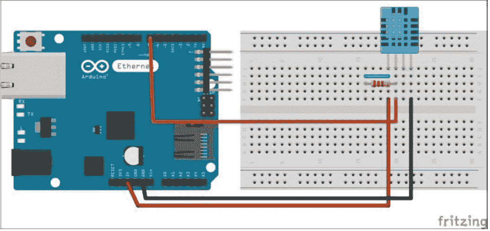
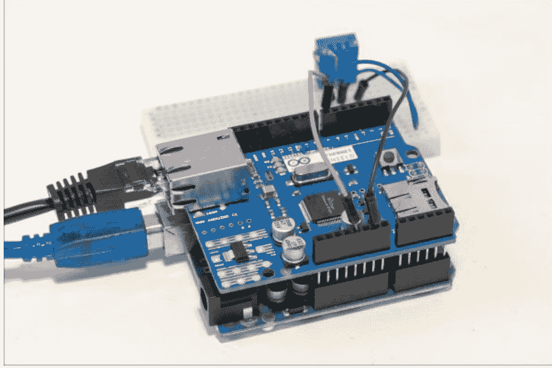
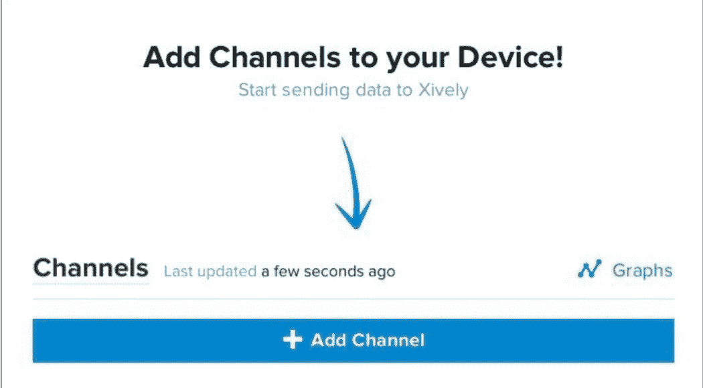
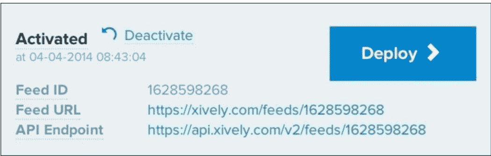
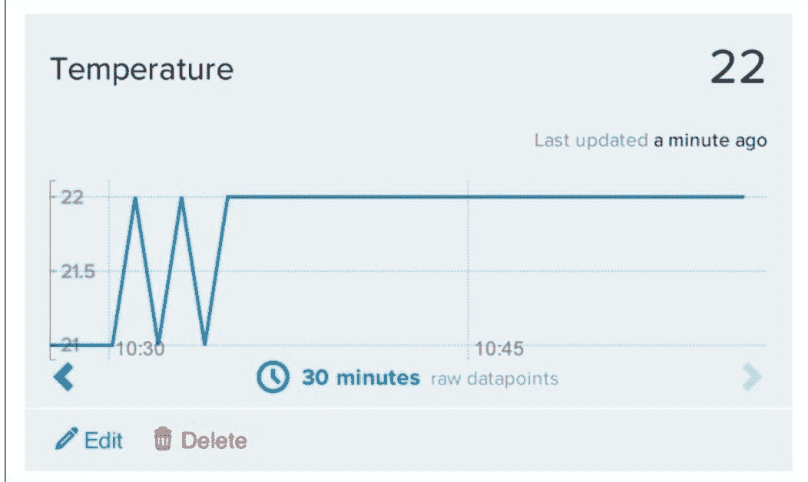
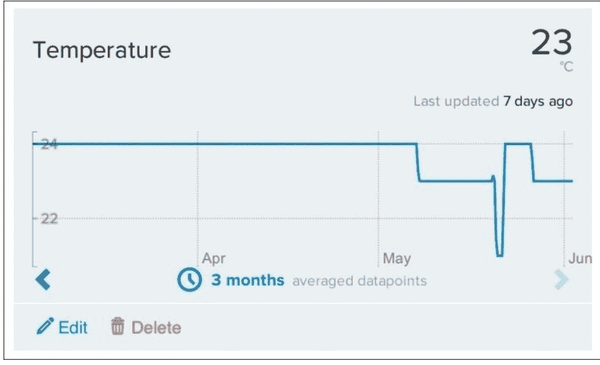
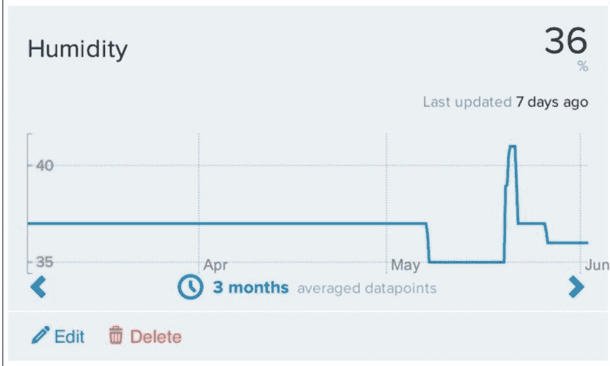

# 第 5 章 使用 Xively 实现物联网

在本书的前几章中，当使用以太网扩展板在 Arduino 板上进行测量时，我们主要保持本地化。例如，我们将一些测量数据发送回计算机上的数据库，并在那里显示测量结果。

在本章中，我们将采取不同的方法。我们将把以太网扩展板集成到物联网视角中。这意味着，我们将不再在本地网络内本地记录测量数据，而是自动将测量数据发送到名为 Xively 的云服务。Xively 网站的目的是存储来自你设备的数据，并在其网站上显示这些数据。这样，你的数据将随时可用，并可以从任何地方访问。

本章的主要收获如下：

- 首先，我们将围绕以太网扩展板和 DHT11 温湿度传感器构建本项目的硬件。
- 然后，我们将在 Xively 网站上创建一个帐户。我们还将配置此帐户，以便可以使用 Arduino 以太网扩展板将测量数据发送到该帐户。
- 当帐户正确设置后，我们将使用帐户信息（例如 Xively API 密钥）来构建本项目的 Arduino 草图。
- 最后，我们将草图上传到 Arduino 板并进行测试。我们将检查数据是否已正确发送到 Arduino 板，并在浏览器中实时可视化记录的数据。

## 硬件和软件要求

在硬件方面，你当然需要 Arduino 以太网扩展板和一个 Arduino 板（例如 Arduino Uno）。

你还需要一个传感器来测量一些数据。由于本书主要介绍如何使用以太网扩展板，而非如何从传感器进行测量，你可以选择任何传感器。

我选择了 DHT11 传感器，这是一种数字温湿度传感器。我选择这个传感器是因为它非常便宜且易于与 Arduino 连接。除了 DHT11 传感器外，你还需要一个 4.7k 欧姆电阻。

你还需要一个面包板和一些跳线，以便在传感器和以太网扩展板之间建立连接。

在软件方面，你首先需要的是用于与之前选择的传感器进行连接的库。由于我为本项目选择了 DHT11 传感器，你需要从 https://github.com/adafruit/DHT-sensor-library 下载并安装 DHT 库。

要安装 Arduino 库，只需将下载文件的内容解压到主 Arduino 文件夹的 libraries 文件夹中（如果该文件夹不存在，则创建它）。

## 硬件配置

现在是时候为本项目设置硬件了。到此为止，如果你遵循了前面的某一章，你应该已经将 Arduino 以太网扩展板插入 Arduino 板，并用一根以太网线将以太网扩展板连接到互联网路由器。如果还没有，请务必这样做。

在本项目中，你需要连接的唯一东西是 DHT11 传感器和电阻。你可以通过查看以下示意图来了解需要建立的不同连接的概览：



首先，将 DHT11 传感器插入面包板。然后，使用 4.7k 欧姆电阻连接传感器的引脚 1 和 2。

接下来是电源供应。将传感器的引脚 1 连接到 Arduino 5 V，将引脚 4 连接到 Arduino GND。最后，将 DHT 传感器的引脚 2 连接到 Arduino 引脚 7。

最终，它应该看起来如下图所示：



你现在已完成本项目的硬件配置，可以进入下一步，即在 Xively 上创建帐户。


## 创建您的 Xively 账户

使用 Xively 服务首先要做的就是创建并配置一个 Xively 账户。您需要在 Xively 上创建一个账户，以便我们可以向其服务发送数据。Xively 基本上是一个面向联网对象（例如我们的 Ethernet 扩展板）的在线平台。该服务会自动存储我们发送的数据。它还会以图表形式显示测量数据，图表会在数据传入时实时更新。

第一步是前往其网站上的 Xively 注册页面 https://xively.com/signup/。您将来到一个可以输入个人信息的页面：


然后，您需要创建一个设备，这是 Xively 网站上的一个虚拟实体。该设备将接收测量数据。创建新设备时，您需要为设备输入名称：

## 添加设备

Xively 开发者工作台将帮助您让设备、应用程序和服务通过 Xively 相互通信。第一步是创建开发设备。首先提供一些基本信息：

**设备名称**
天气站

**设备描述** 可选
告诉我们更多关于此设备的信息

**隐私** 您拥有您的数据，我们帮助您共享它。更多信息

- 私有设备
  您使用 API 密钥来选择是否以及如何共享设备的数据。

- 公共设备
  您同意在 CC0 1.0 通用许可下共享设备的数据。设备的数据会被主要搜索引擎索引，其 Feed 页面可公开查看。

添加设备   取消

然后，您可以向设备添加通道。Xively 上的通道就像数据库中的变量或一行；它是将从 Arduino 板接收特定测量值的实体。您可以通过单击以下屏幕截图中显示的按钮，在设备页面上创建新通道：



您需要为通道输入一些名称。对于此项目，您必须创建两个通道：一个名为 Temperature，一个名为 Humidity。

然后，您需要获取一些关于账户的信息，这些信息都位于设备页面上。

第一个是 feed ID，用于标识此特定设备。您可以在页面的以下部分中找到它：



然后，您需要获取 API 密钥，它特定于您的账户。您也可以在设备页面上找到它，如以下屏幕截图所示：

## API 密钥

### 自动生成的 Weather station 2 设备密钥，用于 feed 1860877001

GjD85fJqnsufHuToN7Itv9b8w1T3hENXrDiWPbsuPx1OCUKb

权限 READ,UPDATE,CREATE,DELETE

私有访问

### API 密钥

- 添加密钥

您需要将这两个密钥输入到本章将要构建的 Arduino 草图中，因此请随时准备好。

## 向 Xively 发送数据

我们现在将为本项目构建 Arduino 草图。目标是在 Arduino 板上测量数据，连接到 Xively 服务器，并发送数据。

第一步是包含以下所需库：

```
#include <SPI.h>
#include <Ethernet.h>
#include "DHT.h"
```

输入您的板的 MAC 地址：

```
byte mac[] = { 0x90, 0xA2, 0xDA, 0x0E, 0xFE, 0x40 };
```

然后我们可以按如下方式定义 DHT 传感器的引脚和类型：

```
#define DHTPIN 7
#define DHTTYPE DHT11
```

创建传感器实例，如以下行所示：

```
DHT dht(DHTPIN, DHTTYPE);
```

创建以太网客户端实例：

```
EthernetClient client;
```

我们还为板子定义一个默认 IP 地址：

```
IPAddress ip(192,168,1,50);
```

在草图中，我们还设置了要通过 Ethernet 扩展板连接的受保护 Xively 服务器的地址：

```
IPAddress server(216,52,233,120);
```

现在，我们需要稍微修改草图以输入您 Xively 账户的相关信息。您需要在此处输入上一节中获取的 API 密钥和 feed ID。使用以下代码，您可以定义 API 密钥和 feed ID：

```
#define WEBSITE "api.xively.com"
#define API_key "yourAPIKey"
#define feedID "yourFeedID"
```

在草图的 setup() 函数中，我们现在可以使用 DHCP 为草图获取 IP 地址，如以下代码所示：

```
// Start the Ethernet connection
if (Ethernet.begin(mac) == 0) {
Serial.println("Failed to configure Ethernet using DHCP");
Ethernet.begin(mac, ip);
}
```

为调试目的，我们在串行监视器上打印此 IP 地址：

```
Serial.print("IP address: ");
Serial.println(Ethernet.localIP());
```

现在，在草图的 loop() 函数中，我们将使用 DHT 传感器进行测量，为 Xively 格式化数据，并将数据发送到 Xively 服务器。

第一步是进行测量。通过以下代码行完成：

```
float humidity = dht.readHumidity();
float temperature = dht.readTemperature();
```

然后我们需要格式化这些测量数据，以便 Xively 服务器可以理解。确实，Xively 定义了接收数据的特定格式。所有格式均定义在 https://xively.com/dev/docs/api/communicating/data_formats/。

在我们的情况中，我们需要根据 Xively 规范将数据放入 JSON 字符串中。这通过以下代码片段完成：

```
int length = 0;
String data = "";
data = data + "\\n" + "{\\"version\\":\\"1.0.0\\",\\"datastreams\\" : [ {\\"id\\" : \\"Temperature\\",\\"current_value\\" : \\"" + String((int)temperature) + "\\"}," + "{\\"id\\" : \\"Humidity\\",\\"current_value\\" : \\"" + String((int)humidity) + "\\"}]}";
Serial.println(data);
length = data.length();
```

您会注意到，我们还会获取将发送到 Xively 服务器所需的字符串长度。此外，我们在引号前使用反斜杠，以指示我们要传输引号而不是字符串的结束。

然后，我们将实际连接到 Xively 服务器并发送数据。这是通过使用 PUT 请求并将 JSON 文件发送到 Xively 服务器完成的。在请求标头中，我们定义 Xively 设备的 feed ID，并传输您的 Xively API 密钥。

我们还需要将之前定义的数据放入请求正文中发送。这是通过以下代码片段完成：

```
if (client.connect(server, 80)) {
    if (client.connected()) {
    Serial.println("connected");
    client.println("PUT /v2/feeds/" + String(feedID) + ".json HTTP/1.1");
    client.println("Host: api.xively.com");
    client.println("X-ApiKey: " + String(API_key));
    client.println("Content-Length: " + String(length));
    client.print("Connection: close");
    client.println();
    client.print(data);
    client.println();
    } else {
    Serial.println(F("Connection failed"));
    return;
    }
}
```

然后，在发送数据后，我们读取来自服务器的返回数据，并使用以下代码片段将答案打印到串行监视器以供调试：

```
while (client.connected()) {
while (client.available()) {
char c = client.read();
Serial.print(c);
}
}
```

最后，完成后，我们停止连接。这是通过以下代码完成：

```
if (!client.connected()) {
Serial.println();
Serial.println("disconnecting.");
client.stop();
}
```

我们使用以下行每 10 秒重复整个过程：

```
delay(10000);
```

### 注意

本章的所有代码都可以在本章的 GitHub 仓库中找到 https://github.com/openhomeautomation/arduino-networking/tree/master/chapter5。

现在是时候测试草图并将数据上传到 Xively 了。此时您可以将草图上传到 Xively，并在 Arduino IDE 中打开串行监视器。您应该会看到板子的 IP 地址被打印出来，并且草图已连接到 Xively 服务器：

**IP 地址: 192.168.1.104
正在连接...**

您还应该看到数据为 Xively 格式化的方式：

```
{ "version": "1.0.0", "datastreams" : [ { "id" : "Temperature", "current_value" : "24"},{"id" : "Humidity", "current_value" : "37"}]}
```

过了一会儿，您应该会看到来自 Xively 的返回响应。如果数据已正确发送到 Xively 服务器，您应该在串行监视器上看到打印出的 200 OK 代码：

```
HTTP/1.1 200 OK
Date: Wed, 21 May 2014 15:02:49 GMT
Content-Type: application/json; charset=utf-8
Content-Length: 0
Connection: close
X-Request-Id: e44becaa5231354568262013fa713d9f099ffc83
Cache-Control: max-age=0
Vary: Accept-Encoding
```

这意味着数据已被 Xively 服务器正确接收，并以可理解的格式。

如果不是这种情况，您可以检查几件事。首先，确保


## 可视化记录的数据

我们现在要可视化使用 Xively 记录的数据。你可以再次访问 Xively 网站上的设备页面。你应该能看到不同通道中已记录了一些数据，如以下截图所示：

| 通道 | 几秒前最后更新 | 图表 |
|---|---|---|
| 湿度 | 35 % | |
| 温度 | 23 °C | |
| + 添加通道 | | |

点击其中任一通道，你也可以以图形方式显示数据。例如，以下截图显示了几次测量后的温度通道：



过一段时间后，温度测量将有更多数据点，如以下截图所示：



湿度测量亦可如此操作；以下截图显示了湿度测量：



请注意，点击时间图标可以更改时间轴并显示更长或更短的时间范围。

如果未看到任何数据显示，你需要返回 Arduino IDE，并确保来自 Xively 服务器的响应是一条 200 OK 消息，就像我们在上一节中看到的那样。

## 摘要

让我们总结本章所做的工作。我们使用 Ethernet 扩展板搭建了一个物联网项目，因为我们将 Ethernet 扩展板直接连接到云服务。我们在 Arduino 开发板上测量数据，并将数据发送到云服务 Xively，以便可以从任何位置访问和显示。

该解决方案的优势在于，记录在 Xively 上的数据可以从任何位置访问，而不仅仅是你的本地网络。你还可以使用数据和 Xively 基于数据创建自动触发器。例如，你可以根据记录的数据向另一个网站发送请求。你还可以将设备记录的数据与同事或朋友共享，以便他们也能实时监控你的项目正在记录的内容。

当然，该解决方案的缺点之一是，如果你的互联网连接中断，整个项目将完全无法工作。

以下是本章的主要要点：

- 我们首先搭建了该项目的硬件，包括 Ethernet 扩展板和 DHT11 传感器，用于测量温度和湿度。
- 然后，我们访问了 Xively 网站并在那里创建了一个帐户。我们还在 Xively 界面上设置了一个设备，并创建了通道，以便数据可以记录在 Xively 网站上。最后，我们还获取了 feed ID 和 API 密钥，以便 Arduino 草图知道将数据发送到哪里。
- 然后，我们为该项目设计了 Arduino 草图。Arduino 草图负责测量数据，根据 Xively 指南对其进行格式化，并将其发送到 Xively。我们测试了该草图，并确保 Xively 接受了数据。
- 最后，我们再次访问 Xively 网站来可视化数据。我们学习了如何以图形方式可视化这些数据，并看到了数据实时到达。

在下一章中，我们将继续构建物联网应用程序。我们将使用另一个名为 **Temboo** 的 web 服务，这是一个可以与 Gmail 或 Google Docs 等其他服务对接的平台。我们将使用此服务直接在 Google Docs 电子表格上记录数据，并根据记录的数据发送自动电子邮件。
