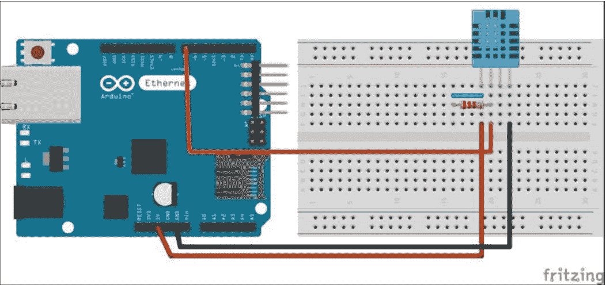
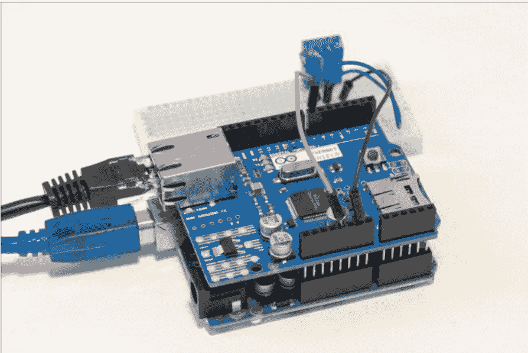
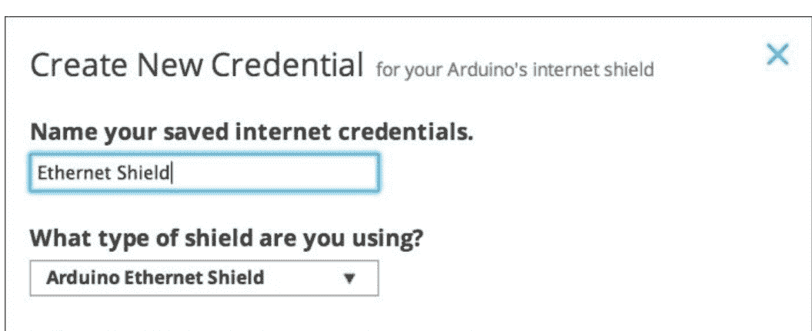
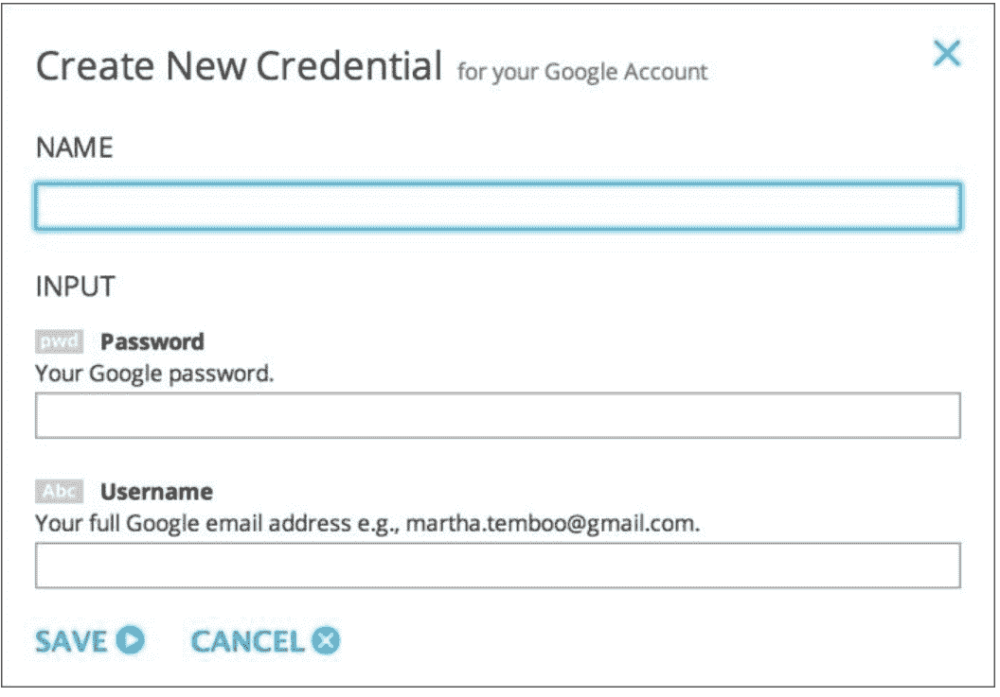
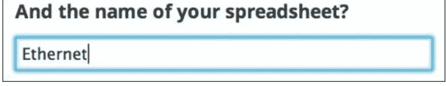
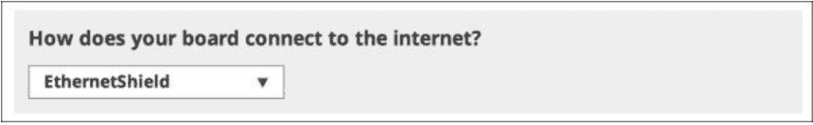
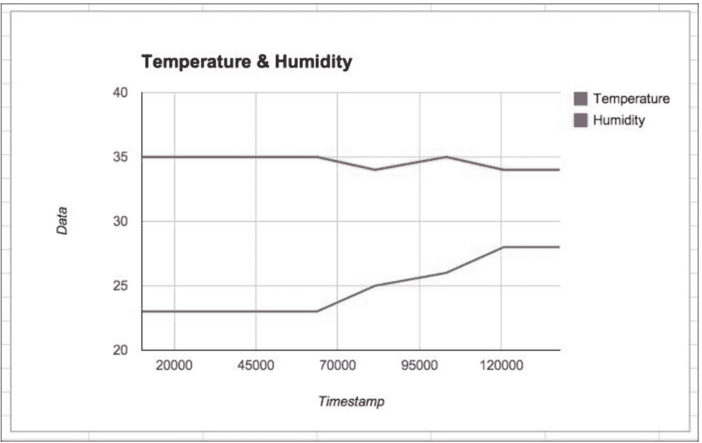
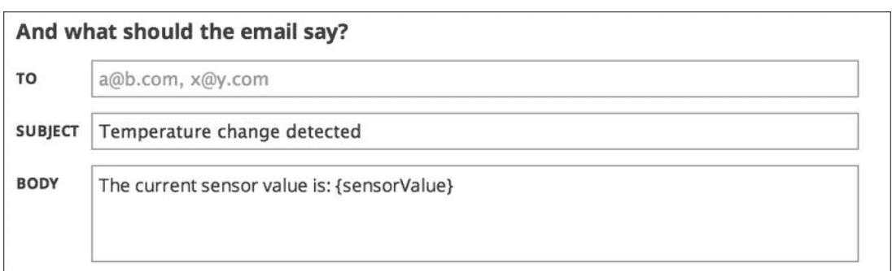

# 第 6 章 在 Google Docs 中记录数据

在本章中，我们将继续使用 Arduino Ethernet 扩展板构建物联网应用程序。这一次，我们将使用名为 Temboo 的 web 服务来构建一些有用且有趣的应用程序。Temboo 与我们在上一章中使用的 Xively 不同。它本身不是云平台，但可以用于将我们的 Arduino 项目与多个其他应用程序和服务对接。你可以将 Temboo 视为 Ethernet 扩展板与广泛 web 服务之间的桥梁，例如电子邮件服务、短信服务或存储服务。

例如，在本章中，我们将了解如何通过 Temboo 将你的 Arduino 项目与你的 Google 帐户对接。我们将使用此功能自动将测量数据记录到 Google Docs 电子表格中。

该解决方案的优势在于，你可以从任何位置访问 Google Docs 电子表格，从而在世界任何地方监控数据，而你的 Ethernet 扩展板正在从家中发送数据。我们还将根据测量数据使用 Gmail 发送自动电子邮件警报。

以下是本章的主要要点：

- 首先，我们将使用 Ethernet 扩展板和 DHT11 传感器配置该项目的硬件部分。我们还将下载并安装项目所需的库，包括 Temboo Arduino 库。
- 然后，我们将设置本章所需的不同帐户。首先，我们将设置你的 Google 帐户并创建一个用于记录数据的电子表格。我们还将设置一个 Temboo 帐户，并将其配置为使用 Arduino Ethernet 扩展板。
- 一旦所有帐户都设置完毕，我们将构建该项目的第一个应用程序——自动将测量数据记录到 Google Docs 电子表格中。你将能够在电子表格中实时查看记录的测量数据，并看到数据自动实时绘图。
- 最后，我们将设置 Arduino 系统，以在给定测量值超过阈值时自动发送电子邮件。

## 硬件和软件要求

在硬件方面，你当然需要 Arduino Ethernet 扩展板和一个 Arduino 开发板，例如 Arduino Uno。

你还需要一个传感器来测量一些数据。由于本书讲的是如何使用 Ethernet 扩展板，而不是如何从传感器测量，你可以选择任何你喜欢的传感器。

我使用了 DHT11 传感器，这是一种数字温度和湿度传感器。我为本章和书中许多章节选择了这个传感器，因为它非常便宜且易于与 Arduino 对接。除了 DHT11 传感器，你还需要一个 4.7k 欧姆电阻。

你还需要一个面包板和一些跳线，以在传感器和 Ethernet 扩展板之间创建连接。

在软件方面，你首先需要的是用于对接你之前选择的传感器的库。由于我为本项目选择了 DHT11 传感器，你需要从 https://github.com/adafruit/DHT-sensor-library 下载并安装 DHT 库才能使用它。

你还需要从 https://www.temboo.com/arduino/others/library-installation 下载并安装 Arduino Temboo 库。

要安装 Arduino 库，只需将下载文件的内容解压到主 Arduino 文件夹的库文件夹中（如果不存在，则创建该文件夹）。

## 硬件配置

现在是时候为本项目设置硬件了。此时，如果你按照之前某一章的操作，你应该已经将 Arduino Ethernet 扩展板插到 Arduino 开发板上，有一根以太网线连接到 Ethernet 扩展板，以及你的互联网路由器。如果还没有，请先这样做。

在本项目中，你需要连接的唯一东西是 DHT11 传感器和电阻。你可以通过查看以下原理图来了解需要进行的不同连接：



首先，将 DHT11 传感器插到面包板上。然后，使用 4.7k 欧姆电阻连接传感器的引脚 1 和 2。

现在，我们将连接电源。将传感器的引脚 1 连接到 Arduino 5V，将引脚 4 连接到 Arduino GND。最后，将 DHT 传感器的引脚 2 连接到 Arduino 引脚 7。

最后，连接应该如以下截图所示：




本项目的硬件配置现已完成，您可以进入下一步，即为此项目设置 Google 账号。

## 设置您的 Google 账号

为此项目，您需要拥有一个 Google 账号。如果您已经在使用 Gmail 或 YouTube 等服务，则说明您已拥有 Google 账号，并可立即使用 Google 文档。如果不是这种情况，您可以在以下地址创建账号：

[https://docs.google.com](https://docs.google.com)

创建账号后，您即可创建第一个电子表格。为此，只需点击 **创建** 按钮并选择 **电子表格**。您需要为电子表格输入一个名称，这一点非常重要，因为您稍后需要将此名称提供给 Temboo。我将我的表格简单地命名为 Ethernet。

然后，您需要为将接收数据的列命名。我们将测量温度和湿度，并为每次测量添加时间戳。您需要在第一行中输入这些内容，如以下截图所示：

| | A | B | C |
|---|---|---|---|
| 1 | 时间戳 | 温度 | 湿度 |
| 2 | | | |
| 3 | | | |
| 4 | | | |

当您拥有如上所示的 Google 电子表格时，即表示此部分设置已完成，您可以进入下一部分。

## 创建您的 Temboo 账号

下一步是在 Temboo 上创建账号。为此，只需访问以下地址：

https://www.temboo.com/

您将看到一个要求输入电子邮件地址的页面。


创建账号后，您将被带到 Temboo 主页。此阶段您会有许多选择，但我们要找的是 **设备**，如以下截图所示：


在设备页面中，Temboo 提供了一个名为 **设备编码器** 的工具。当我们使用 Arduino Yun 等平台，或者在本例中使用 Arduino Ethernet 扩展板时，该工具旨在为我们生成大部分代码。

只需点击正确的选项，该选项对应 Ethernet 扩展板等其他 Arduino 设备，如以下截图所示：

## 设备编码器

## 无需编写代码即可编程硬件

几分钟内设置连接设备。我们全新的设备编码器工具可让您使用带有传感器的 Arduino 在多种场景下触发 Choreo 调用。

安装 Temboo 的新 Arduino 库以运行设备编码器。了解如何。

## Arduino Yún

Arduino 第一款带有 Linux 架构和 Wi-Fi 兼容性的开发板，内置了 Temboo 的强大功能。

## 其他 Arduino 开发板

- Internet Shield
将其他 Arduino 及 Arduino 兼容开发板与 Temboo 的强大功能相结合。

然后，您将被要求选择要使用的传感器类型。当然，Temboo 无法列出此类项目可能使用的每一种传感器。因此，DHT11 传感器不在可能设备列表中。但是，我们将通过重写部分生成的代码来解决这个问题。暂时，只需选择 **通用传感器**。然后在下一个菜单中，选择 **电子表格**。

随后，您将进入一个新菜单，可在其中配置您的设备。由于这是您第一次配置设备，系统将要求您为以太网扩展板创建新的 Temboo 凭据。Temboo 凭据是一组存储在 Temboo 服务器上的参数，以便您在后续开发应用程序时无需再次输入它们。

在凭据框中输入您的 Arduino 开发板和以太网扩展板的详细信息，如以下截图所示：



然后，就像您选择使用电子表格一样，您还需要输入您的 Google 账号凭据。我们将使用它来访问 Google 文档，并在本章的最后部分用于与 Gmail 进行交互。

在以下截图所示的框中输入您的所有 Google 账号信息：



对于我的 Google 账号凭据名称，我使用了 Ethernet@gmail。

请注意，如果您已启用 Google 两步验证方法，则需要在此处提供专用应用密码。这是出于安全考虑，以防 Temboo 受到攻击时，您的 Google 账号不会被泄露。您可以在 https://support.google.com/accounts/answer/185833?hl=en 查找有关专用应用密码的更多信息。

您也可以选择此时不输入 Google 信息。但是，在这种情况下，您将需要在 Arduino 草图中输入这些信息，并对该草图进行轻微修改。要了解更多信息，您可以访问 https://www.temboo.com/arduino/yun/update-google-spreadsheet。

您还需要为先前准备好的电子表格提供一个名称。只需在正确的框中输入此名称，如以下截图所示：


例如，我将我的电子表格命名为 Ethernet：



之后，您需要选择要用于向电子表格记录数据的设备。这就是您选择之前创建的凭据的地方，如以下截图所示：



您还需要为刚创建的项目命名，以便您的 Arduino 草图稍后知道将数据发送到哪里。我将我的项目命名为 arduinoTemperatureSpreadsheet。如果您决定使用另一个名称，稍后需要在代码中进行小修改。

完成后，系统将提示您下载一个包含两个 Arduino 代码文件的压缩文件。下载它，解压缩，然后查看它。它将如以下截图所示：


应该有一个 Arduino 文件和另一个名为 TembooAccount.h 的文件。最后一个文件是最重要的，因为它包含您的项目凭据。在项目的其余部分中，您需要使用此文件来替代项目 GitHub 仓库中包含的文件。

## 在电子表格中记录数据

在 Temboo 网站上完成设备配置后，我们从 Temboo 下载了一堆文件。但是，下载的 Arduino 文件是针对通用传感器的。在本节中，我们将根据自己的需求调整此文件，并了解代码的工作原理。

### 注意

您需要将自己的 TembooAccount.h 文件放在与 Arduino 文件相同的文件夹中，以便代码可以工作。

本节的主要 Arduino 草图首先包含所有使项目能够与 Temboo 协同工作所需的库。请注意，我们还将插入 DHT 库。在代码中添加以下库：

```
#include <SPI.h>
#include <Dhcp.h>
#include <Dns.h>
#include <Ethernet.h>
#include <EthernetClient.h>
#include <Temboo.h>
#include "TembooAccount.h"
#include "DHT.h"
```

我们还定义了连接 DHT 传感器的引脚以及传感器的类型：

```
#define DHTPIN 7
#define DHTTYPE DHT11
```

然后，我们将创建传感器的实例：

```
DHTdht(DHTPIN, DHTTYPE);
```

我们还分配了以太网扩展板的 MAC 地址。请注意，这里并未明确分配，而是直接从您的 Temboo 账号文件中获取信息。MAC 地址通过以下行分配：

```
byte ethernetMACAddress[] = ETHERNET_SHIELD_MAC;
```

我们还将按以下方式创建一个以太网客户端实例：

```
EthernetClient client;
```

现在，在草图的 setup() 函数中，我们将通过 DHCP 为以太网扩展板获取 IP 地址，如以下代码所示：

```
Serial.print("DHCP:");
if (Ethernet.begin(ethernetMACAddress) == 0) {
 Serial.println("FAIL");
 while(true);
}
Serial.println("OK");
delay(5000);
```


启动 DHT 传感器，使用以下代码行：

```
dht.begin();
```

然后，在 loop() 函数中，我们将从 DHT 传感器测量温度和湿度，并使用以下代码片段将测量值转换为字符串：

```
float h = dht.readHumidity();
float t = dht.readTemperature();
```

```
int temperature = (int)t;
int humidity = (int)h;
```

```
Serial.println("Temperature: " + String(temperature));
Serial.println("Humidity: " + String(humidity));
```

测量完成后，我们将调用以下函数，该函数将实际连接到网络并将数据记录到我们的 Google 电子表格中。稍后我们将了解这个由 Temboo 自动生成的函数的详细信息：

```
runAppendRow(temperature, humidity);
```

最后，我们还将在每次测量之间插入一些延迟。我建议使用较大的延迟（我选择每分钟记录一次数据，仅用于演示目的），因为你可以调用 Temboo 的次数是有限的。延迟通过以下代码行插入：

```
delay(60000);
```

你可以在以下链接查看不同的计划和定价：

https://www.temboo.com/about/plans

例如，在免费计划中，你每月限制为 1,000 次调用，这意味着你大约每 44 分钟可以记录一次测量值。在第一个付费计划中，你大约每 5 分钟可以记录一个数据点。在开发应用程序时，请牢记这些限制。

现在让我们看看 runAppendRow() 函数的详细信息。它首先声明我们要使用的 Choreo 类型。Choreo 是 Temboo 服务上库的等效项。例如，我们将声明我们要使用特定的库，将数据插入 Google 电子表格中的一行：

```
TembooChoreo AppendRowChoreo(client);
```

我们将设置关于你的账户的不同信息，例如账户名称和你的应用密钥。所有这些都已在你之前下载的 Temboo 账户文件中定义，因此你不需要再定义任何内容：

```
AppendRowChoreo.setAccountName(TEMBOO_ACCOUNT);
AppendRowChoreo.setAppKeyName(TEMBOO_APP_KEY_NAME);
AppendRowChoreo.setAppKey(TEMBOO_APP_KEY);
```

然后，你需要以某种方式指定数据应记录的位置。再次，所有工作都由 Temboo 完成：所有信息都保存在 Temboo 端，保存在你之前设置的 Google 账户凭据中。如果你为此示例使用了与我相同的名称，那么你不需要修改以下代码行中的任何内容：

```
AppendRowChoreo.setSavedInputs("arduinoTemperatureSpreadsheet");
```

请注意，克服 Temboo 调用限制的新方法也是在每次调用 Temboo API 时传输多个数据点，例如，每次调用追加多行。你可以作为练习相应地修改代码。

现在，我们需要格式化数据，以便它可以在 Google 电子表格中正确记录。你想在给定行中插入的内容是时间戳、温度和湿度。对于时间戳，我们将简单地使用自设备通电以来经过的时间，使用 millis() 函数。

数据本身将包含在一个字符串变量中，其中每个列的值将用逗号分隔，如以下代码所示：

```
String RowDataValue = String(millis()) + "," + String(temperature) + "," + String(humidity);
AppendRowChoreo.addInput("RowData", RowDataValue);
```

我们还需要设置要使用的 Choreo，使用以下代码行：

```
AppendRowChoreo.setChoreo("/Library/Google/Spreadsheets/AppendRow");
```

然后，我们终于可以执行 Choreo，并使用以下代码行将结果存储在名为 returnCode 的变量中：

```
unsigned int returnCode = AppendRowChoreo.run();
```

如果执行 Choreo 后该代码等于 0，则表示一切正常，我们将使用以下代码片段在串行监视器中打印相应消息，以供调试：

```
if (returnCode == 0) {
    Serial.println("Done!\n");
} else {
    // A non-zero return code means there was an error
    // Read and print the error message
    while (AppendRowChoreo.available()) {
        char c = AppendRowChoreo.read();
        Serial.print(c);
    }
    Serial.println();
}
```

如果不是这种情况，我们将在串行监视器中打印相应的错误消息。最后，我们使用以下代码行关闭 Choreo：

```
AppendRowChoreo.close();
```

### 注意

你可以在本章的 GitHub 仓库中找到本节的所有代码，网址为 https://github.com/openhomeautomation/arduino-networking/tree/master/chapter6。

即使你决定直接从 GitHub 仓库获取代码，请注意，你需要使用自己的 Temboo 账户文件，或在 GitHub 上提供的 Temboo 账户文件中输入正确信息。

我们现在可以测试项目。将代码上传到 Arduino 开发板，转到 Google 文档，打开项目的电子表格。稍后，你应该会看到第一组测量值被记录在电子表格中，如以下屏幕截图所示：

| | A | B | C |
|---|---|---|---|
| 1 | **时间戳** | **温度** | **湿度** |
| 2 | 10122 | 23 | 35 |
| 3 | 28654 | 23 | 35 |

你还可以使用 Google 文档的集成绘图功能在图表上显示测量值。你只需选择与数据对应的列（在本章开发的示例中为 A、B 和 C），然后单击工具栏中的 **插入图表** 按钮。系统将提示你选择要绘制的图表类型。我只是选择了折线图，将所有数据绘制在单个图表上。图表将类似于以下屏幕截图：



由于一切都是动态的，你应该看到随着新测量值的输入，图表会实时更新。请注意，由于这是 Google 文档上的电子表格，无论你身处世界何处都可以访问，只需登录你的 Google 账户即可。

## 发送自动电子邮件

在本章的最后部分，我们将基于已完成的工作构建，但稍微更改应用程序。这次，我们将使用以太网扩展板和 Temboo，在达到条件时自动发送电子邮件。作为示例，我们将在测量温度上设置一个条件。每当温度达到给定值时，我们将向你选择的地址发送一封电子邮件，例如，你的专业电子邮件，以便你在工作时保持更新。

它再次从 Temboo 网站上的 Device Coder 开始，网址为 https://www.temboo.com/library/Library/Devices/Arduino/Others/。

单击 **通用传感器**，然后单击 **电子邮件**。这次你不需要输入那么多信息。你的 Gmail 账户应该已在上一部分中设置，Device Coder 应该会自动选择你的以太网扩展板。

你只需输入目标电子邮件（例如，你的专业电子邮件地址或家庭成员的电子邮件地址）和电子邮件的 **主题** 字段。现在不用担心电子邮件正文的值；我们稍后会更改它：



完成后，单击 **生成**。与上一部分一样，系统将提示你为这个项目输入一个名称，以便 Temboo 知道将电子邮件发送到哪里。我将我的命名为 arduinoTemperatureEmail，但如果你决定使用另一个名称，以后只需更改代码中的一行即可。

你现在可以下载生成的代码，我们将对其稍作修改。与上一部分一样，我们将修改 Arduino 代码，但重要的是你要获取自己的 TembooAccount.h 文件，其中包含你在 Temboo 上的自己的账户信息。

Arduino 草图与上一部分的类似，因此我将只讨论主要更改。

在草图的 loop() 函数中，你需要设置 Temboo 将发送电子邮件的限制。为演示目的，我将限制设置为 23，如以下代码所示：


```
if (temperature > 23) {
    Serial.println("\nTriggered! Calling /Library/Google/Gmail/SendEmail...");

    // Send email
    runSendEmail(temperature);
}
```

你可以看到，每当温度超过该限制时，就会通过 Temboo 发送一封电子邮件警报。我们稍后将详细介绍此函数。我在每次测量之间还插入了 1 分钟的延迟，因此如果跨越阈值，我们不会持续发送电子邮件：

```
delay(60000);
```

现在让我们来看看 runSendEmail() 函数的详细信息。该函数负责创建用于发送电子邮件的正确 Choreo，设置电子邮件正文，并通过 Temboo 发送。

它首先通过以下行创建用于发送电子邮件的正确 Choreo：

```
TembooChoreoSendEmailChoreo(client);
```

我们还定义了与你的账户相关的不同信息，这些信息在你刚刚从 Temboo 下载的 Temboo 账户文件中定义：

```
SendEmailChoreo.setAccountName(TEMBOO_ACCOUNT);
SendEmailChoreo.setAppKeyName(TEMBOO_APP_KEY_NAME);
SendEmailChoreo.setAppKey(TEMBOO_APP_KEY);
```

接下来，你需要在此处输入你刚刚在 Temboo 上创建的电子邮件项目的名称。如果你使用与我相同的名称，则无需修改以下行中的任何内容：

```
SendEmailChoreo.setSavedInputs("arduinoTemperatureEmail");
```

我们现在将构建电子邮件正文，它将存储在字符串变量中。我们只是使用一条通用消息，将测量温度的值附加其中，并将所有内容存储在一个字符串中。最后，我们将把以下行添加为用于发送电子邮件的 Choreo 的输入：

```
String MessageBodyValue = String("Alert! The current sensor value is: ") +
String(sensorValue);
SendEmailChoreo.addInput("MessageBody", MessageBodyValue);
```

在执行 Choreo 之前，我们定义使用以下行从 Gmail 使用 SendEmailChoreo：

```
SendEmailChoreo.setChoreo("/Library/Google/Gmail/SendEmail");
```

我们最终可以执行 Choreo 并将结果存储在变量中：

```
unsigned int returnCode = SendEmailChoreo.run();
```

与上一节一样，如果结果为 0，则表示一切正常。如果不是这种情况，我们将使用以下代码片段在串行端口上打印错误消息以进行调试：

```
if (returnCode == 0) {
  Serial.println("Done!\n");
} else {
  // A non-zero return code means there was an error
  // Read and print the error message
  while (SendEmailChoreo.available()) {
    char c = SendEmailChoreo.read();
    Serial.print(c);
  }
  Serial.println();
}
```

最后，我们将使用以下行关闭 Choreo：

```
SendEmailChoreo.close();
```

## 注释

你可以在本章的 GitHub 仓库中找到本节的所有代码：https://github.com/openhomeautomation/arduino-networking/tree/MASTER/chapter6。

你现在可以测试草图了。首先要确保你的 Temboo 账户文件与 Arduino 草图在同一文件夹中。然后，将草图上传到 Arduino 开发板并打开串行监视器。你首先应该看到的将是一切正常的确认消息：

```
**DHCP: OK**
**Setup complete**
```

接着，你应该在串行监视器上看到首次测量结果：

```
**Temperature: 21**
**Humidity: 39**
```

根据温度值，你可能需要捏住传感器来触发电子邮件警报。请记住，在本章示例中，我们将温度设置为 23 度。过一会儿，如果温度达到阈值，你应该看到以下消息：

```
**Triggered! Calling /Library/Google/Gmail/SendEmail...**
```

过一会儿，应该出现以下确认消息：

```
**Done!**
```

你现在可以关闭串行监视器，去检查你在 Temboo 上设置的电子邮件账户。你应该已经收到一条带有你在 Temboo 上设置的标题的消息，你还会收到正文，该正文指示你在草图中设置的通用消息以及测得的温度。

## 摘要

在本章中，我们使用网络服务 Temboo 创建了另一个物联网项目。基于 Temboo，我们构建了两个令人兴奋的应用程序。第一个是将测量值自动记录到 Google Docs 电子表格中。与我们在上一章中采用的方法相比，这里的优势很明显，即 Google Docs 是创建和共享电子表格的广泛使用的标准。你只需使用网页浏览器就可以随时随地访问数据，还可以绘制数据图表，并轻松与朋友和家人共享。

我们还构建了一个令人兴奋的应用程序，通过 Temboo 将我们的项目与 Gmail 对接。我们构建了一个基于测量数据的自动电子邮件警报系统。

让我们看看本章的主要收获是什么。首先，我们构建了项目的硬件，在 Arduino 以太网扩展板上安装了 DHT11 温湿度传感器。

接着，我们设置了项目所需的不同账户。我们首先在 Google Docs 上创建了一个电子表格，并正确配置它，以便它可以与 Temboo 协同工作。然后，我们还创建了一个 Temboo 账户并对其进行配置，以便你的以太网扩展板可以将数据发送到 Temboo 并将测量值记录到 Google Docs。

设置阶段完成后，我们构建了该项目的第一个应用程序，该应用程序包括将数据直接记录到 Google Docs 电子表格中。我们还使用 Google Docs 的绘图功能显示了这些数据。

最后，我们再次使用 Temboo 创建了一个自动电子邮件警报系统，当测量值达到特定阈值时，它会自动向你选择的地址发送一封电子邮件。

由于本书即将结束，让我们来看看我们了解了关于 Arduino 以太网扩展板的哪些内容，以及可以用它创建哪些令人兴奋的应用程序。

本书的第一部分主要关于在以太网扩展板上运行 Web 客户端。我们首先尝试了扩展板，看看它是否能连接到互联网并获取页面内容。然后，我们构建了第一个测量系统，其中以太网扩展板连接到运行在你计算机上的服务器以记录一些数据。

在本书的第二部分，我们通过在 Arduino 开发板上直接运行 Web 服务器，为 Arduino 以太网扩展板赋予了更多自主权。我们再次制作了测量项目，但这次是在开发板上运行 Web 服务器，并将数据记录到插入扩展板的 SD 卡中。我们还将继电器连接到 Arduino 开发板，并通过以太网对其进行控制。

最后，我们使用 Xively 和 Temboo 平台构建了两个物联网项目。在这两个项目中，我们都使用以太网扩展板将数据发送到 Web，以便这些数据可以从世界任何地方访问并以图形方式显示。

为本书画上句号，我希望你在不同章节中找到的所有信息都能激发你构建更多令人兴奋的应用程序的意愿。Arduino 以太网扩展板是使用 Arduino 构建精彩联网应用程序的最佳方式之一，而你用本书所学概念能做的事情也没有任何限制。
