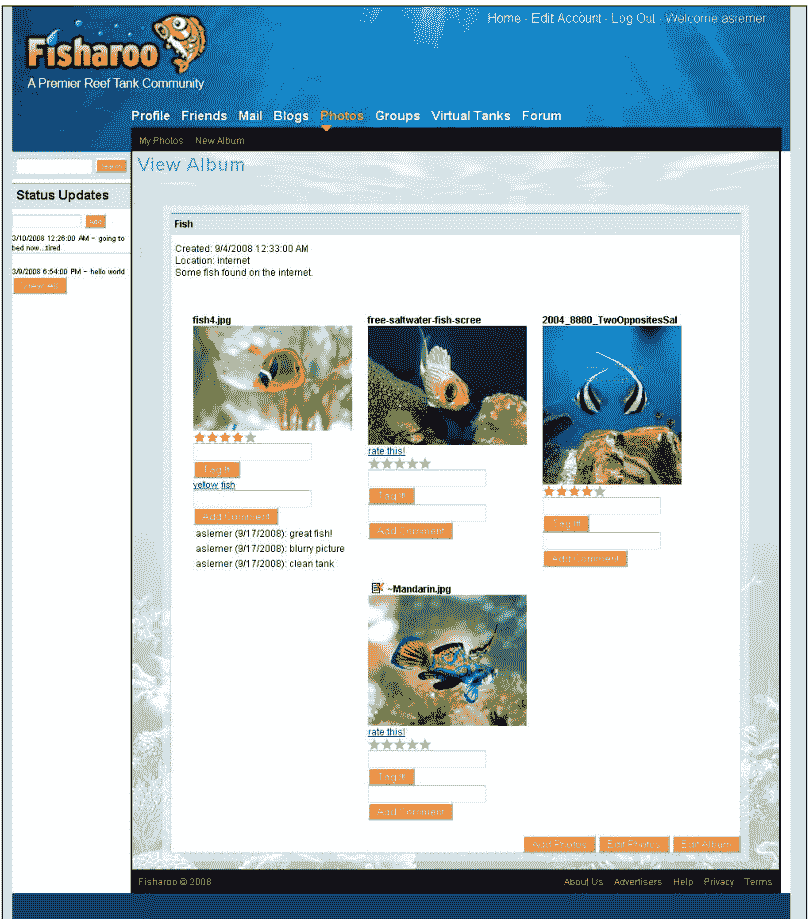
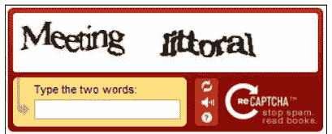
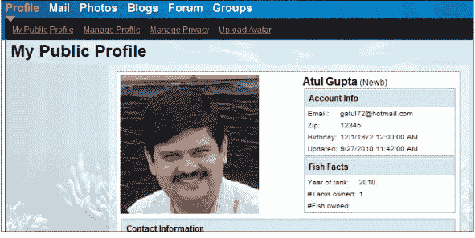
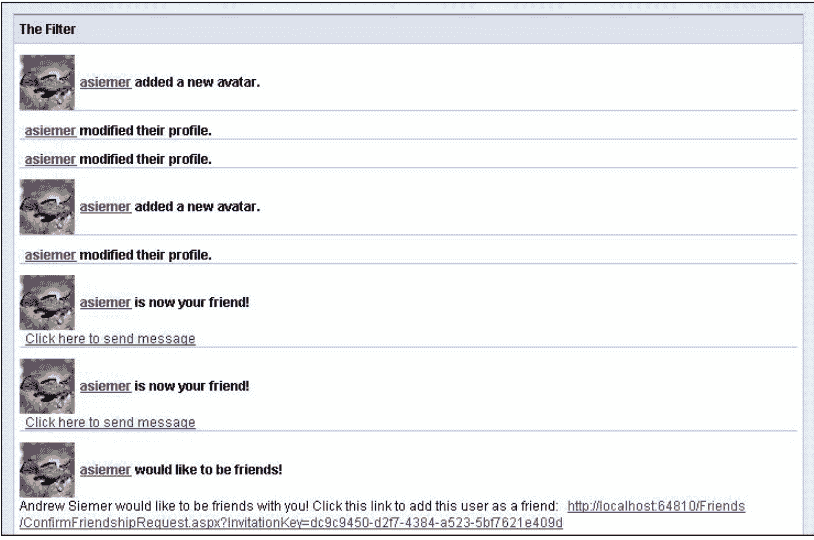
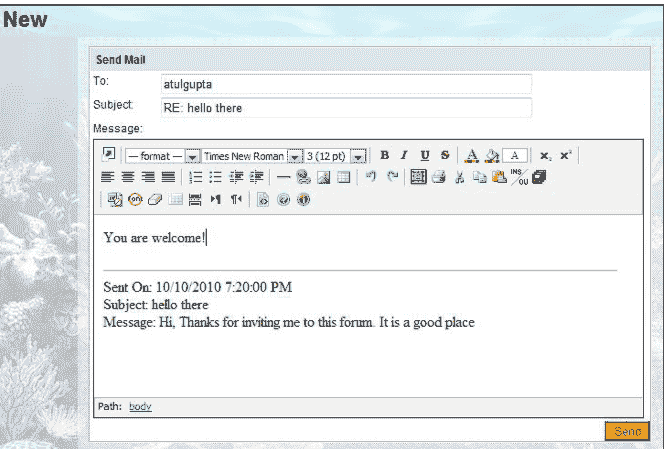
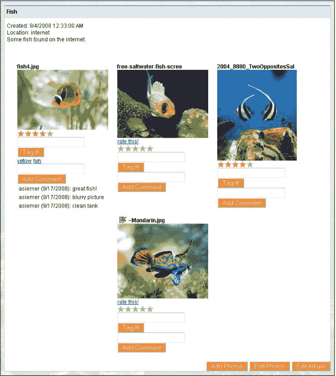
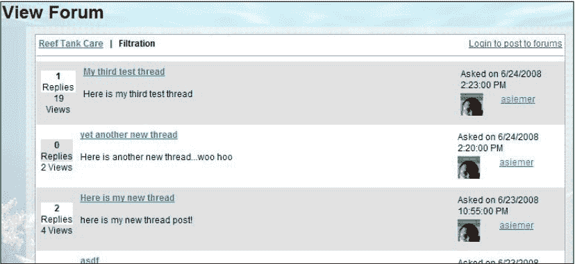

# 1 社交网络

随着互联网和移动设备行业的蓬勃发展，世界各地的人们比以往任何时候都更加紧密相连。社交网络正是当下的热潮。本书的主题就是如何构建一个社交网络网站或社区网站。在本书中，我们将研究一些知名社交网络和一些不太知名的网络，以了解哪些功能受欢迎。然后，我们将讨论在本书中要构建的社区。一旦我们了解了其他人在做什么以及我们的社区会是什么样，我们将立即投入去构建自己的演示社区。

## 为什么这个主题如此重要

**社交网络**的核心在于发展朋友和伙伴之间的联系或纽带。虽然人们自古以来就在相互建立联系，但互联网使我们能够以全球化的方式进行。一些广受欢迎的社交网络的典型示例包括 Digg、LinkedIn、Facebook 和 Twitter。大多数人听说过这些服务，许多人每天都在使用它们。这些社区能够通过广告和额外的付费服务产生收入。

## 社区遍地开花

`Digg.com` 是一个聚合其他网站信息的信息聚合器。它允许人们发布有趣视频、博客、新闻源以及其他形式的媒体和内容的链接。这些帖子会根据站内其他用户对它的喜爱程度被推送到网站顶部。最终，帖子会沉到首屏之下，逐渐被遗忘。他们网站的关键之处在于，你实际上并不会在他们网站上查看内容的正文。这项服务本质上就是一个动态链接农场，而且有过之而无不及。

## 社交网络

**LinkedIn.com** 将社交网络的概念进行了打磨，并增添了专业色彩。通过此服务，你可以建立专业档案，与招聘人员建立联系，与所在地区的其他专业人士建立联系，最重要的是，与他们所联系的每个人建立联系。LinkedIn 真正抓住了扩展网络概念的力量。

Facebook.com 最初始于哈佛大学。该网站本质上是学校发给新生的一本数字版书籍，以便每个人都能互相认识。该网站非常注重建立个人资料并通过 Facebook 称之为“墙”的窥探功能将这些个人资料链接起来。该功能本质上会捕获你在网站上朋友所进行的所有活动。墙是另一种形式的聚合。Facebook 也以其可扩展性功能而闻名，这些功能允许开发者直接在 Facebook 环境中创建和托管应用程序。

Twitter.com 大多数人会称其为微型博客。该网站允许你向你的博客发布非常小的短语，然后将其推送给你的订阅者（朋友）。该服务主要用于让人们知道你正在做什么。此功能的一个很好的用途是发布：“我正在某某咖啡店。如果附近有人，欢迎过来一起喝杯咖啡。”

这些都是非常庞大的社区网站，很容易就拥有数百万订阅者/成员。然而也有趣的是，在通常庞大的用户群体中，只有很小一部分是活跃的，而大多数人是被动用户。人们可能加入这些网站更多是为了社交地位，但可能并不是真正的活跃用户。

也有许多成功的社区网站以更小的规模运营。其中一些包括 Rockero.com、AnimeDates.com 和 Ning.com。虽然它们没有 LinkedIn、Facebook 等那么大或知名，但这些都是非常活跃的社区，能够通过社区上的广告谋生。像 Ning 这样的一些社区甚至收取会员费。

### 一旦我有了自己的社交网络，然后呢？

尽管已经有这么多社交网络网站，但仍不断涌现出新的网站。每个人都想建立自己的网站，认为自己有更好的想法，能比别人做得更好。下面列出了任何社交网络网站经常被忽略的一些关键考虑因素。

这个社交网络将专注于帮助新老海水鱼缸主人设置和照顾他们的海水鱼缸。它还将帮助他们选择合适的鱼类组合。而且，作为一个社区，它将为他们提供一个可以提供建议并接受建议的地方。

### 本书的方法

在每一章中，我们将遵循一种模式来构建功能或一组功能。我们将从本章要解决的问题开始。然后我们将尝试找出一种设计来解决我们需要构建的功能。最后，我们将讨论满足设计要求所需的内容。

#### 问题

在问题部分，我们将概述为了实现本章主题的成功，我们需要做什么。我们将向你展示成品的一些屏幕截图。并且我们将涵盖构建功能时需要注意的主要陷阱。

#### 设计

本章的这一部分是关于定义我们对功能或功能的期望。在这里，我们将决定并写下物理需求，以便在下一节开始构建功能集。在这里，我们将开始查看数据库可能是什么样子，是否需要制作一页或两页，或者用户控件是否会更好，以及开源工具是否可以帮助我们满足需求。

#### 解决方案

在我们章节的解决方案部分，我们将讨论如何实现每个功能的全部要求。本节将深入探讨从数据库到用户界面的功能实现实际代码。我们将使用 ASP.NET 4 进行实现，Visual Studio 2010 作为 IDE。除 ASP.NET 外，我们还将在实现中利用 .NET Framework 4 的某些功能、第三方工具和 SDK。我们将在书中内联提供相关代码。整个代码可以从 Packt 网站下载。在本节结束时，你应该拥有可以玩的东西。

### 我们社交网络的功能

以下是我们社交网络网站将具备的理想功能：

#### 账户

用户账户在任何有用户为网站做出贡献的数据驱动网站上几乎是必须的。如果你需要知道你的用户是谁，那么你就需要某种方式来跟踪他们的账户。与其向你展示纯 ASP.NET 方式的账户，本节将向你展示如何从头开始构建自己的账户系统。

这将包括查看注册流程，我们的用户在此创建初始账户。为了确保我们阻止机器人和其他程序以自动方式创建账户，我们将实现 reCAPTCHA 系统并讨论此方面的其他选项。我们将实现电子邮件验证系统，以确保我们的用户确实是他们声称的那样。在此基础上，我们还将讨论设置权限系统，以便我们随着时间的推移对其进行构建。并且，没有一章关于账户创建是完整的，除非我们讨论密码加密（一个经常被忽略的话题）。

#### 个人资料

用户的个人资料实际上只是其账户的扩展。区别在于账户保存登录信息，而个人资料保存所有个人标识符。它保存用户的描述、用户的属性以及他们的照片（头像）。我们将讨论以一种足够灵活的方式创建用户个人资料，以便所有系统都可以使用。我们还将讨论如何处理头像的创建，以便用户可以上传图片然后适当地裁剪它。由于个人资料包含大量关于用户的信息，我们还将实现一些隐私形式，允许他们隐藏某些部分并显示其他部分。最后，我们将讨论为我们的用户创建个人页面，允许他们拥有一个虚荣 URL，使用 ASP.NET 的 URL 路由功能实现（www.site.com/profiles/AtulGupta）发送给他们的朋友。

#### 好友

在社区中拥有好友的概念是让人们不断回到你网站的粘合剂。好友是你声明的、你信任并允许查看你的信息的用户，并且你通常对他们感兴趣。把好友想成一个联系人、同事等等。不同的术语描述了不同社区主题的相同概念。

在本节中，我们不仅会向你展示如何实现 **好友** 功能，还将讨论如何搜索他们、在网站列表中找到他们，以及导入你的联系人到网站以找到你的好友。我们还将实现一个微型博客，允许你的用户提供他们所在位置和正在做什么的状态。此状态随后将作为提醒显示在你的微型博客和你的好友的微型博客上。

#### 消息

消息对于任何社区网站都是必不可少的，因为它允许用户直接相互通信。这可以有多种形式。你可以向用户发送消息，直接通过电子邮件发送给用户。或者你可以允许你的用户通过网站发送消息，然后存储在收件人的收件箱中。然后向收件人发送通知。这种最后一种形式对你作为网站管理员来说更容易管理。

在本节中，我们将创建一个完整的消息系统，其外观类似于 Hotmail 或 Gmail 等基于网络的电子邮件应用程序。作为我们界面的一个部分，我们将显示现有好友列表以发送消息。并且我们将学习如何以一种可以在整个网站中轻松重复使用的方式实现 Xinha WYSIWYG 编辑器，用于复杂输入。我们将在后面的章节中更详细地介绍 Xinha 编辑器。

## 媒体库

有很多社区非常依赖媒体库。YouTube 或类似的网站就是一个例子。这通常是能将最大比例的社区成员带回你网站的功能。因此，非常重要的是要了解如何构建一个媒体系统，而不是构建图像库、视频库等。我们将构建一个通用的媒体管理系统，让你能够托管视频、照片、简历或任何数量的物理文件，只需做少量额外调整即可。

除了媒体管理系统之外，我们还将探讨解决许多 Web 编程环境中最大的限制之一——多文件上传。ASP.NET 在处理一次一个文件时很出色，但在管理照片库时，例如，你会发现自己经常需要上传几张或数百张照片。与其创建基于 Java 或 Active-X 的控件，这可能需要用户系统进行额外安装，我们将研究基于 Silverlight 的实现以及基于 Flash 的实现。

## 社交网络

通过此功能，我们能够浏览到一个目录并上传任意数量的文件，如下图所示：

## 博客

博客通常是任何社区网站中的主要功能，因为它为喜欢向世界发言的人提供了这样做的工具。另一方面，你的博客输出为那些更具窥视欲的人提供了免费内容供他们阅读和跟进。活跃的博主对社区最大的好处之一是，你获得了大量免费内容来喂养各种搜索引擎蜘蛛。这反过来会帮助你提高搜索排名，从而为你的网站带来更多流量，并进而壮大你的社区。

考虑到搜索引擎、用户和安全性，我们将投入一些时间来解决困扰许多动态网站的一个问题——使用查询字符串数据来确定页面输出。说实话，从用户角度来看，在查询字符串中看到一堆变量名、随机自动生成的记录 ID 和 32 个字符的 GUID 根本不友好，有时甚至令人困惑。再加上如今搜索引擎似乎能够导航这种查询字符串乱码，但我们却失去了通过伪装 URL 使其看起来像我们的关键词是目录，从而优化网站关键词排名的关键机会。我们将继续从个人资料的示例出发，扩展我们的个性化 URL 支持，以便我们可以拥有类似 www.sitename.com/blogs/AtulGupta/my-article-name.aspx 的地址。

## 论坛

每个人都知道论坛是什么。对于社交网络来说，这是一种脱节的沟通形式，人们可以在其中发布内容供讨论，其他人可以在一段时间后偶然发现该帖子并发表自己的看法。在开发人员世界中，你经常会有一个完全围绕这种功能构建的社区，例如技术帮助论坛。对于我们专注于帮助他人弄清如何运营水族馆的网站来说，此功能将非常有用。

上图显示了留言板的外观。

## 投票

投票是管理社区网站内容并认可通过在论坛中提供有价值评论而做出贡献的人的一种方式。用户需要有权对论坛上发布的问题或回复进行正面和负面投票。这有助于其他用户不必阅读整个问题及相关回复，而是专注于投票更高的内容。与 *标记为答案* 类似，投票也有助于建立个人的声誉。

## 奖章

一旦用户开始根据被标记为答案或被投票支持的回复累积积分，他们就开始获得奖章。这是对其在网站上声誉的视觉体现（见下图），奖章数量越高，社区对其言论的信任度就越高。

## 框架

任何人都可以构建一个具有我们讨论过的功能的家庭式社区网站。然而，如果你想构建一个能够随着社区成长而成长的网站，我们希望从一开始就以某种方式构建它。为此，我们将提前遵循一些设计模式和概念。我们将使用 n 层方法构建我们的网站，采用领域驱动设计、模型视图演示者、工厂模式和仓储模式。我们还将使用微软随 .NET 4 提供的 **托管可扩展性框架 (MEF)**、ADO.NET 实体框架及相关工具和 Windows Server AppFabric，以及一些优秀的开源工具集，如 Lucene.NET 和 MemCached。

### 扩展

一旦我们完成了核心社区的构建，我们将开始讨论一些概念，以帮助你在社交网络上支持大量用户。我们将讨论应用程序如何分层、转变为面向服务架构 (SOA)、部署在 IIS 上以及围绕 Web 农场的某些关键概念。我们将讨论如何使用 Lucene.NET 创建和搜索索引数据。我们还将介绍如何通过在 Web 农场内部使用新的 Windows Server AppFabric 或 MemCached Win32 服务器实现缓存农场来优化数据检索和内容创建。我们还可以探讨通过实现某种邮件队列概念来优化电子邮件通信。

### 总结

我们已经查看了一些构成社交网络网站的功能，并查看了一些成功的社区网站示例。接下来，我们讨论了社区网站必须提供的关键功能，并简要介绍了 POST 和 SLATES。最后，我们讨论了我们将在本书中构建的功能。
