# 2 企业级社区框架方法

我们都做过应用程序开发。通常它从小开始，具有有限的功能需求，似乎未来不需要。但随后你发现自己不断为该应用程序添加功能。它持续不受控制地增长和增长。如果你知道该应用程序会如此重要并会被如此广泛使用，你可能就会以不同的方式构建它。很可能你会考虑到可扩展性来设计应用程序，而不是急于完成项目并交付！

### 应用程序设计

应用程序设计如下：

### 关键原则

在设计 Fisharoo 解决方案时，我们将尝试遵循某些架构原则，其中一些重要原则是：

- **模块化且松耦合**：我们将尝试通过将相关功能划分为各种模块来构建 Fisharoo，这些模块之间没有或只有相对较低的相互依赖。
- **关注点分离 (SoC)**：这是将应用程序分解为特定功能单元的过程，以使每个单元仅解决一个关注点的需求，并且在功能方面与其他单元的重叠尽可能少。有关此主题的更多信息请见：http://en.wikipedia.org/wiki/Separation_of_concerns。
- **可扩展性：** 我们将尝试以可扩展的方式构建应用程序的大部分内容，以便如果需要，我们可以替换部分功能，而无需重新编译整个应用程序甚至重新设计。
- **构建还是购买：** 在可能的情况下，我们将尝试利用 .NET 堆栈中的开箱即用功能，或寻找第三方/开源组件来填补空白。

上述每个原则将在以下部分中讨论。随着我们的进展，我们还将看到它们如何借助技术和架构模式得以实现。

### 分层架构

知道我们的应用程序将是一项庞大的工作，应该持续一段时间，我们需要设计一个能够在需要时轻松扩展的东西。为此，我们将尝试以可扩展性为目标来设计此应用程序。最简单的方法是遵循保持“关注点分离 (SoC)”的一般规则。

### 层

保持 SoC 的最简单方法是首先将应用程序的主要区域划分为层。在大多数应用程序中，这可能分为表示层、业务逻辑层和数据访问层。

- **表示层：** 此层通常包含与应用程序用户界面相关的任何内容——用户在使用应用程序时点击和交互的按钮、链接和其他控件。
- **业务逻辑层：** 这里是应用程序规则的所在。这可能像在产品目录中格式化价格货币那样简单，也可能像强制执行数据输入规则那样复杂。
- **服务层：** 在构建 **面向服务架构 (SOA)** 时，服务层建立在业务逻辑层之上。由于我们不以 SOA 实现为目标，我们将不会创建此层。然而，在第 13 章中，我们将向你展示如何在现有设计中引入此层而无需大量更改。
- **数据访问层：** 数据访问层负责连接到数据源并与存储在该位置的数据进行交互。这可能是一个数据库、一些 XML 文件、文本文件，甚至是一个 Web 服务。


领域驱动设计（Domain-driven Design）是一个宏大的主题。为了帮助你开始理解其高层概念，我们这里只概述基础内容。随着我们继续构建框架和应用程序，你将看到以下一些原则得到应用。

如需了解更多关于领域驱动设计的信息，请访问这个网站：http://www.domaindrivendesign.org。

## 重要方面

领域驱动设计的重要方面如下：

## 通用语言

**通用语言**（ubiquitous language）的概念很简单。它基本上指出，所有参与软件开发项目的人员——业务所有者、项目经理、开发人员，也就是几乎所有人——都使用同一种语言来描述正在开发的软件的各个方面。这减少了混乱，从而提高了整体开发速度。

这一概念不仅仅用于讨论。它还延伸到类、方法等的实际命名上。一旦做到这一点，无论谁参与讨论，所有讨论听起来都会相似。当遵循这一点，并且每个人在所有对话中都使用同一种语言时，混乱就完全消除了，不再有专业知识孤岛。

最终，领域和领域逻辑变得更加精炼。应用程序也因此变得更好！

## 实体

**实体**（entity）是应用程序中在应用整个生命周期内保持自身状态的对象。这意味着它可以从 XML 文件中重新加载、保存到数据库、之后从该数据库实例中加载、序列化并通过网络发送——在所有情况下都能得到相同的对象。这是通过使用唯一 ID 来实现的。这个 ID 可以是任何东西，从自增数字 ID、GUID，到**社会安全号码（SSN）**，包括系统中任何唯一的值。

一个例子可以是美国（U.S.）的一个人。在这种情况下，我们可以使用一个人的 SSN，每个生成的人都是唯一的。当我们放眼全世界的人时，SSN 就不再被视为一种好的唯一 ID 形式，因为并非世界上所有人都有 SSN。因此在这种情况下，我们可能不得不开始查看一个人的多个属性来定义其唯一性。我们可以取他们的出生日期、姓氏、国家/州、城市等等。这些信息的组合应该能在你的系统中产生一个唯一的实体。实体是领域中最重要的对象。

应用程序中的所有对象都需要唯一吗？所有对象都必然是实体吗？嗯，答案是“不是”。在下一节中，我们将通过值对象来回答这些问题。

## 值对象

值对象（value object）没有实体那么重要。它不需要身份标识，因此可以轻松创建，无需担心确定其唯一性。我们更关心这个对象是什么，而不是它是谁。值对象应该是不可变的。如果需要修改值对象，请丢弃它并创建一个新的。但如果你发现该对象不是不可变的，或者没有自己的身份就无法存在，那么它很可能是一个实体对象。

为了进一步扩展我们在*实体*一节中的人物示例，我们可以创建一个“地址”值对象，而不是让一个人拥有州、城市、邮政编码、街道或任何其他与地址相关的属性。然后，值对象将存储州、城市、邮政编码、街道等信息。这个地址对象随后可以成为一个人的一部分。因此你可以使用它，如 *person.Address.City*。从技术上讲，这个地址可以被同一所房子里的所有人共享。我们不太关心地址本身，而是关心它附着在某个特定的人身上这一事实。

为什么我们需要值对象？值对象很重要，因为它们提供了一种对信息位进行分组的方式，正如你在上面的示例中看到的那样。作为“轻量级”对象，它们减少了应用程序中使用的资源量。它们还简化了应用程序，因为值对象不需要唯一性。

## 服务


> 这里的“服务”一词不应与**面向服务架构（SOA）**领域中的服务混淆。

当我们使用通用语言讨论应用程序时，我们很快就会得到一个由名词（实体和值对象）和动词（这些对象的方法）组成的词汇表。然而，并非我们最终得到的所有动词都能轻松地融入我们定义的实体和值对象中。我们该如何处理这些同样重要却无家可归的动词呢？应用程序显然需要它们。我们要不要因为找不到更好的位置而把它们塞进现有的某个对象中？这样做会造成混乱，并使这些对象变得难以使用。因此，前面问题的答案是“不”。我们宁愿创建一个服务。

**服务**（service）既不是实体也不是值对象。话虽如此，鉴于我们使用的是基于**面向对象编程（OOP）**的语言，我们必须创建某种对象。因此我们创建一个基于服务的对象，为应用程序提供所需的动作（动词）。以电子商务应用程序为例。我们可能有一个客户和一个供应商，其中一方需要通过电子邮件联系另一方。在客户对象中添加一个方法，用于从供应商向客户发送电子邮件，这合适吗？在供应商对象中添加这个方法合适吗？放在任何一个对象中似乎都不太对。因此我们可以创建一个电子邮件服务。现在，当我们的客户需要联系供应商，或者供应商需要联系客户时，任何一方都可以使用该服务来处理通信。

## 模块

即使你从未听说过或使用过领域驱动设计，你也很容易理解什么是模块。**模块**（module）是应用程序中一组特性和功能。模块是将庞大而复杂的领域逻辑组织成更小、更易理解的单元的一种方式。模块还有助于遵循高内聚、低耦合的原则，将高度内聚的代码放在一起。

在这个应用程序中，我们将有账户、博客、图片画廊以及许多其他功能。虽然我们可以轻松地创建一个庞大的代码库来涵盖所有这些功能，但对我们来说，创建更小的代码单元来分别描述每个模块的特性会更容易。显然，模块之间会有一些重叠，因为账户在画廊和博客中都会用到。博客也可能引用图片画廊中的图片。正如你所看到的，模块不仅让你的代码更易于理解，而且由于你将代码进一步细化到另一个容器中，它们还有助于保持解耦！

## 聚合

到目前为止，我们已经讨论了必须使用通用语言来定义应用程序词汇表的思想。根据该定义，我们将提取出实体和值对象。当方法不适合我们的实体或值对象时，我们可以创建服务。而所有这些项都可以分组到模块中。现在我们将继续讨论如何使用聚合、工厂和仓储来管理、创建和存储这些项。

对于复杂的应用程序，我们将有大量对象需要处理。到目前为止，我们一直试图通过定义良好的词汇表并将该词汇表分组到更小的容器中来降低复杂性。此外，我们还通过声明某些对象需要在应用程序中保持状态，而其他对象则不需要，来尝试降低复杂性。

我们尚未讨论的是如何维护对象的生命周期。我们知道它们会被创建、存储、传递等等。但是当需要从系统中彻底删除其中一个对象时该怎么办？如果我们不密切管理对象的使用，最终可能会导致对象无缘无故地随机漂浮在我们的系统中。这反过来又会给我们带来问题，例如内存泄漏、缓冲区溢出、空指针访问，最终导致系统崩溃。

因此，规划对象之间交互的简单性非常重要。与其让对象随意地互相创建，不如设置一些守门人，我们必须通过它们才能访问其他对象。例如，对象 Z 访问对象 B 的唯一方式是通过对象 A。这样，当对象 Z 用完对象 A 和对象 B 后，我们可以直接移除对象 A，对象 B 也会随之消失。

**聚合**（aggregation）是我们可以在对象中使用的一个边界。我们之前讨论过**人**对象是一个实体对象，地址信息是一个值对象。让我们扩展这个示例，假设我们还有一个处理人联系信息的对象，其中可能包含电话号码、电子邮件地址等。这同样是一个值对象。与其让外部对象直接访问地址和联系信息，我们可以强制它们通过实体对象来读取这些数据。此外，如果外部对象想向一个人的电话号码列表中添加一个号码，我们可以强制规定唯一的方式是通过人对象，而不是通过联系信息对象。

沿着这一概念继续推进，通过将类结构进一步分解为更小的代码块，我们的领域逻辑得以进一步简化。这不仅从开发的角度来看更容易操作，而且管理对象在应用程序中的来去也更为简单。


## 工厂

在设计过程中我们力求简洁，但如何限制创建对象所涉及的复杂性呢？将这部分逻辑存储在待创建的对象本身并不合理。在对象构造函数中放一些简单逻辑、让对象自行构建是一回事，但当该对象是一个实体，并且自身包含多个值对象作为其组成部分（即聚合）时，就是另一回事了。在这种情况下，我们希望将创建逻辑放入一个名为“工厂”的组件中。

在力求让对象专注于单一职责的同时，建立一个“人”工厂来创建一个人及其地址信息和联系方式，而不是让人对象既知道如何完成这些任务，又知道如何做一个人，就显得合情合理。为了更好地理解这一概念，以购买电视为例。如果你想要一台新电视，会去当地的电器商店购买。你不会期望商家给你一块屏幕、一个外壳、一些电子元件、几根线缆、一些塑料、一把按钮和组装说明，让你自己组装电视。你会走到货架前，挑一台电视，买一个装有一台可正常工作电视的盒子，然后回家。我们应该让我们的对象也以同样的秩序运转。把工厂想象成电器商店，把你的对象想象成组装好的电视。你的对象应该做它最擅长的事——像人一样行事，而不必操心如何读取遗传密码和组装细胞。

## 仓储

我们已经明白工厂的唯一目的是创建对象，那么对于已经存在的对象的水合（hydration）又该如何处理呢？也许我们在数据存储中保存了一个人员列表。工厂是否应该负责检索这些人员？在 DDD 中，这被认为是仓储（Repository）的职责。

**仓储**是一种对象，其用途专门针对单个实体对象。例如，我们会有一个 PersonRepository 对象，它知道如何根据某些明确定义的参数获取一个人（或多个人），也懂得如何将人员对象持久化到数据存储中。

请注意，我们使用的是“数据存储”而非“数据库”。仓储与应用程序的基础结构代码紧密协作。它应该知道如何处理应用程序可能适用的各种数据存储，这可以是数据库、Web 服务、XML 文件集合或任何其他数据存储。虽然你的仓储足够智能以与基础结构代码协作，但它向其他领域对象呈现的接口应当面向领域，并且便于其他领域对象使用。

## 实体框架

在上一节中，我们讨论了领域驱动设计。现在来看看如何实现同样的概念。Microsoft ADO.NET 实体框架提供了一个数据访问框架，用于构建以领域为中心、需要解决对象关系阻抗失配问题的应用程序。对象关系阻抗失配主要是由于底层关系实体或表的结构与领域/业务概念的结构（这些概念通常以类、聚合、继承等面向对象概念建模，在上面领域驱动设计一节中称为实体和值对象）之间的差异造成的。

实体框架通过在现有关系或非关系数据源之上实现一个逻辑抽象层来解决阻抗失配问题，该抽象层称为实体数据模型（EDM），它托管实体与关系表之间的映射。此映射可以轻松更改，而无需修改在此逻辑抽象之上编写的数据访问代码。因此，实体框架可以支持连接到多个数据库，如 Microsoft SQL Server、ORACLE、DB2 等。

实体框架是 .NET Framework 4 的一个组成部分，并通过模型优先方法、对纯旧式 CLR 对象（POCO）的支持等有趣特性，在其早期版本之上进行了构建。鉴于实体框架的简单性、灵活性和日益广泛的采用，我们决定使用它来构建数据访问层。

## 仓储模式与实体框架

之前我们曾对仓储进行了高层讨论。现在准备进一步深入。我们知道，仓储的核心在于为领域逻辑提供一种访问外部世界资源的方式。我们也知道它们可以用于 Web 服务、XML 文件以及几乎任何其他资源。在我们的场景中，将讨论如何使用 EF 访问数据库中的数据。

到目前为止，我们还没有真正涉及与 Fisharoo 应用程序相关的任何内容，这意味着数据库中还没有可供我们操作的数据。为此，我们创建了一个简单的 Person 表供使用。它具有以下字段：PersonID、FirstName、LastName 和 Email。然后我们在数据库中创建了四条记录供使用。

```
CREATE TABLE [dbo].[Person](
    [PersonID] [int] IDENTITY(1,1) NOT NULL,
    [FirstName] [varchar](30) NULL,
    [LastName] [varchar](30) NULL,
    [Email] [varchar](150) NULL
) ON [PRIMARY]
```

此 Person 表稍后将在我们的 .NET 解决方案中通过 ADO.NET 实体框架（.edmx 文件）使用。

## 使用托管扩展框架（MEF）构建可扩展性

为了支持可扩展架构，我们需要构建多个扩展点，以便在需要时可以无缝地替换为不同的实现。例如，将一种缓存实现替换为另一种缓存实现。

然而，这应该以最小的影响实现，即不应该需要更改代码和重新编译应用程序。理想情况下，替换应该像将现有程序集替换为新实现一样简单。

有几个框架有助于实现这一点，包括 Unity 框架、Structure Map、Castle Windsor 等。不过，我们决定使用托管扩展框架（MEF），它是 .NET 4 的组成部分。Visual Studio 2010 本身就在内部使用 MEF 来提供扩展性。

我们选择 MEF 而不是其他框架，是因为它提供的简单性，包括以更少的代码实现所需功能、支持属性式编程的简单 API，以及无需维护任何配置文件。

以下是 MEF 的三个核心概念：

- **导出（Export）** 是应用程序中可以在运行时替换的潜在候选组件。它公开“契约”，而契约可以是任何东西，如 .NET 接口、类或属性。

```
[Export(typeof(ICache))]
public class Caching: ICache
{
    public object Get(string cache_key)
    {
        //Specific caching implementation goes here
    }
}
```

- **导入（Import）** 用于消费导出的实例。消费应用程序如下所示：

```
[Import()]
private ICache cache;
```

- **目录（Catalog）** 承载需要组合的组件：

```
public static void Compose(object o)
{
    var container = new CompositionContainer(
        new DirectoryCatalog(Path.Combine(
            AppDomain.CurrentDomain.BaseDirectory,
            @"bin\\MEFBin")));
    var batch = new CompositionBatch();
    batch.AddPart(o);
    container.Compose(batch);
}
```

组合在运行时将所有部分绑定在一起以交付功能。在组件层（本章稍后介绍）中，我们将更详细地了解如何实现 MEF。

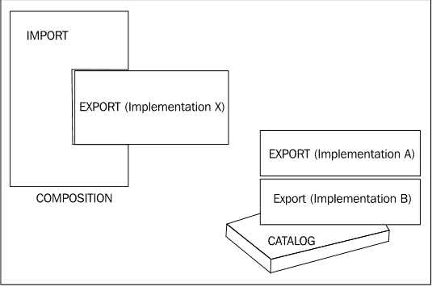

## 模型-视图-演示者模式

> 在撰写本书时，Microsoft 已经发布了模型-视图-控制器（MVC）框架（目前作为 .NET 4 的一部分，版本 2 已经可用）。我们曾讨论过是否在该版本中使用它，最终决定不使用。关于 MVC 以及我们为什么没有使用的讨论，请参阅附录 A。


- 1. 加载时，视图会实例化其Presenter。然后，它通过调用Presenter中的**init**方法，将自身的引用传递给该Presenter。
- 2. 这将视图的控制权移交给Presenter。Presenter现在负责初始化页面（加载页面的初始状态）。
- 3. Presenter与我们的领域对象（模型）协作，获取人员列表。
- 4. 随后，Presenter通过调用视图提供的适当方法，将新获取的人员列表传递给视图。
- 5. 视图随后将人员列表附加到重复器的数据源，并要求重复器绑定该列表。

如果有人点击该列表中的某个人，这个过程将重复执行：通过视图向上传递至Presenter，再传递到某些领域对象，然后返回视图。

## 创建 .NET 解决方案

到目前为止，我们已经了解了分层、MVP、MEF 和 Entity Framework 概念等。现在让我们开始实现，为此我们需要创建一个名为 Fisharoo 的空 .NET 解决方案，在该解决方案下，我们可以开始创建以 .NET 项目形式设计的各个层次。

## 表示层

在 Fisharoo 解决方案中，创建一个新的 ASP.NET Web 应用程序项目，它将作为表示层。我们将其命名为 Web。项目创建完成后，您将看到如下图所示的目录结构：

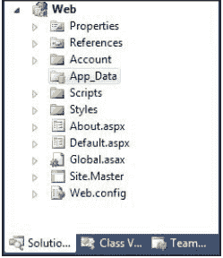

为了获得真正的可扩展性，每个插件（Configuration、Caching、Email 等）都应放在各自独立的类库项目中，这样我们就可以替换任何一个组件，而不影响其他任何内容。不过，对于我们当前的站点来说，这对这个应用程序而言有些过度设计，因此我们决定将所有这些功能的实现都包含在一个 Components 项目中。

## 配置

对于配置工具，我们希望创建一些能够从配置源返回强类型项（strongly typed item）的能力。当然，这个配置源最初将是标准的 web.config。由于 web.config 仅保存字符串值，我们的配置对象将负责转换出适当的类型。

```csharp
//Fisharoo/Components/Configuration.cs
using System;
using System.ComponentModel.Composition;
using System.Configuration;
using Fisharoo.Interfaces;

namespace Fisharoo.Components
{
    [Export(typeof(IConfiguration))]
    public class Configuration : IConfiguration
    {
        public object GetConfigurationSetting(Type expectedType, string key)
        {
            string value = ConfigurationManager.AppSettings.Get(key);
            if (value == null)
            {
                throw new Exception(string.Format("AppSetting: {0} is not configured.", key));
            }

            try
            {
                if (expectedType.Equals(typeof(int)))
                {
                    return int.Parse(value);
                }

                if (expectedType.Equals(typeof(string)))
                {
                    return value;
                }

                throw new Exception("Type not supported.");
            }
            catch (Exception ex)
            {
                throw new Exception(string.Format("Config key:{0} was expected to be of type {1} but was not.", key, expectedType), ex);
            }
        }
    }
}
```

正如您所见，从一开始我们就在类定义上方添加了 MEF 特性（Export），这样如果将来需要，我们可以轻松地将其替换为另一个实现。为了支持 MEF，我们需要添加对 System.ComponentModel.Composition 程序集的引用。

Configuration 类目前仅公开了一个方法 GetConfigurationSetting()，用于以通用方式检索应用程序配置项。它使用 ConfigurationManager 与配置文件通信，并获取由传入的键指定的字符串值。其余代码相当不言自明。我们测试检索到的值是否为 null，如果是则抛出错误。然后我们尝试通过解析为 int 或 string 来返回期望的类型。如果期望的类型既不是 int 也不是 string，那么我们将抛出一个错误，说明所请求的类型不受支持。

## 缓存

本着可扩展性的原则，我们将构建一个实现 ICache 接口的缓存对象。我们的缓存实现将包装 System.Web.Caching 中的 HttpContext.Current.Cache 对象。如果将来需要，我们可以用 MemCached 或 AppFabric 等替代此实现。

该逻辑将涉及使用键作为引用标识缓存项，并处理从缓存中保存和检索项。缓存还将支持基于时间的缓存，一旦时间限制结束，缓存项将过期。我们还将支持从缓存中删除条目。这可以用于在缓存开始填满时为较新的条目腾出空间，或者仅用于移除应用程序不再需要的项。请参阅本书附带的代码以了解此类的实现细节。

## 会话

会话对象是大多数 Web 应用程序中频繁使用的另一项。话虽如此，它也是我们未来可以从中挖掘性能的东西。即使性能不是问题，会话对象本身也并不是很符合最基本的面向对象编程（OOP）原则。与其试图凭空或从 HttpContext.Current.Session 中转换出一个对象，如果我们能够调用一个返回适当对象的对象，那会好得多。以下是基本实现：

```csharp
//Fisharoo/Components/Session.cs
using System.ComponentModel.Composition;
using System.Web;
using Fisharoo.Interfaces;

namespace Fisharoo.Components
{
    [Export(typeof(WebContext))]
    public class WebContext : IWebContext
    {
        public void ClearSession()
        {
            HttpContext.Current.Session.Clear();
        }

        public bool ContainsInSession(string key)
        {
            return HttpContext.Current.Session[key] != null;
        }

        public void RemoveFromSession(string key)
        {
            HttpContext.Current.Session.Remove(key);
        }

        private string GetQueryStringValue(string key)
        {
            return HttpContext.Current.Request.QueryString.Get(key);
        }

        private void SetInSession(string key, object value)
        {
            if (HttpContext.Current == null || HttpContext.Current.Session == null)
            {
                return;
            }
            HttpContext.Current.Session[key] = value;
        }

        private object GetFromSession(string key)
        {
            if (HttpContext.Current == null || HttpContext.Current.Session == null)
            {
                return null;
            }
            return HttpContext.Current.Session[key];
        }

        private void UpdateInSession(string key, object value)
        {
            HttpContext.Current.Session[key] = value;
        }
    }
}
```

我们将继续扩展此对象，使其具有一些可以处理某些繁琐工作的特定方法。假设我们将一个人员作为当前用户存储在会话中。我们可以定义一个 GetCurrentUserFromSession() 方法，它与我们的包装方法交互。它会检索用户并将该对象转换为人员类型。从面向对象编程的角度来看，这要好得多。让我们看一下包装器，为了简洁起见，我们只关注此代码中的关键或新方面。

让我们来看一些公共方法定义。这些方法都非常容易理解，并且主要与 HttpContext 对象协作。我们有一个 ClearSession() 方法，它只是重置会话。我们有一个 ContainsInSession() 方法，它接受一个键值。它检查该键是否存在于会话中并返回 true 或 false。RemoveFromSession() 方法接受一个键并尝试从会话中移除该键。

在我们的公共方法之后，我们有几个私有方法，即 GetQueryStringValue()、SetInSession()、GetFromSession() 和 UpdateInSession()。在讨论这些方法之前，我们需要您理解它们为什么是私有的。我们可以将所有这些方法设为公共，它们也能正常工作。然而，将它们设为公共也意味着我们会在应用程序中散布直接与会话交互的代码。我们的偏好是扩展此对象，使其提供更具体的方法来处理这些私有方法，而这些私有方法又与会话交互。这为我们提供了关于会话交互方面的更多封装。


**GetQueryStringValue()** 方法接收一个键值，并从查询字符串中检索对应条目。**SetInSession()** 方法允许你传入一个键和一个对象，该对象随即以该键名存储在会话中。**GetFromSession()** 方法正是如此——它接收一个键，并检索对应的对象。**UpdateInSession()** 与 **SetInSession()** 非常相似，区别在于它假定键已存在，并更新当前存储在该键下的值。如果键不存在，此方法将抛出错误。因此，在使用此方法之前，你应该检查该键是否已存在于会话集合中！

## 重定向

从面向对象编程的角度来看，Response.Redirect 与会话对象一样有用（我们这里开始看到一种趋势了）。它只是提供了一种将你从一个地方发送到另一个地方的方式。如果我们可以通过方法来使用它，那就太好了。如果能在这些方法中按需隐藏一些逻辑，那就更好了。我们的初步实现非常简单。

```csharp
//Fisharoo/Components/Redirector.cs
using System.ComponentModel.Composition;
using System.Web;
using Fisharoo.Interfaces;

namespace Fisharoo.Components
{
    [Export(typeof(Redirector))]
    public class Redirector : IRedirector
    {
        public void GoToHomePage()
        {
            Redirect("~/Default.aspx");
        }

        public void GoToErrorPage()
        {
            Redirect("~/Error.aspx");
        }

        private void Redirect(string path)
        {
            HttpContext.Current.Response.Redirect(path);
        }
    }
}
```

这个类与其他类一样，使用 MEF，以便日后在测试时可以将其打桩（stub）。目前有两个方法——一个是示例，另一个处理重定向。让我们看看 Redirect() 方法。它接收一个路径参数，然后使用 HttpContext 对象将用户重定向到适当的位置。一个例子是 GoToHomePage() 方法。它请求 Redirect() 方法将用户发送到主页。如果应用程序的主页日后更改，我们只需编辑这一个方法即可。

当然，这个类可以根据需要扩展出任意多的新方法，以用于任何目的的重定向。我们也可以将这个对象扩展得更通用一些。我们还可以在这些方法中使用重定向之前执行各种逻辑，当然这不会降低整体设计，并且在实际需要时才会这样做。

## 电子邮件

发送电子邮件是每个网站都必须具备的能力之一。计划发送的邮件数量肯定应当决定你如何发送这些邮件。由于我们还不知道计划发送多少邮件，因此最初我们将依赖 .NET 框架提供的工具来发送邮件。为简洁起见，我们在这里只看这个类中的具体方法。

与所有对象一样，我们将使用 MEF Export 属性，使其成为可插拔（Pluggable）类。这个类本身继承自我们的 IEmail 接口。我们会声明几个常量——一个用于网站接收邮件的账户，另一个用于网站发送邮件的账户。（我们可以用一个变量同时表示两者，但稍微灵活一点总没坏处！）然后我们进入第一个方法：

```csharp
public void SendEmail(string From, string Subject, string Message)
{
    MailMessage mm = new
    MailMessage(From,TO_EMAIL_ADDRESS);
    mm.Subject = Subject;
    mm.Body = Message;
    Send(mm);
}
```

此方法是 SendEmail() 方法的各种重载之一。它与其他方法略有不同，因为它用于站点向另一个站点发送邮件，而不是向用户发送。此方法的使用者需要提供发件人地址、主题和正文。此方法可用于“联系我们”页面或类似的邮件表单。在此方法的末尾，你会看到一次 Send() 方法调用。该方法会启动一个 SmtpClient，并像其他 SendEmail() 方法一样发送邮件消息。

其余的 `SendEmail()` 方法以各种方式用于站点向用户发送邮件。这些方法支持向单个用户（**收件人**、**抄送**和**密送**输入均为单个用户）或一组用户（**收件人**、**抄送**和**密送**输入为多个用户）发送邮件。`SendIndividualEmailsPerRecipient()` 方法接受多个用户名，但为每个用户单独发送邮件。

最后，我们来看所有其他方法都使用的 `Send()` 方法。这个方法负责实际发送邮件。但在该方法执行任何操作之前，我们需要在 `web.config` 的 configuration 标记之后添加以下节。它负责告诉 .NET 框架如何连接到我们的邮件服务器。

```xml
<system.net>
    <mailSettings>
        <smtp>
            <network host="localhost" port="25"
                     defaultCredentials="true" />
        </smtp>
    </mailSettings>
</system.net>
```

现在，我们可以定义最后一个方法 `Send()`，如下所示：

```csharp
private void Send(MailMessage Message)
{
    SmtpClient smtp = new SmtpClient();
    smtp.Send(Message);
}
```

这个配置在发送邮件的方式上非常灵活。然而，它仍然需要网页直接负责发送邮件。这会导致页面产生大量开销，因为可能需要处理大量收件人，或者事务中涉及大量网络延迟。

拥有这个类的好处在于，我们可以轻松创建另一个实现 `IEmail` 接口但使用邮件队列的类，而不是要求页面发送邮件。这样，网站只需创建邮件消息并将其放入队列中，这比实际处理和发送邮件要快得多。然后，我们可以让某个地方的队列处理器负责发送我们的邮件。我们将在第 13 章进一步讨论这一点。

## 错误处理与日志记录

我们认为，任何“企业应用程序”如果无法妥善处理错误并通知相关人员加以解决，就不能真正称为“企业级”。在 ASP.NET 网站中，基本上有两种形式的错误——你捕获到的错误，以及你未能捕获的错误。很简单，对吧？嗯，别急着下结论！无论你是否捕获到了错误，应用程序的用户仍然会在浏览体验中遇到某种形式的中断。因此，我们需要的不仅是为用户提供尽可能平顺的中断体验，还要修复这种中断，使其不再发生。

错误处理就是尽力捕获预期或可能出现的错误。同时，它也是不让难看的错误信息出现在客户面前的行为。日志记录则是捕获这些错误的详细信息，以便我们日后修复它们。

### 日志记录

日志记录既可能过于复杂，也可能非常简单。由于我们手头没有太多时间，我们通常尽可能选择不重复造轮子！因此，在这种情况下，我们将使用 log4net 框架，它提供了大量工具来支持各种形式的日志记录。


> 有关 log4net 项目的更多信息，请访问：
> **http://logging.apache.org/log4net/**

要让 log4net 正常工作，你需要将 log4net.dll 和 log4net.xml 文件复制到 Components 项目的 bin 目录中。放置好后，添加对 log4net 的引用。然后，你需要在 Web 项目的根目录或 bin 目录中创建一个 log4net.config 文件。


> 有关 log4net 配置的更多信息，请访问：**http://logging.apache.org/log4net/release/config-examples.html。**

现在，我们可以创建一个实现 ILogger 接口的类，帮助我们对 log4net 提供的功能进行交互。由于这是常规代码，我们在这里不再详细讨论。你可以参考本章附带的代码来了解实现。日志类完成后，我们要做的就是向日志发送一些内容。让我们回到 Global.asax.cs 文件，在 Application_Error() 方法底部添加这一行：

```csharp
Log.Error(sender,"Error caught by the Global.asax: " + e.ToString());
```

这应该就能满足我们的日志需求了！


## 我们社区框架的企业级方法

我们需要为处理的每个部分创建组合逻辑，例如日志（Log）、缓存（Cache）、电子邮件（Email）、配置（Configuration）、重定向器（Redirector）等。因此，为了不在代码中到处重复组合逻辑，我们将创建一个静态类来集中组合逻辑。

```csharp
//Fisharoo/Common/MEFManager.cs
using System;
using System.ComponentModel.Composition;
using System.ComponentModel.Composition.Hosting;
using System.IO;

namespace Fisharoo.Common
{
    public static class MEFManager
    {
        public static void Compose(object o)
        {
            var container = new CompositionContainer(
                new DirectoryCatalog(Path.Combine(
                AppDomain.CurrentDomain.BaseDirectory, "bin")));

            var batch = new CompositionBatch();
            batch.AddPart(o);
            container.Compose(batch);
        }
    }
}
```

为了从目录读取程序集，使用了 **DirectoryCatalog()** 方法。一旦找到为 **IRedirector** 提供实现的程序集，它就会被程序拾取，并通过 **container.ComposeParts()** 组合到应用程序中。

我们从 **Application_Start()** 方法中调用此组合逻辑。

```csharp
void Application_Start(object sender, EventArgs e)
{
    // Code that runs on application startup
    MEFManager.Compose(this);
    log.EnsureInitialized();
}
```

### 数据访问层

为了实现上面领域驱动设计部分所讨论的领域模型，我们将使用实体框架（Entity Framework）创建数据访问层。为此，我们需要在解决方案中添加一个新项目。我们将其命名为 DataAccess。

在这个项目中，我们将创建两个类和一个 edmx 文件。第一个类是我们的连接对象（命名为 Connection.cs），第二个文件将命名为 PersonRepository.cs。创建好这些类文件后，右键单击 DataAccess 项目并选择“添加新项”来添加新的 ADO.NET 实体数据模型。在“数据”选项卡中选择“ADO.NET 实体数据模型”，如下面的截图所示：

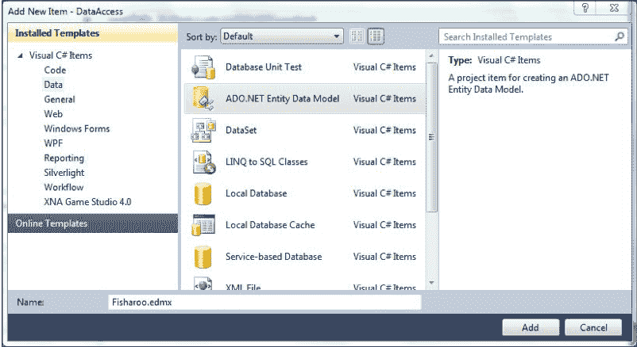

我们将其命名为 Fisharoo.edmx。之后，向导将引导你完成以下解释的各种步骤。由于我们已经创建了数据库中的表，并且希望模型基于该表，因此我们将选择第一个屏幕中的**从数据库生成**，然后点击**下一步**。选择适当的连接字符串设置，然后点击**下一步**。

在下一个屏幕中，按如下方式从 **Tables | Person** 中选择数据库对象，并将模型命名空间命名为 **FisharooModel**，然后点击**完成**。

这为一些演示提供了基础框架。现在，让我们深入研究我们创建的两个类文件——**Connection.cs** 文件和 **PersonRepository.cs** 文件。**Connection** 类为我们提供了一种封装 **DataContext** 创建的方式。它有一个方法返回 **FisharooDataContext** 对象。如果将来有更多的数据上下文需要使用，它们也可以放在这里，我们可以将当前的 **GetContext()** 方法重命名为更有意义的名字。

```csharp
//Fisharoo/DataAccess/Connection.cs
namespace Fisharoo.DataAccess
{
    public class Connection
    {
        public static FisharooDataContext GetContext()
        {
            FisharooDataContext fdc = new FisharooDataContext(ConfigurationManager.ConnectionStrings["FisharooConnectionString"].ToString());
            return fdc;
        }
    }
}
```

请注意，我们正在创建一个新的 **FisharooDataContext** 类实例，并引用之前放在 **web.config** 文件中的连接字符串。

现在，让我们转向 **PersonRepository** 类。我们之前创建的 Person 表仅供演示之用，这个 repository 也是如此。以下是该类。

```csharp
//Fisharoo/DataAccess/PersonRepository.cs
using System.Collections.Generic;
using System.ComponentModel.Composition;
using System.Linq;
using Fisharoo.Interfaces;

namespace Fisharoo.DataAccess
{
    [Export(typeof(IPersonRepository))]
    public class PersonRepository : IPersonRepository
    {
        public List<string> GetAllNames()
        {
            List<string> names = new List<string>();
            FisharooDataContext dc = Connection.GetContext();

            var people = from p in dc.People
                         select p;

            foreach (Person p in people)
            {
                names.Add(p.FirstName + " " + p.LastName);
            }

            return names;
        }
    }
}
```

请注意，它有一个 Export 属性，以便我们以后需要时可以替换实现。与所有 MEF 类一样（出于良好的设计原因），我们也继承自 IPersonRepository 接口，这清晰地定义了这个类。

现在我们的 repository 中只有一个方法。它负责简单地从 Person 表中选择所有人，并返回这些人的名字和姓氏列表。我们有一个字符串类型的 names 集合列表，将在方法末尾返回。然后我们获取 DataContext 用于查询。一旦定义了 DataContext，就可以执行查询。

我们使用 var 关键字声明一个局部变量。这允许我们声明动态类型的变量。在这种情况下，我们将选择 Person 类的集合。但我们并不确定！而且也不需要知道。

我们在代码中看到的查询是从 Person 表中选择所有人并返回这些人的集合。它非常像 SQL，但顺序相反，即 from 在前，select 在后。LINQ 查询就是这样编写的，正是由于这种顺序，Visual Studio 智能感知才能正常工作。

查询执行后，结果会被获取到 people 变量中，其类型为 ObjectSet<Person>。这帮助我们可以在循环中遍历它。当我们创建 edmx 时，实体框架会自动创建 People ObjectSet 作为 FisharooDataContext 类的一部分。

最后，在代码中有一个循环，我们将每个人的名字和姓氏连接起来，并将它们添加到 names 集合中。完成后，我们简单地将该集合返回给此方法的使用者。

这里给出的演示非常简单，因为我们不想让你感到困惑。你会了解 Repository 在此应用程序中的工作方式。我们还涉及了 LINQ 的基础知识。

此时，解决方案结构如下面的截图所示：

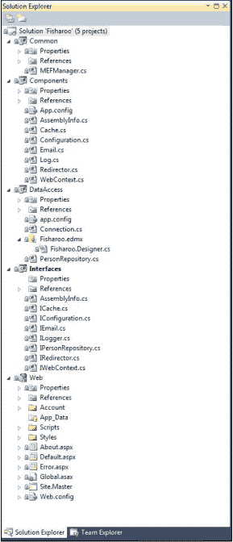

### 摘要

在本章中，我们介绍了创建一个企业级框架来满足大多数 Web 应用程序的基本需求。我们讨论了架构分层、领域驱动设计、相关模式和最佳实践。我们还通过一些代码为将在应用程序中使用的基本框架类创建了组件。我们讨论了如何使用一些新技术和现有模式来处理数据访问。我们还了解了如何在表示层使用 MVP 模式。本章应为你提供坚实的基础，在此基础上我们现在可以开始构建应用程序。

## 用户账户

没有人，你的社区就不存在！

任何社区网站要被认为成功，首先必须拥有一群忠实的用户。尽管还有其他衡量标准，但在大多数情况下，社区的人口越多，就被认为越成功。因此，我们应该创建一种方式让用户来到我们的站点、创建账户，并成为社区的一部分。下面的截图显示了注册页面的外观：

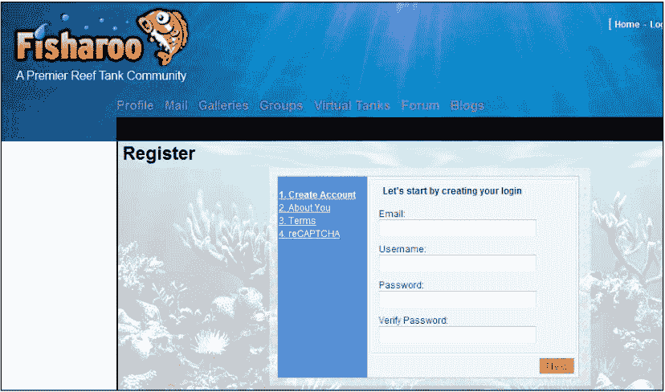


## 用户账户

在本章中，我们将讨论许多与用户账户相关的常见功能。这将包括处理注册、认证、权限和安全。我们还将介绍一些基本工具，例如密码提醒、账户管理和 reCAPTCHA。本章将为我们的用户提供基础，在此基础上我们能够构建所有其他功能。

### 问题

如今大多数网站，无论其目的如何，都需要知道你的用户是谁。你需要知道这一点，以便限制用户与网站的交互方式，或者你可能需要这些信息来为用户提供动态体验。无论你的原因是什么，识别和控制用户的任务都有一些基本要求。

为了了解我们的用户，我们需要一种在网站上注册他们的方法。这将为我们提供该用户的足迹，以便每次用户返回时我们都可以使用。大多数情况下，注册过程相当简单，以便我们可以轻松地引入新用户。我们需要捕获我们感兴趣的数据（例如用户名、密码、电子邮件等）。我们必须确保正确存储他们的密码，这样他们的身份不仅对网站的其他用户安全，而且对网站的管理员和工作人员也是安全的。此外，考虑到当今互联网上的欺诈和垃圾邮件数量，我们需要为网站配备某种智能形式，以防备自动注册。为了进一步保护网站，我们需要确保用户向我们提供有效的信息。我们可以通过验证他们提供的电子邮件来检查它是否是他们控制下的有效账户。作为注册过程的一部分，我们还需要告知用户我们当前的条款和条件，以便他们提前了解网站的规则。

> 当我们提到自动注册时，我们实际上是在描述使用机器人（或程序）创建账户的行为，其唯一目的是将广告发布到公共区域，例如留言板、博客等。

一旦用户成功注册，我们需要为他们提供工具，以便他们每次返回时都可以向我们表明身份。这通常通过集中式登录屏幕完成。成功认证后，我们可以通过网站跟踪该用户。知道用户经常忘记他们提供给我们的信息，我们需要提供工具，通过密码提醒功能提醒用户如何进入我们的网站。在用户认证身份后，我们需要定义用户在网站上可以去哪里以及他们可以做什么，这就需要某种基于权限的系统。

话虽如此，强制用户设置强密码可能会给他们带来不便。信不信由你，有很多用户更喜欢将密码设置为“password”。虽然我们不赞成让你的用户变得懒惰并将他们的账户置于风险之中，但你确实需要意识到，这个要求可能会导致你失去一些注册用户。由你来决定安全网站有多重要。

### 条款和条件

虽然条款和条件对于好的网站来说不是必需的，但本节将介绍这个概念。我们将创建一种简单的方法来管理你的条款和条件。条款和条件是法律事务。鉴于条款和条件会随着时间而变化，跟踪你的用户最后同意的条款和条件版本非常重要。跟踪他们何时同意也很重要。

### reCAPTCHA

**CAPTCHA，即完全自动化的公共图灵测试，用于区分计算机和人类，** 是一种挑战-响应测试形式，用于确定你的网站用户是计算机还是人类。reCAPTCHA 是 Google 的一项 CAPTCHA 服务，帮助将书籍、报纸和旧时代广播节目数字化。

reCAPTCHA 向用户展示两个单词，其中一个是 **光学字符识别（OCR）** 过程能够从图像转换为文本的单词。另一个是 OCR 无法转换的单词。系统假设，如果用户对已知翻译的单词提供了正确答案，那么另一个未知翻译的单词也被正确翻译了。然后系统会在多个实例中重用这个新单词，以获得更高的翻译正确性信心。reCAPTCHA 为各种编程环境提供插件，我们将使用 ASP.NET 的插件。有关更多详细信息，请查看此网站：**http://www.google.com/recaptcha**。

以下是我们系统生成的图像示例：

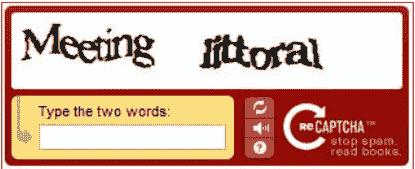

### 电子邮件确认和验证

在我们的社区中使用电子邮件通信有几个原因。例如，我们的网站将需要注册确认和电子邮件验证。

当用户在网站注册时，我们需要能够让他们知道注册已成功完成。这封电子邮件通常会欢迎用户访问网站。它还可能向用户提供一些常见问题解答、注册后获得的福利列表，以及用户在使用网站之前可能需要的任何其他相关信息。

除了注册回执之外，我们需要一种方法来检查用户提供的电子邮件地址是否是有效账户（它确实存在），并且用户确实有权访问。我们将通过在电子邮件中嵌入一个用户必须点击的链接来验证这一点。一旦点击此链接，我们就认为该电子邮件地址是有效的！

### 安全性

安全性显然是构建网站最重要的方面之一。你不仅应该能够向特定用户提供对你网站特定区域的访问权限，更重要的是能够拒绝你的网站的各种用户的访问。所有网站都有需要锁定的区域。例如，最重要的区域之一可能是你网站的管理部分，或网站的付费区域。因此，确保你有某种形式的安全措施非常重要。

### 权限

处理权限（也称为授权）的方式有很多种。我们可以通过使用权限、角色、组等实现基于权限的系统，从而使事情变得非常复杂。我们甚至可以让它变得像 Microsoft 的 Active Directory 系统一样复杂。然而，我认为保持事物仅与你当前需求一样复杂是最好的做法。随着需求的增加，我们随时可以向系统添加内容。

我们的权限系统将简单地包含一个名称/角色（管理员、编辑者、受限等）。然后，此权限名称将通过 .NET 提供给我们的 **Sitemap** 文件静态映射到每个页面。只要我们保持页面提供单一功能，这应该始终满足我们的需求。无论如何，这是一个好的设计实践，我们在这里不应该有任何问题。当然，一个用户可以将许多权限绑定到他们的账户上，以便他们能够浏览我们网站的不同部分。一旦就位，我们需要做的就是有一个系统，在用户进入每个页面时检查他们的权限，以确保他们拥有该页面所需的权限。

我们将有一个 Permissions 表，通过 AccountPermissions 表与 Accounts 表关联。这是一个相当简单直接的设计。

### 密码加密/解密

在处理密码时，有一个重要的问题需要回答。我们是使用单向哈希，还是存储加密密码并提供解密方法？如果我们不提供解密功能，那么我们将无法向忘记密码的用户发送提醒邮件。如果我们正在创建银行系统，通过电子邮件发送密码是不可接受的。然而，由于我们创建的内容保密性稍低，用户能够轻松找回密码而不必太过麻烦，这成为解密密码并将其发送给用户的一个很好的理由。

### 登录

一旦用户创建了账户，能够重新向我们确认身份对他们来说很重要。因此，我们需要为他们提供一种方式。这将采用接受用户名和密码的页面的形式。一旦他们向我们完成了身份验证，我们需要确保他们仍然被允许进入我们的网站（如果他们是有效用户）。

### 密码提醒

用户将不可避免地忘记他/她的密码。由于我们要求强密码，而且相当多的用户宁愿根本没有密码，或者希望使用“password”一词作为他们的密码，他们很可能忘记注册时使用的密码。没问题！由于我们决定使用双向加密，我们将能够解密他们选择的密码并通过电子邮件发送给他们。这样，我们的用户永远不会被锁定太长时间！

### 管理账户

为了将客户服务电话降至最低，我们需要一种方式让客户管理自己的账户。我们的客户需要一种更新他们向我们提供的大部分信息的方法。虽然我们不会允许他们更改用户名，但我们将允许他们编辑其余信息。当我们允许他们更改电子邮件地址时，我们需要确保强制他们验证新地址。


## 解决方案

现在，让我们来看看如何实现所有这些新功能。

### 实现数据库

我们将从实现数据库开始，然后从那里逐步深入。

### Accounts 表

Accounts 表将存储用户的所有基本信息。其中大部分内容都很容易理解，因为它们的名称具有指示性（这是良好设计的标志）。

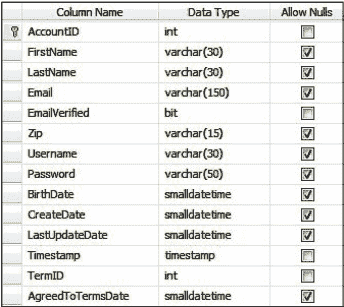

然而，有几列乍一看可能不是百分之百清楚。我们将在这里解释这些列。

| 列 | 描述 |
|---|---|
| **EmailVerified** | 这是一个位标志，用于让我们知道用户的电子邮件地址是否已经过验证。 |
| **CreateDate** | 这是记录创建的日期。它的默认值为 GetDate()。 |
| **LastUpdateDate** | 这与 **CreateDate** 类似，不同之处在于我们每次更新记录时都应该更新它。这可以通过触发器或编程方式完成。 |
| **AgreedToTermsDate** | 此列用于跟踪用户同意条款和条件的日期。 |

### Permissions 表

Permissions 表主要用作各种权限类型的查找表。它保存每个权限的名称以及唯一 ID。

### AccountPermissions 表

AccountPermissions 表允许我们在 Permissions 和 Accounts 之间创建多对多类型的关系。它只是在关系末端保存对记录的引用。

### Terms 表

Terms 表是我们条款和条件的查找表。此外，它为我们提供了客户过去同意的条款的历史视图。

### 创建关系

首先，尽管你可以在没有任何强制关系的数据库中工作，但我们不建议这样做。其次，如果你没有明确定义所有数据库约束，你可能会发现自己正在处理损坏的数据。

对于这组表，我们有以下表之间的关系：

- Accounts 和 AccountPermissions
- Permissions 和 AccountPermissions
- Accounts 和 Terms

### 实现数据访问层

现在我们已经为本章所需的所有功能定义了数据库，让我们来看看如何访问这些数据！请记住，本章不会包含我们在前面章节中讨论过的步骤，即告诉 Entity Framework 如何连接到我们的数据库，以便它可以根据我们的表结构为我们生成 Entity 类。

### 从数据库更新模型

在第 2 章中，我们创建了 EDMX 并从数据库中添加了 Person 表。在本章中，到目前为止，我们讨论了在 SQL Server 中创建的各种表和关系。现在是时候让它们反映在我们的 EDMX 中了。这可以通过双击 Fisharoo.EDMX（你需要先在 Visual Studio 2010 中打开解决方案）来实现，它将在设计器界面中打开。右键单击设计器界面，然后选择“从数据库更新模型”。在出现的向导中（如下面的截图所示），选择需要添加的必要表。

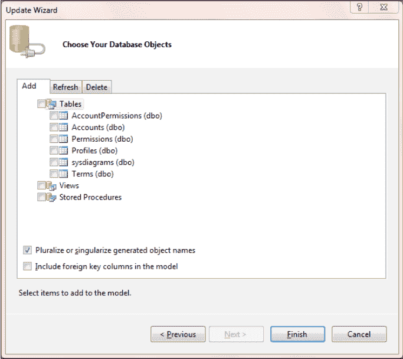

单击“完成”，所选表将添加到 EDMX 设计器中，如下面的截图所示：

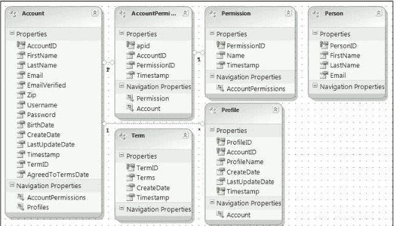

### 用户账户

此时，VS 2010 将更新 Fisharoo.Designer.cs，并生成与所有选定表对应的 Entity 类。你不会在项目中看到这些类作为文件，但我们可以在类视图中看到它们。通过进入 **视图** 菜单并选择 **类视图** 打开类查看器。然后展开 **DataAccess** 项目。

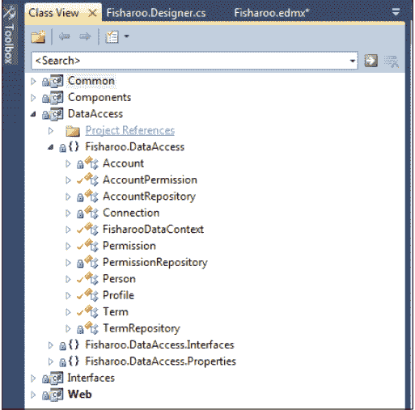

首先，你应该会看到 Fisharoo.EDMX 设计图面上的每个表都有一个对应的类。这些是分部类，你可以通过在同一命名空间中创建另一个同名的分部类来扩展它们（我们稍后会这样做）。不要直接编辑生成的类，因为你的添加在下次生成时会丢失！

除了代表表的类之外，你在这里应该看到的唯一其他项是 FisharooDataContext。这个类处理你的表和类的所有 LINQ 功能。它跟踪你对对象所做的更改、可以处理哪些对象、如何查询这些对象等等。任何时候我们处理 LINQ 类或数据，我们都会通过 FisharooDataContext 类。

```csharp
select a).FirstOrDefault();
}
return account;
}

public Account GetAccountByEmail(string Email)
{
    Account account = null;
    using (FisharooDataContext dc = conn.GetContext())
    {
        account = (from a in dc.Accounts
                   where a.Email == Email
                   select a).FirstOrDefault();
    }
    return account;
}

public Account GetAccountByUsername(string Username)
{
    Account account = null;
    using (FisharooDataContext dc = conn.GetContext())
    {
        account = (from a in dc.Accounts
                   where a.Username == Username
                   select a).FirstOrDefault();
    }
    return account;
}

public void AddPermission(Account account,
                          Permission permission)
{
    using (FisharooDataContext dc = conn.GetContext())
    {
        AccountPermission ap = new AccountPermission();
        ap.AccountID = account.AccountID;
        ap.PermissionID = permission.PermissionID;
        dc.AccountPermissions.AddObject(ap);
        dc.SaveChanges();
    }
}

public void SaveAccount(Account account)
```

你在这里注意到的第一件事是 MEF 的 Export() 特性和 IAccountRepository 接口。因为我们可能希望在测试期间替换此存储库，所以这些很重要。另外，不要忘记，使用 MEF 可以让我们轻松确保一旦开始使用 Repository，耦合度就会降低。这意味着从技术上讲，我们可以替换整个存储库而无需更改代码。

然后在构造函数中，我们初始化 Connection 对象，以便在 AccountRepository 类的其余部分中使用。

### 选择账户

一旦我们的 Connection 对象可以使用，我们就可以从通用的角度来看任何一个方法。让我们从 GetAccountByID() 方法开始。

此方法用于通过 ID 检索账户。我们首先在 using 语句之外定义返回变量（本例中为 account）。然后我们在 using 语句中获取一个 FisharooDataContext，这确保我们在使用完 DataContext 后将其释放。然后我们在 using 语句中处理 LINQ 查询本身。这看起来非常像标准的 SQL SELECT 语句，但有所不同。我们必须先定义 from 语句，以便 IntelliSense 可以检查我们正在处理的集合。这允许我们像处理任何其他对象集合一样使用点语法来处理查询。然后我们定义一个 where 子句来限制返回的内容。最后，我们选择要使用的对象。

然后你会注意到整个查询都包裹在圆括号中。这允许我们在结果集之上链式调用方法。在本例中，我们调用的是 FirstOrDefault() 函数。这会将我们的数据集限制为查询返回的第一条记录，如果找不到任何元素，则返回默认值。因为我们知道一个 ID 只能关联一个账户，所以这在这里应该是可以接受的！

> 如果不知道查询返回什么类型，我们可以使用 var 作为查询结果。
>
> `var account = [your LINQ query here];`
>
> var 被称为匿名类型。LINQ 大量使用它。使用匿名类型的注意事项是它只能在本地使用。因此，如果你打算在检索对象的作用域之外使用查询到的对象，你将必须进行某种形式的强制转换、循环或其他操作，以使它们脱离匿名状态。

GetAccountByEmail() 和 GetAccountByUsername() 方法在功能上几乎相同。因此我们不会详细解释它们。


## 用户账户

### 保存账户

现在我们已经有了以各种方式从数据库中选出 Account 对象的方法，接下来需要考虑如何将数据放入数据库。这让我们想到了 SaveAccount() 方法。我们本可以从这一个方法中拆出两个方法——Insert() 和 Update()。但两者之间只差一行代码，因此我们选择将这两个方法合并，并用 SaveAccount() 方法替代。

正如你将看到的，在我们所有 Repository 方法中，我们都在 using 语句中获取 FisharooDataContext。这让我们的清理工作自动完成！（严格来说是这样！）一旦有了可用的 DataContext，我们就会检查传入的对象，看它是否已有 AccountID。如果对象已有 AccountID，它就不可能是新对象。如果没有 AccountID，那它一定是新对象。

处理新对象很容易。我们只需调用 dc.Accounts.AddObject() 方法，然后调用 dc.SaveChanges()。这会告诉 DataContext 需要将所有更改过的数据持久化到数据库中——在我们的场景中，就是保存这条新的 Account 记录。

我们的代码让更新数据看起来几乎和插入新数据一样简单。不过，在更新时，我们首先要通过给接收到的 Account 对象赋予 AccountId 来创建一个临时的 Account 对象，然后再应用值。这是通过告诉 DataContext：传入的这个对象是当前原始对象的修改版来实现的。最后我们仍然需要调用 dc.SaveChanges()。

### 删除账户

既然我们有办法向系统中添加账户，自然也想知道如何删除账户，这通过 DeleteAccount() 方法来完成。

我们认为从 DataContext 中删除对象是最简单的事情之一！只需定位你想从中删除对象的集合，将要删除的对象传给 DeleteObject() 方法，然后调用 dc.SaveChanges()。没有比这更简单的了！

### 向账户添加权限

难道不应该把添加权限的操作放在 Permission 仓储或其他什么地方吗？不，并非如此。实际上，我们并不是真正地添加权限。我们是在非实体表 AccountPermissions 中创建一条记录，将 Permission 链接到 Account。回想一下，我们曾经说过，为了尽可能坚持 DDD，我们不会创建非实体仓储。这样，我们只能在 Permissions 仓储或 Accounts 仓储中添加账户权限。把添加权限的操作放在 Accounts 仓储中对我们来说更合理！

代码也非常简单，正如你在 AddPermission() 方法中所看到的（你会发现这句话会反复出现！）。

```csharp
public void AddPermission(Account account, Permission permission)
{
    using(FisharooDataContext dc = conn.GetContext())
    {
        AccountPermission ap = new AccountPermission();
        ap.AccountID = account.AccountID;
        ap.PermissionID = permission.PermissionID;
        dc.AccountPermissions.AddObject(ap);
        dc.SaveChanges();
    }
}
```

这个方法只是简单地将 Account 对象与 Permission 对象关联起来。为此，它期望传入一个 Account 对象和一个 Permission 对象。然后它创建一个新的 AccountPermission 对象，并根据传入的对象给 AccountID 和 PermissionID 属性赋值。随后将这个新的 AccountPermission 对象插入到 DataContext 的 AccountPermissions 集合中。最后，调用 SaveChanges() 方法。

如果你回顾一下我们对 DDD 的讨论（见附录），实体对象足够重要，需要用唯一 ID 进行重新创建和跟踪。值对象则没那么重要，没有父实体对象就无法（也不应该）存在。在本例中，值对象 AccountPermission 可以以 Permission 或 Account 作为父对象存在。虽然这种说法没错，但整体设计可以进一步简化，即：Account 可以拥有 AccountPermission，而 Permission 不能拥有。这样，当对象只有一个入口进入系统时，跟踪起来会更容易。

话说回来，我们可以设想这样一种场景：我们可能需要说：“对于这个权限，显示所有相关的账户”。这在管理控制台中可能很有用。我们会在讲到那里时看到。我们同样可以轻松地执行一个查询：“显示所有拥有此权限的账户”。

### 其他仓储

现在我们已经比较详细地看了 AccountRepository，接下来将快速介绍其余的仓储。我们会零零星星地讨论一些有趣的点，但大多数情况下，一旦你看过了一个仓储，你就已经看过了所有仓储！

```csharp
var permissions = from p in dc.Permissions.Where(
    p=>p.Name.Equals(Name))
select p;
return permissions.ToList();
}
}
```

与标准查询相比，Lambda 表达式的主要优势是类型推断、简洁性以及更高的代码可读性。

> Lambda 表达式由 lambda 运算符“=>”（读作“goes to”）组成，其左侧表示输入参数（如果有多个输入参数，请用逗号分隔），右侧表示要求值的表达式或语句块。编译器会根据参数的使用情况自动执行类型推断。

### 条款仓储

在 TermRepository 的 GetCurrentTerm() 方法中，新增了一个 LINQ 查询语句项。

```csharp
//Fisharoo/DataAccess/TermRepository.cs
public Term GetCurrentTerm()
{
    using (FisharooDataContext dc = conn.GetContext())
    {
        Term term = (from t in dc.Terms
                     orderby t.CreateDate descending
                     select t).FirstOrDefault();
        return term;
    }
}
```

在这里，你会看到我们引入了一个 orderby 子句以及一个 descending 关键字。这让我们能够取出所有已创建的条款，并将最近的条款放在最前面。

## 实现应用层

这一层可以称为应用层、业务逻辑层、组件层或服务层。在我们的代码中，我们将其称为**组件**。它们都是同一个东西。这一层应当相对轻薄。它不应该包含任何业务逻辑或数据访问逻辑。它更多是一个工作层，负责让业务层使用起来更简单、更干净。通常，它会将业务层的若干项与数据层的若干方法组合起来，为一个复杂任务提供易于使用的接口。

其中一个例子就是我们的 AccountService。AccountService 提供了一些简单的方法，这些方法使用了好几个更偏基础结构的类。代码如下：

```csharp
//Fisharoo/Components/AccountService.cs
namespace Fisharoo.Components
{
    [Export(typeof(IAccountService))]
    public class AccountService : IAccountService
    {
        [Import]
        private IAccountRepository _accountRepository;
        [Import]
        private IPermissionRepository _permissionRepository;
        [Import]
        private IUserSession _userSession;
        [Import]
        private IRedirector _redirector;
        [Import]
        private IEmail _email;
        public AccountService()
        {
            MEFManager.Compose(this);
        }
        public bool UsernameInUse(string Username)
        {
            Account account =
                _accountRepository.GetAccountByUsername(Username);
            if(account != null)
                return true;
            return false;
        }
        public bool EmailInUse(string Email)
        {
            Account account =
                _accountRepository.GetAccountByEmail(Email);
            if (account != null)
                return true;
            return false;
        }
        public void Logout()
        {
            _userSession.LoggedIn = false;
            _userSession.CurrentUser = null;
            _userSession.Username = "";
            _redirector.GoToAccountLoginPage();
        }
        public string Login(string Username, string Password)
        {
            Password = Password.Encrypt(Username);
            Account account =
                _accountRepository.GetAccountByUsername(Username);

            //if there is only one account returned - good
            if(account != null)
            {
                //password matches
                if(account.Password == Password)
                {
                    if (account.EmailVerified)
                    {
                        _userSession.LoggedIn = true;
                        _userSession.Username = Username;
                        _userSession.CurrentUser =
                            GetAccountByID(account.AccountID);
                        _redirector.GoToHomePage();
                    }
                    else
                    {
                        _email.SendEmailAddressVerificationEmail(
                            account.Username, account.Email);
                        return @"The login information you provided
was correct
but your email address has not yet
been verified.
We just sent another email
verification email to you.";
                    }
                }
            }
        }
    }
}
```


> 密码学是一门内容广泛的学科，超出了本书的范畴。不过，如果你想把 `System.Security.Cryptography.Rijndael` 理解得更透彻一些，本项目中所包含的 Cryptography 类带有详尽的注释！你可以在 **Common** 项目中找到这个类。

首先，让我们来看看我们是如何能够从一个 **string** 变量调用 `Encrypt()` 的。要实现这一点其实非常简单。尽管 **string** 类是密封的，意味着我们无法按常规方式对其进行扩展，但我们可以使用 .NET 中名为“扩展方法”的特性。

```csharp
//Fisharoo/Common/Extensions.cs
namespace Fisharoo.Common
{
    public static class Extensions
    {
        public static string Encrypt(this string s, string key)
        {
            return Cryptography.Encrypt(s, key);
        }
        public static string Decrypt(this string s, string key)
        {
            return Cryptography.Decrypt(s, key);
        }
    }
}
```

扩展方法允许我们在不影响类正常工作方式的前提下扩展一个类。实现方式是在一个静态类中定义一个静态方法。需要注意的一点是，该方法的第一个参数以目标类型开头，在这里就是 **string**。因此，我们实际上为 **string** 类定义了一个 `Encrypt()` 和 `Decrypt()` 方法。请注意，这个方法与你平时编写的方法之间唯一的区别，就是第一个参数前面的 **this** 引用。就是这么简单！

## 实现领域层

由于我们使用的是 Entity Framework，它拥有一些现在已经属于 .NET 框架一部分的功能；我们的业务层因此被大大简化了。我们可以回想一下，在之前的应用程序中，我们使用了各种不同的数据访问层，这要求我们花费大量时间在数据库中编写 SQL、连接逻辑、提供程序，以及对象的实例化和持久化逻辑。除此之外，我们还需要定义业务对象。在这些对象中，有 95% 的逻辑仅仅是为了以更易于管理的方式传输数据。

有了 Entity Framework，这些繁琐的工作大多都消失了！我们现在有了完全生成的类来负责传输数据。但如果我们还需要自定义逻辑该怎么办呢？虽然我们可以简单地将逻辑添加到生成的类中，但这并不是最佳途径。下次我们做修改时，就必须重新生成类。这会导致所有自定义功能丢失。

幸运的是，生成的类是分部类。这意味着我们可以在同一个命名空间中创建一个同名的新分部类文件，从而扩展我们生成的类。下面是我们自定义的 Account 对象，它扩展了生成的 Account 对象。

```csharp
//Fisharoo/DataAccess/Account.cs
namespace Fisharoo.DataAccess
{
    public partial class Account
    {
        private List<Permission> _permissions = new List<Permission>();
        public List<Permission> Permissions
        {
            get { return _permissions; }
        }

        public void AddPermission(Permission permission)
        {
            _permissions.Add(permission);
        }

        public bool HasPermission(string Name)
        {
            foreach (Permission p in _permissions)
            {
                if (p.Name == Name)
                    return true;
            }
            return false;
        }
    }
}
```

借助这个新的分部类，我们现在就可以扩展现有的已生成 Account 类。我们为 Account 类添加了一些重要功能。现在我们有了添加和检查权限的方法。我们还有一个返回权限列表的属性。

这可以轻松地应用于我们项目中的任何分部类！

视图通过定义视图的接口将自身的引用传递给 presenter。使用接口为我们提供了一种解耦的结构。这就允许我们在需要时轻松地替换 UI。只要 UI 恰当地实现了该接口，它就可以使用 presenter。

在这个场景中，presenter 扮演着控制器的角色。一旦它被启动并拥有了对 code-behind 的引用，它就能主动决定如何处理前端的事件。presenter 也是我们前端中唯一能够与领域逻辑（即模型）交互的部分。

在接下来的小节中，我们将讨论登录过程。这更多是为了说明 MVP 模式的运作方式，而不是关于 ASP.NET 本身，因为代码本身非常简单。

> 我们在创建 ASP.NET 4 应用程序（第 2 章）时创建了一个 **Account** 文件夹。它添加了与登录、用户注册、更改密码等相关的基文件，以及使用 ASP.NET 成员资格服务的代码。但是，由于我们希望为身份验证和授权编写自定义逻辑，我们删除了这个文件夹中的所有文件，并按照后面小节中讨论的方式编写了自定义逻辑。

## 视图

我们将从 ASP.NET 前端代码开始。它基本上定义了一个用户名和密码文本框，以及一个用于登录的按钮。它还有两个用于简单导航任务的链接按钮——一个用于转到密码恢复页面，另一个用于带你到注册页面。

```aspx
//Fisharoo/Web/Account/Login.aspx
<%@ Page Language="C#" MasterPageFile="~/Site.Master"
AutoEventWireup="true" CodeBehind="Login.aspx.cs"
Inherits="Fisharoo.Web.Account.Login" %>

<asp:Content ContentPlaceHolderID="Content" runat="server">
    <div class="divContainer">
        <div class="divContainerBox">
            <fieldset class="login">
                <legend>Enter your Username and Password</legend>
                <asp:Table CssClass="tableLogin" runat="server">
                    <asp:TableRow>
                        <asp:TableCell HorizontalAlign="Left">
                            <asp:Panel ID="Panel1"
DefaultButton="btnLogin" runat="server">
                                <p>
                                    <asp:Label ID="UserNameLabel"
```

## 用户账户

你会在上面注意到，在 Page_Load() 中我们初始化了 presenter。一旦我们启动了 presenter，我们立即通过 _presenter.Init(this) 方法调用将 code-behind 的引用传递给 presenter。你还应该注意到，code-behind 捕获了一个按钮点击事件。但这个方法所做的只是通知 presenter 需要执行 Login() 方法，并传递原始的 username 和 password 值。最后，请注意 code-behind 确实通过其 DisplayMessage() 方法实现了该接口。由于 presenter 可以访问 code-behind 类，它就能根据需要调用任何公共方法。

另一个需要注意的方面是，当你开始编写代码时，Visual Studio 会在文件顶部添加许多 using 语句。Visual Studio 2010 的重构支持提供了删除未使用 using 语句的功能。你可能会想尝试一下，以保持代码的组织性。

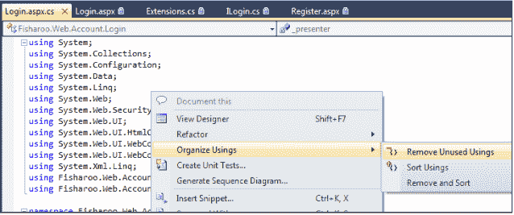

我们这样做了，最终只剩下了三条 using 语句，而之前有十四条。

## Presenter

以下是 presenter 代码：

```csharp
//Fisharoo/Web/Account/Presenters/LoginPresenter.cs
namespace Fisharoo.Web.Account.Presenters
{
    public class LoginPresenter
    {
        private ILogin _view;
        [Import]
        private IAccountService _accountService;
        [Import]
        private IRedirector _redirector;
        public void Init(ILogin view)
        {
            _view = view;
            MEFManager.Compose(this);
        }
        public void Login(string username, string password)
        {
            string message = _accountService.Login(username,
                                                    password);
            _view.DisplayMessage(message);
        }
        public void GoToRegister()
        {
            _redirector.GoToAccountRegisterPage();
        }
        public void GoToRecoverPassword()
        {
            _redirector.GoToAccountRecoverPasswordPage();
        }
    }
}
```

请注意，在 **Init()** 方法中，presenter 使用 MEF 框架来设置它完成工作所需的对象。如果页面需要在初始加载时显示数据，就是在这里实现的。除了 presenter 的初始化之外，你还会注意到 presenter 还有其他三个方法：Login()、GoToRegister() 和 GoToRecoverPassword()。

Login() 方法处理 **View** 传递给它的按钮点击事件。请注意，即使在这里，我们也没有太多需要管理的逻辑。Presenter 会迅速将用户登录的职责转交给前面讨论过的 AccountService 对象。它只是期望从 AccountService 得到一个友好的消息，来描述登录过程进行得如何。我们知道，如果它收到了消息，那就意味着登录失败；否则 AccountService 会适当地重定向用户。一旦登录完成，presenter 就会使用视图的 DisplayMessage() 方法将状态告知用户。

GoToRegister() 和 GoToRecoverPassword() 方法只是利用 Redirector 对象将用户发送到站点上相应的页面。虽然这看起来可能有些极端，但请记住，它遵循了良好的设计原则。如果你在整个站点中遵循这一点，你将获得以下三个好处：

1.  你可以轻松地替换 UI，并以最小的努力获得相同的结果。
2.  由于你的重定向代码集中在一个地方，当多个链接使用相同的方法重定向到某个位置时，你可以在这个地方更改重定向，从而影响整个站点的所有链接。
3.  这有助于提高你站点的可测试性！


## 用户账户

以下是新增的Redirector方法：

```csharp
//Fisharoo/Components/Redirector.cs
...
    public void GoToAccountRegisterPage()
    {
        Redirect("~/Account/Register.aspx");
    }
...
    public void GoToAccountRecoverPasswordPage()
    {
        Redirect("~/Account/RecoverPassword.aspx");
    }
...
```

> 我们希望你已经注意到，由于每个文件都只负责一组非常具体的任务，每个文件也短小而精悍。虽然这是一种复杂的思考方式，但使用起来非常愉快！

### 注册页面

我们承认，使用标准的.NET控件创建账户要简单得多！话虽如此，为这个网站创建注册页面还是相当有趣的。我们最终使用了向导控件来展示注册过程的各个步骤，并使用了它的现成格式。我们的步骤如下（由于ASPX代码占用了大量空间，我们使用了屏幕截图来代替。有关代码，请参阅本章配套代码）：

1. 我们总是先获取用户的电子邮件、用户名和密码。所有这些都有相应的验证。我们希望验证他们的电子邮件地址的真实性。我们还希望确保他们的用户名符合一定的长度规则。然后我们允许他们输入密码，并要求他们重新输入密码以确认他们输入的是他们想要输入的。当然，所有这些字段都是必填的！

    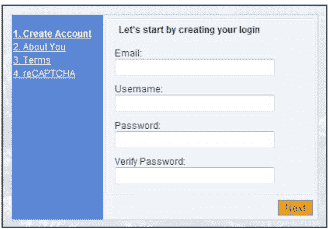

2. 下一步是获取一些用户的描述性信息，如名字和姓氏。在构建任何类型的社区网站时，通常还需要收集他们的生日和邮政编码或邮编。这让你知道什么适合他们，以及他们身处世界的哪个角落。这里有验证，以确保他们输入的出生日期是有效日期（MM/DD/YYYY格式），并且邮编是美国有效格式。虽然我们只验证了美国邮编，但在社区网站中，你需要根据不同的国家验证不同的格式。所有这些字段也都是必填的。

    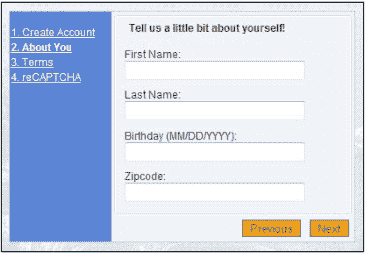

3. 第三步显示条款和条件。这一步需要你获取一些数据来展示。这些数据从`TermRepository.GetCurrentTerm()`（我们之前介绍过）中检索。用户在这里需要做的就是阅读条款（当然，大多数用户不会阅读！）并勾选表示同意条款的复选框（我们默认已勾选）。

    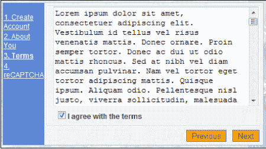

```csharp
{
    recaptcha.SkipRecaptcha = value;
}

- - - -

}
}
```

reCAPTCHA验证与页面验证集成在一起，因此如果Page.IsValid返回true，我们就知道reCAPTCHA验证已成功。另请注意，要使用reCAPTCHA，我们需要在ASPX页面中添加一个新的register指令：

```aspx
<%@ Register TagPrefix="recaptcha" Namespace="Recaptcha" Assembly="Recaptcha" %>
```

在开发过程中，我们不希望一直看到reCAPTCHA验证屏幕。为避免这种情况，我们将控件上的SkipRecaptcha属性设置为false（针对调试配置）。这使得reCAPTCHA控件在验证时始终返回true。我们希望控件在最终部署时能正常工作，因此我们为此使用了web.release.config文件。该文件中相关的标记是：

```xml
//Fisharoo/Web/Web.Release.Config
<appSettings>
    <add key="reCaptcha" value="false" xdt:Transform="Replace"
    xdt:Locator="Match(key)" />
</appSettings>
```

> 我们在之前的章节中简要提到过多个配置文件。这是Visual Studio 2010中ASP.NET 4应用程序的一个新功能。适当的构建任务会负责将相应配置文件中的值替换为主配置文件中的值。要了解更多信息，请阅读此处：**http://msdn.microsoft.com/en-us/library/dd465326.aspx.**

现在我们来谈谈这个页面的核心内容。一旦我们收集了所有数据，就需要处理它们。接下来是展示器（这么说很有趣！）。我们还将只关注代码中的Register()方法，因为大部分操作都在那里进行。

```csharp
//Fisharoo/Web/Account/Presenters/RegisterPresenter.cs
namespace Fisharoo.Web.Account.Presenters
{
    public class RegisterPresenter
    {
        - - -

        public void Register(string Username, string Password,
            string FirstName, string LastName, string Email,
            string Zip, DateTime BirthDate, bool isCaptchaValid,
            bool AgreesWithTerms, Int32 TermID)
        {
            if (AgreesWithTerms)
            {
                if (isCaptchaValid)
                {
                    Fisharoo.DataAccess.Account acc = new Fisharoo.DataAccess.Account();
                    acc.FirstName = FirstName;
                    acc.LastName = LastName;
                    acc.Email = Email;
                    acc.BirthDate = BirthDate;
                    acc.Zip = Zip;
                    acc.Username = Username;
                    acc.Password = Password.Encrypt(Password);
                    acc.TermID = TermID;
                    //TODO: For development marked as verified already
                    acc.EmailVerified = true;

                    if (_accountService.EmailInUse(Email))
                    {
                        _view.ShowErrorMessage("This email is already in use!");
                        _view.ToggleWizardIndex(0);
                    }
                    else if (_accountService.UsernameInUse(Username))
                    {
                        _view.ShowErrorMessage("This username is already in use!");
                        _view.ToggleWizardIndex(0);
                    }
```

这里比较有意思的新内容是Email对象的提及。你可能还记得我们之前构建Email对象时的情景。它为我们提供了以各种方式发送电子邮件的功能。我们在这里所做的是扩展Email对象，使其也封装系统发送的消息。以下是Email对象的新代码，允许我们发送电子邮件来验证电子邮件地址的有效性和所有权。

```csharp
//Fisharoo/Components/Email.cs
public void SendEmailAddressVerificationEmail(string Username, string To)
{
    MEFManager.Compose(this);
    string rootURL = _configuration.GetConfigurationSetting(
        typeof(string), "RootURL").ToString();
    string encryptedName = Cryptography.Encrypt(Username, "verify");

    string msg = "Please click on the link below or paste it into a browser to verify your email account.<BR><BR>" +
                 "<a href=\"" + rootURL + "Account/VerifyEmail.aspx?a=" +
                 encryptedName + "\">" +
                 rootURL + "Account/VerifyEmail.aspx?a=" +
                 encryptedName + "</a>";

    SendEmail(To, "", "Account created! Email verification required.", msg);
}
```

还要注意这里嵌入的链接使用“verify”作为盐值对注册者的用户名进行加密。这样，在他们收到电子邮件并点击链接返回我们的网站后，我们就能知道正在处理的是谁（更多内容将在下一节介绍）。

在向导的分步环境中，很容易像这样呈现小块数据，而无需太多编码开销。虽然它不如.NET成员控件那么容易，但我们认为它更加灵活。此外，我们现在可以轻松测试整个流程。

### 电子邮件验证

我们在上一节中简要提到了这个主题。基本上，注册过程会触发向新注册用户发送一封电子邮件，要求他们验证其电子邮件地址。这个过程通常会将电子邮件发送到用户在注册时提供的电子邮件地址。如果用户能收到邮件，我们就知道该电子邮件地址是有效的。如果他们能点击邮件中嵌入的链接，我们就知道他们也能访问该电子邮件。这并不一定意味着他们拥有该账户，但我们无法真正验证这一点，因此也无法真正担心它。


## 用户账户

上面我们没有涉及到的内容，是接收电子邮件中链接点击的页面。这一系列代码相对简单。因此，首先我们将按使用顺序列出所有文件（设计、代码隐藏和 Presenter），然后再讨论它。

```aspx
//Fisharoo/Web/Account/VerifyEmail.aspx
<%@ Page Language="C#" MasterPageFile="~/Site.Master"
AutoEventWireup="true" CodeBehind="VerifyEmail.aspx.cs"
Inherits="Fisharoo.Web.Account.VerifyEmail" %>
<asp:Content ContentPlaceHolderID="Content" runat="server">
    <asp:Label ID="lblMsg" runat="server" ForeColor="Red"></asp:Label>
</asp:Content>
```

```csharp
//Fisharoo/Web/Account/VerifyEmail.aspx.cs
namespace Fisharoo.Web.Account
{
    public partial class VerifyEmail : System.Web.UI.Page,
                                      IVerifyEmail
    {
        private VerifyEmailPresenter _presenter;
        protected void Page_Load(object sender, EventArgs e)
        {
            _presenter = new VerifyEmailPresenter();
            _presenter.Init(this);
        }
        public void ShowMessage(string Message)
        {
            lblMsg.Text = Message;
        }
    }
}
```

```csharp
//Fisharoo/Web/Account/Presenters/VerifyEmailPresenter.cs

using System.ComponentModel.Composition;
using Fisharoo.Common;
using Fisharoo.DataAccess.Interfaces;
using Fisharoo.Web.Account.Interfaces;

namespace Fisharoo.Web.Account.Presenters
{
    public class VerifyEmailPresenter
    {
        [Import]
        private IWebContext _webContext;
        [Import]
```

```csharp
_view = View;
}
public void RecoverPassword(string Email)
{
    Fisharoo.DataAccess.Account account =
    _accountRepository.GetAccountByEmail(Email);
    if(account != null)
    {
        _email.SendPasswordReminderEmail(account.Email,
            account.Password, account.Username);
        _view.ShowRecoverPasswordPanel(false);
        _view.ShowMessage("An email was sent to your account!");
    }
    else
    {
        _view.ShowRecoverPasswordPanel(true);
        _view.ShowMessage("We couldn't find the account you requested.");
    }
}
}
}
}
```

该页面要求用户提供其电子邮件地址，然后根据该电子邮件地址查找账户。如果找到账户，它将使用 Email.SendPasswordReminderEmail() 方法将用户解密后的密码发送到其邮箱账户。

SendPasswordReminderEmail() 方法如下所示。

```csharp
//Fisharoo/Components/Email.cs
public void SendPasswordReminderEmail(string To,
    string EncryptedPassword, string Username)
{
    string Message = "Here is the password you requested: " +
        Cryptography.Decrypt(EncryptedPassword, Username);
    SendEmail(To, "", "Password Reminder", Message);
}
```

### 编辑账户

为了节省篇幅，我们将不再展示此代码的设计、代码隐藏及接口部分。它只是一个带有文本框之类控件的基本表单，并且与注册表单具有相同的验证要求。它允许你修改信息，并在成功保存后显示相应的消息，同时阻止进一步编辑（用户可以转到另一个页面，然后回到此处再次编辑）。不过，下面我们将介绍 UpdateAccount() 方法中的几个要点。

```csharp
//Fisharoo/Web/Account/Presenters/EditAccountPresenter.cs

namespace Fisharoo.Web.Account.Presenters
{
    public class EditAccountPresenter
    {
        ...

        public void UpdateAccount(string OldPassword, string NewPassword, string UserName,
            string FirstName, string LastName, string Email,
            string ZipCode, DateTime BirthDate)
        {
            //verify that this user is the same as the logged in user
            if(OldPassword.Encrypt(OldPassword) == account.Password)
            {
                if (Email != _userSession.CurrentUser.Email)
                {
                    if (!_accountService.EmailInUse(Email))
                    {
                        account.Email = Email;
                        //TODO: for development disable sending emails, so setting the following to true
                        //in production this will be set to false
                        account.EmailVerified = true;
                        _email.SendEmailAddressVerificationEmail(account.Username, Email);
                    }
                    else
                    {
                        _view.ShowMessage(false, "The email you entered is already in our system!", account.UserName);
                        return;
                    }
                }

                if(!string.IsNullOrEmpty(NewPassword))
                    account.Password = NewPassword.Encrypt(NewPassword);

                account.FirstName = FirstName;
                account.LastName = LastName;

                account.Zip = ZipCode;
                account.BirthDate = BirthDate;

                _accountRepository.SaveAccount(account);
                _view.ShowMessage(true, "Your account has been updated!", account.UserName);
            }
            else
            {
                _view.ShowMessage(false, "The password you entered doesn't match your current password! Please try again.", account.UserName);
            }
        }
    }
}
```

关于这个 Presenter，有一点需要注意：当它首次初始化时，会加载当前用户的账户详细信息，并将这些数据传递给视图进行初始显示。然后，一旦用户编辑了数据，就会执行几个验证步骤。其中最重要的是密码和电子邮件的验证。

如果密码没有更改，我们要确保不会向系统存储空值！

对于电子邮件，如果用户更改了它，我们要确保再次发送验证邮件，并将该账户标记为尚未通过验证的电子邮件地址。

除此之外，我们只是通过 AccountRepository.Save() 方法更新账户对象。

### 实现安全性

既然我们已经完成了所有的底层基础工作，现在就可以锁定我们的网站了。在此之前，任何人都可以在网站上随意访问任何地方，而我们根本无法阻止他们！

### 站点地图

我们将用来锁定网站的主要 .NET 组件是 ASP.NET 站点地图。这是一个很好的工具，不仅可用于安全性，还可用于显示面包屑导航、主导航，以及许多其他有用的面向页面/文件的任务。

站点地图文件由多个 siteMapNode 组成。默认情况下，每个节点包含 URL、标题、描述和角色等内容。你还可以添加自己的自定义属性。在我们的网站中，我们将通过这些属性来识别属于顶部导航、页脚导航的链接，并让站点地图帮助我们设置每个页面的标题。我们当前的站点地图如下所示：

```xml
//Fisharoo/Web/Web.Sitemap
<?xml version="1.0" encoding="utf-8" ?>
<siteMap xmlns="http://schemas.microsoft.com/AspNet/SiteMap-File-1.0" >
    <siteMapNode url="default.aspx" title="Home" description="Home page" pageTitle="Welcome to Fisharoo.com!"
                 roles="PUBLIC">

    <!-- TOP NAV NODES -->
        <siteMapNode url="/account/default.aspx" title="My Account"
                     description="" pageTitle="" roles="PUBLIC">
            <siteMapNode url="/account/EditAccount.aspx" title="Edit Account" description="" pageTitle="" roles="PUBLIC" />
            <siteMapNode url="/account/Login.aspx" title="Login"
                         description="" pageTitle="" roles="PUBLIC" />
            <siteMapNode url="/account/RecoverPassword.aspx"
                         title="Recover Password" description="Recover Your Password" pageTitle="Recover your password"
                         roles="PUBLIC" />
            <siteMapNode url="/account/Register.aspx" title="Register"
                         description="" pageTitle="" roles="PUBLIC" />
            <siteMapNode url="/account/VerifyEmail.aspx" title="Verify Email" description="Verify your email address"
                         pageTitle="Email Verification" roles="PUBLIC" />
            <siteMapNode url="/account/AccessDenied.aspx" title="Access Denied" description="Access Denied"
                         pageTitle="Access Denied" roles="PUBLIC" />
        </siteMapNode>
        <siteMapNode url="/profile/default.aspx" title="Profile"
                     description="" topnav="1" pageTitle=""
                     roles="PUBLIC"></siteMapNode>
        <siteMapNode url="/friends/default.aspx" title="Friends"
                     description="" topnav="1" pageTitle=""
                     roles="PUBLIC"></siteMapNode>
        <siteMapNode url="/mail/default.aspx" title="Mail"
```

## 用户账户

```
description="" topnav="1" pageTitle=""
roles="PUBLIC"></siteMapNode>
<siteMapNode url="/galleries/default.aspx" title="Galleries"
description="" topnav="1" pageTitle=""
roles="PUBLIC"></siteMapNode>
<siteMapNode url="/groups/default.aspx" title="Groups"
description="" topnav="1" pageTitle=""
roles="PUBLIC"></siteMapNode>
<siteMapNode url="/virtualtanks/default.aspx" title="Virtual
Tanks" description="" topnav="1" pageTitle=""
roles="PUBLIC"></siteMapNode>
<siteMapNode url="/forum/default.aspx" title="Forum"
description="" topnav="1" pageTitle=""
roles="PUBLIC"></siteMapNode>
<siteMapNode url="/blogs/default.aspx" title="Blogs"
description="" topnav="1" pageTitle=""
roles="PUBLIC"></siteMapNode>
<!-- /TOP NAV NODES -->
<!-- FOOTER NODES -->
<siteMapNode url="AboutUs.aspx" title="About Us"
description="About Us" footernav="1"
pageTitle="" roles="PUBLIC"></siteMapNode>
<siteMapNode url="Advertisers.aspx" title="Advertisers"
description="Click here to learn more about
advertising on our site" footernav="1"
pageTitle="" roles="PUBLIC"></siteMapNode>
<siteMapNode url="Help.aspx" title="Help" description="Click
here to enter our help section" footernav="1"
pageTitle="" roles="PUBLIC"></siteMapNode>
<siteMapNode url="Privacy.aspx" title="Privacy"
description="Click here to learn about our
privacy policy" footernav="1" pageTitle=""
roles="PUBLIC"></siteMapNode>
<siteMapNode url="Terms.aspx" title="Terms" description="Click
here to learn about our terms and conditions"
footernav="1" pageTitle=""
roles="PUBLIC"></siteMapNode>
<!-- /FOOTER NODES-->
<!-- NONE NAVIGATION NODES -->
<siteMapNode url="Search.aspx" title="Search"
description="Click here to perform a site
search" pageTitle=""
roles="PUBLIC"></siteMapNode>
<siteMapNode url="Error.aspx" title="Error" description="An
error has occurred" pageTitle=""
roles="PUBLIC"></siteMapNode>
<!-- /NONE NAVIGATION NODES -->
</siteMapNode>
</siteMap>
```

### 所有节点

默认情况下，`SiteMap` 类并不会返回所有节点，可以这么说。它为你提供了对 `RootNode` 的调用，以及对它的子节点的调用。如你在第一个方法中所见，我们只是创建了一个 `AllNodes()` 调用，它返回“所有节点”。

### 导航

我们的站点将有多个导航区域，包括：

- 顶部导航
- 主导航
- 次级导航
- 左侧导航
- 页脚导航

如果每次需要时都要翻阅所有这些导航集合，我们可能会觉得很麻烦。取而代之的是，我们会在类中添加方法来生成所需的节点子集。

`PrimaryNodes()` 方法就是这类方法的第一个例子。它遍历 `AllNodes()` 方法返回的所有节点，查找带有自定义 `topnav` 属性的节点，从而生成主导航区域中的节点列表。不过，除此之外，你还会注意到一个特殊过滤器。每找到一个 `topnav` 节点，都会执行一次安全检查，以确定当前用户是否有权访问该节点。如果没有访问权限，则该节点不会显示。

`FooterNodes()` 方法与 `PrimaryNodes()` 方法完全相同，只是它查找的是 `footernav` 属性。该方法还会检查用户是否有权访问指定的节点集合。

### 检查访问权限

这就引出了我们在其他方法中使用的 `CheckAccessForNode()` 方法。该方法会检查传入的节点，并检查其 `Roles` 集合。它首先检查是否指定了 `PUBLIC` 角色。如果指定了，则不再执行其余检查。然后我们继续检查是否存在账户，即是否有用户已登录。如果有用户，我们会检查他们的权限属性。如果该属性存在，我们会检查权限列表中是否有任何权限。然后我们遍历节点中指定的每个角色，并确认该账户拥有相应权限。如果账户不包含任何指定权限，则返回 false。如果所有权限都有效，则返回 true。

### 安全性

到目前为止，我们已经讨论了该类的导航方面。但考虑到安全性已经如此深入地融入其中，我们也应该有一些东西来检查当前节点的安全性，而不只是显示链接。这就引出了 `CheckAccessForCurrentNode()` 方法。

`CheckAccessForCurrentNode()` 方法包装了 `CheckAccessForNode()` 方法，并传入当前 SiteMap 节点。如果当前节点具有足够的访问权限，则不执行任何操作。但是，如果对当前节点的访问被拒绝，则用户将通过 `Redirector` 类自动重定向到访问被拒绝页面。

### 实现导航和安全性

有了这个包装器，我们现在就可以轻松地限制用户访问的位置以及他们看到的导航形式。我们只需调用这个类中的方法，就能获取相应导航区域的节点列表。我们还需要在某个全局位置调用 `CheckAccessForCurrentNode()` 方法。

在我们的案例中，这些调用将从母版页发出，因为它同时控制全局访问和导航显示。因此，我们要做的第一件事就是在 `Site.Master.cs` 页面的 `Page_Load()` 方法中添加对 `CheckAccessForCurrentNode()` 的调用。

```
protected void Page_Load(object sender, EventArgs e)
{
    _navigation.CheckAccessForCurrentNode();
    ...
}
```

出于导航目的（到目前为止并没有真正涉及太多），我们有一个简单的 Repeater 控件，它将遍历 SiteMapNodes。在设计视图中，我们有一个如下所示的 Repeater：

```
<asp:Repeater ID="repPrimaryNav" OnItemDataBound="repPrimaryNav_ItemDataBound" runat="server">
    <ItemTemplate>
        <asp:HyperLink ID="linkPrimaryNav" CssClass="PrimaryNavLink" runat="server"></asp:HyperLink>
    </ItemTemplate>
</asp:Repeater>
```

然后，针对 `Page_Load()` 方法，我们在母版页的代码隐藏文件中编写了以下绑定代码：

```
repPrimaryNav.DataSource = _navigation.PrimaryNodes();
repPrimaryNav.DataBind();
```

如果我们只有这些代码，就不会有任何导航。这时 `OnItemDataBound="repPrimaryNav_ItemDataBound"` 属性就派上用场了。它基本上表明 `repPrimaryNav_ItemDataBound()` 方法将成为我们的 `OnItemDataBound` 事件处理程序。

此方法将负责显示所有链接，并会格式化链接，以正确显示你当前所在的区域。

```
protected void repPrimaryNav_ItemDataBound(object sender,
    RepeaterItemEventArgs e)
{
    HyperLink linkPrimaryNav = e.Item.FindControl("linkPrimaryNav")
                              as HyperLink;
    SiteMapNode node = (SiteMapNode) e.Item.DataItem;
    linkPrimaryNav.Text = node.Title;
    linkPrimaryNav.NavigateUrl = node.Url;
    if (node == _navigation.CurrentNode || node ==
                                      _navigation.CurrentNode.ParentNode)
    {
        linkPrimaryNav.CssClass = "PrimaryNavLinkActive";
    }

    //TODO: For Chapter 3 these links will be kept disabled
    linkPrimaryNav.Enabled = false;
}
```

### 总结

在本章中，我们实现了用户注册。这使我们能够收集用户数据，使他们能够成为社区的一员。除了收集数据，我们还简要介绍了一些重要信息的存储方式。我们还创建了一个 reCAPTCHA 工具，以减少社区需要处理的垃圾信息量。我们还为新注册用户提供了一些工具，让他们可以找回密码并编辑账户数据。注册工具就绪后，我们讨论并实现了一种简单的方法来管理整个站点的导航和安全性。

随着账户创建和管理工具的到位，我们现在可以进入其他章节了。掌握本章内容非常重要，因为后续所有章节都会使用我们在这里创建的许多功能。


## 用户资料

用户账户是系统运行的基础，而用户资料则是社区运转的关键。用户资料让你的用户能够分享关于自身的各种细节信息。它应当非常灵活，以便随着社区的发展和演变，你能轻松扩展用户资料的功能。

在本章中，我们将讨论用户资料设置的基础内容。这包括收集关于用户的各种个人数据片段、联系方式等等。我们还会介绍允许用户上传**头像**（与用户资料关联的图标或图像）的概念，以及与第三方头像服务 **Gravatar** 的集成。自定义头像上传的一部分工作将涉及图像处理，以确保我们网站上的所有头像都具有统一的大小和形状！

完成这些工作后，我们就可以着手整合用户的公开资料，并讨论如何通过自定义主页或美观的 URL 来访问该资料。一旦我们收集了用户的一些数据——供网站上的其他用户查看——我们就需要讨论如何让用户控制自己的隐私设置，并允许他们限制这些数据的显示。

本章的最后一个部分将涉及创建动态消息 / 提醒，用于记录用户的活动。在下一章引入“好友”概念后，这将成为一个非常重要的功能。

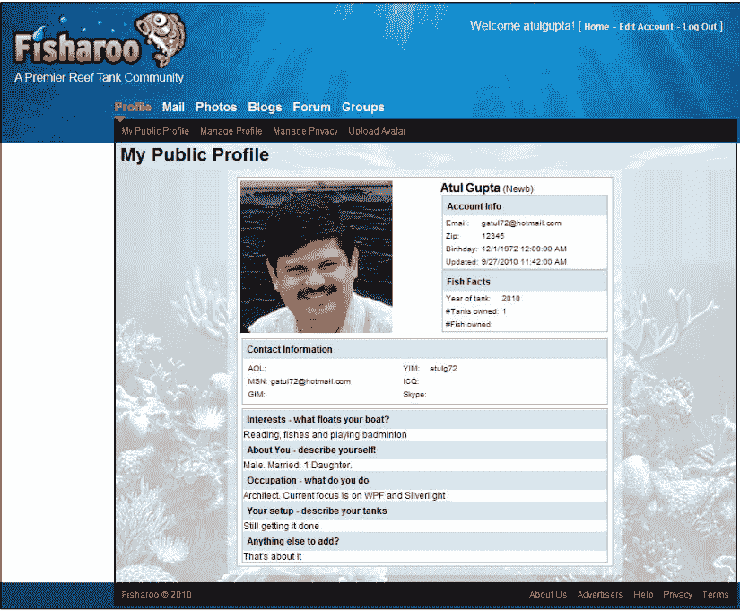

### 问题

我们不会讨论 .NET 的配置文件功能，原因与之前不写 .NET 成员资格功能相同。这个话题在许多书籍和顶级博客站点上已经被广泛覆盖。我们认为，讨论自定义实现配置文件及动态属性可能会更有意思，这样成员的配置文件可以随着时间推移不断扩展。此外，这也能让我们更深入地了解 LINQ 以及我们的框架是如何运作的。

在构建配置文件时另一个必须讨论的有趣话题是头像。头像是一个小图标或图像，与每个用户的资料相关联。这样你就可以轻松地从人群里直观地辨认出某个资料。通常，头像会显示在用户所进行或交互的几乎所有内容旁边，例如他们的博客文章、论坛帖子、评论等。这提供了一种虚拟的面对面感觉。

当然，我们也可以采取更简单的方法，不允许用户创建自定义头像——某些社区就是这么做的。我们可以只提供一个通用头像图库，让用户从中选择一个关联到自己的资料。但任何社区网站最大的吸引力在于让用户尽可能自由地表达。因此，在自定义头像方面，我们将讨论另一个极端。

我们需要一种方式让用户上传他们自己的图片，尺寸几乎不限（不过我们会有文件大小限制！请别上传 10 MB 的图片来处理！）。由于头像通常更接近图标大小而非海报大小，我们将需要处理图像缩放。此外，既然我们知道图片可以是各种形状，如果能设计一个 UI，让用户选择上传图片的特定区域，并将该选区限制为特定形状，那就太棒了。我们倾向于使用正方形，因为它最容易处理。

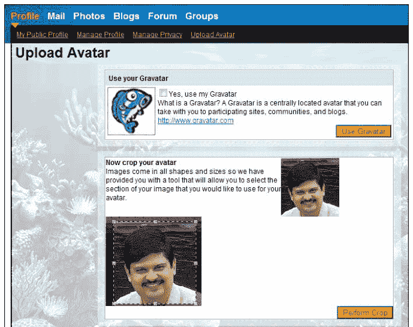

除了自定义头像，如今许多服务也提供集中式头像。这样用户可以在一处上传和管理头像，然后自动同步到他们所属的所有网站。我们将研究如何使用最大、最流行的服务之一 Gravatar。

一旦我们完成了所有数据收集和配置文件配置工具，接下来就要处理向社区展示这些数据的问题。这里一个很好的特性是美观 URL，它允许我们的用户在社区中拥有自己的个人主页，如下所示：www.fisharoo.com/profiles/atul gupta。

Facebook 的一个非常流行的功能是持续动态流，显示关于你、你的朋友以及社区活动的内容。这类功能现在已经非常流行，以至于 MySpace 最近也实现了一个版本。这是一个重要的功能，因为它每天都会给我们提供一些新的内容。你关注的朋友越多（详见第 6 章），你需要跟踪的动态就越多。由于这些动态或提醒通常会显示在用户的私人主页上，并且它是一个主要子系统，许多其他功能都会向其中写入内容，所以我们应该现在而不是以后再处理底层框架。

### 设计

让我们看看这些功能的整体设计会是怎样的。

#### 资料

我们的资料将收集用户的基本数据。我们要收集的一些项目包括：

- 各种 IM（即时通讯）ID
- 用户的帖子 / 评论
- 一些与鱼相关的基本信息，例如他们拥有多少个鱼缸以及多少条鱼

除此之外，我们还将允许资料拥有动态属性。虽然从用户角度来看这些属性可以是动态的，但目前我们会限制这一功能，只允许站点管理员添加额外属性。动态属性的一些示例包括“关于你”、“职业”和“你的（珊瑚礁/水族箱）配置”。

### 管理资料

由于我们要管理好几类数据，我们需要考虑如何最好地向用户呈现这些内容。同时，我们也不想创建一堆不同的管理页面，因为那对我们来说会变成一场噩梦。我们将使用简单的分步向导式界面，这样我们就能将数据收集/管理过程分解为逻辑步骤。

#### 头像

在系统中管理图像有许多方法。多年来争议最大的两种方法是将图像存储在数据库中，或者将它们存储在文件系统上。对于日常的图片库，我们完全支持将它们存储在文件系统上。然而，像头像这样频繁使用的东西（考虑到头像形状较小）可以直接与资料一起存储在数据库中。

#### 自定义头像

我们大多数人会认为上传图像或文件很简单。然而，以一种不会让图像看起来失真的方式缩放图像确实是一个挑战。此外，我们还要放大和/或裁剪图像，使其成为完美的正方形。但我们不能把用户的图像强行压扁成正方形。也不能随便从上传的图片中随机截取一个方形区域！那样头像最终可能只包含鼻子而不是整个头部。所以我们需要创建一个 UI（或找到一个），让用户指定要使用上传图像的哪个部分。

#### Gravatar

Gravatar.com 和其他类似网站还有另一个有趣的想法。它们允许你在一个集中的位置存储头像，并从其他网站引用它。这样，如果你想更换头像，只需前往这一个地方进行修改，你的头像就会在所有引用它的网站上同步更新。我们认为这是我们应该在站点中支持的功能。

#### 公开资料

随着人们加入网站，他们希望了解站点的其他成员并与他们互动。我们需要提供一个公共区域，让用户表达自我并与世界分享。这也将成为我们在后续章节中其他功能的主要展示平台。

### 自定义主页

大多数互联网用户习惯看到这样的 URL：

http://www.domain.com/somepage.aspx?id=asduiw8921s1cm&t=89889

虽然计算机可以轻松读取这种链接，但对人来说完全没有意义。既然我们已经为每个用户提供了公开资料页面，为什么不提供一个简单的方式让好奇的人找到该页面呢？更重要的是，为什么不提供一种简单的方法让用户分享他们的公开资料？我们将不再使用之前的 URL，而是建立一个更像这样的 URL：**http://www.fisharoo.com/profiles/YourUsername**。

### 隐私

一旦我们为用户提供了所有这些工具来输入个人数据，那么为他们提供一种管理谁可以看到这些数据的方式就非常重要。在本章中，我们将专注于创建基础系统，以便在后续章节中进一步扩展。在本章中，我们将研究如何将用户数据设置为公开或私有。我们要创建的系统应该足够灵活，能够保护单条数据或整个数据区域。一个示例是，我们可能想要单独保护用户的社会安全码数据（虽然我们不会存储社会安全码！），并通过一个开关保护所有用户的 IM 账户。

这里的开关就是实际的用户设置。开关类型就是需要被保护的特定数据或数据区域。由于这些是在系统中静态定义的，因此这些数据不需要直接管理。可见性级别归结为公开、私密和仅好友可见。通过这种结构，最终用户将能够独立配置每种开关类型。

### 动态消息

正如我们之前提到的，动态消息部分是我们在任何社区中最喜欢的功能之一。我们认为，如果这个区域设计得正确，它将拥有最多的活跃度，也可能对用户最有价值。它本质上允许用户跟踪其他用户。

实现这种功能的方式有好几种。我们可以为要跟踪的各种通知类型将数据分散存储。或者我们可以将其集中存储，并与关系模型解耦。我们选择保持简单（像往常一样）。因此，在我们的场景中，当生成通知时，它将存储在一个简单的结构中，以便我们能更高效地将数据快速推送给用户。

提醒由每个用户生成。所有这些提醒都会显示在用户的首页上，这样他/她就能按时间顺序看到他们自己正在进行的活动。


## 解决方案

现在，让我们来看看如何着手实现这些新功能。

### 回顾解决方案结构

在深入细节之前，让我们快速回顾一下解决方案的结构。由于到本书结尾时，这个站点将变得相当庞大，并涵盖所有功能，因此有必要进行一定的模块化。同时，为了正确遵循我们之前讨论的应用分层概念，提前以正确的方式设置事物非常重要。我们的解决方案结构如下所示：

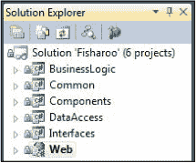

各个项目都有特定的用途。让我们来看看这些项目：

- **业务逻辑：**所有与业务相关的逻辑、规则等都将放在此项目中。
- **通用：**这是任何层都可以使用的通用功能。
- **组件：**这些也是通用组件，但可以根据需要被不同的实现所替换。本质上，这些组件实现了 MEF。
- **数据访问：**该层是对实际数据访问的封装，包含各种使用实体框架生成的实体来操作数据库的仓储。
- **接口：**这些是组件项目中各个类所实现的接口。
- **Web：**这是表示层，包含所有 ASPX 页面及相关逻辑。

### 实现数据库

我们将从实现数据库开始，然后自底向上逐步推进。下面的截图显示了本章中我们将使用的主要表。

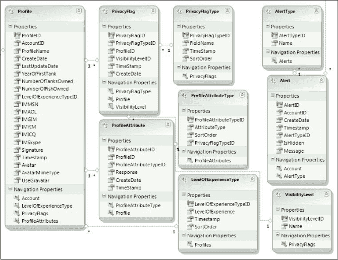

### Profiles 表

在真正组装一个界面之前，我们需要讨论一下个人资料（profile）的数据将如何存储。参见上一张截图中的 profiles 表。让我们讨论一些不太常见的字段。这里我们指的是使用 **varbinary(MAX)** 字段的 **头像**存储。有了 MAX 大小限制（其实也算不上什么限制！），一个人理论上可以把一张 DVD 的内容存放到这个字段中。这当然是很荒唐的，所以我们需要确保在前端设置一些限制，以便将文件存储大小保持在最小。稍后您会看到，这个字段本质上是一个字符数组！

### 经验水平

一旦我们的基础个人资料容器就绪，我们就可以创建一些周围的表了。其中最简单的是经验水平系统。随着站点的其他功能逐步构建，该系统也会被用到。最初，用户可以进入并设置其个人资料，并声明一种经验水平。然后，当用户在论坛中添加帖子、创建新的博客文章，或以任何其他方式与我们的社区互动时，我们可以动态调整用户的经验水平。这可以基于用户获得的勋章，我们将在第 11 章中讨论这一点。

### Attributes 表

个人资料系统中另一个最简单的部分就是动态属性系统。回忆一下，这将允许站点管理员轻松扩展为每个用户收集的数据。有两张表——ProfileAttribute 和 ProfileAttributeType。第一张表用于用户输入的属性，第二张表用于站点中使用的各种属性。

### Privacy 表

现在我们可以讨论隐私系统了。这本质上是一个一对多关系系统，在关系的子端有一些配置/查找表。我们有 PrivacyFlag 用于存储用户创建的值。然后我们有 PrivacyFlagType 来定义该标志所保护的内容。最后，我们有 VisibilityLevel，它定义了谁可以看到受保护的数据。

### Alerts 表

接下来，我们来看看支持个人资料页面上新闻源或“提醒”（Alerts）概念的表。这包括 Alert 表和 AlertType 表。

这里一个值得讨论的有趣字段是 IsHidden 字段。稍后我们将使用它，让用户可以从其新闻源中隐藏某条提醒。我们也可以使用它，让用户根据提醒类型隐藏整组提醒。

在业务层包含大量业务逻辑的应用程序中，可以创建独立的业务实体，并在实体之间进行转换（例如，从 DataAccess 实体转换为业务实体，反之亦然）。类似地，如果表示层要求实体具有特定于表示层的额外属性，则可以创建表示实体。

让我们通过在 DataAccess 项目中创建一个新的 Profile 分部类来扩展我们的 Profile 对象。在这个类中，让我们添加一个属性来存储个人资料属性的列表，以及一个属性来保存个人资料的经验水平。我们不需要相应的标量属性，因为这些属性是可用的，因此我们无需担心在这个分部类中添加它们。Profile 分部类看起来如下所示：

```csharp
//Fisharoo/DataAccess/Profile.cs
namespace Fisharoo.DataAccess
{
    public partial class Profile
    {
        public List<ProfileAttribute> Attributes { get; set; }
        public LevelOfExperienceType LevelOfExperienceType { get; set; }

        public Profile()
        {
            Attributes = new List<ProfileAttribute>();
        }
    }
}
```

类似地，我们将为 AlertType、PrivacyFlagType、ProfileAttribute 和 VisibilityLevel 创建分部实体类。有关这些类的详细信息，请参阅第 4 章提供的代码。

### 构建仓储

随着新表的添加，将会有新的仓储来访问存储在表中的数据。我们将创建几个仓储来支持我们的个人资料需求，即 ProfileRepository、ProfileAttributeRepository、PrivacyRepository、LevelOfExperienceTypeRepository 和 AlertRepository。

我们的每个仓储都会有一个方法用于按 ID 选择、按父 ID 选择、保存和删除。一旦你见过一个仓储，基本上就相当于见过所有仓储了。让我们来看一下 ProfileRepository.cs：

```csharp
//Fisharoo/DataAccess/Repositories/ProfileRepository.cs
namespace Fisharoo.DataAccess.Repositories
{
    [Export(typeof(IProfileRepository))]
    public class ProfileRepository : IProfileRepository
    {
        private Connection conn;
        public ProfileRepository()
        {
            conn = new Connection();
        }

        public Profile GetProfileByAccountID(int AccountID)
        {
            Profile profile;

            using (FisharooDataContext dc = conn.GetContext())
            {
                profile = (from p in dc.Profiles.Include(
                    "ProfileAttributes.ProfileAttributeType")
                    .Include("LevelOfExperienceType")
                    where p.AccountID == AccountID
                    select p).FirstOrDefault();
            }
            if (profile != null)
            {
                foreach (ProfileAttribute item in profile.ProfileAttributes)
                {
                    profile.Attributes.Add(item);
                    item.profileAttributeType = item.ProfileAttributeType;
                }
                profile.LevelOfExperienceType = profile.LevelOfExperienceType;
            }
            return profile;
        }

        public Int32 SaveProfile(Profile profile)
        {
            Int32 profileID = 0;
            Boolean HasAttributeId = false;
            profile.LastUpdateDate = DateTime.Now;
            using (FisharooDataContext dc = conn.GetContext())
            {
                if (profile.ProfileID > 0)
                {
                    dc.Profiles.Attach(new Profile { ProfileID = profile.ProfileID });
                    dc.Profiles.ApplyCurrentValues(profile);
                    if (profile.Attributes != null)
                    {
                        foreach (ProfileAttribute item in profile.Attributes)
                        {
                            dc.ProfileAttributes.Attach(
                                new ProfileAttribute
                                {
                                    ProfileAttributeID = item.ProfileAttributeID,
                                });
                            dc.ProfileAttributes.ApplyCurrentValues(item);
                        }
                    }
                }
                else
                {
                    profile.CreateDate = DateTime.Now;
                    //when working with new profile we don't expect attributes to be null, but check anyway
                    if (profile.Attributes != null)
                    {
                        foreach (ProfileAttribute item in profile.Attributes)
                        {
                            dc.ProfileAttributes.AddObject(new ProfileAttribute
                            {
                                ProfileAttributeID = item.ProfileAttributeID,
                                ProfileAttributeTypeID = item.ProfileAttributeTypeID,
                                ProfileID = item.ProfileID,
```


```csharp
Response = item.Response,
CreateDate = item.CreateDate,
TimeStamp = item.TimeStamp
});
HasAttributeId = true;
}
}
dc.Profiles.AddObject(profile);
}
dc.SaveChanges();
profileID = profile.ProfileID;
if (HasAttributeId)
{
    var result = from pa in dc.ProfileAttributes
                 .Include("ProfileAttributeType")
                 where pa.ProfileID == profileID
                 select pa;
    profile.Attributes = result.ToList();
    foreach (ProfileAttribute item in profile.Attributes)
    {
        item.ProfileAttributeType = item.ProfileAttributeType;
    }
}
return profileID;
}

public void DeleteProfile(Profile profile)
{
    using (FisharooDataContext dc = conn.GetContext())
    {
        dc.Profiles.DeleteObject(dc.Profiles
            .Where(pf => pf.ProfileID
            .Equals(profile.ProfileID))
            .FirstOrDefault());
        dc.SaveChanges();
    }
}
```

> Lambda 表达式由 lambda 运算符 ‘=>’ 组成，读作 goes to，其左侧表示输入参数，右侧表示要计算的表达式或语句块。与标准查询相比，其主要优势在于类型推断、简洁性和代码可读性提高。

其他存储库也是类似构建的，这里不再展示代码。你可以查看本章关联的代码以获取更多细节。

## 实现服务/应用层

一旦为单一用途构建了所有存储库，我们就可以开始创建服务层。服务层将被表示层项目所使用。存储库类（除实体外）永远不会在表示层项目中直接访问，而只会通过业务逻辑项目访问。这有助于在应用程序的各个层之间保持耦合和内聚。不仅如此，它还有助于建立“关注点分离”的设计原则，即每一层只执行对其期望的专用活动。

我们将创建一些服务，即 ProfileService、PrivacyService、AlertService、ProfileAttributeService、LevelOfExperienceTypeService 和 PermissionService。

除上述服务外，我们还需要修改几个服务。

### ProfileService

现在我们可以开始构建 ProfileService。 在 BusinessLogic 项目中创建一个名为 ProfileService 的新类。

```csharp
//Fisharoo/BusinessLogic/ProfileService.cs
namespace Fisharoo.BusinessLogic
{
    //CHAPTER 4
    [Export(typeof(IProfileService))]
    public class ProfileService : IProfileService
    {
        [Import]
        private IProfileRepository _profileRepository;
        [Import]
        private IAlertService _alertService;
        [Import]
        private IProfileAttributeRepository _profileAttributeRepository;
        [Import]
        private IUserSession _userSession;
        [Import]
        private ILogger _log;

        public ProfileService()
        {
            MEFManager.Compose(this);
        }

        public Profile LoadProfileByAccountID(Int32 AccountID)
        {
            Profile profile = null;
            profile = _profileRepository.GetProfileByAccountID(AccountID);
            return profile;
        }

        public void SaveProfile(Profile profile)
        {
            _profileRepository.SaveProfile(profile);
            _userSession.CurrentUser.Profile = profile;
        }
    }
}
```

如你所见，这个类具有 LoadProfileByAccountID() 和 SaveProfile() 方法。它们很容易理解，因为它们只是调用相应的数据访问层方法并传递适当的参数。

我们并不是通过在 ProfileService 类中创建实例来直接访问存储库类，而是通过使用 MEF 使用对数据访问存储库的接口（IProfileRepository），如前一章所述。

### Account service

现在我们已经创建了 ProfileService，让我们扩展 AccountService 以利用我们的新功能。请注意，我们在 AccountRepository.cs 中加载了 Profiles 和 AccountPermissions 以及 Account，因此这些将作为 account 对象的导航属性可用。让我们从扩展 AccountService.cs 文件中的 Login 方法开始。当用户尝试登录时，我们使用刚刚扩展的方法 GetAccountByID 获取他们的账户。这意味着我们现在也有了他们的个人资料！我们现在可以决定是否有一个具有完整创建个人资料的用户，并相应地重定向他们。让我们使用以下代码更新 AccountService.cs Login() 方法：

```csharp
//Fisharoo/BusinessLogic/AccountService.cs
if (account.EmailVerified)
{
    _userSession.LoggedIn = true;
    _userSession.Username = Username;
    _userSession.CurrentUser = GetAccountByID(account.AccountID);
    if(_userSession.CurrentUser.Profile != null &&
        _userSession.CurrentUser.Profile.ProfileID > 0)
        _redirector.GoToProfilesDefault();
    else
        _redirector.GoToProfilesManageProfile();
}
```

当然，这意味着我们需要在 Redirector 类中添加这些新方法！以下是代码：

```csharp
//Fisharoo/Components/Redirector.cs
public void GoToProfilesProfile()
{
    Redirect("~/Profiles/Profile.aspx");
}

public void GoToProfilesDefault()
{
    Redirect("~/Profiles/Default.aspx");
}
```

### Privacy service

隐私服务目前仅负责确定某条数据或显示多种类型数据的部分是否可以显示。它有一个名为 ShouldShow() 的方法，返回布尔值。

```csharp
//Fisharoo/BusinessLogic/PrivacyService.cs
public bool ShouldShow(Int32 PrivacyFlagTypeID,
    Account AccountBeingViewed,
    Account Account,
    List<PrivacyFlag> Flags)
{
    bool result;

    //CHAPTER 5 - come back to this when we start friends
    bool isFriend = false;
    //flag marked as private test
    if(Flags.Where(f => f.PrivacyFlagTypeID == PrivacyFlagTypeID &&
    f.VisibilityLevelID == (int)VisibilityLevel.VisibilityLevels.
    Private).FirstOrDefault() != null)
        result = false;
    //flag marked as friends only test
    else if (Flags.Where(f => f.PrivacyFlagTypeID ==
            PrivacyFlagTypeID && f.VisibilityLevelID ==
            (int)VisibilityLevel.VisibilityLevels.
            Friends).
        FirstOrDefault() != null && isFriend)
        result = true;
    else if (Flags.Where(f => f.PrivacyFlagTypeID ==
            PrivacyFlagTypeID && f.VisibilityLevelID ==
            (int)VisibilityLevel.VisibilityLevels.Public)
        .FirstOrDefault() != null)
        result = true;
    else
        result = false;
    return result;
}
```

请注意，我们使用的是枚举而不是记录号进行测试。为了使用 VisibilityLevel.VisibilityLevels 表示的这些枚举值，我们将不得不创建一个新的 partial VisibilityLevel 类。导航到 DataAccess 并创建一个名为 VisibilityLevel.cs 的新类文件。在其中，输入以下代码：

```csharp
public enum VisibilityLevels
{
    Private = 1,
    Friends = 2,
    Public = 3
}
```

### Other services

- **Profile Attribute service：** 此服务负责根据存储在 `ProfileAttribute` 中的 `ProfileAttributeTypeID` 将 `ProfileAttribute` 与其对应的 `ProfileAttributeType` 组合起来。这实现起来非常直接，因为它只是调用 `ProfileAttributeRepository` 根据指定的 `ProfileID` 获取 `ProfileAttributes` 列表。我们只是从代码完成的角度实现了它。此服务可能不会被调用或使用，因为我们已经在 `ProfileRepository.cs` 中为每个 Profile 加载了所有 `ProfileAttribute`。
- **Level of Experience type service：** 这是一个简单的包装服务，调用 `LevelOfExperienceTypeRepository` 获取所有经验等级类型的列表。这是为了避免表示层直接调用存储库类而编写的。
- **Permission service：** 这与 `LevelOfExperienceTypeService` 类似，并调用 `PermissionRepository` 上的方法以获取与 `Web.sitemap` 中使用的名称关联的权限。

查看本章关联的代码以了解这些服务的细节。

## 实现表示层

现在整个后端已经创建完成并准备就绪，让我们继续讨论如何让表示层为我们工作。虽然隐私功能完全可以在其他所有功能之后实现，但我们认为如果先准备好它会更容易。然后在构建其他区域时，我们可以在需要的地方加入隐私检查。

### Privacy

现在，让我们实现隐私功能。


```aspx
<asp:PlaceHolder ID="phPrivacyFlagTypes"
runat="server"></asp:PlaceHolder> </div>
<div class="divContainerFooter">
<asp:Label ID="lblMessage" runat="server"
ForeColor="Red"></asp:Label>
<asp:Button CssClass="loginButton" ID="btnSave"
runat="server" Text="Save Privacy Settings" OnClick="btnSave_Click" />
</div> </fieldset> </div>
</asp:Content>
```

这就把我们带到了代码后置部分。当然，它继承自一个接口，这样我们就可以将此页面的引用传递给我们的 ManagePrivacyPresenter 类。与大多数 Model View Presenter (MVP) 页面一样，我们必须设置我们的 presenter 类。开始时，我们在 Page_Load 中将此页面的引用传递给 presenter。

```csharp
//Fisharoo/Web/Profiles/ManagePrivacy.aspx.cs
namespace Fisharoo.Web.Profiles
{
    public partial class ManagePrivacy : System.Web.UI.Page,
    IManagePrivacy
    {
        private ManagePrivacyPresenter _presenter;

        protected void Page_Load(object sender, EventArgs e)
        {
            _presenter = new ManagePrivacyPresenter();
            _presenter.Init(this);
        }

        public void ShowPrivacyTypes(List<PrivacyFlagType>
        PrivacyFlagTypes,
        List<VisibilityLevel> VisibilityLevels,
        List<PrivacyFlag> PrivacyFlags)
        {
            foreach (PrivacyFlagType type in PrivacyFlagTypes)
            {
                //Add the field name to the display
                phPrivacyFlagTypes.Controls.Add(new
                LiteralControl("<p>"));
                Label lbl = new Label();
                lbl.Text = type.FieldName + ":";
                lbl.Width = 100;
                phPrivacyFlagTypes.Controls.Add(lbl);

                //Create the visibility drop down
                DropDownList ddlVisibility = new DropDownList();
                ddlVisibility.ID = "ddlVisibility" +
                                   type.PrivacyFlagTypeID.ToString();
                foreach (VisibilityLevel level1 in VisibilityLevels)
                {
                    ListItem li = new ListItem(level1.Name,
                                               level1.VisibilityLevelID.ToString());
                    if(!IsPostBack)
                        li.Selected = _presenter.IsFlagSelected(
                                          type.PrivacyFlagTypeID,
                                          level1.VisibilityLevelID,
                                          PrivacyFlags);
                    ddlVisibility.Items.Add(li);
                }
                phPrivacyFlagTypes.Controls.Add(ddlVisibility);
                phPrivacyFlagTypes.Controls.Add(new LiteralControl("</p>"));
            }
        }

        protected void btnSave_Click(object sender, EventArgs e)
        {
            lblMessage.Text = "";
            foreach (PrivacyFlagType type in
                     _presenter.GetPrivacyFlagTypes())
            {
                DropDownList ddlVisibility =
                    phPrivacyFlagTypes.FindControl("ddlVisibility" +
                    type.PrivacyFlagTypeID.ToString()) as
                    DropDownList;
                if(ddlVisibility != null)
                    _presenter.SavePrivacyFlag(
                        type.PrivacyFlagTypeID, Convert.
                        ToInt32(
                        ddlVisibility.SelectedValue));
            }
            lblMessage.Text = "Your privacy settings were saved successfully!";
        }

        public void ShowMessage(string Message)
        {
            lblMessage.Text += Message;
        }
    }
}
```

这里需要注意的是，与所有 presenter 控制的页面一样，视图会调用一个 Init() 方法，该方法是在 presenter 中负责加载页面的方法。presenter 会调用 LoadPrivacyTypes() 使用适当的服务加载隐私数据，然后调用视图中的 ShowPrivacyTypes() 方法，并传入构建动态 UI 所需的内容。ShowPrivacyTypes() 方法随后会遍历传入列表中的所有值，将下拉菜单添加到 .aspx 页面中的占位符中。在加载 UI 的同时，它还会尝试为每个菜单定位当前值以进行加载。

我们随后有 btnSave_Click() 事件处理程序，负责提取当前选择并将这些值传递给 presenter，以便将数据持久化到数据库中。

最后，我们有一个 ShowMessage() 方法，允许 presenter 将消息传回此页面的用户。

presenter ManagePrivacyPresenter 为我们提供了加载和处理来自 ManagePrivacy 页面的事件的各种方法。以下是代码：

```csharp
//Profiles/Presenters/ManagePrivacyPresenter.cs
namespace Fisharoo.Web.Profiles.Presenters
{
    public class ManagePrivacyPresenter
    {
        [Import]
        private IPrivacyService _privacyService;
        [Import]
        private IUserSession _userSession;

        private Account account;
        int profileID;

        private List<PrivacyFlagType> privacyFlagTypes;
        private List<VisibilityLevel> visibilityLevels;
        private List<PrivacyFlag> privacyFlags;
        private IManagePrivacy _view;

        public void Init(IManagePrivacy View)
        {
            _view = View;
            MEFManager.Compose(this);
            account = _userSession.CurrentUser;
            profileID = account.Profile.ProfileID;

            LoadPrivacyTypes();
        }

        private void LoadPrivacyTypes()
        {
            privacyFlagTypes = _privacyService.GetPrivacyFlagTypes();
            visibilityLevels = _privacyService.GetVisibilityLevels();
            privacyFlags = _privacyService.GetPrivacyFlagsByProfileID(
                profileID
            );

            _view.ShowPrivacyTypes(privacyFlagTypes, visibilityLevels, privacyFlags
            );
        }

        public List<PrivacyFlagType> GetPrivacyFlagTypes()
        {
            return privacyFlagTypes;
        }

        public void SavePrivacyFlag(Int32 PrivacyFlagTypeID,
        Int32 VisibilityLevelID)
        {
            foreach (PrivacyFlag flag in privacyFlags)
            {
                if (flag.PrivacyFlagTypeID == PrivacyFlagTypeID)
                {
                    flag.VisibilityLevelID = VisibilityLevelID;
                    _privacyService.SavePrivacyFlag(flag);
                    return;
                }
            }

            //not in collection? Add a new one
            PrivacyFlag newFlag = new PrivacyFlag();
            newFlag.PrivacyFlagTypeID = PrivacyFlagTypeID;
            newFlag.VisibilityLevelID = VisibilityLevelID;
            newFlag.ProfileID = profileID;
            newFlag.CreateDate = DateTime.Now;
            privacyFlags.Add(newFlag);
            _privacyService.SavePrivacyFlag(newFlag);
        }

        public bool IsFlagSelected(Int32 PrivacyFlagTypeID,
            Int32 VisibilityLevelID, List<PrivacyFlag>
            PrivacyFlags)
        {
            List<PrivacyFlag> result = privacyFlags.FindAll(
                pf => (pf.PrivacyFlagTypeID.Equals(PrivacyFlagTypeID))
                && (pf.VisibilityLevelID.Equals(VisibilityLevelID)));
            if (result.Count > 0)
            {
                return true;
            }
            return false;
        }
    }
}
```

我们有 **Init()** 方法，它只是捕获视图引用并使用 MEF 加载所需的服务。然后它调用 **LoadPrivacyTypes()** 来初始化调用页面的 UI。此方法获取隐私标志类型列表、可视性级别以及当前用户的当前隐私标志列表。然后在视图中调用 **ShowPrivacyTypes()** 来显示 UI。

**GetPrivacyFlagTypes()** 方法在视图保存数据时被调用，这样我们就可以以构建 UI 的相同方式遍历 UI。我们使用 **PrivacyFlagTypes** 列表来构建 UI，因此用它来销毁 UI 也很合适！

这就把我们带到了 **SavePrivacyFlag()** 方法，它负责与视图中的保存按钮点击事件交互。此方法只是遍历传入的 **PrivacyFlags** 并将它们保存到数据库中。

完成所有这些后，我们现在可以自由调用 **PrivacyService** 类来查看是否应该显示某个区域。虽然我们有私有数据可供使用，但确定是否应该显示某物或不显示，目前对我们没有帮助，因为目前没有添加个人资料数据的方式！让我们添加一个个人资料管理页面。但在我们这样做之前，请注意所有页面都遵循类似的 MVP 模式，因此代码的一部分会相似。从现在开始，我们只会展示代码的相关和重要部分。完整的代码，您始终可以参考本章关联的代码。


## 用户资料

### 管理资料

我们知道，随着网站的发展，这个区域有很大的增长和扩展空间，因此决定使用一系列向导步骤来构建此页面。UI 的代码本身并不复杂，但比我们希望在正文中展示的内容长得多！因此，我们只展示向导的步骤。

这里，我们收集一些关于用户鱼缸的属性，如下面的截图所示。

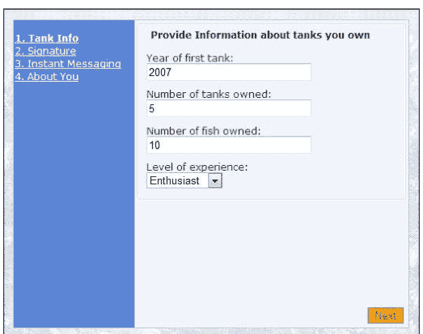

然后，我们收集用户的签名（可用于用户在论坛或其他功能中的任何发帖），如下面的截图所示：

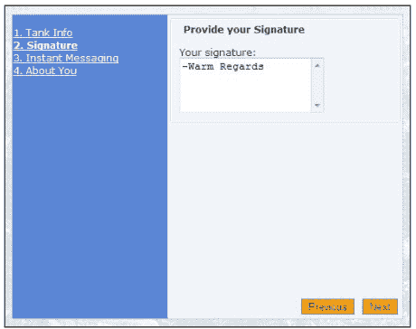

接下来，我们收集用户与站点内其他用户交流的所有方式。这里我们重点收集他们的即时通讯客户端 ID。

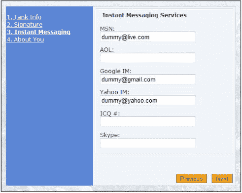

最后，我们还有一些关于用户的属性，可以展示在他们的个人资料页面上。

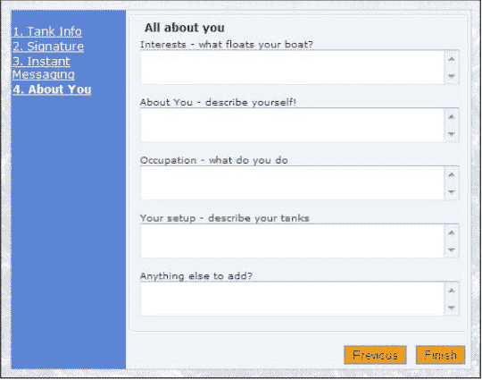

唯一与常规略有不同的步骤是第一步和最后一步。第一步的**经验级别**菜单和最后一步的所有输入都是动态生成的。

在初始化期间，Presenter 使用几个先前讨论过的服务方法来初始化 UI。

```csharp
//Fisharoo/Web/Profiles/Presenters/ManageProfilePresenter.cs
public void Init(IManageProfile view, bool IsPostback)
{
    _view.LoadLevelOfExperienceTypes(
        _levelOfExperienceTypeService.
        GetAllLevelOfExperienceTypes());
    _view.LoadProfileAttributeTypes(GetProfileAttributeTypes());

    if (!IsPostback)
    {
        _view.LoadProfile(GetProfile());
    }
}
```

然后，Presenter 将数据反馈给 UI，以动态创建所需的控件，适当地格式化它们，并最终显示输出。

```csharp
//Profiles/ManageProfile.aspx.cs
public void LoadProfileAttributeTypes(List<ProfileAttributeType> types)
{
    foreach (ProfileAttributeType type in types)
    {
        Label lbl = new Label();
        lbl.ID = "lblAttribute" + type.ProfileAttributeTypeID.ToString();
        lbl.Text = type.AttributeType;
        lbl.CssClass = "formLabel";

        Label lblAttributeTypeID = new Label();
        lblAttributeTypeID.ID = "lblAttributeTypeID" + type.ProfileAttributeTypeID.ToString();
        lblAttributeTypeID.Text = type.ProfileAttributeTypeID.ToString();
        lblAttributeTypeID.Visible = false;

        Label lblProfileAttributeID = new Label();
        lblProfileAttributeID.ID = "lblProfileAttributeID" + type.ProfileAttributeTypeID.ToString();
        lblProfileAttributeID.Visible = false;

        TextBox tb = new TextBox();
        tb.ID = "txtProfileAttribute" + type.ProfileAttributeTypeID.ToString();
        tb.TextMode = TextBoxMode.MultiLine;
        tb.Columns = 40;
        tb.Rows = 2;

        CustomValidator cv = new CustomValidator();
        cv.ControlToValidate = "txtProfileAttribute" + type.ProfileAttributeTypeID.ToString();
        cv.ClientValidationFunction = "MaxLength2000";
        cv.ErrorMessage = "This field can only be 2000 characters long!";
        cv.Text = "*";
        cv.ForeColor = System.Drawing.Color.Red;

        phAttributes.Controls.Add(lblAttributeTypeID);
        phAttributes.Controls.Add(lblProfileAttributeID);
        phAttributes.Controls.Add(lbl);
        phAttributes.Controls.Add(new LiteralControl("<br />"));
        phAttributes.Controls.Add(tb);
        phAttributes.Controls.Add(cv);
        phAttributes.Controls.Add(new LiteralControl("<br />"));
    }
}
```

一旦 UI 创建完成，剩下的就是简单的连接和 UI 维护工作。每次有人点击**下一步**按钮时，我们都会清除错误消息标签。当点击**完成**按钮时，我们从 UI 中提取数据并将其传递给 Presenter 以保存到数据库。

### 头像

现在让我们来看一下如何创建用户的头像，该头像将显示在用户与网站的所有交互旁边。

### 上传头像

此功能的几乎所有工作都发生在 Presenter 中。UI 提供一个文件上传框，带有一个标准的浏览按钮和一个用于提交所选文件的附加按钮。当点击“提交”按钮时，视图会将 PostedFile 传递给 Presenter 的 UploadFile() 方法。

```csharp
//Fisharoo/Web/Profiles/Presenters/UploadAvatarPresenter.cs
public void UploadFile(HttpPostedFile File)
{
    string extension = Path.GetExtension(File.FileName).ToLower();
    string mimetype;
    byte[] uploadedImage = new byte[File.InputStream.Length];
    switch (extension)
    {
        case ".png":
        case ".jpg":
        case ".gif":
            mimetype = File.ContentType;
            break;
        default:
            _view.ShowMessage("We only accept .png, .jpg, and .gif!");
            return;
            break;
    }
    if (File.ContentLength / 1000 < 1000)
    {
        File.InputStream.Read(uploadedImage, 0, uploadedImage.Length);
        profile.Avatar = uploadedImage;
        profile.AvatarMimeType = mimetype;
        profile.UseGravatar = 0;
        _profileRepository.SaveProfile(profile);
        _view.ShowCropPanel();
    }
    else
    {
        _view.ShowMessage("The file you uploaded is larger than the 1mb limit. Please reduce the size of your file and try again.");
    }
}
```

此方法负责接收文件并对文件执行一些基本检查。我们首先获取上传文件的扩展名，并检查确保上传的文件是我们支持的图像格式。如果不是，我们会显示一条消息说明问题。

通过该项检查后，我们检查以确保文件大小不太大。如果文件大小可接受，我们将文件读取到 uploadedImage 字节数组中。然后，我们将字节数组连同其 MIME 类型一起传递给当前个人资料的 Avatar 属性（我们还将 UseGravatar 标志设置为 0，稍后将讨论）。最后，我们将此数据保存到用户的个人资料中，并更新显示以显示裁剪 UI。如果文件太大，则显示错误消息。

### 图像处理

首先，这个图像裁剪工具的完整 UI 位于：http://www.defusion.org.uk/code/javascript-image-cropper-ui-using-prototype-scriptaculous/。这是一个开源的 JavaScript 工具，为我们提供了所有可以拖拽和调整大小的华丽界面选项。它使用了 prototype (http://www.prototypejs.org/)、scriptaculous (http://script.aculo.us/) 以及 Dave Spurr 的一些巧妙技巧。要实现此脚本，请从上述 defusion 网站下载源代码，并在 UploadAvatar.aspx 中引用 prototype、scriptaculous 和 cropper 文件。

```
//Fisharoo/Web/Profiles/UpdateAvatar.aspx
<script type="text/javascript" src="/js/cropper/lib/prototype.js" language="javascript"></script>
<script type="text/javascript" src="/js/cropper/lib/scriptaculous.js?load=builder,dragdrop" language="javascript"></script>
<script type="text/javascript" src="/js/cropper/cropper.js" language="javascript"></script>
```

一旦你插入了 JavaScript 部分，就需要在 ASPX 页面中添加一些元素，才能让这个控件工厂正常工作。首先，我们需要添加一个图像控件，用来加载我们要操作的图像。

```
<asp:Image ImageUrl="~/images/ProfileAvatar/ProfileImage.aspx" id="imgCropImage" runat="server"/>
```

> 请注意，此 Image 控件的 ImageUrl 引用的是一个页面而不是一张图片。images/ProfileAvatar/ProfileImage.aspx 页面会根据用户个人资料的当前配置显示其头像。如果用户没有头像，则显示默认头像。如果决定改用 Gravatar 服务（稍后讨论），则显示存储在 Gravatar 上的头像。

这是可选的，但裁剪脚本会为我们提供当前操作的预览。要实现这一点，我们需要一个以 div 标签形式输出预览的位置。

```html
<div id="previewWrap"></div>
```

然后，我们需要添加一个 JavaScript 函数，将裁剪脚本挂接到我们的 UI 上。此脚本设置了一些基本属性，例如图像的 ID 是什么、预览输出存放在哪里、最小高度和宽度、固定比例（在我们的例子中强制裁剪器为正方形）以及裁剪完成时要执行的操作。另请注意，图像控件的名称（Content_imgCropImage）与您在早期版本的 ASP.NET 中所见到的名称不同。对于 ASP.NET 4，控件名称更简单，不再使用 ctl00 前缀。

```javascript
<script type="text/javascript" language="javascript">
    Event.observe(window, 'load', function() {
        new Cropper.ImgWithPreview(
            'Content_imgCropImage',
            {
                previewWrap: 'previewWrap',
                minWidth: 100,
                minHeight: 100,
                ratioDim: {x: 100,y: 100},
                displayOnInit: true,
                onEndCrop: onEndCrop
            }
        );
    });
</script>
```

我们希望裁剪器将捕获的一些数据存储在隐藏字段中，以便我们可以在服务器端处理这些数据。然后，我们需要添加一个函数来处理裁剪器触发的 onEndCrop 事件。该函数实际上会将数据存储到 HiddenField 控件中。这部分代码我们略过不展示，因为它相当简单。

接下来，一旦用户选择了希望用作头像的图像区域，并将该选择提交给服务器，我们就拥有了执行图像裁剪所需的条件。Presenter 的 CropFile() 方法将处理此任务。

```csharp
//Fisharoo/Web/Profiles/Presenters/UploadAvatarPresenter.cs
public void CropFile(Int32 X, Int32 Y, Int32 Width, Int32 Height)
{
    byte[] imageBytes = profile.Avatar.ToArray();
```


## 用户个人资料

### Gravatar

正如我们之前讨论过的，Gravatar 是一项允许你把头像集中存储的服务。它让你可以将一个头像与你的电子邮件地址关联起来，这样其他网站（比如我们的网站）之后就可以引用它。对于那些在互联网上到处都留有个人资料的用户来说，这非常棒！

为了让用户使用 Gravatar 服务，他们只需在上传头像界面的初始页面上勾选复选框即可。当他们点击**提交**时，我们会将他们的**个人资料**中的 UseGravatar 属性设置为 1。之后每当我们调用 **ProfileImage.aspx** 页面来显示头像时，都必须使用 Gravatar 而不是本地存储的头像。

为了调用 Gravatar 服务，我们必须创建一个 URL，其中包含以十六进制 MD5 哈希形式正确格式化的电子邮件地址。我们在 Cryptography 类中创建了一个方法，来为我们执行此转换。

```csharp
public static string CreateMD5Hash(string StringToHash)
{
    MD5 md5Hasher = MD5.Create();
    byte[] data =
        md5Hasher.ComputeHash(Encoding.Default.GetBytes(StringToHash));
    StringBuilder sBuilder = new StringBuilder();
    for (int i = 0; i < data.Length; i++)
    {
        sBuilder.Append(data[i].ToString("x2"));
    }
    return sBuilder.ToString();
}
```

接着，我们创建了一个简单的扩展方法，它以一种比直接调用 Cryptography 套件更简化的方式为我们处理转换。

```csharp
public static string ToMD5Hash(this string s)
{
    return Cryptography.CreateMD5Hash(s);
}
```

了解了这些背景后，让我们来看看这个方法。

```csharp
//Fisharoo/Web/Images/ProfileAvatar/ProfileImage.aspx.cs
public string GetGravatarURL()
{
    defaultAvatar = Server.UrlPathEncode(__webContext.RootUrl +
        "/images/ProfileAvatar/Male.jpg");
    gravatarURL = "http://www.gravatar.com/avatar.php?";
    gravatarURL += "gravatar_id=" + account.Email.ToMD5Hash();
    gravatarURL += "&rating=r";
    gravatarURL += "&size=80";
    gravatarURL += "&default=" + defaultAvatar;
    return gravatarURL;
}
```

我们讨论的这些属性相当容易理解。不过，你可以在这里获取有关如何使用 Gravatar 服务的完整说明：http://site.gravatar.com/site/implement#section_1_1。

### 公开个人资料

现在我们已经解决了隐私问题，为用户提供了管理其个人资料数据的方式，并允许他们上传和适当格式化头像，接下来我们需要为用户提供一个显示其所有数据的页面。

在很大程度上，这不过是另一个“管道页面”，也就是说我们只是在这里展示数据。一点也不复杂！因此，我们将跳过大部分基础工作，直接切入正题，也就是我们的隐私处理方式。

在 Profile.aspx 页面中，我们把所有内容都存放在类似这样的面板中：

```aspx
//Fisharoo/Web/Profiles/Profile.aspx
<asp:Panel ID="pnlPrivacyAccountInfo" runat="server">
    <fieldset>
        <div class="divContainerTitle"> Account Info</div>
        <table class="profileInfo">
            <tr> <td>Email: </td>
                <td><asp:Literal ID="litEmail" runat="server" /></td>
            </tr>
            <tr> <td>Zip:</td>
                <td><asp:Literal ID="litZip" runat="server" /></td>
            </tr>
            <tr> <td>Birthday: </td>
                <td><asp:Literal ID="litBirthDate" runat="server" />/</td>
            </tr>
            <tr> <td>Updated: </td>
                <td><asp:Literal ID="litLastUpdateDate" runat="server" />
                </td> </tr>
        </table> </fieldset>
</asp:Panel>
```

这让我们可以轻松地按需锁定某个数据区域（例如，为了隐藏数据）。在此页面的 presenter 中，我们有一个 TogglePrivacy() 方法。

```csharp
///Fisharoo/Web/Profiles/Presenters/ProfilePresenter.cs
private void TogglePrivacy()
{
    _view.pnlPrivacyIMVisible(_privacyService.ShouldShow((int)PrivacyFlagType.PrivacyFlagTypes.IM,_accountBeingViewed, _account, _privacyFlags));
    _view.pnlPrivacyAccountInfoVisible(_privacyService.ShouldShow((int)PrivacyFlagType.PrivacyFlagTypes.AccountInfo,_accountBeingViewed, _account, _privacyFlags));
    _view.pnlPrivacyTankInfoVisible(_privacyService.ShouldShow((int)PrivacyFlagType.PrivacyFlagTypes.TankInfo,_accountBeingViewed, _account, _privacyFlags));
}
```

这个方法会调用 PrivacyService.ShouldShow() 方法，该方法返回一个布尔值，指示该项是否应显示。这个布尔值会直接设置到视图中的 Panel.Visible 属性上，从而有效地显示或隐藏相关数据。

### 自定义主页

当我们说“自定义主页”时，实际上指的是以一种易于访问的方式呈现的公开个人资料页面。这实际上是一个花哨的 URL，例如 **http://www.fisharoo.com/profiles/atulgupta**。我们甚至可以更进一步，使用 **http://atulgupta.fisharoo.com** 或类似的 URL！但在我们的例子中，我们将坚持使用第一个示例。

为了实现这一点，我们将使用 ASP.NET 路由支持。ASP.NET 4 在很多方面改进了其 URL 路由功能。现在有了对 SEO 友好的 URL，ASP.NET 4 MVC 在很大程度上依赖这一功能。从核心来说，URL 路由是一项允许应用程序接受不映射到物理文件的 URL 的功能。我们上面提到的友好 URL（**http://www.fisharoo.com/profiles/atulgupta**）并不映射到服务器上的物理文件，但我们的应用程序仍然能够提供该 URL 的内容。

这部分的实现逻辑相当直接。我们首先需要定义一个我们希望应用程序接受为有效的 URL 模式。这个模式会被添加到 RouteTable 中。表中的条目还指定了当模式匹配时要重定向到哪个页面。最后，在特定页面中，我们查询传入该页面的值（类似于查询字符串参数），然后按照我们希望的方式继续处理。RouteTable 条目是在 Application_Start 方法中添加到 Global.asax.cs 文件中的。


The values from the routed URL are added to the RouteData collection and are accessible from the Page class. We extract this value, cast it as a string, and then pass it to our presenter to take further action based on this value. The specific part of the presenter's Init() method, which is of interest here, is as follows:

```
if (string.IsNullOrEmpty(username))
    _accountBeingViewed = userSession.CurrentUser;
else
    _accountBeingViewed = accountService.
        GetAccountByUsername(username);
```

If the passed-in username is valid, then we query for that account and display it. That's all there is to URL routing and getting it to support our fancy URL requirement.

In case you are wondering, won't a direct call to the Profile.aspx page (http://www.fisharoo.com/profiles/profile.aspx) match the URL route we have defined, with the username parameter being set to profile.aspx? The answer is no. The routing engine by default excludes all calls that match to physical files.

## News feed/Alerts

The last concept that we will cover in our discussion about building profiles is news feed (or alerts). A news feed allows us to see what we have been doing with our account, friends, our photos, and any other changes in the system. More importantly, it will allow us to see what our friends have been doing with all their data, such as when they add a new photo.

This system will be built on the alerts system that we have already discussed. Any time we want to add a new alert to the system based on an action performed by our user or the system, we simply make a call into the AlertService and select the appropriate method such as AddNewAvatarAlert(). Once the site is peppered with the addition of alerts to the system, we will have a fairly active news feed to follow. Now, we just need a place to read this feed!

Knowing that this news feed will easily be one of the most active pages on our site, we should put it on the users' homepage so that they can see it as soon as they log in. To implement this, all we need is a repeater with a label in it, on the homepage, which we can hook up to a list of alerts for the current user. See the code for //Fisharoo/Web/Profiles/Default.aspx page.

Then from the presenter, we need to pass the view the appropriate data to bind to. We get the list of alerts, convert them into a list of strings, and pass them to the view to display.

```
//Fisharoo/Web/Profiles/Presenters/DefaultPresenter.cs
private void ShowDisplay()
{
    List<string> msgs = new List<string>();
    List<Alert> alerts = _alertService.GetAlertsByAccountID(
        _userSession.CurrentUser.AccountID);
    foreach (Alert item in alerts)
    {
        msgs.Add(item.Message);
    }
    _view.ShowAlerts(msgs);
}
```

Once we get into the concept of *Friends*, this page will be much more active, as users can see their alerts as well as their friends'!

## Summary

We have covered a lot of ground in this chapter. We have discussed the concept of a profile and a way for our users to manage their data. We have also built a way for our users to manage their privacy regarding their profile data. We have also created tools for our users to manage a custom avatar as well as a way to hook up to their centrally stored Gravatar. With all of these features out of the way, we have created a public profile for our users. And finally, we also created a default landing page for users where they can see their alerts.

# 5

### Friends

The subject of this chapter is the key to the success of any community. Your friend features will be the main reason for people to interact with your community. It is also the biggest drive for your users to advertise for you. "Hey Peter, come and check this out. I love it, so will you!" — a friend in a community site, like in life, is someone who you have something in common with, enjoy the company of, or turn to when you have something to discuss. A circle of friends can be thought of as a sub-community within a community.

This chapter will show you how to take advantage of people's nature to congregate around things that they enjoy, find useful, or that intrigue them. We will start this chapter by extending the framework to allow for relationships to be built between our users. We will then add some features that allow our users to locate all of their existing friends, as well as make new friends. Then we will have a discussion about providing real-time status updates in the form of a micro blog so that all of our friends can stay in touch with everything we are doing.

### Problem

There are many aspects to building relationships in any community — real or virtual. First and foremost is initiating contact with the people whom you will eventually call your friends. The easiest way to locate someone who you might want to call a friend is to directly invite the people who you already know as a friend. We will do this in a few ways.

- 3. Third, we will create a form that allows you to import all of your contacts from Outlook.

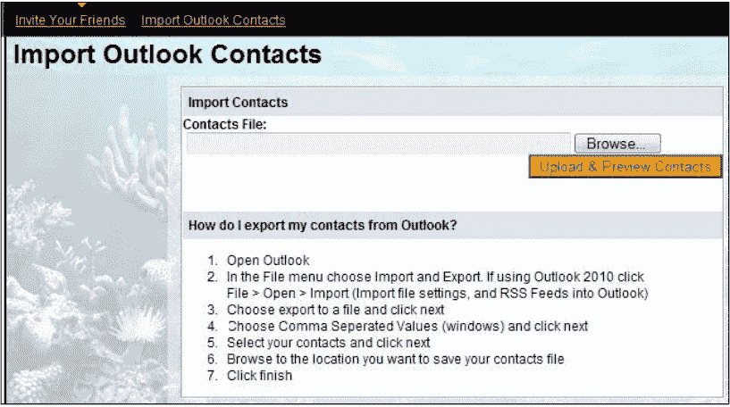

All of these methods of inviting a friend into the system would of course generate an email invite (and eventually a system-based message—see next chapter). The user will have the ability to then follow the link into the system and either sign up or log in to accept the request. Once the user has clicked on the link in their email, he/she will be taken to a page displaying the request.

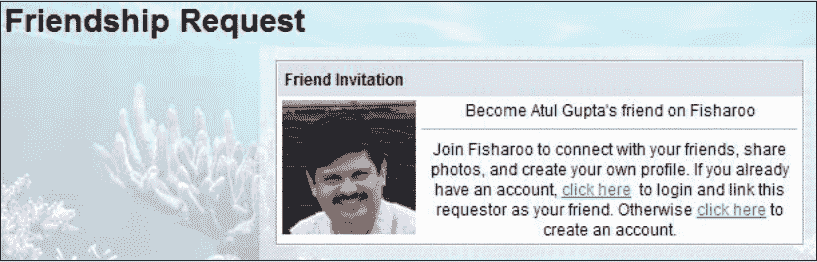

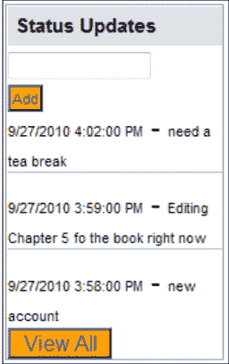

The box in the preceding screenshot is where the user can enter his/her **Status Updates**. Each of these updates will also be shown on the updates view and in their alerts view.

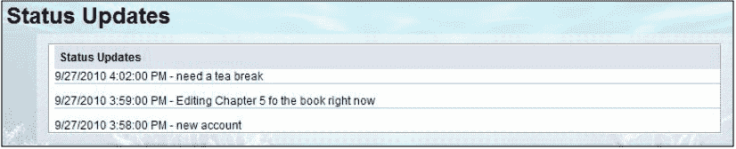

Such alerts/notifications keep the people aware of what their friends are up to and keep them involved with their friends.

### Design

Now let's talk about the design of these features.

### Friends

This chapter is an attempt to throw light on the infrastructure needs and more heavily focus on the UI side for creating and managing relationships. That being said, there is always some form of groundwork that has to be in place prior to adding new features.

In this case we need to add the concept of a friend prior to having the ability to create friendships. This concept is a relatively simple one, as it is really only defining a relationship between two accounts. We have the account that requested the relationship and the account that accepted the relationship. This allows an account to be linked to as many other accounts as they wish.

### Finding friends

The Friends feature will not go anywhere if there is no way for people to find friends. For that reason, the various ways to locate and invite someone to be your friend is our first topic.

### Searching for a friend

The easiest way to locate friends who might be interested in the same site as you are is to search through the existing user base. For that reason, we will need to create a simple keyword search box that is accessible from any page on the site. This search feature should take a look at several fields of data pertaining to an account and return all possible users. From the search results page, we should be able to initiate a friend request.

### Inviting a friend

The next best thing to locating friends who are already members of the site is to invite people who you know outside the site. The quickest way to implement this is to allow a user to manually enter an email address or many email addresses, type a message, and then submit. This would be implemented with a simple form that generates a quick email to the recipient list. In the body of the email will be a link that allows the recipients to come into our site.

### Importing friends from external sources

An obvious extension of the last topic is to somehow automate the importing process of contacts from an email management tool. We will show how the user can export their contacts from Outlook and import them via a web form. The user should then be able to select the contacts that they want to invite.


## 发送邀请

通过以上三种方法，我们最终都会发出一封邀请邮件。我们可以简单地发送一封包含网站链接的邮件。但我们需要记录：

- 谁已被邀请？
- 谁发起的邀请？
- 此事发生在什么时候？

在邮件中，我们不直接邀请用户进来，而是要为该用户分配一个密钥，以便在其进入系统时轻松识别。我们将使用系统生成的 GUID 来完成此操作。如果是邀请现有用户，我们会允许其登录以确认新的好友关系。如果是被邀请的非会员用户，我们会允许其创建新账户。在这两种情况下，我们都会在邀请中填入被邀请用户的 Account ID，以便保留关于这段关系的历史记录。

## 添加好友提醒

一旦我们搭建好了邀请和接受好友请求的框架，就需要用提醒功能扩展现有系统。这些提醒应显示在现有用户的“提醒”页面上，表明他们发出了邀请。对于现有用户，我们还应有提醒显示他们被邀请了。一旦用户接受了好友关系，我们也应该有一条相关提醒。

## 与好友互动

现在让我们讨论一些与好友互动所需的功能。

### 查看好友

只有在用户能够与之互动时，好友才有意义。沿着这个思路的第一步是提供一个页面，让用户能够看到他/她的所有好友。这是用户查看好友个人资料的一个跳板。此外，随着用户个人资料概念的扩展，还可以以一目了然的格式展示每位好友的更多数据。

除了完整的**好友**页面，我们还可以将好友视图添加到用户的公开个人资料中，以便其他用户能够看到这些关系。

### 管理好友

既然我们已经能看到所有关系，最终就可以让用户删除一段关系。在我们的初次设计中，这将是对该关系的永久删除。

### 关注好友

我们可以扩展提醒系统，使得当为用户生成提醒时（例如更新个人资料信息、上传新照片或任何其他与用户相关的操作），该用户的所有好友也会通过其“提醒”页面收到通知。

### 向好友提供状态更新

在前面的章节中我们已经简要提到了这一点。用户可以写一条短消息作为其状态更新/微博客，这将显示在用户所有好友的“提醒”页面上。此功能会在终端用户的首页上产生大量动态内容，从而保持趣味性。

## 解决方案

现在让我们看看我们的解决方案。

### 实现数据库

让我们看看支持这些新功能所需的表。

### friends 表

好友的概念是本章讨论的基础，因此我们将立即开始围绕该主题创建表。正如你之前读到的，这是一个非常直接的表结构，仅将一个账户与另一个账户关联起来。

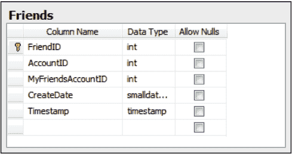

### Friend invitations

这张表负责跟踪谁被邀请到网站、被谁邀请以及何时邀请。它还保存发送给好友的密钥（GUID），以便他们能够在相应的邀请下重新进入系统。一旦好友接受了关系，他们的 AccountID 也会存储在这里，这样我们就能看到关系是在何时以何种方式建立的。

| 列名 | 数据类型 | 允许为空 |
|---|---|---|
| InvitationID | int | ☐ |
| AccountID | int | ☐ |
| Email | varchar(200) | ☐ |
| GUID | uniqueidentifier | ☐ |
| CreateDate | smalldatetime | ☐ |
| BecameAccountID | int | ☐ |
| Timestamp | timestamp | ☐ |

### 状态更新

状态更新允许用户告诉好友他们此刻在做什么。可以说这是一种微博客。

> **微博客**允许用户针对任何事情写简短文字。例子包括 Twitter 和 Yammer。更多信息请看这里：**http://en.wikipedia.org/wiki/Micro-blogging**。

### FriendRepository

此方法查询该账户拥有的所有好友。请注意，LINQ to Entity 查询返回 IEnumerable\<T\>，其中 T 是类。我们希望返回 List\<Friend\>，这是通过调用 friends.ToList() 实现的。

然后它查询反向关系，即该账户被另一个账户拥有。接着将第二个查询添加到第一个查询中，并返回该结果。

下面是获取我们好友账户的方法。

```
//Fisharoo/DataAccess/Repositories/FriendRepository.cs
public List<Account> GetFriendsAccountsByAccountID(Int32 AccountID)
{
    List<Friend> friends = GetFriendsByAccountID(AccountID);
    List<int> accountIDs = new List<int>();
    foreach (Friend friend in friends)
    {
        accountIDs.Add(friend.MyFriendsAccountID);
    }

    List<Account> result = new List<Account>();
    using (FisharooDataContext dc = conn.GetContext())
    {
        IEnumerable<Account> accounts = from a in dc.Accounts
                                         where accountIDs.Contains(a.AccountID) select a;
        result = accounts.ToList();
    }
    return result;
}
```

此方法首先收集所有好友（通过我们讨论过的第一个方法），然后查询所有相关账户并返回结果。

### FriendInvitationRepository

与其他仓库一样，这个仓库也有标准方法，我们这里不再列出。有关详细信息，请参考本章附带的代码。除此之外，我们还需要能够通过 GUID 或发送给好友的邀请密钥来检索邀请。

```
//Fisharoo/DataAccess/Repositories/FriendInvitationRepository.cs
public FriendInvitation GetFriendInvitationByGUID(Guid guid)
{
    FriendInvitation friendInvitation;
    using (FisharooDataContext dc = conn.GetContext())
    {
        friendInvitation = dc.FriendInvitations.Where(fi => fi.GUID
                                              == guid).FirstOrDefault();
    }
    return friendInvitation;
}
```

这是一个非常直接的查询，匹配 **GUID** 值。除了上述方法外，我们还需要一种清理邀请的方式。为此，我们有下面这个方法：

```
//Fisharoo/DataAccess/Repositories/FriendInvitationRepository.cs
public void CleanUpFriendInvitationsForThisEmail(FriendInvitation friendInvitation)
{
    using (FisharooDataContext dc = conn.GetContext())
    {
        IEnumerable<FriendInvitation> friendInvitations
                              = from fi in dc.FriendInvitations
                                where fi.Email == friendInvitation.Email &&
                                fi.BecameAccountID == 0 &&
                                fi.AccountID == friendInvitation.AccountID
                                select fi;
        foreach (FriendInvitation invitation in friendInvitations)
        {
            dc.FriendInvitations.DeleteObject(invitation);
        }
        dc.SaveChanges();
    }
}
```

此方法负责清除系统中从账户 A 发送给账户 B 且尚未被激活（账户 B 从未对邀请进行任何操作）的任何邀请。我们不会在创建邀请时检查邀请是否已存在，而是允许它们被反复创建（在导入 500 个联系人的过程中每次都检查邀请可能会大大拖慢速度！）。当账户 B 最终接受其中一个邀请时，其他所有邀请将被清除。另外，如果账户 B 从未对这些邀请做任何操作，我们将需要一个数据库进程来定期清理旧邀请。

### StatusUpdateRepository

这个仓库中值得关注的方法是用于在个人资料页面上获取前 N 条状态更新的方法。

```
//Fisharoo/DataAccess/Repositories/StatusUpdateRepository.cs
public List<StatusUpdate> GetTopNStatusUpdatesByAccountID(Int32 AccountID, Int32 Number)
{
    List<StatusUpdate> result;
    using (FisharooDataContext dc = conn.GetContext())
    {
        IEnumerable<StatusUpdate> statusUpdates = (from su in dc.StatusUpdates
            where su.AccountID == AccountID
            orderby su.CreateDate descending
            select su).Take(Number);
        result = statusUpdates.ToList();
    }
    return result;
}
```

这是通过一个标准的 LINQ to Entity 查询完成的，并添加了 Take() 方法，该方法会在生成的 SQL 中转换为 TOP 语句。

### AccountRepository

随着搜索功能的增加，我们需要在 AccountRepository 中添加一个新方法。这个方法将是搜索账户的关键。

```
public List<Account> SearchAccounts(string SearchText)
{
    List<Account> result = new List<Account>();
    using (FisharooDataContext dc = conn.GetContext())
    {
        IEnumerable<Account> accounts = from a in dc.Accounts
            where(a.FirstName + " " + a.LastName).Contains(SearchText) || a.Email.Contains(SearchText) || a.Username.Contains(SearchText)
            select a;
        result = accounts.ToList();
    }
    return result;
}
```


该方法目前会搜索用户的名字、姓氏、电子邮件地址和用户名。当然，这可以扩展到他们的个人资料数据以及许多其他数据点（慢慢来！）。

## 实现服务/应用层

现在我们已经建立了存储库，就可以开始创建位于这些存储库之上的服务了。我们将为每个添加的存储库创建一个服务，除此之外我们还会扩展这些服务：

- AlertService
- PrivacyService

### FriendService

FriendService 目前有几个职责。我们需要它来告诉我们某位用户是否是好友，以便我们可以扩展 PrivacyService 来考虑好友（请回忆，我们目前只理解公开和私有设置！）。除此之外，我们还需要 FriendService 能够处理从 FriendInvitation 创建好友。

```csharp
//Fisharoo/BusinessLogic/FriendService.cs
public bool IsFriend(Account account, Account accountBeingViewed)
{
    if(account == null)
        return false;
    if(accountBeingViewed == null)
        return false;
    if(account.AccountID == accountBeingViewed.AccountID)
        return true;
    else
    {
        Friend friend = _friendRepository.GetFriendsByAccountID(accountBeingViewed.AccountID).Where(f => f.MyFriendsAccountID == account.AccountID).FirstOrDefault();
        if(friend != null)
            return true;
    }
    return false;
}
```

### Friends

此方法需要知道是谁（用户账户）在发起请求以及请求发给谁。它随后验证两个账户是否有效，以便我们以后可以使用它们，如果任一账户无效则返回 **false**。我们然后检查查看用户是否与被查看用户相同。如果是，我们可以安全地返回 **true**。然后是有趣的部分——目前我们使用的是 **FriendRepository** 中的 **GetFriendsByAccountID** 方法。我们遍历该列表以查看我们的好友是否在列表中。如果找到它，我们返回 **true**。否则方法未能找到结果并返回 **false**。

> 请记住，这种做法很快就会成为严重的性能问题。如果某人有 500 个好友，这将是不可接受的。由于我们的目标是让人们拥有大量好友，我们通常不希望这样做。你最好的选择是在 FriendsRepository 中创建一个 LINQ 查询来直接处理此逻辑，只返回 **true** 或 **false**。另一种选择是使用缓存。

接下来是我们的 **CreateFriendFromFriendInvitation** 方法，其名称所示，它会从好友邀请中创建好友。

```csharp
//Fisharoo/BusinessLogic/FriendService.cs
public bool CreateFriendFromFriendInvitation(Guid InvitationKey,
Account InvitationTo, bool ExistingMember)
{
    //update friend invitation request
    FriendInvitation friendInvitation = _friendInvitationRepository.GetFriendInvitationByGUID(InvitationKey);
    //validate if the friend request is for the same person who has logged in
    //however if this is a new member (new registration), then don't validate as the friend request
    //person may use a different email during registration
    if(ExistingMember && (friendInvitation.Email != InvitationTo.Email))
        return false;

    friendInvitation.BecameAccountID = InvitationTo.AccountID;
    _friendInvitationRepository.SaveFriendInvitation(friendInvitation);
    _friendInvitationRepository.CleanUpFriendInvitationsForThisEmail(friendInvitation);

    //create friendship
    Friend friend = new Friend();
    friend.AccountID = friendInvitation.AccountID;
    friend.MyFriendsAccountID = InvitationTo.AccountID;
    _friendRepository.SaveFriend(friend);

    Account InvitationFrom = _accountRepository.
    GetAccountByID(friendInvitation.AccountID);
    _alertService.AddFriendAddedAlert(InvitationFrom, InvitationTo);
    return true;
}
```

此方法期望 InvitationKey（以系统生成的 GUID 形式提供）以及希望建立关系的账户。它随后获取 FriendInvitation 并更新新好友的 BecameAccountID 属性。我们随后调用一次清理这两个用户之间的其他好友邀请。清理完成后，我们向系统添加一条新提醒（稍后会介绍），通知发起此邀请的账户邀请已被接受。

请注意，我们还需要在此处添加一些内容以通过消息系统发送消息（在下一章中介绍！）。

### AlertService

Alert 服务本质上是向用户个人资料发布提醒的包装器。所有相关实现已在前一章中介绍。因此，我们添加的额外方法与之前所做的工作非常相似。我们不会在此描述这些方法。你可以在 AlertService 类中查找 AddStatusUpdateAlert()、AddFriendRequestAlert() 和 AddFriendAddedAlert() 方法（作为本章相关代码的一部分提供）。

### PrivacyService

现在我们有了检查两个人是否互为好友的方法，我们终于可以扩展 PrivacyService 以考虑好友。请记住，到目前为止，我们只是在检查某物是否标记为私有或公开。代码中只有很小的改动。

```csharp
//Fisharoo/BusinessLogic/PrivacyService.cs
public bool ShouldShow(Int32 PrivacyFlagTypeID,
Account AccountBeingViewed, Account Account, List<PrivacyFlag>
Flags)
{
    bool result;

    bool isFriend = _friendService.IsFriend(Account,AccountBeingViewed);
    ...
    //rest of the code is as is
}
```

我们所做的只是将 isFriend 变量指向 FriendService 中新的 IsFriend() 方法的结果。其余所有内容之前都已处理！

## 实现表示层

现在基础框架已经就位，我们可以开始讨论将其全部整合起来需要什么。如前所述，本章更少关于框架，更多关于利用新旧框架的 UI！

### 搜索好友

让我们看看实现好友搜索需要什么。

### SiteMaster

让我们从搜索好友开始。我们尚未介绍太多关于实际 UI 的内容，也没有介绍该站点的母版页。我们不想让这变成关于设计的问题！因此我们简单地说，我们已在母版页上添加了一个文本框和一个按钮来接收搜索词。

当按钮被点击时，站点会重定向到 Search.aspx 页面，并将搜索词一并传递过去。

### Search

Search.aspx 页面没有界面。它期望从前面讨论的母版页上的文本框中传入一个值。借助此文本短语，我们调用 AccountService 并使用 Contains() 运算符执行搜索。返回的账户列表随后在页面上显示。

在很大程度上，此页面全部是关于 MVP 管道。我们假设你已经熟悉 MVP，从现在开始只关注有趣的部分。以下是显示所有数据的中继器。

```aspx
//Fisharoo/Web/Search.aspx
<%@ Register Src="~/UserControls/ProfileDisplay.ascx" TagPrefix="Fisharoo" TagName="ProfileDisplay" %>
...
<asp:Repeater ID="repAccounts" runat="server" OnItemDataBound="repAccounts_ItemDataBound">
    <ItemTemplate>
        <Fisharoo:ProfileDisplay ShowDeleteButton="false" ID="pdProfileDisplay" runat="server" />
    </ItemTemplate>
</asp:Repeater>
```

以下屏幕截图显示了搜索结果的显示方式：

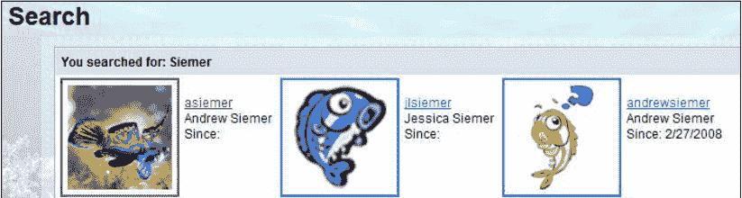

本例中有趣的部分来自于 **ProfileDisplay** 用户控件的创建，以便我们能够以一种易于在各处显示简洁个人资料数据的方式，使用一个可重用的代码块来允许进行全局更改。

你应该会看到我们有 `<Fisharoo:ProfileDisplay ... />`。你还会注意到我们的标签在标签定义中设置了自定义属性。在本例中你可以看到 `ShowDeleteButton="false"`。

所有逻辑和显示都非常标准。你有 MVP 管道，这构成了大部分内容。**ProfileDisplay** 控件还具有 `LoadDisplay()` 方法，负责加载该控件的 UI。这是在 Search 页面中的 `repAccounts_ItemDataBound()` 方法中调用的。

```csharp
//Fisharoo/Web/Search.aspx.cs
protected void repAccounts_ItemDataBound(object sender,
                                         RepeaterItemEventArgs e)
{
    if(e.Item.ItemType == ListItemType.Item || e.Item.ItemType ==
                                      ListItemType.AlternatingItem)
    {
        ProfileDisplay pd = e.Item.FindControl("pdProfileDisplay") as
                                      ProfileDisplay;
        pd.LoadDisplay((Account)e.Item.DataItem);
        if(_webContext.CurrentUser == null)
            pd.ShowFriendRequestButton = false;
    }
}
```

让我们按显示顺序、代码隐藏和演示者查看 **ProfileDisplay** 用户控件代码（通常省略视图接口）。

```aspx
//Fisharoo/Web/UserControls/ProfileDisplay.ascx
<%@ Control Language="C#" AutoEventWireup="true"
CodeBehind="ProfileDisplay.ascx.cs"
```

```aspx
Inherits="Fisharoo.Web.UserControls.ProfileDisplay" %>
<div style="height: 116px; float: left;">
    <table>
        <tr>
            <td style="width: 102px">
                <%-- NavigationURL and Image's URL will be set in code --%>
                <asp:HyperLink ID="imageLink" runat="server" Width="100" Height="100">
                    <asp:Image Style="padding: 5px; width: 100px; height: 100px;" ImageAlign="Left" Width="100" Height="100" ID="imgAvatar" ImageUrl="~/Images/ProfileAvatar/ProfileImage.aspx" runat="server" />
                </asp:HyperLink>
            </td>
            <td style="padding: 2px 2px 2px 15px; text-align: left;" valign="top">
                <asp:ImageButton ImageAlign="AbsMiddle" ID="ibInviteFriend" runat="server" AlternateText="Become Friends" OnClick="ibInviteFriend_Click" ImageUrl="~/Images/icon_friends.gif" ToolTip="Add As Friend" />
                <asp:ImageButton ImageAlign="AbsMiddle" ID="ibDelete" runat="server" OnClick="ibDelete_Click" ImageUrl="~/Images/icon_close.gif" ToolTip="Delete Friend" /><br />
                <asp:HyperLink ID="linkUsername" runat="server" /><br />
                <asp:Label ID="lblFirstName" runat="server"></asp:Label>
                <asp:Label ID="lblLastName" runat="server"></asp:Label><br />
                Since:
                <asp:Label ID="lblCreateDate" runat="server"></asp:Label><br />
                <asp:Label ID="lblFriendID" runat="server" Visible="false"></asp:Label>
            </td>
        </tr>
    </table>
</div>
```

```csharp
public void SendFriendRequest(Int32 AccountIdToInvite)
{
    _redirector.GoToFriendsInviteFriends(AccountIdToInvite);
}

public void DeleteFriend(Int32 FriendID)
{
    if (_userSession.CurrentUser != null)
    {
        _friendService.DeleteFriendByID(
            _userSession.CurrentUser.AccountID,
            FriendID);
        HttpContext.Current.Response.Redirect(
            HttpContext.Current.Request.RawUrl);
    }
}
```

ProfileDisplay 控件还有两个属性——一个用于显示/隐藏删除好友按钮，另一个用于显示/隐藏邀请好友按钮。这两个按钮并非适用于使用该控件的每个页面。在搜索结果页面中，我们希望隐藏“删除”按钮，因为搜索结果不一定是好友。在该视图中，我们希望能够邀请他们。然而，在好友列表中，“邀请”按钮（用于邀请好友）不再适用，因为这些用户都已经是好友了。在这种情况下，“删除”按钮反而更合适。

点击“邀请”按钮会调用 Redirector 类，并将用户路由到 InviteFriends 页面。需要注意的一个重要点是 LoadDisplay() 方法中 URL 的构造方式，它会带你进入用户的个人资料页面。

你会记得，我们在前一章中定义了 ProfileRoute，以支持直接链接到用户个人资料页面的友好 URL。为了创建该链接，我们使用 GetRouteURL 辅助方法。如果我们最终更改了路由模式（在 Global.asax.cs 中定义），这将非常有用，我们无需修改代码来重新生成 URL。GetRouteURL 方法将使用当前路由定义并返回有效 URL。

## 邀请好友

此页面允许我们手动输入想要邀请的好友的电子邮件地址。这是标准的“发件人、收件人、消息”格式，系统默认发件人为你（当前用户），你可以指定收件人以及想要发送的消息。

```csharp
}
public void SendInvitation(string ToEmailArray, string Message)
{
    string resultMessage = "Invitations sent to the following recipients:<BR>";
    Account account = _userSession.CurrentUser;
    resultMessage += _email.SendInvitations(account.AccountID, account.FirstName, account.LastName, ToEmailArray, Message);
    _view.ShowMessage(resultMessage);
    _view.ResetUI();
}
}
```

UI 会根据当前用户的详细信息进行初始化。当用户填写完要邀请的电子邮件后，会调用 SendInvitation() 方法，该方法接收逗号分隔的电子邮件数组以及要在邀请中发送的消息。然后它会调用 Email.SendInvitations() 方法。

```csharp
//Fisharoo/Components/ Email.cs
public string SendInvitations(int accID, string FirstName, string LastName, string ToEmailArray, string Message)
{
    string resultMessage = Message;
    foreach (string s in ToEmailArray.Split(','))
    {
        FriendInvitation friendInvitation = new FriendInvitation();
        friendInvitation.AccountID = accID;
        friendInvitation.Email = s;
        friendInvitation.GUID = Guid.NewGuid();
        friendInvitation.BecameAccountID = 0;
        _friendInvitationRepository.SaveFriendInvitation(
            friendInvitation);
        //add alert to existing users alerts
        Account account = _accountRepository.GetAccountByEmail(s);
        if (account != null)
        {
            _alertService.AddFriendRequestAlert(
                _userSession.CurrentUser, account,
                friendInvitation.GUID, Message);
        }
        SendFriendInvitation(s, FirstName, LastName,
                             friendInvitation.GUID.ToString(),
                             Message);
        resultMessage += "• " + s + "<BR>";
    }
    return resultMessage;
}
```

此方法负责解析所有电子邮件、创建新的 FriendInvitation，并通过电子邮件向被邀请者发送请求。然后，如果被邀请者已有账户，则会向其添加一条提醒。

## Outlook CSV 导入器

### 导入联系人

**导入联系人**页面允许我们的用户将 Microsoft Outlook 导出的联系人文件上传到我们的系统。导入联系人后，用户即可选择实际要邀请到我们系统中的电子邮件地址。

此页面由两个视图组成，这些视图是使用面板创建的。这使我们能够轻松地显示或隐藏面板中的整套控件。在初始视图中，我们允许用户上传 CSV 文件，该文件是 Microsoft Outlook 联系人的导出列表。页面上有帮助用户执行导出操作的说明（参见下面的截图）。

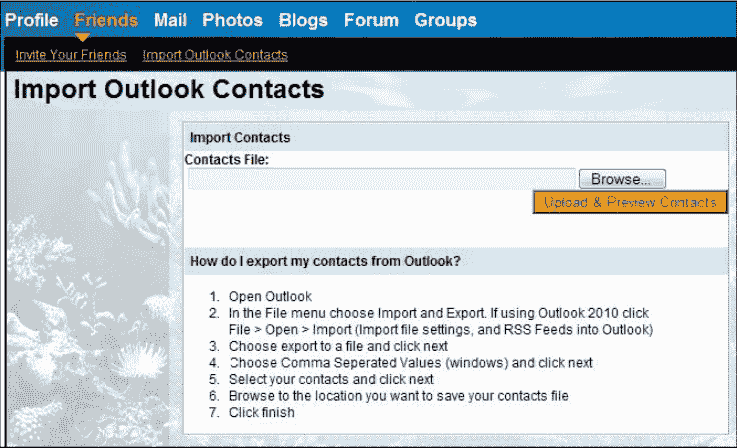

### 选择联系人

处理完上传过程并解析出电子邮件后，我们需要将所有电子邮件显示给用户，以便他们可以选择想要邀请的邮件。这是 ASPX 页面中的另一个视图/面板。

我们的面板中有一个复选框列表。该复选框列表绑定到 Presenter 类中解析后返回的电子邮件地址列表。

```csharp
//Fisharoo/Web/Friends/OutlookCsvImporter.aspx.cs
public void ShowParsedEmail(List<string> Emails)
{
    pn1Upload.Visible = false;
    pn1Result.Visible = false;
    pn1Emails.Visible = true;
    cb1Emails.DataSource = Emails;
    cb1Emails.DataBind();
}
```

用户可以浏览该列表，选择想要邀请到我们系统中的邮箱。选择完想要邀请的邮箱后，他们可以点击“邀请”按钮。

然后，我们遍历复选框列表中的所有项，以定位已选中的项。

```csharp
//Fisharoo/Web/Friends/OutlookCsvImporter.aspx.cs
protected void btnInviteContacts_Click(object sender, EventArgs e)
{
    string emails = "";
    foreach (ListItem li in cb1Emails.Items)
    {
        if(li != null && li.Selected)
            emails += li.Text + ",";
    }
    emails = emails.Substring(0, emails.Length - 1);
    _presenter.InviteContacts(emails);
}
```

收集完所有选中的电子邮件后，我们会将其传递给 Presenter 以执行邀请流程。

```csharp
//Fisharoo/Web/Friends/PresentersOutlookCsvImporterPresenter.cs
public void InviteContacts(string ToEmailArray)
{
    string result = _email.SendInvitations(_userSession.CurrentUser,
                                           ToEmailArray, "");
    _view.ShowInvitationResult(result);
}
```


## Friends

演示者会立即将选定的项目传递给 **Email** 类来处理邀请。这是我们上一节中用来邀请用户的方法。

然后我们将已邀请的邮件结果输出到第三个视图/面板中，这是一个简单的消息，显示邀请已发送到的邮件地址。

## Confirm friendship

在介绍了所有邀请他人加入我们网站的方式后，我们现在需要查看被邀请用户在邀请中会看到什么。让我们从他们在收件箱中会看到的内容开始。用户会在收件箱中收到一封邮件，告诉他们有人邀请他们加入 Fisharoo 社区。

一旦他们打开该邮件，就可以看到他们可以跟随的链接以利用该邀请。点击链接会将他们带到 server/appname/Friends/ConfirmFriendshipRequest.aspx，并附带一个邀请密钥的 GUID。此时用户可能会看到两个屏幕。

第一个屏幕是针对已经是会员并且当前已登录网站的用户。它要求他们再次登录以确认友谊。

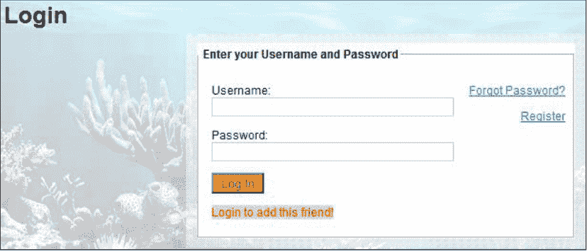

另一个屏幕是针对非会员用户，或未登录的用户。

### Friendship Request

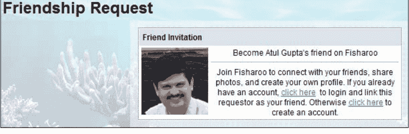

ConfirmFriendshipRequest.aspx 页面中唯一的真正逻辑是检查传入的 GUID 以确保其有效。这发生在该页面的演示者中。

```csharp
//Fisharoo/Web/Friends/Presenters/ConfirmFriendshipRequestPresenter.cs
public void Init(IConfirmFriendshipRequest view)
{
    _view = view;
    if (!string.IsNullOrEmpty(_webContext.FriendshipRequest))
    {
        FriendInvitation friendInvitation =
            _friendInvitationRepository.GetFriendInvitationByGUID(new
            Guid(_webContext.FriendshipRequest));
        if(friendInvitation != null)
        {
            if (_webContext.CurrentUser != null)
                LoginClick();

            Account account =
                _accountRepository.GetAccountByID
                (friendInvitation.AccountID);
            _view.ShowConfirmPanel(true);
            _view.LoadDisplay(_webContext.FriendshipRequest,
                account.AccountID, account.FirstName,
                account.LastName, _configuration.SiteName );
        }
        else
        {
            _view.ShowConfirmPanel(false);
            _view.ShowMessage("There was an error validating your
                invitation.");
        }
    }
}
```

我们要么可以从 GUID 加载 **friendInvitation**，要么不能。如果可以加载，我们就会检查用户是否已经是系统成员并且已登录。如果已登录，我们会自动将他们重定向到登录屏幕。否则我们会提示他们登录或创建账户。如果 **friendInvitation** 无法正确加载，则我们会显示错误解释。

邀请流程的真正魔力发生在登录和注册页面中。

## Login

在登录演示者中，我们在 **Init** 方法中添加了一些逻辑来识别是否存在好友请求。

```csharp
//Fisharoo/Web/Accounts/Presenters/LoginPresenter.cs
public void Init(ILogin view)
{
    _view = view;
    // ...
    if(!string.IsNullOrEmpty(_webContext.FriendshipRequest))
        _view.DisplayMessage("Login to add this friend");
}
```

此逻辑让用户知道，通过登录他们将接受好友请求。

然后在 AccountService.cs 文件中我们添加了一些额外的逻辑。如果登录成功并且存在好友请求，我们会确认请求并通过之前讨论过的 **FriendService** 使这两个用户成为好友。但是，在建立好友关系之前，我们需要验证好友请求是否确实是针对已登录的账户。如果不是，我们会显示适当的错误消息并且不允许用户登录。

```csharp
//Fisharoo/BusinessLogic/AccountService.cs
public string Login(string Username, string Password)
{
    ...
    if (account.EmailVerified)
    {
        _userSession.LoggedIn = true;
        _userSession.Username = Username;
        _userSession.CurrentUser = account;

        if(!string.IsNullOrEmpty(_webContext.FriendshipRequest))
        {
            if(!friendService.CreateFriendFromFriendInvitation(
                new Guid(_webContext.FriendshipRequest),
                _userSession.CurrentUser, true))
            {
                return @"The Friend invitation is not meant
                        for the account you are logging in with.
                        Kindly login with the right account";
            }
        }
        ...
    }
}
```

## Registration

如果被邀请的好友尚未是网站用户，那么我们允许他们像往常一样完成注册流程。一旦注册完成，我们不仅会注册他们，还会建立友谊。

```csharp
//Fisharoo/Web/Accounts/Presenters/RegisterPresenter.cs
public void Register(string Username, string Password,
                     string FirstName, string LastName, string Email,
                     string Zip, DateTime BirthDate, bool isCaptchaValid,
                     bool AgreesWithTerms, Int32 TermID)
{
    ...

    //If this registration came via a friend request...
    if(friendInvitation != null)
    {
        _friendService.CreateFriendFromFriendInvitation(
        new Guid(_webContext.FriendshipRequest), newAccount,
        false);
    }
    ...
}
```

## Show friends

现在我们已经拥有邀请和接受好友所需的一切，我们需要能够查看我们的好友。为此，我们将在我们的 Friends 部分着陆页 Default.aspx 中添加我们所有好友的列表。这实际上会非常容易，因为我们将使用我们在搜索页面中创建的 ProfileDisplay 用户控件。

此页面将只由一个包含我们 ProfileDisplay 控件的 repeater 组成。我们将 ShowFriendRequestButton 设置为 false，因为这些已经是我们的好友。

我们的演示者然后通过调用 FriendService 并将该集合传递给视图来加载所有当前用户的好友。

```csharp
///Fisharoo/Web/Friends/Presenters/DefaultPresenter.cs
public void LoadDisplay()
{
    _view.LoadDisplay(
        _friendService.GetFriendsAccountsByAccountID
            (_userSession.CurrentUser.
             AccountID));
}
```

然后视图会连接 repeater 的数据源。在 repeater 的每个 ItemDataBound 中，我们会启动 ProfileDisplay 用户控件

```csharp
///Fisharoo/Web/Friends/Default.aspx.cs
protected void repFriends_ItemDataBound(object sender,
                                        RepeaterItemEventArgs e)
{
    if(e.Item.ItemType == ListItemType.Item || e.Item.ItemType ==
       ListItemType.AlternatingItem)
    {
        ProfileDisplay pdProfileDisplay =
            e.Item.FindControl("pdProfileDisplay") as ProfileDisplay;
        pdProfileDisplay.LoadDisplay(((Account)e.Item.DataItem));
    }
}
```

然后我们最终得到如下截图所示的输出：

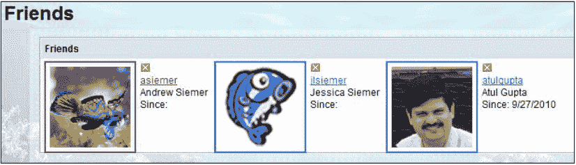

我们还没有做到这一点，但将来我们很可能会在这里也实现某种形式的分页！

### Friends on profile

在有了显示我们所有好友的页面后，很容易更新我们的公开个人资料以显示一些好友。为此，我们将打开 **Profile.aspx** 页面并添加一些内容。

我们只是在个人资料页面上添加与 **Friends/Default.aspx** 页面中相同的 repeater。

```aspx
//Fisharoo/Web/Profiles/Profile.aspx
<asp:Repeater ID="repFriends" runat="server"
              OnItemDataBound="repFriends_ItemDataBound">
    <ItemTemplate>
        <Fisharoo:ProfileDisplay ShowFriendRequestButton="false"
                                 ShowDeleteButton="false" ID="pdProfileDisplay"
                                 runat="server" />
    </ItemTemplate>
</asp:Repeater>
```

然后在我们的 **ProfilePresenter.cs** 文件中，我们添加了一行代码来加载该 repeater。

```csharp
//Fisharoo/Web/Profiles/Presenters/ProfilePresenter.cs
public void Init(IProfile View)
{
    _view = View;
    ...
    _view.LoadFriends(
        _friendService.GetFriendsAccountsByAccountID(
            _accountBeingViewed.AccountID));
    ...
}
```

并且在 **Profile.aspx.cs** 文件中，我们添加了 **repFriends_ItemDataBound()** 的事件处理程序来处理加载每个 **ProfileDisplay** 控件。

```csharp
//Fisharoo/Web/Profiles/Profile.aspx.cs
protected void repFriends_ItemDataBound(object sender,
                                       RepeaterItemEventArgs e)
{
    if(e.Item.ItemType == ListItemType.Item || e.Item.ItemType ==
       ListItemType.AlternatingItem)
    {
        ProfileDisplay pdProfileDisplay =
            e.Item.FindControl("pdProfileDisplay") as ProfileDisplay;
        pdProfileDisplay.LoadDisplay(((Account)e.Item.DataItem));
    }
}
```


## 状态更新

状态更新（我们的轻博客）在现阶段实现起来非常简单。我们需要打开母版页，添加一个小区域，用于接收并显示这些状态更新的最新列表。

在我们的母版页中，我们将向全局显示区域添加一个面板。该面板将负责接收新的更新，并显示最近的更新。

```aspx
//Fisharoo/Web.Site.master
<%@ Import Namespace="Fisharoo.Web.HelperClasses" %>

<asp:Panel ID="pnlStatusUpdate" runat="server">
    <fieldset>
        <div class="divContainerTitle">
            Status Updates</div>
        <asp:TextBox Width="85" Style="font-size: 9px; padding-left: 0px; padding-right: 0px;"
            ID="txtStatusUpdate" runat="server"></asp:TextBox>
        <br />
        <asp:Button CssClass="SiteButton" Style="font-size: 9px; padding-left: 1px; padding-right: 1px;"
            ID="btnAddStatus" runat="server" Text="Add"
            OnClick="btnAddStatus_Click" /><br />
        <asp:Repeater runat="server" ID="repStatus">
            <ItemTemplate>
                <asp:Label ID="Label1" Text='<%# ((PEStatusUpdate)Container.DataItem).CreateDate.ToString() %>'
                    runat="server" Style="font-size: 9px;"></asp:Label>
                -
                <asp:Label ID="Label2" Text='<%# ((PEStatusUpdate)Container.DataItem).Status %>'
                    runat="server" Style="font-size: 9px;"></asp:Label>
            </ItemTemplate>
            <SeparatorTemplate>
                <div class="divContainerSeparator">
                </div>
            </SeparatorTemplate>
        </asp:Repeater>
        <br />
        <asp:Button CssClass="SiteButton" ID="btnShowAllStatusUpdates"
            runat="server" Text="View All"
            OnClick="btnShowAllStatusUpdates_Click" />
    </fieldset>
</asp:Panel>
```

这里需要注意的一个重要点是引入了一个新类 **PEStatusUpdate**。我们没有将实体对象直接绑定到 UI，而是创建了这个新的值对象（在第 2 章中解释），它本质上是 StatusUpdate 实体对象的子集，只包含 UI 所需的相应字段。它可以被称为表示实体。为了创建它，我们还添加了一个新的辅助类 Translator 来管理转换。这两个类的代码如下：

```csharp
//Fisharoo/Web/HelperClasses/PEStatusUpdate.cs
namespace Fisharoo.Web.HelperClasses
{
    public class PEStatusUpdate
    {
        public DateTime CreateDate { get; set; }
        public string Status { get; set; }

        public PEStatusUpdate(DateTime dt, string msg)
        {
            CreateDate = dt;
            Status = msg;
        }
    }
}
```

```csharp
//Fisharoo/Web/HelperClasses/Translator.cs
namespace Fisharoo.Web.HelperClasses
{
    public class Translator
    {
        public static List<PEStatusUpdate> StateUpdateToPEStatusUpdate
        (List<StatusUpdate> stList)
        {
            List<PEStatusUpdate> peList = new List<PEStatusUpdate>();
            foreach (StatusUpdate item in stList)
            {
                peList.Add(new PEStatusUpdate(item.CreateDate, item.
                Status));
            }
            return peList;
        }
    }
}
```

## 好友

显示功能就绪后，我们需要添加一个方法来捕获按钮点击事件，以便添加新的更新。

```csharp
//Fisharoo/Web/Site.master.cs
protected void btnAddStatus_Click(object sender, EventArgs e)
{
    StatusUpdate su = new StatusUpdate();
    su.CreateDate = DateTime.Now;
    su.AccountID = _userSession.CurrentUser.AccountID;
    su.Status = txtStatusUpdate.Text;
    _statusService.SaveStatusUpdate(su);
    _alertService.AddStatusUpdateAlert(su);
    //refresh the status listing on the UI
    LoadStatus();
}
```

该方法会创建一个新的 **StatusUpdate**，并将其传递给 **StatusUpdateService** 以添加到数据库中。

接下来，我们需要在母版页中显示最新的 **StatusUpdates**。为此，我们需要添加一个获取前 N 条 **StatusUpdates** 的方法。

```csharp
//Fisharoo/Web/Site.master.cs
protected void LoadStatus()
{
    List<PEStatusUpdate> statusMsgs =
        Translator.StateUpdateToPEStatusUpdate(
            _statusService.GetTopNStatusUpdatesByAccountID(
                _userSession.CurrentUser.AccountID, 5));

    repStatus.DataSource = statusMsgs;
    repStatus.DataBind();
}
```

完成上述工作后，我们需要更新母版页的 Page_Load() 方法，以便用户登录站点时加载状态更新。

```csharp
//Fisharoo/Web/Site.master.cs
protected void Page_Load(object sender, EventArgs e)
{
    ...
    if (_userSession.CurrentUser != null)
    {
        LoadStatus();
        pnlStatusUpdate.Visible = true;
```

现在，我们已经有了捕获新状态更新和显示最近更新的方法，还需要为用户提供一种查看其所有更新的方式。我们将通过一个专门显示这些数据的页面来实现。由于这与提醒功能类似，我们将其添加到个人资料页面中。

```aspx
//Fisharoo/Web/Profiles/StatusUpdates.aspxProfiles
<%@ Page MasterPageFile="~/Site.Master" Language="C#"
    AutoEventWireup="true" CodeBehind="StatusUpdates.aspx.cs"
    Inherits="Fisharoo.Web.Profiles.StatusUpdates" %>
<%@ Import Namespace="Fisharoo.Web.HelperClasses" %>

<asp:Content ContentPlaceHolderID="Content" runat="server">
    <div class="divContainer" style="width:90%">
        <fieldset style="text-align:left;padding-left:5px">
            <div class="divContainerTitle">Status Updates</div>
            <asp:Repeater ID="repStatusUpdates" runat="server">
                <ItemTemplate>
                    <%# ((PEStatusUpdate)Container.DataItem).CreateDate.ToString() %>
                    <%# ((PEStatusUpdate)Container.DataItem).Status %>
                </ItemTemplate>
                <SeparatorTemplate>
                    <div class="divContainerSeparator"></div>
                </SeparatorTemplate>
            </asp:Repeater>
        </fieldset>
    </div>
</asp:Content>
```

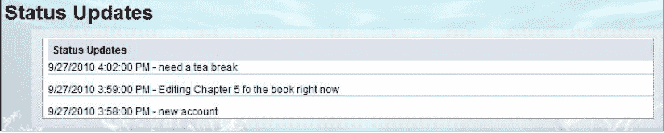

## 好友

这个页面当然和其他页面一样存在相同的管道问题。但基本上可以归结为调用 **StatusUpdateService**，获取指定 **Account** 的所有 **StatusUpdates**。与我们在母版页上显示的 **TopN StatusUpdates** 相比，唯一的区别在于这里将显示所有更新。

这个页面最终也会受益于分页功能的实现。

## 总结

本章与其说是构建框架，不如说是重新调整一些现有功能，使其更面向好友。我们提供了多种方法来查找好友并邀请他们加入。我们还扩展了一些系统，以便好友能够以提醒和状态更新的形式与我们保持联系，并了解我们在站点上的动态。现在，我们的网站已经能够让用户与他人建立联系并进行互动。在众多章节中，这是第一个真正帮助我们为社区注入社区氛围的章节。

## 消息传递

鉴于我们网站的重点是让人们聚集在一起，以便他们能够相互互动，我们需要一种供他们互动的方式。人们彼此互动的主要方式是通过直接沟通。我们将构建一个系统来进行这种沟通，其方式类似于从 Outlook 或 Hotmail 等标准电子邮件客户端发送电子邮件。

我们将为用户提供一种通过 Xinha 所见即所得编辑器创建和发送消息的方式。

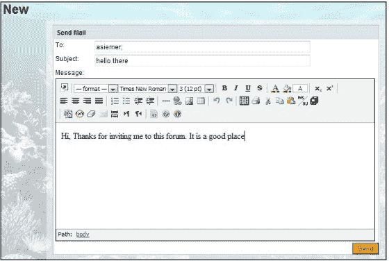

一旦用户能够创建和发送消息，我们就会提供一种方式，让其他用户能够接收和阅读这些消息。这些消息将在他们的收件箱中排队，之后他们就可以阅读自己的消息。

一旦我们的消息传递子系统就绪，我们就可以连接其他功能，使它们也能够发送消息——例如，当用户接受好友请求时，我们可以在好友的收件箱中显示该请求已被接受。


## 消息系统

### 问题

一个基础的消息系统应该能够管理消息、发送者和接收者、包含消息的文件夹以及电子邮件通知。在我们的场景中，我们将尽量在合理的地方保持简单，但在一个方面，我们会采用更复杂的方式，仅仅因为这样可以减少整个系统的负载。这就是消息将如何传递给用户的方式。

我们不采用标准的电子邮件消息系统（每个用户都会得到一条消息的物理副本），而是将以与 MS Exchange 服务器相同的方式构建我们的系统。我们将只创建一条消息副本，并让用户订阅该消息。因此，对于 50 个接收者，我们不是保存 50 条消息，而是保存一条消息和 50 条接收者订阅。

下一个问题在于构建一个所见即所得（WYSIWYG）的消息编辑器。对于这个功能，有许多开源 WYSIWYG 编辑器可供选择；我们将使用其中一种来节省一些时间。我们将使用一个流行的编辑器——Xinha。你可以从 **http://xinha.webfactional.com/** 免费下载这个编辑器。你可能已经见过这个编辑器，因为它被广泛应用于许多流行的社区网站。

### 设计

让我们来看看这些功能的总体设计。

### 消息

消息是任何消息系统的核心。通常，一条消息会包含发送者、接收者等详细信息，以及其他元数据，如发送时间、发送服务器等，以及消息本身、主题和正文。在我们的场景中，消息将包含发送者、主题、正文和发送日期。它还会包含一个额外的字段，即消息类型（消息、好友请求等）。

我们需要创建一个页面，允许用户撰写新消息（如本章开头的图片所示）。这个界面还应该允许用户轻松添加他/她的好友，而不是迫使他们记住每一个好友。此外，这个界面应该允许用户快速拼装一些 HTML，而不必查看 HTML。这可以通过 WYSIWYG 编辑器来实现。

一条消息主要由主题和正文组成。除此之外，我们还需要知道所发送消息的类型，以便将来在 UI 中实现一些更炫酷的功能。此外，我们还将在这个层级维护消息的所有者/创建者。

这里实际上没有什么太大的复杂性需要说明，除了 **正文** 是由 **varchar(MAX)** 数据类型构成的。如果你觉得这对你的系统来说太大了，可以将其改为任何你觉得合适的类型。你最终使用的值将决定你系统的消息。

### 消息类型

消息类型允许我们为消息分配类型。这纯粹是一个查找表，让我们在查询时能够知道消息的类型。我们将在代码中维护一个枚举列表，以便从代码端更容易进行查找。

### 消息收件人

消息收件人就是消息的接收方。但是，由于我们试图减少系统中管理的数据量，消息收件人也是消息中非常重要的一个部分。在我们的设计中，它既代表接收方，也代表接收方对该消息所采取的所有订阅操作。我们将使用这个订阅来标识接收者将消息存放在哪个文件夹中，以及接收者是否已阅读该消息。此外，如果接收者选择删除消息，他/她只需删除对该消息的订阅（除非这是最后一个订阅，这种情况下我们也会删除消息本身）。

这个订阅的 SQL 实际上非常简单。它跟踪与消息的关系、与接收者的关系、订阅当前所在的文件夹，以及该接收者对应消息的状态。

### 消息收件人类型

消息收件人类型允许我们跟踪在 **收件人(TO)**、**抄送(CC)** 或 **密送(BCC)** 字段中指定的消息接收者。起初，我们的界面将只有一个 **收件人(TO)** 字段。不过，我们应该添加这个元数据，以防将来想要扩展我们的能力！这是另一个在 SQL 查询中可能用到的查找表示例。在我们的设计中，我们将在代码端定义一个枚举来维护这个查找。

### 消息发送

```csharp
m.MessageTypeID = (int)MessageTypes.Message;
m.SentByAccountID = _userSession.CurrentUser.AccountID;
Int64 messageID = _messageRepository.SaveMessage(m);

//create a copy in the sent items folder for this user
MessageRecipient sendr = new MessageRecipient();
sendr.AccountID = _userSession.CurrentUser.AccountID;
sendr.MessageFolderID = (int) MessageFolders.Sent;
sendr.MessageRecipientTypeID = (int) MessageRecipientTypes.TO;
sendr.MessageID = messageID;
sendr.MessageStatusTypeID = (int)MessageStatusTypes.Unread;
_messageRecipientRepository.SaveMessageRecipient(sendr);

//send to people in the To field
foreach (string s in To)
{
    Account toAccount = null;
    if (s.Contains("@"))
        toAccount = _accountRepository.GetAccountByEmail(s);
    else
        toAccount = _accountRepository.GetAccountByUsername(s);

    if(toAccount != null)
    {
        MessageRecipient mr = new MessageRecipient();
        mr.AccountID = toAccount.AccountID;
        mr.MessageFolderID = (int)MessageFolders.Inbox;
        mr.MessageID = messageID;
        mr.MessageRecipientTypeID = (int) MessageRecipientTypes.TO;
        mr.MessageStatusTypeID = (int)MessageStatusTypes.Unread;
        _messageRecipientRepository.SaveMessageRecipient(mr);
        Account acc = _userSession.CurrentUser;
        _email.SendNewMessageNotification(acc.FirstName, acc.LastName, toAccount.Email);
    }
}
```

这段代码应该非常容易理解。我们做的第一件事是创建一个正在发送的消息的新实例。然后通过 MessageRepository 保存它，并返回新的 MessageID 以便后续使用。

下一个任务是确保我们在发送者的**已发送邮件**文件夹中放置一条消息副本。我们通过创建一个**MessageRecipient**对象并将其绑定到发送者账户来实现这一点。你会注意到，我们使用名为**MessageFolders**的枚举将它分配到**已发送邮件**文件夹，该枚举的 ID 映射到**MessageFolders**查找表。这个枚举与一个名为**MessageFolder**的新领域对象存储在一起。查看**MessageFolder.cs**文件以了解此枚举的详细信息。

**MessageService**中的下一项是将**MessageRecipientTypeID**分配给发送者的副本。**MessageRecipientType**用于让显示层知道将**MessageRecipient**显示为 TO、CC 还是 BCC 收件人。这是另一个映射回数据库查找表的枚举值，位于**MessageRecipientType.cs**文件中。

然后我们进入**MessageService**中的一个**foreach**循环，该循环负责确定我们是通过电子邮件地址还是用户名来查找收件人。它通过检查**MessageRecipients**的**To**值是否包含@符号来实现这一点，如果包含则对应电子邮件地址。

根据 TO 值是电子邮件地址还是用户名，我们会获取一个**Account**对象的副本。一旦我们有了一个有效的**Account**对象可以操作，我们就继续为该 Account 创建新的**MessageRecipient**。你应该注意到，在这个**MessageRecipient**的实现中，我们将消息订阅放入**收件箱**而不是**已发送邮件**文件夹。这个**MessageRecipient**的**MessageRecipientType**类型也是 TO。

### 电子邮件

一旦**MessageRecipient**成功创建并持久化到数据库，我们接下来就向该**MessageRecipient**发送电子邮件通知。关于额外方法**SendNewMessageNotification()**，最重要的一点是，我们发送的是通知——而不是整个消息！

我们之所以提到这一点，是因为我们认为重要的是要指出，让你的网站 IP 地址被拉黑的最快方法之一是被认定为垃圾邮件发送者。既然你要对消息中发出去的内容负全责，你无法直接控制用户会在消息中输入什么。所以，不要通过发送用户消息的完整内容来冒损害你声誉的风险！

```csharp
//Fisharoo/Components/Email.cs
public void SendNewMessageNotification(string FirstName, string LastName, string ToEmail)
{
    foreach (string s in ToEmail.Split(new char[] { ';', ',', ':' }))
```


## 消息传递

```csharp
{
    string message = FirstName + " " + LastName +
        " has sent you a message on " + _configuration.SiteName + "!" +
        " Please log in at " + _configuration.SiteName +
        " to view the message.<HR>";
    SendEmail("", "", FirstName + " " + LastName
        + " has sent you a message on " +
        _configuration.SiteName + "!", message);
}
```

此方法会将所有 TO 收件人拆分出来，并使用我们现有的子系统创建一个新的电子邮件通知，告诉收件人他们的收件箱中有一条新消息在等待。

### AlertService

我们在前面某章的 **AlertService** 中创建了一个占位符，以便在警报中插入一个 URL，使警报接收者能够轻松点击并向该警报的发送者发送消息。创建该占位符时，它纯粹是一个占位符，因为我们还没有任何可用来发送消息的工具。现在我们将创建这些工具，以便填充这个占位符。

```csharp
//TODO: MESSAGING – point to send message URL
private string GetSendMessageUrl(Int32 AccountID)
{
    return "<a href=\"[rootUrl]/mail/newmessage.aspx?AccountID=" +
        AccountID.ToString() + "\">Click here to send message</a>";
}
```

此方法负责创建一个指向新消息页面的链接，并传入你想要发送消息的用户。我们现有的几个 **AlertService** 方法中已经调用了该方法。

### FriendService

我们现在需要扩展 **FriendService.CreateFriendFromFriendInvitation()** 方法。请记住，该方法负责根据已接受的邀请创建好友。现在我们想添加一些逻辑，使得当好友请求被接受时，我们能够向该好友请求的创建者发送一条新消息，告知其请求已被接受。

```csharp
//Fisharoo/BusinessLogic/FriendService.cs
public bool CreateFriendFromFriendInvitation(Guid InvitationKey,
Account InvitationTo, bool ExistingMember)
{
    //update friend invitation request
    FriendInvitation friendInvitation = _friendInvitationRepository.GetFriendInvitationByGUID(InvitationKey);
    //validate if the friend request is for the same person who has logged in
    //however if this is a new member (new registration), then don't validate as the
    //person may use a different email during registration
    if (ExistingMember && (friendInvitation.Email != InvitationTo.Email))
        return false;

    friendInvitation.BecameAccountID = InvitationTo.AccountID;
    _friendInvitationRepository.SaveFriendInvitation(friendInvitation);
    _friendInvitationRepository.CleanUpFriendInvitationsForThisEmail(friendInvitation);

    //create friendship
    Friend friend = new Friend();
    friend.AccountID = friendInvitation.AccountID;
    friend.MyFriendsAccountID = InvitationTo.AccountID;
    _friendRepository.SaveFriend(friend);

    Account InvitationFrom = _accountRepository.GetAccountByID(friendInvitation.AccountID);
    _alertService.AddFriendAddedAlert(InvitationFrom, InvitationTo);
    return true;
    //CHAPTER 6
    //TODO: MESSAGING - Add message to inbox regarding new friendship!
}
```

这段附加代码执行了创建一条新消息以及该消息收件人的整个过程。不过在这种情况下，我们为这条消息指定了 MessageTypes.FriendConfirm（即好友确认）作为 MessageTypeID。除此之外，这段代码很简单。

### 实现表示层

现在我们的框架已经更新以支持消息传递这一新概念，让我们开始创建一些 UI 功能，以便使用我们的新工具。要真正利用我们的消息功能，我们至少需要三个页面。我们需要一种创建和发送新消息的方式，一种接收和查看消息的方式，以及一种阅读单条消息的方式。除了创建消息之外，我们还需要一种能够轻松从好友列表中为新消息选择收件人的方式。此外，在查看消息列表时，我们还需要一种进入不同消息文件夹的方式。让我们开始吧！

### 新消息

新消息页面的 UI 很简单。它包含一个 **收件人** 字段、一个 **主题** 字段、一个消息字段，以及一个表示我们准备发送消息的按钮。而在使用 Xinha WYSIWYG 编辑器时，情况就大不相同了！这是一个 JavaScript 库，它允许你将一个多行文本框转换为功能完整的编辑器。

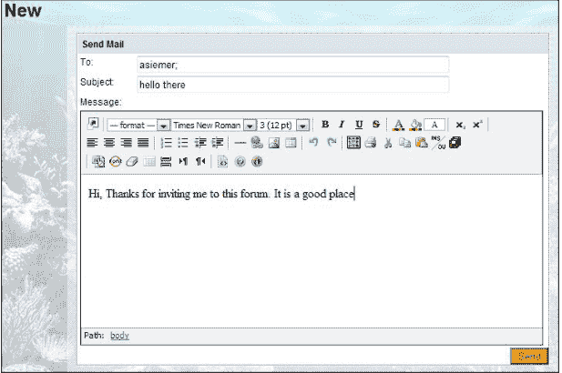

要开始集成 Xinha，我们首先需要获取最新的代码库。可以从本书的代码库中获取，也可以访问 **http://xinha.webfactional.com/wiki/DownloadsPage**。将该代码库安装到站点根目录下的一个新 Xinha 目录中。

然后打开 **Site.Master** 页面。在 body 之后直接添加以下 JavaScript：

```javascript
<script type="text/javascript">
    xinha_editors = null;
    xinha_editors = xinha_editors ? xinha_editors : [];
</script>
```

这段代码并不属于标准安装过程。它的作用是允许我们在单个页面中启动多个编辑器实例。稍后你会看到这一点。

然后，在我们的母版页中继续往下，就在结束的 body 标签之前，我们将插入另一大块 JavaScript。由于这是一大块内容，这里就不展示了。请打开本章现有的母版页查看。

你会看到这一大块代码负责设置 Xinha 暴露的大量配置选项。这段代码有大量注释，因此应该可以理解。此外，网络上也有大量关于此包配置的资料！

我们在这份配置中添加的唯一内容——但绝对是最特殊的一项——是设置站点基础 URL 的第一行。在这里，我们将其改为指向 XINHA 文件安装的路径。

```text
---
_editor_url = "/Scripts/Xinha";
---
```

这让我们回到 NewMessage.aspx 页面。既然已经安装了 Xinha，我们就可以在页面 UI 下方添加一行代码，将多行文本框控件有效地绑定到 Xinha 库。这是通过一段 JavaScript 完成的。

```javascript
<script type="text/javascript">
    xinha_editors[xinha_editors.length] = 'Content_txtMessage';
</script>
```

注意，这里使用的是我们在 Master 页面中最初定义的同一个 **xinha_editors** 变量！我们在这里所做的是将这个新控件插入到 Xinha 编辑器数组中。注意我们希望关联为编辑器的文本框的 **ClientID**。这与我们在以前版本的 ASP.NET 中所习惯的有所不同（如第 4 章前面所讨论的）。

现在，我们继续来看这个页面的 presenter。这个页面有三个主要任务：

- 发送消息
- 预加载消息的收件人（如果从警报链接过来的话），以及
- 回复消息

这实际上是一样的，只是如果要回复消息，我们必须首先加载该回复。我们稍后会讲到！

要发送消息，我们必须通过代码后置将按钮点击事件冒泡到我们的 presenter 中。由于我们在前面的章节中已经详细介绍了 MVP 的概念，这里不再赘述。因此，在 presenter 中，我们添加了一个名为 SendMessage() 的方法，它接收主题（Subject）、消息（Message）以及一个收件人数组。

```csharp
//Fisharoo/Web/Mail/Presenters/NewMessagePresenter.cs
public void SendMessage(string Subject, string Message, string[] To)
{
    _messageService.SendMessage(Message, Subject, To);
}
```

该方法随后调用 MessageService.SendMessage() 方法并发送消息。

收件人的预加载在 presenter 的 Init() 方法中处理。它会检查 QueryString 中是否有 AccountID（通过我们的 WebContext 包装器）。如果有，它会获取 Accounts 的 Username 属性，并将其添加到 UI 中的收件人字段中。

将回复消息加载到 UI 与加载用户名非常相似。Init() 方法检查 WebContext 的 QueryString 中是否有 MessageID，如果有，则将之前的消息详细信息加载到 UI 中。该操作只在页面请求不是回发请求时执行。

```csharp
//Fisharoo/Web/Mail/Presenters/NewMessagePresenter.cs
public void Init(INewMessage view, bool IsPostBack)
{
    _view = view;
    if(!IsPostBack)
    {
        if(_webContext.MessageID != 0)
            _view.LoadReply(_messageService.GetMessageByMessageID(
            _webContext.MessageID,_userSession.CurrentUser.AccountID));
    }
}
```


## 消息

Translator - AccountsToUserNames 接收账户集合并返回这些账户的用户名字符串，这正是最终绑定到 UI 中 repeater 的内容。

在我们 friend 控件的代码后置中，我们插入一段 JavaScript 片段，以便我们可以点击一个好友并将其用户名带入我们 NewMessage UI 中的 To 字段。

```csharp
//Fisharoo/Web/Mail/UserControls/Friends.aspx.cs
public void repFriends_ItemDataBound(object sender,
                                     RepeaterItemEventArgs e)
{
    if(e.Item.ItemType == ListItemType.Item || e.Item.ItemType ==
                                  ListItemType.AlternatingItem)
    {
        HyperLink linkFriend = e.Item.FindControl("linkFriend") as
                                      HyperLink;
        linkFriend.Attributes.Add("OnClick",
                          "javascript:document.forms[0].Content_txtTo.value += '' + e.Item.DataItem + ';';");
    }
}
```

请注意，我们为链接的 OnClick 事件添加了一个属性，该属性将调用 JavaScript 以将用户名移动到我们的 To 字段，并以分号作为分隔符。

这为我们提供了一个好友列表，但我们如何将其关联回我们的 UI？打开 NewMessage.aspx 页面。我们需要在页面中注册新的控件，然后在页面中添加对其的引用。

在 Page 指令正下方添加以下代码：

```
<%@ Register Src="~/Mail/UserControls/Friends.ascx"
             TagPrefix="Fisharoo" TagName="Friends" %>
```

然后在我们的页面中添加一个新的 Content 部分，好友控件将位于此处：

```
<asp:Content ContentPlaceHolderID="LeftNavTop" runat="server">
    <Fisharoo:Friends ID="friends1" runat="server" />
</asp:Content>
```

这会将好友控件插入到主页面中定义的左侧导航栏中！

将消息加载到 UI 中只是一个将 DataSource 绑定到 repeater 的问题。

```csharp
public void LoadMessages(List<PMessage> Messages)
{
    repMessages.DataSource = Messages;
    repMessages.DataBind();
}
```

由于这不需要进一步解释，让我们直接进入构建页面导航的方法。回想一下，在我们 presenter 的 Init() 中，我们调用了 _view.DisplayPageNavigation()，它接收我们正在处理的文件夹的 PageCount 以及我们正在查看的当前页面。以下是该方法：

```csharp
public void DisplayPageNavigation(Int32 PageCount, MessageFolders folder, Int32 CurrentPage)
{
    if(PageCount == CurrentPage)
        linkNext.Visible = false;
    if (CurrentPage == 1)
        linkPrevious.Visible = false;
    linkNext.NavigateUrl = "~/mail/default.aspx?folder=" + ((int)folder).ToString() + "&page=" + (CurrentPage + 1).ToString();
    linkPrevious.NavigateUrl = "~/mail/default.aspx?folder=" + ((int)folder).ToString() + "&page=" + (CurrentPage - 1).ToString();
    for(int i = 1; i<=PageCount;i++)
    {
        HyperLink link = new HyperLink();
        link.Text = i.ToString();
        link.NavigateUrl = "~/mail/default.aspx?folder=" + ((int)folder).ToString() + "&page=" + i.ToString();
        phPages.Controls.Add(link);
        phPages.Controls.Add(new LiteralControl("&nbsp;"));
    }
}
```

这段代码与我们 UI 中的三个控件交互——两个超链接，一个显示 **Previous**，一个显示 **Next**，以及一个 **PlaceHolder** 控件，该控件将保存此数据集所有页面的各个页码。

该方法首先根据当前页面和总页数确定是否应显示 **Next** 或 **Previous** 链接。然后我们将每个链接的导航属性挂钩，以便带我们进入下一页或上一页数据。之后我们使用 for 循环遍历所有可能的页面，从 1 到 PageCount，为每次迭代创建一个新的超链接，其中包含该页面的位置。

此页面的另一个功能是能够删除消息——我们可以删除任意多或任意少的消息。这主要通过视图代码后置中的一个辅助函数实现，该函数提取所有选中的消息，可以从 presenter 中调用。这允许 presenter 保持控制！

```csharp
public List<Int32> ExtractSelectedMessages()
{
    List<Int32> result = new List<Int32>();
    foreach (RepeaterItem item in repMessages.Items)
    {
        if(item.ItemType == ListItemType.Item || item.ItemType ==
           ListItemType.AlternatingItem)
        {
            CheckBox chkMessage = item.FindControl("chkMessage") as
                                     CheckBox;
            Int32 messageID =
                Convert.ToInt32(chkMessage.Attributes["MessageID"]);
            if(chkMessage.Checked)
                result.Add(messageID);
        }
    }
    return result;
}
```

此方法遍历所有复选框以查看它们是否被选中。如果被选中，则从我们在加载显示时创建的属性中提取 MessageID。然后将 MessageID 集合返回给调用者。

这就把我们带到了 presenter 中的 **Delete** 方法。它从冒泡到 presenter 的按钮点击事件中调用，然后调用视图获取选中的 MessageID 列表。然后使用 MessageService 获取该消息的副本。有了副本后，我们调用 MessageRecipientService.DeleteMessageRecipient() 方法并删除每个选中的消息。

```csharp
linkFolder.NavigateUrl = "~/Mail/Default.aspx?folder=" +
    ((MessageFolder)e.Item.DataItem).MessageFolderID.ToString();
linkFolder.Attributes.Add("FolderID",
    ((MessageFolder)e.Item.DataItem).MessageFolderID.ToString());
}
}
```

这为我们在一个控件中创建了一个文件夹列表。但我们如何将其放入我们的 UI 中？为此，我们必须返回到我们的 Default.aspx 页面。这将与我们在新消息页面中为好友控件所做的完全相同。打开默认页面，以便我们可以添加 Folders 控件。

```
<%@ Register Src="~/Mail/UserControls/Folders.ascx"
    TagPrefix="Fisharoo" TagName="Folders" %>
<asp:Content ContentPlaceHolderID="LeftNavTop" runat="server">
    <Fisharoo:Folders id="Folders1"
        runat="server"></Fisharoo:Folders>
</asp:Content>
```

### 读取消息

读取消息并不困难。我们只是根据传递到页面的 MessageID 将消息加载到静态 UI 中。让我们先讨论 UI！该 UI 将由一个 From 标签、一个 Subject 标签、一个 Message 标签和一个 Reply 按钮组成。

以下是消息视图：

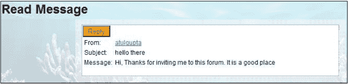

以下是回复消息后会看到的内容：

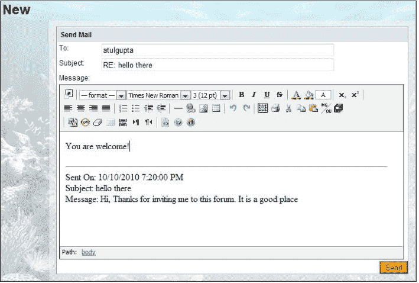

与往常一样，所有繁重的工作都在 presenter 中完成，让我们直接进入它。

```csharp
//Fisharoo/Web/Mail/Presenters/ReadMessagePresenter.cs
public void Init(ReadMessage view)
{
    _view = view;
    _view.LoadMessage(_messageService.GetMessageByMessageID(_webContext.MessageID, _userSession.CurrentUser.AccountID));
}
```

正如你在这里看到的，我们通过根据 ID 获取消息然后将其传递给视图以供显示来填充 UI。

对于 **Reply** 按钮，我们将点击事件冒泡到 presenter。Presenter 然后调用 Redirector 类，将当前 MessageID 传递到 NewMessage 页面。

## 问题

除了构建此类系统时我们需要考虑的标准基础设施问题之外，任何基于 Web 的文件管理系统中的核心问题之一都是文件上传。正如我们所知，大多数服务器端技术一次只允许上传一个文件，ASP.NET 也不例外。虽然我们可以轻松购买第三方插件来同时处理多个文件，但我们决定提供通过 Silverlight 或通过 Flash 上传文件的选项。

一旦我们的文件上传流程运行起来，我们才完成了三分之一的工作！由于我们将主要关注上传图像，因此我们需要考虑提供一些图像处理。每次文件上传到我们的系统时，我们都需要为每个图像创建多个不同尺寸，以便在我们网站的各个场景中使用。起初，我们将创建缩略图、小型、中型、大型和原始尺寸照片。

现在，虽然创建不同尺寸的文件在技术上是与文件存储系统一起工作，但我们希望对文件存储概念做进一步的思考。正如我们在前几章中所讨论的，我们可以选择将文件存储在文件系统或数据库中。对于头像，将其与个人资料数据一起存储是有意义的，而对于图像库，将文件存储在文件系统上更有意义。在将文件存储到文件系统时，我们需要非常谨慎地定义文件结构以及文件存储的位置和方式。在我们的例子中，我们将使用系统生成的 GUID 作为文件名，并使用扩展名来定义我们存储的不同尺寸。我们将在开始了解该系统的细节时更深入地探讨这一点。

一旦我们将文件上传到服务器并准备好在整个系统中使用，我们将讨论用户文件与系统文件概念。如果我们在构建系统时对这个主题有所考虑，我们就可以拥有一个非常通用的文件管理系统，可以在未来进行扩展。我们将在本章中构建一个个人系统。但正如你将在适当位置看到的一些标志，我们同样可以轻松构建一个系统文件管理器或一个群组文件管理器。

## 设计

让我们来看看此功能的設計。


## Files

对于我们的站点，由于我们不会将文件存储在数据库中，因此我们需要更仔细地查看数据库中实际需要管理的内容，以便跟踪文件系统中的情况。除了标准的文件元数据外，我们还需要密切关注文件实际存储的位置——具体来说，文件将驻留在哪个文件系统文件夹（硬盘上的目录）。我们还需要能够维护哪些账户拥有哪些文件，或者在系统文件的情况下，哪些文件可以被任何人查看。

## Folders

你可能会想知道，为什么我们在刚刚提到将管理文件系统文件夹以存储文件之后，还要单独设立一个关于文件夹的部分。在本节中，我们将从站点角度而非文件系统角度来讨论文件夹管理——如果你愿意的话，就是用户文件夹或虚拟文件夹。

与文件存储非常相似，我们将存储每个文件夹的各种元数据。我们还必须跟踪谁拥有哪个文件夹，谁可以看到哪个文件夹，或者在系统文件夹的情况下是否每个人都可以看到该文件夹。当然，由于每个文件夹都是文件的虚拟容器，我们必须维护文件夹与文件之间的关系。

## File upload

文件上传过程将由 Silverlight/Flash 客户端处理。虽然这并不是一本关于 Silverlight 或 Flash 的书，但我们将向你展示创建此 Flash 客户端是多么简单，它实际上只是提供了一种存储需要上传的多个文件的方式，然后一次上传一个文件，以便服务器可以处理每个文件。对于 Silverlight 选项，我们使用的是来自 CodePlex 的代码——**http://silverlightfileupload.codeplex.com/**。

## File system management

管理文件系统乍一看可能似乎不是问题。然而，请记住，要使一个社区站点成功，我们至少需要大约 10,000 个或更多独特用户。鉴于在当今大多数社区站点中，分享照片和其他文件都是如此受欢迎的功能，这很容易转化为大量上传的文件。

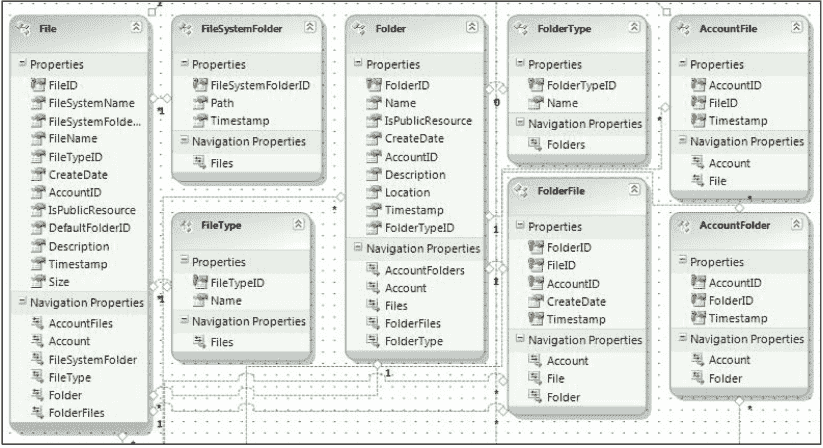

## Files

在数据库中存储的最重要内容，当然是我们主要关注的：文件。与大多数关于物理二进制文件的讨论一样，我们总是要考虑是否要将文件存储在数据库中还是文件系统上。在这种情况下，我们认为将文件（以及在照片的情况下，其各种生成的尺寸）存储在文件系统上是有意义的。这意味着我们只会在数据库中存储每个文件的元数据。

这里最重要需要讨论的字段是 **FileSystemName**。如你所见，这是一个 GUID 值。我们将把上传的文件重命名为 GUID 加上原始扩展名。这使我们能够确保任何给定文件夹中的所有文件都有唯一名称。这消除了我们需要担心覆盖其他文件的需求。

然后我们看到 **FileSystemFolderID**。这是对 **FileSystemFolders** 表的引用，让我们知道文件存储的根文件夹位置。

接下来我们要讨论的项目是 **IsPublicResource** 标志。仅从其名称就可以很清楚地看出，该标志将文件设置为公开或私有，因此可以被所有人或其所有者（**AccountID**）查看。

## Media Galleries

我们接下来遇到一个可能有些令人困惑的字段：**DefaultFolderID**。这与文件系统文件夹无关。这是用户创建的文件夹。文件初始上传时会被放入一个虚拟文件夹。该初始虚拟文件夹成为文件的永久家园。这并不意味着它是文件的唯一家园。正如你稍后会看到的，我们有这样的概念：文件可以通过订阅其他文件夹而存在于多个虚拟文件夹中。

## File system folders

如前所述，**FileSystemFolders** 表负责让我们知道文件根目录的位置。这使我们能够在以后扩展系统以拥有多个根目录，这些根目录可能位于同一服务器的不同磁盘上，也可能位于完全不同的服务器上。该表中的字段有 **Key**、**Path**（URL）和 **Timestamp**。

## File types

FileTypes 表将帮助我们跟踪我们存储和处理的是什么类型的文件。这是一个简单的查找表，告诉我们给定文件的扩展名。

## Folders

在这种情况下，文件夹是虚拟的。它们为我们提供了一种指定文件容器的方法。在我们的例子中，我们将包含照片，在这种情况下，文件夹将充当相册。这里唯一值得解释的字段是标志 **IsPublicResource**，它允许我们指定文件夹及其资源是公开还是私有，即可被所有人查看或仅可被所有者查看。

## Folder types

FolderTypes 表允许我们指定文件夹的类型。目前这将只是名称，照片、电影等等。然而，将来你可能想要为每种文件夹类型指定一个图标，在这种情况下，这就是你想要分配该规范的地方。

## Account folders

在 AccountFolders 表中，我们能够指定文件夹的额外所有权。因此，在文件夹是公共资源并且外部资源可以拥有文件夹的情况下，我们只需在此处创建新的所有权关系。这不是永久所有权。它仍然由 Folders 表的 **AccountID** 指定。这是跨多个账户的临时所有权。

如前一个屏幕截图所示，我们拥有所有者（**AccountID**）和将被拥有的文件夹（**FolderID**）。

## Account files

与 AccountFolders 表类似，AccountFiles 表允许某人订阅特定文件。这可用于 **Favorites** 或类似概念的目的。此表的构成与 AccountFolders 相同。你拥有所有者和被拥有的文件。

## Folder files

FolderFiles 表允许一个 Account 不仅订阅一个文件，类似于 Favorites 概念，而且还允许用户将我的一个文件放入他们的一个文件夹中，就好像该文件本身属于他们一样。

如前一个屏幕截图所示，这主要是一个保存其他表键的表。我们对每个文件都有 **FolderID**、**FileID** 和 **AccountID**。这清楚地指定了谁在接管所有权以及他们希望将其放置在哪里。

## Creating the relationships

一旦所有表都创建完毕，我们就可以创建所有关系。

对于这组表，我们在以下表之间建立了关系：

- **Files and FileSystemFolders**
- **Files and FileTypes**
- **Files and Folders**
- **Files and Accounts**
- **Folders and Accounts**
- **Folders and FolderTypes**
- AccountFolders and Accounts
- AccountFiles and Accounts
- AccountFiles and Files
- FolderFiles and Accounts
- FolderFiles and Folders
- FolderFiles and Files

## Setting up the data access layer

数据访问层可以像前几章中那样设置。我们需要打开 Fisharoo.edmx 文件，右键单击并选择 **Update Model from Database**，并选择新表。保存文件，现在你就有本章可用的领域对象了。

## Building repositories

随着新表的添加，将会添加新的存储库，以便我们可以获取存储在这些表中的数据。我们将创建以下存储库来支持我们的需求。

- `FileRepository`
- `FolderRepository`

我们的每个存储库通常都有一个按 ID 选择、按父 ID 选择全部、保存和删除的方法。一旦你看过一个存储库，你基本上就都看过了。查看前几章、附录或包含的代码以获取标准存储库的示例。在这里我们将讨论与标准不同的任何内容！

## FileRepository

除了所有 XRepository 类都具有的正常方法外，FileRepository 还有几个额外的更有趣的方法。

- `UpdateDescriptions`
- `DeleteFilesInFolder`
- `DeleteFileFromFileSystem`

UpdateDescriptions() 方法是一个有趣的概念。此方法是一次执行多个更新而不是一次一个执行的第一个示例。这显然比单独的更新执行更具性能导向。

```csharp
///Fisharoo/DataAccess/Repositories/FileRepository.cs
public void UpdateDescriptions(Dictionary<int,string> fileDescriptions)
{
    using(FisharooDataContext dc = conn.GetContext())
    {
        List<Int64> fileIDs = fileDescriptions.Select(f => Convert.ToInt64(f.Key)).Distinct().ToList();
        IEnumerable<File> files = dc.Files.Where(f => fileIDs.Contains(f.FileID));
```


```csharp
foreach (File file in files)
{
    file.Description = fileDescriptions.Where(f=>f.FileID==file.FileID)
    .Select(f=>f.Value).FirstOrDefault();
}
dc.SaveChanges();
}
}
```

如你所见，此方法接受一个 **Dictionary** 集合，其中包含 **FileID** 和文件描述的列表。然后我们打开 DataContext。接着，从 Dictionary 集合中获取唯一的 **FileID** 列表。然后，我们只往返数据库一次，使用 **FileID** 集合的 **Contains()** 方法获取所需的全部 File 对象。拿到相应的文件集合后，我们就可以遍历每个文件，将通过 **Dictionary** 集合传入的值设置为文件描述。等所有这些准备工作完成后，就可以调用 SaveChanges 方法。请记住，整个操作过程中我们只使用一个 DataContext。这正是这种更新方法有效的原因！

```csharp
//Fisharoo/DataAccess/Repositories/FileRepository.cs
public void DeleteFilesInFolder(string filePath, Folder folder)
{
    using (FisharooDataContext dc = conn.GetContext())
    {
        List<File> files = GetFilesByFolderID(folder.FolderID);
        foreach (File file in files)
        {
            DeleteFileFromFileSystem(filePath, folder, file);
        }
        //Entity Framework 4 does not support any method to bulk delete, hence only way is to iterate through resultset
        //and delete one by one, another way is to use dc.ExecuteStoreQuery() and pass SQL String
        //dc.ExecuteStoreQuery() is efficient but does not use LINQ syntax
        var listOfFiles = dc.Files.Where(f => f.DefaultFolderID == folder.FolderID).ToList();
        foreach (File f in listOfFiles)
        {
            dc.Files.DeleteObject(f);
        }
        dc.SaveChanges();
    }
}
```

```csharp
if (System.IO.File.Exists(fullPath + file.FileSystemName + "__t." + file.Extension))
    System.IO.File.Delete(fullPath + file.FileSystemName + "__t." + file.Extension);
if (System.IO.File.Exists(fullPath + file.FileSystemName + "__s." + file.Extension))
    System.IO.File.Delete(fullPath + file.FileSystemName + "__s." + file.Extension);
if (System.IO.File.Exists(fullPath + file.FileSystemName + "__m." + file.Extension))
    System.IO.File.Delete(fullPath + file.FileSystemName + "__m." + file.Extension);
if (System.IO.File.Exists(fullPath + file.FileSystemName + "__l." + file.Extension))
    System.IO.File.Delete(fullPath + file.FileSystemName + "__l." + file.Extension);

if (Directory.GetFiles(fullPath).Count() == 0)
    Directory.Delete(fullPath);
}
}
```

此方法首先尝试识别我们要处理的 **FileType**，由此获得该类型文件的根文件夹。

请记住，如果你想将文件存储到多个位置并使用 **FileSystemFolders**，则需要对此稍作修改。这里展示的概念适用于单一根文件文件夹！

> 另一点值得注意的是，如果文件被锁定，文件删除可能会遇到问题。如果遇到问题，你可以在单独的表中创建一个条目，并运行一个定期扫描该表并删除文件的作业。

确定了根路径后，我们接着创建 **fullPath**。这个变量是通过调用我们的 WebContext 类创建的，该类负责确定服务器上的根路径。然后我们添加 **Files**，即文件的根文件夹。接下来就是刚刚配置的路径。下一部分目前可能看起来有些奇怪。当我们上传文件（稍后会讲到）时，我们会上传到一个以文件夹创建日期、年份和月份命名的目录中。

正确配置 **fullPath** 后，我们接着检查目录确实存在。现在，我们可以逐个遍历我们创建的每个文件。我们检查文件在指定位置是否存在，然后调用 System.IO.File.Delete。我们对上传过程中创建的每种文件类型都这样做。请记住，上传和删除过程是紧密相连的。因此，如果我们在某一端做了更改，也需要在另一端做相应的更改！

## 媒体库

删除文件后，我们进一步对文件系统进行美化。我们需要检查文件夹现在是否为空。如果为空，则也删除该文件夹！

### FolderRepository

在 FolderRepository 中有几个值得介绍的方法。

- GetFoldersByAccountID
- GetFriendsFolders

GetFoldersByAccountID 名副其实！它接收一个 AccountID，并执行搜索以获取传入 AccountID 的所有文件夹。它还不止于此。然后，它遍历结果列表中的每个文件夹，并为该文件夹的封面图片生成文件系统路径。这个结果随后被赋给 FullPathToCoverImage。如果没有找到封面图片，则分配默认图片。处理完这一切后，我们返回文件夹列表。

```csharp
//Fisharoo/DataAccess/Repositories/FolderRepository.cs
public List<Folder> GetFoldersByAccountID(Int32 AccountID)
{
    List<Folder> result = new List<Folder>();
    using (FisharooDataContext dc = conn.GetContext())
    {
        var account = dc.Accounts.Where(a => a.AccountID == AccountID).FirstOrDefault();

        IEnumerable<Folder> folders = (from f in dc.Folders
                                       where f.AccountID == AccountID
                                       orderby f.CreateDate descending
                                       select f);
        foreach (Folder folder in folders)
        {
            var fullPath = (from f in dc.Files.Include("FileType")
                            join ft in dc.FileTypes on f.FileTypeID equals ft.FileTypeID
                            where f.DefaultFolderID == folder.FolderID
                            select f).FirstOrDefault();
            if (fullPath != null)
            {
                String FullPathToCoverImage = fullPath.CreateDate.Year.ToString() + "/" + fullPath.CreateDate.Month.ToString() + "/" + fullPath.FileSystemName.ToString() + "_S_" + fullPath.FileType.Name;
                folder.FullPathToCoverImage = FullPathToCoverImage;
            }
            else
                folder.FullPathToCoverImage = "default.jpg";
            if (account != null)
                folder.Username = account.Username;
        }
        result = folders.ToList();
    }
    return result;
}
```

这个仓库中另一个有趣的方法是 GetFriendsFolders。此方法引入了一个新的 LINQ 概念——Union。Union 会获取一个集合中的所有项，并将其与另一个集合中的项合并。两个列表中相同的项会被合并，从而最终得到的列表中的项是唯一的。

```csharp
//Fisharoo/DataAccess/Repositories/FolderRepository.cs
public List<Folder> GetFriendsFolders(List<Friend> Friends)
{
    List<Folder> result = new List<Folder>();
    foreach (Friend friend in Friends)
    {
        if (result.Count < 50)
        {
            List<Folder> folders =
                GetFoldersByAccountID(friend.MyFriendsAccountID);
            IEnumerable<Folder> result2 = result.
                Union(folders);
            result = result2.ToList();
        }
        else
            break;
    }
    return result;
}
```

在我们的方法中，我们接收一个 Friends 列表。然后遍历此集合，每次循环时检查文件夹数量是否少于 50 个（我们选择了一个随机数量来在相册首页上显示）。如果少于 50 个，则获取当前好友的所有文件夹，并使用 Union 方法将其合并到结果列表中。我们持续这样做，直到 Friends 用完或首页上已有 50 个文件夹。

如前所述，我们将构建一个基于 Flash 的文件上传客户端。该客户端负责在本地文件系统中选择一组文件，然后将文件逐个传递到服务器端的接收页面。当我们讨论照片文件（JPG、GIF 等）时，我们还会涉及一些基本的图像处理概念。我们还将提供一个 Silverlight 上传控件作为备选方案，并重用 codeplex 上已有的控件（http://silverlightfileupld.codeplex.com/）。还有其他选项，如基于 AJAX 的控件，但我们希望引入一些富互联网应用（RIA）的特色，因此使用了 Flash 和 Silverlight。

### 多文件上传

我们的文件接收器能够一次接收多个文件。就我们而言，主要关注的是接收图像文件，但我们也会将其设置为接收其他文件。在我们的场景中，接收器（ReceiveFiles.aspx.cs）将位于 Files 目录中的某个网页内。我们将在此处解释代码，但仅展示相关部分，而不是完整代码。

接收器的开头部分负责初始化一些变量和对象。这里唯一值得关注的是 sizesToMake 集合。该集合将保存所有尺寸，我们在后面会生成这些尺寸。如果我们要添加额外的尺寸或修改现有尺寸，就可以在这里进行。

```csharp
Dictionary<string,int> sizesToMake = new Dictionary<string,int>();
```

然后，在 Page_Load() 方法中，我们初始化对象和尺寸集合。接着，我们检查一个查询字符串值，以确定我们要处理的是哪种文件。在我们的场景中，我们会处理照片，但以后可能会处理其他内容。

```csharp
//determine save-to folder
switch (_webContext.FileTypeID)
{
    case 1:
        saveToFolder = "Photos/";
        break;
    case 2:
        saveToFolder = "Videos/";
        break;
    case 3:
        saveToFolder = "Audios/";
        break;
}
```


## 媒体画廊

一旦我们确定了要操作的文件夹，就需要检查该文件夹是否确实存在于文件系统中。如果不存在，我们可能需要创建它。

```csharp
//make sure the directory is ready for use
saveToFolder += DateTime.Now.Year.ToString() +
                DateTime.Now.Month.ToString() + "/";
if (!Directory.Exists(Server.MapPath(saveToFolder)))
    Directory.CreateDirectory(Server.MapPath(saveToFolder));
```

接着，我们需要设置一些其他变量。我们需要获取当前操作的 Account（账户）。我们还需要接收上传的文件。最后，我们需要获取要保存文件的文件夹的完整路径。

```csharp
Account account = _accountService.GetAccountByID(
    _webContext.AccountID);
HttpFileCollection uploadedFiles = Request.Files;
string Path = Server.MapPath(saveToFolder);
```

现在我们已经有了上传文件的集合，需要逐个处理每个文件。为此，我们将启动一个 for 循环。在每次迭代的开始，我们需要获取一个要处理的文件。

```csharp
for(int i = 0 ; i < uploadedFiles.Count ; i++)
{
    HttpPostedFile F = uploadedFiles[i];
}
```

接下来，我们需要初始化更多变量，以确定文件的存储位置及存储方式。我们将从查询字符串中获取文件夹 ID。请注意，我们目前假设处理的是静态 fileType 为 1 的图像文件。如果我们创建另一个页面来上传音频文件，则应该传入 fileType。然后，我们通过解析上传文件名的末尾来获取 uploadedFileName。得到文件名后，我们获取文件扩展名。由于我们要将文件保存到文件系统，如果不确保文件名唯一，就会有覆盖文件的风险。为此，我们创建一个新的 GUID 字符串作为文件系统中的文件名。有了这些数据，我们就足以构建最终的文件名。然后我们创建域对象文件。

```csharp
string folderID = _webContext.AlbumID.ToString();
string fileType = "1";
string uploadedFileName =
    F.FileName.Substring(F.FileName.LastIndexOf("\\") + 1);
string extension =
    uploadedFileName.Substring(uploadedFileName.LastIndexOf(".") + 1);
```

```csharp
break;
case "swf":
    file.FileTypeID = (int)File.Types.SWF;
    break;
default:
    goodFile = false;
    break;
}
break;
case "3":
    file.FileSystemFolderID = (int)FileSystemFolder.Paths.Audios;
    switch (extension.ToLower())
    {
        case "wav":
            file.FileTypeID = (int)File.Types.WAV;
            break;
        case "mp3":
            file.FileTypeID = (int)File.Types.MP3;
            break;
        case "flv":
            file.FileTypeID = (int)File.Types.FLV;
            break;
        default:
            goodFile = false;
            break;
    }
    break;
}
```

接下来，我们尝试为域 **File** 对象填充所有属性，例如上传文件的大小、所属账户、文件系统名称等。

```csharp
file.Size = F.ContentLength;
file.AccountID = account.AccountID;
file.DefaultFolderID = Convert.ToInt32(folderID);
file.FileName = uploadedFileName;
file.FileSystemName = guidName;
file.Description = "";
file.IsPublicResource = false;
```

现在我们可以开始实际工作了。如果 goodFile 标志仍为 true，我们可以将文件对象提交到数据库。然后，我们将实际上传的文件以其新文件名保存到文件系统。最后，如果 fileType 是图片，我们会使用 Resize() 方法对文件进行处理，以生成我们需要的各种尺寸的文件。

```csharp
if (goodFile)
{
    _fileService.SaveFile(file);
    F.SaveAs(fullFileName);
    if(Convert.ToInt32(fileType) == ((int)Folder.Types.Photo))
    {
        Resize(F,saveToFolder,guidName,extension);
    }
}
```

要进入 Resize() 方法，我们必须传入正在处理的上传文件、要将文件保存到的文件夹、为文件系统名称生成的 GUID，以及上传文件的扩展名。进入 Resize() 方法后，我们可以为上传的照片创建所需的所有尺寸变体。我们首先设置一个 foreach 循环，该循环将遍历类级 sizesToMake 集合中的字典。

```csharp
public void Resize(HttpPostedFile F, string SaveToFolder, Guid
                     SystemFileNamePrefix, string Extension)
{
    //Makes all the different sizes in the sizesToMake collection
    foreach (KeyValuePair<string, int> pair in sizesToMake)
    {

using(System.Drawing.Image image =
        System.Drawing.Image.FromStream(F.InputStream))
//determine the thumbnail sizes
using(Bitmap bitmap = new Bitmap(image))
{
    decimal Ratio;
    if(bitmap.Width > bitmap.Height)
    {
        Ratio = (decimal) pair.Value / bitmap.Width;
        NewWidth = pair.Value;
        decimal Temp = bitmap.Height * Ratio;
        NewHeight = (int)Temp;
    }
    else
    {
        Ratio = (decimal) pair.Value / bitmap.Height;
        NewHeight = pair.Value;
        decimal Temp = bitmap.Width * Ratio;
        NewWidth = (int)Temp;
    }
}
```

确定尺寸后，我们可以调整其大小并保存到文件系统。为此，我们再次引用上传的文件并重建一个新的 Bitmap。然后，就可以将新尺寸的 bitmap 保存到文件系统。但请注意，在这种情况下，当我们保存文件到文件系统时，并没有使用字典中的键名来为文件名添加片段。这会导致文件名由 {GUID}__{key}-{extension} 组成。这意味着每个文件都是唯一的，并且会拥有各种尺寸且名称唯一的文件。

```csharp
using(System.Drawing.Image image =
        System.Drawing.Image.FromStream(F.InputStream))
using(Bitmap bitmap = new Bitmap(image, NewWidth, NewHeight))
{
    bitmap.Save(Server.MapPath(SaveToFolder + "/" +
        SystemFileNamePrefix.ToString() + "__"
        + pair.Key + "-" + Extension),
        image.RawFormat);
}
```

我们继续遍历字典中的所有不同文件尺寸，为每个尺寸创建新文件。完成后，我们将处理下一个上传的文件。现在，让我们编写一个测试页面来测试我们的接收页面。

### 使用 Flash 上传器接收文件

既然我们已经有了接收上传文件的方法，接下来让我们创建用于上传少量文件的 UI。这是一个基于 Flash 的 UI。你可以下载 Flash 试用版，也可以寻找 Swish 或 Flex 等产品中的替代方案。

由于本书并非专门讲解 Flash，我们只快速浏览一下这个主题。我们将创建一个简单的 Flash UI，其中包含一个浏览框、几个动态文本框和一些标签。我们将整个 UI 构建在一个帧上，UI 效果如下图所示：

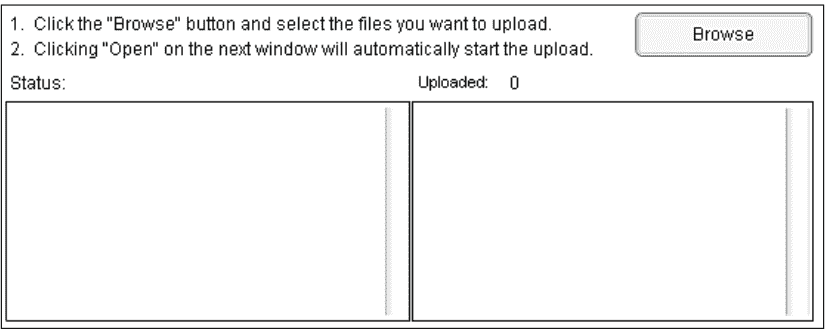

完成 UI 后，我们需要将 Flash 上传器嵌入到页面中。为此，我们需要在承载 Flash 上传器的页面中添加以下代码。

```aspx
//Fisharoo/Web/Photos/AddPhotos.aspx
<object classid="clsid:d27cdb6e-ae6d-11cf-96b8-444553540000"
codebase="http://fpdownload.macromedia.com/pub/shockwave/cabs/flash/swflash.cab#version=8,0,0,0"
    width="550" height="510" id="FileUpload">
    <param name="allowScriptAccess" value="sameDomain" />
    <param name="movie" value="../Files/FileUpload.swf?SiteRoot=<%Response.Write(ctx.RootUrl);%>&AlbumID=<%Response.Write(ctx.AlbumID); %>&FileType=<%Response.Write(ctx.FolderType);%>&AccountID=<%Response.Write(ctx.AccountID); %>" />
    <param name="quality" value="high" />
    <param name="bgcolor" value="white" />
    <embed src="../Files/FileUpload.swf?SiteRoot=<%Response.Write(ctx.RootUrl);%>&AlbumID=<%Response.Write(ctx.AlbumID); %>&FileType=<%Response.Write(ctx.FolderType);%>&AccountID=<%Response.Write(ctx.AccountID); %>"
        quality="high" bgcolor="#ffffff" width="550" height="220"
        name="FileUpload" align="middle"
        allowscriptaccess="sameDomain" type="application/x-shockwave-flash" pluginspage="http://www.macromedia.com/go/getflashplayer" />
</object>
```

一旦页面显示了 UI 并插入了相应的变量，就可以正常使用了。与 Flash UI 类似，我们还将提供一个 Silverlight UI，如前所述，这是我们从 codeplex 网站获取的一个控件。


## 媒体画廊

### 使用 Silverlight 上传器接收文件

与应用程序集成后的界面如以下截图所示。当前有三个文件被选中用于上传（desert.jpg、jellyfish.jpg 和 penguins.jpg）。我们可以上传文件时启用缩略图预览，但这会减慢上传过程。文件上传控件的代码（取自 http://silverlightfileupld.codeplex.com/）可以在 Fisharoo/FileUpload 和 Fisharoo/SilverlightFileUpload 文件夹中找到。

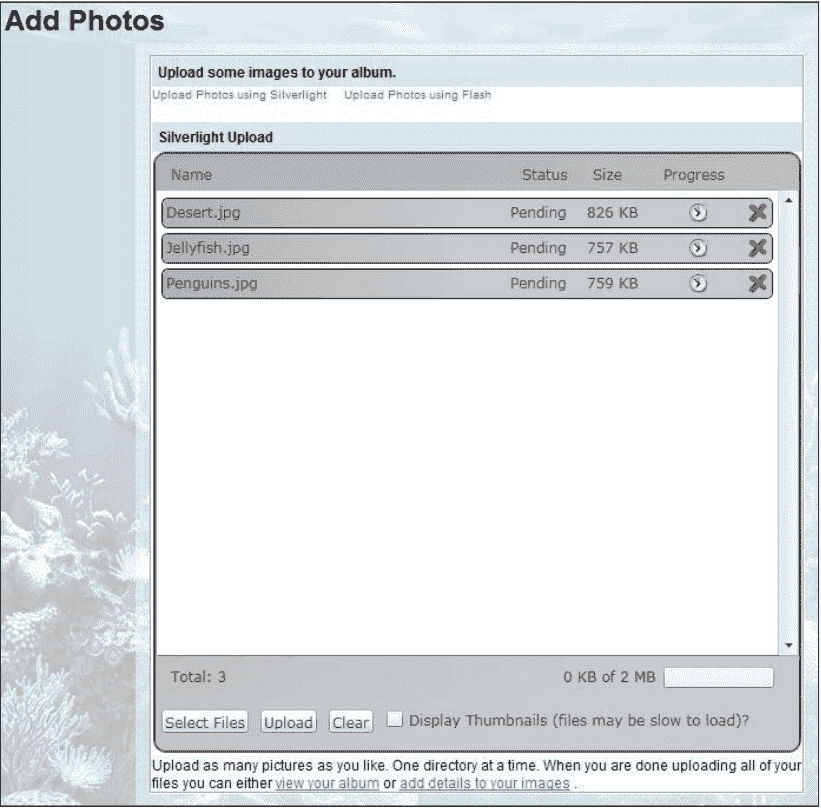

在界面中包含 Silverlight XAP 包的代码如下：

```aspx
//Fisharoo/Web/Photos/AddPhotos.aspx
<object data="data:application/x-silverlight-2," type="application/x-silverlight-2" width="550" height="510">
    <param name="source" value="/ClientBin/FileUpload.xap" />
    <param name="onError" value="onSilverlightError" />
    <param name="background" value="white" />
    <param name="minRuntimeVersion" value="4.0.50401.0" />
    <param name="autoUpgrade" value="true" />
    <param name="initParams" value="UploadPage=/Handlers/FileUpload.ashx?AlbumID=<%Response.Write(ctx.AlbumID); %>&FileTypeID=<%Response.Write(ctx.FolderType); %>&AccountID=<%Response.Write(ctx.AccountID); %>,Filter=Images (*.jpg)|*.jpg" />
    <a href="http://go.microsoft.com/fwlink/?LinkID=149156&v=4.0.50401.0" style="text-decoration: none">
        
    </a>
</object>
```

其中大部分是任何 Silverlight 应用程序在包含 Silverlight 控件时使用的标准代码。唯一主要的关注点是 `initParams` 参数，我们向其传递 `httpHandler` 的值，该值将有助于文件上传。这个处理程序的代码可以在 `Fisharoo/Web/Handlers/Fileupload.ashx.cs` 文件中找到。通常 `httpHandlers` 需要在 web.config 文件中注册，但由于我们的处理程序是一个 `.ashx` 文件，它由 ASP.NET 运行时自动管理，我们不需要显式注册它。

该处理程序将处理过程交给 **FileProcessor** 类（`Web/HelperClasses/FileProcessor.cs`），该类负责 GUID 的创建、各种尺寸图像的生成以及后端相应部分的处理。这里的代码与前面章节中讨论的类似：**多文件上传。**

现在我们已经在上传文件，接下来讨论这些照片的显示。

### 相册

既然我们已经将各种尺寸的文件上传到服务器，现在我们可以做很多事情！我们将向您展示 MyPhotos 页面，该页面将列出登录帐户的所有相册，并链接到 ViewAlbum 页面。这应该演示如何处理相册和照片。您可以查看代码中的其他页面，了解如何创建相册、链接到文件上传器等——基本上涵盖了围绕相册概念的所有数据管理任务。

#### 我的照片

在此页面中，我们将显示一个帐户拥有的所有相册。我们将使用 ListView 来完成此操作。

```aspx
//Fisharoo/Web/Photos/MyPhotos.aspx
<asp:ListView id="lvAlbums" runat="server"
              OnItemDataBound="lvAlbums_ItemDataBound">
    <LayoutTemplate>
        <ul class="albumsList">
            <asp:PlaceHolder ID="itemPlaceholder"
                runat="server"></asp:PlaceHolder>
        </ul>
    </LayoutTemplate>

    <ItemTemplate>
        <li>
            <asp:HyperLink CssClass="albumsActionLink"
                ID="linkEditAlbum" NavigateUrl="~/Photos/EditAlbum.aspx"
                runat="server">&gt;</asp:HyperLink>
            <asp:HyperLink CssClass="albumsActionLink"
                ID="linkViewAlbum" NavigateUrl="~/Photos/ViewAlbum.aspx" Text="View"
                runat="server"></asp:HyperLink>
            <asp:LinkButton CssClass="albumsActionLink"
                ID="linkDeleteAlbum" Text="Delete"
                OnClick="linkDeleteAlbum_Click"
                runat="server"></asp:LinkButton><br />
            <asp:Label CssClass="albumsTitle" ID="lblName"
                Text='<%#((PEFolder)Container.DataItem).Name %>'
                runat="server"></asp:Label><br />
            files_photos/<%#((PEFolder)Container.DataItem).FullPathToCoverImage %>" /><br />
        </li>
    </ItemTemplate>
</asp:ListView>
```

```csharp
linkDeleteAlbum.Attributes.Add("OnClick", "javascript:return(confirm('Are you sure you want to delete this album?')); ");
linkDeleteAlbum.Attributes.Add("FolderID", litFolderID.Text);
linkViewAlbum.NavigateUrl += "?AlbumID=" + litFolderID.Text;
}
}
```

最后，我们有一个方法来处理删除链接的点击事件。该方法调用我们的 presenter 来处理相册的删除。

```csharp
//Fisharoo/Web/Photos/MyPhotos.aspx.cs
protected void linkDeleteAlbum_Click(object sender, EventArgs e)
{
    LinkButton linkDeleteAlbum = sender as LinkButton;
    _presenter.DeleteFolder(Convert.ToInt64(linkDeleteAlbum.Attributes["FolderID"]));
}
```

### 查看相册

ViewAlbum 页面与 MyPhotos 页面完全相同，因为它使用 ListView 来渲染数据。唯一的不同是，我们使用 PEFile 而不是 PEFolder。

在代码隐藏文件中，我们有着与 MyPhotos 代码隐藏类似的布局。我们为给定相册加载照片。我们还加载一些关于相册本身的详细信息，以便我们可以显示相册描述等内容。我们有一些按钮控件，已挂钩事件，以便我们可以通过 redirector 类处理导航等操作。下面我们只展示代码的主要部分：

```csharp
//Fisharoo/Web/Photos/ViewAlbum.aspx.cs
protected void lvAlbum_ItemDataBound(object sender,
                                      ListViewItemEventArgs e)
{
    if(e.Item.ItemType == ListViewItemType.DataItem)
    {
        HyperLink linkImage = e.Item.FindControl("linkImage") as HyperLink;
        Literal litImageName = e.Item.FindControl("litImageName") as Literal;
        Literal litFileExtension = e.Item.FindControl("litFileExtension") as Literal;
        string pathToImage = "~/files/photos/" +
                             linkImage.NavigateUrl + "/" + litImageName.Text;
        linkImage.NavigateUrl = pathToImage + "_o." +
                                litFileExtension.Text;

        linkImage.ImageUrl = pathToImage + "_" +
                             litFileExtension.Text;
    }
    if(e.Item.ItemType == ListViewItemType.EmptyItem)
    {
        HyperLink linkAddPhotos = e.Item.FindControl("linkAddPhotos")
            as HyperLink;
        linkAddPhotos.NavigateUrl =
            "~/photos/AddPhotos.aspx?AlbumID=" +
            _webContext.AlbumID.ToString();
    }
}

public void LoadAlbumDetails(Folder folder)
{
    lblAlbumName.Text = folder.Name;
    lblLocation.Text = folder.Location;
    lblDescription.Text = folder.Description;
    lblCreateDate.Text = folder.CreateDate.ToString();
    if(folder.AccountID != _userSession.CurrentUser.AccountID)
    {
        btnEditPhotos.Visible = false;
        btnEditAlbum.Visible = false;
        btnAddPhotos.Visible = false;
    }
}

public void LoadPhotos(List<PEFile> files)
{
    lvGallery.DataSource = files;
    lvGallery.DataBind();
}
```

请查看网站项目的 photos 文件夹。还有许多其他页面用于编辑照片、编辑相册等，这些页面演示了有关与我们的文件和相册数据交互的额外功能。

### 小结

在本章中，我们深入探讨了媒体管理应用程序所涉及的基础架构和决策。我们重点讨论了图像的处理和存储。我们所看到的大部分原则适用于各种不同类型的文件。唯一需要真正调整的地方是文件存储在服务器上后如何处理。对于音频和视频文件，您很可能希望将它们从 WAV 或 WMV 格式转换为 Flash 格式，以便更便于您的 Web 用户访问，或者您可以将 Silverlight 与 IIS 平滑流媒体选项结合使用来流式传输 WMV 文件。需要注意的一个方面是内容增长以及随之而来的空间管理。您可能需要了解一些内容分发网络。

本章增加了创建相册的能力。然后我们讨论了上传和处理照片的能力。我们还讨论了如何处理多文件上传以及在文件系统上存储它们的最合适方式。最后，我们为用户提供了一种与其相册和上传文件进行交互的方式。


