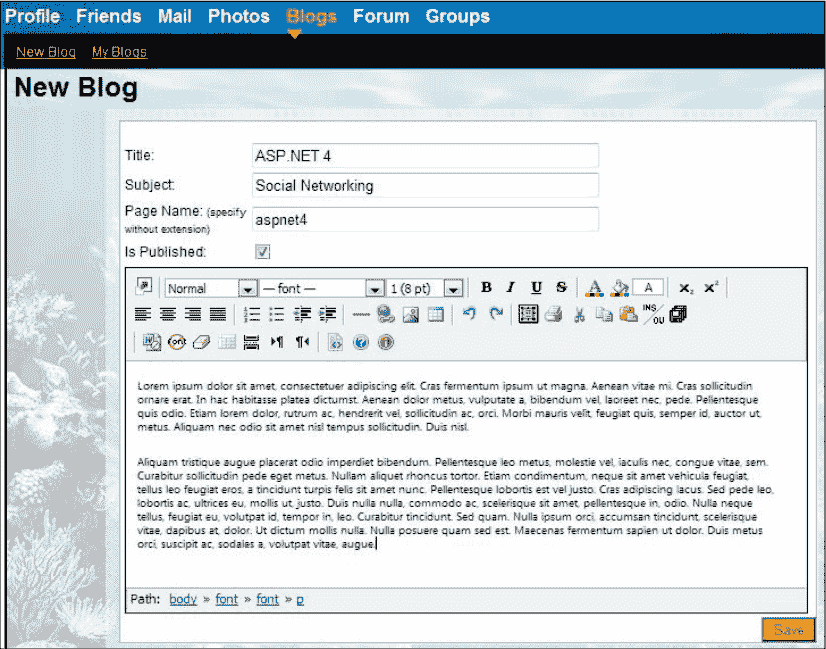
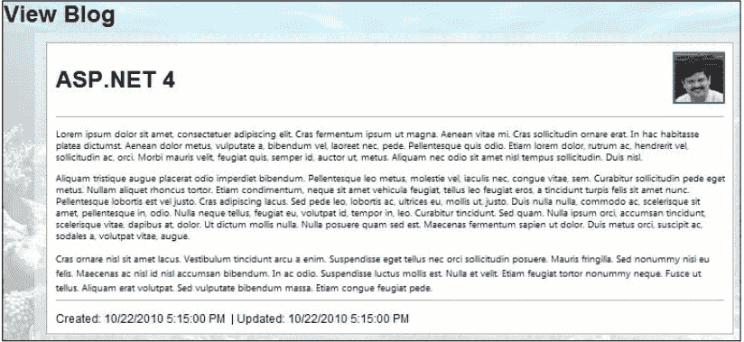
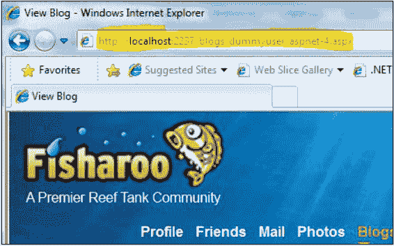

# 8. 博客

人们加入社区是为了寻找或提供关于某个预设主题的信息。这通常通过博客来实现。博客让人们能够自由表达自己，通常以故事、文章或简短随笔的形式，与社区分享任何主题。

将这个关键功能集成到你的社区中，实际上是最容易做的事情之一。到目前为止，我们已经构建了如此多的功能，因此接入博客模块及其所需组件将十分顺利。我们将不仅涵盖如何创建博客，还包括如何为博客文章添加友好 URL。一旦完成这些，我们接下来会把博客系统连接到提醒系统中。

### 问题

在本章中，我们将为网站添加博客功能。该功能将处理文章的创建和管理，还会处理向好友的提醒页面发送提醒。最后，我们还将为博客文章创建友好 URL。

下面是我们向博客发布第一篇文章的过程。



文章创建后，我们将能够在博客首页和 **我的博客** 部分看到它。在这里，我们可以编辑或删除文章。我们也可以点击文章，查看到目前为止的内容。

以下截图展示了点击文章后用户将看到的内容：



我们已将博客文章设置为显示博主的头像。这是一个你可以轻松添加或移除的功能。大多数用户都希望能够看到他们当前所读博客的作者是谁！

此外，我们还将为博客文章页面添加友好 URL。在下面的截图中，你可以看到博客是通过将其名称作为 URL 的一部分来访问的（../aspnet-4.aspx）。



### 设计

我们只需要一张表来存储博客文章。之后，我们需要将博客系统接入现有的基础设施中。

博客表具有与上述 Blog 实体相同的属性。我们在本节中已经讨论了其中的大部分内容。

这里一个有意思的地方是 **Post** 列。注意，我们将其设置为 **varchar(MAX)** 字段。对于你的社区而言，这可能太大，所以可以随意更改。对于我们的社区来说，这个数据类型是可用的。我们总是可以通过验证控件添加 UI 限制，而不会影响数据库设计。接下来，我们将看到 **IsPublished** 标志。该标志告知系统是否在公共区域显示文章。此外，我们还会关注 **PageName** 列。这一列将显示在浏览器的地址栏中。由于它会显示在地址栏中，我们需要确保输入是干净的，以免遭受 SQL 注入攻击或解析问题（这些问题会导致数据类型异常）。我们稍后会在表示层的输入侧处理这个问题。

#### 创建关系

一旦所有表创建完成，我们就可以创建所有关系。我们已经在 Blogs 表和 Accounts 表之间创建了关系：

#### 设置数据访问层

要设置数据访问层，请按照以下步骤操作：

1. 打开 Fisharoo.edmx 文件，并按照第 3 章所述加入新的 Blog 表。
2. 点击保存，你现在应该就可以使用 Blog 域对象了！

#### 构建仓库

随着新表的加入，我们也会添加新的仓库，以便能够访问相应表中存储的数据。我们将在 Fisharoo\DataAccess\Repositories 下创建 BlogRepository 仓库来满足我们的需求。

我们的仓库通常会提供按 ID 选择、按父 ID 选择所有、保存和删除等方法。只要你见过一个仓库，基本上就相当于见过所有仓库了。请回顾前面的章节、附录或包含的代码，以了解标准仓库的示例。我们将讨论所有与标准实现不同的地方。

我们先从一个方法开始，该方法允许我们通过页面名称获取博客，而页面名称可以从浏览器的地址栏中捕获。

```csharp
//Fisharoo/DataAccess/Repositories/BlogRepository.cs
public Blog GetBlogByPageName(string PageName, Int32 AccountID)
{
    Blog result = new Blog();
    using (FisharooDataContext dc = _conn.GetContext())
    {
        result = dc.Blogs.Include("Account").Where(b =>
            b.PageName == PageName && b.AccountID == AccountID).
            FirstOrDefault();
        //we can do this since there will be only one result
        result.account = result.Account;
    }
    return result;
}
```

请注意，要让该系统正常工作，我们只能让每个博客对应一个唯一的页面名称。如果我们强制整个社区都使用唯一的页面名称，最终可能会让一些用户感到不满。我们只想为此目的确保页面名称在用户之间唯一。为此，我们要求在传入页面名称的同时传入 AccountID，这样我们的用户就可以更灵活地重复使用页面名称！稍后我们将展示如何获取 AccountID。除此之外，我们使用 lambda 表达式从数据上下文中的博客集合里选出合适的博客。

接下来，我们将讨论一个通过 GetLatestBlogs() 方法获取所有最新博客文章的方法。这个方法还会为每篇博客获取并关联相应的 Account。在深入讨论这个方法之前，我们需要扩展 Blog 类，使其具有 Account 属性。

要扩展 Blog 类，我们需要在 DataAccess 项目下创建一个公共分部类。

```csharp
namespace Fisharoo.DataAccess
{
    public partial class Blog
    {
        public Account account { get; set; }
    }
}
```

现在我们可以看一下 GetLatestBlogs() 方法。

```csharp
public List<Blog> GetLatestBlogs()
{
    List<Blog> result = new List<Blog>();
```

```csharp
int count = dc.Blogs.Where(b => b.PageName == blog.
PageName && b.AccountID == blog.AccountID).Count();
if (count > 0)
    result = false;
}
return result;
}
```

此方法会查看除自身之外的所有博客条目，以判断是否存在由同一 Account 创建且使用相同页面名称的其他博客文章。这让我们能够有效限制用户创建重复的页面名称。当我们开始讨论用户友好 URL 时，这一点非常重要。

接下来，我们将看一个私有方法，它可以帮助我们清理这些页面名称输入。请记住，这些页面名称会显示在浏览器的地址栏中，因此其中不能包含浏览器想要编码的任何字符。虽然我们可以轻松地解码 URL，但这里更关键的是让 URL 保持用户友好，使用户和搜索引擎爬虫都能轻松地知道他们所处的位置。当 URL 中包含编码字符时，我们会看到类似 %20 的内容（%20 相当于空格）。但阅读 my%20blog%20post 并不容易，而阅读 my-blog-post 则容易得多。因此，我们将去除所有所谓的特殊字符，并用连字符替换所有空格。这个方法就是 CleanPageName() 方法。

```csharp
private Blog CleanPageName(Blog blog)
{
    blog.PageName = blog.PageName.Replace(" ", "-").Replace("!", "")
        .Replace("&", "").Replace("?", "").Replace(",", "");
    return blog;
}
```

你可以根据需要随意添加任意数量的过滤器。目前，我们只是替换代码中看到的少数几个特殊字符。

接下来，我们将进入服务层，用它来处理我们与系统的交互。与其他章节不同，本章不会引入任何新的服务层——我们将在现有服务层上进行扩展。

### 实现服务/应用层

一旦所有仓库都为单一目的构建完成，我们就可以开始创建服务层。我们不会为这个组件创建任何新服务，但需要扩展现有的 AlertService，它位于 //Fisharoo/BusinessLogic 下。


## AlertService

正如我们在前几章中所知，AlertService 负责通过用户的筛选页面（filter page）向用户发送通知。该页面会显示你和好友资料中的最新动态。

对于博客，我们向 AlertService 类添加了两个方法——一个用于在发布新博客文章时发送提醒，另一个用于在更新博客文章时发送提醒。

```csharp
public void AddNewBlogPostAlert(Blog blog)
{
    alert = new Alert();
    alert.CreateDate = DateTime.Now;
    alert.AccountID = _userSession.CurrentUser.AccountID;
    alert.AlertTypeID = (int)AlertType.AlertTypes.NewBlogPost;
    alertMessage = "<div class=\"AlertHeader\">" +
        GetProfileImage(_userSession.CurrentUser.AccountID) +
        GetProfileUrl(_userSession.CurrentUser.Username) + " has just added a new blog post: <b>" +
        blog.Title + "</b></div>";
    alert.Message = alertMessage;
    SaveAlert(alert);
    SendAlertToFriends(alert);
}
```

如果你已经读过包含 AlertService 的第 4 章，你就会知道添加提醒需要做哪些工作。如果你还不了解，我们快速看一下这个 AddNewBlogPostAlert() 方法。

该方法会接收已发布的新 Blog 对象，这样我们就可以在提醒中使用其中的一些信息。一进入方法主体，我们就需要初始化一个新的 Alert，然后填写一些初始属性。

我们需要扩展的其中一个类是 AlertType 类，它包含 AlertTypes 属性。你会发现，AlertTypes 属性实际上对应着我们在数据库的 AlertTypes 表中存储的记录 ID。打开 AlertType 类，为 NewBlogPost 和 UpdatedBlogPost 添加几个新条目。

参考 //Fisharoo/DataAccess/AlertType.cs 中的代码。

然后进入 AlertTypes 表，创建两条新记录 NewBlogPost 和 UpdatedBlogPost。如果生成的记录 ID 与你上面看到的数字不一致，请将枚举中看到的数字更新为表中创建的对应数字。

现在我们来看希望在提醒中显示的消息。它可以包含任何标准 HTML，因为该消息将显示在提醒页面（也就是我们所说的筛选页面）上。一旦 Alert 完全配置好，我们就可以将 Alert 保存到数据库中。在本例中（但并非所有情况），我们还希望该提醒显示在所有好友的筛选页面上，让他们知道刚刚创建了一篇新博客文章。

下面是更新博客文章提醒的方法，它与新增博客文章提醒的方法几乎相同：

```csharp
public void AddUpdatedBlogPostAlert(Blog blog)
{
    alert = new Alert();
    alert.CreateDate = DateTime.Now;
    alert.AccountID = _userSession.CurrentUser.AccountID;
    alert.AlertTypeID = (int)AlertType.AlertTypes.NewBlogPost;
    alertMessage = "<div class=\"AlertHeader\">" +
                   GetProfileImage(_userSession.CurrentUser.AccountID)
                   + GetProfileUrl(_userSession.CurrentUser.Username)
                   + " has updated the <b>" + blog.Title +
                   "</b> blog post!</div>";
    alert.Message = alertMessage;
    SaveAlert(alert);
    SendAlertToFriends(alert);
}
```

在完成仓储层和服务层之后，我们现在可以来看看 UI 了。

## 实现表示层

本章的表示层和基础设施一样简单。我们将在顶部导航中添加一个**博客**链接。点击此链接后，你会进入一个页面，其中显示最新博客文章的列表。在博客板块中，你可以选择从最新博客页面查看博客，也可以选择查看自己的博客或创建新博客。除了这四个页面外，我们还将讨论用户友好的 URL 如何在查看文章页面中发挥作用。你还可以考虑为博客提供 RSS 订阅，这样其他用户就可以在 Outlook 等客户端应用程序中收到推送，而无需显式访问网站。

## 最新博客文章

查看最新博客文章只需对 BlogService 进行一次调用。为了让 UI 能够访问任何服务，它首先必须交出对所有显示交互的控制。具体做法是初始化一个 DefaultPresenter 实例，然后将自身的引用传递给该呈现器的 Init() 方法。进入呈现器的 Init() 方法后，我们就可以调用服务来获取最新博客。Blog 实体被转换为 PEBlog，这是一个表示层实体，只包含与 UI 相关的字段。

```csharp
//Fisharoo/Web/Blogs/Presenters/DefaultPresenter.cs
public class DefaultPresenter
{
    private IDefault _view;
    [Import]
    private IBlogService _blogService;
    public DefaultPresenter()
    {
        MEFManager.Compose(this);
    }

    public void Init(IDefault View)
    {
        _view = View;
        List<Blog> list = _blogService.GetLatestBlogs();
        _view.LoadBlogs(Translator.BlogToPEBlog(list));
    }
}
```

拿到最新博客后，我们就可以将它们传递到 UI 的代码隐藏文件中，并在 Default.aspx 页面中绑定这些博客。这里唯一需要关注的方法是 ItemDataBound()，它处理绑定到列表视图控件的每一个项。

```csharp
//Fisharoo/Web/Blogs/Default.aspx.cs
public void lvBlogs_ItemDataBound(object sender, ListViewItemEventArgs e)
{
    Literal litBlogID = e.Item.FindControl("litBlogID") as Literal;
    HyperLink linkTitle = e.Item.FindControl("linkTitle") as HyperLink;
    Literal litPageName = e.Item.FindControl("litPageName") as Literal;
    Literal litUsername = e.Item.FindControl("litUsername") as Literal;
    //navigation URL will follow the URL routing pattern
    linkTitle.NavigateUrl = Page.GetRouteUrl("BlogRoute", new { username = litUsername.Text, blogpage = litPageName.Text });
}
```

在查看这些细节之前，我们先来看一下要加载的 UI：

```aspx
//Fisharoo/Web/ViewPost.aspx
<table style="vertical-align: top" width="100%">
    <tr>
        <td align="left">
            <asp:Label ID="lblTitle" runat="server" Font-Bold="True" Font-Size="X-Large"></asp:Label>
        </td>
        <td align="right">
            <asp:HyperLink ID="linkProfile" runat="server" CssClass="">
                <asp:Image Width="50" Height="50" ID="imgAvatar" runat="server"
                    ImageUrl="/images/profileavatar/profileimage.aspx"
                />
            </asp:HyperLink>
        </td>
    </tr>
    <tr>
        <td colspan="2" align="left">
            <hr />
            <asp:Label ID="lblPost" runat="server"></asp:Label>
            <hr />
        </td>
    </tr>
    <tr>
        <td align="left" colspan="2">
            Created:
            <asp:Label ID="lblCreated" runat="server"/>
            &nbsp;&nbsp;Updated:
            <asp:Label ID="lblUpdated" runat="server"/>
        </td>
    </tr>
</table>
```

正如我们之前提到的，需要关注的一点是：所有路径都采用站点根目录下的固定格式。这样，无论我们当前位于何处，都能知道该去哪里访问指定资源。我们再来快速看一下呈现器代码的相关部分。我们通过用户名获取账户详情，然后使用 AccountID 和博客的页面名称来获取特定博客条目的详情。

```csharp
//Fisharoo/Web/Blogs/Presenters/ViewPostPresenter.cs
public void Init(IViewPost View, string username, string blogpage)
{
    _view = View;
```

## 创建或编辑文章

所有这些都按预期工作后，我们现在可以集中精力创建实际的博客文章了。这个页面实际上有两个用途。我们既可以用它来创建博客文章，也可以复用这个 UI 来编辑已有的文章。让我们看看这个页面的呈现器。

```csharp
//Fisharoo/Web/Blogs/PostPresenter.cs
public void Init(IPost View, bool IsPostBack)
{
    _view = View;
    if (!IsPostBack)
    {
        if (_webContext.BlogID > 0)
        {
            _view.LoadPost(_blogService.GetBlogByBlogID(_webContext.BlogID));
        }
    }
}

public void SavePost(Blog blog)
{
    bool result = true;
    if (blog.BlogID == 0)
    {
        //if blog already saved once, the ID will be > 0
        result = _blogService.CheckPageNameIsUnique(blog);
    }
    if (result)
    {
        blog.AccountID = _webContext.CurrentUser.AccountID;
        long blogID = _blogService.SaveBlog(blog);
        _view.UpdateID(blogID);
        _view.ShowError("Blog is saved!");
    }
    else
    {
        _view.ShowError("The page name you have chosen is in use. Please choose a different page name!");
    }
}
```


## 博客

在 **Init** 方法的第一部分，我们检查 **WebContext.BlogID** 属性，以确定是否有可用的数据。如果有，我们就用相应的博客加载 UI；如果没有，则意味着我们正在创建一个新的博客条目。接下来你会看到 SavePost 方法，它负责将加载/新建的博客传递给 BlogService 进行保存。

接下来，我们看一下 Presenter 所用的后台代码。这里会看到 LoadPost 和 btnSave_Click 方法。这里的逻辑并不复杂。但需要注意的一点是，我们在页面中跟踪 BlogID，以便后续知道我们正在处理哪个对象。

```
protected void btnSave_Click(object sender, EventArgs e)
{
    Blog blog = new Blog();
    if (litBlogID.Text != "")
        blog.BlogID = Convert.ToInt64(litBlogID.Text);
    blog.IsPublished = chkIsPublished.Checked;
    blog.PageName = txtPageName.Text;
    blog.Post = txtPost.Text;
    blog.Subject = txtSubject.Text;
    blog.Title = txtTitle.Text;
    _presenter.SavePost(blog);
}
public void LoadPost(Blog blog)
{
    txtTitle.Text = blog.Title;
    txtSubject.Text = blog.Subject;
    txtPost.Text = blog.Post;
    txtPageName.Text = blog.PageName;
    chkIsPublished.Checked = blog.IsPublished;
    litBlogID.Text = blog.BlogID.ToString();
}
```

这处理了数据输入和输出的细节。不过，现在我们来看看如何让 UI 可用。你可能记得之前用过 Xinha 所见即所得编辑器，这里我们也会用到它。要启用它，只需要一个多行文本框控件和一行 JavaScript。

```
---
<asp:TextBox TextMode="MultiLine" ID="txtPost"
             runat="server"></asp:TextBox>
---
<script type="text/javascript">
    xinha_editors[xinha_editors.length] = 'Content_txtPost';
</script>
---
```

有了这些，我们就可以创建博客文章了！

## 小结

我们现在有了一种很好的方式，让社区成员相互分享信息。这些内容有多种用途：它不仅为社区成员提供了一个大型信息库，让他们看到彼此关系的价值，同时也为我们的搜索引擎爬虫提供了食粮。

在本章中，我们介绍了博客文章的创建，还讨论了让人们查看其他用户帖子以及自己帖子所需的页面。当然，我们也提供了一个实际阅读帖子的页面。此外，我们还介绍了美观或友好 URL 的概念，这些 URL 对用户和搜索引擎都更友好。最后，我们通过 Xinha 所见即所得编辑器为 UI 增加了更多的可用性。
