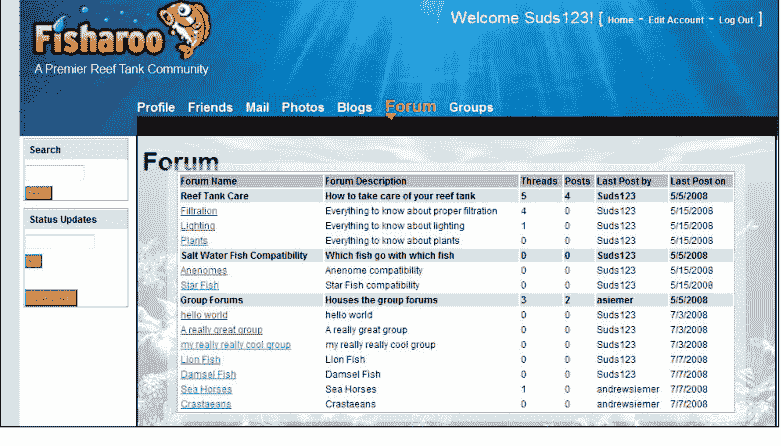
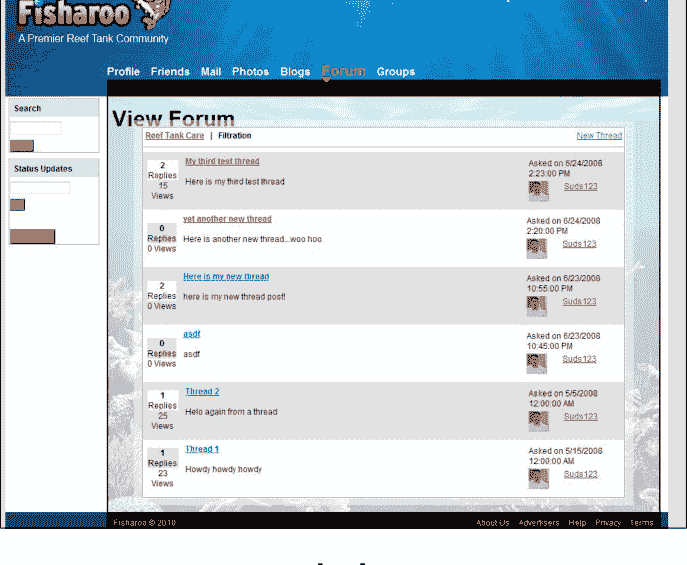
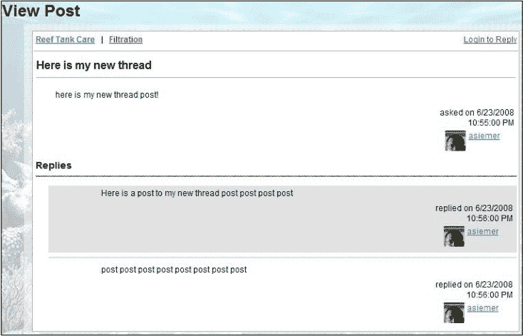
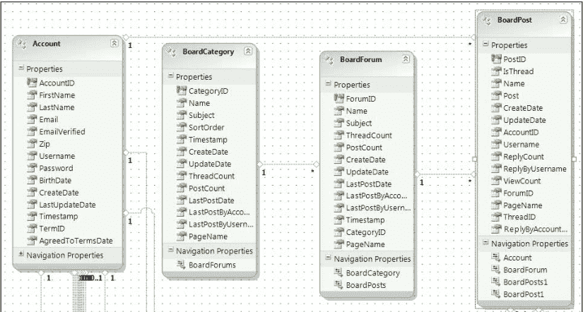
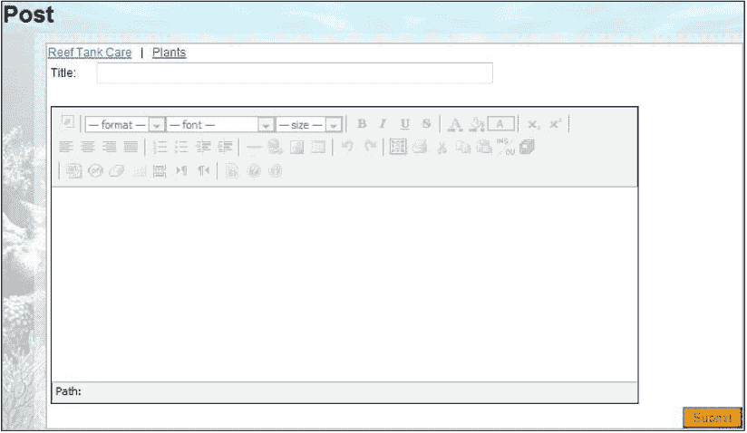

# 9 论坛

在本章中，我们将讨论论坛。**论坛**是一个用户可以向社区发布消息的地方，无论每条帖子之间相隔多久，所有回复都是可见的——可以将其视为一场长期持续的对话。随着主题（threads）及其帖子逐渐变旧，新的内容会开始覆盖旧的内容。这使得网站的这一部分成为一个非常动态的区域，许多用户都会关注。这被认为是一个具有“粘性”的功能！考虑到我们社区的主题——海水鱼——论坛是网站的完美功能。它可以让用户发布他们鱼缸遇到的问题，整个社区都能阅读并与该用户的问题互动。随着时间的推移，你的社区会慢慢把某些用户推举为特定主题的专家。最终（你希望如此），你的网站论坛会成为获取特定类型信息的首选之地。即便没有其他好处，我们亲爱的朋友谷歌和必应也会把人引到你的网站。

### 问题

在开始之前，我们应先讨论正确的术语。论坛实际上是一组用于存储数据的容器。我们首先需要能够创建类别。**类别**是最高级别的容器，因此会有一个非常通用的主题。每个类别可以容纳任意数量的论坛。论坛与顶级类别的主题相关，但更加具体。在每个论坛中，我们可以有多个主题。每个主题都是一个非常具体的讨论话题，用户可以在其中进行讨论。讨论通过帖子进行，这些帖子只是对所属主题的回复，或者是该主题下的一个帖子。

### 论坛

这是我们的落地页，列出了每个类别及其论坛：



这是我们的论坛页面，列出了该论坛所有可用的主题：



这是一个主题页面，同时也会列出其帖子：



你可以猜到，论坛这个主题非常庞大，如果觉得合适，你可以评估并集成任何现成的第三方留言板。然而，我们将会解释论坛的一些关键组成部分，在创建过程中，我们会涉及创建类别、论坛、主题和帖子的基础知识。这些部分中的每一个都能统计其下有多少数据。所有内容都将能够以 SEO 友好的方式被链接（也就是说支持友好 URL）。友好 URL 也更容易让用户记住和使用。我们还会在过滤器和朋友过滤器上加入提醒功能，这样他们就知道我们何时有新内容可用。

> **SEO（搜索引擎优化）** 通常被定义为优化自然搜索流量的过程。这通常意味着以搜索引擎友好的方式构建网站，并以一种让搜索引擎更容易索引页面的方式来呈现网站及其内容。通常，像 `default.aspx?userid=324568` 这样又长又难看的查询字符串，不如 `domain.com/atulgupta` 友好。更多相关信息可参见：`http://en.wikipedia.org/wiki/Search_engine_optimization`。

### 提醒

最后，我们将扩展现有系统，使用已有的提醒系统，这样每当有人发帖或创建新主题时，我们都会在创建者的过滤器以及朋友的过滤器上看到提醒。这将有助于我们在整个网站推广新内容。

### 解决方案

让我们看看我们的解决方案。

### 实现数据库

让我们从讨论数据库的实现开始。



### 类别

正如我们之前讨论过的，类别的概念是我们的顶级数据容器。让我们看一下类别的表结构：

**SortOrder** 字段负责设置显示顺序，以防同一页面上有多个类别。我们之前已经讨论过计数字段。最后几个字段用于控制最后发帖的人和时间。**PageName** 控制着系统稍后将要使用的友好 URL。

### 论坛

论坛是下一级容器，保存用户创建的各个主题。

与类别类似，我们维护底层帖子和主题的计数，也维护最后发帖的人和时间。注意，我们有一个指向 BoardCategories 表的外键引用。

### 帖子

正如我们前面所说，BoardPosts 表实际上是一个双重用途的表，同时包含帖子和主题。我们这样做主要是因为大多数情况下，每个条目的数据都是相同的，除了父级 **ThreadID** 列以外。

这里需要注意的字段是 **IsThread**。这是判断帖子是否同时是主题的最简单方法。此外，我们还有 **ThreadID**，它也表示帖子和主题之间的区别：主题不会有 **ThreadID**——一个主题永远不会是另一个主题的一部分（至少现在还没有！）。还要注意，我们有一个指向论坛的外键，即 **ForumID** 外键，表示该主题属于哪个论坛。对于主题，我们还会存储其被查看的次数以及回复数。

这种帖子/主题结构的一个好处是，任何普通帖子都可以轻松移出，作为独立的主题处理。版主经常会发现，主题中的某个帖子比初始主题本身带来了更多流量。在这种情况下，该帖子很容易被提升为独立主题！

### 创建关系

创建完所有表后，我们就可以创建所有关系了。

对于这组表，我们在以下表之间存在关系：

- BoardForums 和 BoardCategories
- BoardPosts 和 Accounts
- BoardPosts 和 BoardForums
- BoardPosts 和 BoardPosts（用于帖子到主题的引用）


## 设置数据访问层

要设置数据访问层，请按照以下步骤操作：

- 打开 Fisharoo.edmx 文件，并按照前面章节中提到的指南，添加本章中讨论的数据库表。
- 点击**保存**，你应该就可以使用上面讨论过的领域对象了！

你的设计图面上应该包含前面截图中的所有项（尽管排列方式可能不同！）。

### 构建仓库

随着新表的添加，也将会添加新的仓库，以便我们能够访问存储在这些表中的数据。我们将创建以下仓库来满足我们的需求。

- BoardCategoryRepository
- BoardForumRepository
- BoardPostRepository

我们的每个仓库通常都会有一个按 ID 选择的方法、一个按父 ID 选择所有项的方法、一个保存方法和一个删除方法。一旦你看过一个仓库，基本上就等于看过了所有仓库。关于标准仓库的示例，请回顾之前的章节、附录或随附的代码。不过，我们会讨论那些与我们目前所遵循的标准方法不同的地方！

### BoardCategoryRepository

我们的留言板最重要的特性之一（这一点可能与其他留言板略有不同）是支持友好 URL 对我们来说非常重要。这意味着我们每个仓库中都需要一个按页面名称获取对象的方法。以下是该仓库的方法：

```csharp
public BoardCategory GetCategoryByPageName(string PageName)
{
    BoardCategory category;
    using(FisharooDataContext dc = _conn.GetContext())
    {
        category = dc.BoardCategories.Where(bc => bc.PageName == PageName).FirstOrDefault();
    }
    return category;
}
```

这是一个相当直接的方法，可按页面名称获取板块分类。

### BoardForumRepository

BoardForumRepository 也有一个 GetForumByPageName 方法，但它与上述 BoardCategoryRepository 的方法完全相同。

### BoardPostRepository

这个仓库充满了许多有趣的要点需要介绍！首先，由于我们的用户会创建帖子和主题，但不会被允许创建论坛或分类，我们需要确保他们不会创建不唯一的页面名称。试图按名称获取一个主题，结果却得到多个不同的主题，而不是我们预期的那一个，这可不行。

```csharp
//Fisharoo/DataAccess/Repositories/BoardPostRepository.cs
public bool CheckPostPageNameIsUnique(string PageName)
{
    bool result;
    using(FisharooDataContext dc = _conn.GetContext())
    {
        BoardPost bp = dc.BoardPosts.Where(p => p.PageName == PageName).FirstOrDefault();
        if(bp != null)
            result = false;
        else
            result = true;
    }
    return result;
}
```

在该方法中，我们尝试按指定的 PageName 加载帖子。如果返回 null 对象，则表明该 PageName 是唯一的，可以返回 true 响应。否则，我们必须返回 false 结果。虽然不够精巧，但能完成任务。

下一个方法负责获取给定主题的所有帖子。这本身并不太有趣。但因为我们知道只在查看某个主题的页面上使用这个方法，所以我们可以插入一些逻辑，用于增加主题被查看的次数。

> 请记住，只有当我们仅使用此方法来获取给定主题的帖子并显示它们时，该方法才是合适的。如果我们开始将此方法用于其他任务，那么我们的查看计数将会完全失真！

```csharp
public List<BoardPost> GetPostsByThreadID(Int64 ThreadID)
{
    List<BoardPost> result;
    using (FisharooDataContext dc = _conn.GetContext())
    {
        //increment the view count for this thread
        BoardPost thread = dc.BoardPosts.Where(p => p.PostID == ThreadID).FirstOrDefault();
        if (thread != null)
            thread.ViewCount += 1;
        dc.SaveChanges();

        IEnumerable<BoardPost> posts = dc.BoardPosts.Where(p => p.ThreadID == ThreadID && !p.IsThread)
            .OrderBy(p => p.CreateDate);
        result = posts.ToList();
    }
    return result;
}
```

我们通过按 ID 获取主题（实际上是一个 BoardPost），然后递增其 ViewCount 属性来执行此任务。然后，我们在 DataContext 上提交更改，确保将其推送回数据库。

接着，我们继续按该主题的 ID 获取其所有帖子。

下一个方法 SavePost 不仅负责保存新帖子和更新现有帖子，还负责在论坛和分类两个级别上增加计数。

```csharp
public Int64 SavePost(BoardPost boardPost)
{
    using (FisharooDataContext dc = _conn.GetContext())
    {
        if (boardPost.PostID > 0)
        {
            dc.BoardPosts.Attach(new BoardPost { PostID = boardPost.PostID });
            dc.BoardPosts.ApplyCurrentValues(boardPost);
        }
        else
        {
            //get the parent containers when a new post is
            //created
            // to update their post counts

            BoardCategory bc = (from c in dc.BoardCategories
                                join f in dc.BoardForums
                                on c.CategoryID equals f.CategoryID
                                where f.ForumID == boardPost.ForumID
                                select c).FirstOrDefault();

            BoardForum bf = (from f in dc.BoardForums
                              where f.ForumID == boardPost.ForumID
                              select f).FirstOrDefault();

            //update the thread count
            if (boardPost.IsThread)
            {
                bc.ThreadCount = bc.ThreadCount + 1;
                bf.ThreadCount = bf.ThreadCount + 1;
            }
            //update the post count
            else
            {
                bc.PostCount = bc.PostCount + 1;
                bf.PostCount = bf.PostCount + 1;

                //update post count on thread
                BoardPost bThread = null;
                if (boardPost.ThreadID != 0)
                {
                    bThread = (from p in dc.BoardPosts
                               where p.PostID == boardPost.ThreadID
                               select p).FirstOrDefault();
                }
                if (bThread != null)
                {
                    bThread.ReplyCount = bThread.ReplyCount + 1;
                }
            }
            dc.BoardPosts.AddObject(boardPost);
        }
        dc.SaveChanges();
    }
    return boardPost.PostID;
}
```

请注意，这个方法的第一部分与其他所有保存方法完全一样。如果要保存的对象 ID 大于零，我们就把该对象作为该对象的新版本重新附加到数据上下文。然后调用 SaveChanges() 方法，将其持久化回数据库。

这就是其他所有部分发生改变的地方。如果该项是一个新帖子或新主题，那么我们有一大堆事情要做。我们要做的第一件事是获取父对象。我们通过帖子关联的 ForumID 获取 BoardCategory 和 BoardForum。然后检查这个新帖子是否也是一个主题。如果是，我们就更新父对象的 ThreadCount。

如果只是一个普通帖子，我们就更新父对象的 PostCount。同时，我们还会获取该帖子的父主题。拿到父主题后，我们更新回复计数。然后执行我们习惯的操作：插入对象。最后，我们在数据上下文上调用 SaveChanges 方法。

最后，我们来看 DeletePost 方法。请记住，帖子也可以是主题，这意味着它可能有子项。我们不能删除带有子项的主题，因为这会给我们带来引用完整性问题（也称为脏数据）。

```csharp
public void DeletePost(BoardPost boardPost)
{
    using (FisharooDataContext dc = _conn.GetContext())
    {
        dc.BoardPosts.Attach(boardPost);
        //If this is a thread then we need to delete all of
        //its children
        if (boardPost.IsThread)
        {
            IEnumerable<BoardPost> posts = dc.BoardPosts
                .Where(bp => bp.ThreadID == boardPost.PostID)
                .ToList();
            foreach(BoardPost bp in posts)
            {
                dc.BoardPosts.DeleteObject(bp);
            }
        }
        dc.BoardPosts.DeleteObject(boardPost);
        dc.SaveChanges();
    }
}
```

因此，为了解决这个问题，我们必须检查待删除的帖子，通过其 IsThread 属性判断它是否也是一个主题。如果是，我们就遍历这些 BoardPost，并通过在 BoardPosts 集合上调用 DeleteObject() 来删除。


## 实现服务/应用程序层

一旦所有仓储（Repository）都为单一服务目的构建完成，我们就可以开始创建服务层。同样，这一层负责组装聚合体，并利用我们的实体执行复杂操作。我们将创建以下服务：

- BoardService（板块服务）
- AlertService（提醒服务）

### BoardService

我们的 BoardService 实际上并不特别复杂。它负责为我们提供一种方式，以便获取已经填充了 BoardForum 项目列表的 BoardCategory。在查看 BoardService 之前，我们需要扩展 BoardCategory 对象，使其包含一个 BoardForum 对象列表。为此，我们在 Domain 目录中添加一个 BoardCategory 类。然后，使这个类成为公共分部类，最后添加一个 BoardForum 对象的泛型列表。

```csharp
public partial class BoardCategory
{
    public List<BoardForum> Forums { get; set; }
}
```

扩展了此类之后，我们现在可以来查看 BoardService 了。

```csharp
namespace Fisharoo.BusinessLogic
{
    [Export(typeof(IBoardService))]
    public class BoardService : IBoardService
    {
        [Import]
        private IBoardCategoryRepository _categoryRepository;
        [Import]
        private IBoardForumRepository _forumRepository;

        public BoardService()
        {
            MEFManager.Compose(this);
        }

        public List<BoardCategory> GetCategoriesWithForums()
        {
            List<BoardCategory> categories = _categoryRepository.GetAllCategories();
            List<BoardForum> forums = _forumRepository.GetAllForums();
            for(int i = 0; i < categories.Count(); i++)
            {
                categories[i].Forums = forums.Where(f => f.CategoryID == categories[i].CategoryID).ToList();
            }
            return categories;
        }
    }
}
```

首先要留意的是，这个类与解决方案中的其他类一样，都使用了 MEF 特性进行标记。接下来，我们声明 BoardCategoryRepository 和 BoardForumRepository。在构造函数中，我们组合了 MEF 容器。

然后，我们来看 GetCategoriesWithForums() 方法。这是一个经过优化的方法，留言板首页会调用它来获取分类及其板块的列表。这样，我们就能遍历每个列表及其子列表，而无需进行大量单独的调用。

该方法首先获取所有分类的列表，然后获取系统中所有板块的列表。接着，它遍历所有分类，并从板块的主列表中选取对应板块，将其放入 BoardCategory.Forums 集合中。最后，它返回完整的分类列表。

> 这是一个非常适合加入缓存的方法，因为分类和板块在网站中都是相当静态的数据列表！

### AlertService

从基础设施的角度来看，提醒服务已经相当完整了。当我们需要额外功能时，只需添加新的服务消息即可。在此场景中，我们希望在创建新帖子或新主题时发布提醒。我们要添加的两个方法非常相似：它们都初始化一个提醒，设置提醒类型，创建消息，将提醒保存到提醒仓储中，最后将提醒发送给用户的所有好友。

```csharp
public void AddNewBoardPostAlert(BoardCategory category,
    BoardForum forum, BoardPost post, BoardPost thread)
{
    Init();
    alert.AlertTypeID = (int)AlertType.AlertTypes.NewBoardPost;
    alertMessage = "<div class=\"AlertHeader\">" +
        GetProfileImage(_userSession.CurrentUser.AccountID) +
        GetProfileUrl(_userSession.CurrentUser.Username) + " has just added a new post to:<b>" +
        post.Name + "</b></div>";

    alertMessage += "<div class=\"AlertRow\"><a href=\"" +
        _webContext.RootUrl + "forums/" + category.Name +
        "/" + forum.Name + ".aspx/" + thread.PostID +
        "\">" + _webContext.RootUrl +
        "forums/" + category.Name + "/" + forum.Name +
        ".aspx/" + thread.PostID + "</a></div>";
    alert.Message = alertMessage;
    SaveAlert(alert);
    SendAlertToFriends(alert);
}

public void AddNewBoardThreadAlert(BoardCategory category,
    BoardForum forum, BoardPost post)
{
    Init();
    alert.AlertTypeID = (int)AlertType.AlertTypes.NewBoardThread;
    alertMessage = "<div class=\"AlertHeader\">" +
        GetProfileImage(_userSession.CurrentUser.AccountID) +
        GetProfileUrl(_userSession.CurrentUser.Username) + " has just added a new thread on the board: <b>" +
        post.Name + "</b></div>";

    alertMessage += "<div class=\"AlertRow\"><a href=\"" +
        _webContext.RootUrl + "forums/" + category.Name +
        "/" + forum.Name + ".aspx/" + post.PostID +
        "\">" + _webContext.RootUrl +
        "forums/" + category.Name + "/" + forum.Name +
        ".aspx/" + post.PostID + "</a></div>";
    alert.Message = alertMessage;
    SaveAlert(alert);
    SendAlertToFriends(alert);
}
```

## 实现表示层

### Default.aspx

在完成整个基础设施之后，我们现在可以继续进行更有趣的部分——显示数据。我们将从首页开始。该页面负责显示所有分类以及每个分类下的所有板块，如本章第一张截图所示。

除了 **模型-视图-演示器（MVP）** 模式所要求的常规管道代码之外，这个页面主要由两个中继器（Repeater）组成——第一个中继器显示分类列表中的所有分类，内部的中继器则显示每个分类下的所有板块。

分类列表是在该页面的演示器中加载的。相关方法如下：

```csharp
//Fisharoo/Web/Forums/Presenters/DefaultPresenter.cs
public void Init(Default View)
{
    _view = View;
    List<BoardCategory> list = _boardService.GetCategoriesWithForums();
    _view.LoadCategories(Translator.BoardCategoryToPEBoardCategory(list));
}
```

一旦页面的代码后置文件通过调用演示器的 **init** 方法将控制权传递给演示器，演示器便会通过 LoadCategories 方法将（来自 BoardService 的）分类和板块列表传回代码后置文件。同时请注意 PEBoardCategory 表示实体的使用。我们已在第 5 章讨论过表示实体，因此这里不再赘述。

然后，代码后置文件会加载第一个中继器的数据源并绑定它。

```csharp
//Fisharoo/Web/Forums/Default.aspx.cs
public partial class Default : System.Web.UI.Page, IDefault
{
    private DefaultPresenter _presenter;
    protected void Page_Load(object sender, EventArgs e)
    {
        _presenter = new DefaultPresenter();
        _presenter.Init(this);
    }

    public void LoadCategories(List<PEBoardCategory> Categories)
    {
        repCategories.DataSource = Categories;
        repCategories.DataBind();
    }

    public void repCategories_ItemDataBound(object sender, RepeaterItemEventArgs e)
    {
        if (e.Item.ItemType == ListItemType.Item || e.Item.ItemType == ListItemType.AlternatingItem)
        {
            if (((PEBoardCategory) e.Item.DataItem).Forums != null)
            {
                Repeater repForums = e.Item.FindControl("repForums") as Repeater;
                repForums.DataSource = ((PEBoardCategory) e.Item.DataItem).Forums;
                repForums.DataBind();
            }
        }
    }

    public void repForums_ItemDataBound(object sender, RepeaterItemEventArgs e)
    {
        HyperLink linkForum = e.Item.FindControl("linkForum") as HyperLink;
        linkForum.NavigateUrl = Page.GetRouteUrl("ForumRoute", new {
            categoryname = ((PEBoardForum) e.Item.DataItem).CategoryName,
            forumname = ((PEBoardForum)e.Item.DataItem).Name
        });
    }
}
```

在 repCategories_ItemDataBound 方法的每次迭代中，我们都会用给定分类（PEBoardForum）下的板块列表来加载 repForums 中继器并绑定它。这个过程会持续进行，直到分类和板块的列表都被呈现在页面上。

另外请注意，当每个板块项被绑定时，我们都会将相应的 URL 设置为超链接控件的 NavigateUrl 属性。这是一个友好的 URL，会将我们带到相应的板块页面。


## URL 路由

为了支持用户友好的 URL，我们将再次使用 URL 路由功能。我们的附加代码将插入到 Global.asax.cs 中的 RegisterRoute() 方法中。我们将为论坛支持四种不同的 URL 模式。让我们快速查看每种模式：

- 像 **http://server/appname/forums/categoryname/forumname.aspx** 这样的 URL 用于访问特定类别中的特定论坛。此请求将由 **ViewForum.aspx** 处理。
- 像 **http://server/appname/forums/categoryname/forumname/postid** 这样的 URL 用于访问论坛中的特定帖子/主题。此请求将由 **ViewPost.aspx** 处理。
- 像 **http://server/appname/forums/categoryname/forumname.aspx/new** 这样的 URL 用于在论坛中创建新主题。此请求将由 **Post.aspx** 处理。
- 像 **http://server/appname/forums/categoryname/forumname.aspx/reply** 这样的 URL 用于在论坛中创建新主题。此请求将由 **Post.aspx** 处理。

您可以查看代码，了解这些模式是如何形成并添加到路由集合中的。

### ViewForum.aspx

视图论坛页面负责显示单个论坛及其所有主题，如本章第二张截图所示。

视图论坛页面首先从路由数据集合中提取类别名称和论坛名称，并将其传递给呈现器。呈现器返回特定论坛中所有主题的集合。视图拿到这个集合后，便填充页面的显示内容。在每次遍历主题时，repTopics_ItemDataBound 方法会加载 linkViewTopic HyperLink 控件的 NavigateUrl 属性，该属性是指向特定帖子页面的花式路径。该路径的一部分是 IsThread=1 变量。原因是这个页面是一个双用途页面，既用于创建帖子，也用于创建主题。

```csharp
//Fisharoo/Web/Forums/ViewForum.aspx.cs
public partial class Forum : System.Web.UI.Page, IViewForum
{
    private ViewForumPresenter _presenter;

    protected void Page_Load(object sender, EventArgs e)
    {
        _presenter = new ViewForumPresenter();
        string categoryname = Page.RouteData.Values["categoryname"] as string;
        string forumname = Page.RouteData.Values["forumname"] as string;
        _presenter.Init(this, categoryname, forumname);
    }

    public void LoadDisplay(List<PEBoardPost> Threads, string CategoryName, string ForumName, Int32 ForumID)
    {
        //forum can be viewed by anyone but for posting one needs to login
        if (_presenter.IsUserLoggedIn())
        {
            //navigation URL will follow the URL routing pattern
            linkNewThread.NavigateUrl = Page.GetRouteUrl("NewThreadRoute", new
            {
                categoryname = linkCategoryName.Text,
                forumname = litForumName.Text,
            });
        }
        else
        {
            linkNewThread.Text = "Login to post to forums";
            linkNewThread.NavigateUrl = "/Accounts/Login.aspx";
        }
        repTopics.DataSource = Threads;
        repTopics.DataBind();
    }

    protected void repTopics_ItemDataBound(object sender, RepeaterItemEventArgs e)
    {
        if (e.Item.ItemType == ListItemType.Item || e.Item.ItemType == ListItemType.AlternatingItem)
        {
            HyperLink linkViewTopic = e.Item.FindControl("linkViewTopic") as HyperLink;
            //navigation URL will follow the URL routing pattern
            linkViewTopic.NavigateUrl = Page.GetRouteUrl("ThreadRoute",
                new
                {
                    categoryname = linkCategoryName.Text,
                    forumname = litForumName.Text,
                    postid = ((PEBoardPost)e.Item.DataItem).PostID
                });
        }
    }
}
```

> 你可能不会想到此页面会直接加载每个主题的 HyperLink 导航。我们没有经过 Redirector 类。原因是为了性能。这样我们可以避免回发到同一页面，然后使用重定向类执行 Response.Redirect，再加载页面。相反，我们使用用户友好的 URL 直接跳转到帖子页面。

### ViewPost.aspx

查看帖子页面提取类别名称、论坛名称和主题 ID，并使用这些信息显示主题及其所有帖子，如本章第三张截图所示。

```csharp
//Fisharoo/Web/Forums/ViewPost.aspx.cs
public partial class ViewPost : System.Web.UI.Page, IViewPost
{
    private ViewPostPresenter _presenter;

    protected void Page_Load(object sender, EventArgs e)
    {
        _presenter = new ViewPostPresenter();
        string categoryname = Page.RouteData.Values["categoryname"] as string;
        string forumname = Page.RouteData.Values["forumname"] as string;
        int postID = Convert.ToInt32(Page.RouteData.Values["postid"]);
        _presenter.Init(this, IsPostBack, categoryname, forumname, postID);
    }

    public void LoadData(PEBoardPost Thread, List<PEBoardPost> Posts, string CategoryName, string ForumName)
    {
        linkForumName.NavigateUrl = Page.GetRouteUrl("ForumRoute", new
        {
            categoryname = CategoryName,
            forumname = ForumName
        });

        linkUsername.Text = Thread.Username;
        linkUsername.NavigateUrl = "~/" + Thread.Username;
        lblCreateDate.Text = Thread.CreateDate;
        lblThreadTitle.Text = Thread.Name;

        lblPost.Text = Thread.Post;
        imgProfile.ImageUrl = "/images/profileavatar/profileimage.aspx?AccountID=" + Thread.AccountID.ToString();
        //to reply one needs to login
        if (_presenter.IsUserLoggedIn())
        {
            linkReply.Text = "Reply";
            linkReply.NavigateUrl = Page.GetRouteUrl("ReplyThreadRoute", new
            {
                categoryname = CategoryName,
                forumname = ForumName,
                postid = Thread.PostID.ToString()
            });
        }
        else
        {
            linkReply.Text = "Login to Reply";
            linkReply.NavigateUrl = "/Accounts/Login.aspx";
        }

        repPosts.DataSource = Posts;
        repPosts.DataBind();
    }
}
```

在 Page_Load() 方法中，我们提取路由数据值并将其传递给呈现器，以获取主题和相关帖子。

返回的 Thread 和 Post 详细信息在 LoadData() 方法中绑定到 UI 元素。请注意，linkForumName 超链接控件的 NavigateUrl 属性设置为将我们带回论坛页面。注意，每个项目旁边还有一个回复链接。在我们的实现中，它们都做同样的事情——通过用户友好的 URL 将用户导航到 Post.aspx 页面，以创建帖子或回复。但是，只有在用户登录时，回复选项才可用。否则，用户将被重定向到登录页面。

最后，让我们快速看一下 ViewPost.aspx 页面的一个重要部分，我们从路由数据集合中直接加载类别和论坛名称。

```aspx
<asp:Hyperlink ID="linkCategoryName" Text="<%$RouteValue:categoryname %>" NavigateUrl="~/Forums/Default.aspx" runat="server" />
&nbsp; | &nbsp;
<asp:Hyperlink ID="linkForumName" Text="<%$RouteValue:forumname %>" runat="server" />
```

还要注意，linkCategoryName 超链接控件链接回论坛的默认页面。

### Post.aspx

帖子页面是论坛实际上要求您登录后才能操作的页面。一旦登录，您就可以创建新主题或回复现有的主题或帖子。



关于此页面，您可能唯一会忽略的是它是双用途的。这意味着我们需要能够处理创建主题和帖子。区别在于，帖子的标题会按照主题的标题预先填充，并且无法编辑。

一旦所有 UI 正常工作，我们就需要连接 **保存** 按钮。这在一定程度上是通过代码后置中的 **btnSubmit_Click** 方法完成的，我们在其中捕获来自 UI 的所有数据。然后，我们尝试将数据以 BoardPost 的形式传递给呈现器，以将数据实际持久化到数据库中。

```csharp
//Fisharoo/Web/Forums/Post.aspx.cs
protected void btnSubmit_Click(object sender, EventArgs e)
{
    BoardPost post = new BoardPost();
    post.Name = txtName.Text;
    post.Post = txtPost.Text;
    _presenter.Save(post);
}
```

现在，呈现器中的 Save 方法比前面这些代码要复杂一些。

```csharp
//Fisharoo/Web/Forums/Presenters/PostPresenter.cs
public void Save(BoardPost post, string forumName, long postID)
{
    BoardForum forum = _forumService.GetForumByName(forumName);
    Boolean newPost = false;
    //is new thread
    if (postID == 0)
    {
        post.ForumID = forum.ForumID;
        post.IsThread = true;
        newPost = true;
    }
    //is reply post
    else
    {
        BoardPost postToReplyToo = _postService.GetPostByID(postID);
        if (postToReplyToo.IsThread)
            post.ThreadID = postToReplyToo.PostID;
        else
            post.ThreadID = postToReplyToo.ThreadID;

        post.ForumID = postToReplyToo.ForumID;
    }
    post.CreateDate = DateTime.Now;
    post.UpdateDate = DateTime.Now;
    post.AccountID = _webContext.CurrentUser.AccountID;
    post.Username = _webContext.CurrentUser.Username;
    post.ReplyCount = 0;
}
```


```csharp
post.ViewCount = 0;

post.PostID = _postService.SavePost(post);

Account act = _accountService.GetAccountByID(_webContext.CurrentUser.AccountID);

if (!newPost)
{
    _accountService.SaveAccount(act);
}

BoardCategory category = _categoryService.GetCategoryByCategoryID(forum.CategoryID);
BoardPost thread;
if (post.IsThread)
    thread = _postService.GetPostByID(post.PostID);
else
    thread = _postService.GetPostByID((long)post.ThreadID);

//add an alert to the filter
if (post.IsThread)
    _alertService.AddNewBoardThreadAlert(category, forum, thread);
else
    _alertService.AddNewBoardPostAlert(category, forum, post, thread);

RouteValueDictionary values = new RouteValueDictionary
{
    {"categoryname", category.Name},
    {"forumname", forum.Name},
    {"postid", thread.PostID}
};
VirtualPathData vpd = RouteTable.Routes.GetVirtualPath(null, "ThreadRoute", values);
_redirector.GoToForumsViewPost(vpd.VirtualPath);
}
```

该方法最初看起来是要判断我们是在处理帖子还是主题。如果我们正在处理一个新主题，那么我们需要设置 ForumID 和 IsThread 属性。

如果我们处理的是帖子而不是主题，那么我们会获取正在回复的帖子。基于此，我们检查它是一个主题还是一个简单的帖子。如果它是一个主题，那么我们将新帖子的 ThreadID 属性设置为该帖子的 PostID。否则我们将帖子的 ThreadID 设置为该帖子的 ThreadID。我们还从 postToReplyTo 的 ForumID 属性设置 ForumID。

在做出这些判断并设置初始值后，我们就可以继续设置其他属性，例如创建日期、更新日期、accountID 等等。最后我们保存帖子并获取新创建帖子的 PostID。

帖子创建后，我们需要确定要向朋友发送什么类型的提醒。如果是主题，则发送新主题提醒。否则发送新帖子提醒。

最后我们创建用户友好的 URL，将用户重定向到查看其新帖子。

### Summary

在本章中，我们创建了管理论坛的核心功能——分类、论坛、主题和帖子。除了这些功能之外，我们还大量实现了友好 URL，以帮助我们的内容更符合 SEO。这应该能有效地为各种搜索引擎蜘蛛提供信息。为了传播我们新内容的信息，我们还将论坛部分集成到我们的提醒服务中。这会将每个新帖子广播到每个发帖用户的朋友的主页上。

如前所述，论坛是一个很大的主题。虽然我们实现了一个很好的基础，但这一部分远非功能完整。如果你查看市场上论坛和留言板提供的众多选项，你会很快注意到可以在我们构建的基础上实现许多其他功能。投票和勋章是使论坛更加丰富的两个重要功能。我们将在后面的章节中查看扩展我们的实现以支持这些功能。这是一个很好的开始！
