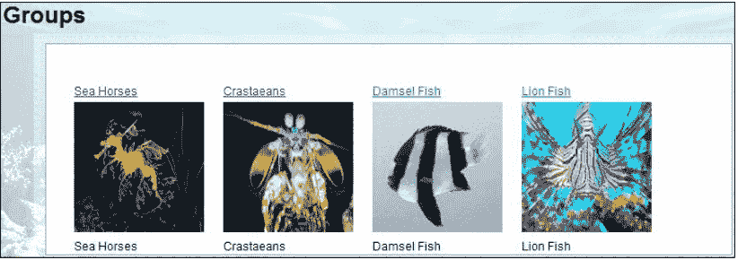
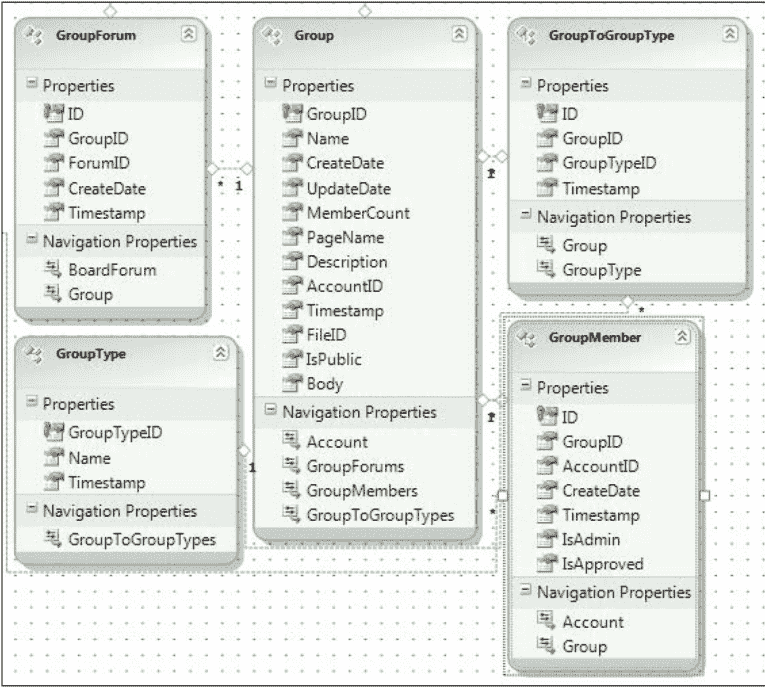
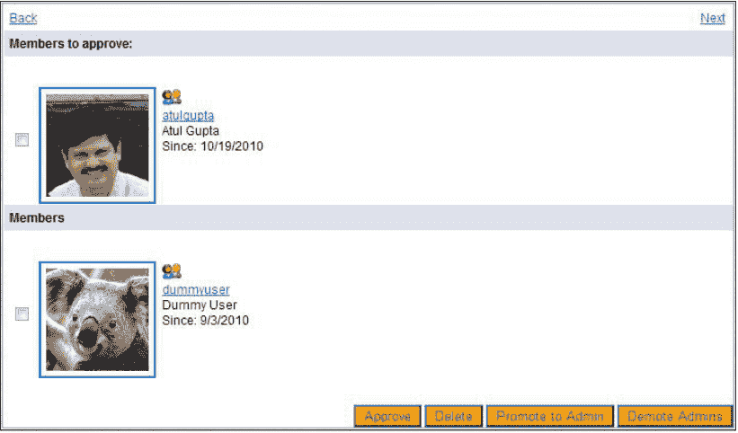
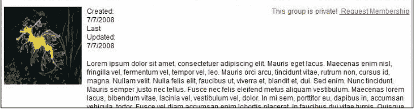
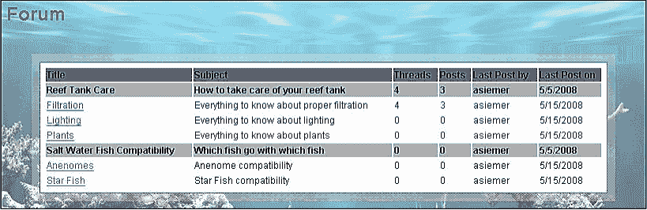

# 10 Groups

什么是 Groups？在社交网络的上下文中，**Groups** 允许你的社区用户围绕共同主题相互交流。Groups 开始将我们其他已创建的概念整合在一起。诸如论坛、博客、图片等项目，以及许多其他功能，都可以从群组的角度得到更好的利用。

以论坛为例。作为我们社区的用户，你可以与预先创建的论坛互动，并且能够在系统中的任何公共论坛上发布主题或回复。你希望其他与你有相似兴趣的用户，或那些能回答你发布问题的用户，会偶然看到你的帖子。很多人会看到你的帖子，有些人会回复。但不能保证合适的人会看到它，更不能保证合适的人会给出你寻求的回应。如果你能够将主题发布到与你的兴趣 somewhat 相关的论坛，那么你的机会会稍微提高一些。

另一方面，有群组拥有的论坛时，你知道有一个特定的社区，在全球社区内部，对你的论坛帖子给予了额外的关注。此外，当你向群组拥有的论坛发帖时，你知道该群组的整个用户群会被告知你的帖子发布情况，通常是通过适当的通知。这增加了你获得所需信息的机会。而且你知道查看你帖子的大多数人很可能拥有你感兴趣的信息。

把群组想象成具有特殊兴趣的子社区。因为它们是子社区，它们在系统中与用户一样拥有生命，只是它们代表许多用户行事。通过成为群组的一部分，你获得了许多具有共同兴趣的新朋友。你可以访问特殊兴趣论坛，你还可以看到隐藏的图片库！

以下是我们将要构建的示例：



### Problem

鉴于示例站点中有如此多的功能，我们不可能将它们全部与我们的群组功能集成。然而，当你阅读本章时，请记住，社区中适用于个人的几乎任何东西都可以被修改以适用于一群人。在本章中，我们将专注于创建群组的核心框架。

我们正在构建的框架将允许我们创建一个群组，该群组在我们的站点中既有公共也有私有的存在。群组还将能够拥有专用的群组页面。

以下是将为群组创建构建的界面：

除了群组的成员资格之外，我们还将提供一种方式，让其中一些成员被视为群组的拥有者或管理员。

一旦基础建立起来，我们将开始连接我们其他的一些功能。我们将允许每个群组拥有自己的论坛。该论坛有一些不同之处，即当用户向论坛发帖时，论坛不会向他们的朋友发送提醒，而是向该群组的所有成员发送提醒。

在未来，我们还可以扩展群组功能，使其拥有自己的过滤器，以类似的方式捕获对账户的用户提醒。我们也可以让相关博客帖子显示在群组的主页上。我们也可以在群组主页上显示最新的论坛帖子。我们可以显示最新上传的图片。并且还可以基于群组基础完成许多其他事情。

### Design

让我们来看看此功能的設計。

#### Groups

Accounts 表是系统中许多项目的核心枢纽的方式相同，Groups 表也可以构建为额外的枢纽。因此，我们将首先处理此功能的创建。群组的表结构并不过于复杂。

你可能已经习惯看到计数在父级中汇总。我们将再次解释我们这样做是为了消除运行聚合查询的需求。相反，当我们加载对象时，我们将自动已经掌握计数。

你可能也习惯看到页面名称的概念。由于群组页面将成为信息的主要中心，我们希望确保就 Google 或其他搜索引擎蜘蛛而言，这是一个真正的页面，而不是某个服务器生成的页面。我们这样做是为了希望获得那些珍贵的 SEO 分数。此外，这对于用户来说更容易知道他们在哪里，并且允许我们的用户向朋友发送可读的 URL，这促进了分享！

最后需要注意的重要一点是我们群组条目中的 IsPublic 标志。这将是告诉我们任何人是否可以访问该群组或只有群组成员可以访问的关键。我们稍后会更详细地讨论这一要求。


## 群组成员（GroupMembers）

一般来说，一个群组中会有不止一个用户来协助运营。因此，我们会在群组中设置一个 AccountID，用来标识群组的所有者。但我们还需要一种方法来追踪群组的所有成员，以及那些同时也是管理员的成员。

从截图中的结构可以看出，我们将通过追踪 GroupID 和 AccountID 来创建群组（Groups）与账户（Accounts）之间的关系。除这些信息外，我们还会记录成员何时申请加入、是否已批准（IsApproved），以及该账户是否也是管理员（IsAdmin）。这为我们创建群组成员提供了所需的一切。

## 群组类型（GroupTypes）

最终我们的系统中会有许多不同类型的群组。作为一项附加功能，我们希望用户能够轻松找到他们可能感兴趣的群组。为了提供这一功能，我们将建立一个系统来追踪群组的类型。将来，我们可以利用这个系统来搜索群组或将它们分组。这个系统还能让我们实现这样的提示：“如果你喜欢这个群组，你可能也会对这些相关群组感兴趣。”

正如你在截图中的关系所看到的，群组可以与多个群组类型关联（反之亦然）。这个结构本身非常简单明了。

## 群组论坛（GroupForums）

正如前面提到的，当用户创建群组时，他们还会获得一个属于该群组的论坛。为了实现这一点，我们需要在群组和新论坛之间建立关联。

这是一个简单的多对多关系，使我们在技术上可以让多个论坛和多个群组相互关联。不过，我们不喜欢在设计上引入限制。因此，万一我们需要一个群组对应多个论坛，或者一个群组拥有多个论坛，我们也能做到。

## 解决方案

现在让我们来看看我们的解决方案。

## 实现数据库

让我们来看看实现数据库所需的内容。下面的截图显示了相关的表。



### 群组（Groups）

请参考前面截图中 Groups 表的结构。该表的大部分内容不言自明。不过，有一点需要特别注意，那就是 **Body** 字段，它在这里是 **varchar(MAX)**。这意味着，从技术上讲，用户可以在这里输入任意数量的文本。如果你不希望提供这种功能，那么可以将这个字段改小，或者对这个字段添加某种客户端验证来限制其大小。

你可能还会好奇，为什么我们有一个较大的 **Description** 字段和一个更大的 **Body** 字段。主要原因是我们需要公共和私有的文本字段。描述可以只是群组页面文本的第一段，也可以是一段简短的概要。这完全取决于你如何组织输出。我们这样设置，使得描述和正文同时显示，描述位于上方。

另一个值得注意的地方是，我们为每个群组都追踪一个 **FileID**。这个引用允许我们向系统上传一张照片，用作群组的头像或标志。

### 群组成员（GroupMembers）

GroupMembers 表允许我们定义谁可以成为我们的群组成员。除了定义成员资格之外，这个表还允许我们接受或拒绝成员。一旦有了成员，我们还可以使用这个结构来定义群组中的其他管理员。

### 群组类型（GroupTypes）

这个表允许我们定义系统要提供的不同群组类型。如果你希望允许用户自定义群组类型，可以添加一个额外的字段来定义该类型是系统定义的还是用户定义的。我们可能会将这个标志命名为 IsSystemType。这将帮助我们定义初始类型库。

一旦创建了 GroupTypes 表，我们就可以将注意力转向捕获群组及其类型之间的关系。请记住，如果合适的话，用户将能够将他们的群组关联到多个类型。

这是一个简单的多对多关系定义表，用来追踪 **GroupID** 和 **GroupTypeID**。

### 群组论坛（GroupForums）

这个表，正如前面描述的许多表一样，只是一个多对多关系表。这个表允许我们的每个群组也拥有一个论坛。我们通过追踪 **GroupID** 和 **ForumID** 来实现这一点。

## 群组（Groups）

### IsOwner

IsOwner 方法负责判断传入的 AccountID 是否是传入的 GroupID 所关联群组的所有者。这是在 DataContext 的 groups 集合上使用 where 子句来执行的，以确定是否拥有所有权。如果返回的项不为 null，那么我们就知道该用户确实是所有者；否则他/她不是。

```csharp
//Fisharoo/DataAccess/Repositories/GroupRepository.cs
public bool IsOwner(int AccountID, int GroupID)
{
    bool result = false;
    using (FisharooDataContext dc = conn.GetContext())
    {
        if (dc.Groups.Where(g => g.AccountID == AccountID &&
                g.GroupID == GroupID).FirstOrDefault() != null)
            result = true;
    }
    return result;
}
```

### CheckIfGroupPageNameExists

这个方法非常重要，因为它判断某个群组的页面名称是否已被使用。

```csharp
//Fisharoo/DataAccess/Repositories/GroupRepository.cs
public bool CheckIfGroupPageNameExists(string PageName)
{
    bool result = false;
    using (FisharooDataContext dc = conn.GetContext())
    {
        Group group = dc.Groups.Where(g => g.PageName ==
                PageName).FirstOrDefault();
        if(group == null)
            result = false;
    }
    return result;
}
```

### GroupToGroupTypeRepository

请记住，这个特定的存储库支持的是一种非常简单的表结构——可以说是一个查找表。因此，这个存储库也相当轻量。我们将只讨论这个存储库中的一个方法。

```csharp
List<GroupToGroupType> GrouptoGroupType = dc.GroupToGroupTypes.Where(g => itemsToDelete.Contains(g.GroupTypeID) && g.GroupID == GroupID).ToList();
foreach (GroupToGroupType gptogpt in GrouptoGroupType)
{
    dc.GroupToGroupTypes.DeleteObject(gptogpt);
}
// create the actual objects to insert and insert
foreach (long l in itemsToInsert)
{
    GroupToGroupType g = new GroupToGroupType()
    {
        GroupID = GroupID, GroupTypeID = l
    };
    dc.GroupToGroupTypes.AddObject(g);
}
dc.SaveChanges();
```

正如你所见，我们基本上只是使用标准的 LINQ 语句来为每个目的创建唯一的项目列表。我们首先获取当前关系的列表。然后，我们列出要删除的项目和要创建的项目。接下来，我们实际删除需要移除的关系。然后创建表示这些关系的对象。接着，我们插入这些对象。在需要编写的代码量方面确实有一些工作量。但请记住，这样做可以最大限度地减少数据库抖动，并且保证数据的干净整洁！

### GroupForumRepository

与我们刚才讨论的存储库相比，GroupForumRepository 更没什么特别之处。这个存储库同样支持一个标准的多对多查找表。

这里的方法都很普通，因为它们都与我们之前在其它存储库示例中看到的方法类似。

### GroupMemberRepository

这个特定的存储库提供了许多辅助性的数据库查询，使我们能够执行批量操作、简单任务（例如在管理员状态之间提升和降级成员），以及判断用户是成员还是管理员等任务。

### GetMemberAccountIDsByGroupID

这个特定的方法无论如何都不复杂。但你会注意到，它从两个数据源创建了一个成员列表。它首先查看 GroupMembers 表定义的所有成员。然后考虑到群组的所有者不在该列表中，因此它还会提取所有者并添加到该列表中。

```csharp
//Fisharoo/DataAccess/Repositories/GroupMemberRepository.cs
public List<int> GetMemberAccountIDsByGroupID(Int32 GroupID)
{
    List<int> result = new List<int>();
    using (FisharooDataContext dc = conn.GetContext())
    {
        result = dc.GroupMembers.Where(gm => gm.IsApproved &&
                         gm.GroupID == GroupID).
                         Select(gm => gm.AccountID).ToList();
        result.Add(dc.Groups.Where(g => g.AccountID ==
                    GroupID).Select(gm => gm.AccountID).FirstOrDefault());
    }
    return result;
}
```

### DeleteGroupMembers

这是一个执行批量操作的方法。我们根据传入方法的 ID 选择一个成员列表。然后，我们将该 GroupMembers 列表传递给 DeleteAllOnSubmit 方法，从而执行批量删除。这将为之后成员管理页面上的多选页面提供支持。

```csharp
//Fisharoo/DataAccess/Repositories/GroupMemberRepository.cs
public void DeleteGroupMembers(List<int> MembersToDelete, int
                               GroupID)
{
    using (FisharooDataContext dc = conn.GetContext())
    {
        IEnumerable<GroupMember> members =
            dc.GroupMembers.Where(gm =>
                MembersToDelete.Contains(gm.AccountID)
                && gm.GroupID == GroupID);
        foreach(GroupMember grpmember in members) {
            dc.GroupMembers.DeleteObject(grpmember);
        }
        dc.SaveChanges();
    }
}
```


## 群组

### GroupTypeRepository

GroupTypeRepository 有一些用于执行基本任务的方法。这些方法都很普通，因此我们在这里不再讨论。

### AccountRepository

这个特定的存储库在多个章节中不断扩展。为了支持群组，我们必须向这个类添加两个新方法——GetApprovedAccountsByGroupID 和 GetAccountsToApproveByGroupID。它们允许我们使用 GroupMembers 表从成员关系的角度查找实际的 Account。我们将获取希望加入我们群组的用户，以及已经是群组成员的用户。

#### GetApprovedAccountsByGroupID

这个方法之所以值得我们关注，主要是因为它支持服务端分页，也就是说，它能够在较大的数据集中显示一个子集。这是通过一些标准的 LINQ 表达式——Skip() 和 Take() 来实现的。

```csharp
//Fisharoo/DataAccess/Repositories/AccountRepository.cs
public List<Account> GetApprovedAccountsByGroupID(int GroupID,
                                                   int PageNumber, int
                                                   NumberOfRecordsInPage)
{
    List<Account> result = null;
    using (FisharooDataContext dc = conn.GetContext())
    {
        IEnumerable<Account> accounts = (from a in dc.Accounts
                                         join m in dc.GroupMembers on a.AccountID equals
                                         m.AccountID
                                         where m.GroupID == GroupID && m.IsApproved
                                         orderby a.AccountID
                                         select a).Skip((NumberOfRecordsInPage *
                                         (PageNumber - 1))).Take(NumberOfRecordsInPage);
        result = accounts.ToList();
    }
    return result;
}
```

在这个方法中，我们接收 GroupID 和 PageNumber。这告诉了我们所关注的数据集合及其子集。LINQ to Entities 查询在调用 Skip() 方法之前是非常标准的。这个调用允许我们告诉查询要从数据集合中的哪一条记录开始。紧接着，我们调用 Take() 方法，它告诉查询从开始记录起，我们希望在返回的数据集中包含多少条记录。

执行跳过逻辑的最简单方式是，用我们希望每页包含的记录数（存储在配置文件的某处）乘以当前页码（减一，因为从技术上讲这是一种基于零的方式）。Take() 方法只需要知道你想用多少条记录来组成页面数据集。

#### GetAccountsToApproveByGroupID

这个方法只是对 GroupMembers 和 Groups 的一个简单查询。

```csharp
//Fisharoo/DataAccess/Repositories/AccountRepository.cs
public List<Account> GetAccountsToApproveByGroupID(int GroupID)
{
    List<Account> result = null;
    using (FisharooDataContext dc = conn.GetContext())
    {
        IEnumerable<Account> accounts = (from a in dc.Accounts
                                         join m in dc.GroupMembers on a.AccountID equals m.AccountID
                                         where m.GroupID == GroupID && !m.IsApproved
                                         select a);
        result = accounts.ToList();
    }
    return result;
}
```

### 实现服务层/应用层

一旦所有用于单一目的的存储库构建完成，我们就可以开始创建服务层。同样，这一层负责组装聚合对象，并用我们的实体执行复杂操作。我们将创建和修改以下服务：

- GroupService
- AlertService
- Redirector
- WebContext

```csharp
form.LastPostByUsername = webContext.CurrentUser.Username;
form.LastPostDate = DateTime.Now;
form.Name = group.Name;
form.PageName = group.PageName;
form.PostCount = 0;
form.Subject = group.Name;
form.ThreadCount = 0;
form.UpdateDate = DateTime.Now;
int ForumID = _forumRepository.SaveForum(form);
//Create relationship between the group and forum
GroupForum gf = new GroupForum();
gf.ForumID = ForumID;
gf.GroupID = group.GroupID;
gf.CreateDate = DateTime.Now;
_groupForumRepository.SaveGroupForum(gf);
}
return result;
}
```

#### AlertService

如果你还没有读过前面的章节，那么 **AlertService** 贯穿这个网站的所有其他代码，因为它为我们提供了一种让用户知道网站上发生了什么的方式。对于群组来说也是如此——不同的是，用户实际上不会与我们的群组进行太多互动。不过，他们可以加入群组，然后在我们的群组论坛中发帖！这里的区别在于，我们不是向用户的所有朋友发送关于论坛帖子的提醒，而是向所有群组所有者发送提醒。

除了我们添加的各种提醒方法之外，这里唯一值得讨论的是 SendAlertToGroup() 方法。

```csharp
//Fisharoo/BusinessLogic/AlertService.cs
private void SendAlertToGroup(Alert alert, Group group)
{
    List<int> groupMembers =
        _groupMemberRepository.GetMemberAccountIDsByGroupID(group.GroupID);
    foreach (int id in groupMembers)
    {
        alert.AlertID = 0;
        alert.AccountID = id;
        SaveAlert(alert);
    }
}
```

该方法接收新创建的提醒，然后获取指定群组的群组成员列表。拿到这些列表项后，它遍历每个群组成员，将其 AccountID 添加到提醒中，然后发送提醒。

> 这可能会成为性能瓶颈。一种更好的做法可能是先创建所有提醒，然后创建一个新的 SaveAlert() 方法，接收一组 Alert 列表以进行批量插入。

#### Redirector

虽然 Redirector 类并不复杂，但它非常重要，因为它将我们的重定向逻辑从页面中抽象出来，并将其提升到业务层。这意味着，如果我们的页面结构发生变化，我们只需去一个地方修改即可。当然，有些情况下我们无法将重定向逻辑塞进 Redirector 类——但请确保不要仅仅为了方便而将重定向逻辑放在页面中！请查阅本章附带的源代码，了解添加到这个类中的新方法。

#### WebContext

与 Redirector 类似，WebContext 类也并不复杂。它的用途很简单，实现这种用途的方式也同样简单。这个类负责充当所有对 HttpContext 类的请求的门面。这意味着，任何时候我们想要访问查询字符串项、表单提交项，或任何由 HttpContext 类直接表示的内容（如应用程序变量），我们都应该使用这个类，而不是直接访问原始来源。

这个类有两个新增项——我们现在有了 NewGroup 属性和 GroupID 属性。你可以查阅本章附带的源代码来了解这些。

### 实现表现层

后台工作全部完成后，让我们开始构建前端。在创建这种性质的应用程序时，总是很难决定从哪里开始。你是先用一些示例测试数据填充数据库，然后构建显示页面？还是先创建数据录入页面，然后再处理显示页面？这次我们将先处理数据录入页面，最后再处理显示页面。考虑到这一点，让我们开始吧。

#### ManageGroup

虽然我们可以创建两个页面来管理群组数据——一个用于新建群组，另一个用于编辑群组——但我们发现创建一个页面、一个 UI 会容易得多，这样我们既可以创建群组也可以编辑群组。这个页面中有几个有趣的功能：我们提供了一个所见即所得（WYSIWYG）编辑器，以及一个图片上传功能。这两个主题是本次讨论中我们涉及最多的功能。

在开始之前，需要了解的是，页面通过两个查询字符串变量的存在来区分不同的状态。第一个变量是 newgroup=1。这显然告诉页面，我们打算创建一个新群组。第二个变量是 GroupID={number}，它允许我们用指定群组的数据填充页面。

##### WYSIWYG

我们选择的 WYSIWYG 编辑器是 Xinha（在前面的章节中我们已经介绍过）。要使用这个编辑器，我们只需放置一个 TextMode 设置为 MultiLine 的文本框。然后在页面更下方，我们必须使用以下代码将完整的控件 ID 传递给 Xinha 引擎：

```javascript
//Fisharoo/Web/Groups/ManageGroup.aspx
<script type="text/javascript">
    xinha_editors[xinha_editors.length] = 'Content_txtDescription';
    xinha_editors[xinha_editors.length] = 'Content_txtBody';
</script>
```

这会创建功能完整的 WYSIWYG 编辑器，你可以根据需要全局配置更多或更少的选项。

##### 图片上传

虽然我们在关于文件、文件夹、图片库等内容的章节中已经讨论过文件上传的主题，但我们觉得可能需要再复习一下。在该章节中，我们将 FileUpload 逻辑存储在一个名为 ReceiveFiles.aspx 的辅助页面中。当网站只有一个需要上传的区域时，这种方法效果很好，但当网站有两个需要上传功能的区域时，它就不再适用了。

出于这个原因，我们将所有上传逻辑移入一个 UploadService。它几乎百分百是从那个文件中复制而来的（所以我们这里不再重复）。然后，在 ReceiveFiles 页面中，我们删除了所有旧代码，并用一行对 UploadService.UploadPhotos 方法的调用来替代。一旦重构完成，我们就可以回过头来满足用户上传照片作为群组徽标的需求。


以下是来自 ManageGroupPresenter 的 SaveGroup 方法（其余代码是标准的管道代码）：

```csharp
//Fisharoo/Web/Groups/Presenters/ManageGroupPresenter.cs
public void SaveGroup(Group group, HttpPostedFile file, List<long> selectedGroupTypeIDs)
{
    if (group.Description.Length > 2000)
    {
        _view.ShowMessage("Your description is " + group.Description.Length.ToString() + " characters long and can only be 2000 characters!");
    }
    else
    {
        group.AccountID = _webContext.CurrentUser.AccountID;
        group.PageName = group.PageName.Replace(" ", "-");
        if (group.GroupID == 0 && _groupRepository.CheckIfGroupPageNameExists(group.PageName))
        {
            _view.ShowMessage("The page name you specified is already in use!");
        }
        else
        {
            if (file.ContentLength > 0)
            {
                List<Int64> fileIDs = _uploadService.UploadPhotos(1, _webContext.CurrentUser.AccountID, _webContext.Files, 1);
                //should only be one item uploaded!
                if (fileIDs.Count == 1)
                    group.FileID = fileIDs[0];
            }
            group.GroupID = _groupService.SaveGroup(group);
            _groupToGroupTypeRepository.SaveGroupTypesForGroup(selectedGroupTypeIDs, group.GroupID);
            _redirector.GoToGroupsViewGroup(group.PageName);
        }
    }
}
```

正如你在前面的代码中所看到的，我们主要在执行一些数据验证和清理工作。如果是一个新群组，我们会验证指定的页面名称在系统中是唯一的。如果页面名称唯一，那么我们就能处理保存请求。在处理保存之前，我们会检查是否有文件正在上传。如果有，则调用 UploadService.UploadPhotos 方法并传入上传文件。然后，我们执行标准的保存操作。本页其余代码是标准的 MVP 事件和数据管道。

## 成员

成功创建群组后，并且能够就地编辑群组，我们就可以将注意力转向管理成员资格。在成员管理页面中，我们将能够批准新的成员请求。我们可以将现有成员提升或降级为管理员状态（允许他们在未来执行各种任务）。我们还可以删除成员。该 UI 将采用多选复选框类型的界面，但不会使用标准的 CheckBoxList 控件。此外，我们还将以自定义方式支持分页功能。



## 群组

正如我们在创建 AccountRepository 的 GetApprovedAccountsByGroupID() 方法时提到的——在该方法中我们传入 GroupID 和 PageNumber——PageNumber 输入指定了我们要在显示中查看的数据子集。你会在前面的截图中注意到有一个**返回**链接（它将我们带回到群组页面）。在它旁边，如果我们不在第一页，就会看到**上一页**。此外，如果 UI 中有已批准的成员，我们还会看到一个**下一页**链接。

## 数据分页

这些“下一页”和“上一页”的概念由 MembersPresenter 中的以下两个方法处理：

```csharp
//Fisharoo/Web/Groups/Presenters/MembersPresenter.cs
public void Next()
{
    _redirector.GoToGroupsMembers(_webContext.GroupID,
                                  (_webContext.PageNumber + 1));
}
public void Previous()
{
    _redirector.GoToGroupsMembers(_webContext.GroupID,
                                  (_webContext.PageNumber - 1));
}
```

正如你所看到的，结合 AccountRepository 中的逻辑，我们有了一个非常简单的分页解决方案，它可以用于任何数据集。此外，虽然我们在这里没有明确讨论，但你应当注意不要超过有效的页码。

## 不使用 CheckBoxList 控件的 CheckBoxLists

另一个无需被迫使用标准控件即可轻松实现的功能是，使用 Repeater 和 CheckBox 控件来创建自定义的 CheckBoxList，这种方法更受欢迎。这种组合只是一个 Repeater 控件和一个 CheckBox。在 Repeater 的 OnItemDataBound 事件中，我们可以将每个选中复选框需要捕获的任何数据作为属性添加到 CheckBox 控件上。

```csharp
//Fisharoo/Web/Groups/Members.aspx.cs
public void repMembersToApprove_ItemDataBound(object sender,
                                             RepeaterItemEventArgs e)
{
    if (e.Item.ItemType == ListItemType.AlternatingItem ||
        e.Item.ItemType == ListItemType.Item)
    {
        ProfileDisplay p = e.Item.FindControl("Profile1") as
            ProfileDisplay;
        CheckBox chkProfile = e.Item.FindControl("chkProfile") as
            CheckBox;
        p.LoadDisplay(((Account)e.Item.DataItem));
        chkProfile.Attributes.Add("AccountID",
            ((Account)e.Item.DataItem).AccountID.ToString());
    }
}
```

然后我们在后台代码中有一个方法来提取选中的值，以便以后使用。

```csharp
//Fisharoo/Web/Groups/Members.aspx.cs
private List<int> ExtractMemberIDs(Repeater repeater)
{
    List<int> result = new List<int>();
    foreach (RepeaterItem item in repeater.Items)
    {
        if (item.ItemType == ListItemType.AlternatingItem ||
            item.ItemType == ListItemType.Item)
        {
            CheckBox chkProfile = item.FindControl("chkProfile") as
                CheckBox;
            if (chkProfile.Checked)
                result.Add(Convert.ToInt32(chkProfile.Attributes[
                    "AccountID"]));
        }
    }
    return result;
}
```

正如你在代码中所见，我们查找的是在 OnItemDataBound 事件中添加的 AccountID 属性。我们通过遍历 Repeater 中的所有项，找出并转换每一项中的复选框控件来实现这一点。然后，无论 Repeater 中有多少项，我们都可以处理选中的值。这里最后要注意的一点是，当成员资格被批准时，系统会向请求该成员资格的用户发送相应的通知。有关详细信息，请参阅 MembersPresenter.cs 中的 ApproveMembers 方法代码。虽然目前尚未实现这一点，但如果请求被拒绝，可以轻松添加类似的通知。

## 默认页

我们群组部分的主页（参见本章第一张截图），即 default.aspx 页面，负责在用户首次进入本网站此部分时，列出系统中的所有群组。该页面调用 GroupService 获取所有最新的群组。然后，它将这一数据集合绑定到 ListView 并输出每个群组。请注意，每个群组名称都有指向自定义群组 PageName.aspx 的实际链接（稍后我们将对此进行更多介绍）。不过，这个页面没有更多内容了。

有关具体工作方式的示例，请参阅代码。

## URL 路由

在深入研究数据管理之前，我们发现自己又到了一个需要重新深入研究 URL 路由的岔路口。由于我们的群组中有 PageName 字段，因此需要讨论如何处理群组的 PageName。一旦完成，我们就可以继续调出并查看群组。这一步是通过在 Global.ascx.cs 的 RegisterRoutes 方法中向路由集合添加一个额外的路由条目来实现的。

```csharp
//Fisharoo/Web/Global.ascx.cs
public static void RegisterRoutes(RouteCollection routeCollection)
{
    routeCollection.MapPageRoute("GroupRoute",
        "groups/{groupname}.aspx", "~/Groups/ViewGroup.aspx");
}
```

一旦我们找到合适的关键字，就可以通过指定的页面名称加载群组实例。这部分由 ViewGroup.aspx 页面处理。

## ViewGroup

该页面负责显示群组详细信息。首先需要关注的是 URL 路由的处理。在后台代码中，我们从路由数据集合中提取群组页面名称，并将其传递给 presenter 以加载特定页面。

```csharp
//Fisharoo/Web/Groups/ViewGroup.aspx.cs
string groupname = Page.RouteData.Values["groupname"] as string;
presenter.Init(this, IsPostBack, groupname);
```


在 presenter 中，我们使用从路由数据集合中获取的 groupname 加载特定群组数据，然后针对公开/私有查看做进一步处理。

```csharp
//Fisharoo/Web/Groups/ViewGroupPresenter.cs
public void LoadData(string groupname)
{
    Group group = _groupService.GetGroupByPageName(groupname);
    string url = "/files/photos/" + _uploadService.GetFullFilePathByFileID(group.FileID, File.Sizes.S);
    _view.LoadData(group, url);
    if(_webContext.CurrentUser != null)
        _view.ShowRequestMembership(true);
    else
        _view.ShowRequestMembership(false);

    //is this public or private data?
    if (group.IsPublic)
    {
        _view.ShowPrivate(true);
        _view.ShowPublic(true);
    }
    else if (ViewerIsMember(group.GroupID))
    {
        _view.ShowPrivate(true);
        _view.ShowPublic(true);
    }
    else
    {
        _view.ShowPrivate(false);
        _view.ShowPublic(true);
    }
}
```

除了显示数据之外，它还作为我们查看和管理与群组相关的其他部分（例如群组拥有的论坛）的起点。

## 私有/公开

判断群组是公开还是私有，只需检查数据库中设置的一个位标志即可；而判断谁能实际看到私有群组则稍显复杂（请参阅上面的 presenter 代码）。

回想一下，我们创建了一些辅助函数，用来判断用户是群组的所有者、成员还是管理员。在 ViewGroupPresenter 中，我们调用 ViewMembers 方法来确定用户所处的位置。

```csharp
//Fisharoo/Web/Groups/Presenters/ViewGroupPresenter.cs
public void ViewMembers()
{
    _redirector.GoToGroupsMembers(_webContext.GroupID);
}
```

这让我们能够快速轻松地判断是否可以显示私有群组。如果不能，则向用户显示相应消息，说明该群组为私有，并提示他们申请加入。当你请求成为成员时，会向群组所有者发送一条关于此请求的提醒。

```csharp
//Fisharoo/Web/Groups/Presenters/ViewGroupPresenter.cs
public void RequestMembership(string groupID)
{
    _alertService.AddGroupMembershipRequestAlert(gm.AccountID, gm.GroupID, _webContext.CurrentUser.Username);
}
```



如果你是群组成员或群组所有者，则会看到群组描述下方的成员列表。

## MyGroups

MyGroups 页面是主页面的一个副本，因为它同样会流式展示一堆群组。最直接的区别是，此页面上的所有群组都属于当前查看者。除了安全检查和数据源变更之外，我们还提供了一些额外功能。在这个页面上，我们可以删除选中的群组，还可以链接到 ManageGroup.aspx 页面。

## 群组

```csharp
LinkButton lbPageName = e.Item.FindControl("lbPageName") as LinkButton;
ImageButton ibDelete = e.Item.FindControl("ibDelete") as ImageButton;
Literal litGroupID = e.Item.FindControl("litGroupID") as Literal;
ImageButton ibEdit = e.Item.FindControl("ibEdit") as ImageButton;
ibDelete.Attributes.Add("GroupID", litGroupID.Text);
ibEdit.Attributes.Add("GroupID", litGroupID.Text);
ibDelete.Attributes.Add("onclick", "return confirm(\"Are you sure you want to delete this group?\");");
lbPageName.Attributes.Add("PageName", litPageName.Text);
imgGroupImage.ImageUrl = "/files/photos/" + _presenter.GetImageByID(Convert.ToInt64(litImageID.Text), File.Sizes.S);
}
}
}
```

## 论坛增强

前面我们讨论过，将会有群组拥有并运营的论坛。为了实现这一点，我们必须在论坛系统中添加一个新类别，专门称为**群组论坛（group-forums）**。然后，我们将该类别从论坛类别显示（论坛主页）中排除。这由 BoardCategoryRepository.GetAllCategories() 方法处理。论坛主页仍然看起来像这样：



这里不存在任何群组类别！还要注意，显示中没有**海马（sea-horses）**论坛，而我们可以从**海马（sea-horses）**群组清晰地链接到**海马（sea-horses）**论坛。回想一下，前面我们讨论过，当 GroupService 创建群组时，我们也会创建一个新论坛，并将其附加到**群组论坛（group-forums）**类别（类别 4）。有了这个机制，当加载 ViewGroup 页面时，我们也可以加载该群组的论坛链接。

此外，回想一下我们向 AlertService 添加了几个方法。这些方法允许我们向群组的所有成员发送提醒，而不是仅向发帖人的好友发送提醒。到目前为止，我们还没涉及的集成细节是：发帖的论坛页面如何知道它是否是一个群组拥有（group-owned）的论坛。

为创建此功能而修改的论坛系统部分只有 PostPresenter.Save() 方法（上一章已介绍）。在该方法的末尾，我们添加了一些代码，用于判断是否可以根据 ForumID 加载群组。

> 请记住，此逻辑只有在以下情况下才有效：我们规定一个群组只能拥有一个论坛（反之亦然）。目前，我们是在创建群组时创建关联来实现这一点的。但是，如果你提供其他工具来创建论坛或群组，则需要记住，必须加入某种形式的验证，否则我们目前讨论的这种群组/论坛验证就需要更改！

```csharp
//Fisharoo/Web/Forums/Presenters/PostPresenter.cs
if (post.IsThread)
    thread = _postService.GetPostByID(post.PostID);
else
    thread = _postService.GetPostByID((long)post.ThreadID);

//CHAPTER 10- is this forum part of a group?
Group group = _groupService.GetGroupByForumID(forum.ForumID);

//add an alert to the filter
if (post.IsThread)
{
    //CHAPTER 10- is this a group forum?
    if (group != null)
        _alertService.AddNewBoardThreadAlert(category, forum,
            thread, group);
    else
        _alertService.AddNewBoardThreadAlert(category, forum, thread);
}
else
{
    //CHAPTER 10- is this a group forum?
    if (group != null)
        _alertService.AddNewBoardPostAlert(category, forum, post,
            thread, group);
    else
        _alertService.AddNewBoardPostAlert(category, forum, post, thread);
}

RouteValueDictionary values = new RouteValueDictionary {
    {"categoryname", category.Name}, {"forumname", forum.Name},
    {"postid", thread.PostID} };
VirtualPathData vpd = RouteTable.Routes.GetVirtualPath(null,
    "ThreadRoute", values);
_redirector.GoToForumsViewPost(vpd.VirtualPath);
```

有了这段代码，我们的论坛不仅知道自己属于某个群组，而且还能向群组成员（而非仅限于好友）发送提醒。

## 总结

有了这个核心框架，你可以看到群组如何将许多不同的系统汇集在一起，从而开始创建子社区。显然，这个部分还可以加入许多其他功能。就我目前想到的，以下几个功能的集成可能会为群组部分增添一些有趣的亮点：

- 消息
  - 你可以创建一个“发送到群组”的所见即所得（WYSIWYG）区域，向所有群组成员发送消息。
  - 此外，你还可以将用户加入的所有群组整合到消息系统中，这样群组名称就可以作为联系人名称，直接从邮件部分群发消息。
- 好友
  - 群组成员可以很方便地整合为好友。
  - 你不仅可以在用户配置中指定公开、私有和好友区域，还可以添加类似“我所属群组的成员”这样的筛选器。
