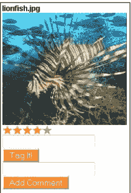
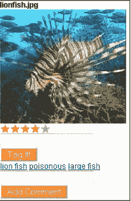
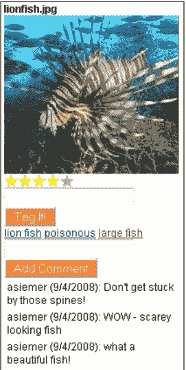
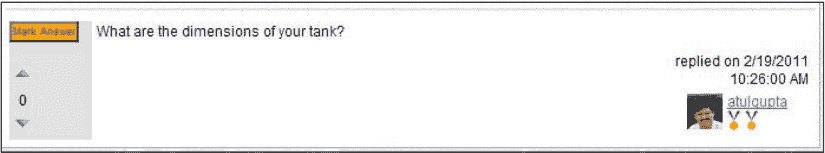
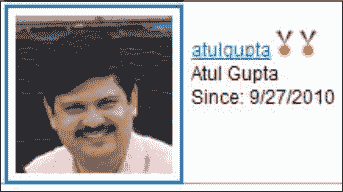

# 11 用户交互

让我们的用户能够对网站内容进行评论、添加标签和评分，可以为他们提供一定程度的交互性，使他们愿意一次又一次地回来。这些功能之所以能激起用户的好奇心，主要有两个原因。首先，对任何可接触到的事物发表看法是人类的天性。一旦第一群用户对所有内容都发表了自己的看法，你会发现第二群用户会开始关注并与那些评分最高、评论和标签最多的内容进行互动。

在本章中，我们将深入探讨如何创建一个灵活的系统，使我们可以为系统中的任何对象（在数据库级别）添加标签、评分、投票和评论。我们将把标签、评分和评论系统应用到照片库部分，并将投票、标记为答案和勋章应用到论坛部分。标签和评论会相对直接，因为它们只是获取用户的原始输入并将其与各个内容区域关联。另一方面，评分系统将使用 ASP.NET AJAX 库，在带有评分控件的模态窗口中提供多个属性，这些属性聚合后就会为该条目提供平均分。


在模态窗口中，用户将拥有多个动态生成的属性，可以对每个属性进行单独评分。所有这些评分随后会被汇总，以提供该项目的最终评分。一旦我们收到了对某个项目的评分，我们将感谢用户提供输入，然后显示平均评分，如下一张截图所示：



## Tagging

Tagging 是一种功能，允许我们为任何对象附加关键词（在我们的案例中为图像）。每个关键词都附带一个分数，这使我们能够构建一个标签云，其中最大的标签会移至顶部，展示系统中使用的最多的关键词。此控件将以灵活的方式创建，允许我们捕获新标签，显示附加到某个对象的标签，显示附加到某个部分的标签，以及附加到整个站点的标签。

我们允许用户为图像添加标签，然后将标签显示为该图像的子云。



### User Interactivity

我们将在本章后面介绍用于动态确定字体大小的算法，以及此控件中内置的一些灵活性。

## Commenting

Commenting 允许我们的用户对资源提供更具体的输入。这可以稍后集成到我们的搜索功能中，以帮助我们将内容传递给用户。除此之外，它还允许用户就资源交换评论，从而激发其他用户的兴趣。



## Mark as answer

对于任何论坛来说，要成功，重要的是拥有发布问题和回复现有帖子的基本基础设施。一旦我们创建了第 9 章中的基本基础设施，下一个重要事项就是确保对发布查询的解决/响应，因为最终这将推动用户数量进入论坛。为了确保论坛成功，它们应提供将回复接受为答案的能力，同时也允许其他用户对问题及其回复进行投票。这些操作在内部链接到一个评分系统。当用户达到一定的总分数时，他们将被授予奖牌。虽然每个被接受为答案的帖子会获得一定的分数，但其他帖子也需要被重视，以确保用户继续对发布回复感兴趣。这是通过为所有回复授予分数来实现的，即使它们未被接受为答案。在这种情况下授予的分数显然低于发布答案所获得的分数。我们将采用接受答案得 10 分，所有其他帖子得 5 分的方案。



## Voting

Mark as answer，如前所述，是由提出初始查询的用户使用的。但我们如何让社区参与讨论呢？一种方法是投票。用户可能会发现问题和回复对他们自己的目的有用，因此会想要给予积极投票。类似地，其他用户可能认为内容不相关，可以给予消极投票。消极投票将导致相关用户在总分数上损失，并导致他们失去奖牌。这将起到遏制用户发布不相关回复的作用。

## Medals

随着时间的推移，用户通过累积分数建立他们的资质。这些资质可以通过奖牌来体现为等级。在 Fisharoo 中，当用户达到一定的总分数时，我们会授予他/她一个奖牌。达到下一个分数等级后，我们会授予他/她额外的奖牌，依此类推。用户拥有的奖牌越多，他们在社交网络网站上拥有的资质就越强。与评分系统类似，奖牌的等级范围为 1 到 5，其中 1 为初学者，5 为网站上声誉最高的<|message|>。



## Design

让我们来看看此功能的[content]

在模态窗口中，用户将拥有多个动态生成的属性，可以对每个属性进行单独评分。所有这些评分随后会被汇总，以提供该项目的最终评分。一旦我们收到了对某个项目的评分，我们将感谢用户提供输入，然后显示平均评分，如下一张截图所示：


## Tagging

Tagging 是一种功能，允许我们为任何对象附加关键词（在我们的案例中为图像）。每个关键词都附带一个分数，这使我们能够构建一个标签云，其中最大的标签会移至顶部，展示系统中使用的最多的关键词。此控件将以灵活的方式创建，允许我们捕获新标签，显示附加到某个对象的标签，显示附加到某个部分的标签，以及附加到整个站点的标签。

我们允许用户为图像添加标签，然后将标签显示为该图像的子云。


### User Interactivity

我们将在本章后面介绍用于动态确定字体大小的算法，以及此控件中内置的一些灵活性。

## Commenting

Commenting 允许我们的用户对资源提供更具体的输入。这可以稍后集成到我们的搜索功能中，以帮助我们将内容传递给用户。除此之外，它还允许用户就资源交换评论，从而激发其他用户的兴趣。


## Mark as answer

对于任何论坛来说，要成功，重要的是拥有发布问题和回复现有帖子的基本基础设施。一旦我们创建了第 9 章中的基本基础设施，下一个重要事项就是确保对发布查询的解决/响应，因为最终这将推动用户数量进入论坛。为了确保论坛成功，它们应提供将回复接受为答案的能力，同时也允许其他用户对问题及其回复进行投票。这些操作在内部链接到一个评分系统。当用户达到一定的总分数时，他们将被授予奖牌。虽然每个被接受为答案的帖子会获得一定的分数，但其他帖子也需要被重视，以确保用户继续对发布回复感兴趣。这是通过为所有回复授予分数来实现的，即使它们未被接受为答案。在这种情况下授予的分数显然低于发布答案所获得的分数。我们将采用接受答案得 10 分，所有其他帖子得 5 分的方案。


## Voting

Mark as answer，如前所述，是由提出初始查询的用户使用的。但我们如何让社区参与讨论呢？一种方法是投票。用户可能会发现问题和回复对他们自己的目的有用，因此会想要给予积极投票。类似地，其他用户可能认为内容不相关，可以给予消极投票。消极投票将导致相关用户在总分数上损失，并导致他们失去奖牌。这将起到遏制用户发布不相关回复的作用。

## Medals

随着时间的推移，用户通过累积分数建立他们的资质。这些资质可以通过奖牌来体现为等级。在 Fisharoo 中，当用户达到一定的总分数时，我们会授予他/她一个奖牌。达到下一个分数等级后，我们会授予他/她额外的奖牌，依此类推。用户拥有的奖牌越多，他们在社交网络网站上拥有的资质就越强。与评分系统类似，奖牌的等级范围为 1 到 5，其中 1 为初学者，5 为网站上声誉最高的 fiy。


## Design

让我们来看看此功能的


## 用户交互性

最终的复杂性完成了标签云。我们将拥有表格来适当保存数据。我们将拥有捕获和显示数据的控件。但标签云的真正关键在于它如何显示。**标签云**以与云中整体流行度排名相对应的大小显示每个标签（一个关键词或多个词）。这意味着标签在云中使用的越多，标签在云中就越大。另一方面，使用频率较低的标签在云中显示得更小。我们将在适当的时候全面讨论此排序背后的算法。

### 评论

与我们花哨的评分和标签控件相比，评论控件并不特别突出。虽然它不突出，但它仍然适合本章，因为这是用户为您的内容提供非常具体内容的另一种方法。评论将在您将收集到的内容整合到网站的搜索结果中时派上用场。此外，我们友好的搜索引擎也会喜欢吃掉您新的内容特定评论。

该系统与另外两个系统一样，将围绕 SystemObject 表构建。除了该表之外，我们还将有一个 Comments 表。Comments 表不仅会收集所有正常数据，还会收集评论正文。就这样！

### 投票

为了跟踪投票，我们在 BoardPost 表中添加了一个名为 **VoteCount** 的非空整数列。为了跟踪被标记为答案的帖子，我们还在 BoardPost 表中添加了位列 **isAnswer**（非空）。

### 奖章

为了跟踪特定账户/用户的总得分，我们在 Accounts 表中添加了一个整数列作为 **Score**。得分将根据设计部分中定义规则进行递增，并据此授予 Badges。

### 解决方案

让我们来看看我们的解决方案。

### 评分

**Ratings** 表负责保存所有最终用户评分。如您所见，每个评分都关联回 **SystemObjects** 表，并直接关联到指定表中的记录。此外，我们还跟踪被评分的选项。该表中最重要的部分是 **Score** 字段。**Score** 跟踪最终用户选择的星级数量（就我们而言）。

#### 系统对象评分选项

除了 ratings 表之外，我们还拥有 **SystemObjectRatingOptions** 表。该表跟踪我们每个系统对象可用的所有选项。

### 标签

Tags 表负责保存用户附加到系统中各种对象的所有文本标签。考虑到我们打算为系统中多个对象收集大量相同标签，维护一个唯一的标签列表及其计数非常重要，而不是为系统中输入的每个标签创建一个条目，然后再对标签求和以获取计数。从性能角度来看，在收集标签时维护聚合值，将比每次需要计数时确定汇总值更容易胜任。

#### 系统对象标签

这就引出了我们的 **SystemObjectTags** 表。它负责维护哪个标签连接到哪种类型对象的哪个记录的详细信息。该表仅维护各种记录 ID 以跟踪关系。

### 评论

这最终引出了 Comments 表。在五项功能中，这无疑是最容易实现的，因为该表直接为我们跟踪所有内容。在这种情况下，每个评论都被假定为唯一，并因此直接链接到一个对象以及该对象中的一条记录。我们还跟踪留下评论的用户（**CommentByAccountID**）以及何时（**CreateDate**）留下评论。评论的当前大小可达 2,000 个字符。然而，如果您的社区需要大评论，您当然可以增加这个数字。

### 投票和标记为答案

投票在单个线程/帖子级别管理。我们不需要为此新建一个表，而是扩展我们的 BoardPosts 表以添加两个新列——VoteCount 和 IsAnswer。投票数量的变化或答案的设置将导致相关用户的得分发生变化。

### 奖章

奖章取决于用户获得的总得分。为此，我们将扩展现有的 Accounts 表并添加一个名为 Score 的新列。Medals 用户控件将显示适当的奖章数量。我们将在讨论表示层细节时稍后查看。

### 创建关系

一旦所有表都创建完毕，我们就可以创建所有关系。

对于这组表，我们在以下表之间存在关系：

- Ratings 和 Accounts
- Ratings 和 SystemObjectRatingOptions
- Ratings 和 SystemObjects
- SystemObjectRatingOptions 和 SystemObjects
- SystemObjectTags 和 Accounts
- SystemObjectTags 和 SystemObjects
- SystemObjectTags 和 Tags
- Comments 和 Accounts
- Comments 和 SystemObjects

### 设置数据访问层

要设置数据访问层，我们按照前面章节中已完成的方法执行步骤。打开 Fisharoo.edmx 文件并添加上述所有表。

### 构建存储库

随着新表的添加，将会添加新的存储库，以便我们可以获取存储在这些表中的数据。我们将创建以下存储库来支持我们的需求：

- RatingRepository
- SystemObjectRatingOptionRepository
- TagRepository
- SystemObjectTagRepository
- CommentRepository

我们的每个存储库通常都有一个按 ID 选择、按父 ID 选择所有、保存和删除的方法。一旦您看过一个存储库，您基本上就看过它们全部了。查看前面的章节、附录或包含的代码，例如标准存储库。在这里，我们只讨论与标准不同的内容！

#### RatingRepository

让我们来看看 RatingRepository。

##### HasRatedBefore()

HasRatedBefore() 方法接收 SystemObjectID、SystemObjectRecordID 和 AccountID，以检查该账户是否已为指定对象提供过评分。如果已提供，则 HasRatedBefore() 方法返回 true，否则返回 false。

```csharp
//Fisharoo/DataAccess/Repositories/RatingRepository.cs
public bool HasRatedBefore(int SystemObjectID, long SystemObjectRecordID, int AccountID)
{
    bool result = false;
    using(FisharooDataContext dc = conn.GetContext())
    {
        if (dc.Ratings.Where(r => r.SystemObjectID == SystemObjectID && r.SystemObjectRecordID == SystemObjectRecordID && r.CreatedByAccountID == AccountID).Count() > 0)
            result = true;
    }
    return result;
}
```

##### GetCurrentRating()

GetCurrentRating() 方法负责确定系统中特定对象的平均评分。

```csharp
//Fisharoo/DataAccess/Repositories/RatingRepository.cs
public int GetCurrentRating(int SystemObjectID, long
                            SystemObjectRecordID)
{
    double result;
    using(FisharooDataContext dc = conn.GetContext())
    {
        if (dc.Ratings.Where(r => r.SystemObjectID == SystemObjectID
                                  && r.SystemObjectRecordID ==
                                     SystemObjectRecordID).Count() > 0)
        {
            result =
                dc.Ratings.Where(
                    r => r.SystemObjectID == SystemObjectID &&
                         r.SystemObjectRecordID == SystemObjectRecordID).
                    Select(r => r.Score).Average();
        }
        else
            result = 0;
    }
    return Convert.ToInt32(result);
}
```

此方法检查系统是否对指定对象有任何评分。如果有，我们就对 Ratings 集合执行查询，查找我们指定的对象。我们只关心返回对象的平均分数，因此我们可以定位我们的评分，然后调用 Select() 方法。Select() 方法从所有对象中获取 Score 字段。从那里，我们可以调用 Average() 来获取所有评分的所有分数的平均值。如果没有评分，则将结果设置为 0。

##### SaveRatings()

我们习惯于构建一个具有单个对象保存方法的存储库。这相当直接。这里我们将专注于构建一个方法，该方法可以一次处理多个评分。

```csharp
//Fisharoo/DataAccess/Repositories/RatingRepository.cs
public void SaveRatings(List<Rating> ratings)
{
    using (FisharooDataContext dc = conn.GetContext())
    {
```


```csharp
int varCreatedByAccountID = ratings[0].CreatedByAccountID;

// get a list of items that have been rated before
List<long> previouslyRatedSystemObjectRecordIDs =
    dc.Ratings.Where(r =>
        r.CreatedByAccountID == varCreatedByAccountID)
    .Select(r => r.SystemObjectRecordID)
    .ToList();

foreach (Rating rating in ratings)
{
    if (!previouslyRatedSystemObjectRecordIDs.Contains(
        rating.SystemObjectRecordID))
        dc.Ratings.AddObject(rating);
}
dc.SaveChanges();
```

这个方法其实并不复杂。首先，它接收一个 **Rating** 对象的泛型列表。一旦它打开连接并获取 DataContext，我们就确定用户之前已经评价过哪些条目（因为我们不希望每个用户对每个对象有多条评价！）。然后我们遍历所有传入的评价。一旦确认用户尚未评价过该选项，我们就将评价对象添加到 DataContext 中。在附加所有适当的评价后，我们保存更改。

## SystemObjectRatingOptionRepository

这个特定的仓库只有三个方法：**GetSystemObjectRatingOptionsBySystemObjectID()**（这个名字可真长！）、**SaveSystemObjectRatingOption()** 和 **DeleteSystemObjectRatingOption()**。这些都是非常标准的方法，功能正如其名。查看这个仓库的代码是了解标准仓库的绝佳示例！

## TagsRepository

这个仓库在我们构建标签云时被大量使用。这里有几个方法需要介绍。

### GetTagsBySystemObjectAndRecordID()

最后，我们来到了这个方法，它获取指定对象在记录级别的所有标签。这是针对某种类型的特定条目的方法。该方法用于在被打标签的条目旁边显示所有标签。

```csharp
//Fisharoo/DataAccess/Repositories/TagsRepository.cs
public List<Tag> GetTagsBySystemObjectAndRecordID(int SystemObjectID, long SystemObjectRecordID)
{
    List<Tag> results = null;
    using (FisharooDataContext dc = conn.GetContext())
    {
        results = (from t in dc.Tags
            join sot in dc.SystemObjectTags on t.TagID equals sot.TagID
            where sot.SystemObjectID == SystemObjectID &&
                sot.SystemObjectRecordID == SystemObjectRecordID
            select t).Distinct().OrderBy(t => t.CreateDate).ToList();
    }
    return results;
}
```

## SystemObjectTagRepository

这个仓库中有三个方法：GetSystemObjectsByTagID()、SaveSystemObjectTag() 和 DeleteSystemObjectTag()。这里我们只讨论 GetSystemObjectsByTagID() 方法。

### GetSystemObjectsByTagID()

这是一个相当庞大的方法。它用于获取与某个标签关联的所有对象。当我们点击标签链接显示标签及其链接时，会使用这个方法。

> 目前这个方法只允许加载一个标签。但这个限制仅限于方法的输入侧。该方法的内部逻辑完全可以处理多个标签。

```csharp
//Fisharoo/DataAccess/Repositories/SystemObjectTagRepository.cs
public List<SystemObjectTagWithObject> GetSystemObjectsByTagID(int TagID)
{
```

```csharp
switch (tag.SystemObjectID)
{
    case 1:
        result.Add(new SystemObjectTagWithObject() {
            SystemObjectTag = tag, Account = accounts.Where(a => a.AccountID == tag.SystemObjectRecordID).FirstOrDefault() });
        break;

    case 2:
        result.Add(new SystemObjectTagWithObject() {
            SystemObjectTag = tag, Profile = profiles.Where(p => p.ProfileID == tag.SystemObjectRecordID).FirstOrDefault() });
        break;

    case 3:
        result.Add(new SystemObjectTagWithObject() {
            SystemObjectTag = tag, Blog = blogs.Where(b => b.BlogID == tag.SystemObjectRecordID).FirstOrDefault()
        });
        break;

    case 4:
        result.Add(new SystemObjectTagWithObject() {
            SystemObjectTag = tag, BoardPost = posts.Where(p => p.PostID == tag.SystemObjectRecordID).FirstOrDefault()
        });
        break;

    case 5:
        //need to get the file for use in getting the folder as well
        File file = files.Where(f => f.FileID == tag.SystemObjectRecordID).FirstOrDefault();
        result.Add(new SystemObjectTagWithObject()
        {
            SystemObjectTag = tag,
            File = file,
            Folder = folders.Where(f => f.FolderID == file.DefaultFolderID).FirstOrDefault()
        });
        break;

    case 6:
        result.Add(new SystemObjectTagWithObject() {
            SystemObjectTag = tag, Group = groups.Where(g
```

- WebContext
- Extensions
- AccountService

## TagService

TagService 中有一些负责添加标签和计算字体大小的功能。

### AddTag()

我们有一个 AddTag() 方法，负责向数据库中添加标签。你可能会问，为什么我们不能直接在 TagRepository 中处理这个问题。在这种情况下，我们要做的不仅仅是向系统中塞入一条新记录。这里我们需要检查是否已经存在该标签。如果不存在，那么我们需要创建一个新标签。如果标签已经存在，那么我们需要增加该标签的计数，并可以将标签保存回系统中。

除了向系统中添加标签外，我们还需要为该标签及其关联对象创建关系。这是一项直接的工作。我们只需用相应的 TagID 创建一个新的 SystemObjectTag。然后就可以将其放入数据库。

```csharp
//Fisharoo/BusinessLogic/TagService.cs
public void AddTag(string TagName, int SystemObjectID, long SystemObjectRecordID)
{
    Tag tag = _tagsRepository.GetTagByName(TagName);
    if (tag == null)
    {
        tag = new Tag();
        tag.CreateDate = DateTime.Now;
        tag.Name = TagName;
        tag.Count = 1;
    }
    else
    {
        tag.Count += 1;
    }
    tag = _tagRepository.SaveTag(tag);
    SystemObjectTag sysObjTag = new SystemObjectTag();
    sysObjTag.CreateDate = DateTime.Now;
    sysObjTag.CreatedByAccountID = _webContext.CurrentUser.AccountID;
    sysObjTag.CreatedByUsername = _webContext.CurrentUser.Username;
    sysObjTag.SystemObjectID = SystemObjectID;
    sysObjTag.SystemObjectRecordID = SystemObjectRecordID;
    sysObjTag.TagID = tag.TagID;
    _systemObjectTagRepository.SaveSystemObjectTag(sysObjTag);
}
```

### CalculateFontSize()

CalculateFontSize() 方法负责接收一组标签并计算每个标签的字体大小。这个计算有点门道，因为有些标签的计数可能非常大，而其他标签可能只被应用到少数几个项目上。如果我们直接用这些数字来计算字体大小，最终可能会出现标签比页面还大，或者小到无法阅读的情况。因此，我们需要让数字适配到更合理的范围内。这就是我们将要讨论的计算过程。

在完整查看方法之前，我们先讨论一些将要使用的变量：

- **MinimumRange**：该变量将保存我们标签集合中的最小计数。这将构成我们集合的下界。它对整个计算是全局的。
- **MaximumRange**：该变量将保存我们标签集合中的最大计数。这将构成我们集合的上界。它对整个计算是全局的。
- **Delta**：该变量将保存 **MinimumRange** 和 **MaximumRange** 之间的差值。它对整个计算是全局的。
- **Tag.InitialValue**：这将保存每个标签的计数的副本。
- **Tag.MinimumOffset**：这是 **InitialValue** 减去 **MinimumRange**。
- **Tag.Ranged**：该值是 **MinimumOffset** 除以 **Delta**。
- **Tag.PreCalculatedValue**：这是 **Ranged** 值乘以最大字体大小与最小字体大小之差再减一（largest-smallest-1）。
- **Tag.FinalCalculatedValue**：这是 **PreCalculatedValue** 加一。
- **Tag.FontSize**：这是 **FinalCalculatedValue** 加上最小字体大小。

所有这些计算的结果是一组标签，无论是最小标签计数和最大标签计数之间的差异，还是最小和最大字体大小之间的差异，它们都能平滑地增长。


## 用户交互性

这种方法的下一层复杂度在于我们希望对云中的标签进行何种排序。我们是从小到大、从大到小，还是随机排序？我们将这交给一个配置值来决定。如果我们希望从小到大排序，可以在 Tags 集合上使用 `OrderBy()` 方法。如果我们希望从大到小排序，可以使用 `OrderByDescending()` 方法。如果我们想随机排序该怎么办？我们将向 Extensions 类添加一个新方法 `ShuffleList()`，它将扩展 `Tag` 类型的泛型列表，负责对集合中的项目进行随机打乱。稍后我们将讨论该方法。

```csharp
//Fisharoo/BusinessLogic/TagService.cs
public List<Tag> CalculateFontSize(List<Tag> Tags)
{
    decimal MinimumRange;
    decimal MaximumRange;
    decimal Delta;
    //get the smallest count in this list
    MinimumRange = (Tags.OrderBy(t => t.Count).Take(1).Select(t =>
                                      t.Count).FirstOrDefault()) * 100;
    //get the largest count in this list
    MaximumRange = (Tags.OrderByDescending(t =>
                                      t.Count).Take(1).Select(t => t.Count).
                                      FirstOrDefault()) * 100;
    //determine the difference between the minimum and the maximum
    Delta = MaximumRange - MinimumRange;
    if (Tags.Count > 1)
    {
        for (int i = 0; i < Tags.Count(); i++)
        {
            //set a working value
            Tags[i].InitialValue = Tags[i].Count*100;
            //calculate the minimum offset
            Tags[i].MinimumOffset = Tags[i].InitialValue -
                                    MinimumRange;
            //calculate the ranged value
            Tags[i].Ranged = Tags[i].MinimumOffset/Delta;
            //calculate the pre calculation
            Tags[i].PreCalculatedValue = Tags[i].Ranged*
                                         ((_configuration.TagCloudLargestFontSize -
                                         _configuration.AddToTagCloudFontSize) - 1);
            //calculate the final value
            Tags[i].FinalCalculatedValue = Tags[i].PreCalculatedValue
                                           + 1;
            //calculate the font size
            Tags[i].FontSize =
Convert.ToInt32(Tags[i].FinalCalculatedValue +
    _configuration.AddToTagCloudFontSize);
        }
    }
    //if a standard sort is not what you require, you can call
    //Tags.Sort();
    //  The Tags.Sort() method (in the Tag.cs partial class)
    //  can be
    //  modified to use different properties to sort by
    if (_sortOrder == CloudSortOrder.Ascending) //small to tall
    {
        Tags = Tags.OrderBy(t => t.FinalCalculatedValue).ToList();
    }
    else if (_sortOrder == CloudSortOrder.Descending) //tall to small
    {
        Tags = Tags.OrderByDescending(t =>
            t.FinalCalculatedValue).ToList();
    }
    else
    {
        Tags.ShuffleList(); //randomize!
    }
    return Tags;
}
```

## 扩展

我们将向 Extensions 类添加一个名为 `ShuffleList()` 的扩展方法，它负责打乱 Tags 列表中的项目。我们在 Experts-Exchange.com 上找到了这段代码：http://www.experts-exchange.com/Programming/Languages/C_Sharp/Q_22571864.html

```csharp
//Fisharoo/Common/Extensions.cs
public static List<Tag> ShuffleList(this List<Tag> listToShuffle)
{
    Random randomClass = new Random();
    for (int k = listToShuffle.Count-1; k > 1; --k)
    {
        int randIndx = randomClass.Next(k); //
        Tag temp = listToShuffle[k];
        listToShuffle[k] = listToShuffle[randIndx]; // move random
                                                   // num to end of list.
        listToShuffle[randIndx] = temp;
    }
    return listToShuffle;
}
```

## AccountService

我们之前已经讨论过这个服务，因此这里只讨论所做的更改。

### SaveAccount()

该方法调用相应仓库的保存方法，将账户及其更新后的分数保存到数据库中。它还处理根据 ScoreInput 变量增加账户分数的逻辑。该分数将用于向用户显示勋章。

如果帖子是对已有问题的回复，则帖子所有者的账户分数增加 1。如果该回复被投票为有用，则帖子所有者的分数增加 5；如果被投票为无用，则分数减少 5。在减少时，我们确保分数不会低于零。如果该回复被标记为答案，则帖子所有者的账户分数增加 10。

```csharp
public void SaveAccount(Account account, BoardPost.ScoreInput value)
{
    if (account.AccountID > 0)
    {
        switch (value)
        {
            case BoardPost.ScoreInput.ReplyPost:
                account.Score += 1;
                break;
            case BoardPost.ScoreInput.VoteUseful:
                account.Score += 5;
                break;
            case BoardPost.ScoreInput.VoteNotUseful:
                if (account.Score > 5)
                    account.Score -= 5;
                else
                    account.Score = 0;
                break;
            case BoardPost.ScoreInput.MarkedAsAnswer:
                account.Score += 10;
                break;
            default:
                break;
        }
    }
    _accountRepository.SaveAccount(account);
}
```

## WebContext

这里我们将讨论对 WebContext 类所做的一些更改。

### SelectedRatings

SelectedRatings 属性处理存储在 Session 中的 `Dictionary<int, int>` 集合。该集合负责处理附加到对象上各个选项的评分。第一个 int 是 RatingOptionRecordID，第二个 int 是应用于该 SystemObjectRatingOptionID 的评分（分数）。该集合在用户保存其评分选项之前构建。我们的意思是，每次用户向 SelectedRatings 属性添加字典项时，它都会将该项目添加到存储在 Session 中的集合中，而不是完全重置该值。当我们开始构建 Ratings 控件时，就会看到这一点是如何体现的。

如果你想知道这个集合是如何处理的——如果它持续增长——你应该知道还有另一个方法（接下来会介绍）负责清除这个集合。

```csharp
//Fisharoo/Components/WebContext.cs
public Dictionary<int, int> SelectedRatings
{
    get
    {
        Dictionary<int, int> result = new Dictionary<int, int>();
        if (GetFromSession("SelectedRatings") != null)
        {
            result = GetFromSession("SelectedRatings") as Dictionary<int, int>;
        }
        return result;
    }
    set
    {
        //make sure that we add to the existing rating store rather
        //than creating a new one
        Dictionary<int, int> result = new Dictionary<int, int>();
        if (GetFromSession("SelectedRatings") != null)
        {
            result = GetFromSession("SelectedRatings") as Dictionary<int, int>;
            foreach (KeyValuePair<int, int> pair in value)
            {
                if (!result.ContainsKey(pair.Key))
                    result.Add(pair.Key, pair.Value);
            }
            SetInSession("SelectedRatings", result);
        }
        else
            SetInSession("SelectedRatings", value);
    }
}
```

### ClearSelectedRatings

该方法只是清除存储在 SelectedRatings 背后会话中的 `Dictionary<int, int>` 集合。

```csharp
//Fisharoo/Components/WebContext.cs
public void ClearSelectedRatings()
{
    SetInSession("SelectedRatings", null);
}
```

## 配置

Configuration 类负责读取配置文件中的值。在最后一轮编码功能中，我们添加了以下属性：

- TagCloudLargestFontSize：该值设置标签云中显示的最大字号。
- TagCloudSmallestFontSize：该值设置标签云中显示的最小字号。
- CloudSortOrder：该值设置标签云中标签的排序顺序。
- NumberOfTagsInCloud：该值设置要在标签云中显示的标签数量。

## 实现表示层

本章主要介绍如何创建必要的用户控件——Comments、Ratings、Tags、Votes 和 MarkAnswer。除了 Tags 控件之外，我们还有一个 Tags.aspx 页面，负责显示指定 Tag 的所有关联项。

### 评论页面

让我们先来看看评论页面。


## Comments.ascx

评论控件负责接收用户对系统中某个对象的评论。与我们接下来要创建的其他控件相比，这个控件相对简单。它有一个文本框和一个按钮来接收评论，还有一个占位符（PlaceHolder）用来存放我们随时间收集到的所有评论。

```aspx
//Fisharoo/Web/UserControls/Comments.ascx
<asp:UpdatePanel runat="server">
    <ContentTemplate>
        <asp:Panel runat="server" ID="pnlComment">
            <asp:TextBox ID="txtComment" runat="server"></asp:TextBox>
            <asp:Button Text="Add Comment" ID="btnAddComment" runat="server" OnClick="btnAddComment_Click" />
            <asp:PlaceHolder ID="phComments" runat="server"></asp:PlaceHolder>
        </asp:Panel>
    </ContentTemplate>
</asp:UpdatePanel>
```

## Comments.ascx.cs

首先，请注意我们是在重写的 `OnInit()` 方法中初始化控件的。这样可以让我们将控件的输出放入 ViewState，以便后续能够访问所有内容。

这个类有两个属性——`SystemObjectID` 和 `SystemObjectRecordID`。它们让我们知道要保存和加载哪些数据。

页面初始化时，我们会检查当前用户的状态，看他们是否已登录。我们不允许未授权用户发表评论。如果用户已登录，就显示评论文本框和按钮；如果未登录，则隐藏这些控件。

接下来，我们加载页面。为了加载页面，我们从 presenter 中加载评论。然后有用于捕获新增评论的事件处理器。我们还有一个方法用来切换显示评论的 panel 的可见性。另有一个方法用于清空评论面板。

整个类中最复杂的方法是 `LoadComments()`。该方法负责接收评论集合，遍历它们，并将它们添加到面板中进行显示。让我们特别来看一下这个方法：

```csharp
//Fisharoo/Web/UserControls/Comments.ascx.cs
public partial class Comments : System.Web.UI.UserControl, IComments
{
    ...
    public void LoadComments(List<Comment> comments)
    {
        if (comments.Count > 0)
        {
            phComments.Controls.Add(new LiteralControl("<table width=\"100%\">"));
            foreach (Comment comment in comments)
            {
                phComments.Controls.Add(new LiteralControl("<tr><td>"
                    + comment.CommentByUsername + " ("
                    + comment.CreateDate.ToShortDateString() + "): "
                    + comment.Body + "</td></tr>"));
            }
            phComments.Controls.Add(new LiteralControl("</table>"));
        }
    }
}
```

## CommentsPresenter.cs

CommentsPresenter 负责处理该控件背后的所有逻辑。它根据查看控件的用户是否已登录来决定是否显示控件。它还负责为指定的 SystemObject 和 SystemObjectRecordID 加载评论。最后，还有一个用于添加评论的方法。

```csharp
//Fisharoo/Web/UserControls/Presenters/CommentsPresenter.cs
public class CommentsPresenter
{
    ...
    public void LoadComments()
    {
        _view.LoadComments(_commentsService.GetCommentsBySystemObject(
            _view.SystemObjectID, _view.SystemObjectRecordID));
    }

    public void AddComment(string comment)
    {
        Comment c = new Comment();
        c.Body = comment;
        c.CommentByAccountID = _webContext.CurrentUser.AccountID;
        c.CommentByUsername = _webContext.CurrentUser.Username;
        c.CreateDate = DateTime.Now;
        c.SystemObjectID = _view.SystemObjectID;
        c.SystemObjectRecordID = _view.SystemObjectRecordID;
        _commentsService.SaveComment(c);
        _view.ClearComments();
        LoadComments();
    }
}
```

## Ratings 页面

现在让我们看一下评分页面。

## Ratings.ascx

评分控件负责显示一个模态弹出框，其中包含各种可评分的选项。然后它捕获这些评分并将它们保存到数据库中。除了处理用户交互外，它还显示该特定对象的总体平均评分。

为了使用评分控件或模态弹出框，我们需要注册 AjaxControlToolkit（版本 4.1.1.40412.2）。添加完成后，我们可以将模态弹出框挂接到我们的 `pnlModalPopup` 上。这个面板包含一个 repeater，用来显示该对象所有可用的评分。在模态弹出框之外，我们还有一个评分控件，用于显示对象的平均评分。

```aspx
//Fisharoo/Web/UserControls/Ratings.ascx
<asp:Panel ID="pnlRating" runat="server">
    <asp:UpdatePanel runat="server">
        <ContentTemplate>
            <asp:LinkButton ID="lbRateThis" runat="server" Text="Rate this!" OnClick="lbRateThis_Click"></asp:LinkButton>
            <asp:Label ID="lblThankYou" runat="server" Text="Your ratings have been saved! " Visible="false"></asp:Label><br />
            <ccl:Rating ID="Rating1" Enabled="false" ReadOnly="true" runat="server" MaxRating="5" EmptyStarCssClass="ratingStarEmpty" FilledStarCssClass="ratingStarFilled" StarCssClass="ratingStar"
                PopupControlID="pnlModalPopup"
                OkControlID="btnSave" CancelControlID="btnCancel" />
        </ContentTemplate>
    </asp:UpdatePanel>
</asp:Panel>
```

在这个 UI 中有两点需要注意。第一行是将 `SystemObjectRatingOptionID` 赋给 Rating 控件的 `Tag` 属性的那行代码。

```aspx
Tag="<%# ((PESystemObjectRatingOption)Container.DataItem).SystemObjectRatingOptionID %>"
```

当选择一个 Rating 时，它会触发一个事件，该事件包含 Rating 控件和选定的值（选中的星星）。我们将 `SystemObjectRatingOptionID` 通过 Rating 的 `Tag` 属性传递。

第二点需要注意的是 `btnSave` 按钮中的一个属性。`UseSubmitBehavior` 属性会关闭 `btnSave` 按钮的提交行为。如果我们不禁用这个属性，那么当你点击按钮时，模态弹出框会消失，你将无法捕获 `btnSave_Click` 事件。当你确实关闭此行为时，我们就能捕获该事件。

## Ratings.ascx.cs

在这个类中，我们有两个属性——`SystemObjectID` 和 `SystemObjectRecordID`。它们让我们能够为相应的对象加载和捕获数据。接下来，我们初始化 presenter。在此过程中，我们加载当前选项，设置显示，并设置当前评分。

接下来，我们有事件处理器，用于捕获用户在模态弹出框中选择评分的事件。这个事件直接传递给 presenter。

然后是 `btnSave_Click` 事件处理器。这个方法不仅将事件上传到 presenter，还将 `pnlModalPopup` 的可见性设置为 false，从而有效地隐藏弹出框。（如果不这样做，ModalPopup 似乎会出现问题，并在页面中显示自身，而不是显示在页面上方。）我们还隐藏了充当显示 ModalPopup 链接的标签，以及显示控件平均评分的 Rating 控件。最后，我们感谢用户的输入！

然后我们来到 `lbRateThis_Click` 方法，它显示模态弹出面板 `pnlModalPopup`。

最后，我们有一个方法，用于设置 **lbRateThis**（显示模态弹出框的链接）和 **pnlModalPopup** 的可见性。这个方法直接与 presenter 交互：

```csharp
//Fisharoo/Web/UserControls/Ratings.ascx.cs
public partial class Ratings : System.Web.UI.UserControl, IRatings
{
    ...
    public void LoadOptions(List<PESystemObjectRatingOption> Options)
    {
        repRatingOptions.DataSource = Options;
        repRatingOptions.DataBind();
    }
    ...
    protected void btnSave_Click(object sender, EventArgs e)
    {
        _presenter.btnSave_Click(sender, e, SystemObjectID,
                                  SystemObjectRecordID);
        pnlModalPopup.Visible = false;
        lbRateThis.Visible = false;
        Rating1.Visible = false;
        lblThankYou.Visible = true;
    }
    protected void lbRateThis_Click(object sender, EventArgs e)
    {
        pnlModalPopup.Visible = true;
    }
    public void CanSetRating(bool Visible)
    {
        lbRateThis.Visible = Visible;
        pnlModalPopup.Visible = Visible;
    }
}
```

## RatingsPresenter.cs

在 RatingsPresenter 中，我们从 `Init()` 方法开始。该方法为我们的 Ratings 控件加载所有选项。然后继续判断用户是否已登录。如果未登录，我们就禁用设置评分的能力。如果用户已登录，我们检查该用户之前是否已经为此控件提供过评分。如果已经提供过，我们同样禁用设置评分的能力。否则，我们允许用户提供评分。最后，我们为这个控件设置当前评分。


## 用户交互

接下来，我们有 `LoadOptions()` 方法，它通过填充显示所有可用选项来实现。它通过从视图中获取 `SystemObject` 的属性和 `SystemObjectRecordID`，并将它们传递给 `SystemObjectRatingOptionService.GetSystemObjectRatingOptionsBySystemObjectID()` 方法。

然后是 `rating_Changed()` 方法，它捕获来自显示的事件。我们创建一个新的 `Dictionary<int, int>` 对象并添加 `SystemObjectRatingOptionID` 和所选评分。我们然后通过 `WebContext.SelectedRatings` 属性将此添加到该用户的 `Session` 中。（请记住，这会将评分添加到存储在会话中的集合中。）

最后，我们来到 `btnSave_Click()` 方法，它捕获从代码后方传递上来的保存按钮点击。在此方法中，我们加载存储在会话中的 `Dictionary<int, int>` 评分集合。然后我们创建一个新的 `Generic List of Ratings`。如果我们手头有评分，我们就会遍历 `KeyValuePairs` 列表。每次迭代时，我们都会启动一个新的 `Rating` 并将其添加到 `Ratings` 集合中。然后我们将所有评分保存到 `RatingRepository.SaveRatings()` 方法。然后我们使用 `WebContext.ClearSelectedRatings()` 清除会话。

```csharp
//Fisharoo/Web/UserControls/Presenters/RatingsPresenter.cs
public class RatingsPresenter
{
    ...

    public void Init(IRatings view, bool IsPostBack)
    {
        _view = view;
        LoadOptions(_view.SystemObjectID, _view.SystemObjectRecordID);
        if(_webContext.CurrentUser == null)
            _view.CanSetRating(false);
        else if (_ratingService.HasRatedBefore(_view.SystemObjectID, _view.SystemObjectRecordID, _webContext.CurrentUser.AccountID))
            _view.CanSetRating(false);
        else
            _view.CanSetRating(true);

        _view.SetCurrentRating(_ratingService.GetCurrentRating(
            _view.SystemObjectID, _view.SystemObjectRecordID));
    }

    public void LoadOptions(int SystemObjectID, long SystemObjectRecordID)
    {
        List<SystemObjectRatingOption> list = _systemObjectRatingOptionsService.GetSystemObjectRatingOptionsBySystemObjectID(SystemObjectID);
        _view.LoadOptions(Translator.SystemObjectRatingOptionTOPESystemObjectRatingOption(list));
    }

    public void rating_Changed(object sender, RatingEventArgs args)
    {
        AjaxControlToolkit.Rating rating = sender as AjaxControlToolkit.Rating;

        Dictionary<int, int> newRating = new Dictionary<int, int>();
        newRating.Add(Convert.ToInt32(rating.Tag), Convert.ToInt32(args.Value));
        _webContext.SelectedRatings = newRating;
    }

    public void btnSave_Click(object sender, EventArgs e, int SystemObjectID, long SystemObjectRecordID)
    {
        Dictionary<int, int> selectedRatings = _webContext.SelectedRatings;
        List<Rating> ratings = new List<Rating>();
        if(selectedRatings != null)
        {
            foreach (KeyValuePair<int, int> pair
                     in _webContext.SelectedRatings)
            {
                Rating rating = new Rating();
                rating.CreatedByAccountID =
                    _webContext.CurrentUser.AccountID;
                rating.CreatedByUsername =
                    _webContext.CurrentUser.Username;
                rating.CreateDate = DateTime.Now;
                rating.Score = pair.Value;
                rating.SystemObjectRatingOptionID = pair.Key;
                rating.SystemObjectID = SystemObjectID;
                rating.SystemObjectRecordID = SystemObjectRecordID;
                ratings.Add(rating);
            }
            _ratingService.SaveRatings(ratings);
        }
        _webContext.ClearSelectedRatings();
    }
}
```

### 标签页

现在让我们来看看标签页。

#### Tags.ascx

从客户端来看，我们正在创建的标签控件似乎非常简单。此控件有两个面板——一个用于显示标签，另一个用于收集标签。

```aspx
//Fisharoo/Web/UserControls/Tags.ascx
<asp:UpdatePanel ID="UpdatePanel1" runat="server">
    <ContentTemplate>
        <asp:Panel runat="server" ID="pnlTag" Visible="false">
            <asp:TextBox ID="txtTag" runat="server"></asp:TextBox>
            <asp:Button CssClass="SiteButton" ID="btnTag" runat="server"
                        Text="Tag It!" OnClick="btnTag_Click" />
        </asp:Panel>
        <asp:Panel runat="server" ID="pnlTagCloud" Visible="false">
            <asp:PlaceHolder ID="phTagCloud" runat="server" />
        </asp:Panel>
    </ContentTemplate>
</asp:UpdatePanel>
```

#### Tags.ascx.cs

在此文件中我们定义了一个类和一个枚举。`TagState` 枚举用于修改标签控件的各种状态。我们定义了以下条目：

- **ShowCloud:** 此选项仅显示控件配置的对象的云。
- **ShowTagBox:** 此选项显示用于收集标签的文本框。它不显示任何云。
- **ShowCloudAndTagBox:** 此选项同时显示云和文本框。
- **ShowParentCloud:** 此选项显示父级云。此选项可用于显示类似照片相册之类的所有标签。
- **ShowGlobalCloud:** 此选项显示站点视角下的所有标签。

`Tags` 类实现了一个 `Display` 属性，其类型为 `TagState`（我们之前提到的枚举）。在 `Page_Load()` 方法中，我们初始化我们的 `TagsPresenter`，并在这样做的同时设置控件的状态并加载已收集的标签。

最后，我们有 **btnTag_Click()** 方法，它处理传递的点击事件并捕获新标签条目的 `TagName`。此 `TagName` 连同 `SystemObjectID` 和 `SystemObjectRecordID` 一起传递给 `TagService.AddTag()` 方法。然后我们确定我们的 `Display` 选项中是否包含云。如果有，我们清除云并重建它，以便可以显示新标签。

```csharp
//Fisharoo/Web/UserControls/Presenters/TagsPresenter.cs
public void DetermineClientState()
{
    if (_webContext.CurrentUser != null &&
                         _view.Display == TagState.ShowCloud) {
        _view.ShowTagCloud(true);
        BuildTagCloud();
    }
    else if (_webContext.CurrentUser != null &&
                         _view.Display == TagState.ShowCloudAndTagBox)
    {
        _view.ShowTagBox(true);
        _view.ShowTagCloud(true);
        BuildTagCloud();
    }
    else if (_webContext.CurrentUser == null &&
                         _view.Display == TagState.ShowCloudAndTagBox)
    {
        _view.ShowTagBox(false);
        _view.ShowTagCloud(true);
        BuildTagCloud();
    }
    else if (_view.Display == TagState.ShowCloud) {
        _view.ShowTagBox(true);
    }
    else if (_view.Display == TagState.ShowParentCloud) {
        _view.ShowTagCloud(true);
        _view.ShowTagBox(false);
        BuildParentTagCloud();
    }
    else if (_view.Display == TagState.ShowGlobalCloud) {
        _view.ShowTagCloud(true);
        _view.ShowTagBox(false);
        BuildGlobalTagCloud();
    }
    else {
        _view.ShowTagBox(false);
        _view.ShowTagCloud(false);
    }
}

public void BuildGlobalTagCloud()
{
```

#### Votes.ascx

`Votes` 控件具有显示上下箭头的 `ImageButton` 控件，以及显示当前投票数的标签。

```aspx
//Fisharoo/Web/UserControls/Votes.ascx
<%@ Control Language="C#" AutoEventWireup="true" CodeBehind="Votes.ascx.cs" Inherits="Fisharoo.Web.UserControls.Votes" %>
<asp:UpdatePanel ID="UpdatePanel1" runat="server">
    <ContentTemplate>
        <table>
            <tr><td><asp:ImageButton ID="imgUp" runat="server" ImageUrl="~/Images/up.png" ToolTip="This post is useful" onclick="imgUp_Click" /></td></tr>
            <tr><td align="center">
                <asp:Literal ID="litVote" Text="0" runat="server"/>
            </td></tr>
            <tr><td>
                <asp:ImageButton ID="imgDown" runat="server" ToolTip="This post not useful" ImageUrl="~/Images/down.png" onclick="imgDown_Click" />
            </td></tr>
        </table>
    </ContentTemplate>
</asp:UpdatePanel>
```

#### Votes.ascx.cs

`Votes` 控件存储两个属性。一个是 `Count` 即当前投票数，另一个是 `PostID` 即相关帖子的 ID。同一控件用于显示线程和帖子的投票数。唯一的区别在于如果它是线程（即问题）时显示的工具提示。

最后它有两个按钮点击处理程序，用于递增和递减投票数，并将相同的值传递给演示者以存储到数据库中。让我们只看代码的相关部分：

```csharp
//Fisharoo/Web/UserControls/Votes.ascx.cs
protected void Page_Load(object sender, EventArgs e)
{
    presenter = new VotesPresenter();
    presenter.Init(this);
    if (IsQuestion)
    {
        imgUp.ToolTip = "This question is useful";
        imgDown.ToolTip = "This question is not useful";
```


## MarkAnswer.ascx.cs

在此文件中，我们需要处理两个属性。`PostID` 属性指示我们正在处理哪篇帖子，`IsAnswer` 属性指示该帖子是否已被标记为答案。当按钮被点击时，我们将其传递给 presenter 进行进一步处理。相关代码如下：

```csharp
//Fisharoo/Web/UserControls/MarkAnswer.ascx.cs
public void ToggleDisplay(bool value)
{
    btnAnswer.Visible = value ? false : true;
    imgAnswer.Visible = value ? true : false;
}

protected void btnAnswer_Click(object sender, EventArgs e)
{
    _presenter.MarkAsAnswer(PostID);
}
```

## MarkAnswerPresenter.cs

唯一相关的部分是保存帖子，将其标记为已被接受的答案，并相应地为该账户增加积分。

```csharp
//Fisharoo/Web/UserControls/Presenters/MarkAnswerPresenter.cs
public void MarkAsAnswer(long PostID)
{
    BoardPost post = _postService.GetPostByID(PostID);
    post.IsAnswer = true;
    _postService.SavePost(post);
    _accountService.SaveAccount(post.Account,
                                BoardPost.ScoreInput.MarkedAsAnswer);
}
```

## 勋章页面

最后，我们来看一下勋章页面，它使用账户的积分在 UI 上显示相应的勋章。由于此控件仅用于展示勋章，没有任何与之关联的更新操作，因此也没有与此控件关联的 presenter。

### Medals.ascx

UI 上有五个图像，用于显示用户已获得的勋章。

```aspx
//Fisharoo/Web/UserControls/Medals.ascx
<%@ Control Language="C#" AutoEventWireup="true" CodeBehind="Medals.ascx.cs" Inherits="Fisharoo.Web.UserControls.Medals" %>
<!-- keeping one visible to help with UI layout. Actual visibility is controlled from code behind -->
<asp:Image ID="medal1" runat="server" ImageUrl="~/Images/medal.png" />
<asp:Image Visible="false" ID="medal2" runat="server" ImageUrl="~/Images/medal.png" />
<asp:Image Visible="false" ID="medal3" runat="server" ImageUrl="~/Images/medal.png" />
<asp:Image Visible="false" ID="medal4" runat="server" ImageUrl="~/Images/medal.png" />
<asp:Image Visible="false" ID="medal5" runat="server" ImageUrl="~/Images/medal.png" />
```

### Medals.ascx.cs

这里只有一个相关属性，即 `Score`，它用于决定在 UI 上显示多少枚勋章。

```csharp
//Fisharoo/Web/UserControls/Medals.ascx.cs
public int Score
{
    get {
        if (ViewState["MedalScore"] != null)
            return Convert.ToInt32(ViewState["MedalScore"]);
        else
            return 1; }
    set {
        ViewState["MedalScore"] = value;
        /* We have picked some range to display medals. These are
           easily customizable based on specific needs
         * 0 - 5 = no medal
         * 6 - 20 = 1 medal
         * 21 - 100 = 2 medals
         * 101 - 500 = 3 medals
         * 501 - 2000 = 4 medals
         * > 2001 = 5 medals
         */
        medal1.Visible = (value > 5) ? true : false;
        medal2.Visible = (value > 20) ? true : false;
        medal3.Visible = (value > 100) ? true : false;
        medal4.Visible = (value > 500) ? true : false;
        medal5.Visible = (value > 2000) ? true : false;
    }
}
```

## 安装新的用户控件

现在我们已经构建好控件并准备使用，接下来将它们集成到现有页面中。

### 照片 UI

让我们从 ViewAlbum.aspx 页面开始。该页面显示上传的照片，是收集用户评分、评论和标签的绝佳内容。

首先，我们需要在页面中注册用户控件，以便能够使用它们。我们通过在页面顶部添加 Register 声明来实现。

```aspx
<%@ Register Src="~/UserControls/Ratings.ascx" TagName="Ratings"
    TagPrefix="Fisharoo" %>
<%@ Register Src="~/UserControls/Tags.ascx" TagName="Tags"
    TagPrefix="Fisharoo" %>
<%@ Register Src="~/UserControls/Comments.ascx" TagName="Comments"
    TagPrefix="Fisharoo" %>
```

注册完成后，我们就可以随意将它们放置在任何位置。我们选择将它们添加在每张照片显示区域的下方。

```aspx
//Fisharoo/Web/Photos/ViewAlbum.aspx
<li>
    <asp:Label Style="font-weight: bold;" ID="lblFileName"
        Text='<%#((PEFile)Container.DataItem).FileName %>'
        runat="server" /><br />
    <asp:HyperLink ID="linkImage" NavigateUrl='<%#((PEFile)Container.DataItem).Year + ((PEFile)Container.DataItem).Month %>'
        runat="server"></asp:HyperLink>
    <br />
    <asp:Label ID="lblDescription" runat="server" Text='<%#((PEFile)Container.DataItem).Description %>' />
    <br />
    <Fisharoo:Ratings ID="Ratings1" runat="server" SystemObjectID="5"
        SystemObjectRecordID='<%#Convert.ToInt64(((PEFile)Container.DataItem).FileID) %>'></Fisharoo:Ratings>
    <br />
    <Fisharoo:Tags ID="Tags1" runat="server" SystemObjectID="5" SystemObjectRecordID='<%#Convert.ToInt64(((PEFile)Container.DataItem).FileID) %>' Display="ShowCloudAndTagBox"></Fisharoo:Tags>
    <br />
    <Fisharoo:Comments ID="Comments1" runat="server" SystemObjectID="5" SystemObjectRecordID='<%#Convert.ToInt64(((PEFile)Container.DataItem).FileID) %>'></Fisharoo:Comments>
</li>
```

### 用户交互

```aspx
<asp:Literal Visible="false" ID="litFileID" Text="<%#((PEFile)Container.DataItem).FileID %>" runat="server"></asp:Literal>
<asp:Literal Visible="false" ID="litImageName" runat="server" Text="<%#((PEFile)Container.DataItem).FileSystemName %>"></asp:Literal>
<asp:Literal Visible="false" ID="litFileExtension" runat="server" Text="<%# ((PEFile)Container.DataItem).Extension %>"></asp:Literal><br />
</li>
```

当我们将控件实际嵌入页面后，需要将其 **SystemObjectID** 设置为 5，即（我们数据库中的）**File** 对象。

我们还需要将 **SystemObjectRecordID** 设置为当前迭代项的 **FileID**。然后，对于 Tags 控件，我们需要将 **Display** 属性设置为 **ShowCloudAndTagBox**，这将允许用户查看已分配的标签并添加自己的标签。

### 论坛 UI

另一组控件（Votes、MarkAnswer 和 Medals）将在论坛页面（如 ViewForum.aspx 和 ViewPost.aspx）中用到。这里我们以 ViewPost.aspx 为例，因为三个控件都在其中使用。你可以查看相关代码，了解对 ViewForum.aspx、其代码隐藏文件以及 presenter 所做的更改。

与照片 UI 的做法相同，我们首先在页面中注册控件：

```aspx
<%@ Register Src="~/UserControls/Votes.ascx" TagName="Votes"
TagPrefix="Fisharoo" %>
<%@ Register Src="~/UserControls/Medals.ascx" TagName="Medals"
TagPrefix="Fisharoo" %>
<%@ Register Src="~/UserControls/MarkAnswer.ascx" TagName="MarkAnswer"
TagPrefix="Fisharoo" %>
```

接下来，我们将它们插入到适当的位置。MarkAnswer 和 Votes 控件被添加在帖子正文之前，Medals 控件添加在用户详细信息旁边。请注意下面这些控件的属性绑定：

```aspx
<ItemTemplate>
    <table style="background-color: #dddddd; vertical-align: top;
    text-align: left;width:100%">
        <tr><td rowspan="2" style="width:70px" >
            <div style="background-color:#ffffff">
                <Fisharoo:MarkAnswer ID="MarkAnswer1"
                    IsAnswer="<%#((PEBoardPost)Container.DataItem).IsAnswer %>"
                    PostID="<%#((PEBoardPost)Container.DataItem).PostID %>"
                    Visible="<%#((PEBoardPost)Container.DataItem).DisplayMarkAnswer %>"
                    runat="server" /> <br />
                <Fisharoo:Votes ID="votePost" IsQuestion="false"
                    PostID='<%#((PEBoardPost)Container.DataItem).PostID %>'
                    Count='<%#((PEBoardPost)Container.DataItem).VoteCount %>'
                    runat="server" />
            </div></td>
            <td>
                <asp:Label ID="lblDescription" runat="server"
                    Text='<%#((PEBoardPost)Container.DataItem).Post %>'></asp:Label>
            </td></tr>
        <tr>
            <td align="right">
                <table width="120px">
                    <tr> <td colspan="2">
                        replied on
                        <asp:Label ID="lblUpdateDate"
                            runat="server" Text='<%#((PEBoardPost)Container.DataItem).UpdateDate %>'></asp:Label>
                    </td></tr>
                    <tr><td>
                        <asp:Image Width="30" Height="30"
                            ID="imgProfile" runat="server" ImageUrl='<%# "/images/profileavatar/profileimage.aspx?AccountID=" + ((PEBoardPost)Container.DataItem).AccountID %>' />
                    </td>
                    <td align="left" valign="top">
                        <asp:HyperLink ID="linkUsername"
                            NavigateUrl='<%# "/" + ((PEBoardPost)Container.DataItem).Username %>'
                            runat="server" Text='<%#((PEBoardPost)Container.DataItem).Username %>'></asp:HyperLink><br />
                        <Fisharoo:Medals ID="medalPost"
                            Score='<%#((PEBoardPost)Container.DataItem).Score %>' runat="server" />
                    </td> </tr>
                </table>
            </td></tr>
    </table>
</ItemTemplate>
```


## 用户交互

在设置这些新增控件的属性值的后台代码中，有一些细微的更改。在 presenter 中，我们对加载方法做了一些修改。MarkAnswer 控件仅在用户已登录且与最初提问的用户为同一用户时显示。此外，在查询帖子详情的同时，我们还需要额外调用 AccountService 来获取用户账户的相应分数，以便显示勋章。

```csharp
//Fisharoo/Web/Forums/Presenters/ViewPostPresenter.cs
private void LoadData(string categoryname, string forumname, int postID)
{
    List<BoardPost> list = _postService.GetPostsByThreadID(postID);
    BoardPost bp = _postService.GetPostByID(postID);

    bool displayMarkAnswer = IsUserLoggedIn() && (bp.AccountID ==
                             _webContext.CurrentUser.AccountID) ? true : false;
    int score = _accountService.GetAccountByID(bp.AccountID).Score;

    _view.LoadData(Translator.BoardPostToBEBoardPost(bp, score),
                   Translator.BoardPostToBEBoardPost(list, _accountService,
                   displayMarkAnswer), categoryname, forumname, score);
}
```

### ProfileDisplay 用户控件

最后，我们还将把 Medals 控件添加到 ProfileDisplay 用户控件中。这些更改与我们刚才讨论的场景类似。我们将在 UserControl/ProfileDisplay.ascx 中注册 Medals 控件，并将其添加到合适的位置。在后台代码中，我们将 Medals.Score 属性设置为 Account.Score。

就是这样！您的新用户控件正式准备就绪。

### 标签页面

现在，我们已构建好用户控件并将其安装到我们的站点中，还有最后一件事情要做。在我们的标签云中，每个标签直接链接到标签名称，将用户带到 Tags.aspx 页面，以便我们查看共享同一标签的所有对象。这些标签最终还可以用于在站点上执行搜索。这个页面相当简单，因为大部分繁重的工作都在后台完成。让我们来看一下。

#### Tags.aspx

此页面的显示端仅包含少量 repeater — 我们允许附加标签的每种对象类型都有一个 repeater。加载 UI 时，presenter 会向视图发送一个 SystemObjectTagWithObjects 对象的列表。我们遍历此集合，并将每个对象的特定对象集合绑定到相应的 Repeater。以 Files 为例（我们已将自己的控件插入其中），我们会获取 Files 集合并将其绑定到 repFiles Repeater。当我们向站点的其他部分添加新用户控件时，也可以在此页面中连接到新的部分。

```aspx
//Fisharoo/Web/Tags/Tags.aspx
<asp:Repeater ID="repFiles" runat="server">
  <ItemTemplate>
    <tr><td>
      <%#((PESystemObjectTagWithObjects)Container.DataItem).FileName%>
    </td><td>
      <asp:HyperLink runat="server" Text='<%# "Click to view album: " + ((PESystemObjectTagWithObjects)Container.DataItem).FolderName %>' NavigateUrl='<%# "~/photos/ViewAlbum.aspx?AlbumID=" + ((PESystemObjectTagWithObjects)Container.DataItem).DefaultFolderID %>' /> or
      <asp:HyperLink runat="server" Text='<%# "Click to view photo: " + ((PESystemObjectTagWithObjects)Container.DataItem).FileName %>' NavigateUrl='<%# "~/files/photos/" + ((PESystemObjectTagWithObjects)Container.DataItem).URL %>' />
    </td></tr>
  </ItemTemplate>
</asp:Repeater>
```

#### Tags.aspx.cs

该文件自身所做的就是通过传递捕获标签名称的路由数据来连接到其 presenter。当 presenter 的 Init() 方法被调用时，presenter 会调用视图的 LoadUI() 方法。LoadUI() 方法接收一个 PESystemObjectTagWithObjects 集合。然后，它通过指定要使用的 SystemObjectID，为每个 repeater 设置数据源，使用 PESystemObjectTagWithObjects 集合的一个子集。一旦所有列表构建完成，就会检查 repeater 的 Items.Count 属性，以查看是否有空的部分；如果有，我们会添加一条“无标签项”消息。

```csharp
//Fisharoo/Web/Tags/Tags.aspx.cs
public partial class Tags : System.Web.UI.Page, ITags
{
    private TagsPresenter _tagsPresenter;
    protected void Page_Load(object sender, EventArgs e)
    {
        _tagsPresenter = new TagsPresenter();
        string tagName = Page.RouteData.Values["tagname"] as string;
        _tagsPresenter.Init(this, IsPostBack, tagName);
    }
    public void LoadUI(List<SystemObjectTagWithObjects>
                       tagWithObjects)
    {
        repAccounts.DataSource = tagWithObjects.Where(t =>
                                t.SystemObjectTag.SystemObjectID == 1);
        repAccounts.DataBind();
        repProfiles.DataSource = tagWithObjects.Where(t =>
                                t.SystemObjectTag.SystemObjectID == 2);
        repProfiles.DataBind();
        repBlogs.DataSource = tagWithObjects.Where(t =>
                                t.SystemObjectTag.SystemObjectID == 3);
        repBlogs.DataBind();
        repPosts.DataSource = tagWithObjects.Where(t =>
                                t.SystemObjectTag.SystemObjectID == 4);
        repPosts.DataBind();
        repFiles.DataSource = tagWithObjects.Where(t =>
                                t.SystemObjectTag.SystemObjectID == 5);
        repFiles.DataBind();
        repGroups.DataSource = tagWithObjects.Where(t =>
                                t.SystemObjectTag.SystemObjectID == 6);
        repGroups.DataBind();
        if (repGroups.Items.Count == 0)
            repGroups.Controls.Add(new LiteralControl("<tr><td colspan=\"2\">No tagged items</td></tr>"));
        if (repFiles.Items.Count == 0)
            repFiles.Controls.Add(new LiteralControl("<tr><td colspan=\"2\">No tagged items</td></tr>"));
        if (repPosts.Items.Count == 0)
            repPosts.Controls.Add(new LiteralControl("<tr><td colspan=\"2\">No tagged items</td></tr>"));
        if (repBlogs.Items.Count == 0)
            repBlogs.Controls.Add(new LiteralControl("<tr><td colspan=\"2\">No tagged items</td></tr>"));
        if (repProfiles.Items.Count == 0)
            repProfiles.Controls.Add(new LiteralControl("<tr><td colspan=\"2\">No tagged items</td></tr>"));
        if (repAccounts.Items.Count == 0)
            repAccounts.Controls.Add(new LiteralControl("<tr><td colspan=\"2\">No tagged items</td></tr>"));
    }
    public void SetTitle(string TagName)
    {
        ((SiteMaster)Master).Title = TagName;
    }
}
```

#### TagsPresenter.cs

此文件的 presenter 只有一个方法：**Init()**。**Init()** 方法通过传递从 TagService 中按 TagName 加载的 Tag 的 Name 属性来设置标题。presenter 还调用视图的 LoadUI() 方法，向其发送一个 PESystemObjectTagWithObjects 集合。该集合通过 SystemObjectTagService.GetSystemObjectsByTagID() 方法获取。

```csharp
//Fisharoo/Web/Tags/Presenters/TagsPresenter.cs
public void Init(ITags view, bool IsPostBack, string tagName)
{
    _view = view;
    Tag tag = _tagService.GetTagByName(tagName.Replace("-", " "));
    _view.SetTitle(tag.Name);
    List<SystemObjectTagWithObject> list =
        _systemObjectTagService.GetSystemObjectsByTagID(
            Convert.ToInt32(tag.TagID));
    _view.LoadUI(
        Translator.SystemObjectTagWithObjectToPESystemObjectTagWithObject(list));
}
```
