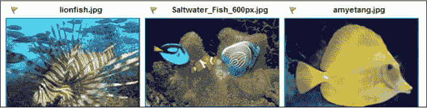
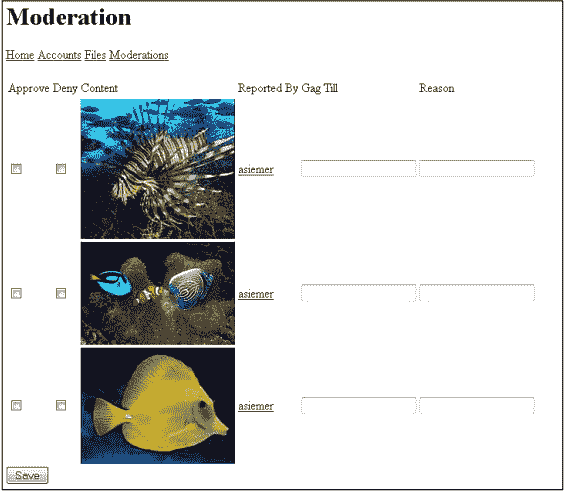
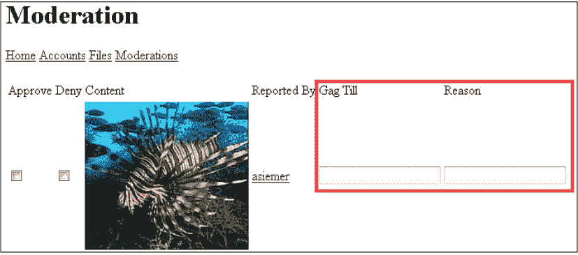
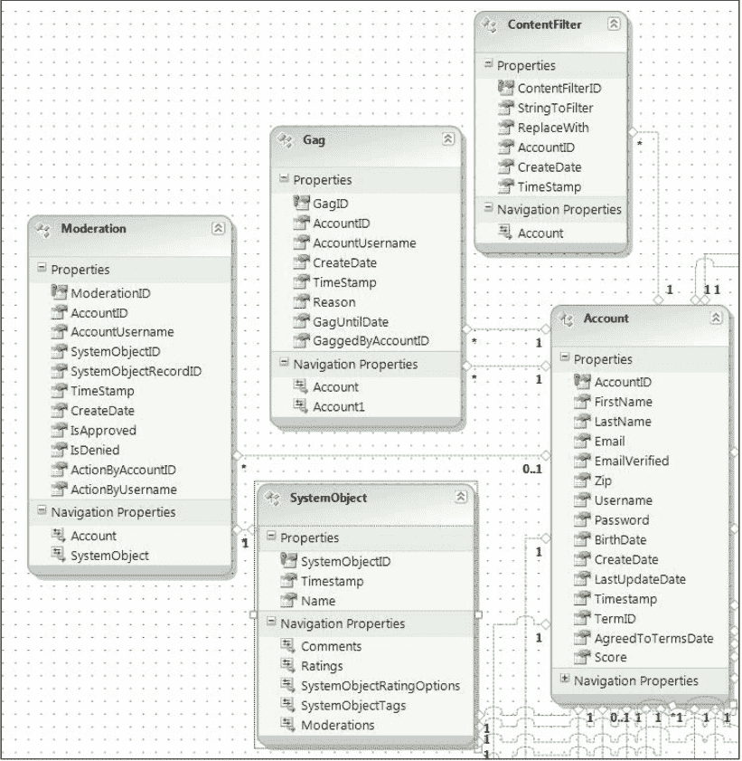

# 12 审核

我们终于到达了一个拥有社区的地步，这个社区具备几乎代表一个伟大社区的所有功能。就此而言，我们允许用户创建的许多内容都是基于文本或基于资源的内容项，例如图片、影片等等。这太棒了！现在我们要做的就是部署站点，邀请一些用户，然后看着我们的社区成长。

别急！允许用户群完全自由地在你的站点上填充内容并不是一个好主意。这意味着你无法控制站点的命运。这还意味着最终会有人添加不当材料。甚至可能有精通技术的用户试图窃取你部分用户的信息，用于不当目的。所有这些问题最终可能会赶走所有好用户，只留下坏用户。最坏的情况下，由于这些不受控制的用户的行为，你可能最终会面临法律问题。

我们并不是想吓唬你。我们只是想告诉你，对于一个由用户内容驱动的社区，你需要承担一些责任，并牢牢掌控局面。我们所说的这种严格控制正是本章的内容。

在本章中，我们将讨论各种形式的审核。对于用户生成的内容，我们可以利用用户生成审核。毕竟，为什么不给受冒犯者一种方法来举报冒犯他们的内容呢？我们还将讨论对惯犯用户进行禁言。我们还将创建一个过滤器，用来屏蔽不良词语和竞争对手的垃圾信息。


## 问题

本章的核心问题是，我们不希望将控制权随意交给用户群体。对于网站的内容输入和显示，我们应当尽可能保持对网站的最大控制。让我们来讨论核心功能。

## 社区审核

用户审核通过一个简单的 AJAX 化 ImageButton 来实现，该按钮允许用户随内容一起对内联的不当内容进行标记。



被社区标记的内容将显示在管理控制台的“审核”部分下，如以下截图所示。在这里，你可以批准或拒绝该内容。



## 禁言用户

一旦你有了待审核内容的列表，你最终会开始注意到一些重复违规者。因此，我们需要一种方式来约束这些违规者。在查看被标记的内容时，你还会看到内容的拥有者。如果你发现看到了重复违规者，你可以对该用户施加禁言（Gag）。禁言将限制该用户继续向网站添加内容，作为对其不良行为的一种惩罚。禁言的一部分是指定原因和禁言令结束的日期，如以下截图所示。如果你不想指定结束日期，可以施加 20 年的封禁！



## 动态过滤器

动态过滤器将解决几个问题。你可以用它有效地从网站上删除不雅内容。你也可以用它拦截竞争对手的帖子或广告。最重要的是，你可以用它限制允许的脚本类型。该工具可以阻止 HTML、JavaScript 以及几乎任何其他你不希望在网站上出现的内容，这有助于你处理跨站脚本问题。

## 审核

为了启用审核功能，我们将利用在第 11 章中使用的相同概念。此功能将实现为另一个 UserControl，我们可以将其插入到任何需要的地方。由于它将与 SystemObjects 对象表关联，我们可以自由地让用户审核任何数据库导向的内容——无论是文本、图像还是几乎其他任何内容。只要它有记录 ID 和关联的表，我们就可以对其审核。

除了让用户标记内容以供批准外，我们还需要创建一个页面来管理被标记的内容。我们将实现一个简单的管理页面，显示所有列出的内容。对于每个列出的项目，我们可以批准或拒绝该内容。被批准的内容将不再在网站上可见。这个页面还将承载我们的禁言功能，我们将在后面讨论。

这个结构与我们对 SystemObjects 表的其他用法相同。它有 SystemObjectID 和 SystemObjectRecordID，这使我们能够添加审核条目并查看它指向的位置。当我们构建管理页面时，你会看到我们如何使用这些数据来获取所有对象，无论其类型如何，以供管理查看。除了 SystemObjects 表之外，我们还连接到 Accounts 表，使用发布可疑内容的账户的 AccountID 和对可疑内容采取行动的用户的 AccountID。跟踪第二个 AccountID 很有用，因为它帮助我们跟踪哪个用户正在发起标记。如果我们发现内容没有问题，我们实际上可以追踪发起请求的用户，以查明这是否是一个试图让无辜用户被禁言的恶意用户。

### 禁言

禁言用户——就像法律上的禁言令一样——是限制他们公开发表评论。我们将扩展这个概念，即如果用户被施加了禁言令，我们将不允许他们在我们的系统上发布内容！与标记可疑内容一样，不采用自动禁言，而是由仲裁者介入，将有助于防止无辜用户被错误禁言的情况。

在 Gags 表中最需要注意的字段是 GagUntilDate，如前面的截图所示。此字段中的日期是用户能够再次与社区互动的日期。

## 过滤

过滤系统将使能够映射出我们不想要的内容，并将其替换为实际需要的内容。我们首先用一个简单的映射场景来说明：有人在我们的网站上使用了脏话。我们可以将不喜欢的词添加到内容过滤列表中，并在其位置插入一个更好的词，从而使我们的内容不那么冒犯。在“dude”的例子中，我们将其替换为“[Filtered]”。

虽然我们的过滤器可以并且应该在这种简单的方式下使用，它也可以用于销毁客户端脚本。为了可能销毁脚本，你可以将以下文本字符串（两个不同的条目）添加到过滤列表中：`<script>` 和 `</script>`，并将替换值设置为空字符串。这将有效地将所有 `<script>` 和 `</script>` 条目替换为空字符串。这将在剩余的脚本标签之间留下代码/文本。我们认为，这实际上会破坏脚本。

为了仅仅使用过滤这个概念，我们需要一个包含可能条目的庞大数据库来进行测试。这不仅困难，而且效率极其低下！即使我们拥有世界上最全面的词典，仍然有可能遗漏某些内容。而且，这也会相当难看，因为你会在页面中看到所有未捕获的代码。但至少他们此时无法运行脚本。这是朝着正确方向迈出的一步。

为了解决未捕获标签的问题，并绕过对标签库的需求，我们将在过滤之前对要过滤的字符串使用 `UrlEncode()`。`UrlEncode()` 的第一遍会将 `<script>` 和 `</script>` 标签转换为 `&lt;script&gt;` 和 `&lt;/script&gt;`。它还会将条目中的所有其他特殊字符转换为编码形式。这有效地使所有 HTML、CSS 和 JavaScript 代码失效！

既然我们已经杀死了文本中所有可能的标记和脚本，那我们想在网站上允许的内容呢？我们可以通过在过滤列表中添加编码后的单词，将它们翻译回可接受的术语，从而在过滤列表中做出例外。对于粗体标签 `<b>`，编码函数会使其看起来像 `&lt;b&gt;`。我们可以简单地将 `&lt;b&gt;` 添加到要过滤的单词列表中，并设置替换值为 `<b>`。现在我们可以重新构建我们想要接受的内容。接受列表比内容过滤可能的数据库更容易管理。

## 解决方案

现在让我们看一下解决方案。

## 实现数据库

首先让我们看看需要哪些表。以下截图显示了相关的表：



## 审核记录

上一张截图中的审核表包含 SystemObjectID 和 SystemObjectRecordID，以及创建所讨论内容的账户。它还包含了执行相应操作的账户以及该操作是什么。

除了表之外，我们还需要一种快速简便的方式获取已审核的文件。我们不想这么说，但这次我们要深入实际 SQL。我们将创建一个存储过程，它接收一个 FolderID 并返回该文件夹中所有已审核的文件。

```
CREATE PROCEDURE [dbo].[pr_GetModeratedFiles]
@DefaultFolderID bigint
AS
BEGIN
    SELECT f.* FROM Files f WHERE f.DefaultFolderID = @DefaultFolderID AND f.FileID
    NOT IN (SELECT f.FileID FROM Files f, Moderations m
            WHERE
            f.DefaultFolderID = @DefaultFolderID
            AND
            m.SystemObjectID = 5
            AND
            m.systemobjectrecordid = f.FileID
            AND
            m.IsApproved = 1
    )
END
```

然后，我们可以在查询内外快速轻松地使用这些信息。

## 禁言记录

如前面截图所示，Gags 表负责判断用户是否被限制向社区添加内容（即被“软禁”）。它包含被禁言用户的 AccountID、他们的 AccountUsername、禁言生效时间、禁言原因、施加禁言的管理员以及禁言解除时间。


## 内容过滤器

尽管内容过滤器承担着重大责任，但它是一个相对简单的系统。它只需跟踪要过滤哪些模式、将每个模式替换成什么、每个过滤器由谁创建，以及创建时间。该系统的优势更多体现在实现上，而非存储上！

### 创建关系

一旦所有表创建完成，我们就可以创建所有关系。

对于这组表，我们有以下表之间的关系：

-   Moderations 和 Accounts
-   Moderations 和 SystemObjects
-   Gags 和 Accounts
-   ContentFilters 和 Accounts

### 设置数据访问层

要设置数据访问层，我们按照前面章节中已经完成的步骤进行操作。打开 Fisharoo.edmx 文件，并添加我们在本章中讨论过的上述所有表。

### 构建存储库

随着新表的增加，也会新增相应的存储库，以便我们能够获取存储在这些表中的数据。我们将创建以下存储库来满足我们的需求。

-   ModerationRepository
-   GagRepository
-   ContentFilterRepository

我们的每个存储库通常都会有一个方法——用于按 ID 选择、按父 ID 选择全部、保存和删除。一旦你看过一个存储库，基本上就看过了所有的存储库。请回顾前面的章节、附录或随附代码，了解标准存储库的示例。不过，我们将讨论任何与标准不同的地方。

#### ModerationRepository

对于这个存储库，我们有一个标准的保存方法，它一次接收一个 ModerationRepository 并适当地处理它。当我们的用户标记内容时，它实质上是创建条目。这对于我们社区用户的一次一条记录创建非常有用。

**GetModerationsGlobal()**

一旦我们创建了审核记录，我们需要能够查看问题，以便我们可以接受某些内容并拒绝其他内容。为此，我们有一个方法可以从全局视角获取所有审核项：GetModerationsGlobal()。

```csharp
///Fisharoo/DataAccess/Repositories/ModerationRepository.cs
public List<Moderation> GetModerationsGlobal()
{
    List<Moderation> result = new List<Moderation>();
    using(FisharooDataContext dc = conn.GetContext())
    {
        var groups = (from m in dc.Moderations
                      where m.IsDenied == null || m.IsApproved == null
                      group m by m.SystemObjectRecordID
                      into g
                      select new { g, NumberOfReports = g.Count() }
                      ).OrderByDescending
                      (g1 => g1.NumberOfReports);

        foreach (var v in groups)
        {
            result.Add(v.g.ToList()[0]);
        }
    }
    return result;
}
```

此方法允许我们获取所有审核项，并按 SystemObjectRecordID 分组，因为许多人可能会举报同一段内容。这种简化后的视图将出现在我们的管理界面中，以便我们能够以更精简的方式接受或拒绝内容。无需查看每一条举报！

#### GagRepository

我们将讨论这个存储库中的两个方法：

-   **GetActiveGags()** 使我们能够获取系统中所有禁言（Gag）的列表，从而管理谁被禁言、谁即将解禁，以及可能需要延长禁言的用户。
-   **IsGagged()** 允许我们检查用户当前是否被禁言。它允许我们限制被禁言的用户创建新内容。我们还可以用它来更改显示，例如隐藏“新帖”按钮。

```csharp
//Fisharoo/DataAccess/Repositories/GagRepository.cs
public List<Gag> GetActiveGags()
{
    List<Gag> result = new List<Gag>();
    using(FisharooDataContext dc = conn.GetContext())
    {
        result = dc.Gags.Where(g => g.GagUntilDate >
            DateTime.Now).OrderBy(g => g.GagUntilDate).
            ToList();
    }
    return result;
}
public bool IsGagged(Int32 AccountID)
{
    bool result = false;
    using(FisharooDataContext dc = conn.GetContext())
    {
        if(dc.Gags.Where(g=>g.AccountID == AccountID &&
            g.GagUntilDate > DateTime.Now).
            FirstOrDefault() != null)
        {
            result = true;
        }
    }
    return true;
}
```

#### ContentFilterRepository

ContentFilterRepository 目前只有一个职责：返回系统中所有过滤器的列表。

### 实现服务/应用程序层

一旦所有存储库都为单一用途构建完成，我们就可以开始创建服务层了。同样，这一层负责组装聚合体，并对我们的实体执行复杂操作。我们将创建和修改以下服务：

-   ContentFilterService
-   Extensions

#### ContentFilterService

ContentFilterService 负责应用我们的内容过滤器（ContentFilters）。该方法将调用 ContentFilterRepository、对字符串进行 HtmlEncode() 编码，以及实际将过滤器应用到待过滤字符串的工作整合在一起。

```csharp
//Fisharoo/BusinessLogic/ContentFilterService.cs
public string Filter(string StringToFilter)
{
    List<ContentFilter> _contentFilters = _contentFilterRepository.GetContentFilters();
    StringBuilder sb = new StringBuilder(StringToFilter);
    //encode the final output for further security
    sb = new StringBuilder(HttpUtility.HtmlEncode(sb.ToString()));
    //replace all the dirty words and forbidden tags
    foreach (ContentFilter cf in _contentFilters)
    {
        sb.Replace(cf.StringToFilter, cf.ReplaceWith);
    }
    return sb.ToString();
}
```

我们进入此方法时，首先获得要处理的字符串。接下来，我们获取要处理的 ContentFilters 列表。为了更高效地处理字符串，我们将创建一个新的 StringBuilder。我们过滤字符串的第一步是使用 HttpUtility.HtmlEncode() 方法对字符串进行编码。一旦我们有了可处理的基础字符串，就可以开始遍历 ContentFilters 集合。对于每个 ContentFilter，我们执行一次 Replace()，将 StringToFilter 替换为 ReplaceWith 值。然后，在返回过滤结果之前，我们将 StringBuilder 转换回字符串。

## 审核（Moderation）

代码后置文件中没什么特别之处，所以我们来看看 presenter。在那里，我们为控件设置所有属性，并决定是否应该显示该控件。

```csharp
///Fisharoo/Web/UserControls/Presenters/ModerationPresenter.cs
public class ModerationPresenter
{
    - - -

    public void Init(Moderations view, bool IsPostBack)
    {
        _view = view;

        if (_webContext.CurrentUser == null)
            _view.ShowFlagThis = false;
        else if (_moderationRepository.HasFlaggedThisAlready(
                _webContext.CurrentUser.AccountID, _view.SystemObjectID,
                _view.SystemObjectRecordID))
            _view.ShowFlagThis = false;
        else
            _view.ShowFlagThis = true;
    }

    public void SaveModeration(int SystemObjectID, long SystemObjectRecordID)
    {
        if (_webContext.CurrentUser != null)
        {
            Moderation moderation = new Moderation();
            moderation.AccountID = _webContext.CurrentUser.AccountID;
            moderation.AccountUsername = _webContext.CurrentUser.Username;
            moderation.CreateDate = DateTime.Now;
            moderation.SystemObjectID = _view.SystemObjectID;
            moderation.SystemObjectRecordID = _view.SystemObjectRecordID;
            _moderationRepository.SaveModeration(moderation);
        }
        _view.ShowFlagThis = false;
    }
}
```

SaveModeration() 方法是从代码后置文件传输到 presenter 的按钮点击事件。在 presenter 中，我们创建一个新的 Moderation 并将其保存到数据库。


## 审核

```csharp
mr.IsApproved = false;
results.Add(mr);
}
}
if(!string.IsNullOrEmpty(txtGagDate.Text))
{
    _presenter.GagUserUntil(Convert.ToInt32
        (litAccountID.Text),
        litAccountUsername.Text,
        DateTime.Parse(txtGagDate.Text),
        txtReason.Text);
}
}
}
}
if(results.Count() > 0)
    _presenter.SaveModerationResults(results);
}
```

这里看起来有很多内容，但方法顶部的代码很大程度上用于定位并加载 UI 上的控件。一旦我们拿到这些控件，我们就可以检查每个被标记项目的状态。当我们发现有复选框被选中用于批准或拒绝时，我们就将该项目添加到我们的 ModerationResults 列表中（请回顾我们在上一节的存储库中创建了它）。

一旦我们处理完数据，就将修改列表发送到 ModerationRepository，在那里批量保存。

### 禁言

在审核页面 UI 中，你可以看到我们有两个文本框控件。我们有一个文本框用于捕获我们决定禁言用户的理由。另一个文本框用于提供日期，该日期表示用户的禁言将最终被撤销的时间。

在 **btnSubmit_Click()** 方法中（之前讨论过），你也会看到一些检查这些文本框状态的代码。如果我们在 Repeaters 控件集合中找到内容，那么我们就会调用 presenter 的 GagUserUntil() 方法，有效地禁言该用户。Presenter 创建一个新的 Gag 对象并将其持久化到数据库中。

```csharp
//Fisharoo/AdminConsole/Moderations/Presenters/DefaultPresenter.cs
public void GagUserUntil(int AccountID, string AccountUsername,
                         DateTime GagTillDate, string Reason)
{
    Gag gag = new Gag();
    gag.AccountID = AccountID;
    gag.CreateDate = DateTime.Now;
    gag.AccountUsername = AccountUsername;
    gag.GagUntilDate = GagTillDate;
    gag.Reason = Reason;
    gag.GaggedByAccountID = _webContext.CurrentUser.AccountID;
    _gagRepository.SaveGag(gag);
}
```

### 过滤

过滤过程负责移除粗俗语言、竞争对手广告、恶意中伤以及 XSS 攻击。

我们已将此功能添加到我们的 PEBoardPost 展示实体中以演示它。一个帖子/主题有两个文本部分——标题和主要内容。我们修改了 PEBoardPost，使其返回标题和内容的已过滤数据。代码更改如下所示：

```csharp
//Fisharoo/Web/HelperClasses/PEBoardPost.cs
private string _name;
public string Name
{
    get { return _contentFilterService.Filter(_name); }
    set { _name = value; }
}

private string _post;
public string Post
{
    get { return _contentFilterService.Filter(_post); }
    set { _post = value; }
}
```

好了，终于完成！实现此功能的所有工作都在后端——对于这种性质的功能至关重要。越容易使用，就越可能被使用。在可能的情况下，我们最好在 presenter 中甚至更上层链路中过滤文本。越接近实际数据检索完成此任务，就越不可能被遗忘！但正如你所见，它足够灵活，可以在任何需要时使用。

### 总结

在本章中，我们讨论了如何以及为何实现某种形式的审核。我们查看了我们的社区提供的内容如何由同一社区使用一个非常简单的标记工具进行管理，该工具足够灵活，可以添加到我们网站上的任何主要实体。我们还查看了处理习惯性违规者的一些方法，即通过禁言他们或通过添加权限来暂停其内容。最后，我们从高层次审视了如何实现过滤系统以从网站内容中过滤掉不需要的语言/词语。
