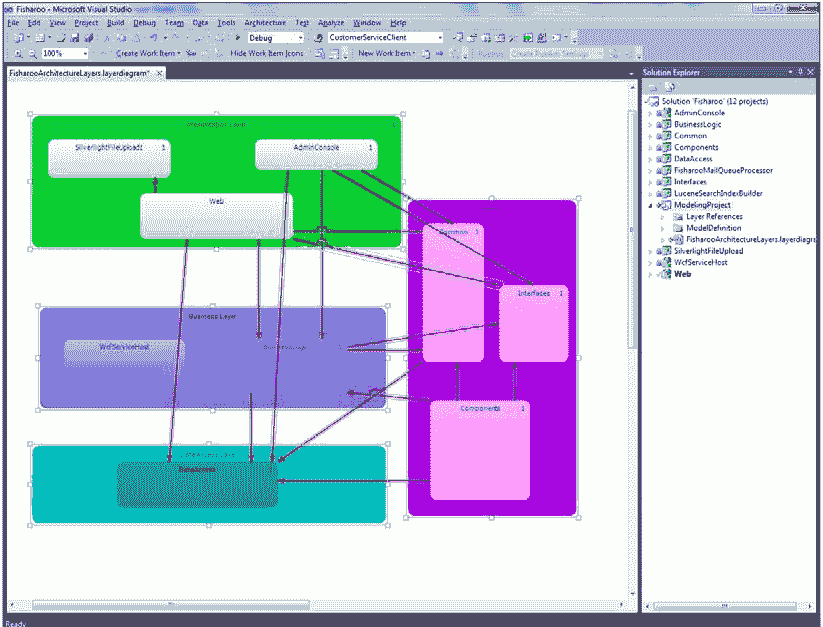
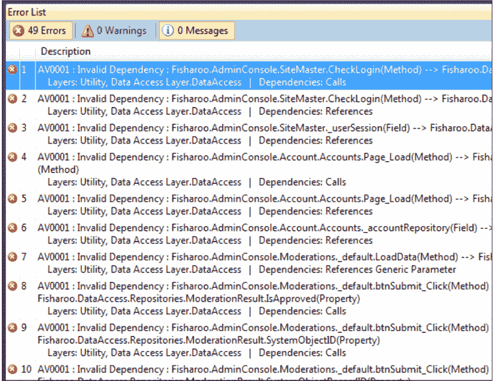
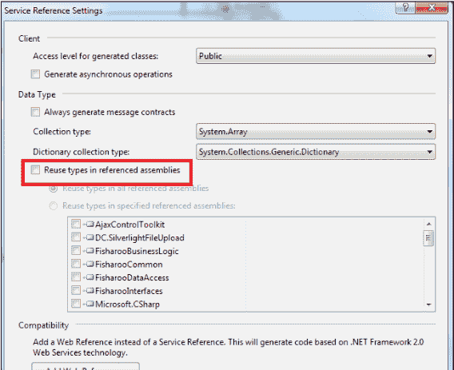
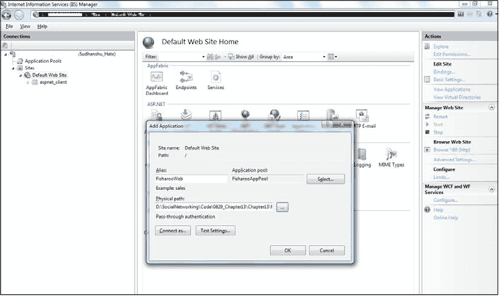
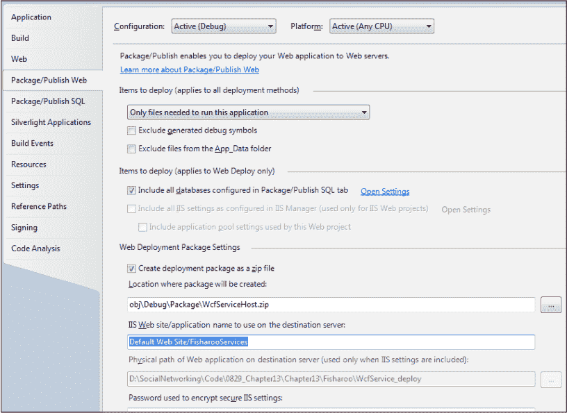
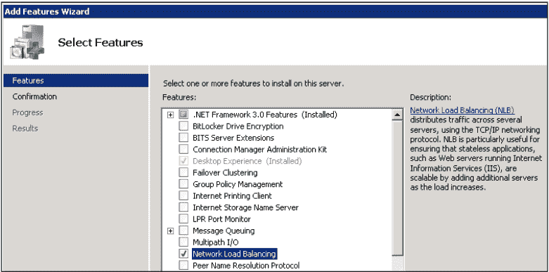

# 13 扩展

如果你能坚持到这里，那么你一定是拥有了一个社区网站的自豪新主人，该网站已准备好开始接受新的社区成员。我们从经验中知道，你不会走到这一步只是为了建立一个永远只有 100 个用户的社区。你和其他人一样，非常希望建立一个拥有 10 万或更多活跃用户的社交网络。一万名用户被认为是一项成功。十万名用户，你也许能够把你的社区卖给别人。

要让这么多用户访问你的网站需要多方面的条件。你必须为你的网站提供一个很棒的新概念。一些真正使其与众不同之处。它需要出色的营销技巧，无论是通过病毒式营销还是通过更传统的营销活动。它还意味着你的网站需要在达到目标之前承受每天大量用户的持续重载。这最后一点正是本章要讨论的内容。

### 问题

拥有大量用户的网站有许多方面可能导致网站瘫痪。有些可能是功能缓慢，而其他则可能是物理上锁定系统，导致其不再响应。在本章中，我们将讨论社区中可能出现的一些问题以及如何解决它们。

我们将在数据库层面讨论索引和分区数据等形式的问题。我们将深入探讨如何通过应用分层来解决可扩展性问题，通过增加硬件来解决应用缓慢问题，然后对该硬件进行负载均衡。我们还将讨论如何缓存数据访问和复杂对象创建，以便不必每次都执行查询或对象操作。接下来，我们将通过创建高度优化的索引数据集来加快搜索速度。最后，我们将研究减少网站直接对话的系统数量，以便用户体验不会直接受到基础设施的影响。

然而，这并不像只是将特定程序集移动到不同机器那么简单。从展示层到业务层的调用现在将超出机器边界，因为相应的代码将存在于不同的物理机器上。为了解决这个问题，我们可以做的一件事是为此应用程序启用 **面向服务的架构 (SOA)**。SOA 是一个非常著名的范式，你可以从 http://en.wikipedia.org/wiki/Service-oriented_architecture 阅读它。

在以下各节中，我们将展示如何修改当前实现以使其支持 SOA。

### 展示层和应用层扩展

在进一步深入扩展之前，让我们先进行一些架构合规性验证。

#### 分层架构验证

架构验证是我们应该能够在项目的各个阶段执行的重要方面。这有助于确保作为流程一部分定义的结构规则在整个开发阶段始终得到遵守，并且不会无意中被违反。例如，展示层代码不应直接调用数据访问层代码等规则至关重要，但除非彻底审查代码，否则很难定位。

Visual Studio (VS) 2010 的架构验证功能开箱即提供此功能。你需要先在设计器中创建一个架构图，然后将解决方案中的不同项目附加到图中的不同层。VS 然后可以根据架构图验证不同项目之间的调用并指出违规行为。

让我们向现有解决方案添加一个名为 ModelingProject 的新项目，并使用图层图模板添加一个新项。使用 View | Toolbox 菜单在画布上拖动三个水平层和一个垂直层。从上到下的水平层分别命名为展示层、业务层和数据访问层。垂直层称为实用程序层。


# 扩展

一旦创建了这些层，从解决方案资源管理器中将 Web、AdminConsole 和 SilverlightUpload 项目拖到表示层。类似地，将相应项目拖到其他层，如下面的屏幕截图所示。所有层都与项目映射后，右键单击画布并选择“生成依赖项”，这将显示各个项目之间的关系。箭头的方向表示从源层到目标层的调用。



还可以右键单击画布并选择“验证体系结构”选项，这将有助于确认体系结构是否有效。当我们验证 Fisharoo 体系结构时，它给出了一些错误，如下面的屏幕截图所示：



要追溯到与错误关联的源代码，你可以双击错误，它将打开关联的代码，如下所示。我们得到的错误是在表示层（Web 项目中）直接使用了数据访问层中的接口和实体。你可以修复所有此类错误，也可以选择忽略它们。

在接下来的过程中，我们将展示如何修复这些问题。如果我们没有遵循分层、模块化和基于对象的设计，将现有应用程序转换为 SOA 可能会极其困难。但正因为我们遵循了这些设计原则，我们只需做一些更改就可以将现有解决方案转换为基于 SOA 的应用程序。请注意，SOA 的一个关键方面是将业务逻辑作为服务公开。虽然我们将业务逻辑项目中的所有类都称为服务，但它们并不是真正的 SOA 服务。让我们看看如何将其中一个业务功能转换为服务。其他业务组件可以类似方式进行转换。我们将使用 **Windows Communication Foundation (WCF) 4** 来实现我们的服务。

## 将业务逻辑启用为服务

你需要按照以下步骤将现有业务逻辑转换为 WCF 服务：

- 1. 我们使用 Entity Framework 的基于实体对象的方法（默认选项）构建了数据访问层。对于 SOA 设计，我们需要使用基于自跟踪实体的解决方案。右键单击 Fisharoo.edmx 设计器，选择 **添加代码生成项**，然后选择 **ADO.Net 自跟踪实体生成器** 模板，并提供模型的名称。它将生成 `Fisharoo.Model.Context.tt` 和 `FisharooModel.tt` 作为基于文本转换工具包的文件。

   DataAccess 项目中的实体承载数据并跨层移动。我们将创建一个独立的类库项目作为 Entities，并将 `Fisharoo.Model.tt` 及其关联的实体类移到该项目下。我们还将把扩展分部类（如 Account、Profile 等）移到这个新项目中一个名为 ExtendedEntities 的文件夹中。现在我们的所有实体都位于 Fisharoo-Entities 命名空间下。这有助于消除 Web 项目对 DataAccess 项目的依赖，这是我们之前在体系结构验证中遇到的一个违规情况。现在我们需要在 Web、BusinessLogic、Components 和 Common 项目中引用 Entities 项目。

- 2. 现在我们将 AccountService 类（BusinessLogic 项目）转换为 WCF 服务。无 SVC 激活是 WCF 4 的一项新功能，它允许我们将逻辑作为服务公开，而不必将该逻辑写在具有 SVC 扩展名的文件中。这就是我们在将类转换为 WCF 服务时将使用的功能。

- 3. 在 BusinessLogic 项目中添加对 `System.ServiceModel` 和 `Fisharoo.Entities` 程序集的引用。

- 4. 转到 `IAccountService.cs`，使用 `ServiceContract` 特性修饰接口，并使用 `OperationContract` 特性修饰所有需要在服务外部公开的公共方法。如果有任何重载方法，请在 OperationContract 中使用 Name 特性，如 SaveAccount 方法中所示。下面是我们展示的文件的相关部分：

  ```csharp
  //Fisharoo/BusinessLogic/Interfaces/IAccountService.cs
  [ServiceContract]
  public interface IAccountService
  {
      [OperationContract]
      bool UsernameInUse(string Username);
      [OperationContract]
      bool EmailInUse(string Email);
      ...
      [OperationContract(Name = "SaveAccountWithScore")]
      void SaveAccount(Account account, BoardPost.ScoreInput value);
      ...
  }
  ```

  在 **Entities** 项目中生成的 Account 等实体已经使用 DataContract 特性进行了标记，因此无需修改它们。

- 5. 要托管 WCF 服务，我们需要创建服务主机。使用 **WCF 服务应用程序** 项目模板创建 WCFServiceHost 项目。同时添加对 BusinessLogic 项目的引用。

- 6. 更新 WCFServiceHost 配置文件中的相对地址：

  ```xml
  <system.serviceModel>
      <serviceHostingEnvironment multipleSiteBindingsEnabled="true"
      aspNetCompatibilityEnabled="false">
          <serviceActivations>
              <add relativeAddress="AccountService.svc"
              service="Fisharoo.BusinessLogic.AccountService"/>
          </serviceActivations>
      </serviceHostingEnvironment>
      <behaviors>
          <serviceBehaviors>
              <behavior>
                  <serviceMetadata httpGetEnabled="true"/>
                  <serviceDebug includeExceptionDetailInFaults="true"/>
              </behavior>
          </serviceBehaviors>
      </behaviors>
  </system.serviceModel>
  ```

  请注意，此 .config 文件未提及终结点和行为信息，因为它使用了默认信息。WCF 4 的这一功能有助于降低 WCF 配置的复杂性。

  如果你打算为每个服务提供终结点和绑定，可以按照以下方式操作：

  ```xml
  <system.serviceModel>
      <services>
          <service name="Fisharoo.BusinessLogic.AccountService" behaviorConfiguration="AccountServiceBehavior">
              <endpoint name="AccountServiceEndpt" address="" binding="basicHttpBinding" contract="Fisharoo.BusinessLogic.Interfaces.IAccountService"
                  bindingConfiguration="AccountBinding" ></endpoint>
          </service>
      </services>
      <serviceHostingEnvironment multipleSiteBindingsEnabled="true" aspNetCompatibilityEnabled="true">
          <serviceActivations>
              <add relativeAddress="AccountService.svc" service="Fisharoo.BusinessLogic.AccountService"/>
          </serviceActivations>
      </serviceHostingEnvironment>
      <behaviors>
          <serviceBehaviors>
              <behavior name="AccountServiceBehavior">
                  <serviceMetadata httpGetEnabled="true" />
                  <serviceDebug includeExceptionDetailInFaults="true"/>
              </behavior>
          </serviceBehaviors>
      </behaviors>
      <bindings>
          <basicHttpBinding>
              <binding name="AccountBinding" allowCookies="true">
              </binding>
          </basicHttpBinding>
      </bindings>
  </system.serviceModel>
  ```

  > 确保 DataAccess 项目的连接字符串在 WCFServiceHost 项目的 `.config` 中进行了配置。

  ```xml
  <connectionStrings>
      <add name="FisharooDataContext"
           connectionString="metadata=res://*/Fisharoo.csdl|res://*/Fisharoo.ssdl|res://*/Fisharoo.msl;
           provider=System.Data.SqlClient;
           provider connection string=&quot;Data Source=.\SQLEXPRESS;Initial Catalog=Fisharoo;Integrated Security=True;MultipleActiveResultSets=True&quot;"
           providerName="System.Data.EntityClient" />
  </connectionStrings>
  ```

- 7. 确保 DataAccess 程序集被显式加载，以便成功建立数据库连接。程序集在 BusinessLogic 层的 AccountService.cs 构造函数中被显式加载，如下所示：

  ```csharp
  public AccountService()
  {
      MEFManager.Compose(this);
      Assembly.Load("FisharooDataAccess");
  }
  ```

  这是一种快速完成的方式。更优雅的方式是在 .config 文件中指定程序集名称，并从那里读取它，而不是硬编码。

- 8. 现在我们已经准备好客户端使用服务。为此，我们需要在 Web 项目中为 Account 服务添加服务引用（AccountProxy）。

  最终我们将服务托管在 IIS 上，但目前我们需要从 ASP.NET 环境中添加代理 URL。如果我们将其留给 ASP.NET 运行时，它每次运行服务时都会分配一个新端口。但是，我们希望为生成的代理分配一个静态端口。因此，我们在服务项目属性中为其分配了一个静态端口。我们将端口设置为 63043。

  要生成服务代理，右键单击 Web 项目，选择添加服务引用，并提供服务的 URL：http://localhost:63043/AccountService.svc

  请记住，在 WcfServiceHost 的 .config 中，我们为 AccountService 提供了相对地址，上述 URL 在 machinename:port 之后必须使用相同的相对地址。

  将服务代理命名为 AccountProxy，点击页面上的“高级”按钮，将出现“服务引用设置”窗口。勾选“在所有引用的程序集中重用类型”复选框，如下面的屏幕截图所示，然后点击“确定”，代理将在 Web 项目下创建。

  

我们可以通过两种方式应对这一设计变更。我们可以用完全自治的方式设计服务操作，包含所有相关的输入输出参数；也可以将 HttpContext 和 Session 信息传递给 WCF 服务。

10. 虽然第一种方法是更好的方案，但它的侵入性更强，需要我们对代码做出更多更改。目前我们先采用第二种方案。为此，我们需要添加一个特性来修饰我们的服务：

```
[AspNetCompatibilityRequirements(RequirementsMode = AspNetCompatibilityRequirementsMode.Required)]
public class AccountService : IAccountService
```

并且在 WcfServiceHost 项目的 web.config 文件中，将 aspNetCompatibilityEnabled 设置为 true。

```
<system.serviceModel>
    <serviceHostingEnvironment multipleSiteBindingsEnabled="true" aspNetCompatibilityEnabled="true">
        <serviceActivations>
            <add relativeAddress="AccountService.svc" service="Fisharoo.BusinessLogic.AccountService"/>
        </serviceActivations>
    </serviceHostingEnvironment>
</system.serviceModel>
```

至此，我们已经完成了将 AccountService 转换为 WCF 服务，并在 Web 客户端项目中调用它的工作。

## Web 服务器与应用服务器——Windows IIS 7.5 和 AppFabric

我们必须将表示层和应用层部署到可扩展的软件上，这一点非常重要。我们将使用 Windows Internet 信息服务（IIS）7.5 来部署表示层（Web 项目），并使用 Windows Server AppFabric 来部署服务、业务逻辑和数据访问逻辑。

Windows Server AppFabric 是微软提供的一个服务器，用于托管和管理 WCF 与工作流基础（WF）服务，同时还提供分布式缓存服务。它需要安装在 IIS 7 或更高版本之上。Web 项目和 WcfServiceHost 项目在 IIS 中的部署可以按以下步骤完成。

请确保你已安装 IIS 7.5（假设你运行在 Windows Server 2008 R2 上）。Windows Server AppFabric 是免费软件，可以从以下网站下载：

http://www.microsoft.com/downloads/en/details.aspx?displaylang=en&FamilyID=467e5aa5-c25b-4c80-a6d2-9f8fb0f337d2

### 扩展

有关该软件的安装与配置信息，你可以参考以下链接：http://msdn.microsoft.com/en-us/library/ff637707.aspx

安装完成后，启动 IIS 并按以下步骤部署 Web 项目：

- 右键单击**默认网站**，选择**添加应用程序**。
- 提供应用程序池的别名，并确保你选择一个在 .NET v 4.x.x.x 下运行的专用应用程序池（可以在**应用程序池**节点下创建专用应用程序池）。



> 应用程序必须拥有一个专用的应用程序池，这一点非常重要。这有助于确保必要的应用程序隔离级别，因为每个应用程序池都运行在独立的 w3wp 进程中。如果多个应用程序在同一个应用程序池下运行，而其中一个应用程序出现任何问题导致 w3wp 崩溃，那么在同一 w3wp 下运行的其他应用程序也会崩溃。

这样，你就会看到 **Fisharoo** Web 应用程序已创建在默认网站下。

现在，我们来看看如何部署服务。为此，首先需要打包服务。打包时，选择 WcfServiceHost 项目，右键单击，并提供打包属性，例如**将部署包创建为 zip 文件**选项、部署包的创建位置以及 Web 应用程序名称。



完成这一步后，右键单击该项目并选择**生成部署包**。这将创建一个部署包，我们需要将其导入 IIS。右键单击**默认网站 | 部署 | 导入**，并提供导入路径。

这样服务就会被安装。你可以通过 AppFabric 的仪表板来配置、管理和监控 WCF 服务。

## Web 场

**Web 场**（或负载均衡）是指将网站流量分散到多台服务器上的概念。通过扩展基础设施并在多台服务器之间分担负载，它可以解决应用程序或服务器层面的大部分性能问题。一般来说，负责负载均衡的人会查看你服务器场中的所有服务器，并将用户路由到负载最低的服务器。实现这一目标有多种方式，我们将对其中许多方式做简要介绍。

我们假设你有兴趣了解如何在 Windows 环境中创建 Web 场。

> 如果你需要 Linux 解决方案，可以尝试 **HAProxy**（http://haproxy.1wt.eu/）或类似的软件。

具体来说，我们将讨论如何使用 Windows 的**网络负载均衡（NLB）**来搭建 Web 场。这样你就可以在网络中的单个虚拟 IP 地址后面托管多台服务器。

要实现这一点，服务器场中的每台服务器都必须配置成完全相同，这样发送到任何服务器的任何请求都会以相同的方式处理。当请求到达虚拟 IP 地址时，数据包会被路由到最不繁忙的服务器。这种配置支持可靠服务的概念。也就是说，如果一台服务器出现故障，服务器场会自动重新平衡，并将流量路由到仍然正常运行的服务器。

要搭建这样的环境，你至少需要两台运行 Windows Server 2008 的机器。每台机器都需要有一个固定的 IP 地址。虽然机器可以只使用一块网卡，但最好使用两块——一块网卡使用固定 IP 地址，另一块使用虚拟 IP 地址。这些 IP 地址必须位于同一个 C 类网络上。

Windows Server 2008 预装的功能有限。你需要在其上启用**网络负载均衡**。为此，请从**管理工具**进入**服务器管理器**，在**功能**部分选择**添加功能**选项。



安装完成后，从**管理工具**中打开**网络负载均衡管理器**。右键单击**网络负载均衡群集**，选择**新建群集**，然后继续按照向导步骤配置负载均衡。

有关在 Windows Server 2008 中设置网络负载均衡 Web 场的更详细信息，请参阅：

- http://technet.microsoft.com/en-us/library/cc771300(WS.10).aspx
- http://www.techotopia.com/index.php/Building_a_Windows_Server_2008_Network_Load_Balancing_Cluster
- http://telnetport25.wordpress.com/2008/03/24/quick-tip-configuring-network-load-balancing-nlb-on-windows-2008-for-exchange-cas-servers/

## 缓存

通常，缓存就是从后端数据库获取某些数据或对象，并将它们存储在内存中以供以后使用。当我们需要数据/对象时，可以直接从缓存（内存）中检索。就数据库数据缓存而言，我们可以将查询结果存储到内存中。这意味着当我们再次需要这些信息时，不必进行服务器与服务器之间的连接，不必等待查询执行，也不必等待结果返回。我们可以直接从 RAM 中获取数据。沿着这条链路再向前一步，我们可以获得更多的优化。我们可以从数据库获取数据，解析这些数据，构建一个完全填充（hydrated）对象的列表，然后将该列表存储在缓存中。这意味着除了跳过数据库相关操作外，我们还可以跳过对象的创建和填充过程。

### 扩展

缓存与索引一样，也有一些缺点。如果我们把数据放入缓存，然后从数据库中修改或删除这些数据，我们可能会发现网站使用的是过期数据。例如，如果我们尝试使用一个已不存在的账户来创建博客条目，就会收到数据库错误。因此，在实现缓存层时，我们必须保持警惕，确保数据保持干净。

另一个问题是，如果缓存中的数据已过期但仍然有效，我们最终可能会向用户显示不正确的数据。同样，我们也必须维护干净数据这一方面！

还有一个方面是决定缓存多少数据。缓存过多数据会导致内存不足问题，因为缓存数据会消耗服务器内存。如果打算缓存大量数据，就应该规划配备大内存（多 GB 到 TB）的服务器，这在社交网站中很常见。

### 缓存——AppFabric 解决方案

Windows Server AppFabric 缓存服务非常适用于在分布式和非分布式场景中构建高度可扩展且可用的应用程序。让我们看看如何在我们的解决方案中使用它。

#### 客户端

在 Components 项目中，创建一个 AppFabricCache 类。该类将实现 ICache 接口，并公开 AppFabric 缓存 API。与 AppFabric 缓存服务所能提供的功能相比，当前的 ICache 接口（我们在第 2 章中曾介绍过）方法有限。不过目前我们将只保留这些方法。如果你打算使用更多 AppFabric API，可以在 ICache 接口中添加相应的方法签名，并在 AppFabricCache.cs 类中实现这些方法。

我们需要在 Components 项目中添加对以下 AppFabric 缓存程序集的引用。

- `Microsoft.ApplicationServer.Caching.Client.dll`
- `Microsoft.ApplicationServer.Caching.Core.dll`

这些程序集包含应用程序将使用的缓存方法。这些程序集可以在 ~:\Windows\System32\AppFabric 文件夹中找到。

AppFabricCache 包装类及相关方法如下所示。我们实现了一些 get 和 set 方法。AppFabric 缓存服务还提供了许多其他 API 可以包装，但为了简单起见，我们只关注这两个方法，其他方法我们只是抛出异常。有关该类的完整代码，请参见本章附带的代码。


```csharp
//Fisharoo/Components/AppFabricCache.cs
using System.Web.Caching;
using System.ComponentModel.Composition;
using Microsoft.ApplicationServer.Caching;

namespace Fisharoo.Components
{
    [Export(typeof(ICache))]
    public class AppFabricCache : ICache
    {
        private static DataCache dataCache;
        private static TimeSpan timeSpan = new TimeSpan(
            Settings.Default.DefaultCacheDuration_Days,
            Settings.Default.DefaultCacheDuration_Hours,
            Settings.Default.DefaultCacheDuration_Minutes, 0);

        private static DataCacheFactory dataCacheFactory;
        private static string namedCache = "FisharooCachedData";

        static AppFabricCache()
        {
            if (dataCacheFactory == null)
            {
                dataCacheFactory = new DataCacheFactory();
                dataCache = dataCacheFactory.GetCache("FisharooCachedData");
            }
        }

        public object Get(string cache_key)
        {
            return dataCache.Get(cache_key);
        }

        public void Set(string cache_key, object cache_object)
        {
            dataCache.Put(cache_key, cache_object);
        }
    }
}
```

## 扩展

首先，我们使用 MEF 通过 Import 特性将 ICache 插入我们的类中。

在 GetFoldersByAccountID() 中，我们检查 Folders 是否存在于缓存中，如果存在则直接从缓存返回。如果缓存中不存在，我们调用 FolderRepository 中的相应方法，并确保将返回值存储到缓存中。

在 DeleteFolder() 中，首先检查 Folder 是否存在于缓存中。如果存在，我们从缓存对象中移除该文件夹，然后还使用 FolderRepository.DeleteFolder() 方法将其从后端删除。

如果数据过期，还应考虑如何使缓存数据失效。可以使用 AppFabric 的通知服务功能来实现这一点。

Windows Server AppFabric 为缓存数据提供了故障转移解决方案，而在 AppFabric 之前，基于 State Server 或 SQL Server 的 OutProc 缓存解决方案是无法实现这一点的。它在分布式缓存中有更多应用，并覆盖更多不同类型的缓存需求。有关 Windows Server AppFabric 的更多详细信息，请查看 http://msdn.microsoft.com/en-us/windowsserver/ee695849.aspx。

### 缓存——MemCached 解决方案

http://memcached.org/about 页面解释：

> memcached 是一个高性能、分布式的内存对象缓存系统，本质上很通用，但旨在通过减轻数据库负载来加速动态 Web 应用程序。

简而言之，MemCached 软件允许你在 Web 服务器场内创建一个服务器场。该工具用于创建和管理状态服务器场。这个服务器场中可以容纳的服务器数量没有任何限制。该工具也没有任何硬件要求。这意味着你可以轻松地用一些内存很大的廉价 Linux 机器来搭建，并根据应用程序的需求扩展你的状态服务器场。

你说 Linux？我们之前也这么说。不过别担心。MemCached 已经移植到 Windows 平台，现在以 MemCached for Windows 的形式提供（http://code.google.com/p/memcached/wiki/PlatformWindows）。从硬件角度来看，同样的规则也适用于这个产品。我们之所以提到 Linux 选项，是因为你设置的每个 Windows 实例都需要为新机器和操作系统支付初始费用。另一方面，Linux 机器可以是一群停用的台式机，再加上一份你喜欢的免费 Linux 发行版。这种缓存实现可以为你提供与 AppFabric 缓存解决方案完全相同的功能。你可以将会话包装器（在我们的例子中是 Context）指向你的 memcache 实现。

### 服务器

从“缓存”部分给出的 URL 获取 Windows 版本的 MemCached。你可以下载程序集或源代码。如果下载了源代码，需要构建解决方案。拿到程序集后，你可以将其解压/放入本地驱动器上的某个目录。安装好程序集后，可以按照以下简单步骤操作：

- 1. 将程序集解压到你想要的目录（例如 c:\memcached）。
- 2. 使用以下命令安装服务：
  - `c:\memcached\memcached.exe -d install`
- 3. 从 Microsoft 管理控制台或运行以下命令启动服务器：
  - `c:\memcached\memcached.exe -d start`
- 4. 使用服务器，默认监听端口 11211。

如果需要，你可以在每台服务器上运行该程序的多个实例。也可以更改运行服务器的端口。如果愿意，你可以为每个应用程序运行不同的实例。

就是这样！

### 客户端

安装并运行服务器后，你需要一个客户端。目前有几个可用的 C# 客户端：

- https://sourceforge.net/projects/memcached-dotnet/
- http://code.google.com/p/beitmemcached/
- http://memcached.enyim.com

还有大量用于其他语言的客户端。

http://memcached.org/

在我们的实现中，我们将使用 Enyim Memcached 客户端。我们已在多个项目中使用过这个客户端，没有发现任何问题。这个客户端以一个解决方案的形式提供，你可以从 codeplex.com 获取。它包含一个测试客户端、实际代码等。我们从该解决方案中取出 Enyim.Caching 项目，并将其插入到我当前的项目解决方案中。

有了这些，你就可以从项目中添加对 Enyim.Caching 的引用。

### 使用客户端

有了这个新客户端，我们就可以创建一个新的缓存包装器，它继承自我们当前缓存包装器相同的接口。

我们将这个新的缓存包装器命名为 MemcachedCache。这里的主要区别在于我们使用了不同的 MemCached 可插拔特性。

```csharp
//Fisharoo/Components/MemcachedCache.cs
using System.ComponentModel.Composition;
using System.Web.Caching;
using Enyim.Caching;
using Enyim.Caching.Memcached;

namespace Fisharoo.Components
{
    [Export(typeof(ICache))]
    public class MemcachedCache : ICache
    {
        private MemcachedClient cache;

        public MemcachedCache()
        {
            cache = new MemcachedClient();

            List<string> keys = new List<string>();
            cache.Store(StoreMode.Add, "keys", keys);
        }
        public object Get(string cache_key)
        {
            return cache.Get(cache_key);
        }
        ............
    }
}
```

### 业务逻辑层中的缓存

现在，我们可以将缓存概念接入到现有的业务逻辑层中。例如，我们将把它添加到 FolderService 中。具体来说，我们将专门针对 GetFoldersByAccountID()。

```csharp
//Fisharoo/BusinessLogic/FolderService.cs
public List<Folder> GetFoldersByAccountID(int AccountID)
{
    //CHAPTER 13, Implemented a sample for Caching
    List<Folder> cachedFolders = _cacheService.Get(AccountID.ToString())
        as List<Folder>;
    if (cachedFolders != null)
    {
        return cachedFolders;
    }
    else
    {
        cachedFolders = _folderRepository.GetFoldersByAccountID(AccountID);
        _cacheService.Set(AccountID.ToString(),
            cachedFolders);
        return cachedFolders;
    }
}
```

缓存不只是处理数据库调用。同样值得对那些执行长时间处理并返回不会随每次调用而改变的结果集的复杂代码进行包装。可以考虑用缓存包装的地方包括数据库、文件系统访问、Web 服务结果等。

在实现缓存层时，要谨慎考虑添加新数据时会发生什么，更重要的是删除数据时会发生什么。如果添加的数据不在缓存中，更新缓存项可能重要也可能不重要。但是，将已删除的数据留在缓存中几乎从来都不是一个好主意！因此，我们想在 **删除** 方法中添加一些代码，从缓存条目中移除已删除的文件夹。

```csharp
//Fisharoo/BusinessLogic/FolderService.cs
public void DeleteFolder(Folder folder)
{
    //CHAPTER 13 - first removing the folder from the cache
    if (_cacheService.Exists(folder.AccountID.ToString()))
    {
        _cacheService.Delete(folder.AccountID.ToString());
    }
    //actual physical delete
    _folderRepository.DeleteFolder(folder);
}
```

现在，当用户删除文件夹时，如果缓存中存在该文件夹，我们会将其从缓存中移除。然后，当用户获取曾经包含已删除文件夹的文件夹列表时，我们将重新构建列表，而不是在缓存中找到它。


## 配置

我们演示了三种缓存方案：一种使用 System.Web.Caching（参见代码中的 Cache.cs），一种使用 AppFabric Caching，最后一种使用 MemCached。为此，我们构建了一个接口 ICache，并在 Components 项目中分别针对每种方案实现了具体的包装类 Cache.cs、AppFabricCache.cs 和 MemcachedCache.cs。

在实际环境中，你只需要一种方案；而我们展示了三种，是为了让你能够逐一理解每种方案。当你真正要运行项目时，应该只使用一种缓存实现，并从 Components 项目中排除另外两个缓存类实现，因为如果不这样做，MEF 在运行时就会抛出异常。这是因为 MEF 会发现 ICache 接口有三个匹配的导入（来自三个类实现），而组合容器将不知道应该使用哪一个。

不过，MEF 也通过提供 ImportMany 特性解决了此类问题，该特性可以将多个匹配的 Import 接口对应到一个 Export 接口。或者，也可以在 [Metadata] 特性中注明匹配导入的优先级，优先级最高的导入会被分配。但为了简单起见，你可以在这里排除另外两个类文件。

### 我应该从哪里开始？

要了解缓存应该放在哪里，最简单的方法是分析网站的性能，找出最慢的部分。有时候，某些代码段可能通过调整来获得更好的性能。但通常也存在一些已经高度优化的代码段，它们已经无法运行得更快了。这些区域可能更适合使用缓存包装器。要从缓存中获得显著收益，你不一定需要将项目长期存放在缓存中。哪怕只缓存几秒钟，你也能看到效果。关键在于你的数据变化的频率，以及用户访问该数据的频率。如果数据不断变化且被频繁访问，哪怕只缓存几秒钟也能带来巨大的收益。如果数据变化不大，你可以将其放入缓存，只在数据变化时移除。

## 电子邮件

发送电子邮件怎么会让网站变慢？如果你想一想正常的邮件发送过程，就会发现 Web 服务器至少必须连接到 SMTP 服务器。这个连接可能会耗费时间。如果你需要发送数百封邮件，那么你可能需要建立同样多的 SMTP 服务器连接。

为了减少这种缓慢，我们将构建一个系统，允许我们将邮件塞进队列，然后由另一个系统稍后发送。这将大大改善用户体验，因为用户不必等待 Web 服务器建立到 SMTP 的连接并发送邮件。相反，我们会将邮件塞进队列，并假设邮件将从另一个系统投递出去。这些邮件在投递前会有一些延迟，但针对我们社区网站的需求，我们并不期望用户需要实时通信。

到目前为止，我们已经从硬件和缓存的角度讨论了加速网站的方法。我们确信，不需要太多说服，你也会认为这些都是从网站中压榨出最后一点性能的明智之处。现在，我们将从基础设施的角度来讨论加速网站。具体来说，我们将研究如何处理邮件处理过程，以减少网站直接需要建立的网络连接数量。

> 将系统间通信排队的概念并不新鲜。几乎任何不需要实时反馈的通信都可以做到这一点。任何异步通信都是首选候选。而且你不一定需要把数据库当作队列。你可以使用 MSMQ、文件系统或任何其他响应迅速的本地或半本地资源。尽管技术差异很大，但概念基本上相同。

具体来说，每当你的网站需要连接到外部服务器——比如 FTP、HTTP 或 SMTP——网站在尝试建立连接时都会受到重大影响，而一旦连接成功，还要实际与第三方资源进行交互。每当我们能想出办法消除这种连接时，用户都会高兴得多。从用户的角度来看，他们想创建一条消息、点击一个按钮，然后得到关于他们的消息是否已发送的反馈。我们可以通过允许他们创建消息、将其塞入数据库，然后告诉用户消息已发送来模拟这个过程。与数据库建立连接进行事务处理比与 SMTP 服务器建立连接要快得多。因此，我们将消息存储在数据库中，并让另一个应用程序稍后处理外发邮件。

### 创建用于发送电子邮件的服务

目前我们有一个 Email 类，它负责创建电子邮件、实际连接基础设施，以及最终发送电子邮件。你会同意这个类被赋予了过多职责。因此，我们将把基础设施和发送电子邮件的功能转移到 EmailService 中。

### 扩展

该服务一开始将有一个方法——Send()。该方法负责接收一个 MailMessage，通过 SmtpClient 连接到邮件服务器，最后发送电子邮件。

```csharp
//Fisharoo/BusinessLogic/EmailService.cs
public void Send(MailMessage Message)
{
    Message.Subject = _configuration.SiteName + " - " +
                      Message.Subject;
    SmtpClient smtp = new SmtpClient();
    smtp.Send(Message);
}
```

然后我们将进入 Email 类，修改 Send() 方法的实现，使其调用 EmailService：

```csharp
//Fisharoo/Components/Email.cs
private void Send(MailMessage Message)
{
    _emailService.Send(Message);
}
```

现在我们的基础设施已经稍微分离出来，我们可以解决将电子邮件以某种队列形式存储而不是直接发送的需求。为此，我们将首先解决队列需求。我们将使用数据库中的队列。

> 我们也可以轻松地使用 MSMQ 或带有一些 XML 文件的文件系统。与其给项目添加新东西，我们不如基于现有框架进行构建！

### 数据库

我们需要构建三张表。每张表的结构完全相同，但用途不同。我们会有一张接收表，用于接收新邮件。这张表不能被中断。我们希望能够在处理现有邮件的同时接收新邮件。为此，我们需要一张工作表，将需要处理的所有邮件放入其中。最后，由于我们记录了所有已发送的通信，我们还会有一张历史表。这张表将保存我们随时间处理的所有邮件。

我们的表将保存序列化后的电子邮件。这意味着我们将实际拥有完整的、按发送时状态存储的邮件。这也意味着如果我们有需要，可以轻松地对一批邮件重新序列化以重新发送。这些表之间唯一不同的就是它们的名称！

为了处理收到的邮件，我们可能需要超出 LINQ 的设计范围。因此，我们将创建几个存储过程来帮助我们。我们将有两个过程——一个用于将接收表中的数据放入工作表，另一个用于将工作表中的数据放入历史表。这只是一个想法，不是实际实现！

```sql
create procedure [dbo].[pr_MailQueue_SwapReceivingAndWorking_GetWorking]
as
begin tran
--rename working to temp
execute sp_rename
    @objname = 'MailQueue_Working',
    @newname = 'MailQueue_Temp'
--rename receiving to working
execute sp_rename
    @objname = 'MailQueue_Receiving',
    @newname = 'MailQueue_Working'
--rename temp to receiving
execute sp_rename
    @objname = 'MailQueue_Temp',
    @newname = 'MailQueue_Receiving'
select * from MailQueue_Working
commit tran
```

这个过程以一种比实际移动数据更高效的方式将数据从一张表移动到另一张表。我们首先将工作表（此时是一张空表）重命名为 MailQueue_Temp。然后我们将接收表（一张满表）重命名为 MailQueue_Working。最后，我们将临时表重命名为 MailQueue_Receiving，以便继续收集新邮件。完成这些操作后，我们返回工作表中的所有记录。如果这个过程运行得不够频繁，你可能会发现这张表中的数据比你单次能处理的数据还要多。因此，你需要么更频繁地处理，要么修改选择逻辑以分页选择数据。我们的实现将假设你处理队列足够频繁，使处理器永远不会过载。

下一个过程 pr_MailQueue_MoveWorkingToHistory 在我们的邮件处理器完成工作后进行清理。

```sql
create procedure [dbo].[pr_MailQueue_MoveWorkingToHistory]
as
begin tran
```


```csharp
{
    using (FisharooDataContext dc = conn.GetContext())
    {
        dc.MailQueue_Receivings.InsertOnSubmit(MailQueue);
        dc.SubmitChanges();
    }
}
public List<pr_MailQueue_SwapReceivingAndWorking_GetWorkingResult>
    GetMailQueueToProcess()
{
    List<pr_MailQueue_SwapReceivingAndWorking_GetWorkingResult>
        results = new List<pr_MailQueue_SwapReceivingAndWorking_GetWorkingResult>();
    using (FisharooDataContext dc = conn.GetContext())
    {
        results =
        dc.pr_MailQueue_SwapReceivingAndWorking_GetWorking().ToList();
    }
    return results;
}
public void MoveMailQueueWorkingToHistory()
{
    using (FisharooDataContext dc = conn.GetContext())
    {
        dc.pr_MailQueue_MoveWorkingToHistory();
    }
}
```

## 服务

在存储库和数据库就绪之后，我们需要创建一个新的服务。我们已经有一个通过SMTP服务器直接发送邮件的EmailService。但我们需要的是一种可以替代EmailService的新服务——DBMailService。该服务需要符合我们的IEmailService接口，这样我们的应用程序就无需知道邮件是如何发送的。

回想一下，我们的EmailService只有一个方法——Send()。我们将有一个Send()方法，将邮件存入新的EmailRepository。但我们的DBMailService还需要一种让邮件处理器处理邮件的方式。所以我们需要第二个方法ProcessEmails()。

```csharp
//Fisharoo/BusinessLogic/EmailService.cs
public void Send(MailMessage Message)
{
```

另一方面，ProcessEmails()方法稍微复杂一些。首先也是最重要的一点是，这个方法应该一次只运行一个。我们不希望这个方法被任何东西访问，所以需要锁定它。接下来，我们需要获取要处理的邮件列表。然后遍历每封邮件。注意，在遍历邮件消息时，我们正在对每条消息进行反序列化（稍后我们将介绍这一点）。然后我们连接到邮件服务器并发送邮件。

> 与其连接到IIS SMTP服务器或其他非批量发送应用程序，不如连接到PMTA之类的批量邮件投递系统。这些系统会使这个过程更快，因为它们像数据库一样接收邮件，并在接收后处理邮件。IIS SMTP会尝试立即发送，这可能会导致任何尝试发送邮件的应用程序出现延迟。

由于我们向DBMailService添加了一个新方法，我们还需要更新IEmailService接口和EmailService类（以便在所有情况下都能通过MEF获取DBMailService和EmailService）。为此，请为EmailService添加一个针对ProcessEmails()方法的新方法。此方法将抛出一个错误，因为我们不打算实现它。

```csharp
public void ProcessEmails()
{
    throw (new Exception("ProcessEmails is not implemented by this class!"));
}
```

## 序列化邮件

开始本节时，我们得先发点牢骚！我们试图通过队列进程发送MailMessage。这意味着我们需要能够序列化MailMessage。我们认为很多人需要类似的功能，要么将其塞入数据库，要么放入MSMQ，要么放到文件系统。然而MailMessage不可序列化！

这个问题有两种方法。我们可以深入MailMessage的序列化过程，指定MailMessage中每个对象的序列化方式。或者我们可以伪造序列化。深入研究并重写序列化本身就可以写成一章。所以我们打算伪造它。

为了伪造这个过程，我们创建了一个名为MyMailMessage的类，其中包含一个子类MailAddress。这包含了我们目前在邮件中需要表示的所有特性。我们避开了标题、附件等。目前，我们只关心发件人、收件人、主题、正文以及其他一些内容。

```csharp
//Fisharoo/BusinessLogic/MailMessageService.cs
[Serializable]
public class MyMailMessage
{
    public MailAddress[] Bcc { get; set; }
    //refer to actual file for complete code
    public MailAddress Sender { get; set; }
    public string Subject { get; set; }
    [Serializable]
    public class MailAddress
    {
        public string Address { get; set; }
        public string DisplayName { get; set; }
    }
}
```

请注意，它被标记为**可序列化**！

有了这个基础，我们就能创建一些方法，有效地在MailMessage类和新MyMailMessage对象之间来回传输数据。

```csharp
//Fisharoo/BusinessLogic/MailMessageService.cs
private static MailAddressCollection ConvertMyMailAddressesToMailAddresses(List<MyMailMessage.MailAddress> MyMailAddresses)
{
    MailAddressCollection mac = new MailAddressCollection();
    foreach(var a in MyMailAddresses)
    {
        mac.Add(ConvertMyMailAddressToMailAddress(a));
    }
    return mac;
}
private static MailAddress ConvertMyMailAddressToMailAddress(MyMailMessage.MailAddress MyMailAddress)
{
    MailAddress ma = null;
    if(MyMailAddress != null && MyMailAddress.Address != null &&
       MyMailAddress.DisplayName != null)
        ma = new MailAddress(MyMailAddress.Address,
                             MyMailAddress.DisplayName);
    return ma;
}
```

最后，我们还有Serialize()和Deserialize()方法，它们借助辅助方法来操作MailMessage。

作为这个类的一个很好的副产品，我们还创建了SerializeEncrypted()和DeserializeEncrypted()方法，它们从Serialize()方法获取返回的字符串，并分别使用我们的Cryptography.Encrypt()和Cryptography.Decrypt()方法对其进行处理。

## 连接新的DBMailQueueService

既然我们已经启动并运行了这个新服务，并准备进行测试，我们就可以使用MEF方法将其挂接到现有系统中，而无需更改太多现有代码。

### 队列

现在，我们实际上能够从我们的网站收集邮件并将其存入MailQueue。由于这一新功能的实现对于网站是透明的，所有发送邮件的区域现在都会将其存入我们的队列。

> 请记住，您可以选择对要存储在队列中的电子邮件进行加密。考虑到有些电子邮件会包含用户密码，这或许是个好主意。只是提供一些思考！

### 处理队列

队列中有几封邮件后，我们现在可以专注于构建一个示例处理器。我们将构建一个快速的控制台应用程序来演示这一点。从技术上讲，您可以将该控制台应用程序作为计划任务挂接到Windows服务器上。但对于生产环境，我们建议您将此控制台应用程序转换为Windows服务，后者要可靠得多（只是不太容易演示！）。

首先，我们添加了一个名为MailQueueProcessor的新控制台应用程序项目。我们添加了一个app.config文件。该app.config文件包含Configuration类所期望看到的所有属性的副本，以及一个指向邮件服务器的system.net/mailSettings条目。

```xml
<?xml version="1.0" encoding="utf-8" ?>
<configuration>
    <system.net>
        <mailSettings>
            <smtp>
                <network host="www.fisharoo.com" port="25"
                         userName="admin@fisharoo.com" password="tm-es@as"/>
            </smtp>
        </mailSettings>
    </system.net>
    <appSettings>
        <add key="SiteName" value="Fisharoo"/>
        <add key="NumberOfRecordsInPage" value="20"/>
        <add key="NumberOfTagsInCloud" value="30"/>
        <!--
            CloudSortOrder - Possible options include the following:
                Random: randomly sorts the cloud each time
                Ascending: sorts the final value of the tag cloud from small
                to tall
                Descending: sorts the final value of the tag cloud from tall
                to small
        -->
        <add key="CloudSortOrder" value="Random"/>
        <add key="TagCloudSmallestFontSize" value="10"/>
        <add key="TagCloudLargestFontSize" value="30"/>
        <add key="RootURL" value="http://localhost:64810/"/>
        <add key="WebSiteURL" value="http://localhost:64810/"/>
        <add key="AdminSiteURL" value="http://localhost:64948/"/>
        <add key="DefaultCacheDuration_Days" value="0"/>
        <add key="DefaultCacheDuration_Hours" value="0"/>
        <add key="DefaultCacheDuration_Minutes" value="15"/>
        <add key="ToEmailAddress" value="website@fisharoo.com"/>
        <add key="FromEmailAddress" value="website@fisharoo.com"/>
    </appSettings>
</configuration>
```


最后，我们来看程序的核心部分：

```
using System.ComponentModel.Composition;
using Fisharoo.BusinessLogic.Interfaces;
using Fisharoo.Common;

namespace Fisharoo.MailQueueProcessor
{
    public class Program
    {
        [Import]
        private static IEmailService _emailService;

        static void Main(string[] args)
        {
            MEFManager.Compose(null);
            _emailService.ProcessEmails();
        }
    }
}
```

由于我们的大部分工作已经在 `DBMailService` 中完成，实际处理邮件队列所需的工作已经所剩无几。我们导入一个 `IEmailService` 接口，组合它，然后调用 `ProcessEmails()` 方法。我们只是想向你展示，这件事可以轻而易举地完成。也就是说，处理队列中邮件的整个应用程序只需要两行代码！

## 警报

警报是网站用户之间发送的通知。你可能会问，这会对网站性能产生什么影响？随着社区中的人越来越多，他们互相成为好友，加入群组、写博客、访问论坛等，系统中流动的警报消息数量也会增加。这意味着需要存储并显示给每个用户的数据会快速增长。

下面我们会讨论数据库优化，其中会涉及数据文件大小的问题。对于警报而言，我们既要处理警报消息的增长，也需要考虑提供删除不再有用的警报的方法。这将有助于控制数据增长。我们还可以按需自动清除早于某个日期的数据。另一个改动是将警报限制为仅发送给好友。没有必要给自己发送警报，因为用户自己已经知道自己在网站上做了什么。

我们还可以轻松添加另一个功能，比如订阅警报。在我们当前的设计中，警报总是发送给所有好友（以及群组成员）。我们可以为用户提供选项，让他们选择希望接收的警报类型，这可以进一步减轻系统负载。我们已经更新了 Profiles 文件夹中的 `Default.aspx`，为用户提供一个复选框，他们可以用它来选择要删除哪些警报。此外，我们已修改 `AlertService`，使其不会向自己发送警报，只向好友发送警报。你可以在与本章相关的代码中查看这些更新。

## 数据库层扩展

到本书目前这一部分为止，我们还没有花费太多时间讨论数据库层面。这里我们也将尽量延续这一主题，毕竟这本书更侧重于 ASP.NET 和 C#，而不是 SQL！话虽如此，有些操作我们只能在数据库层面完成，其他地方则无法实现。

### 标记为删除

将内容标记为删除而不是实际删除，不仅从用户角度看会更快，从数据库角度看也是如此。当你尝试删除一条记录时，数据库必须先锁定该表，然后才执行删除操作。此外，每次删除都必须在事务日志中写入一条条目。而当一条记录最终被删除时，数据库会维护日志序列号，但不一定会为已删除的信息释放数据页。归根结底，`DELETE` 语句是可能执行的最昂贵的命令之一。

因此，当应用程序要求删除某个条目时，我们不必真正删除该记录，而是可以将 `FlaggedForDelete` 列设置为 true。然后，当我们的查询从该表中获取数据时，我们可以在 `WHERE` 子句中添加一个参数，检查所选数据是否未被标记为删除。接着，我们可以运行一个管理进程，根据当前负载选择最合适的频率，将该表中的所有活动数据复制到一个临时表中，删除包含标记为删除数据的原表，然后将临时表重命名为原名。当表被截断时，数据页会重新分配给系统以供复用。

请记住，这种方法没有“撤销”功能。如果你需要将数据持久化到事务日志中以满足审计要求，这可能不是最适合你的方法。此外，如果你要截断的表有任何外键引用，在执行截断命令之前，必须先删除这些引用。处理完成后，你还需要重新创建这些键。

**标记为删除**这个概念我们不会花太多时间讨论。你只需在每个表中添加 **标记为删除** 列，并将默认值设置为 **false** 即可。由于我们使用 Entity Framework，你需要更新设计界面中的所有表。然后在所有 `INSERT` 语句中，将 **标记为删除** 字段的默认值指定为 **false**（当对象传入待插入时，你需要设置该值）。完成这些之后，你还需要更新所有 `SELECT` 语句，检查 **标记为删除** 字段，排除标记为 **true** 的条目。别忘了，在执行联接查询时，也要检查关联表上的 **标记为删除** 字段。

### 索引

索引是一种优化数据库的方式，它使数据为快速搜索而组织起来。使用数据库引擎优化顾问分析查询有助于创建索引。如果没有索引，`WHERE`、`ORDER BY`、`GROUP BY`、`TOP` 和 `DISTINCT` 等各种功能都必须执行全表扫描，这会严重影响性能。如果没有索引，当你查找 `ProfileID = 89734` 的用户配置时，SQL Server 将不得不查看每一行来寻找所需数据。有了索引，SQL Server 会按特定顺序保存一份 `ProfileID` 列表，这样一来，定位我们感兴趣的那条记录就变得容易了。

有了索引，你会发现使用 `WHERE` 子句的查询会快得多。索引的缺点是，每次从索引中删除数据，都必须重新生成或重建索引。如果数据集很大，创建或重建索引可能会耗费时间。这是一个已知的缺点，但通常来说，有索引总比没有索引好。

可以在表上创建多种类型的索引——唯一索引、聚集索引、非聚集索引等。**唯一**索引是指索引的键在整个表中是唯一的。可以把自动生成的 **int** 值想象成唯一索引。**聚集**索引使表数据的物理排序与索引的排序保持一致，这使得索引非常快。一个表只能有一个聚集索引，因为表只能有一种物理排序顺序！然后是**非聚集**索引。这种索引类型在逻辑上对索引键进行排序，但不会影响表数据的物理排序。索引可以由单个列组成，例如 **int** 类型的主键。也可以创建由多达十六个列组成的复合键。

### 水平分区

**水平分区**是指将一组物理数据——整行——存储到一个结构相同的表（架构相同）中。每组数据通常是一个范围数据集。例如，对于订单系统，你可以将一个季度的数据放在表 A 中，另一个季度的数据放在表 B 中，依此类推。通常，你会希望使用日期、数字或地理位置作为范围集。但是，在我们的场景中，我们只能通过用户名和密码来识别用户。因此，我们可能会保留一个包含用户名和用户 ID 的索引表。一旦获得用户 ID，我们就可以进入一个按用户 ID 分区的用户数据分区表，范围可以是 1-100000、100001-200000，依此类推。水平分区可以加快查询速度，因为我们处理的是更小的数据集。此外，我们也可以轻松快速地处理较小的数据集，包括向其中添加数据或从中删除数据。

> 如果你关注云计算相关的趋势，你就会知道微软的 Azure 表存储本质上遵循的就是这种水平分区模式。

我们将重点讨论如何构建和使用分区表。请记住，我们只需要在数据库开始变得有点迟缓时（实际上，你应该在感到迟缓之前就做这件事！）这样做。以下是创建水平分区的一般步骤：

1. 如果希望将数据放在多个物理磁盘上，请创建文件组。这是从这一特定的性能提升中获得最大收益的最佳方式。这样，当你跨分区进行查询时，工作会被拆分到多个磁盘上。
2. 创建分区函数。这定义了我们将要处理的范围。
3. 创建分区方案。这允许我们指定哪个分区位于哪个文件组上。
4. 完成这些步骤后，我们就可以开始创建分区表了。

### 文件组

要创建新的文件组，请使用以下语法：

```
Alter Database Fisharoo ADD FILEGROUP FG1
```


创建文件组后，就可以向其中添加文件了。

```
ALTER DATABASE Fisharoo
ADD FILE
(
    NAME = FILE1,
    FILENAME = 'c:\Projects\Fisharoo\Trunk\DataBase\FILE1.ndf',
    SIZE = 1MB,
    MAXSIZE = 10MB,
    FILEGROWTH = 1MB
)
TO FILEGROUP FG1;
```

你可以根据需要向文件组中添加任意数量的文件。每个磁盘上的每个分区对应一个文件，这是最佳做法！之后你随时可以添加或修改。

### 分区函数

要创建分区函数，请使用以下代码：

```
CREATE PARTITION FUNCTION pfAccounts(int)
AS
RANGE LEFT FOR VALUES(10000,20000,30000)
```

这个分区函数指定了将有三个分区。每个分区将保存 10,000 条账户记录（你可能会希望定义更大的范围）。在第一个分区中，我们将存放账户 1 到 10,000。第二个分区将存放 10,001 到 20,000。第三个分区，也就是最后一个分区，将存放账户 20,001 到 30,000。

### 分区方案

要创建分区方案，请使用以下代码（假设你已经创建了这些文件组）：

```
CREATE PARTITION SCHEME psAccounts
AS
PARTITION pfAccounts TO (FG1,FG2,FG3,[PRIMARY])
```

如果你只定义了一个文件组，则可以使用以下代码：

```
CREATE PARTITION SCHEME psAccounts
AS
PARTITION pfAccounts ALL TO (FG1)
```

### 分区表

有了这些元素之后，我们就可以创建实际的分区表了。

```
CREATE TABLE Accounts
(
    AccountID INT,
    Username VARCHAR(20),
    ...
)
ON psAccounts(AccountID)
```

#### 这对我们当前的系统有什么影响？

不幸的是，这不像索引那样是对系统的一种幕后修补。对分区表进行查询需要更多的语法，因为你需要告诉 SQL Server 在哪个分区中查找。不过这并不算太复杂。要获取 AccountID 为 25,000 的用户账户，你可以运行以下查询：

```
SELECT *
FROM Accounts
WHERE $PARTITION.pfAccounts(AccountID) =
      (SELECT $PARTITION.pfAccounts(25000))
```

这里的关键是 WHERE 子句中的 SELECT 语句。

```
SELECT $PARTITION.pfAccounts(25000)
```

这一行根据我们构建分区函数时所依据的范围值，返回要搜索的分区编号。在这种情况下，它知道你要查找的是第三个分区。因此它返回 3，因为分区 3 保存着 AccountID 为 25,000 的账户。除此之外，数据查询方式没有改变。

有关分区表的更多信息，请查看以下资源：

**http://www.dotnetspider.com/resources/1082-Partitioning-Tables-SQL-SERVER.aspx**

对于 SQL Server 2008 R2，请查看

**http://msdn.microsoft.com/en-us/library/ms188730.aspx**

## 向上扩展

### 注意事项

请务必注意，上一节中描述的表分区功能仅在 SQL Server 的企业版（EE）中可用。

扩展是一个广泛的领域，我们可以一直讲下去。由于页数限制，我们希望在此结束讨论，并建议你查看以下博客以获取一些补充要点：

http://www.infosysblogs.com/microsoft/2009/10/considerations_for_developing.html

### 搜索

尽管合理实现的索引集和缓存层确实可以显著提升网站性能，但它并不是解决所有问题的万能药。我们没有理由将搜索结果添加到缓存中，因为每次搜索都可能不同并产生不同的结果。这会很快用无用的数据填满我们的缓存。除了缓存的这一缺点之外，索引也不能解决所有问题。虽然索引可以为搜索增添一些新的优势，但它并不是搜索的最佳选择，因为人们通常感兴趣的是搜索文本字段（这不是我们希望索引的内容）。虽然我们可以在 SQL Server 中实现 FREETEXT 搜索功能，但市面上有更好的解决方案。

在本节中，我们将讨论如何使用 Lucene.NET，这是一个允许你高效索引和搜索数据的工具。目前有许多大型网站使用 Lucene 来提供搜索功能，我们将向你展示如何实现。虽然我们无法创建一个谷歌搜索引擎，但我们可以创建任何社区网站可能需要的所有快速搜索功能。

> 你可以在这里找到 Lucene：**http://incubator.apache.org/lucene.net/**。

我们之前从创建索引、优化删除流程和分区数据等角度讨论了数据库优化。很明显，删除流程在这里帮不上忙。让我们讨论一下为什么另外两种方法其实也对搜索帮助不大。

你可能会认为向表中添加索引有助于优化搜索过程。但仔细想想，我们需要在列的数据中进行搜索。我们很少会拥有与完全匹配的字符串完全相同的完整字符串。除此之外，我们还需要支持不仅仅是通配符搜索。我们还想支持布尔搜索、多短语查询等等。基于这些原因，索引对搜索没有太大帮助。

请注意，在类的顶部有一个名为 `_indexBuildLocker` 的对象声明。每当我们调用 `BuildIndexes()` 方法时，都可以对该对象加锁。如果在该方法被再次调用时对象已被锁定，调用将被阻塞，直到锁被释放。

有了这个作为我们其他构建索引方法入口的方法，我们就可以开始了。让我们先创建一个 `BuildBlogIndex()` 方法。这个方法负责为我们的博客数据构建索引。请参考 `// Fisharoo/BusinessLogic/LuceneSearchService.cs` 中的代码。

构建索引的第一步重要操作是打开一个 `IndexWriter`。这需要传入一个 `Directory` 和一个 `StandardAnalyzer`。由于我们有多个索引构建器，我们将 `Directory` 的逻辑提取出来，放入 `getCacheDirectory()` 方法中以返回适当的 `Directory`。

```
private Directory getCacheDirectory(string SubFolder)
{
    if (!System.IO.Directory.Exists(_indexPath + "\\" + SubFolder))
    {
        System.IO.Directory.CreateDirectory(_indexPath + "\\" +
                                            SubFolder);
    }
    _directory = FSDirectory.GetDirectory(_indexPath + "\\" +
                                          SubFolder, false);
    return _directory;
}
```

`StandardAnalyzer` 用于清除正在创建的索引中的干扰词。这样，像“the”、“and”、“is”等单词将被移除。


> 重要的是，如果你清理了要进入索引的词语，那么你同样需要从查询中移除任何干扰词！

下一组代码允许我们处理较小的数据集。在构建索引时，我们不想处理一百万条记录。相反，我们将使用较小的数据集来处理。因此，我们使用 while (moreRecords) 语句来仔细检查是否还有更多记录。一旦我们从 `BlogRepository` 中获取了剩余记录，我们就会将 moreRecords 变量设置为 `false`。

当我们获取用于构建索引的记录时，我们需要遍历每条记录以实际添加到索引中。一个 Lucene.NET 索引由文档（Documents）组成。因此，对于每条新的博客记录，我们都要创建一个新的 Document，就像上面代码中的 foreach 块所做的那样。

一旦我们有了初始化搜索的方法，就可以安全地开始搜索过程了。在我们的案例中，我们将搜索 Profiles 和 Blogs 索引（我们为两者都创建了索引）。请注意，在搜索开始时，我们有一个要搜索的索引数组。然后我们遍历该列表，对集合中的每个索引执行搜索。

接着我们打开相应的索引。还要注意，我们在初始化一个 Hits 对象，它将保存搜索的结果。在此实现中，我们创建了三种类型的搜索。一种是通配符搜索，它允许用户指定 * 作为搜索的通配符。然后我们检查搜索短语中是否有多个单词，如果有，则将其视为 MultiPhraseQuery。最后，我们还有一个简单的 PhraseQuery。

通配符搜索将查找你指定的内容，并用任何其他内容代替通配符。如果我们指定“Atul*”作为搜索短语，它应该能轻松匹配到“Atul Gupta”或任何其他以 Atul 开头的内容。请注意这种搜索方式，因为你可能会返回大量数据，与从 SQL 中 Select all 没什么区别。

MultiPhraseQuery 允许你先搜索短语查询中的第一个词，然后在第一个词的搜索结果中搜索第二个词，以此类推。这可以用来相当准确地缩小搜索结果范围。最后，我们还有一个简单的 PhraseQuery。这个查询接收一个单词，并在索引中搜索该单词的实例。

每次搜索我们都会返回一个 Hits 集合。Hits 对象保存了通过搜索找到的所有文档。每个命中结果都带有相关性和文档，因此你可以使用找到文档的记录 ID，从而回到存储在 SQL 表中的数据。

然后，我们遍历每个命中结果，创建新的 SearchResult（我们自定义的结构），用于通用地填充我们的 UI。请参考 `// Fisharoo/BusinessLogic/LuceneSearchService.cs` 中的代码。

我们使用这个结构来在搜索结果 UI 中填充网格或中继器。

我们没有直接将这个功能接入网站，而是创建了一个简单的网页 LuceneSearch.aspx，让你看看它是如何工作的。这个页面中也有构建索引和执行搜索的代码。代码非常简单，我们也没有为其实现 MVP 模式，因为我们只想强调如何快速使用它。你可以查看本章相关的代码以了解详细信息。


## 摘要

在本章中，我们讨论了应用程序中可能随着时间的推移而出现增长痛点的各个领域。我们解决了应用程序层验证的相关问题，从 Web、应用和数据库服务器三个角度审视了应用分层，并研究了每一层中可用于让该特定层应对未来用户增长（扩展）的可行策略。

在应用层，我们探讨了如何在不显著更改现有代码的情况下，为现有应用程序启用服务化功能。我们研究了一种通过使用 Windows Server AppFabric 或 MemCached.NET 实现缓存层来加快站点数据和对象访问速度的方法。接下来，我们探讨了如何通过在网站与实际发送电子邮件的进程之间引入异步机制来加速网络通信，尤其是电子邮件。然后，我们研究了如何更好地管理用户之间针对其在站点上执行操作而发送的各种警报。

在数据库层，我们通过讨论更好的数据删除、分区和索引方式来审视数据库中可能存在的低效问题。随后我们探讨了如何让搜索功能变得更好、更快。

本章的关键在于利用现有技术栈充分提取有助于支撑扩展的功能，然后审视你的站点以找出可能的痛点，并采用那些不一定与 ASP.NET 或 C# 相关的方法来解决这些问题。通常，你的代码可能已经优化到了更高的水平，但看起来仍然很慢。不妨稍微深入探查，自行判断与某个问题相关的所有方面，并学习在必要时以跳出常规思维的方式去解决它。
