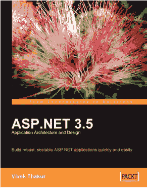
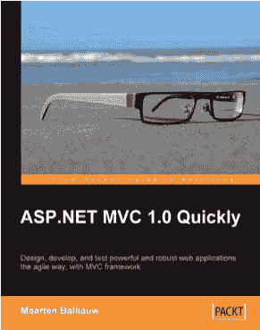

## 索引

### 符号

- **创建 .NET 解决方案**
  - 组件层 38
  - 数据访问层 50-54
  - 表示层 37, 38
  - **生成依赖项** 394

### A

- AboutBox 38
- Account 类 77
- AccountRepository 类 68
- AccountRepository.GetApprovedAccountsByGroupID() 方法 304
- AccountRepository.Save() 方法 96
- AddNewAvatarAlert() 方法 144
- AddNewBlogPostAlert() 方法 249
- AddPermission() 方法 70
- AddTag() 方法 336
- AddTagsToTagCloud() 方法 352
- 警报 425
- AlertService 类 249
- AlertType 类 249
- AllNodes() 方法 101
- AppFabric 40
- **AppFabric 解决方案缓存**
  - 关于 406
  - 客户端 406-410
- **应用程序设计**
  - 分层架构 26
  - 多层架构 27
- Application_Error() 方法 49
- **应用层实现，用户帐户**
  - 关于 73-75
  - 扩展方法 75, 76
- **应用层实现，用户资料。** *参见* service layer implementation, user profiles*
- Application_Start() 方法 48
- ApproveMembers 方法 305
- ASP.NET MVC 442
- ASP.NET MVP 439
- **ASP.NET Web Forms**
  - ASP 方式，问题 439
  - 优点 440
  - 已解决的问题 440
  - Web 呈现模式 440
- **头像，用户资料**
  - 关于 105, 109
  - 自定义头像 109
  - Gravatar 109

### B

- **博客**
  - 关于 241
  - 数据访问层，设置 245
  - 数据库，实现 244
  - 友好 URL，添加 243
  - 帖子，创建 242
  - 表示层，实现 250
  - 存储库，构建 245-248
  - 服务/应用层，实现 248
  - 存储 244
  - 查看 243
- **btnSave_Click 事件** 347
- **btnSave_Click 方法** 256
- **btnSubmit_Click() 方法** 280, 385
- **btnTag_Click() 方法** 353
- **BuildIndexes() 方法** 434
- **业务逻辑 - WCF 服务转换**
  - 服务，部署 402, 403
  - 步骤 396-400
  - Web 项目，部署 402
  - Windows IIS 7.5 401

### C

- **缓存**
  - 关于 405, 406
  - AppFabric 解决方案 406
  - 配置 414
  - MemCached 解决方案 410
  - 开始使用 414
- **CalculateFontSize() 方法** 337
- **CAPTCHA** 58
- **分类**
  - 关于 259, 262
  - 警报 263
  - 论坛 262
  - 友好 URL 262
  - 帖子 262
  - 主题帖 262
- **CheckAccessForCurrentNode() 方法** 102
- **CheckAccessForNode() 方法** 101
- **CheckIfGroupPageNameExists 方法** 292
- **CleanPage() 方法** 248
- **ClearSession() 方法** 42
- **聚集索引** 427
- **CommentRepository** 335
- **评论页面，用户交互**
  - comments.ascx 343
  - Comments.ascx.cs 343, 344
  - CommentsPresenter.cs 344
- **社区关系**
  - 建立 147-151
- 完全自动化的公共图灵测试，用于区分计算机和人类。
  - *参见* CAPTCHA
- **组件层，.NET 解决方案**
  - 关于 38
  - 缓存 40
  - 配置实用工具 39
  - 电子邮件，发送 44, 45
  - 错误，处理 46, 47
  - 日志记录 46
  - 重定向 43
  - 会话对象 41, 42
- **Configuration 类** 40
- **ContainsInSession() 方法** 42
- **控制器** 442
- **CreateFriendFromFriendInvitation 方法** 162
- **CropFile() 方法** 138
- **Cryptography 类** 76

### D

- **数据访问层实现，消息传递**
  - 存储库，构建 190
- **数据访问层实现，用户帐户**
  - Data Context 包装器 65
  - 存储库，构建 65
  - 从数据库更新模型 62-64
- **数据访问层，媒体库**
  - 创建 FileRepository 218-221
  - 创建 FolderRepository 222-224
  - 存储库，构建 218
  - 设置 218
- **数据访问层，关系**
  - AlertService 163
  - FriendService 161, 162
  - PrivacyService 163
  - 存储库，构建 156
  - 设置 156
- **数据访问层设置，论坛**
  - 关于 265
  - 存储库，构建 265
- **数据访问层设置，用户组**
  - GetAccountsToApproveByGroupID 方法 297
  - GetApprovedAccountsByGroupID 方法 296
  - 构建 GetGroupByForumID 291
  - 构建 GroupForumRepository 294
  - 构建 GroupMemberRepository 294
  - 构建 GroupRepository 291
  - 构建 GroupToGroupTypeRepository 292
  - 存储库，构建 290
  - 步骤 293–297
- **数据访问层设置，用户交互**
  - BoardPostRepository 335
  - GetCurrentRating() 方法 329
  - 构建 HasRatedBefore() 存储库 328
  - 存储库，构建 328
  - 构建 SaveRatings() 存储库 329, 330
  - 设置 327
  - SystemObjectRatingOptionRepository 330
  - TagsRepository 330
- **数据访问层设置，用户资料**
  - 关于 114
  - 实体类 114, 115
  - 存储库，构建 115–119
- **数据访问审核**
  - 构建 ModerationRepository 376, 378
- **数据库实现**
  - AccountFiles 表 217
  - AccountFolders 表 216
  - 文件 215
  - 文件系统文件夹表 216
  - FileTypes 表 216
  - FolderFiles 表 217
  - 文件夹 216
  - FolderTypes 表 216
  - 关系，创建 217
- **数据库实现，博客**
  - 关于 245
  - PageName 列 245
  - Post 列 245
  - 关系，创建 245
- **数据库实现，论坛**
  - 分类 263
  - 论坛 264
  - 帖子 264
  - 关系，创建 264
- **数据库实现，用户组**
  - GroupForums 表 289
  - GroupMembers 表 289
  - Groups 表 288, 289
  - GroupTypes 表 289
  - 关系，创建 290
  - 截图 288
- **数据库实现，消息传递**
  - MessageRecipients 表 188
  - MessageRecipientTypes 表 188
  - 消息表 188
  - MessageTypes 表 188
  - 关系，创建 189
- **数据库实现，审核**
  - ContentFilters 375
  - Gags 表 374
  - 审核表 374
  - 关系，创建 375
  - 截图 373
- **数据库实现，关系**
  - 好友邀请 155
  - 好友表 154
  - 关系，创建 156
  - 状态，更新 155
- **数据库实现，用户帐户**
  - AccountPermissions 表 62
  - Accounts 表 61
  - Permissions 表 61
  - 关系，创建 62
  - Terms 表 62
- **数据库实现，用户交互**
  - Comments 表 326
  - IsAnswer 列 327
  - Medals 用户控件 327
  - Ratings 表 326
  - 关系，创建 327
  - SystemObjectRatingOptions 表 326
  - SystemObjects 表 325
  - SystemObjectTags 表 326
  - Tags 表 326
  - VoteCount 列 327
- **数据库实现，用户资料**
  - Alerts 表 113
  - Attributes 表 113
  - 经验等级 113
  - Privacy 表 113
  - Profiles 表 112, 113
  - 表 112

- 朋友
  - 添加提醒 153
  - 关注 154
  - 从外部来源导入 152
  - 与…交互 153
  - 发送邀请 153
  - 邀请 152
  - 管理 154
  - 搜索 152
  - 提供状态更新 154
  - 查看 153
- FriendService.
  - CreateFriendFromFriendInvitation() 方法 196
- 确认友谊
  - 登录展示器 176, 177
  - 未登录用户，屏幕 174
  - 注册流程 177
  - 已登录用户，屏幕 174

## G

- GagUserUntil() 方法 385
- GetAccountByEmail() 方法 68
- GetAccountByID() 方法 68
- GetAccountByUsername() 方法 68
- GetActiveGags() 方法 379
- GetApprovedAccountsByGroupID() 方法 296, 297
- GetBlogsByAccountID() 方法 253
- getCacheDirectory() 方法 434
- GetCategoriesWithForums() 方法 271
- GetCommentsBySystemObject() 方法 335
- GetContext() 方法 52
- GetCurrentRating() 方法 329
- GetCurrentTerm() 方法 72
- GetCurrentUserFromSession() 方法 42
- GetFriendsByAccountID() 方法 162
- GetLatestBlogs() 方法 246
- GetMemberAccountIDsByGroupID() 方法 295
- GetPermissionByName() 方法 71
- GetPermissionsByAccountID() 方法 71
- GetPrivacyFlagTypes() 方法 131
- GetQueryStringValue() 方法 43
- GetRouteURL() 辅助方法 168
- GetSystemObjectByTagID() 方法 332-335
- GetTagByName() 方法 331
- GetTagsGlobal() 方法 331
- GoToHomePage() 方法 44
- GoToRecoverPassword() 方法 83
- GoToRegister() 方法 83
- Gravatar 105
- 群组
  - 概述 283, 286
  - 实现数据库 288
  - 示例 284
  - 论坛 287
  - 问题 284, 285
  - 成员 287
  - 实现表示层 300
  - 请求成员资格链接 285
  - 实现服务/应用程序层 297
  - 类型 287
- GroupService
  - 概述 298
  - IsOwnerOrAdministrator() 方法 298
  - SaveGroup() 方法 298
- GroupService.
  - GetGroupsOwnedByAccount() 方法 309

## H

- HA Proxy
  - URL 404
- HasRatedBefore() 方法 328
- HttpContext 类 300
- HttpUtility.HtmlEncode() 方法 380

## I

- IIS 401
- Import 特性 47
- Init() 方法 203
- Insert() 方法 69
- Internet 信息服务器。*参见* IIS
- IsAnswer 属性 357
- IsGagged() 方法 379
- IsOwner() 方法 292
- IsThread 属性 269
- ItemDataBound 事件 309
- ItemDataBound() 方法 206, 251

## K

- **DDD 的关键方面**
  - 聚合 31
  - 实体 28
  - 工厂 32
  - 模块 30
  - 仓储 32
  - 服务 30
  - 通用语言 28
  - 值对象 29
- **应用程序设计的关键原则**
  - 构建与购买 26
  - 可扩展性 26
  - 模块化和松散耦合 25
  - 关注点分离 (SoC) 25

## L

- **层关系图模板** 393
- **应用程序设计的分层架构**
  - 概述 26
  - 业务逻辑层 26
  - 数据访问层 26
  - 表示层 26
  - 服务层 26
  - 工具/组件层 27
- **LinkedIn.com** 8
- **负载均衡。** *参见* Web 服务器场
- **LoadComments() 方法** 344
- **LoadData() 方法** 278
- **LoadDisplay() 方法** 168
- **LoadOptions() 方法** 349
- **LoadUI() 方法** 236, 364
- **Login() 方法** 83
- **用户帐户登录过程**
  - 概述 60
  - 管理帐户 60
  - 密码提醒 60
- **Lucene** 432

## M

- **托管扩展框架。** *参见* MEF
- **MapPageRoute() 方法** 143
- **MarkAnswer 页面，用户交互**
  - MarkAnswer.ascx 356
  - MarkAnswer.ascx.cs 357
  - MarkAnswerPresenter.cs 357
- **勋章页面，用户交互**
  - Medals.ascx 358
  - Medals.ascx.cs 358
- **Medals.Score 属性** 362
- **媒体库**
  - 设置数据访问层 218
  - 实现数据库 214
  - 数据管理界面 214
  - 文件 213
  - 文件系统管理 213
  - 文件夹 213
  - 概述 211
  - 实现表示层 224
- **MEF**
  - 概述 22
  - 目录 35
  - 导出 34
  - 构建扩展性 34, 35
  - 导入 34
- **MemCached** 40
- **MemCached 解决方案缓存**
  - 概述 410
  - 业务逻辑层，缓存 412, 413
  - 客户端 411
  - 使用客户端 412
  - 服务器 411
- **MessageRecipientService.DeleteMessageRecipient() 方法** 206
- **MessageService.SendMessage() 方法** 200
- **消息传递**
  - 概述 185
  - 实现应用程序层 193
  - 设置数据访问层 189
  - 实现数据库 187
  - 设计功能 186, 187
  - 问题 186
  - 实现表示层 198
  - 收件人 187
  - 实现服务层 193
- RegisterRoute() 275
- RemoveFromSession() 42
- repAccounts_ItemDataBound() 165
- repCategories_ItemDataBound() 274
- repPrimaryNav_ItemDataBound() 103
- SaveAccount() 69
- SaveChanges() 70, 269
- Send() 45
- SendEmail() 44
- SendIndividualEmailsPerRecipient() 45
- SetInSession() 43
- SaveModeration() 382
- SaveModerationResults() 377
- SavePost() 256
- SavePrivacyFlag() 131
- SaveProfile() 119
- SendAlertToGroup() 299
- SendInvitation() 170
- SendPasswordReminderEmail() 方法 94
- ShowPrivacyTypes() 129
- SystemObjectTagService.GetSystemObjectsByTagID() 365
- TogglePrivacy() 142
- Update() 69
- UpdateAccount() 95
- UpdateDescriptions() 218
- **微博** 155
- **模型** 442
- **模型-视图-控制器。** *参见* **MVC**
- **模型-视图-展示器。** *参见* **MVP**
- **MVP 模式**
  - 概述 35
  - 模型 36
  - 展示器 36
  - 视图 36
  - 工作原理 36
- **审核**
  - 社区审核 368
  - 设置数据访问层 375
  - 设计 370
  - 动态过滤器 369, 370
  - 启用 371
  - 过滤系统 372
  - 概述 367
  - 实现表示层 381
  - 构建仓储 375
  - 实现服务/应用程序层 380
  - 禁言用户 369, 371
- **MSDN 库** 443
- **MVC**
  - 概述 442
  - 与 MVP 之间选择 443
  - 视图 442
- **MVP**
  - 概述 127
  - 与 MVC 之间选择 443
  - 展示器 82, 83
  - 视图 79–82

## N

- **NavigateUrl 属性** 274
- **Navigation 类** 99
- **网络负载均衡。** *参见* **NLB**
- **NewGroup 属性** 300
- **新用户控件安装，用户交互**
  - 论坛 UI 360
  - 照片 UI 359
  - ProfileDisplay UserControl 362
- **NLB** 404

## O

- **面向对象编程。** *参见* **OOP**
- **OCR** 58
- **OnClick 事件** 202
- **OnItemDataBound 事件** 305
- **OOP** 30
- **光学字符识别。** *参见* **OCR**
- **Optimize() 方法** 435
- **OrderByDescending() 方法** 338

## P

- **Page_Load() 方法** 102
- **分部类** 77
- **分区**
  - 概述 428
  - 影响当前系统 431
  - 注意事项 432
  - 水平分区 429
    - 创建 429
    - 创建新文件组 429
    - 创建分区函数 430
    - 分区方案 430
    - 分区表 431
  - 垂直分区 428
- 模式和做法。*参见* PnP
- 人员、目标、战略和技术。*参见* POST
- PersonRepository 类 52
- PnP 440
- 帖子 262
- POST 10
- PostID 属性 357
- PostPresenter.Save() 方法 311
- PostService.SavePost() 方法 356
- 表示实体 181
- 表示层，论坛
  - Default.aspx 273, 274
  - 实现 272
  - Post.aspx 279-281
  - URL 路由 275
  - ViewForum.aspx 275, 276
  - ViewPost.aspx 277, 278
- 表示层，群组
  - 默认 306
  - 论坛增强 310-312
  - 实现 300
  - ManageGroup 301
  - ManageGroup，图像上传 301, 303
  - ManageGroup，WYSIWYG 301
  - 成员 303, 304
  - 成员，CheckBoxLists 304, 305
  - 成员数据分页 304
  - MyGroups 308
  - URL 路由 306
  - ViewGroup 306
  - ViewGroup，私有/公共 307
- 表示层实现，博客
  - 概述 250
  - 友好 URL 支持 253
  - 最新博客帖子 251, 252
  - 我的博客部分 253
  - 创建帖子 255, 256
  - 编辑帖子 255, 256
  - ViewPost.aspx 页面 253, 254
- 表示层实现，媒体库
  - 概述 224
  - 接收文件，使用 Silverlight 上传程序 232, 233
  - 上传文件 224
  - 上传多个文件 225-231
  - 显示照片 234-236
  - ViewAlbum 页面 237, 238
- 表示层实现，消息
  - 概述 198
  - 默认 203-205
  - 文件夹 206
  - 阅读消息 207, 208
  - NewMessage.aspx 页面 201, 202
  - 新消息页面 198-200
  - 整合 Xinha 198, 199
- 表示层实现，关系
  - 导入联系人 171, 172
  - 选择联系人 173
  - 显示朋友 177
  - 确认友谊 174-176
  - 邀请朋友 168
  - 搜索朋友 164
  - 导入联系人页面 171
  - 更新公开资料 179
  - Search.aspx 页面 164
  - SiteMaster 164
  - 实现状态更新 180-183
- 表示层实现，用户帐户
  - 概述 78
  - 编辑帐户 95, 96
  - 验证电子邮件 90-92
  - 模型视图展示器 78, 79
  - 恢复密码 92, 94
  - 注册页面 84-90
  - 实现安全性 96
- 表示层实现，用户资料
  - 提醒 144, 145
  - 上传头像 136, 137
  - 自定义主页 142, 144
  - Gravatar 140, 141

- 扩展方法 339
- TagService 336
- WebContext 341
- **SetInSession() 方法** 43
- **SetTitle() 方法** 364
- 站点
  - 限制 389
- **SiteMap 类** 99
- **SkipRecaptcha 属性** 87
- **SLATES** 11
- **SOA** 26, 293
- **SOC** 441
- **社交网络**
  - 关于 7
  - 内容审核 9
  - 客户服务 9
  - Digg.com 7
  - 示例 7, 8
  - Facebook.com 8
  - 功能 14
  - 基础设施要求 9
  - LinkedIn.com 8
  - POST 10
  - SLATES 10
  - Twitter.com 8
- **社会保障号码。** *参见* **SSN**
- **解决方案结构**
  - 项目 111
  - 重新探讨 111
- **SSN** 28
- **SystemObjectTagRepository 方法** 332
- **SystemObjectTagService.**
  - **GetSystemObjectsByTagID() 方法** 365

## T

- **标签云** 324
- **标签添加, 用户交互**
  - 关于 318
  - 选择大鱼标签 319
- **标签页, 用户交互**
  - 关于 362
  - Tags.ascx 351
  - Tags.ascx.cs 351, 352
  - Tags.aspx 363
  - Tags.aspx.cs 363, 365
  - TagsPresenter.cs 352, 353
- **TagsRepository**
  - GetTagByName() 方法 331
  - GetTagsBySystemObjectAndRecordID() 方法 332
  - GetTagsBySystemObject() 方法 331
- **Take() 方法** 297
- **线程** 262
- **ThreadID 属性** 282
- **分层架构**
  - 多层方法的扩展 392
  - 两层方法的扩展 390, 391
  - 两层方法的优势 391
- **TopN StatusUpdates** 184
- **Twitter.com** 8

## U

- **唯一索引** 427
- **UpdateAccount() 方法** 95
- **UpdateDescriptions() 方法** 218
- **更新向导** 114
- **UploadService.UploadPhotos 方法** 303
- **用户账户**
  - 应用层实现 73
  - 数据访问层实现 62
  - 数据库实现 61
  - 设计 57
  - 领域层实现 76, 77
  - 功能 56
  - 功能实现 61
  - 问题 56
  - 登录 60
  - 表示层实现 78
  - 注册 57
  - 注册页面 55
- **用户账户设计**
  - 登录 60
  - 注册 57
  - 安全 59
- **用户交互**
  - 关于 315, 316
  - 标记答案 320
  - 评论 320
  - 数据库实现 325
  - 问题 317
  - 勋章 321

## ASP.NET 3.5 应用程序架构与设计

ISBN: 978-1-847195-50-0    平装本：260 页

快速轻松地构建健壮、可扩展的 ASP.NET 应用程序

- 1. 掌握 ASP.NET 中的架构选项，以增强你的应用程序
- 2. 开发并实现 n 层架构，使你能够修改一个组件而不影响下一个组件
- 3. 快速设计可扩展且可维护的 Web 应用程序

## ASP.NET MVC 1.0 快速入门

ISBN: 978-1-847197-54-2    平装本：256 页

以敏捷方式使用 MVC 框架设计、开发和测试功能强大且健壮的 Web 应用程序

- 1. 使用 ASP.NET MVC 框架构建功能强大的 Web 应用程序的快速指南
- 2. 涵盖 Web 应用程序开发的各个方面，包括需求分析、设计、构建、测试和部署
- 3. 使用多项新发布的功能探索 ASP.NET MVC 框架，包括 WebForms、脚本合并、jQuery 集成和 ASP.NET MVC AJAX 帮助器

