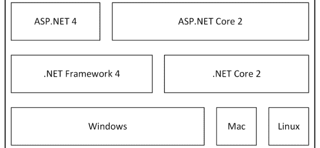

# 2 为什么性能是一项功能
## 为什么性能是一项功能

现在是成为 C# 开发者的激动人心的时代。微软正处于其历史上最大的变革之中，并且正在拥抱开源软件。ASP.NET 和 .NET Framework 已从头重建，因此它们组件化、跨平台且完全开源。最近的许多改进都来自社区。

ASP.NET Core 2 和 .NET Core 2 拥抱了其他流行的开源项目，包括 Linux。ASP.NET 模型视图控制器（MVC）Web 应用程序框架是 ASP.NET Core 的一部分，它大量借鉴了 Ruby on Rails，微软也热衷于推广 Node.js、Grunt、gulp 和 Yeoman 等工具。对 React、Redux 和 Angular 单页应用程序（SPA）的支持也是内置的。你可以用 TypeScript 编写这些，TypeScript 是由微软开发的 JavaScript 的静态类型版本。

通过阅读本书，你将学习如何使用这些新的 .NET Core 技术编写高性能软件。你将能够使你的 Web 应用程序对输入做出快速响应，并能根据需求进行扩展。

我们将专注于 .NET 的最新 Core 版本。然而，许多这些技术也适用于以前的版本，并且它们通常对 Web 应用程序开发（任何语言或框架）都很有用。

理解所有这些新框架和库如何组合在一起可能会有些令人困惑。我们将介绍在使用最新技术时可用的各种选项，引导你走向高速成功的道路，并避免性能陷阱。

读完本书后，你将了解 Web 应用程序在规模部署（到分布式基础设施）时可能出现哪些问题，并知道如何避免或缓解这些问题。你将获得编写高性能应用程序的经验，而无需通过艰难的方式了解这些问题。

在本章中，我们将涵盖以下主题：

- 性能作为一项功能
- 常见性能问题类别
- 基本硬件知识
- 微软工具及替代方案
- 新的 .NET 命名和兼容性

### 性能作为一项功能

你可能之前听说过将性能视为一流功能的做法。传统上，性能（连同安全性、可用性和正常运行时间等）仅被视为**非功能需求（NFR）**，通常需要满足一些人为设定的指标。你可能之前听过*高性能*这个术语。这是一种表现良好的品质，通常在需求中不加量化地体现，价值甚微。在与客户或用户沟通时，最好避免这种企业行话。

使用过时的瀑布式开发方法时，这些 NFR 不可避免地被留到最后，并且为了完成功能需求，往往从超预算和延期的项目中删除。这导致了不合格的产品，不可靠、缓慢，而且通常不安全（因为可靠性和安全性也常常是被忽视的 NFR）。想想你有多少次因软件响应输入迟缓而感到沮丧。也许，你使用过售票机或自助结账机，其响应迟钝到了无法使用的程度。

有一种更好的方法。通过将性能视为一项功能，并在**敏捷**开发过程的每个阶段都考虑它，你可以让用户和客户爱上你的产品。当软件响应速度超过用户的感知时，使用起来就是一种享受，因为它不会拖慢用户的速度。当存在明显延迟时，用户需要调整自己的行为来等待机器，而不是按照自己的节奏工作。

如今计算机拥有惊人的处理能力，并且比几年前拥有更多的资源。那么，为什么在计算机如此之快、计算速度远超人类的情况下，我们仍然有响应明显缓慢的软件呢？答案是编写的软件不佳，没有考虑性能。为什么会这样？原因是性能不佳的迹象在开发中通常不可见，只有在部署后才会显现。然而，如果你知道要寻找什么，就可以在将软件发布到生产环境之前避免这些问题。

更高一层的是编译为与硬件无关的中间语言（IL）或字节码，并在虚拟机（VM）上运行的软件。例如 Java、Scala、Clojure（在 Java VM 上的字节码），当然还有 C#（在公共语言运行时上的 IL）。内存管理通常由系统处理，并且通常有一个垃圾收集器（GC）来清理未使用的引用（Go 和 .NET Native CoreRT 也有 GC）。这些应用程序可以在多个平台上运行，并且更安全。然而，在执行速度方面你仍然可以获得接近原生的性能，尽管启动速度可能会受到影响。

在这些之上是解释型语言，如 Ruby、Python 和 JavaScript。这些语言通常不编译，而是由解释器逐行运行。它们通常比编译语言运行得慢，但这通常不是问题。更严重的担忧是使用动态类型时捕获 bug。你只有在遇到错误时才能看到它，而使用静态类型语言时，许多错误可以在编译时捕获。

最好避免泛泛的建议。你可能会听到反对使用 Ruby on Rails 的论点，引用 Twitter 因性能原因不得不迁移到 Java 的例子。这对你的应用程序来说很可能不是问题，事实上，拥有 Twitter 那样的受欢迎程度将会是一个不错的问题。运行 Rails 时更大的担忧可能是内存占用大，导致在云实例上运行成本高昂。

本节只是让你初步了解，主要教训是通常语言并不重要。通常不是语言使程序变慢，而是糟糕的设计选择。C# 在速度和灵活性之间提供了良好的平衡，使其适用于广泛的应用程序，尤其是服务器端 Web 应用程序。

### 性能问题的类型

性能问题有很多种，其中大多数与所使用的编程语言无关。其中很多源于代码在计算机上的运行方式，我们将在本章后面讨论其影响。

我们将在这里简要介绍常见的性能问题，并在本书后面的章节中更详细地介绍。你可能遇到的问题通常属于几个简单的类别，包括：

- 延迟：
  - 内存延迟
  - 网络延迟
  - 磁盘和 I/O 延迟
  - 频繁通信/握手
- 带宽：
  - 过大的负载
  - 未优化的数据
  - 压缩
- 计算：
  - 处理过多数据
  - 计算不必要的结果
  - 暴力破解算法
- 响应性：
  - 可以在离线完成却同步执行的操作
  - 缓存和处理陈旧数据

在为平台编写软件时，你通常受到两种资源的限制。它们是计算处理速度和访问远程（相对于处理器）资源。如今处理速度很少成为限制因素，并且可以与其他资源进行权衡，例如，压缩一些数据以减少网络传输时间。访问远程资源（如主内存、磁盘和网络）会有不同的时间成本。重要的是要理解速度不是一个单一的值，它有多项参数。其中最重要的参数是带宽，以及至关重要的延迟。

延迟是操作开始前的滞后时间，而带宽是操作开始后数据传输的速率。邮寄硬盘具有非常高的带宽，但也有非常高的延迟。这会使来回发送大量文本文件变得非常缓慢，但也许这是发送大批 3D 视频的好选择（取决于 Weissman 分数）。手机数据连接可能更适合文本文件。尽管这是一个牵强的例子，但同样的考虑通常适用于计算栈的每一层，时间差异的数量级也相似。问题在于差异太快而无法感知，我们需要借助工具和科学来观察它们。

解决性能问题的秘诀是更深入地理解技术，并了解在较低级别发生的事情。你应该理解框架在网络级别对你的指令做了什么。对这些命令如何在底层硬件上运行以及它们如何受到所部署基础设施的影响有一个基本了解也很重要。

性能问题与功能性 bug 相比有些不同，因为它们通常只有在规模扩大时才会显现，除非你主动去寻找，否则在上线部署前你不会注意到它们。你可以编写集成和负载测试来检查性能是否达到你设定的量化目标，我们将在本书后面介绍这一点。

### 理解硬件

记住计算机科学里有台计算机。了解你的代码运行在什么之上以及由此产生的影响非常重要；这不是魔法。

### 存储访问速度

计算机运行得如此之快，以至于很难理解哪种操作是快速操作，哪种是慢速操作。一切看起来都是即时的。事实上，任何在几百毫秒以内发生的事情对人类来说都是无法感知的。然而，有些东西比其他东西快得多，只有当数百万个操作并行执行时，你才会在大规模下遇到性能问题。

应用程序可以访问各种不同的资源，其中一些列举如下：

- CPU 缓存和寄存器：
  - L1 缓存
  - L2 缓存
  - L3 缓存
- RAM
- 永久存储：
  - 本地 **固态硬盘 (SSD)**
  - 本地 **硬盘驱动器 (HDD)**
- 网络资源：
  - **局域网 (LAN)**
  - 区域网络
  - 全球互联网

**虚拟机 (VM)** 和云基础设施服务可能会简化部署，但也可能带来更多性能复杂性。挂载在机器上的本地磁盘实际上可能是一个共享网络磁盘，其响应速度远慢于连接到同一台机器的真实物理磁盘。你可能还必须与其他用户竞争资源。

为了体会各种存储形式之间的速度差异，请考虑以下图表。它显示了从多种存储介质中检索少量数据所需的时间：

该图表是为本书制作的，它使用了从网上找到的延迟数据的平均值。它采用对数刻度，这意味着差异非常大。图表顶部代表一秒或十亿纳秒。将数据包发送到大西洋彼岸并返回大约需要 150 毫秒 (ms) 或 150 百万纳秒 (ns)，这主要受光速限制。这仍然远快于你思考的速度，并且看起来是即时的。事实上，将一个像素推送到屏幕上往往比将数据包发送到另一个大陆花费的时间更长。

下一个最大的条形图是物理 HDD 将机械臂移动到开始读取数据位置所需的时间（10 ms）。机械设备很慢。

理解所有这些版本如何组合在一起可能会有点令人困惑。这最好用类似下面的图表来解释，它展示了各层如何交互：

ASP.NET Core 2 可以运行在现有的 .NET Framework 4.7 或新的 .NET Core 2 框架上。同样，.NET Core 可以运行在 Windows、OS X / macOS 和 Linux 上，但旧的 .NET 只能运行在 Windows 上。

还有 Mono 框架，为了清晰起见被省略了。这是一个之前的项目，允许 .NET 在多个平台上运行。Mono 被微软收购，并被开源（连同其他 Xamarin 产品）。我们现在开始看到这些不同平台的融合，由 .NET Standard 驱动。

Core 的功能不如现有的 .NET Framework 丰富，尽管在版本 2 中差距已大幅缩小。如果你编写图形桌面应用程序，也许使用 Windows Presentation Foundation (WPF)，那么你应该坚持使用 .NET 4。没有计划将这些 Windows 特定 API 移植到 Core，因为那样它就不会跨平台了。

由于本书主要关于 Web 应用程序开发，我们将使用所有软件的最新 Core 版本。我们将研究各种操作系统和架构的性能影响。如果你的部署目标是 Raspberry Pi 等计算机，这一点尤其重要，它使用 ARM 架构的处理器。它也具有有限的内存，在使用包含垃圾回收的托管运行时（如 .NET）时需要考虑这一点。

### 总结

让我们总结一下本章我们涵盖了什么以及下一章我们将涵盖什么。我们介绍了将性能视为功能的概念，并讨论了其重要性。我们还简要提到了一些常见的性能问题，以及为什么我们在软件开发过程中经常会错过它们。我们将在本书后面更详细地介绍这些内容。

我们展示了各种类型存储硬件之间的性能差异。我们强调了了解你的代码运行在什么之上以及至关重要的是它在用户看到时将运行在什么之上的重要性。我们谈到了系统扩展过程的变化，与过去相比，现在扩展是水平进行的而不是垂直的，以及你如何在代码和系统的创建中利用这一点。我们向你展示了你可以使用哪些工具以及其中一些工具的许可影响。我们还解释了 .NET 的新世界以及这些最新框架如何与稳定的框架配合。我们提到了测量至关重要。

在下一章中，我们将向你展示如何在 Windows、Mac 或 Linux 上开始使用 ASP.NET Core 2。我们还将演示如何使用 Docker 容器来构建和运行你的应用程序。
