# 3 设置你的环境

.NET Core 的主要好处之一是它跨平台，这意味着它可以在各种操作系统上运行。你不再需要依赖 Windows 操作系统来托管甚至开发你的 .NET 应用程序。虽然在之前技术上是可行的，但现在比以往任何时候都更容易，并且微软也积极鼓励。他们甚至在 Azure 上提供 Linux 服务器以及可用于构建和托管代码的预制 Docker 镜像。

在本章中，我们将向你展示如何在你选择的 OS 上使用最新工具开始。我们将介绍在 Windows、macOS（以前的 OS X）和 Linux 上设置开发环境的过程。每个系统都有首选的解决方案，但也有跨平台工具可供在其中任何一个上使用。

我们还将讨论现代 DevOps 的应用程序开发和部署方式，使用容器。特别是，我们将介绍如何使用 Docker。容器是将你的应用程序及其依赖项打包成一个单元的绝佳方式，以便你可以更一致地部署并减少不愉快的意外。通过将你的应用程序作为标准单元交付，你可以更少地担心配置实时生产服务器或设置新的开发人员工作站。

为了让你入门，我们将在本章中介绍以下主题：

- Windows
- macOS
- Linux
- Visual Studio 2017
- Visual Studio for Mac
- Visual Studio Code
- .NET Core SDK

选择标准 Web 应用程序模板：

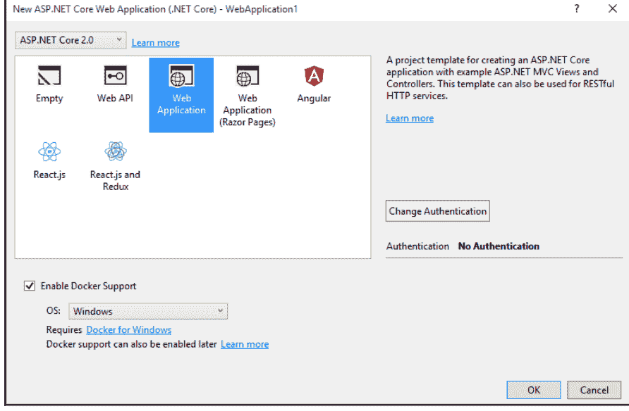

点击 **Change Authentication** 按钮以更改用户登录你网站的方式。选择 **Individual User Accounts** 但将数据保留在本地存储。或者，你也可以连接到云服务，如下图所示，但我们这里不涉及：

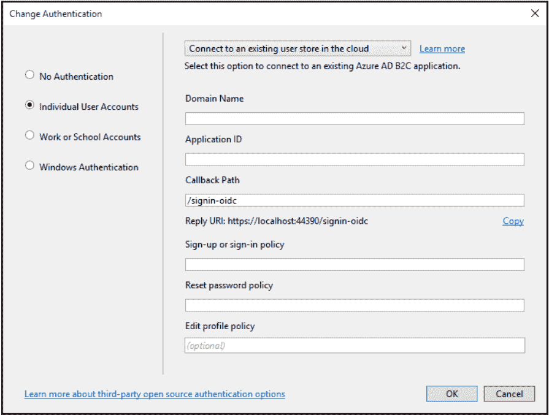


一旦你创建了应用程序，VS 将在后台恢复 NuGet 包。完成此操作后，按 F5 在调试器中构建并运行你的应用。默认浏览器应打开包含 ASP.NET Core 模板站点的页面，并且 VS 将显示性能跟踪的图表：

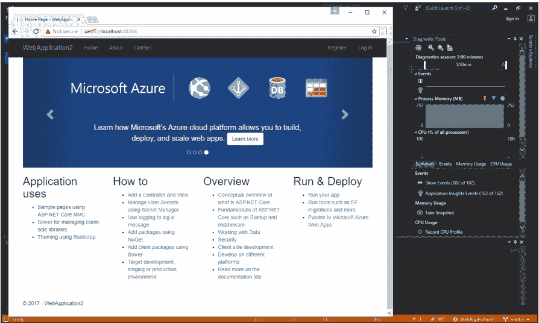

恭喜！你刚刚创建了一个 ASP.NET Core 2 Web 应用。

## Mac

苹果电脑一直备受青睐，价格也与之相符。它们在开发者中非常受欢迎，尤其是 Web 开发者。也许这是因为它们是唯一可以运行你可能想要测试的所有东西的机器。你可以在虚拟机中运行 Windows 和 Linux，但苹果的 macOS（以前称为 OS X，发音为 OS ten）不会在任何非苹果硬件上运行（没有一些说服力）。

这也可能是由于 iPhone 和 iPad 的 meteoric 崛起，以及随之而来的生态系统。如果你想为 iOS 和 Android 开发应用，那么唯一合理的选择是使用 Mac——尽管，渐进式 Web 应用正在蚕食传统上由原生应用占据的大部分领域。

## Visual Studio for Mac

VS Mac 是 Xamarin Studio 的重新命名，但它也得到了扩展，并采用了大量常规 VS 的功能和代码。它仍然最适合制作 Xamarin 跨平台移动和桌面应用，但它也支持 .NET Core 和 ASP.NET Web 应用。

首先，下载你需要的文件。这包括用于构建应用的软件，例如 VS for Mac 或 VS Code。VS Mac 以 DMG 磁盘映像的形式提供，其中包含安装程序，而 VS Code 则以可解压即用的 ZIP 文件形式提供。你还需要 .NET Core SDK，它以需要安装的 PKG 文件形式提供。你可能还想要一本方便的指南手册：

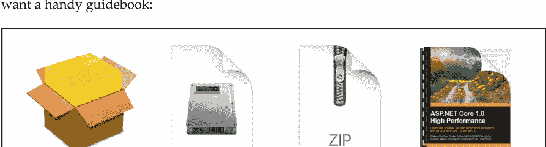

### 安装 VS Mac

VS for Mac 由最新版本的 macOS（High Sierra）支持，但它也适用于较旧的版本，例如 OS X El Capitan（10.11）和 macOS Sierra（10.12）。

2. 在下一个屏幕中，选择 .NET Core 2.0 作为目标框架：

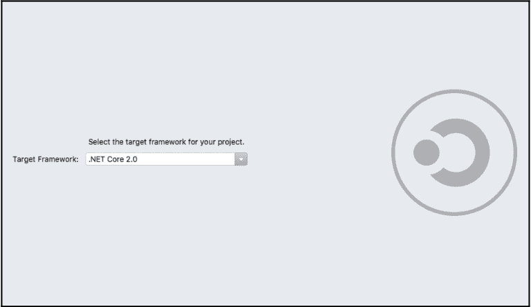

3. 最后，添加项目名称并完成向导：

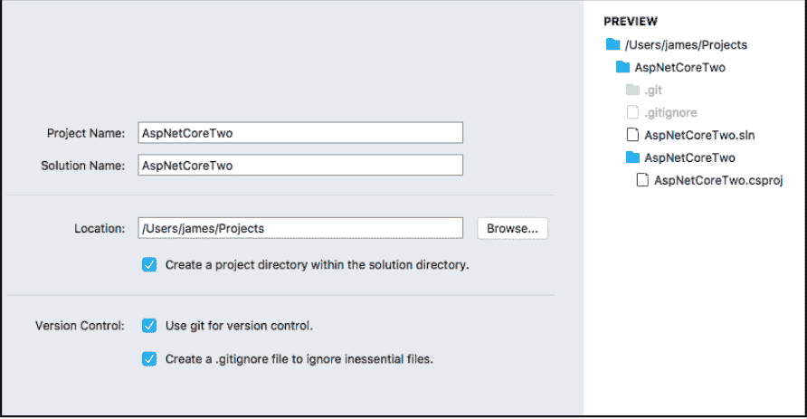

你也可以通过打开包含它的文件夹，在 Visual Studio Code 中处理此解决方案：

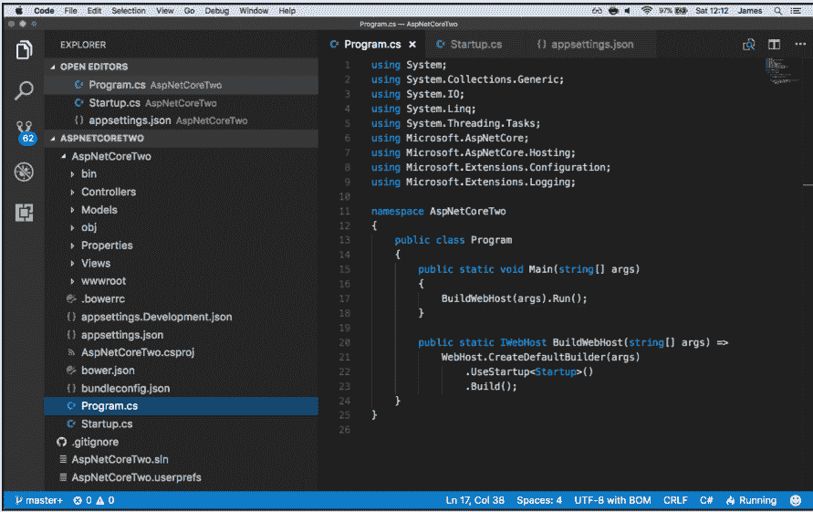

## Visual Studio Code

Visual Studio Code 运行于 Windows、Mac 和 Linux。VS Code 更像是一个文本编辑器而不是 IDE，但它是一个非常强大的编辑器，并且模糊了编辑器与完整 IDE 之间的界限。它支持 IntelliSense 代码补全、构建代码以及调试应用。

它使用 Web 技术（特别是 TypeScript）构建，并在基于独立 Web 浏览器的应用托管环境中运行。然而，它比类似的 Electron 桌面应用（如 Atom 或 Slack）快得多。Azure Web 界面用于编辑代码的相同引擎也在使用。

为了处理巨大的数据文件，最好坚持使用原生文本编辑器，例如 Notepad++（Windows 上）或 Sublime Text。

## Linux

Linux 在桌面市场之外是一个非常流行的操作系统。Android（由 Google 收购的移动操作系统）基于它构建，并且运行在世界上大多数智能手机上。有时它是使用专用硬件的计算机的主要桌面选项，例如 Raspberry Pi。Linux 在嵌入式设备上非常流行，部分原因是它轻量级，通常对资源的需求远低于典型的 Windows 或 macOS 安装。

Linux 也是 Web 服务器最流行的操作系统，这正是我们在这里最感兴趣的。可以说 Linux 是地球上最流行的操作系统，尽管许多用户不会直接与之交互。


严格来说，Linux 仅指操作系统的内核。Windows 的等效部分是 NT 内核。许多不同的发行版都是以 Linux 内核为核心构建的，并将其与许多其他（通常是 GNU）应用程序捆绑在一起。你甚至可以使用类似 Buildroot 的东西自己制作一个精简版本。

一些流行的发行版的例子是 Ubuntu 和 CentOS（Community Enterprise OS，是 Red Hat Enterprise Linux 的免费版本）。Linux 发行版可以根据它们使用的软件包管理类型进行广泛分类。当尝试找到要安装的软件的正确版本时，这很有用，尽管你通常可以直接通过发行版的包管理器获取流行的应用程序。

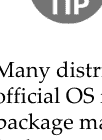

如果你以前从未使用过包管理器，那么你会惊讶于它比手动安装软件（或甚至像在 Windows 或 Mac 上通常那样使用 App Store）容易得多。

许多发行版基于 Debian，包括 Mint、Ubuntu 和 Raspbian（Raspberry Pi 的官方操作系统）。这些使用基于 Debian 的软件包格式和 APT 包管理器。Debian 的最新版本称为 Stretch，.NET Core 支持它。它还将其用于官方的 .NET Docker 镜像。


Debian 版本以《玩具总动员》角色命名；上一个版本称为 Jessie。

其他发行版使用 **Red Hat Enterprise Linux (RHEL)** RPM 软件包系统和 yum 包管理器。这些包括 CentOS 和 YellowDog，仅举几例。还有 **SUSE Linux Enterprise Server (SLES)**，这是另一种不同的发行版，但 .NET Core 也支持它。

还有许多其他发行版，太多无法在此提及。Linux 不是像 Windows 或 Mac 那样的单一操作系统。我们甚至还没有涵盖基于 BSD 的系统，它们使用不同的内核。这些包括 FreeBSD、OpenBSD 和 NetBSD。甚至 macOS 也是基于 BSD 的，具有其 NeXTSTEP 遗产（运行 CERN 第一个 Web 服务器的操作系统）。

这里的大多数说明也适用于 Windows 和 Mac 的命令行。工具是相同的；甚至 VS 中的图形工具也使用与命令行 `dotnet` 实用程序相同的模板。

## 在 Linux 上开始使用 .NET Core

我们将稍微改变一下，展示 .NET Core 的多功能性和跨平台性。在下面的部分中，我们将演示如何在 Azure 上运行的 Ubuntu Server VM 上仅使用命令行且没有窗口管理器开发一个 .NET Core 应用。

这与你在任何基于 Debian 的发行版上设置的方式非常相似，包括 Ubuntu、Mint 和 Raspbian（用于 Raspberry Pi）。Raspberry Pi 使用定制的 ARM 处理器而不是传统的 Intel x86 CPU 并不重要。当 Mono 最初移植到 Pi 时，专用硬件基于浮点实现存在问题，但这在 .NET Core 中不再是问题。

我们将使用命令行文本编辑器，这里争论 Emacs 与 vi 是不明智的，所以使用你喜欢的那个。如果使用平板电脑（例如带有蓝牙键盘的 iPad）通过 SSH 或 Mosh 连接到云服务器，这种设置可能是一个不错的工作流程。然而，如果你在本地工作并且想要在你选择的 X11/Wayland 桌面环境中使用图形编辑器，那么你可以运行 VS Code 或 JetBrains Rider。毫无疑问你也会大量使用终端窗口。

## 安装 .NET Core 2

本指南中使用的是 Ubuntu Server 16.04 LTS，但这些说明也适用于其他版本。使用 **Advanced Package Tool (APT)**，我们可以非常轻松地安装 .NET Core，但首先我们需要添加一个自定义源，因为 .NET Core 不在默认存储库中。

首先我们需要将 .NET Core 包源添加到 APT 使用的列表中。包源位于 Azure 上，因此我们将此 URL（加上一些其他信息）写入 apt-get 使用的源文件夹中的文件。我们通过将 echo 的标准输出重定向到它，使用以下命令来完成此操作：

```
sudo sh -c 'echo "deb [arch=amd64] https://apt-mo.trafficmanager.net/repos/dotnet-release/ xenial main" > /etc/apt/sources.list.d/dotnetdev.list'
```

所有软件包都使用公钥加密进行签名以验证其完整性（请阅读后面的章节了解更多信息）。我们使用 apt-key 命令从 Ubuntu 密钥服务器导入 .NET Core 包的公钥：

```
sudo apt-key adv --keyserver hkp://keyserver.ubuntu.com:80 --recv-keys 417A0893
```

我们需要更新我们的源，以便最新的更改可以被获取，使用以下简单命令：

```
sudo apt-get update
```

update 命令与 upgrade 命令不同，但它们通常一起使用。虽然 update 只是刷新 APT 关于软件包的信息，但 upgrade 允许你非常轻松地将机器上所有未手动安装的软件更新到最新版本。这可以节省很多时间。

现在我们可以使用以下命令安装 .NET Core：

```
sudo apt-get install dotnet-sdk-2.0.0
```

如果 SDK 包最终进入默认源列表，那么这就是你需要做的全部。

如果你正在尝试预览版本，那么该包将带有预览标签后缀（例如，-preview2-006497）。

在滚动的文字墙之后，假设你没有收到任何错误并且看到遥测通知，你就可以开始了。输入 dotnet 以查看使用信息，输入 dotnet --version 以查看你当前运行的版本。


## 创建你的第一个应用

运行以下命令，从模板创建一个新的控制台应用：

```
dotnet new console -o DotNetCoreTwoHelloWorld
```

然后切换到刚刚创建的目录，并用以下两条命令运行它：

```
cd DotNetCoreTwoHelloWorld
```

```
dotnet run
```

你的控制台应该类似于以下截图（如果你在 Windows 上使用 PuTTY）：

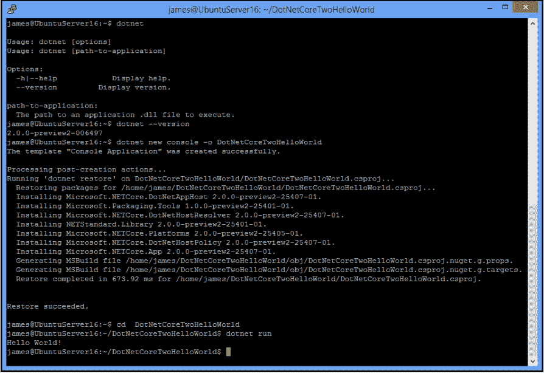

对于 .NET Core 1.0，你需要在用 `dotnet` 命令构建或运行应用之前调用 `dotnet restore`。在 .NET Core 2.0 中，对于需要它的 `dotnet` 命令，系统会代表你调用此命令，你不再需要以这种方式手动还原 NuGet 包。

假设基础控制台应用运行正常，让我们创建一个 Web 应用。运行以下命令，向上移动一级到父文件夹并列出模板：

```
cd ..
```

```
dotnet new
```

在不带任何附加参数的情况下，`dotnet new` 命令将列出所有可用模板。这些模板显示在以下截图中：

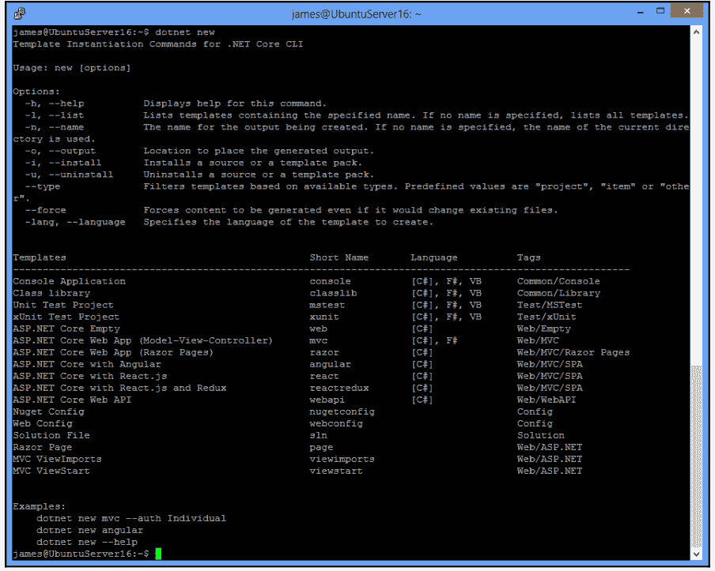

让我们像之前的其他示例一样，创建一个标准的 MVC Web 应用。接下来的三条命令将从模板创建一个新的 Web 应用，切换到所创建的文件夹，并运行该应用：

```
dotnet new mvc -o AspNetCoreTwoMvc

cd AspNetCoreTwoMvc

dotnet run &
```

我们正在后台运行该应用（使用 &），这样在它运行时我们仍可使用终端。你可以使用本地机器上的浏览器连接到服务器，但这需要将 Web 服务器绑定到外部 IP 地址，并在服务器和云防火墙上打开端口。

接下来，我们通过以下命令下载首页来非常简单地测试 Web 服务器是否正常工作。如果你没有安装 wget，也可以使用 curl：

```
wget localhost:5000
```

此过程显示在以下截图中：

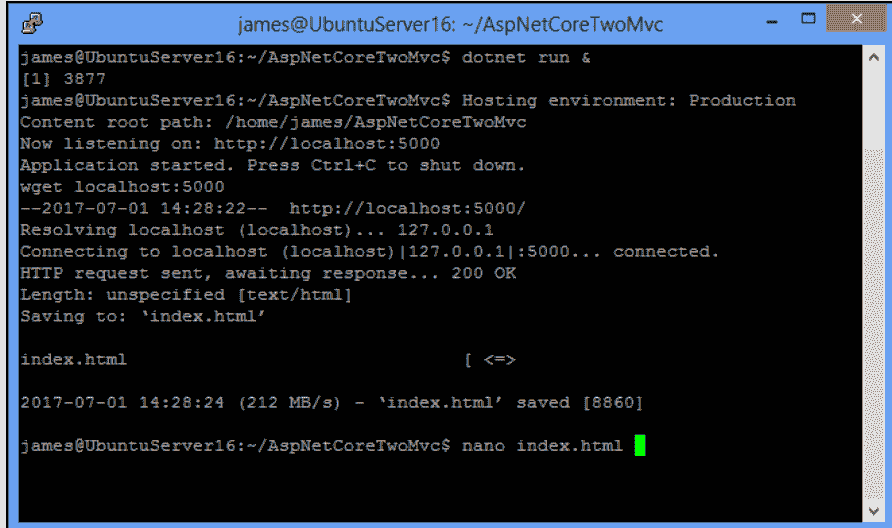

我们可以使用命令行文本编辑器查看首页的源代码，如下所示：

```
nano index.html
```

你现在将看到默认首页的 HTML 源代码，如下所示：

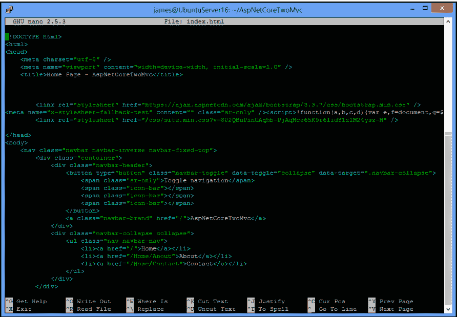

为了整理干净，我们应该结束仍在运行的 `dotnet` 进程。你可以使用 `kill` 命令，以启动时显示的 ID 来结束该进程。如果找不到该 ID，则可以使用 `ps x` 列出正在运行的进程。

## 使用 Docker 进行容器化

Docker 是容器技术的一种实现，它是虚拟机（VM）的轻量级版本。它最初构建于 Linux 容器（LXC）之上，但现在支持许多其他技术，包括 Windows。对于同一台服务器，你可以运行比传统虚拟机更多的容器，因为它们并不总是为每个镜像都包含完整的操作系统，并且它们共享许多资源。例如，如果你始终使用微软官方镜像，那么 Docker 将在你的 .NET Core 应用之间共享这个基础镜像，同时仍保持它们的隔离和沙箱化。

容器可以显著降低成本，既包括托管硬件成本，也包括节省下来的时间，因为无需自己配置和手动为操作系统打安全补丁。.NET 团队通过迁移到 Docker，每年节省了约 10 万美元的托管费用，尽管他们可能在 Azure 上并没有按市场价格支付。

容器的优势类似于现实世界中的航运集装箱。通过标准化运输单元而不必担心内容，可以大幅降低成本。当你将如何移动容器与容器内装什么这两个关注点分离时，你就可以共享通用基础设施，并且更容易地进行横向扩展。这也为自动化提供了更大的空间。

使用 Docker，你在容器中构建应用程序并进行部署。容器负责运行应用，并随附其完整的配置。你部署到的服务器无需了解应用的任何信息；它只需要知道如何运行容器。这大大减少了让应用运行起来所涉及的配置问题。所有主要的云托管提供商都提供容器服务，用于托管以这种方式打包的应用程序。

使用容器的最佳理由之一是，它们允许你在尽可能贴近真实的环境中进行开发。这意味着当你的代码需要部署到生产基础设施上时，意外和困难会少得多。

我们都曾在新的在线服务器或全新的开发人员工作站上为让代码库正常运行而费尽周折。这些苦差事可以成为过去。另一个好处是，你可以确信所有环境都将具有一致的配置，这将有助于解决在将发布版本沿环境链升级到生产环境时遇到的头痛问题。

Docker 运营着 Docker Hub，其中托管着可以使用的镜像。微软维护了发布在那里的一系列 .NET 镜像，并使其保持最新的补丁。

接下来，我们将软件源添加到本地列表中。此命令已分成多行，以便于阅读：

```
sudo add-apt-repository \
"deb [arch=amd64] https://download.docker.com/linux/ubuntu \
$(lsb_release -cs) \
stable"
```

然后，我们使用以下命令更新新的软件源：

```
sudo apt-get update
```

现在，我们可以使用这个简单的命令安装 Docker：

```
sudo apt-get install docker-ce
```

假设这里没有出现错误，下一步是使用以下冒烟测试容器来测试 Docker 是否正常工作：

```
sudo docker run hello-world
```

你应该会得到类似以下的输出：

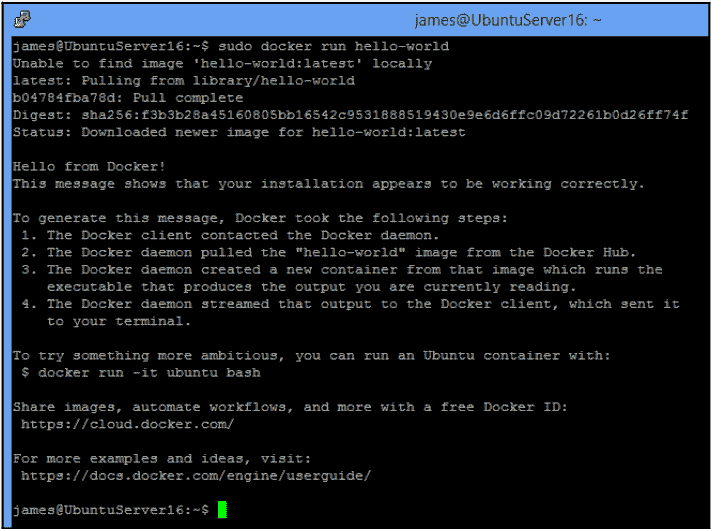

让我们使用以下命令在 Docker 中测试 .NET Core：

```
sudo docker run microsoft/dotnet-samples
```

你应该会看到 .NET 机器人的 ASCII 艺术画：

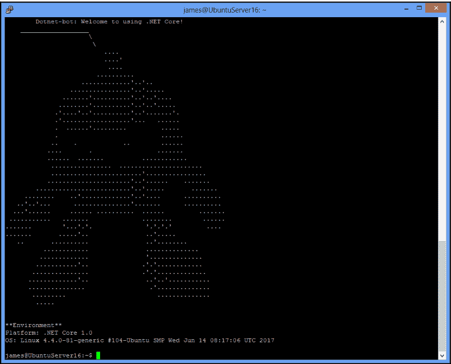

接下来，让我们升级到最新版本的 .NET Core，并尝试一个 Web 应用。

## 在 Docker 中使用 ASP.NET Core 2

既然我们已经确认 Docker 可以正常工作并能运行 .NET Core，现在是时候做一些更复杂的事情了。我们将以交互方式登录到一个容器中，并在其中创建一个 ASP.NET Core 2 应用。

运行以下命令：

```
sudo docker run -it --rm microsoft/aspnetcore-build:2
```

镜像下载完成后，你应该会得到一个略有不同的命令提示符。让我们更进一步，使用 React 和 Redux JavaScript 库创建一个单页应用：

```
dotnet new reactredux -o AspNetCoreTwoDocker
```

接下来，我们需要从 npm 还原 JS 包。请注意，我们尚未安装 npm（或 .NET Core）；它们已包含在容器镜像中：

```
cd AspNetCoreTwoDocker
```

```
npm install
```

让我们再次在后台运行该应用，并下载首页。请注意，Kestrel Web 服务器现在运行在默认的 HTTP 端口 80 上，因此我们无需指定其他非标准端口号：

```
dotnet run &
```

```
wget localhost
```

这显示在以下截图中：

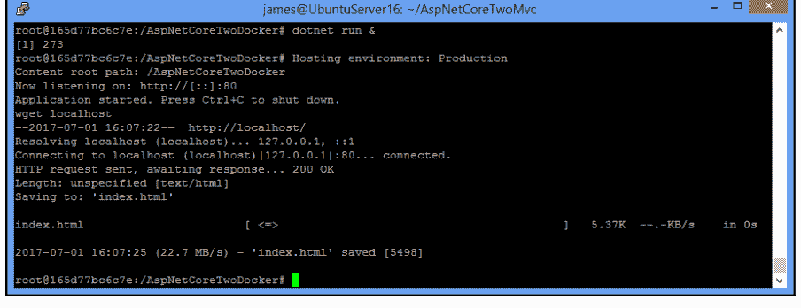
