# 4 测量性能瓶颈

测量是构建高性能系统最关键的方面。你无法改变自己没有测量的东西，因为如果效果存在的话，你也不会知道自己的改变产生了什么影响。如果不测量应用程序，你就不会知道它是否运行良好。

如果你只在软件感觉变慢时才采取行动，那么就已经为时已晚。你是在被动地修复问题，而不是主动地避免问题。你必须进行测量才能获得良好的性能，尽管用户在意的是感觉。

有些书把测量、分析和性能剖析留到最后。然而，这应该是首先考虑的事情。常见的情况是修复了错误的问题，并优化了没有性能困难的区域。

在本章中，我们将涵盖以下主题：

- 结构化查询语言数据库性能剖析
- Web 应用程序性能剖析
- HTTP 监控
- 网络监控
- 科学方法和可重复性

本章将向你展示如何检查性能问题以及这些问题发生在何处。我们将介绍能够提供这些信息的工具，并演示如何有效且正确地使用它们。我们还将向你展示如何一致地重复实验，以便在识别出问题后，能够判断是否已修复该问题。


## 执行简单查询

作为测试，你可以使用 Management Studio 执行一个简单的 SELECT 查询，Profiler 窗口应该会被条目填满。在众多记录中找到你刚刚执行的查询。如果查询以注释开头，这会更容易，如下面的截图所示：

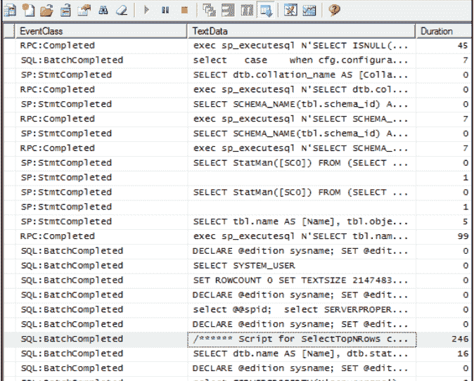

## MiniProfiler

MiniProfiler 是一款出色的开源工具，用于调试数据查询。它支持 SQL 数据库以及一些 NoSQL 数据库，例如 MongoDB 和 RavenDB。它出自 Stack Exchange，也就是运营 Stack Overflow 问答网站的那个团队。它会在你的网页中嵌入一个小部件，显示网页获取数据所花费的时间。它还会显示 SQL 查询，并针对常见错误发出警告。虽然 MiniProfiler 最初是基于 .NET 的，但它也可用于 Ruby、Go 和 Node.js。

与 SQL Server Profiler 相比，MiniProfiler 最大的优势在于它始终存在。你无需主动去查找 SQL 问题，因此它可以更早地发现问题。不过，在生产环境运行它也是个好主意，只需让它仅对登录的管理员可见即可。这样，每次你在网站上工作时，都能看到数据访问的性能表现。不过，在部署之前，请务必测试它对性能的影响。

MiniProfiler 现在支持 ASP.NET Core！你可以在 http://miniprofiler.com/dotnet/AspDotNetCore 阅读如何设置它的简单说明。

## 应用程序性能分析

通常，你会希望了解应用程序中工作在哪里执行，以及时间主要花费在何处。你可能希望查看计算资源是如何分配的，以及它们如何变化。有多种工具可用于此目的，我们将在本节介绍其中的几种。

应用程序性能分析可以帮助你缩小应用程序中性能不佳的范围。你可以从较高层次开始，一旦定位到大范围，就可以深入挖掘并找到具体问题。将一个大问题拆分成小块是解决它并使其更易于管理的有效方法。

## Glimpse

Glimpse 是一个很棒的开源附加组件，适用于你的 Web 应用程序。与 MiniProfiler 类似，它会在你的网页中添加一个小部件，以便你在浏览和开发网站时发现问题。它提供的信息类似于浏览器开发者工具，但也会深入你的服务器端应用程序，向你展示哪些操作最耗时的跟踪信息。

Glimpse 可从 http://getglimpse.com/ 获取，你可以通过 NuGet 为你使用的 Web 框架和 O/RM 安装它。对于 ASP.NET Core，我们需要使用 Glimpse 版本 2。在撰写本文时，这仍然是测试版预发布版本。

在 ConfigureServices 函数中，添加以下内容：

```
services.AddGlimpse();
```

在 Configure 函数中，添加以下内容：

```
app.UseGlimpse();
```

## 运行你的 Web 应用程序

按 F5 生成并运行你的 Web 应用程序。如果在运行时遇到重复类型错误，只需清理解决方案并完全重新生成即可。你可能需要将迁移应用到数据库，但这只需在浏览器中单击按钮即可完成。但是，如果你将其添加到包含数据的现有项目中，则需要更加小心。

运行应用程序时，你会在浏览器窗口底部看到 Glimpse 栏，如下面的截图所示。该栏原本是一个长条，但在截图中被拆分开以更清晰地显示：

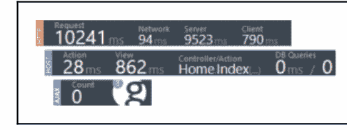

首次页面加载可能比后续加载花费更长的时间，因此你应该刷新页面以获得更具代表性的数据。不过，就本次演示而言，我们不必担心这一点。

将鼠标悬停在 Glimpse 工具栏中的每个部分上，即可展开以获取更多信息。你可以通过单击各个部分（HTTP、HOST 或 AJAX）的标题来最小化和还原它们。

详细信息视图也非常相似，包括 **时间（Timings）** 选项卡。该选项卡显示在下面的截图中：

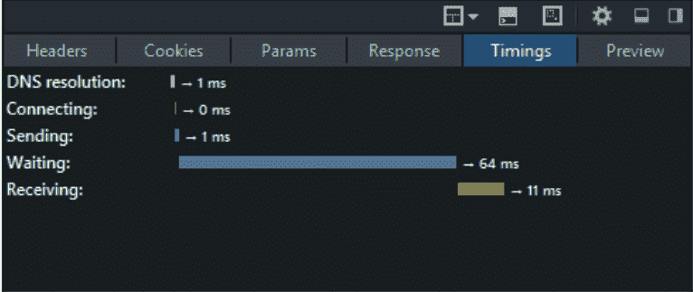

## Fiddler

有时，浏览器工具并不够用。比如说，你在调试原生应用程序、代码中的 HTTP 客户端或移动浏览器。Fiddler 是一个免费的调试代理，可以捕获客户端和服务器之间的所有 HTTP 流量。稍加配置，它还可以拦截 HTTPS 流量。Fiddler 可免费下载，地址是 http://www.telerik.com/fiddler。

由于本书侧重于 Web 开发，因此我们不再深入讨论。如今，浏览器开发者工具适用于大部分工作。它们现在承担了 Fiddler 过去所扮演的大部分角色，而当时浏览器工具还没有获得相同的功能（网络请求捕获、节流和计时）。如果你需要，Fiddler 仍然可用，如果你的 Web 服务器调用外部 HTTP API，它会很方便，不过这通常也可以直接在 VS 中调试。

## 网络

偶尔，你需要在比 HTTP 或 SQL 更低的级别进行调试。这时就需要使用网络监视器或数据包嗅探器。也许你想调试发送到 SQL Server 数据库的 **表格数据流（TDS）** 消息，或者与 SSL 终止负载均衡器之间的 TLS 握手。又或者，你想分析 SOAP Web 服务信封或 **简单邮件传输协议（SMTP）** 电子邮件连接，以了解其无法正常工作的原因。

下面的截图显示了 Wireshark 捕获的部分结果：

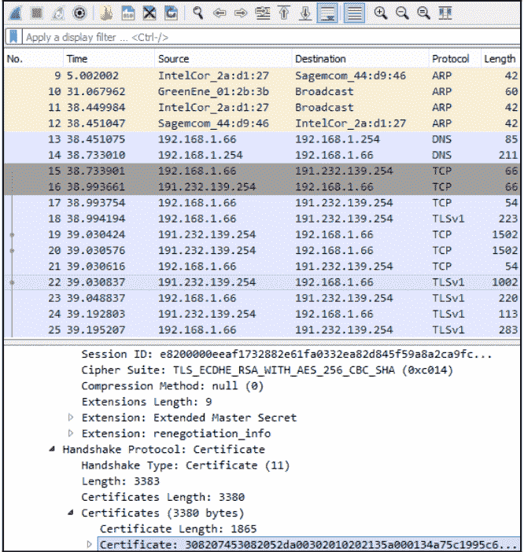

使用 Wireshark 时可能会有很多干扰信息。你会看到底层网络数据包，例如地址解析协议（ARP）流量，你可以将其过滤掉或忽略。你还可能看到来自 VoIP 电话和其他网络设备的数据，或者发往网络上其他计算机的数据。

从顶部窗格中选择你感兴趣的数据包。中间窗格将显示数据包的内容。通常你可以忽略网络栈中的较低层，例如以太网和 TCP/IP（显示在列表顶部）。

直接进入列在最后的应用程序层。如果这是 Wireshark 能够识别的协议，它会将其分解为构成该协议的各个字段。


通常，最好以 **协调世界时（UTC）** 存储时间戳，这也被称为 **格林尼治标准时间（GMT）**。如果你使用 `DateTimeOffset.UtcNow`（或至少 `DateTime.UtcNow`），就能避免许多与时区和夏令时相关的问题。命名变量和列时要表明这一点，例如 `TimestampUtc`。使用 `TimeSpan` 来表示时间段，但如果你必须使用基元类型（如整数），则请在变量或列名中包含单位，例如 `DurationInMilliseconds` 或 `TimeoutInSeconds`。这将有助于避免其他开发人员（或未来的你）使用它们时产生混淆。但是，要对快速操作进行基准测试，则应使用 `Stopwatch`。该类位于 `System.Diagnostics` 命名空间中。

如果你尝试测量单个快速事件，则不会获得准确的结果。解决此问题的方法是多次重复该任务，然后取平均值。这对于基准测试很有用，但通常不适用于实际应用程序。不过，一旦你通过测试确定哪种方法最快，就可以将其应用到自己的程序中。

让我们通过一个小实验来说明这一点，测量使用 PBKDF2 算法（位于 `System.Security.Cryptography` 命名空间中）对密码进行哈希运算所需的时间。在这种情况下，被测试的操作并不重要，因为我们只对计时代码感兴趣。一种朴素的方法可能如下所示：

```
var s = Stopwatch.StartNew();
pbkdf2.GetBytes(2048);
s.Stop();
Console.WriteLine($"Test duration = {s.ElapsedMilliseconds} ms");
```

由于测量过程中的缺陷，这段代码每次运行都会输出不同的值。更好的方法是多次重复测试并对输出取平均值，如下面的代码所示：

```
var s = Stopwatch.StartNew();
for (var ii = 0; ii < tests; ii++)
{
    pbkdf2.GetBytes(2048);
}
s.Stop();
var mean = s.ElapsedMilliseconds / tests;
Console.WriteLine($"{tests} runs mean duration = {mean} ms");
```

这段代码仍然非常原始，但每次都会输出非常相似的结果。`tests` 的值越大，结果就越准确，但测试所需的时间也会越长。


你可以通过先对被测函数进行预热，然后执行一次垃圾回收，再启动计时器并进入循环，来改进基准测试。你也可以将输出存入成员变量，以防止编译器进行过度优化。

不过，到了这个阶段，更好的做法是直接使用完整的基准测试工具，例如 BenchmarkDotNet。我们在这里之所以没有这样做，只是为了让你更容易自行运行这些示例。

BenchmarkDotNet 是一个非常实用的工具，现已加入 .NET Foundation 的项目。我们将在第 8 章“理解代码执行与异步操作”中再次介绍它。你可以在 https://github.com/dotnet/BenchmarkDotNet 阅读更多相关信息。


在这些示例中，我们使用的是 C# 6 的字符串插值，但如果你愿意，也可以使用传统重载的 `Console.WriteLine`。

让我们编写一个快速的示例应用程序，通过多次运行这两个不同的版本来展示其差异。我们将把这两个测试提取为方法，并各调用几次：

```
var pbkdf2 = new Rfc2898DeriveBytes("password", 64, 256);
SingleTest(pbkdf2);
SingleTest(pbkdf2);
SingleTest(pbkdf2);

Console.WriteLine();
var tests = 1000;
AvgTest(pbkdf2, tests);
AvgTest(pbkdf2, tests);
AvgTest(pbkdf2, tests);

Console.WriteLine();
Console.WriteLine("Press any key...");
Console.ReadKey(true);
```

输出将类似于下面的截图。如果你想自行运行，可以在本书附带的代码中找到完整的应用程序清单。

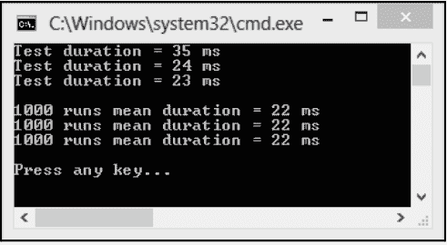

你可以看到，三个单独的测试可能产生差异极大的结果，而取平均后的测试结果却完全一致。

你的结果会有所不同。这是因为计算机系统本身具有固有的可变性。对时间敏感的内嵌系统通常使用实时操作系统。普通软件系统通常运行在分时操作系统上，你的指令很容易被中断，而虚拟机则会使问题更加严重。

你将得到不同的结果，具体取决于你是以调试模式还是发布模式构建，以及是否在调试状态下运行。无调试的发布模式（Ctrl + F5）是最快的。

下面的截图显示了相同的基准测试演示应用程序在调试状态下运行的情况。你可以通过命令行提示符标题栏中显示的 dotnet 可执行文件来辨别。如果它在无调试状态下运行，则会显示 cmd.exe（在 Windows 上），如上一张截图所示。

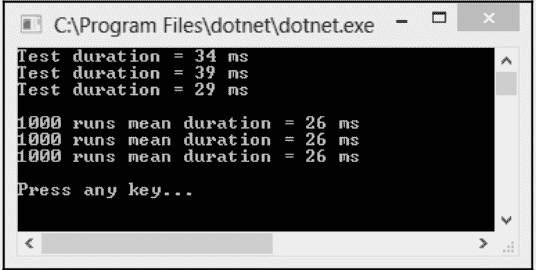


单元测试非常有价值，你甚至可能实践**测试驱动开发（TDD）**，但你应该谨慎对待将性能测试作为单元测试的做法。单元测试必须快速才能有价值，而能够准确测量操作耗时的测试通常很慢。你应该为单元测试设置超时时间，以确保不会编写带有外部依赖的缓慢测试。你仍然可以测试性能，但应该在集成测试阶段进行，与那些访问 API、数据库或磁盘的测试一同执行。

## 科学

我们曾在`第 2 章`“为什么性能是一项特性”中通过展示一些硬件访问速度来探讨计算机科学中的计算机。现在，是时候谈谈科学的部分了。

如果你希望获得持续可靠的结果，采用科学的方法非常重要。制定一套方法论或测试计划，并每次都按相同的方式执行，只更改你想要测量的变量。自动化在这一过程中能提供很大帮助。

同时，始终使用自己的系统和数据来衡量使用场景也很重要。对其他人有效的方案，对你来说可能并不理想。

我们将在本书后面更详细地讨论科学和统计学。使用简单的平均值可能会产生误导，但作为温和的入门介绍并无妨。请阅读`第 10 章`“性能增强工具的弊端”，了解更多关于中位数和百分位数等概念。

## 可重复性

结果必须可重复。如果每次测试的结果都差异巨大，那么这些结果就不可信。你应该重复测试并取平均结果，以消除被测应用程序或硬件中的任何变异性。

明确记录度量单位也非常重要。当你要将新值与历史值进行比较时，必须知道这一点。美国国家航空航天局（NASA）曾因单位混淆而损失了一台火星探测器，这已是众所周知的教训。

## 一次只改变一个变量

进行测试时，你的目标是衡量单个变更的影响。如果同时更改多个变量，你就无法确定是哪一个造成了差异。

目标是尽可能减少除你关注的那个变量之外其他任何变化的影响。这意味着要让外部因素尽可能保持静态，并执行多次测试，取平均结果。

## 小结

让我们总结一下本章关于度量的内容，以及下一章将要介绍的内容。我们讨论了度量在解决性能问题中的重要性。没有度量，你无法期望编写出高性能的软件；否则你就像在黑暗中编码。

我们重点介绍了一些可用于度量性能的工具，展示了如何使用其中一部分工具，以及如何编写自己的工具。我们还讨论了以科学方法进行度量的价值。确保结果可重复并记录正确的度量单位，是非常重要的关注点。

在下一章中，我们将学习如何修复常见的性能问题。你将掌握加速那些容易优化的部分（低垂的果实）的技能，并在同事面前看起来像性能魔法师。不再会出现“测试时一切正常；现在是运维问题”的情况。

你将学习如何识别和修复当一切都在单机上运行时并不总是显而易见的问题。你将看到如何识别 O/RM 或框架行为不佳、与数据库交互过于频繁的情况——如果没有正确使用，这很容易发生。

我们将看到如何确保工作在最适合的位置执行，并探讨一些使用正确分辨率和格式来保持图像体积较小的方式。这些技术将确保你的应用程序高效运行，并且不会在网络上不必要地传输数据。

我们还将讨论如何通过改进底层硬件来减少放大糟糕软件问题的因素，从而以替代方案缓解性能问题。如果软件应用已经部署到生产环境并正在使用中，这可以作为一种良好的临时措施。如果你已经面临线上性能问题，那么这可以为你争取一些时间，来工程化地修复真正的问题。

## 延迟

如前面章节所述，延迟是指操作完成之前发生的延迟，有时也称为时延。你可能无法控制软件应用所运行基础设施的延迟，但你可以通过编写应用程序来优雅地应对这种延迟。

我们将在此讨论的两种主要延迟类型是网络延迟和磁盘延迟。顾名思义，它们分别是在网络上执行操作的延迟，以及从持久化存储介质读取或写入的延迟。你通常会同时面对这两种延迟，例如，对远程虚拟机上的服务器执行数据库（DB）查询将涉及以下操作：

- 从 Web 服务器到数据库服务器的网络操作
- 从数据库服务器到存储区域网络（SAN）上远程磁盘的网络操作
- 在物理驱动器上查找数据的磁盘操作


尽管固态硬盘（SSD）的延迟远低于旋转式磁盘，但它们仍然相对较慢。我们在这里讨论磁盘 I/O 时，指的是这两种类型的驱动器。


在我们的控制器中，我们可以编写如下代码来查询数据库、从数据库结果填充模型并返回视图进行渲染：

```
using (var connection = new SqlConnection(connectionString))
{
    await connection.OpenAsync();
    var blogPosts = await connection.QueryAsync<BlogPost>(@"
        SELECT * FROM BlogPost");
    foreach (var post in blogPosts)
    {
        var comments = await
            connection.QueryAsync<BlogPostComment>(@"
            SELECT * FROM BlogPostComment
            WHERE BlogPostId = @BlogPostId",
            new { BlogPostId = post.BlogPostId });
        post.CommentCount = comments.Count();
    }
    return View(blogPosts);
}
```

我们测试了它并且它工作了！我们对自己感到相当满意。它在本地测试数据库上完成得很快，该数据库只包含少量行。我们在各处使用了异步方法，这一定就是它如此快速的原因。我们甚至只获取每个博客的相关评论，而不是每次都获取所有评论。我们还使用了参数化查询来避免 SQL 注入，一切看起来都很不错。发布吧！

由于这是一个示例，我们为了清晰起见保持了简单。在实际应用程序中，你需要使用诸如依赖注入（例如 ASP.NET Core 内置的 DI）等技术使其更具灵活性。

不幸的是，当数据开始增加（随着帖子和评论的添加）时，博客开始变得非常缓慢，页面加载时间变长。我们的读者等待不耐烦并放弃。受众数量随之下降，收入也随之下降。

让我们分析数据库以查看问题可能出在哪里。我们运行 SQL Server Profiler，过滤目标数据库，并查看正在执行的 SQL。

## 高效分页

在实际应用程序中，你需要实现分页，以便当表中数据很多时列表不会过长。在单个页面上列出数千个项目是不好的主意。

你可能想用 LINQ 命令来实现这一点，因为它们非常方便。然而，你需要小心。如果你的 O/RM 不感知 LINQ，或者你过早地错误地转换了类型，那么过滤可能会在应用程序内部发生，而最佳的过滤位置实际上是在数据库中。你的代码可能在你没有意识到的情况下检索所有数据并丢弃大部分数据。

也许你想修改 action 方法的返回语句，使其看起来像以下这样：

```
return View(blogPosts.OrderByDescending(bp => bp.CommentCount)
    .Skip(pageSize * (pageNumber - 1))
    .Take(pageSize));
```

这可行，并且会显著加快你的应用程序速度。然而，它可能没有你想象的效果。应用程序更快是因为视图渲染更快，因为生成的页面更小。这也减少了将页面发送到浏览器以及浏览器渲染 HTML 的时间。

然而，应用程序仍然从数据库获取所有博客帖子并将其加载到内存中。随着数据量的增长，这可能会成为一个问题。如果你想使用此类 LINQ 方法，则需要检查它们是否一直处理到数据库。阅读你的 O/RM 或框架的文档并使用分析器仔细检查生成的 SQL 是一个非常好的主意。

让我们看看 SQL 应该是什么样子的。例如，如果你使用 SQL Server，从前面的查询开始，你可以通过以下方式仅获取评论最多的前十篇帖子：

```
SELECT TOP 10
    bp.BlogPostId,
    bp.Title,
    COUNT(bpc.BlogPostCommentId) 'CommentCount'
FROM BlogPost bp
LEFT JOIN BlogPostComment bpc
    ON bpc.BlogPostId = bp.BlogPostId
GROUP BY bp.BlogPostId, bp.Title
ORDER BY COUNT(bpc.BlogPostCommentId) DESC
```

我们按评论计数降序排序。但是，如果你愿意，也可以按降序 ID 排序以获得大致的逆时间顺序。从这个有序集合中，我们仅选择（或获取）前十条记录。

如果你想跳过记录以进行分页，SELECT TOP 子句是不够的。在 SQL Server 2012 及更高版本中，你可以使用以下方法：

```
SELECT
    bp.BlogPostId,
    bp.Title,
    COUNT(bpc.BlogPostCommentId) 'CommentCount'
FROM BlogPost bp
LEFT JOIN BlogPostComment bpc
    ON bpc.BlogPostId = bp.BlogPostId
GROUP BY bp.BlogPostId, bp.Title
ORDER BY COUNT(bpc.BlogPostCommentId) DESC
OFFSET 0 ROWS
FETCH NEXT 10 ROWS ONLY
```

你可以调整 OFFSET 的值以获取页面编号的正确条目。FETCH NEXT 的值将更改页面大小（页面上的条目数）。你可以使用参数化查询传入这些值，如下所示：

```
using (var connection = new SqlConnection(connectionString))
{
    await connection.OpenAsync();
    var blogPosts = await connection.QueryAsync<BlogPost>(@"
        SELECT
            bp.BlogPostId,
            bp.Title,
            COUNT(bpc.BlogPostCommentId) 'CommentCount'
        FROM BlogPost bp
        LEFT JOIN BlogPostComment bpc
            ON bpc.BlogPostId = bp.BlogPostId
        GROUP BY bp.BlogPostId, bp.Title
        ORDER BY COUNT(bpc.BlogPostCommentId) DESC
        OFFSET @OffsetRows ROWS
        FETCH NEXT @LimitRows ROWS ONLY", new
        {
            OffsetRows = pageSize * (pageNumber - 1),
            LimitRows  = pageSize
        }
    );
    return View(blogPosts);
}
```

截图中的查询获取了页面大小设置为 50 条目时的第三页数据。因此，它使用了 100 的偏移量（跳过前两页各 50 条）并获取接下来的 50 行。对应的 URL 查询字符串可能如下所示：

```
/?pagenumber=3&pagesize=50
```

我们可以看到查询的持续时间已从之前的 24 ms 减少到现在的 14 ms。


注意当参数传递到查询中时 SQL 的执行方式不同。这比直接将用户提供的值连接到 SQL 命令中要安全得多（因此，永远不要这样做拼接）。如果你使用用户输入构建 SQL 查询，那么你的应用程序就会暴露于 SQL 注入攻击之下。你的整个数据库可能通过基本的点按工具通过网络被下载。你的数据库也可能被篡改或删除并被勒索，但攻击者实际上并没有他们声称的备份。数据库被窃的另一种方式是如果你粗心地将未加密的备份放在可通过网络访问的位置。

如果你不使用任何参数，则使用默认值，首页仅显示十个条目，看起来可能如下所示的截图，具体取决于数据库中的数据：

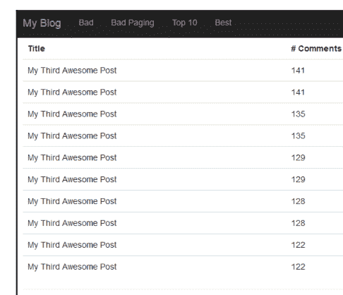

对于与数据库过于频繁通信的写得不好的应用程序，从性能角度来看，将应用程序部署在靠近数据库（或与数据库在同一服务器上）的服务器上会更好。也许应用程序工作区和数据库服务器可以在同一个**服务器机架**中，位于**数据中心**，并通过千兆（或 10 千兆）**以太网**连接。

用户然后可以使用远程桌面连接或**Citrix**会话与应用程序交互。这将减少到数据库的延迟，即使考虑到远程 UI 的延迟，也能加快速度。这有效地将桌面 PC 变成**瘦客户端**，类似于旧式大型机的工作方式。

例如，你可以构建一台具有 RAID SSD 和大量 RAM 的高性能服务器，其成本远低于修复大型应用程序的开发人员时间。即使是写得不好的软件，如果你将应用程序和数据库一起运行在同一台机器上，尤其是如果在**裸金属**上运行且没有虚拟机阻碍，也能表现良好。这种策略可以为你赢得时间，以便正确修复问题。

这些远程应用程序和虚拟化技术通常被作为帮助部署和维护的工具出售。然而，其潜在的性能优势也值得考虑。

由于 Web 应用程序的兴起，**厚客户端**桌面应用程序现在变得不那么常见。架构似乎在服务器端计算和客户端工作之间振荡，因为网络速度和处理能力的相对进步相互竞争。

## Web 应用程序

同样的迁移方法对于 Web 应用程序通常并不那么有效，但这取决于使用的架构。好消息是，对于 Web 应用程序，你通常控制基础设施。对于原生应用程序硬件则通常不是这种情况。

如果你使用**三层架构**，那么你可以将应用程序服务器移近数据库服务器。这是否有效取决于 Web 服务器与应用程序服务器的通信是否过于频繁。如果它们发出太多 Web API 请求，那么这种方法效果不佳。

**两层架构**（Web 服务器直接与数据库通信）在典型的 Web 应用程序中更常见。有使用**集群**数据库或只读镜像的解决方案来将数据放置在靠近 Web 服务器的位置，但这会增加复杂性和成本。

**代理服务器**可以带来显著差异。流行的开源代理服务器是 Varnish，你也可以使用 NGINX Web 服务器作为代理。代理服务器缓存 Web 服务器的输出，因此页面不必为每个用户重新生成。


你可以在 https://www.cloudflare.com/ 了解有关 Cloudflare CDN 服务的更多信息（包括免费计划中的 HTTP/2 服务器推送和 WebSockets）。

我们将在第 9 章《学习缓存和消息队列》中更详细地介绍缓存，因此这里不会再深入探讨。缓存是一个具有挑战性的主题，需要很好地理解，以便你能有效地使用它。

## 过大的图片

既然我们谈到了静态资源，我们应该简要提及图片优化。我们将在下一章中更详细地介绍这个问题，但在开始之前值得在此指出一些常见问题。由于你在基础设施和用户之间的网络状况几乎没有控制权，除了高延迟外，低吞吐量也可能成为一个问题。

Web 应用大量使用图片，尤其是在着陆页或主页上，图片可能会构成全屏背景。可惜的是，直接把相机拍摄的原始照片丢到网页上是很常见的。相机拍摄的图片通常有数兆字节大小，对于网页来说太大了。

你可以使用工具来测试网页是否存在问题，例如 Google 的 PageSpeed Insights。访问 https://developers.google.com/speed/pagespeed/insights/，输入一个 URL，然后点击 ANALYZE 查看结果。Google 会将此信息作为其搜索引擎排名的一部分，因此你最好采纳其建议。加载缓慢的网站在搜索结果中的排名会更低。

你也可以使用浏览器开发者工具查看图片的大小。按 F12 并在页面加载后查看 Network 选项卡，以查看传输了多少数据以及花费了多长时间。在本地机器或测试服务器上，这些性能问题很容易被忽略，因为图片会加载得很快。第一次加载后，图片也会存储在浏览器的缓存中，因此请确保执行完全的硬刷新并清空或禁用缓存。在 Chrome 中（当开发者工具打开时），你可以在刷新按钮上右键单击或长按以获得这些额外选项。使用内置的限速工具来查看用户加载页面的体验也是一个好主意。

最基本图片优化问题通常分为两类：

- 图片对于其显示区域来说过大
- 图片使用了不适合主题的压缩格式

## 图片分辨率

最常见的问题是图片的分辨率对于显示它的区域来说过高。这会迫使浏览器将图片调整大小以适应屏幕或区域。如果文件大小不必要地大，则在互联网连接上传输所需的时间会更长。浏览器随后会丢弃大部分信息。你应该在将图片添加到网站之前提前调整其大小。

有许多图片处理工具可用于调整图片大小。如果你使用 Windows，那么 **Paint.NET** (`https://www.getpaint.net/`) 是一个优秀的免费软件。这比随 Windows 提供的 Paint 程序要好得多（尽管，如果你没有其他选择，这也可以工作）。

对于其他平台，GIMP (`https://www.gimp.org/`) 非常好。如果你喜欢使用命令行，那么你可能会喜欢 ImageMagick (`http://imagemagick.org/script/index.php`)，它可以以编程方式或批量执行大量图片处理任务。此外，还有云托管的图片管理服务，例如 **Cloudinary** (`http://cloudinary.com/`)。

你应该将图片缩小到实际大小，以便在用户屏幕上显示。有时在处理响应式图片时会出现复杂情况，响应式图片会随着用户屏幕或浏览器窗口大小而缩放。此外，请记住 **高 DPI** 或 Retina 显示屏，其每个逻辑像素可能有多个物理像素。你的图片可能需要更大以免看起来模糊，但上限仍可能低于原始大小。很少需要图片的尺寸超过显示分辨率的两倍。我们将在本书后面更详细地讨论响应式图片，但值得牢记这一点。

以下图片显示了 Paint.NET 中的调整大小对话框：

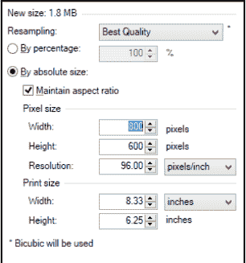

调整图片大小时，通常重要的是保持图片的 **宽高比** 相同。这意味着按比例改变水平和垂直尺寸。

例如，将 **高度** 从 **600** px 减少到 **300** px，并将 **宽度** 从 **800** px 减少到 **400** px（即两个维度都减少 50%）会使图片看起来相同，只是更小。大多数图片处理软件都会协助此过程。保持宽高比相同可以避免图片看起来被拉伸。如果图片需要适应不同的形状，则应裁剪它们。

## 图片格式

下一个最常见的问题是为内容使用错误的文件格式。你永远不应该在网络上使用原始未压缩的图片，例如 **位图 (BMP)**。

对于自然图片如照片，请使用 JPEG 文件格式。JPEG 是一种有损编解码器，这意味着使用时部分信息会丢失。它对于包含大量渐变的图片非常好，例如自然场景或人物的图片。JPEG 在图片中包含任何文本时看起来很差，因为字母边缘会出现 **压缩伪影**。大多数中低端相机原生保存图片为 JPEG，因此坚持使用它不会有任何损失。然而，你应该调整图片大小以使其更小，如前所述。

对于人工图片如图表或图标，请使用 **PNG**。PNG 是一种无损编解码器，这意味着不会丢弃任何信息。这最适用于大块纯色图片，例如在绘画软件中绘制的图表或屏幕截图。PNG 还支持透明度，因此你可以拥有非矩形或半透明的图片。你也可以拥有动画 PNG，其质量优于 **GIFs**，但我们在本章中不会详细介绍它们。

你可以使用前面提到的用于调整大小的相同工具来更改图片格式，只需在保存图片时更改文件格式即可。同样，你应该为你的特定用例测试什么效果最好。你可以通过以不同格式（和不同分辨率）保存同一张图片，然后观察磁盘上文件的大小来进行实验。

以下图表显示了协议通常如何堆叠：

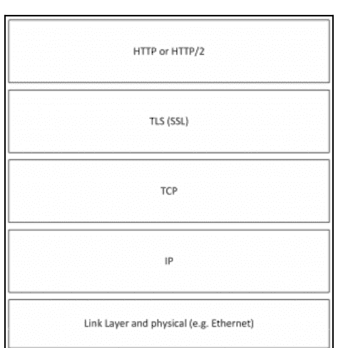

## 慢启动

TCP 实现了一种称为 *slow-start* 的算法用于拥塞控制。这意味着浏览器到 Web 服务器的连接初始速度很慢，并随着时间的推移逐渐加快以发现可用带宽。你可以更改此设置的设置，使其加速更积极，连接更快地变快。如果你增加初始 *拥塞窗口*，则性能可以改善，尤其是在带宽良好但延迟高的连接上，例如移动 4G 或位于其他大陆的服务器。

通常，你应该为你的用例进行测试，也许使用 Wireshark，如第 4 章《测量性能瓶颈》中所述之前所述那样。更改此窗口有缺点，应仔细考虑。虽然这可能会加快网站速度，但它可能导致网络设备中的缓冲区填满，这可能为 VoIP 应用和游戏产生延迟问题，如果端到端没有使用 **服务质量 (QoS)**。

你可以在 Windows Server 2008 R2 上通过热修复程序（KB2472264）及更高版本更改此值。你也可以轻松地在 Linux 上调整此值，当然，ASP.NET Core 使你能够在 Linux（和 macOS / OS X）以及 Windows 上运行你的 .NET Web 应用。


我们不会在这里提供详细说明，因为这是一个需要谨慎考虑的决定，你不应该盲目套用建议。你可以很容易地在你所用 Web 服务器的操作系统上找到相关说明。

TCP 慢启动只是一个例子，说明为什么你不能忽视互联网技术的底层，Web 应用正是站在这些底层技术的肩膀上。让我们沿着协议栈向上移动一点，来到应用层。

## HTTP

作为希望交付高性能的 Web 应用开发者，理解超文本传输协议（HTTP）非常重要。你应该知道自己使用的是哪个版本的 HTTP、它如何工作，以及它如何影响请求管线化和加密等方面。

HTTP/1.1 可能是你如今最熟悉的版本，因为它已经使用了一段时间。HTTP/2 正变得越来越流行，它改变了许多事情的最佳做法。

## 头部

HTTP 使用头部来提供关于请求的元数据，这些元数据与消息正文中的主要负载一起发送，这一点很像电子邮件。查看源代码时你不会看到这些头部，但可以使用浏览器开发者工具观察到它们。头部可用于许多用途，例如缓存控制和身份验证。Cookie 也是通过头部来发送和接收的。

浏览器同一时间到单个主机只会打开有限数量的 HTTP/1.1 连接。如果你需要大量请求来获取页面的所有资源，那么这些请求会被排队，从而增加页面完全加载所需的总时间。与之前提到的 TCP 慢启动结合在一起时，这种效应会被放大，从而降低性能。在 HTTP/2 中，这个问题不那么严重，我们稍后会介绍。你可以允许浏览器复用连接来减轻这个问题的影响，具体做法是确保你的 Web 服务器不会在 HTTP 响应中发送 `Connection: close` 头。

## 密钥交换

如前面所述，密钥交换是在双方之间安全地共享加密密钥且不会被截获的过程。实现方法有多种，其中大多依赖于非对称加密。与对称加密（我们交换这个密钥正是为了使用对称加密）不同，非对称加密使用单个密钥只能单向进行。换句话说，用于加密的密钥不能用于解密，必须有另一个不同的密钥。而一旦我们共享了密钥，对于绝大多数数据来说，情况就不是这样了。我们这样做是因为对称加密比非对称加密更快。因此，非对称加密不会用于所有内容，而只需要用来加密另一个密钥。

除了交换密钥之外，浏览器（或其他 HTTPS 客户端）还应该检查证书，以确保服务器确实属于它所声称的域名。一些程序化客户端默认不会执行这项检查，所以这一点值得注意。你还可以实现证书固定（甚至可以在浏览器中使用 HTTP 公钥固定）来提升安全性，但这超出了本书的讨论范围。

我们将用简化形式的类比来说明密钥交换的两种变体，以展示这一过程是如何运作的。如果你愿意，可以自行查阅技术细节。

RSA 历来是 TLS 中最常用的密钥交换机制。直到最近，大多数 HTTPS 连接都还在使用它。

RSA 的全称是 Rivest-Shamir-Adleman，取自其创造者们的名字，它可能是最流行的公钥密码学形式。据说，英国监听机构政府通信总部（GCHQ）差不多在同一时间也构想出了公钥密码学，但由于相关成果直到 1997 年才公开，这一点无法证实。这项发明的功劳归属于惠特菲尔德·迪菲和马丁·赫尔曼，他们最近因此获得了图灵奖。我们稍后会更详细地讨论他们的工作。


图灵奖是计算领域的诺贝尔奖。它以艾伦·图灵的名字命名。图灵是一位传奇计算先驱，曾在初创的 GCHQ 工作并帮助盟军赢得二战，但后来却被英国政府背叛。

RSA 使用大素数生成公钥和私钥对。公钥可用于加密信息，这些信息只能用私钥解密。除此之外，私钥还可用于对信息（通常是其哈希值）进行签名，任何人都可以用公钥验证签名。即使密钥交换机制使用的是其他算法，RSA 也经常被用来签署 TLS 证书（密钥交换机制是在初始 TLS 握手期间协商的）。

这里简要解释各种 TLS 密钥交换方法的工作原理，是为了说明它是很复杂的。建立安全连接需要来回发送大量消息，而且无论连接速度多快，延迟都会拖慢每一条消息。所有这些都发生在 TLS 握手阶段。在握手中，客户端（通常是 Web 浏览器）和服务器会协商共同的能力，并确定应该使用哪些加密算法。另外还需要考虑服务器名称指示（SNI）。它与 HTTP 的 Host 头类似，可以让多个站点共用一个 IP 地址。一些较旧的客户端不支持 SNI。

我们可以使用 Wireshark 来观察 TLS 握手。我们不会深入太多细节，但你可以看到客户端和服务器之间至少交换了四类消息，分别是客户端问候（client hello）、服务器问候（server hello，包括证书和服务器密钥交换）、客户端密钥交换（client key exchange）和密码套件协商。如果配置不是最优，浏览器可能会发送更多消息，例如请求中间证书。它还（即浏览器）可能会检查证书吊销列表，确认证书是否已被吊销。

下面的截图展示了用 Wireshark 捕获的 TLS 握手：

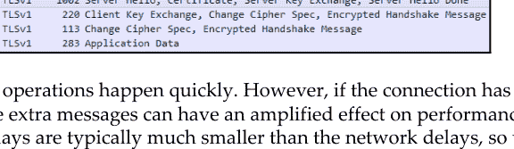

所有这些网络操作都发生得很快。然而，如果连接延迟很高，这些额外的消息就会对性能产生放大的影响。计算延迟通常远小于网络延迟，因此除非你使用非常旧的硬件，否则这些都可以忽略不计。幸运的是，有一些简单的做法可以帮你加快速度，在保持安全的同时享受高性能。

## 延迟诊断

TLS 内置了多种可用于加速它的机制。但是，如果使用不当，有些做法也会让它变慢。Qualys SSL Labs 提供了一些很棒的免费在线工具，用于评估你的 TLS 配置，地址是 https://www.ssllabs.com/。其中的服务器测试（https://www.ssllabs.com/ssltest/）非常有用。你只需输入一个 URL，它就会给出评分以及大量其他信息。

例如，如果我们分析 https://www.packtpub.com/ 这个网站，可以看到在测试当天它获得了 **B** 级。这是因为该网站支持较弱的 Diffie-Hellman 参数，以及过时且不安全的 **RC4** 加密算法。然而，事情并不总是像移除旧加密算法那么简单。你可以拥有一个非常安全的网站，但也可能会将部分客户排除在外，因为他们使用的旧客户端不支持最新标准。这当然会因你的客户群特点而异，你应该测量自己的流量，并仔细考虑各种选择。

下面的截图展示了 SSL Labs 针对 https://www.packtpub.com/ 的部分报告：

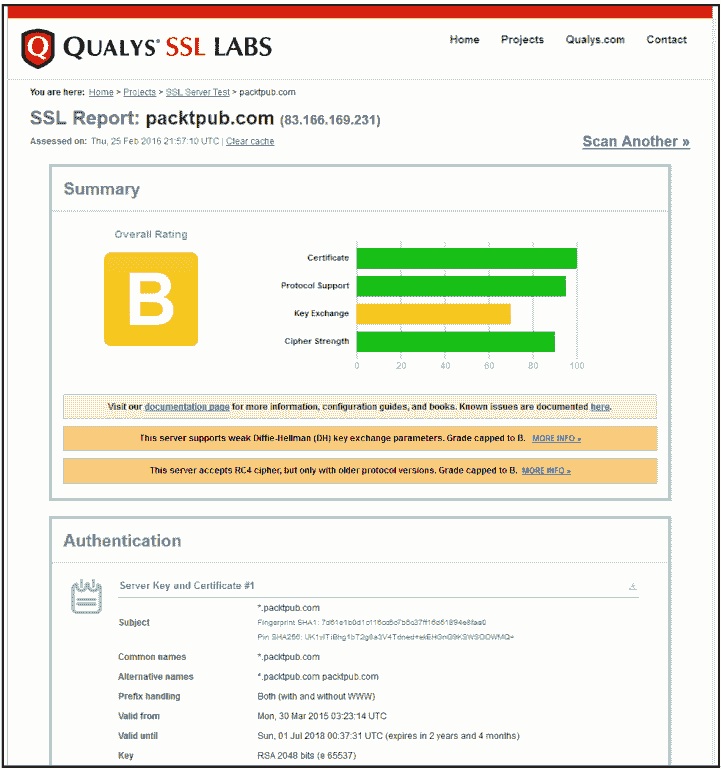

我们再来看一个配置更好的网站（https://emoncms.org/），可以看到它获得了 A 级。使用 HSTS 头可以获得 A+ 级。此外，这些头部还能避免重定向带来的开销。如果你将域名提交给浏览器厂商，你的网站甚至还可能被加入到浏览器自带的预加载列表中。

下面的截图展示了 SSL Labs 针对 https://emoncms.org/ 的部分报告：

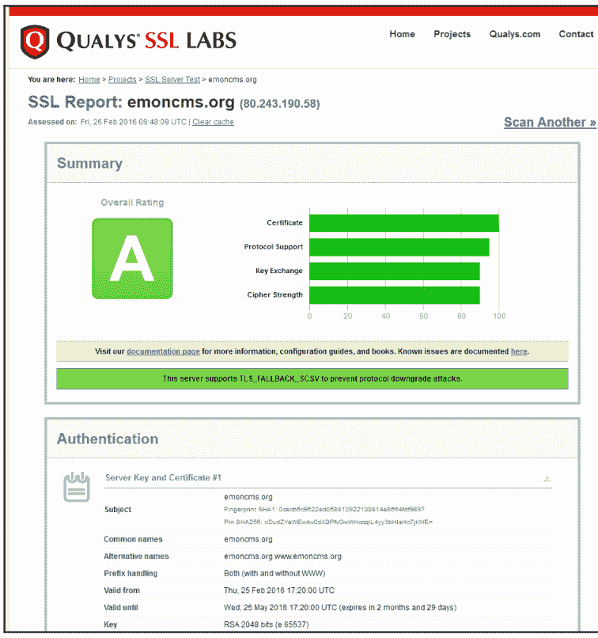


## 性能调优

我们已经讨论过对 TLS 最重要的性能调优，因为这与 TLS 本身无关。你应该确保 HTTP 连接可重用，因为如果不可重用，除了 TCP 开销之外，你还会承担 TLS 协商带来的额外代价。缓存也非常重要，稍后我们会进一步讨论。

TLS 和 HTTP 都支持压缩，但这些压缩有安全隐患。因此，请谨慎考虑。它们可能会泄露信息，坚决的攻击者可以利用对这些信息的分析来恢复加密数据。TLS 压缩已被弃用，并将在 TLS 1.3 中移除。因此，不要使用它。我们将在本章后面讨论 HTTP 压缩。

关于 TLS 的具体建议，你可以做几件事来提高性能。主要技术是确保使用**会话恢复**。这与重用 HTTP 连接不同，它意味着客户端可以重用现有的 TLS 连接，而无需经历完整的密钥交换。

你可以通过服务器上的 ID 或加密票据（类似于使用计算机密钥加密的 ASP.NET Cookie）来实现会话。Microsoft 客户端实现中曾存在一个关于票据加密密钥轮换的 bug，但 KB3109853 补丁修复了它。请确保安装此更新，尤其是当你从 .NET 代码连接到安全端点时看到异常抛出时。

重要的是不要过度，更大并不总是更好，尤其是在密钥大小方面。这是性能与安全之间的权衡，取决于你的具体情况。一般来说，一个好的平衡是当 128 位 AES 密钥足够时，不要使用 256 位。

2048 位 RSA 密钥已经足够大；更小不安全，更大则太慢。你可以使用**椭圆曲线数字签名算法（ECDSA）**代替 RSA 进行签名，因为它快得多。然而，支持有限，因此你需要并行部署 RSA。

在下面这张 Android 版 Chrome 的截图中，你可以看到当连接到 https://huxley.unop.uk/ 时，Chrome 使用 CHACHA20_POLY1305 作为流密码，ECDHE 用于密钥交换，ECDSA 用于签名：

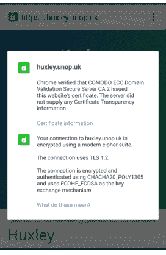

新版本的 TLS（1.3）目前还是草案，但在许多地方已得到支持。它只允许带附加数据的认证加密（AEAD）密码。目前只有 AES-GCM 和 ChaCha/Poly 两种密码符合这些标准。它还将移除一些其他过时特性，例如 TLS 压缩。好消息是，TLS 1.3 不仅提高了安全性，还带来了更高的性能。Firefox 和 Chrome 的稳定版本已经支持它。你可以在 https://caniuse.com/#feat=tls1-3 查看支持情况。

有时听起来好像使用 TLS 并不总是值得的，但在你的整个站点（包括你加载的任何第三方资源）上使用 HTTPS 是一个非常棒的主意。这样做，你将能够利用 HTTP/2 的性能增强特性，这些特性包括一些技术，意味着不再需要从多个域提供资源（例如 JavaScript 库）。你可以自己安全地托管所有内容，并避免额外请求带来的 DNS、TCP 和 TLS 开销。

所有这一切都可以免费，因为 Let's Encrypt 和 Cloudflare 提供零成本证书。Cloudflare 也有 TLS 1.3 测试版，但使用它们可能存在安全隐患。Let's Encrypt 允许你生成证书用于自己的服务器，并且从 2018 年起，它也将提供通配符证书。现在让我们详细看看 HTTP/2。

这是服务器保持 Web 请求打开状态、以防服务器想要发送某些内容的情况。当请求获得响应或超时时，该连接会重新建立。不用说，轮询从来都不是很高效。

从用户的角度来看，推送通知可以提高性能，因为他们可以在更新发生时立即收到更新。用户无需刷新任何内容或不断检查。你可以在长时间运行的进程开始时立即响应用户，异步运行它，并在其完成时立即通知他们。

**Socket.IO** 是 Node.js 的一个流行 WebSocket 库。要查看它的实际应用，你可以在使用它的网站上打开浏览器开发者工具。例如，如果你打开开发者工具并访问 https://www.opentraintimes.com/maps/signalling/staines，你会看到连接从 HTTPS 升级到 WSS（如果你使用不安全版本，则从 HTTP 升级到 WS）。

WebSocket 早于 HTTP/2，但尽管有了新的服务器推送技术，它们仍然适用。这两个功能看起来相似，但用途不同。WebSocket 用于实时双向数据传输，而服务器推送目前仅用于预加载。


除了 HTTP/2 服务器推送预加载之外，还有一个新的浏览器特性，目前支持 Android、Chrome 和 Opera，它允许你通过在链接标签上使用 rel="preload" 在标记中声明资源预加载。你可以在 https://w3c.github.io/preload/ 阅读规范，并在 http://caniuse.com/#feat=link-rel-preload 查看浏览器支持的当前状态。

在 Chrome 中，协议切换看起来类似于下面的截图。你无法看到 WebSocket 连接的内容，因此你无法在开发者工具内查看正在传输的数据：

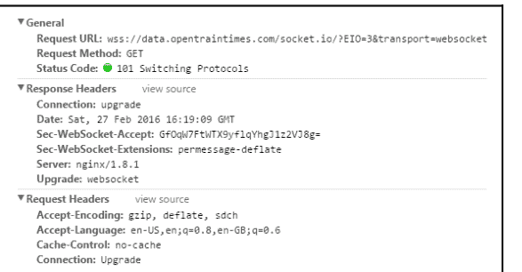

有一个用于 ASP.NET 的 Microsoft 库，名为 SignalR。该库允许你使用 WebSocket 执行推送通知。如果客户端或服务器不支持 WebSocket，它也会回退到长轮询。你需要相当新版本的 Windows Server（2012 或更高版本）和 IIS（8.0 及以上）才能使用 WebSocket。

不幸的是，最新的稳定版本（SignalR 2）并不正式支持 .NET Core 2.0。一个新版本正在编写中，将在 ASP.NET Core 2.0 之后发布。


你可能还想看看 StackExchange.NetGain 作为 WebSocket 服务器。

## 压缩

数据压缩是一个广泛的主题，我们不可能涵盖全部内容。在这里，我们将学习无损压缩以及如何在 HTTP 中使用它。我们将在本章后面介绍图片的有损压缩。压缩很重要，因为如果我们能让文件更小，就可以缩短通过网络传输它们所需的时间。

### 无损压缩算法

你可能已经注意到之前一些截图中的 HTTP 头与编码有关。HTTP 最常见的压缩算法是 GZIP 和 DEFLATE，它们非常相似。这两者都与 ZIP 文件中使用的算法有关。如果你还没有使用 HTTP 压缩，那么这是一个快速见效的改进，启用它将提高你网站的性能。

还有许多其他更先进的压缩算法，例如 xz，它类似于 7-Zip（7z）格式，并使用 Lempel-Ziv-Markov 链算法（LZMA/LZMA2）。然而，目前主流浏览器中常用的只有两种额外的算法。它们是 Brotli 和 HTTP 共享字典压缩（SDCH）。两者都来自 Google，但只有 Chrome 支持 SDCH，并且它需要一个大字典。

Brotli 更有趣，因为大多数现代浏览器现在都支持它。许多浏览器要求使用 HTTPS 才能支持 Brotli（这是使用 TLS 的又一个好理由），并且头中使用的编码标记是 br。Brotli 有显著的性能改进，尤其是在慢速连接的移动设备上。你可以在 https://caniuse.com/#search=brotli 查看最新的支持数据。


## Bundling and minification

在开发 Web 应用程序时，你通常会得到大量需要交付给浏览器的静态文件。这些文件包括样式表、脚本和图像。处理许多小文件比处理一个大文件更容易（特别是在团队中工作时），但这并不总是性能的最佳做法。

打包和压缩是两种加快这些静态资源交付速度的技术。它们通常用于文本文件，例如 JavaScript 和 CSS 内容。然而，你也可以缩小图像，我们稍后会介绍这一点。

### Bundling

打包是将多个文件组合或连接在一起的技术，以便作为一个文件交付。在使用 HTTP/1.1 时这是一个好主意，因为并发连接数有限。然而，随着 HTTP/2 的出现，打包变得不那么必要了，事实上，它可能会降低性能。HTTP/2 中的新多路复用意味着，当你请求许多文件而不是包含所有相同内容的一个文件时，不再会有很大的惩罚。你可以通过只为页面交付所需的内容，而不是为每个页面交付整个客户端代码库来利用这一点。即使你按页面选择性打包，这也可能效率低下。

例如，你可能会包含一个用于表单的验证库。然而，由于它是打包的，它将被发送到所有页面，包括没有需要验证表单的页面。如果你为已验证的页面有一个单独的包，那么公共核心代码中可能会有重复，也会被发送。通过保持分离，客户端可以单独缓存它们并重用组件。这也意味着，如果你更改了某些内容，你只需要使这一个部分的缓存失效。客户端可以继续使用其他未修改的部分，而无需再次下载它们。

正如 always，你应该为你的特定用例进行测量。你可能会发现打包仍然可以减少总文件大小。HTTP/2 的开销要低得多，但仍然不是零，而且压缩在更大的文件上效果更好。然而，请记住对缓存和可重用性的影响。

### Minification

压缩是减少文本静态资源文件大小的过程。我们通过各种手段来实现这一点，包括删除注释、移除空白和缩短变量名。混淆代码以使其更难逆向工程也很有用。

我们介绍了经验法则，说明 PNG 是图标的最佳图像格式，而 JPEG 更适合照片。这两种格式分别是无损和有损图像压缩中最常见的。

我们稍后会谈论更多其他图像格式，但你通常受制于浏览器支持的流行格式。那么，你如何从常见的选择中获得更多？

## PNG

**Portable Network Graphics (PNG)** 是一种无损图像压缩格式，其内部工作原理类似于 ZIP 文件（使用 DEFLATE 算法）。它非常适合包含纯色块的图像，并且图像质量（颜色更多）高于旧的 **Graphics Interchange Format (GIF)**。

PNG 在所有现代浏览器中都支持透明度，因此你应该用它代替 GIF 用于静态图像。除非你需要支持 Internet Explorer 6，否则这不是问题，在这种情况下，这可能不是你最麻烦的问题。PNG 还支持使用 **Animated Portable Network Graphics (APNG)** 文件进行动画。这些就像动画 GIF，但质量要高得多。不幸的是，只有 Firefox 和 Safari 支持 APNG。

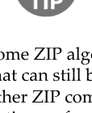

查找支持特定功能的浏览器的一个好网站是 http://caniuse.com/。你可以搜索功能支持，然后将其与你网站的用户代理分析进行比较。例如，你可以搜索 PNG-alpha、Brotli 或 APNG。

一些 ZIP 算法实现比其他实现更好，它们产生的较小文件仍可被所有人解码。例如，7-Zip 在 Windows 上比大多数其他 ZIP 压缩软件更有效，即使使用 ZIP 格式，而不是其原生的 7z 格式。同样，你可以更紧凑地压缩 PNG 而不丢失任何数据，并且仍然可以在所有浏览器中工作。这通常会带来更高的前期计算成本。然而，如果你压缩很少更改的静态资源，那么这可能非常值得付出努力。

你可能已经使用 PNGOUT 工具来无损地减小 PNG 图像的大小。如果你没有使用，那么你可能应该使用。你可以在 http://advsys.net/ken/utils.htm 上阅读更多关于它的信息并下载它。

然而，有一种新的算法叫做 Zopfli，它提供了更好的压缩，但压缩速度非常慢。解压缩速度同样快，因此对于预编译资源来说，这只是一次性优化成本。Zopfli 是 Brotli 的前身，但它与 DEFLATE 和 GZIP 兼容，因为它不是新格式。

你可以在 https://github.com/google/zopfli 获取 Zopfli，但你应该始终使用你的图像进行测试并验证确实有文件大小减少。你可能会发现这些工具可以帮助你更快地交付资源并实现更高的性能。

你也可以使用将许多精灵组合成一张图像的做法。与打包一样，这在使用 HTTP/2 时也不那么必要了。然而，与压缩相同的注意事项也适用，你应该始终为你的图像集进行测试。

## JPEG

JPEG 是一种有损图像压缩格式，这意味着它通常会丢弃图片中的数据以使其变小。它最适合自然渐变和连续色调，例如照片中常见的。JPEG 不像 PNG 那样支持透明度，因此如果你想在不同背景上使用它，则需要预先渲染它们。

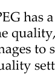

对于 Web 来说，从 JPEG 文件中删除可交换图像文件格式 (Exif) 元数据是一个节省空间的好主意。这包含有关所用相机和照片拍摄地理位置的信息。

JPEG 有一个质量设置，影响图像文件大小和细节水平。质量越低，文件越小，但看起来越差。你可以对图像进行测试，看看哪些设置提供了可接受的权衡。至关重要的是，此质量设置的最佳值会因图像内容而异。有工具可以自动检测最佳质量级别，例如 Google 的 butteraugli。

Mozilla（Firefox 浏览器的制造商）有一个有趣的项目叫做 mozjpeg。这旨在更好地压缩 JPEG 图像，类似于 PNGOUT 和 Zopfli 对 PNG 图像所做的。你可以使用 mozjpeg 将 JPEG 图像压缩到正常大小以下，而不影响解压缩或质量。它可在 https://github.com/mozilla/mozjpeg 获取，但你需要自己编译它。正如 always，结果可能有所不同，因此请为你网站上的照片进行测试。

JPEG Archive (https://github.com/danielgtaylor/jpeg-archive) 是一个方便的工具，它使用 mozjpeg 压缩 JPEG 图像，使用各种比较指标。另一个类似的工具是 imgmin (http://github.com/rflynn/imgmin)，它稍微老一些。

## Other image formats

还有许多其他图像格式可用，但在 Web 上你通常受限于浏览器支持的内容。

## Server

Web 服务器是缓存的绝佳位置，因为它通常完全在你的控制之下。然而，除了生成正确的头之外，它并不是网络性能的一部分。使用服务器端缓存可以带来其他很好的性能优势，例如提高生成页面的速度，但我们将在后面的章节中介绍这些内容。

如果你在 Microsoft 的 **Internet Information Services (IIS)** Web 服务器上使用传统的 .NET Framework，那么你可以在应用程序内部使用 **输出缓存**。这将负责设置正确的头并向浏览器请求发送 304 (Not Modified) 响应。它还会在内存、磁盘或使用 Memcached/Redis 上缓存服务器上的输出。你可以向控制器操作方法添加属性来控制缓存选项，但其他方法也可用，例如在配置文件中。

输出缓存现在在 ASP.NET Core 中可用，因此如果你选择，可以在你的基础设施中存储输出的副本。由于本节是关于网络的，我们只在这里介绍 `ResponseCache` 属性，它是输出缓存的一个子集。有关其他主题的更多信息，请访问作者的网站 https://unop.uk/。

如果你想禁用 ASP.NET Core 页面的缓存，则将此注释添加到你的控制器操作中：

```
[ResponseCache(NoStore = true, Duration = 0)]
```

这将在 HTTP 响应上设置以下头并确保它不会被缓存：

```
Cache-Control: no-store
```

要缓存页面一小时，请改用以下内容，Duration 以秒为单位：

```
[ResponseCache(Duration = 3600, VaryByHeader = "Accept")]
```

缓存控制头将如下所示：

```
Cache-Control: public,max-age=3600
```

关于其他缓存配置选项和配置文件，还有很多要说。因此，如果你感兴趣，请阅读后面的章节。这是一个复杂的话题，我们在这里只是触及了皮毛。


你可以在 https://docs.microsoft.com/en-gb/aspnet/core/performance/caching/response 上阅读有关 ASP.NET Core 中响应缓存的文档。

这些缓存指令不仅指示浏览器，还指示途中的任何代理。如果你有缓存代理，如 Squid、Varnish 或 HAProxy，那么其中一些可能在你的基础设施中。或者，你可能有一个 TLS 终止负载均衡器（如 Azure Application Gateway）来减轻 Web 服务器的负载，同时也进行缓存。你可以强制刷新你控制的服务器的缓存，但你和用户之间可能存在其他无法执行此操作的缓存。

## 你和用户之间的代理服务器

你和用户之间可能存在许多你无法直接控制的代理服务器。它们可能会忽略你的缓存请求、阻止你网站的某些部分，甚至修改你的内容。解决这些问题的方法是使用 TLS，正如我们之前讨论的那样。TLS 创建了一个安全隧道，使得你基础设施和浏览器之间的连接难以被篡改。

企业代理，通常是中间人（MitM），会攻击你与用户的连接，以便他们可以监视员工在线做什么。这涉及在用户工作站上安装自定义受信任根证书，以便可以伪造你的证书。不幸的是，除了对用户进行教育之外，你对此无能为力。证书固定在原生应用中有效，但在 Web 应用中并不那么有用。HTTP 公钥固定（HPKP）可用，但由于它是一种首次使用即信任（TOFU）技术，初始连接可能被拦截。客户端证书是另一个选项，但它们可能难以分发，并且并不常用。

如果你使用 HSTS 并让你的域名预装在浏览器中，那么这可以帮助避免拦截，但你的网站可能只是被阻止。例如，Firefox 自带自己的证书存储，不像 Chrome 那样使用操作系统提供的证书。你不能为启用了 HSTS 的站点添加安全异常，而 Firefox 在连接之前就知道这一点，对于包含在浏览器安装中的 HSTS 站点。

MitM 如果你信任第三方并保持控制，则可能很有用。这被一些内容分发网络（CDN）用来加速你的网站。然而，你需要仔细评估其风险影响。阅读上一章中提到的 Cloudbleed 事件，了解一个发人深省的例子。

## CDN

CDN 可以通过在更靠近用户的位置存储你的内容副本来提高你网站的性能。Cloudflare 等提供的服务会对你的连接进行 MitM，并在全球的数据中心保存副本。与未经授权的代理不同的是，你控制配置，并且可以随时清除缓存。

你应该小心，因为如果你不使用缓存功能，那么由于额外的跳数，这可能会降低你网站的响应性。确保你监控使用 CDN 和不使用 CDN 的响应时间，并且在它们宕机时需要有回退计划。

CDN 的另一个常见用例是分发流行的库，例如 jQuery JavaScript 库。jQuery（MaxCDN）、Google、Microsoft 和 cdnjs（Cloudflare）提供了免费的 CDN 来执行此操作。假设是用户可能已经从这些源之一在缓存中拥有该库。然而，你应该极其小心信任提供商和连接。当你将第三方脚本加载到你的网站时，你实际上是在赋予他们对其的完全控制权，或者至少依赖他们始终可用。

如果你选择使用 CDN，则确保它使用 HTTPS 以避免脚本被篡改。你应该在安全页面上使用显式的 `https://` URL 或至少协议无关的 URL（//），并且永远不要使用 `http://`。否则，你将收到混合内容警告，一些浏览器会将其显示为完全未加密甚至阻止。

SRI 可以帮助在某些浏览器中避免脚本被篡改。不要担心哈希脚本的任何潜在性能开销。使用的 SHA-2 算法非常快，这就是为什么它们不应该用于哈希密码或密钥拉伸。有关此脚本完整性检查功能的更多信息，请参阅上一章。

无论如何，你都需要一个托管在你自己的服务器上的回退，以防 CDN 宕机。如果你使用 HTTP/2，那么你可能会发现使用 CDN 没有优势。显然，始终为你的情况进行测试。

ASP.NET Core 视图中提供了一些有用的功能，可以轻松启用 CDN 资源的本地回退。我们将在后面的章节中向你展示如何使用它们。

## 总结

在本章中，你学习了如何在你基础设施的边缘和用户之间在网络层面提高性能。你现在对应用程序下的互联网协议有了更多的了解，以及如何优化其使用以获得最佳效果。

我们从高层次上涵盖了网络栈的许多层，从 IP 和 TCP 到 HTTP 和 HTTP/2。我们还展示了 TLS 如何用于保护通信以及密钥交换的工作方式。我们强调了可以使用的不同密码算法，并涉及了 WebSockets 等替代协议。

你学习了如何利用压缩来缩小文本和图像文件。这将减少带宽并加快资源交付。我们还强调了缓存的重要性，你现在应该明白它有多重要。我们将在第 9 章《学习缓存和消息队列》中更详细地介绍缓存。

在下一章中，你将学习如何优化你基础设施内部的性能。你将看到如何处理 I/O 延迟，以及如何编写高性能 SQL。
