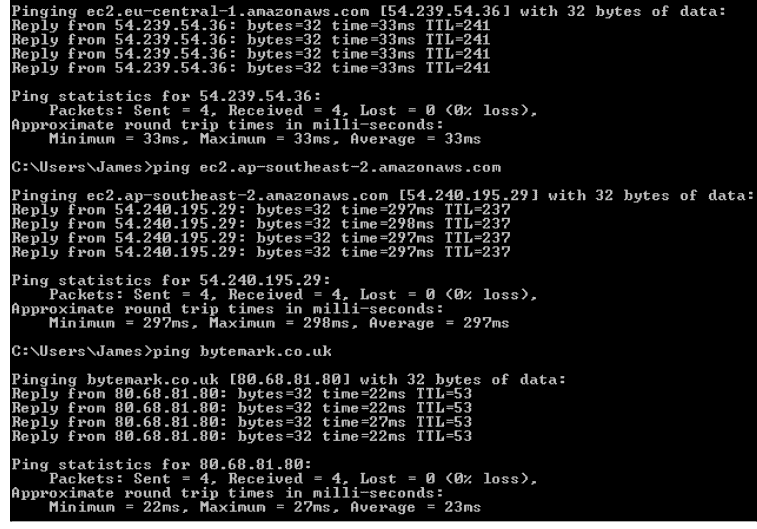
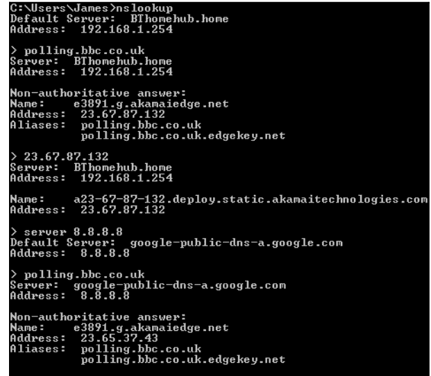
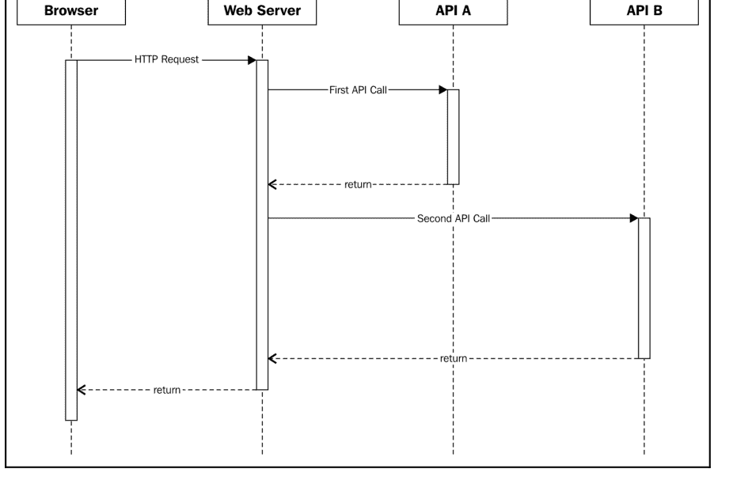
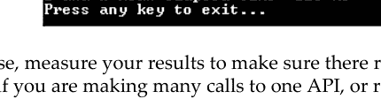
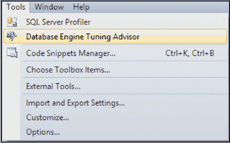
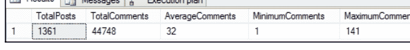
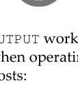
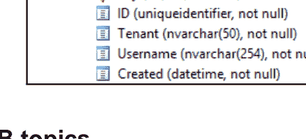

# 7 优化 I/O 性能

本章讨论了当你将功能测试过的应用程序拆分为部署的各个部分时经常出现的问题。你的 Web 服务器托管前端代码，你的数据库在数据中心的别处，你可能有一个用于集中文件的存储区域网络（SAN），一个用于 API 的应用服务器，并且所有虚拟磁盘也都在不同的机器上。

这些更改会为许多常见操作增加显著的延迟，你的应用程序现在变得超级慢，很可能是因为它在网络上过于啰嗦。在本章中，你将学习如何通过批量组合查询并在最适合工作的服务器上执行工作来修复这些问题。即使所有内容都在一台机器上运行，本章中学到的技能也将通过提高效率来帮助提高性能。

本章涵盖的主题包括以下内容：

- 输入/输出
- 网络诊断
- 批量 API 请求
- 高效的 DB 操作
- 模拟和测试

你将了解不应该同步使用的各种操作，以及如何以高效的方式仅从 DB 返回你需要的数据。你还将看到如何驯服你的 O/RM，并学习如何使用 Dapper 编写高性能 SQL。

我们在第 5 章《修复常见性能问题》中简要介绍了其中一些主题，但在那里我们将深入探讨。 本章的前半部分将侧重于背景知识和使用诊断工具，而后半部分将向你展示你可能遇到的问题的解决方案。你还将了解一些不常见的问题，以及如何修复或缓解它们。

我们最初将重点放在理解问题上，因为如果你不了解问题的根本原因，那么修复起来可能很困难。你不应该盲目应用你读到的建议，并期望它成功地工作。诊断问题通常是最困难的部分，一旦完成，通常很容易修复它。

### 输入/输出

I/O 是代码与外部世界交互的任何操作的通用名称。有许多事情被视为 I/O，尤其是如果你的应用程序具有分布式架构，则内部软件中可能存在大量 I/O。

科技公司越来越多地使用 `.io` **顶级域名（TLD）**，例如 `http://github.io`，这在一定程度上可以归因于它代表 I/O，但这并不是它的真正含义。与某些其他 TLD 一样，它实际上是一个国家代码。其他示例包括利比亚的 `.ly` 和图瓦卢的 `.tv`（与邻国基里巴斯一样，可能很快会因气候变化而沉入太平洋）。`.io` TLD  intended for the **British Indian Ocean Territory (BIOT)**，是一组具有可耻历史的微小但战略性的岛屿集合。因此，`.io` TLD 由一家英国注册机构控制，即使 BIOT 不过是一个美国军事基地。

在本章中，我们将专注于提高 I/O 的速度，而不是避免它。因此，我们不会在这里介绍缓存。I/O 优化和缓存本身就是强大的技术，当它们结合起来时，你可以实现令人印象深刻的性能。有关缓存的更多信息，请参阅 `Chapter 9, Learning Caching and Message Queuing`。

### I/O 类别

第一个挑战是识别触发 I/O 的操作。.NET 中的一个经验法则是，如果一个方法具有异步 API（`MethodAsync()` 变体），那么它就声明它可能很慢，并且可能正在执行 I/O 工作。让我们更仔细地看看不同种类的 I/O。

### 磁盘

我们将要介绍的第一种 I/O 是从持久存储读取和写入。这通常是某种磁盘驱动器，例如旋转盘片的 **硬盘驱动器（HDD）**，或，如今更常见的是，基于闪存的 **固态驱动器（SSD）**。


## 网络诊断工具

正如我们之前所发现的，虚拟化或云托管基础设施中的几乎所有 I/O 操作现在都是网络操作。磁盘和数据库很少是本地的，因为这会阻止水平扩展。有各种命令行工具可以帮助你发现你正在使用的 API、DB 或任何其他服务器的位置，以及连接上的延迟情况。

虽然所有这些命令都可以从你的工作站运行，但从服务器通过安全外壳（SSH）或远程桌面协议（RDP）连接运行时最有用。这样，你就可以检查你的数据库、API 和存储服务器相对于你的 Web 服务器的位置。不幸的是，托管提供商将服务器地理分离并放在不同的数据中心是很常见的。

例如，如果使用 AWS，那么你希望将服务器配置在至少同一个区域，最好在同一个可用区（AZ）中，这通常意味着同一个数据中心。你可以在 AZ 之间（甚至跨区域）对 DB 或文件服务器进行复制（集群），以便你的 Web 服务器始终与本地网络上的服务器通信。这也增加了冗余，因此除了提高性能外，还会使你的应用程序对硬件故障或电源供应故障更具弹性。

### Ping

Ping 是一种简单的网络诊断工具，可在几乎所有操作系统上使用。它在 IP 层运行，并向指定主机发送 Internet 控制消息协议（ICMP）回显消息。

并非所有机器都会响应 ping，或请求可能被防火墙阻止。然而，出于调试目的，允许服务器响应是良好的网络礼仪，大多数服务器都会配合。例如，打开命令提示符或终端，并输入以下内容：

```
ping ec2.eu-central-1.amazonaws.com
```

这将 ping 德国的 Amazon Web Services（AWS）数据中心。在响应中，你将看到以毫秒为单位的时间。从英国出发，该往返时间（RTT）可能约为 33ms，但你的结果会有所不同。

在 Windows 上，默认情况下 ping 执行四次尝试，然后退出。在类 Unix 操作系统（例如 macOS、BSD 或 Linux）上，默认情况下会无限期继续。按 Ctrl + C 停止并退出。


接下来尝试此命令，它将对澳大利亚的 AWS 数据中心执行相同的操作：

```
ping ec2.ap-southeast-2.amazonaws.com
```

从英国出发，延迟现在增加，几乎增加了一个数量级，约为 300 ms。要 ping 英国的托管提供商，输入以下内容：

```
ping bytemark.co.uk
```

延迟现在下降到平均 23ms，因为我们的连接（可能）没有离开该国家。显然，你的结果会根据你的位置而有所不同。接下来我们将看到如何发现我们的数据所走的路由，因为距离并不总是唯一重要的因素。跳数同样可能很重要。

以下屏幕截图显示了我们刚才对德国、澳大利亚和英国执行的三个 ping 操作的输出。请注意时间上的差异；然而，你的结果会有所不同，因此请自行尝试。



### Traceroute

如果我们现在追踪到韩国和日本的 AWS 数据中心的路由，我们可以看到，最初它们都走相同的路由。它们从伦敦到纽约，然后到西雅图，然后到达日本的大阪。韩国的追踪随后继续进行另外十一次跳，而日本的追踪在六次后完成，这在逻辑上是有意义的。

以下屏幕截图显示了追踪到韩国的典型结果，然后是追踪到日本的第二次追踪结果：

```
C:\Users\James>tracert ec2.ap-northeast-2.amazonaws.com
Tracing route to ec2.ap-northeast-2.amazonaws.com [52.95.192.85]
over a maximum of 30 hops:

 1    1 ms    1 ms    1 ms  BThomehub.home [192.168.1.254]
 2     *        *        *     Request timed out.
 3     *        *        *     Request timed out.
 4    36 ms   16 ms   16 ms  31.55.186.188
 5    16 ms   16 ms   15 ms  core4-hu0-6-0-1.faraday.ukcore.bt.net [195.99.127.200]
 6    25 ms   15 ms   15 ms  peer2-et-10-3-0.faraday.ukcore.bt.net [62.6.201.199]
 7    19 ms   15 ms   15 ms  213.137.183.100
 8    17 ms   17 ms   16 ms  82.112.115.185
 9   273 ms  274 ms  273 ms  ae-13.r02.londen03.uk.bb.gin.ntt.net [129.250.2.118]
10    17 ms   16 ms   16 ms  ae-4.r22.londen03.uk.bb.gin.ntt.net [129.250.5.24]
11    87 ms   87 ms   88 ms  ae-5.r24.nycmny01.us.bb.gin.ntt.net [129.250.2.18]
12   172 ms  179 ms  150 ms  ae-1.r21.sttlva01.us.bb.gin.ntt.net [129.250.4.13]
13   250 ms  250 ms  250 ms  ae-2.r20.osakjp02.jp.bb.gin.ntt.net [129.250.3.86]
14   252 ms  248 ms  311 ms  ae-2.r20.osakjp02.jp.bb.gin.ntt.net [129.250.6.188]
15   280 ms  275 ms  274 ms  ae-1.r00.osakjp02.jp.bb.gin.ntt.net [129.250.2.253]
16   255 ms  256 ms  254 ms  ae-0.amazon.osakjp02.jp.bb.gin.ntt.net [61.200.82.122]
17   261 ms  261 ms  261 ms  54.239.52.142
18   286 ms  286 ms  286 ms  54.239.52.149
19     *        *        *     Request timed out.
20   294 ms  291 ms  298 ms  54.239.122.238
21   322 ms  289 ms  295 ms  54.239.122.245
22   422 ms  335 ms  295 ms  54.239.122.38
23     *        *        *     Request timed out.
24     *        *        *     Request timed out.
25     *        *        *     Request timed out.
26     *        *        *     Request timed out.
27   292 ms  296 ms  295 ms  52.95.192.85

Trace complete.

C:\Users\James>tracert ec2.ap-northeast-1.amazonaws.com
Tracing route to ec2.ap-northeast-1.amazonaws.com [27.0.1.195]
over a maximum of 30 hops:

 1    2 ms    1 ms    1 ms  BThomehub.home [192.168.1.254]
 2     *        *        *     Request timed out.
 3     *        *        *     Request timed out.
 4    16 ms   16 ms   16 ms  31.55.186.100
 5    16 ms   16 ms   16 ms  core3-hu0-6-0-1.faraday.ukcore.bt.net [195.99.127.192]
 6    15 ms   16 ms   16 ms  peer2-et-9-3-0.faraday.ukcore.bt.net [62.6.201.195]
 7    15 ms   15 ms   16 ms  213.137.183.96
 8    16 ms   16 ms   16 ms  82.112.115.185
 9   273 ms  274 ms  274 ms  ae-13.r02.londen03.uk.bb.gin.ntt.net [129.250.2.118]
10    16 ms   17 ms   17 ms  ae-4.r22.londen03.uk.bb.gin.ntt.net [129.250.5.24]
11    82 ms   83 ms   83 ms  ae-5.r24.nycmny01.us.bb.gin.ntt.net [129.250.2.18]
12   153 ms  153 ms  152 ms  ae-1.r21.sttlva01.us.bb.gin.ntt.net [129.250.4.13]
13   242 ms  243 ms  242 ms  ae-2.r20.osakjp02.jp.bb.gin.ntt.net [129.250.3.86]
14   294 ms  309 ms  283 ms  ae-4.r23.osakjp02.jp.bb.gin.ntt.net [129.250.6.90]
15   273 ms  273 ms  273 ms  ae-2.r00.osakjp02.jp.bb.gin.ntt.net [129.250.3.197]
16   247 ms  246 ms  246 ms  ae-0.amazon.osakjp02.jp.bb.gin.ntt.net [61.200.82.122]
17   249 ms  259 ms  259 ms  27.0.0.250
18   255 ms  412 ms  306 ms  54.239.52.135
19   261 ms  262 ms  260 ms  27.0.0.67
20   254 ms  254 ms  254 ms  27.0.0.155
21   255 ms  255 ms  255 ms  27.0.0.175
22   255 ms  255 ms  255 ms  27.0.1.195

Trace complete.
```

### nslookup

我们随后获取该机器的主机名，方便地包含 IP 地址，即 `a23-67-87-132.deploy.static.akamaitechnologies.com`。该域名由 Akamai 拥有，Akamai 是一种 **内容分发网络（CDN）**，用于分发负载。

如果你在本地网络上使用 DNS 服务器，可能你的路由器运行 dnsmasq，那么它可能会缓存结果，并给出陈旧的数据。你可以通过将服务器更改为传播更改更快的核心服务器来查看更最新的信息。例如，要使用 Google 的公共 DNS 服务器之一，输入以下内容（但请注意，如果你正常使用此服务，Google 将记录你访问的所有互联网网站）：

```
server 8.8.8.8
```

然后再次运行相同的查询。注意主机名现在解析为不同的 IP 地址。这是 CDN 的常见行为，记录会随时间变化，即使在同一 DNS 服务器上。它通常被用作平衡网络负载的技术。更改 DNS 服务器有时也可以用来绕过天真的内容过滤或位置限制。

要退出 `nslookup` 交互模式，输入 `exit` 并按 *return*。以下屏幕截图显示了之前命令的输出：




IPv4 是你可能最熟悉的 IP 版本。它使用 32 位地址，通常表示为四个点分十进制的八位组，例如 `192.168.0.1`。然而，我们已经用完了 IPv4 地址，世界正在（缓慢地）转向名为 **IPv6** 的新版 IP。地址长度增加了四倍，达到 128 位，通常以十六进制表示，例如 `2001:0db8:0000:0000:0000:ee00:0032:154d`。为了便于书写，可以省略前导零，例如 `2001:db8::ee00:32:154d`。本地回环 (`127.0.0.1`) 在 IPv6 中现在简单地为 `::1`。

在 Windows 上，你可以使用 `ping -a x.x.x.x` 来执行反向 DNS 查找，并将 IP 地址解析为主机名。在 Linux 上（以及其他类 Unix 系统如 OS X 上），此功能不可用，`-a` 标志用于不同的目的。你将不得不使用 `nslookup`，或在这些操作系统上使用 `dig` 进行反向 DNS。

## 自己动手构建

你可以使用 C# 构建自己的工具（如控制台应用程序），所需的功能由 .NET 提供。底层实现是平台特定的，但框架会负责在你使用的操作系统上调用本地代码。

你通常不需要以编程方式解析主机名，因为大多数网络命令会自动执行此操作。然而，在某些情况下它可能很有用，特别是如果你想执行反向 DNS 查找并查找 IP 地址的主机名时。

.NET 的 Dns 类与 nslookup 不同，因为它包含本地 hosts 文件中的条目，而不仅仅是查询 DNS 服务器。因此，它更能代表其他进程正在解析的 IP 地址。

要以编程方式执行 DNS 查找，请按照以下步骤操作：

- 1. 添加 System.Net 命名空间。

```
using System.Net;
```

- 2. 要将主机名解析为 IP 地址，请使用以下静态方法。这将返回一个 IP 地址数组，虽然通常只有一个。

```
var results = await Dns.GetHostAddressesAsync(host);
```

- 3. 要将 IP 地址解析为主机名，请改用以下方法：

```
var revDns = await Dns.GetHostEntryAsync(result);
```

- 4. 如果成功，则主机名将作为 revDns.HostName 可用。

要以编程方式 ping 主机，请按照以下步骤操作：

- 1. 添加 System.Net.NetworkInformation 命名空间。

```
using System.Net.NetworkInformation;
```

- 2. 然后你可以实例化一个新的 Ping 对象。

```
var ping = new Ping();
```

- 3. 使用此对象，你现在可以通过使用以下方法 ping IP 地址或主机名（内部会执行 DNS 查找）：

```
var result = await ping.SendPingAsync(host);
```

- 4. 你可以使用 result.Status 获取 ping 的状态，如果成功，则可以使用 result.RoundtripTime 获取以毫秒为单位的往返时间。

DNS 通常用于负载均衡。在这种情况下，你会看到为单个域名返回许多 IP 地址，如以下屏幕截图所示：

```
Enter a hostname or IP address:
DuckDuckGo.com

Performing DNS lookup of DuckDuckGo.com
Complete, DuckDuckGo.com = 54.229.105.92
Performing reverse DNS lookup of 54.229.105.92
Complete, 54.229.105.92 = ec2-54-229-105-92.eu-west-1.compute.amazonaws.com

Complete, DuckDuckGo.com = 54.229.105.203
Performing reverse DNS lookup of 54.229.105.203
Complete, 54.229.105.203 = ec2-54-229-105-203.eu-west-1.compute.amazonaws.com

Complete, DuckDuckGo.com = 176.34.131.233
Performing reverse DNS lookup of 176.34.131.233
Complete, 176.34.131.233 = ec2-176-34-131-233.eu-west-1.compute.amazonaws.com

Complete, DuckDuckGo.com = 176.34.155.20
Performing reverse DNS lookup of 176.34.155.20
Complete, 176.34.155.20 = ec2-176-34-155-20.eu-west-1.compute.amazonaws.com

Complete, DuckDuckGo.com = 46.51.197.89
Performing reverse DNS lookup of 46.51.197.89
Complete, 46.51.197.89 = ec2-46-51-197-89.eu-west-1.compute.amazonaws.com

Complete, DuckDuckGo.com = 176.34.135.167
Performing reverse DNS lookup of 176.34.135.167
Complete, 176.34.135.167 = ec2-176-34-135-167.eu-west-1.compute.amazonaws.com

Pinging DuckDuckGo.com 4 times
Ping attempt #1 of 4
Success
27 ms
Ping attempt #2 of 4
Success
27 ms
Ping attempt #3 of 4
Success
27 ms
Ping attempt #4 of 4
Success
27 ms

Press any key to exit...
```

我们可以在前面的屏幕截图中看到，注重隐私的搜索引擎 DuckDuckGo（它不像 Google 那样跟踪用户）正在使用 AWS。DNS 用于在各个实例之间平衡负载；在这种情况下，它们都位于都柏林数据中心，因为那是最接近的。注意 ping 时间现在比前一个示例中基于英国的主机略高。

考虑调用两个彼此没有依赖关系的孤立 API 的示例。此操作的序列图可能如下所示：



这种先调用 A，然后在 A 完成后调用 B 的线性过程很简单，因为它不需要复杂的编排来处理 API 调用的结果，但速度并不必要地慢。通过同步并按顺序调用两个 API，我们浪费了等待它们返回的时间。如果我们不需要第一个 API 的结果来请求第二个 API，那么更好的方法是异步同时调用它们。

我们可以用一个简单的控制台应用程序来说明这一原则。有两个模拟 API 的方法，两者都很相似。**API A** 的代码如下：

```
private static async Task CallApiA()
{
    Thread.Sleep(10);
    await Task.Delay(100);
}
```

*Thread.Sleep* 模拟固定的开销，*Task.Delay* 模拟等待 API 调用返回。**API B** 返回的时间是 **API A** 的两倍，但固定开销相同，其代码如下：

```
private static async Task CallApiB()
{
    Thread.Sleep(10);
    await Task.Delay(200);
}
```

现在，如果我们按顺序同步调用这些方法，我们会发现所有延迟都累加起来，正如预期的那样。

```
CallApiA().Wait();
CallApiB().Wait();
```

这些操作平均总共花费约 332 毫秒，因为方法调用中约有 10 毫秒的额外固有开销。如果我们同时调用两个方法，时间会显著减少。

```
Task.WaitAll(CallApiA(), CallApiB());
```

操作现在平均总共花费 233 毫秒。这很好，但如果我们交换方法顺序，可以做得更好。

```
Task.WaitAll(CallApiB(), CallApiA());
```

这现在平均总共花费 218 毫秒，因为我们将 **API A** 的固定开销吞没在等待 **API B** 的时间内。


用于基准测试这三种变体的完整控制台应用程序可与本书一起下载。它使用 Stopwatch 类来计时操作，并对多次运行的结果进行平均。

这三种不同方法的结果显示在以下屏幕截图中：



正如总是适用的那样，测量你的结果以确保确实有所改进。你可能会发现，如果你对一个 API 进行多次调用，或重用同一个 API 客户端，那么你的请求无论如何都会按顺序处理。

这种任务并行化不仅适用于 I/O，还可用于计算，正如我们在下一章中将发现的那样。现在，我们将继续前进，更深入地研究数据库查询优化。

## 高效的 DB 操作

虽然这不是一本面向数据库管理员（DBA）的书籍，但了解你正在使用的底层技术对你是有益的。正如网络一样，如果你了解其优势和劣势，那么更容易实现高性能。

这对于开发者在专业领域之外做更多工作的趋势也特别相关，尤其是在小型组织或初创公司中。你可能听说过相关的流行词 full-stack developer 或 DevOps。这些相似的概念指的是模糊传统技术边界的角色，并将开发（前端和后端）、质量保证、网络、基础设施、运营和数据库管理合并为一个工作。今天的开发者不再只是编程或交付代码。了解其他领域的一些知识也是有帮助的。

之前，在第 5 章《修复常见的性能问题》中，我们介绍了使用微型 O/RM Dapper，以及如何修复 select N+1 问题。现在，我们将在此知识的基础上，重点介绍一些你可以合并查询并提高 DB 操作性能的其他方法。

如第 4 章《测量性能瓶颈》中所述，第一步是分析你的应用程序并发现问题所在。只有在此之后，你才应继续对问题区域应用解决方案。


## 数据库调优

我们将更专注于改进性能不佳的查询，因此不会过多深入数据库调优。这是一个复杂的主题，关于索引以及数据存储方式，有大量内容值得学习。

但是，如果你尚未运行过数据库引擎优化顾问（DETA），那么这是识别是否存在缺失索引的一个简单步骤。不过，在应用建议的更改时应当小心，因为总是存在需要权衡的缺点和利弊。例如，索引可以加快数据检索速度，但也会使添加和更新记录变慢。它们还会占用额外空间，因此最好不要过度使用。你是希望前期优化，还是后期在检索时承受代价，将取决于你的具体业务用例。

第一步是使用 SQL Server Profiler 捕获跟踪并保存结果文件。有关如何执行此操作，请参阅第 4 章“测量性能瓶颈”。调优模板是捕获跟踪的不错选择；为了获得良好结果，应确保所捕获的内容能代表真实的数据库使用情况。在 SSMS 中，你可以从与 SQL Server Profiler 相同的菜单启动 DETA，如下面的屏幕截图所示：



然后，你可以将跟踪作为工作负载加载，处理后它将给出一些建议。出于篇幅原因，我们在此不赘述具体步骤，而且它本身也很简单明了。如果需要，网上有很多不错的指南。如果在 SSMS 中运行查询时启用了实际查询计划，你还可以看到建议的缺失索引。


默认情况下，SQL Server 会返回一条消息，详细说明返回的记录数以及每个查询的结果。你可以通过在查询前加上 SET NOCOUNT ON 命令来关闭此功能，这将在表格数据流（TDS）连接中节省几个字节，并略微提升性能。仅当使用游标时，这才有意义；而由于锁定原因，使用游标本身也是一种不良做法。较好的做法是在查询后重新启用行计数，即使它无论如何都会在局部作用域之外被重置。

在第 5 章“修复常见性能问题”中，我们通过连接数据库中的表并在应用代码中使用 COUNT 而不是执行这些计算，解决了 select N+1 问题。还有许多其他聚合函数可用于提高性能，尤其是在报表场景中。

回到之前的示例，假设我们现在想要找出博客文章的总数。我们还想要评论总数、平均评论数、单篇文章的最低评论数以及单篇文章的最高评论数。

第一部分很简单，只需对文章（而不是评论）应用 COUNT 即可，但第二部分则更难。由于我们已经有了带有每篇文章评论数的文章列表，可能会想复用该列表，并直接在 C# 代码中计算出所有结果。

这是一个糟糕的主意，查询性能会很差，尤其是在文章数量较多的情况下。更好的解决方案是使用如下查询：

```
;WITH PostCommentCount AS (
SELECT
    bp.BlogPostId,
    COUNT(bpc.BlogPostCommentId) 'CommentCount'
FROM BlogPost bp
LEFT JOIN BlogPostComment bpc
    ON bpc.BlogPostId = bp.BlogPostId
GROUP BY bp.BlogPostId
) SELECT
    COUNT(BlogPostId) 'TotalPosts',
    SUM(CommentCount) 'TotalComments',
    AVG(CommentCount) 'AverageComments',
    MIN(CommentCount) 'MinimumComments',
    MAX(CommentCount) 'MaximumComments'
FROM PostCommentCount
```

我们添加了一个 HAVING 子句，以确保只统计评论数大于零的文章。这与 WHERE 子句类似，但用于 GROUP BY 场景。现在查询结果大致如下：



## 采样

有时，你不需要使用全部数据，可以对其进行采样。这种技术特别适用于你可能希望绘制图表的任何时间序列信息。在 SQL Server 中，进行随机采样的传统方式是使用 NEWID() 方法，但这种方法可能很慢。例如，请考虑以下查询：

```
SELECT TOP 1 PERCENT *
FROM [dbo].[TrainStatus]
ORDER BY NEWID()
```

该查询以随机分布的方式精确返回 1% 的行。针对包含 1,205,855 条记录的表运行时，它在大约四秒内返回了 12,059 条结果，这很慢。更好的方式可能是使用 TABLESAMPLE，任何较新版本的 SQL Server（2005 及更高版本）都支持该功能，如下所示：

```
SELECT *
FROM [dbo].[TrainStatus]
TABLESAMPLE (1 PERCENT)
```

上述查询要快得多，针对与前一示例相同的数据运行时，几乎瞬间完成。缺点是它比早期方法更粗糙，不会精确返回 1% 的结果。它会返回大约 1% 的行，但每次运行时的值都会变化。例如，针对同一测试数据库连续运行该查询三次，分别返回了 11,504、13,441 和 11,427 行。

## 插入数据

查询数据库可能是最常见的用例，但你通常首先需要向其中放入一些数据。在向关系数据库插入记录时，最常用的功能之一就是标识列。它是由数据库生成的自动递增 ID，在添加数据时无需提供。

例如，在前面提到的 BlogPost 表中，BlogPostId 列创建为 INT IDENTITY (1, 1)。这意味着它是一个整数值，从 1 开始，每新增一行就增加 1。你可以按如下方式向该表插入数据，而无需指定 BlogPostId：

```
INSERT INTO BlogPost (Title, Content)
VALUES ('My Awesome Post', 'Write something witty here...')
```

标识列非常有用，但你通常希望知道新创建记录的 ID。典型的做法是存储一行，然后立即检索它，以便该 ID 可用于后续的编辑操作。你可以使用 OUTPUT 子句一次性完成此操作，如下所示：

```
INSERT INTO BlogPost (Title, Content)
OUTPUT INSERTED.BlogPostId
VALUES ('My Awesome Post', 'Write something witty here...')
```

除了插入行之外，还会返回该 ID。



你可能会看到有人提倡使用 SCOPE_IDENTITY()（甚至 @@IDENTITY）来检索标识，但这些方法已经过时。在 SQL Server 的现代版本中，推荐的做法是使用 OUTPUT。

OUTPUT 可用于 INSERT、UPDATE、DELETE 和 MERGE 命令。它甚至能一次操作多行，如下面这个批量插入两篇博客文章的例子所示：

```
INSERT INTO BlogPost (Title, Content)
OUTPUT INSERTED.BlogPostId
VALUES ('My Awesome Post', 'Write something witty here...'),
       ('My Second Awesome Post', 'Try harder this time...')
```

上述查询将返回包含两个标识的结果集，例如 3003 和 3004。为了使用 Dapper 执行这些插入操作，你可以使用以下针对单条记录的方法。首先，让我们创建一个博客文章对象；这里我们硬编码该对象，但通常它会来自用户输入：

```
var post = new BlogPost
{
    Title = "My Awesome Post",
    Content = "Write something witty here..."
};
```

要插入这一篇文章并设置 ID，可以使用以下代码。该代码将执行 INSERT 语句，并返回一个整数值。

```
post.BlogPostId = await connection.ExecuteScalarAsync<int>(@"
    INSERT INTO BlogPost (Title, Content)
    OUTPUT INSERTED.BlogPostId
    VALUES (@Title, @Content)",
    post);
```

然后，你可以将返回的 ID 赋给该文章对象，并将该对象返回给用户进行编辑。假设插入成功且未抛出异常，则无需再次选择该记录。

你可以使用执行方法通过相同的 SQL 一次插入多条记录。但是，SQL 将被执行多次，这可能效率低下，而且你只能得到插入的行数，而不是它们的 ID。以下代码将文章数组提供给前一示例中使用的相同 SQL：

```
var numberOfRows = await connection.ExecuteAsync(@"
    INSERT INTO BlogPost (Title, Content)
    OUTPUT INSERTED.BlogPostId
    VALUES (@Title, @Content)",
    new[] { post, post, post });
```

如果你希望返回多个 ID，则需要使用查询方法来返回值集合，就像我们之前所做的那样。然而，如果不动态构建 SQL，就很难让这种方法适用于数量可变的记录。以下代码使用多个单独的查询参数执行批量插入：

```
var ids = await connection.QueryAsync<int>(@"
    INSERT INTO BlogPost (Title, Content)
    OUTPUT INSERTED.BlogPostId
    VALUES (@Title1, @Content1),
           (@Title2, @Content2)", new
    {
        Title1 = post.Title,
        Content1 = post.Content,
        Title2 = post.Title,
        Content2 = post.Content
    });
```

这将在单个命令中完成所有工作，并返回一个可枚举的标识集合。然而，这段代码不是很有可扩展性（甚至不够优雅），而且这种方式最多只能插入 1,000 条记录。


`Dapper.Contrib` 包中有许多辅助方法，可以帮助你插入记录和执行其他操作。然而，它们与这里的示例存在相同的限制，你只能返回单个标识或插入的行数。

## GUID（全局唯一标识符）

整数标识在数据库内部可能很有用，但也许你不应该在外部使用标识键，尤其是在拥有多个 Web 服务器或将 ID 暴露给用户的情况下。另一种选择是使用**全局唯一标识符（GUID）**，在 SQL Server 中称为 `UNIQUEIDENTIFIER`。我们之前已经提到过它们，因为它们是由次优采样示例中使用的 `NEWID()` 函数生成的。

GUID 被广泛使用，长度为 16 字节，是整数的四倍。GUID 的大小意味着你在向已填充数据的表中插入随机 GUID 时，不太可能遇到**唯一约束**冲突。


人们有时担心 GUID 冲突，但所涉及的数字大到令人难以置信，因此冲突极不可能发生。.NET（在 Windows 上使用 `COM` 函数）生成的 GUID 具体来说是**通用唯一标识符（UUID）**版本 4。这些 UUID 具有 122 位的随机性，因此你需要生成近 300 亿亿个 GUID，才有二分之一的冲突机会。如果以每秒一个新记录的速度，那将需要超过 900 亿年。即使以每秒两百万个 GUID 的速度（如今一台普通计算机都能达到），也仍然需要超过 4.5 万年（比人类文明存在的时间还要长）。如果你认为这对你的软件来说是个问题，那么你可能应该使用五位数的年份（如 02017）来为未来做好准备，以避免 Y10K（或十六进制的 YAK）问题。

这种唯一性属性允许你在应用程序代码中生成 GUID 并将其存储在分布式数据库中，而不必担心以后合并数据。它还允许你将 ID 暴露给用户，而不必担心有人会枚举它们或试图猜测某个值。整数 ID 通常会暴露表中有多少条记录，这根据你的用例可能属于敏感信息。

使用随机 GUID 时，有一点需要注意：把它们当作键（key）而不是 ID。这两个术语之间的区别很微妙，而且它们通常是同一个东西。键（**主键**或**聚集键**）是数据库用来定位记录的，而 ID 是你用来检索记录的。它们可以是相同的值，但并不一定必须相同。将随机 GUID 用作键可能会导致索引性能问题。随机性可能会导致碎片化，从而降低查询速度。

你可以使用顺序 GUID，例如 `NEWSEQUENTIALID()` 可以作为一个列的 `DEFAULT` 值，但这样你会失去 GUID 的大部分有益特性，而这些特性主要来自随机性。现在你实际上只是拥有了一个非常大的整数，如果你只关心表中的最大行数，并且需要超过二十亿行，那么 `big int`（是 `int` 的两倍大，但只有 GUID 的一半）应该就足够了。

一个很好的折中方案是使用 `int` 标识作为主键，但使用 GUID 作为 ID（并在该列上强制唯一约束）。最好在应用程序代码中使用 `Guid.NewGuid()` 生成 GUID，因为如果在数据库中使用默认列值，则意味着你必须在插入后检索 ID，如前所示。

使用此策略的表可能看起来部分像下面的截图。这是 **MembershipReboot** 用户管理和认证库中某个表的一部分的屏幕截图：



## 高级数据库主题

这里还有许多其他数据库性能增强技术可以介绍，但我们没有足够的篇幅。我们将简要提及一些额外的话题，以防你想进一步了解。请访问作者网站 https://unop.uk/ 获取有关其他主题的更多信息。

当使用云托管提供商时（并且如果你自动化服务器构建），这很容易。你可以简单地启动一个与生产环境匹配的暂存系统。只要所有部件都在并且位置相同，你就不必将其配置到完全相同的规模。为了进一步降低成本，你只需要在测试期间保留它。

或者，你可以创建一个新的实时环境，部署并测试它，然后切换过去，并销毁或复用旧的实时环境。这种交换技术称为**蓝绿部署**。另一种选择是在**功能开关**后部署新代码，这允许你在运行时仅对某些用户切换该功能。这不仅让你可以用测试用户进行功能验证，还可以逐步推出新功能，并在过程中监控性能影响。我们将在第11章 *监控性能回归* 中介绍这两种技术。

## 总结

我们在本章中涵盖了很多内容，希望你已经清楚，成为一名高性能开发者需要的不仅仅是一名能干的程序员。在你的代码周围还有许多外部因素需要考虑。

现在你了解了 I/O 的基础知识，以及固有限制存在的物理原因。你可以分析和诊断网络在逻辑上如何组合在一起。我们已经介绍了如何更好地利用网络来减少整体延迟，这一点很重要，因为现在越来越多的 I/O 操作通过网络进行。你还看到了如何更好地利用数据库，以及如何用更少的操作做更多的事情。

在下一章中，我们将深入探讨代码执行的细节，并向你展示如何加速你的 C# 代码。我们将看到 .NET Core 和 ASP.NET Core 的表现为何比之前的版本好得多，以及如何利用这些改进。
