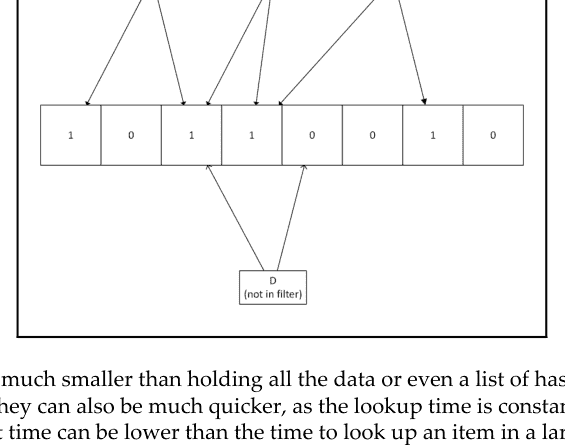
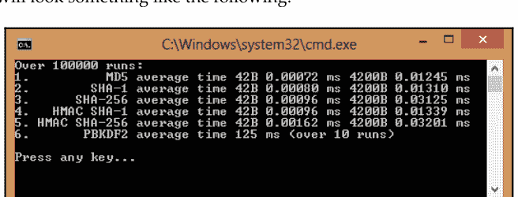
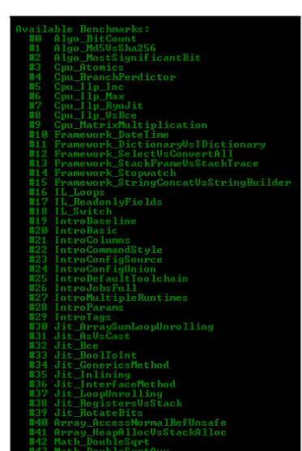
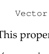
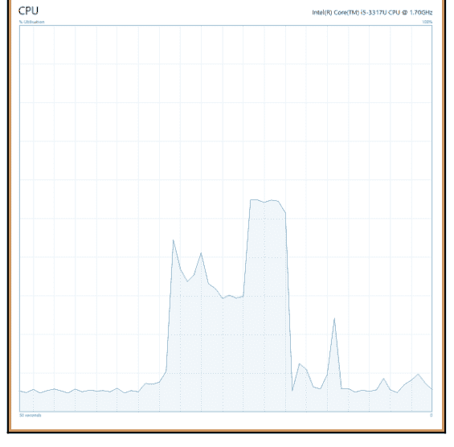
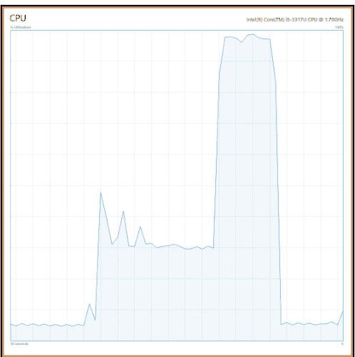
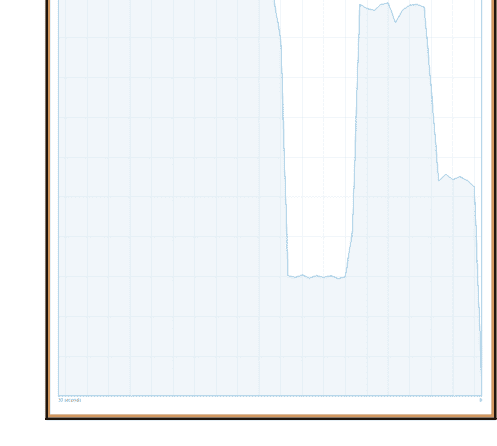

# 8 理解代码执行和异步操作

本章介绍如何解决代码执行中的性能问题。代码执行通常不是速度问题出现的第一位置，但可以是一个很好的额外优化点。我们将讨论哪些领域需要性能，哪些领域可以（甚至必须）慢。我们将比较各种数据结构的优点，从标准的内置泛型集合到更奇特的集合。我们将演示如何并行计算操作，以及如何利用 CPU 可能提供的额外指令集。我们将深入探讨 ASP.NET Core 和 .NET Core 的内部结构，以强调你应该注意的改进。

本章涵盖的主题包括以下内容：

- .NET Core 和标准库
- 公共语言运行时（CLR）服务
- ASP.NET Core 和 Kestrel Web 服务器
- 泛型集合和布隆过滤器
- 序列化和数据表示格式
- 哈希函数的相对性能
- 并行化（SIMD、TPL 和 PLINQ）
- 多线程、并发和锁定
- 应避免的性能不佳实践

你将学习如何并行计算结果并在最后组合输出。这包括如何避免错误的做法，因为错误的做法可能会让事情变得更糟。你还将学习如何降低服务器利用率，以及如何选择最合适的数据结构，以便针对你的特定情况高效地处理信息。

## 核心项目入门

与旧版完整框架相比，使用 .NET Core 和 ASP.NET Core 有许多好处。主要的增强是开源开发和跨平台支持，但也有显著的性能改进。开放开发很重要，不仅源代码可用，而且开发工作在 GitHub 上公开进行。鼓励社区做出贡献，如果通过代码审查，这些贡献可能会被合并到上游；流程不是单向的。这带来了来自微软外部的性能提升和额外平台支持。如果你在框架中发现错误，现在可以修复它，而不是绕开问题并希望得到补丁。

组成框架的多个项目分布在 GitHub 上的两个组织中。驱动原则之一是将框架拆分为模块，这样你可以只取所需的部分，而不是整个单体安装。底层框架 .NET Core 可以在 https://github.com/dotnet 下找到（还有其他项目）。更高级的 Web 应用程序框架 ASP.NET Core 可以在 https://github.com/aspnet 下找到。

让我们快速浏览一下各种 .NET Core 仓库以及它们是如何组合在一起的。

## .NET Core

有两个项目构成了 .NET Core 的主要部分，它们是 CoreCLR 和 CoreFX。CoreCLR 包含 .NET Core CLR 和基础核心库 mscorlib。CLR 是运行你的 .NET 代码的虚拟机。CoreCLR 包含即时（JIT）编译器（RyuJIT）、垃圾回收器（GC），以及 mscorlib 中的基础类型和类。CoreFX 包含基础库，并且位于 CoreCLR 之上。这包括大多数不是简单类型的内置组件。还有 Roslyn 编译器，它将你的 C#（或其他 .NET 语言代码）转换为公共中间语言（CIL）字节码。然后 RyuJIT 在运行时将其转换为本机机器代码。


## Kestrel

Kestrel 是 ASP.NET Core 的全新 Web 服务器，性能出色。它基于 libuv，这是一个异步 I/O 抽象和支持库，也运行在 Node.js 之下。Kestrel 速度飞快，基准测试结果令人印象深刻。然而，它相当基础，在生产环境托管中，你应该将其放在反向代理后面，以便利用缓存等功能为更多用户服务。为此，你可以使用许多 HTTP 或代理服务器，如 IIS、nginx、Apache 或 HAProxy。


如果使用 nginx 作为反向代理，你应该小心配置，因为默认情况下，如果 Web 服务器的响应超时，它会重试 POST 请求。这可能导致重复操作，尤其是在作为跨多个后端 HTTP 服务器的负载均衡器时。

## 数据结构

数据结构是可用于存储你正在处理的信息的对象。根据数据的使用方式选择最佳实现，会对执行速度产生巨大影响。在此，我们将讨论一些常见且更有趣的数据结构，你可能会想加以利用。

由于这是一本关于 Web 应用程序编程的书，而不是关于复杂算法实现或微优化的书，因此我们不会深入探讨数据结构和算法。正如引言中简要提到的，在 Web 环境中，其他因素可能使执行速度显得微不足道，而且我们假设你并不是在编写游戏引擎。不过，好的算法有助于加速应用程序，因此，如果你所在的领域执行性能很重要，你应该多了解它们。

我们更关心整个系统的性能，而不一定是代码运行的速度。通常，考虑你的代码表达了什么以及它如何影响其他系统，比考虑它如何执行更为重要。尽管如此，为工作选择合适的工具仍然很重要，你也不希望代码不必要地缓慢。只是要小心，当代码已执行得足够快时，不要过度优化，最重要的是尽量保持可读性。

## 字典

字典与列表类似，但擅长通过键快速检索特定值。在内部，它们使用哈希表实现。System.Collections.NonGeneric 包中有传统的 Hashtable 类，但它不是类型安全的，而 Dictionary<T> 是泛型类型，因此除非你在将旧代码移植到 .NET Core，否则可能不应使用 Hashtable。这同样适用于 ArrayList，它是 List 的传统非泛型版本。

字典可以用键非常快速地查找值，而列表则需遍历所有值直到找到键。不过，你仍然可以枚举字典，因为它是有序的，尽管这并不是它的预期用途。如果不需要排序，那么可以使用 HashSet。所有这些数据结构都有排序版本，你也可以再次使用只读接口使其难以修改。

## 集合基准测试

准确的基准测试很难进行，并且有很多因素可能会影响你的结果。编译器非常聪明，会进行优化，这会使简单的基准测试价值降低。编译器可能会为不同的实现生成非常相似的代码。

你在数据结构中存放的内容也会对其性能产生很大影响。通常最好测试或分析你的实际应用程序，而不要过早优化。代码的可读性非常有价值，不应为了运行时效率而牺牲它，除非存在明显的性能问题，或者代码本身已经难以阅读。

有一些基准测试框架可以帮助你进行测试，例如 BenchmarkDotNet，可在 https://github.com/dotnet/BenchmarkDotNet 获取。然而，这些框架可能有点大材小用，而且有时设置起来很棘手。其他选项包括 Simple Speed Tester，你可以在 http://theburningmonk.github.io/SimpleSpeedTester/ 了解更多信息，以及可从 https://github.com/minibench 获取的 MiniBench。


你可以在 https://github.com/aspnet/benchmarks 了解更多关于 ASP.NET Core 框架的基准测试。

## 布隆过滤器

**布隆过滤器**是一种有趣的数据结构，可以在某些使用场景下提高性能。它们使用多个叠加的哈希函数，可以快速告诉你某个项肯定不在集合中。然而，它们无法确定某个项是否存在，只能说它可能存在。它们作为预过滤器很有用，这样你就可以避免执行查找，因为你确定该项不在那里。

下图展示了布隆过滤器的工作原理。A、B 和 C 已被哈希并插入过滤器。D 被哈希后用于检查它是否在过滤器中，但由于它映射到一个 0 位，我们知道它不在其中：



布隆过滤器比保存所有数据甚至比保存集合中每个项的哈希列表要小得多。它们也可以更快，因为对于任何大小的集合，查找时间都是恒定的。这个恒定时间可能低于在大型列表或字典中查找项的时间，尤其是当该项位于文件系统或远程数据库中时。

布隆过滤器的一个示例应用是本地 DNS 服务器，它有一个要覆盖的域列表，但会将大多数请求转发到上游服务器。如果自定义域列表很大，那么根据这些条目创建布隆过滤器并将其保存在内存中可能会更有利。

当请求到达时，会对照过滤器进行检查，如果不存在，则将该请求转发到上游服务器。如果条目确实存在于过滤器中，则查询本地 hosts 文件；如果条目在那里，则使用其值。即使过滤器认为条目存在，它也可能不在列表中，这种情况的可能性很小。在这种情况下，当未找到时，请求会被转发，但这种方法仍然避免了每个请求都需要查询列表。

使用布隆过滤器的另一个示例是在缓存节点中，也许作为代理或 CDN 的一部分。你不会想缓存只被请求一次的资源，但如果还没有缓存它，你又如何判断第二次请求何时发生呢？如果你将请求添加到布隆过滤器中，就可以轻松判断第二次请求何时发生，然后缓存该资源。

布隆过滤器还用于某些数据库，以避免昂贵的磁盘操作，以及用于**缓存摘要**，它允许代理声明其缓存的内容。HTTP/2 未来可能会支持缓存摘要，但这可能会使用**哥伦布编码集（GCS）**，它与布隆过滤器类似，但更小，代价是查询速度较慢。

除了其他实现之外，.NET 中还有一个开源布隆过滤器实现，可在 http://bloomfilter.codeplex.com/ 获取。你应该自己测试性能，以确保它能带来改进。

## 哈希与校验和

哈希是一个重要的概念，常用于确保数据完整性或快速查找值，因此它被优化为快速执行。这就是为什么通用哈希函数不应单独用于安全存储密码的原因。如果算法很快，那么密码就可以在相当短的时间内被猜出。哈希算法在复杂度、执行速度、输出长度和冲突率方面各不相同。

一种非常基本的错误检测算法称为**奇偶校验**。它向数据块添加一个位，并且很少在编程中直接使用。然而，由于它非常快速，在硬件层面被广泛使用。但当损坏位为偶数时，它可能会漏掉许多错误。

**循环冗余校验（CRC）**是一种稍复杂的错误检测算法。**CRC-32**（也写作 **CRC32**）版本通常用于软件中，尤其是在压缩格式中，作为**校验和**。


接下来，我们创建一个要测试的算法的排序列表并为每个算法执行测试：

```
var algos = new SortedList<string, HashAlgorithm>
{
    {"1.            MD5", MD5.Create()},
    {"2.            SHA-1", SHA1.Create()},
    {"3.            SHA-256", SHA256.Create()},
    {"4.    HMAC SHA-1", new HMACSHA1(key)},
    {"5. HMAC SHA-256", new HMACSHA256(key)},
};
foreach (var algo in algos)
{
    HashAlgorithmTest(algo);
}
```

我们的测试方法对每个算法运行以下测试。它们都继承自 HashAlgorithm，因此我们可以对它们中的每一个运行 ComputeHash 方法，针对小型和大型字节数组：

```
var smallTimeMs = RunTest(() =>
{
    algo.Value.ComputeHash(smallBytes);
}, runs);
var largeTimeMs = RunTest(() =>
{
    algo.Value.ComputeHash(largeBytes);
}, runs);
```

然后我们计算两种大小的平均值（均值）。我们将长整数转换为双精度浮点数，以便我们可以表示介于一和零之间的较小值：

```
var avgSmallTimeMs = (double)smallTimeMs / runs;
var avgLargeTimeMS = (double)largeTimeMs / runs;
```

前述方法随后将这些平均时间输出到控制台。我们需要单独测试 PBKDF2，因为它不继承自 HashAlgorithm：

```
var slowRuns = 10;
var pbkdf2 = new Rfc2898DeriveBytes(hashingData, key, 10000);
var pbkdf2Ms = RunTest(() =>
{
    pbkdf2.GetBytes(256);
}, slowRuns);
```

PBKDF2 非常慢，以 100,000 次运行执行它需要相当长的时间（这正是使用它的目的）。内部地，此 RFC2898 密钥拉伸算法的实现运行 HMAC SHA-1 10,000 次。默认值为 1,000，但由于今天可用的计算能力，建议将其设置为至少高一个数量级。例如，Wi-Fi Protected Access II（WPA2）使用 4,096 次迭代轮次来使用服务集标识符（SSID）作为盐生成 256 位密钥。

输出将如下所示：



从前面的输出中，你可以看到一次哈希所需的时间从小型 MD5 的约 720 纳秒到大型 HMAC SHA-256 的 32 微秒不等，以及使用典型参数的小型 PBKDF2 的 125 毫秒。

相同的算法构成了 TLS 的基础，因此更快的硬件可以处理更多安全的连接。作为另一个例子，Google 构建了一个名为 Tensor Processing Unit（TPU）的定制 ASIC 来加速其机器学习云服务。

BenchmarkDotNet 中有其他基准测试样本可供使用，当你第一次运行它时，你会看到以下菜单：



之前的基准测试是第二个选项，（编号 #1 Algo_Md5VsSha256）。

基准测试很难，因此如果可以的话，使用 BenchmarkDotNet 之类的库是个好主意。我们从基准测试中得出的唯一结论是 SHA-256 比 MD5 慢。然而，SHA-256 对于大多数应用程序来说应该足够快，并且在完整性检查方面更安全。然而，它仍然不适合密码存储。

SHA-256 可用于为验证下载的文件提供签名，这些文件必须通过 HTTPS 安全检索，并且用于签署证书。当用作 HMAC 的一部分时，它也可以用于安全地验证消息，例如 API 请求。只有在你知道正确的 API 密钥进行哈希时，你才能成功连接。

如果你追求纯粹的性能，并且控制所有端点，那么你可能希望使用二进制协议。然而，这可能会限制与你不控制的第三方端点的未来互操作性。因此，最好仅在内部使用这些协议。

在 UDP 之上构建自己的自定义消息协议是个坏主意。因此，如果你想使用二进制序列化，你应该查看诸如 **protobuf-net** 之类的东西，它是为 .NET 缓冲实现的协议。你可能还想考虑微软的 Bond 框架（https://github.com/Microsoft/bond）或亚马逊的 Ion（https://amzn.github.io/ion-docs/index.html）。你可能需要为最佳性能调整这些工具，例如通过更改默认缓冲区大小。

## SIMD CPU 指令

**Single Instruction Multiple Data（SIMD）** 是一种在许多现代处理器上可用的技术，可以通过在单个线程的单个核心上并行化计算来加快执行速度。SIMD 利用 CPU 上可用的额外指令来操作一组值（向量），而不是仅操作单个值（标量）。

最常见的指令集称为 **Streaming SIMD Extensions 2（SSE2）**，自 Pentium 4 推出以来已有超过 15 年的历史。较新的指令集称为 **Advanced Vector Extensions（AVX）**，它在 SSE2 上提供卓越的性能，并且已有超过五年历史。因此，如果你使用的是相当新的 x86-64 CPU，那么你应该可以访问这些额外指令。



一些 ARM CPU（例如 Raspberry Pi 2 和 3 中的）包含类似的技术，称为 **NEON**，正式名称为 **Advanced SIMD**。目前 .NET 不支持它，但未来可能会支持。C 语言的官方开源库项目托管在 http://projectne10.org/。

你可以使用以下布尔属性来测试是否支持 SIMD：

```
Vector.IsHardwareAccelerated
```

该属性是 JIT-intrinsic，其值由 RyuJIT 在运行时设置。

你可以实例化一个通用类型的 `Vector` 或使用其中一个两/三/四维的便捷类。例如，要创建一个单精度浮点向量，你可以使用以下通用代码：

```
var vectorf = new Vector<float>(1f);
```

要改为创建一个单精度浮点 3D 向量，你可以使用以下代码：

```
var vector3d = new Vector3(0f, 1f, 2f);
```


二维双精度浮点向量可以作为 Complex 结构的良好替代品。它将在硬件加速系统上提供更高的性能。Vector2 仅支持单精度浮点数，但你可以使用通用类型来指定复数的实部和虚部作为双精度。Complex 仅支持双精度浮点数，但如果你不需要高精度，仍然可以使用 Vector2 便捷类。不幸的是，这意味着它不是简单的即插即用替换，而且数学本身也不同。

你现在可以使用标准的向量数学，但修改算法以利用向量可能很复杂，并且通常不应该在 Web 应用程序中执行此操作。它对桌面应用程序有用，但如果 Web 请求中的某个进程花费很长时间，通常最好在后台运行它，那么它不需要那么快。

我们将在下一章介绍这种分布式架构方法。因此，我们不会再详细介绍 SIMD，但如果你愿意，现在你可以阅读更多相关内容。你可以在 https://en.wikipedia.org/wiki/SIMD 阅读一些背景信息，你可以在 MSDN 上 http://msdn.microsoft.com/en-us/library/dn858218 找到 .NET 实现的文档。你也可以查看示例控制台应用程序，它可与本书一起下载，作为入门的简单示例。

## 并行编程

虽然 SIMD 擅长提高在单个核心上运行的单个线程的性能，但它不适用于多个核心或处理器，其应用有限。现代扩展意味着添加更多 CPU，而不是仅仅使单个线程更快。我们不仅仅想像 SIMD 那样并行化我们的数据；我们应该更专注于并行化我们的处理，因为这样可以更好地扩展。

有各种 .NET 技术可帮助并行处理，这样你就不必编写自己的线程代码。两种并行扩展是 Parallel LINQ（PLINQ），它扩展了你熟悉的 LINQ 操作，以及任务并行库（TPL）。


只需哈希两个密码时，CPU 图表如下所示：



在上图中，我们可以看到，最初在串行哈希时，CPU 使用率约为 25%，完全使用一个逻辑 CPU。当并行哈希两个密码时，CPU 使用率达到 50%，运行在两个逻辑处理器上。由于固有的开销和超线程的特性，这并未转化为两倍的速度提升。

超线程是一种技术，通常每个物理内核会向操作系统暴露两个逻辑处理器。然而，这两个逻辑 CPU 仍然共享其单一内核的执行资源。

尽管 CPU 芯片上有两个内核，但超线程会向操作系统暴露四个逻辑 CPU。由于我们只有两个线程（因为我们在哈希两个密码），我们只能使用两个处理器。如果这些线程在不同的内核上执行，速度提升可能会很可观。但如果它们执行在共享同一内核的处理器上，性能就不会那么出色。不过，由于调度上的改进，它仍然比单线程哈希要好，而这正是超线程的设计目的。

当我们同时哈希四个密码时，CPU 图表如下所示：



我们可以看到，最初 25% 的使用率现在跃升到几乎完全利用，我们正在使用处理器的大部分资源。与串行哈希相比，这相当于性能提升到了近两倍。仍然存在显著的开销，但由于主要操作现在快得多，这种权衡是值得的。

## 并行 LINQ

还有很多其他方式可以利用并行编程，例如 LINQ 表达式。我们可以将前面的示例改写为 LINQ 表达式，看起来可能像下面这样：

```
passwords.AsParallel().ForAll(p =>
{
    var pbkdf2 = new Rfc2898DeriveBytes(p, 256, 10000);
    Convert.ToBase64String(pbkdf2.GetBytes(256));
});
```

你可以通过 `AsParallel()` 方法启用这些功能。`ForAll()` 方法与前面示例中的循环具有相同的目的，并且在顺序不重要的情况下很有用。如果顺序很重要，那么 `AsOrdered()` 方法可以帮助解决这个问题。但是，由于涉及额外的处理，这可能会降低性能提升。

这个示例的性能与前面使用并行循环的示例相似，这并不意外。我们还可以使用 `WithDegreeOfParallelism()` 方法来限制可并行执行的操作数量，如下所示：

```
passwords.AsParallel().WithDegreeOfParallelism(2).ForAll(p =>
{
    var pbkdf2 = new Rfc2898DeriveBytes(p, 256, 10000);
    Convert.ToBase64String(pbkdf2.GetBytes(256));
});
```

上面这个示例将哈希限制为一次两个，其性能与列表中只有两个密码时相似，这是符合预期的。如果你不想让 CPU 满载（因为还有其他重要的进程在运行），这会很有用。

你也可以使用 TPL 实现同样的效果，即设置 ParallelOptions 类实例上的 MaxDegreeOfParallelism 属性。然后可以将这个对象作为参数与主体一起传递给循环方法的重载版本。


当你使用并行 LINQ 查询数据集时，重要的是不要忽视执行查询的最佳位置。你也许可以通过并行化加快应用程序中的查询速度，但执行查询的最佳位置可能仍然是在数据库中，这甚至可以更快。要了解更多相关内容，请参阅第 7 章“优化 I/O 性能”和第 5 章“修复常见性能问题”。

## 并行基准测试

让我们看看一个简单的 .NET Core 控制台应用程序的输出，该应用程序对我们刚刚讨论的技术进行了基准测试。它展示了一种并行化不仅没有帮助，反而使情况变得更糟的情形。

基准测试的 CPU 图表如下所示：



最初的并行求和使 CPU 达到峰值，效率非常低。接下来，单线程哈希只使用一个逻辑处理器（25%），但随后的其他哈希几乎充分利用了两个内核。最后的哈希一次仅限于两个密码，只使用了一半的 CPU 能力。

## 并行编程的局限性

Web 应用程序的性能问题通常并不意味着为系统中的单个用户单独提升速度。当只有一个用户时，让 Web 应用表现出色很容易，但真正的挑战在于，随着用户数量增长并需要处理蜂拥而至的请求时，如何保持单个用户时的性能。

本节讨论的并行编程技术在扩展 Web 应用程序方面的作用有限。你的系统已经是并行化的，因为每个用户请求都会被分配到自己的资源。你可以简单地添加更多实例、代理或机器来满足需求。问题在于如何在它们之间高效地分配工作，并避免共享资源成为瓶颈。我们将在下一章更深入地讨论这一点。

## 多线程与并发

在上一节关于并行编程的内容中，我们简要介绍了使用 Interlocked.Add 来避免多个线程写入同一内存位置时出错。在多线程编程中，并发和锁定是最难正确实现的部分。如果处理不当，不仅会损害性能，甚至可能导致错误的计算结果。

由于锁定是经常出错的一个方面，我们将提供一个简短的入门介绍。这绝不是全面的，但将帮助你识别可能需要小心的地方。

### 锁定

锁定是一种确保资源在某一时刻只能被单个线程使用的方式。每个希望使用被锁定项的线程都必须依次等待，因此操作会按顺序执行。这种串行处理确保了数据一致性，但如果大量线程在等待锁释放，也可能会拖慢系统速度。

锁定同样适用于数据库，你可能在 SQL 中使用过它，但在这里我们将围绕 C# 和 .NET 中的多线程来介绍。有许多底层构造和原语可用于锁定。不过，我们将采用更实际的方法，展示 .NET 编程中常用的高级锁定语法。

在 C# 中实现锁定的标准方式是使用 lock 语句。这与 using 语句类似，都是包装底层实现的语法糖。它可以帮助你避免忘记编写所有必要的样板代码，就像 using 语句确保对象被释放一样。人们很容易忘记异常处理的要求，从而导致内存泄漏或死锁。


死锁是指你在实现锁定时犯错，造成没有任何线程能够获取或释放锁的局面。这可能会导致程序陷入无限循环并挂起。

## 反射

反射是通过其他代码以编程方式检查代码，并在运行时深入探究其内部结构的过程。例如，当程序集加载时，你可以检查它实现了哪些类和接口，以便调用它们。通常不推荐使用反射，如果可能的话应该避免。通常有其他不需要反射的方式可以达到同样的目的，尽管反射偶尔还是很有用的。

反射常常对性能不利，这一点已有充分记录，但与往常一样，这取决于你用它做什么。新的变化是，.NET Core 对反射进行了重大改动。API 已经改变，而且反射现在是可选的。因此，如果你不使用反射，就不必承担性能损失。

现在反射 API 上多了一个方法，因此，以前你可能会调用类似 `myObject.GetType().GetMembers()` 的代码，现在你需要插入新的 `GetTypeInfo()` 方法，将其调用为 `myObject.GetType().GetTypeInfo().GetMembers()`，该方法位于 `System.Reflection` 命名空间中。

如果你必须使用反射，那么最好不要重复执行它，也不要在紧密循环中执行。不过，在应用程序启动期间使用一次是可以的。但是，如果你能完全避免使用它，你就能受益于 .NET Core 中的一些新改进。

## 正则表达式

**正则表达式**（**regex**）可能非常有用，但性能可能很差，并且通常会被误用在某些本可以使用更好解决方案的场景。例如，正则表达式常被用于电子邮件验证，但其实有更可靠的方法。

如果你要反复重用同一个正则表达式，那么最好在构造函数中指定 `RegexOptions.Compiled` 选项来编译它，以提高性能。但只有在大量使用该正则表达式时，这样做才有效，而且编译本身会带来初始性能开销。因此，请务必检查是否确实有所改进，而不是变得更慢。

`RegexOptions.IgnoreCase` 选项也会影响性能，但它实际上可能使速度变慢，因此一定要针对你的输入进行测试。编译对此也有影响，你可能还需要使用 `RegexOptions.CultureInvariant` 来避免比较问题。

要警惕将用户输入直接交给正则表达式。这样可能导致它们执行大量回溯并消耗过多资源。你不应允许将不受约束的输入用于正则表达式，因为它们可能会被构造为运行数小时。


正则表达式经常被用于电子邮件地址验证，但这通常是一个坏主意。完全验证电子邮件地址的唯一方法是向它发送一封电子邮件。然后你可以让用户点击电子邮件中的链接，以表明他们可以访问该邮箱并已收到该邮件。电子邮件地址可能与人们经常接触的常见地址有很大差异，随着新增顶级域名的出现，情况更是如此。

网上找到的许多用于电子邮件地址验证的正则表达式会拒绝完全有效的电子邮件地址。如果你想帮助用户，并在表单上执行一些基本的电子邮件地址验证，那么你合理能做的只是检查其中是否有@符号（以及其后的一个.），以确保电子邮件符合x@y.z的形式。你可以通过简单的字符串测试来做到这一点，并避免正则表达式的性能损失和安全风险。

## 紧密循环中的字符串拼接

由于字符串是不可变的，不能改变，当你拼接字符串时，会创建一个新对象。如果你在紧密循环中频繁这样做，可能会导致性能问题和内存使用问题。

你可能会发现使用字符串构建器或其他方法更好。不过，不必对此过于担心，因为只有在规模很大时才会成为问题。始终测试以确认它是否真正是问题，并且不要在不需要的地方进行微优化。

找出代码大部分时间花在哪里，并将优化重点放在那里，这是一个很好的通用建议。显然，优化循环内执行数百万次的代码比优化仅偶尔运行的代码要好得多。

## 动态类型

C# 是一种静态类型语言，变量类型在编译时检查，但它确实有一些动态特性。你可以使用 `dynamic` 类型和诸如 `ExpandoObject` 之类的对象来获得动态类型语言的某些特性。`var` 类型实际上并不是动态的，它只是在编译时进行类型推断。

动态类型会带来性能和安全方面的代价，因此如果你能找到其他方法解决问题，最好避免使用它。例如，ASP.NET MVC 中的 `ViewBag` 是动态的，所以最好不要使用 `ViewBag`，而是使用定义良好的视图模型。除了性能之外，这还有许多其他好处，例如安全性和便利性。

## 同步操作

同步方法会阻塞执行，应尽可能避免使用，尤其是在它们速度较慢或访问 I/O 时。我们在之前的章节中已经介绍了异步（简称 async）操作。理解如何使用 async 对于现代高性能编程非常重要，新的语言特性使其比以往任何时候都更容易使用。如果某个 `async` 方法可用，那么通常应优先使用它，而不是同步阻塞版本。

`async` 和 `await` 关键字使异步编程比以前容易得多，但正如*第5章，修复常见性能问题*中所介绍的，对 Web 应用程序的效果并非总能被单个用户看到。这些便捷的特性允许你在等待操作完成期间，将线程返回到线程池，从而同时服务更多用户。这些线程随后可用于处理其他用户的请求，这使你能用更少的服务器处理更多用户，否则是无法做到的。

异步方法可能很有用，但巨大的收益并非来自编写异步代码，而是来自拥有异步架构。我们将在下一章讨论消息队列时介绍分布式架构。

## 异常

顾名思义，异常应保留给特殊情况。异常缓慢且代价高昂，如果你知道某个事件可能发生，就不应将其用作业务逻辑中的流程控制。

这并不是说你不应该使用异常处理，你确实应该使用。然而，它应保留给真正意外且罕见的事件。如果你能提前预测到某种情况可能发生，那么你应该显式地处理它。

例如，磁盘已满，你的代码因没有空间而无法写入文件，这是一种异常情况。你不会期望这种情况正常发生，你可以直接 `try` 文件操作并 `catch` 任何异常。然而，如果你试图解析日期字符串或访问字典，那么你可能应该使用特殊的 `TryParse()` 和 `TryGetValue()` 方法，并检查 null 值，而不是仅仅依赖异常处理。
