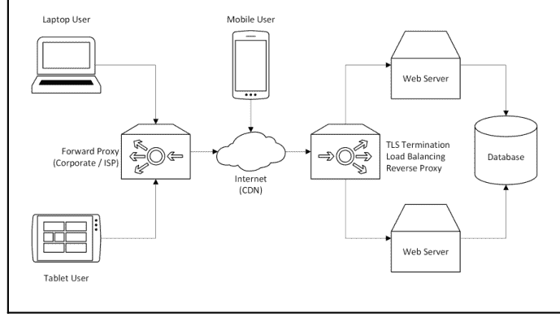
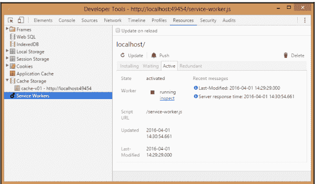
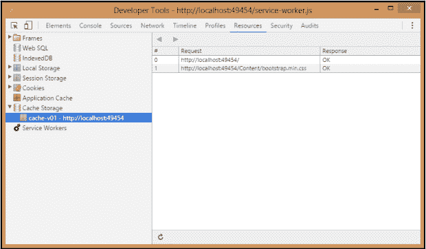
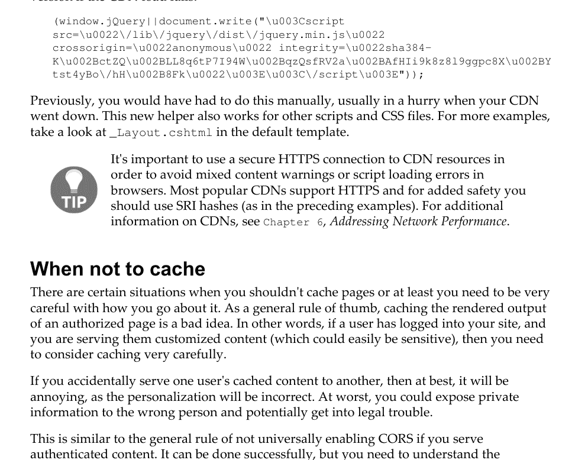
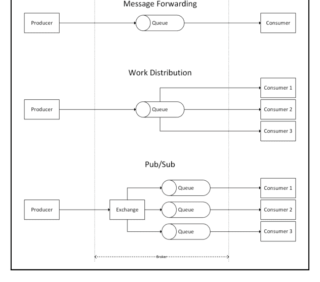
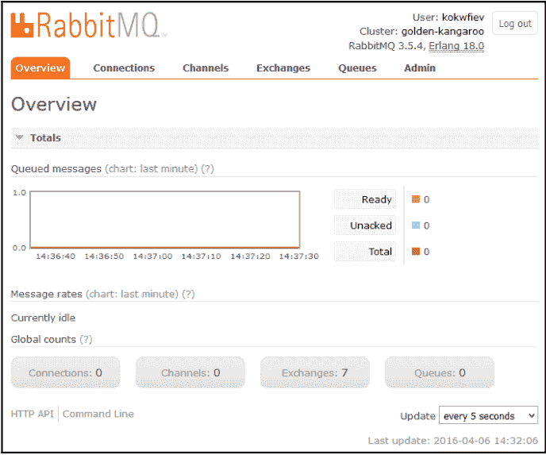

# 9 学习缓存和消息队列

缓存非常有用，几乎可以应用于应用程序堆栈的所有层。然而，要始终让缓存正确工作并不容易。因此，在本章中，我们将介绍 Web、应用程序和数据库级别的缓存。我们将向你展示如何使用反向代理服务器来存储渲染后的网页和其他资源的结果。我们还将介绍较低级别的缓存，使用内存数据存储来加速访问。你将学习如何确保在需要强制传播更新时，能够始终刷新（或清除）缓存。

本章还介绍使用消息队列和抽象（它们封装了各种消息传递模式）的异步架构设计。你将学习如何在后台执行长时间运行的操作（例如视频编码），同时让用户了解其进度。

你将学习如何将缓存和消息队列软件设计模式应用于性能较慢的操作，使它们不必实时执行。你还将了解这些模式可能增加的复杂性，并理解所涉及的权衡。我们将在第10章“性能增强工具的缺点”中了解如何应对这些复杂性并减轻其负面影响。

本章涵盖的主题包括以下内容：

- Web 缓存背景
- JavaScript 服务工作线程
- Varnish 代理和 IIS Web 服务器

如果我们将这个示例扩展到基于数据库的 Web 应用程序，例如 ASP.NET 或 WordPress 网站，那么同样的原则也适用。用户检索从数据库中的数据生成的网页，但它可能在加载后就已过时。底层数据可能已经改变，但包含旧数据的页面仍保留在浏览器中。

默认情况下，Web 应用程序通常会在每次页面加载时从数据库重新生成 HTML，但如果数据没有改变，这是极其低效的。这样做只是为了在发生更改时，页面刷新后能立即显示出来。

然而，用户浏览器中可能保留旧页面，而你对这一点的控制有限。因此，你也不妨在服务器上缓存此页面，并且仅在数据库中的底层数据改变时才删除它。像这样缓存渲染后的 HTML，对于在超过少量用户的规模下维持性能，通常是至关重要的。

### Web 缓存

我们将讨论的第一类缓存是在 Web 级别。这涉及存储 Web 技术栈将要发送给用户的最终输出，以便再次请求时可直接使用，无需重新生成。在此阶段进行缓存，可消除在应用程序层进行昂贵数据库查询和 CPU 密集型渲染的需要。这减少了延迟，降低了服务器的工作负载，使你能够处理更多用户并快速为每个用户提供服务。

Web 缓存通常发生在 Web 服务器上，或位于 Web 服务器前面的反向代理服务器上，以保护它们免受过多负载的影响。你也可以选择将此任务交给第三方，例如 CDN。在这里，我们将介绍两款 Web 服务器和代理服务器软件：IIS 和 Varnish。然而，还有更多可用的 Web 缓存和负载均衡技术，例如 NGINX 或 HAProxy。

Web 层缓存最适合静态资产和资源，例如 JavaScript、CSS 和图像。然而，它也可以用于匿名 HTML，这些 HTML 很少更新但经常被访问，例如无需身份验证且未针对用户定制的主页或落地页。

我们在第5章“修复常见性能问题”中简要提到了代理服务器，并在第6章“解决网络性能问题”中稍微介绍了 Web 层缓存。然而，在本章中，我们将更详细地讨论 Web 缓存。


## 缓存背景

在我们深入探讨实现细节之前，先稍微了解一下缓存如何在 Web 上工作会有所帮助。如果你花时间研究这些运行机制，那么缓存就不会像你一头扎进去那样令人困惑和沮丧。

阅读并理解相关的 HTTP 规范是很有帮助的。但是，不要以为软件总是严格遵守这些 Web 标准，即使它声称如此。

首先，让我们看一下你可能通过 HTTP 流量穿越的典型网络设置。下图展示了一个 Web 应用程序常见配置的示例：



如上图所示，笔记本电脑和平板电脑用户通过缓存正向代理服务器（可能位于企业网络或 ISP 处）进行连接。移动用户直接通过互联网连接。但是，所有用户都会在到达你的基础设施之前经过 CDN。

在你的防火墙（未显示）之后，有一个设备终止 TLS 连接，在 Web 服务器之间进行负载均衡，并充当缓存反向代理。这些功能通常由不同的设备执行，但我们在这里做了简化。

你的资源副本将保存在 Web 服务器、反向代理、CDN、任何正向代理以及所有用户设备的浏览器中。控制这些资源缓存行为的最简单方法是使用带内信令，并在你的内容中添加 HTTP 头，仅在单一位置声明缓存控制元数据。

Age 头用于指示资源已在缓存中保存了多长时间（以秒为单位）。另一方面，ETag 头用于为单个对象或该对象的特定唯一版本指定标识符。

Cache-Control 头告诉缓存该资源是否可以被缓存。它可以有许多值，包括 max-age（以秒为单位）或 no-cache 和 no-store 指令。no-cache 和 no-store 之间令人困惑但微妙的区别在于，no-cache 表示客户端在使用资源之前应与服务器确认，而 no-store 表示根本不应该缓存该资源。为了防止缓存，你通常应该使用 no-store。

ASP.NET Core 的 ResponseCache 操作特性设置 Cache-Control 头，并在第 6 章“解决网络性能问题”中介绍。但是，某些较旧的缓存可能会忽略此头。Pragma 和 Expires 是用于向后兼容的较旧头，它们执行一些现在由 Cache-Control 头处理的功能。

X-Forwarded-* 头用于向代理或负载均衡器提供有关原始连接的更多信息。这些头是非标准的，但被广泛使用，并被标准化为组合的 Forwarded 头（RFC 7239）。Via 头也提供一些代理信息，而 Front-End-Https 是一个非标准的 Microsoft 头，类似于 X-Forwarded-Proto。这些协议头对于告知你原始连接在负载均衡器剥离 HTTPS 时是否使用了 HTTPS 非常有用。


如果你在负载均衡器或代理服务器上终止 TLS 连接，并且在应用程序级别将用户重定向到 HTTPS，那么检查 Forwarded 头非常重要。如果你的 Web 服务器需要 HTTPS，但只从负载均衡器接收 HTTP，则可能会陷入无限重定向循环。理想情况下，你应该检查所有类型的头，但如果你控制代理，则可以决定使用哪些头。

有许多不同的 HTTP 头参与缓存。以下列表包括我们在这里没有涉及的头。大量的头应该让你了解到缓存可能有多么复杂：

- If-Match
- If-Modified-Since
- If-None-Match
- If-Range
- If-Unmodified-Since

我们将缓存命名为 `cache-v01`，并提供了一个要缓存的资源数组。你可能在这里有更多条目，并在函数外部定义数组，但为了清晰起见，我们在这里做了简化。

如果你的首页动态渲染实时内容，请不要缓存它。如前所述，你可能还想对资源使用缓存破坏参数。

然后我们可以添加一个 `fetch` 事件监听器来执行缓存和获取资源的魔法：

```
self.addEventListener('fetch', function (event) {
    event.respondWith(
        caches.match(event.request)
            .then(function (response) {
                if (response) return response;
                var myReq = event.request.clone();
                return fetch(myReq).then(
                    function (response) {
                        var myResp = response.clone();
                        caches.open('cache-v01')
                            .then(function (cache) {
                                cache.put(event.request, myResp);
                            });
                        return response;
                    }
                );
            })
    );
});
```

首先，我们检查请求的资源是否在缓存中，如果在，我们就返回它。使用 Promise，你可以将 `then` 函数链接在一起并逐一执行。如果由于资源不在缓存中而导致缓存未命中，我们执行 `fetch` 到我们的服务器获取资源并返回它。然后，我们通过将资源放入同一个缓存来将其添加到其他资源中。我们克隆请求和响应，因为它们是流，只能消费一次。

`fetch` 函数是 **XMLHttpRequest（XHR）** 的现代版本，用于通过网络检索数据。你不能在 service worker 内部使用同步 XHR，因为它们被设计为异步的。

## 学习缓存和消息队列

你可以使用浏览器开发者工具（F12）更详细地检查你的 service worker 和缓存。在 Resources 选项卡上，选择 Service Workers，你将看到类似以下截图的界面：



如果你选择 Cache Storage，你将看到缓存的内容，类似于下面这样：



你可以通过右键单击刷新缓存和删除项目。位于 Cache Storage 上方的 Application Cache 将显示已弃用的 AppCache 资源。当你四处导航时，你的网站页面将被添加到缓存中（如果你使用我们的演示代码，这些页面应该适合缓存，因为不会再次向服务器请求它们）。

## Web 服务器和代理服务器

从服务器的角度来看，缓存与浏览器中的客户端缓存密切相关。除了在服务器上存储资源外，你设置的头将用于控制所有位置的缓存。

你设置的 HTTP 头既被代理服务器和浏览器使用，不仅用于标准浏览，也用于从 service worker 进行获取。例如，如果 Cache-Control 头指定 no-store，那么你将无法从你的 worker 中将资源添加到缓存。

### IIS

**Internet Information Services（IIS）** 是 Microsoft 的 Web 服务器。它可用于提供 ASP.NET 应用程序中的内容，或用作代理服务器，还可以执行许多其他操作，例如 FTP。IIS 支持输出缓存，使用 OutputCache 操作特性。你还可以使用 ResponseCache 来设置正确的头，如第 6 章 *解决网络性能问题* 所述。

ASP.NET Core 2.0 现在支持在 Windows 上使用 IIS 时从 Visual Studio 2017 进行调试。你可以附加到进程并逐步执行代码，就像使用传统的 ASP.NET 项目一样。如果你计划在生产环境中使用完整版 IIS，那么在其上进行测试是一个好主意。使用 Kestrel 或 IIS Express 进行测试只能到此为止，你应该尽早做到尽可能接近真实环境。

IIS 也可以用作代理，例如，在单台机器上位于 Kestrel Web 服务器前面。但是，当为多个 Web 服务器进行缓存时，使用诸如 Varnish 之类的专用代理服务器软件可能会更好。

### Varnish

Varnish 是一个免费的反向代理服务器，运行在类似 Unix 的操作系统上，例如 **Linux** 和 **FreeBSD**。你可以使用包管理器（例如 apt 或 yum）安装它，或者使用 **Chef** 或 **Puppet** 等 DevOps 软件配置代理服务器。要配置 Varnish，你需要使用一种名为 **Varnish 配置语言（VCL）** 的**领域特定语言（DSL）**。


你可以在 http://varnish-cache.org/ 阅读更多关于 Varnish 的信息。


你如果正确使用了 HTTP 缓存头，就不需要对 Varnish 进行太多配置。不过，你也可以使用自定义的 HTTP PURGE 方法来从缓存中移除条目，该方法也适用于 Squid 代理软件。如果你没有正确配置 Varnish，偶尔会看到一个晦涩的 guru meditation 错误，但你应该能够在 Varnish 日志中追踪到问题所在。这可能表明没有可用的健康 Web 服务器。

Varnish 配置超出了本书的范围，但它在 Varnish 网站上记录得非常完善。如果你不想运行自己的代理服务器，那么可以使用 CDN。你可能仍希望在使用 CDN 的同时保留自己的代理，因为大型 CDN 拥有众多接入点 PoP，可能通过每个 PoP 请求同一资源，而不会在它们之间共享资源。如果你为带宽支付了大量费用，这可能是一个问题，尽管某些 CDN 具有一项功能 通常称为源站屏蔽 可以帮助解决此问题。

## Working with a content delivery network

CDN 通常以两种方式使用，作为卸载内容的代理，或作为常用第三方库和框架的主机提供商。你可以使用动态 CDN 服务，例如 CloudFlare 或 Akamai，用于第一种用例，但第二种情况 使用来自 Google 或 Microsoft 的静态 CDN 更常见，这就是我们在这里要介绍的内容。

尽管随着 HTTP/2 的采用，使用 CDN 提供库 如 jQuery 和 Twitter Bootstrap 的用途变得越来越小，但它仍然有助于降低托管成本。此外，如果你使用流行的 CDN 和库，那么用户可能已经拥有某些所需资产的副本。例如，如果用户访问过另一个使用 Google CDN 的 jQuery 网站，那么它可能已存在于其浏览器缓存中。

从 CDN 获取的任何文件都必须提供本地回退副本。这在 ASP.NET Core 内置的 Razor 视图引擎支持下比以往任何时候都更容易。

以下代码显示了在非开发环境中，默认 MVC Razor 布局中 jQuery 的包含方式。CDN 和本地版本均已指定，并附带测试：

```
<script src="https://ajax.aspnetcdn.com/ajax/jquery/jquery-2.2.0.min.js"
asp-fallback-src="~/lib/jquery/dist/jquery.min.js"
asp-fallback-test="window.jQuery"
crossorigin="anonymous"
integrity="sha384-K+ctZQ+LL8q6tP7I94W+qZsfRV2a+AfHIi9k8z81ggpc8X+Ytst4yBo/hH+8Fk">
</script>
```

## 图 1 智算中心总体架构

智算中心以 GPU 算力为核心，由算力基础设施、算力服务平台和行业应用三层构成，整体采用分层解耦、模块化设计，支持云边协同与异构算力统一调度。



- 行业应用层：AI 科研、智慧城市、智能制造、智慧能源、智慧交通、智慧金融、智慧医疗、互联网
- 算力服务平台：统一资源管理、任务调度、容器服务、监控运维、权限认证、计量计费、数据管理
- 算力基础设施：GPU 算力池、通用算力池、高性能计算池、智能存储、高速网络、安全体系

> 智算中心是支撑 AI 大模型训练与推理的核心基础设施，需兼顾性能、效率、安全与可持续运营。

本方案从硬件选型、集群组网、算力调度到运营管理进行全栈设计，确保系统具备高扩展性、高可靠性与高资源利用率。

Web 服务器现在可以在访问数据库之前先询问缓存是否已包含所需数据。这降低了 DB 的负载，通常也更快，因为如果存在，数据将位于内存中。如果出现缓存未命中并且确实需要查询数据库，则结果可以写入缓存供其他服务器使用。

## Redis

Redis 是一个流行的内存存储，也可将数据持久化到磁盘以永久存储。它在 Linux 上运行最佳，但为开发目的提供了 Windows 版本。Redis 还支持 pub/sub 消息传递，这对于缓存失效很有用。你可以在 http://redis.io/ 上阅读有关 Redis 的更多信息。

你可能希望在本地开发工作中使用 Windows 版 Redis，但仍部署到 Linux 上受支持的版本。你可以在 http://github.com/MSOpenTech/redis 获取 Windows 版本，或者在虚拟机中运行 Linux 版本，也许使用 Docker 或 Vagrant。

Redis 缓存作为服务提供在 Azure 和 AWS 上 Azure 的 ElastiCache 提供 Memcached 和 Redis。你不需要管理自己的服务器，但由于该技术不是云专用的，如果你将来想迁移，也不会被锁定。

由于 Redis 将整个数据集保存在内存中，但也能持久化到磁盘，因此它可以作为主要数据存储使用，而不像 Memcached。然而，它更常仅用作缓存，特别是如果使用云服务并且与云数据库如 Azure SQL Database 或 AWS 关系数据库服务 RDS 配对时。

Redis 有两个推荐的 .NET C# 客户端：ServiceStack.Redis 和 StackExchange.Redis。Stack Exchange 客户端在 Stack Overflow 等网站上被大量使用，并且比 ServiceStack 的客户端更容易正确使用。你可以在 http://github.com/StackExchange/StackExchange.Redis 阅读有关它的更多信息，并通过 NuGet 安装它。

如果在应用层使用缓存，那么你可能需要编写大量自定义代码。你还需要确定将数据序列化为什么格式以存储在缓存中。如果直接提供给浏览器，则 JSON 可能很有用。但如果用于内部使用，则你可能更喜欢二进制格式，例如 MS Bond 或 protocol buffers。

## Coffee shop analogy

如果使用 MQs，那么你可能需要为后台发生的错误实现额外的对账逻辑。这最好用咖啡店类比来解释。

如果你购买外带咖啡，也许是在一家受欢迎的跨国连锁特许经营咖啡因饮料店的分店 那家不喜欢缴税的店，那么你的饮料是异步于支付处理准备的。通常，你下单后，咖啡师会开始准备你的咖啡，然后你才付款。此外，你通常在收到饮料前付款。这里可能出现很多问题，但它们发生的频率足够低，以至于额外的成本是值得的，因为它加快了普通工作流程。

例如，你可能在下单后无法付款，但咖啡制作过程已经开始。这将导致库存浪费，除非有另一位正在等待的顾客可以使用它。或者，也许在你付款后，咖啡师发现你订单的关键配料缺失。他们可以要么为你退款，要么协商另一种饮料。

尽管更复杂，但这个过程显然优于按顺序执行操作。如果你必须证明你有支付能力，你的饮料被制作，然后你完成付款，那么一次只能服务一位顾客。假设有足够的工作人员，支付处理和饮料准备可以并行进行，这避免了顾客的长队。

以这种方式经营咖啡店很直观，然而，在 Web 应用程序中，通常会让一个相对较长的事务完成后再通知用户结果。在某些情况下，最好假设操作会成功，立即通知用户，并制定在出错时处理的流程。

例如，支付处理网关可能很慢且不可靠，因此在接受订单后收取用户的信用卡可能更好。然而，这意味着你无法再通过向用户显示错误消息来处理失败。你必须使用其他通信方式。

当你在 Amazon 上订购商品时，他们会立即获取付款信息，但在后台处理付款并通过电子邮件向你发送结果。如果付款失败，他们需要取消订单履行并通知你。这需要额外的逻辑，但比在确认订单前处理付款交易并检查库存更快。

下图显示了简单消息转发、工作分发和 pub/sub 之间的差异：



很明显，如果你需要一个可靠的代理，那么它必须是高度可用的。通常，你会将多个代理聚集成集群以提供冗余。使用代理还允许你编写自定义规则来定义哪些订阅者接收哪些消息。例如，你的支付系统可能只关心订单，但你的日志服务器可能想要获取所有系统发送的所有消息。

你不仅需要监控代理服务器，还需要监控队列的长度。换句话说，每个队列中的消息数量应始终稳定且接近零。如果队列中的消息数量稳步增长，则可能表明存在问题，你的运维团队需要解决。这可能是因为你的消费者无法比生产者发送消息更快地处理消息，你必须构建额外的消费者。这可以自动化，你的监控软件可以启动一个额外实例来扩展系统，以满足临时需求激增。


## RabbitMQ

RabbitMQ 是一款免费开源的消息队列服务器。它使用 Erlang 编写，与 WhatsApp 用于其消息后端的语言相同，都非常稳健。

RabbitMQ 目前由 Pivotal 维护（其实验室还开发了 Pivotal Tracker 敏捷项目管理工具），但它最初由 LShift 打造，之后被 VMware 收购，再作为合资企业拆分出来。它基于 Mozilla 公共许可证（MPL）v1.1 分发，这是 Firefox 浏览器所使用的许可证的一个较旧版本。

该消息服务器可用于多种语言和框架，例如 Java、Ruby 和 .NET。这有助于将不同的应用程序连接在一起，例如，你想让一个 Rails 应用与 ASP.NET Core 应用或 C# 服务进行交互。

你可以从 http://www.rabbitmq.com/ 了解更多关于 RabbitMQ 的信息并下载构建版本。


RabbitMQ 比 MSMQ 等系统更现代，并包含 HTTP API 和 Web 管理界面等功能。除了 HTTP 和 AMQP 之外，它还支持简单文本定向消息协议（STOMP）和 MQTT，后者对于轻量级物联网（IoT）硬件应用非常有用。所有这些协议都提高了与其他消息系统的互操作性，并且通常可以使用标准 TLS 进行保护。

Web 管理界面会显示你的队列中有多少消息在流动，以及它们的配置方式。

它还允许你管理队列（例如清除或删除消息等任务），界面如下图所示：



## 队列框架和库

你通常需要使用预构建的客户端库或框架来与消息队列交互。针对各种队列系统，有许多不同语言的官方库，它们提供底层访问。例如，RabbitMQ 有一个官方的 .NET/C# 客户端库。

此外，还有其他一些固执己见的客户端和框架，它们为常见的消息传递任务提供了更高层次的抽象。例如，支持 RabbitMQ、MSMQ、SQL Server 和 Azure 的 NServiceBus（NSB）就是一种商业产品。

NSB 的免费替代品是 MassTransit（http://masstransit-project.com/），它是一个轻量级服务总线和分布式应用框架。它还衍生出了非常方便的 Topshelf 框架（http://topshelf-project.com/），让创建 Windows 服务变得非常简单。

这两者目前都还不能在 .NET Core 上运行，但移植这两个项目的工作正在进行中。

针对 .NET Core 和 ASP.NET Core 的库和框架支持正在迅速推进，因此请访问 http://anclafs.com/ 获取最新信息。欢迎帮助完善这份列表，或为任何需要移植的开源项目做出贡献。

MassTransit（以及 NSB）的一个有趣特性是对 saga 的支持。saga 是一个复杂的状态机，允许你为整个工作流的完整过程建模。你无需定义单个消息并记录它们如何组合在一起，而是可以在 saga 中隐式地捕获黄金路径和错误流。

有一个名为 **EasyNetQ** 的优秀开源库，它使在 RabbitMQ 上实现发布/订阅变得非常简单。你可以访问 http://easynetq.com/ 了解相关信息。官方的 RabbitMQ 客户端和 EasyNetQ 现在都支持 .NET Core。

你还可以考虑使用 **RestBus**，这是一个支持 ASP.NET Core 的 RabbitMQ 库。你可以访问 http://restbus.org/ 了解更多信息，它还支持 Web API 和 ServiceStack。

## 小结

在本章中，我们研究了用于缓存和消息队列的各种工具和方法。这两种技术提供了不同的方式来提高系统性能：将数据移动到其他位置，而不是让一个庞大的单体应用处理所有事情。

这些都是高级主题，在如此有限的篇幅内很难完整覆盖。希望你已经接触到一些新的思路，它们可以帮助你用不同的方式解决问题。你也可以访问作者网站 https://unop.uk/ 来了解更多主题。如果你发现了一项你认为会有帮助的新技术，建议你阅读相关文档和规范以了解所有实现细节。

然而，在深入之前，你应该明白，高级技术是复杂的，并且有缺点，这可能会降低你的开发速度。在下一章中，我们将了解这些缺点，并探索管理复杂性的方法，例如微服务。
