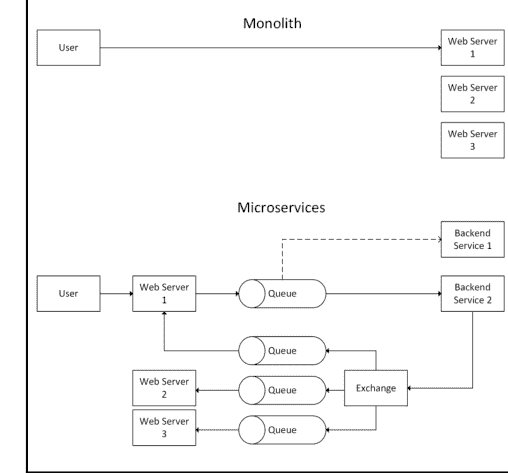

# 10 降低复杂性
性能提升工具的缺点

我们在本书中涵盖的许多主题都是以牺牲某些东西为代价来提升性能的。你的应用程序会变得更加复杂，更难以理解和推理。本章将讨论这些权衡以及如何减轻它们的影响。

你应该只在确实需要时才使用本书中目前学到的许多方法，而不是仅仅因为它们有趣或具有挑战性。如果现有性能已经足够好，那么保持简单通常是更可取的。

你将学习如何就应使用的技术和技巧做出务实的选择。你还会看到，如果选择使用高级方法，该如何管理其复杂性。

本章涵盖的主题包括：

- 使用框架和架构管理复杂性
- 建立健康的文化以交付高性能
- 分布式调试和性能日志记录
- 理解统计数据和过期数据

许多书籍和指南只关注新工具和框架的积极方面。然而，一切都不是免费的，总会有代价，而且这种代价可能不会立刻显现。

你可能在很长一段时间内都感受不到你所做选择的影响，尤其是在技术架构方面。你可能直到多年后试图在其基础上构建时，才会发现某个决定是错误的。

在团队中拥有一套标准做法有助于避免意外。在各地使用相同的方法，可能比找到一种更好的方法然后引入许多不同的方法更有价值。如果存在共识，那么你可以在需要的地方回过来并以更好的方法进行改造。

## 降低复杂性

有各种解决方案可以管理性能提升技术可能带来的复杂性。这些方案通常通过隐藏复杂部分来减少你在任何时刻需要思考的逻辑量。

一种选择是使用能够标准化应用程序编写方式的框架，这可以让推理变得更容易。另一种方法是使用一种架构，使你能够单独思考代码库的各个小部分。通过将复杂的应用拆分为可管理的块，处理起来就更容易了。


这种模块化思想与**单一职责原则（SRP）**相关，它是 **SOLID** 原则中的第一条（其他原则是开闭原则、里氏替换原则、接口隔离原则和依赖反转原则）。它也类似于更高层次的**关注点分离（SoC）**，以及 Unix 哲学的简洁性。拥有许多各司其职的工具，比拥有一个把很多事情都做得很差的工具要好。

## 框架

近年来，前端框架变得流行起来。Facebook 的 **React** 是一个旨在用 JavaScript 可靠构建 Web 应用程序视图的库，尽管其专利许可存在争议。它的目标是通过简化数据流和标准化方法来帮助大型团队在项目上协作。React 可以通过 **ReactJS.NET** 项目（https://reactjs.net/）与 ASP.NET Core 集成。


这不要与 **React Native** 混淆，后者用于构建在 iOS、Android 和**通用 Windows 平台（UWP）**之间共享代码的跨平台应用。如果你更喜欢用 C# 编码，那么你可以使用 **Xamarin** 构建跨平台移动应用。然而，我们不会在本书中进一步深入这些技术。请访问作者网站（https://unop.uk/）了解 ReactJS.NET 和 Xamarin.Forms 的相关内容。


在后端，我们拥有 .NET Core 和 ASP.NET Core 的服务器端框架。它们与 C# 特性一起，为简化历史上复杂的功能提供了便捷方式。例如，`async` 和 `await` 关键字隐藏了异步编程中许多复杂的逻辑，而 lambda 函数则简洁地表达了意图。

我们在本书前面已经介绍过这些特性中的很多内容，因此这里不再重复。我们还重点介绍了一些库，它们通过隐藏复杂操作的样板代码来简化你的工作，例如 `EasyNetQ` 和 `RestBus`。

隐藏复杂过程从来都不是完美的，你有时会遇到一些抽象泄漏了部分实现细节的情况。例如，在处理异常时，你可能会发现所关心的问题被包装在聚合异常中。如果不小心，错误日志可能不再包含你想要的详细信息。


好的做法是不记录异常的各个属性，因为异常本身已内置了输出所有相关信息（包括内部异常）的逻辑。只需将异常作为字符串记录，你就会得到消息和堆栈跟踪，包括任何内部异常。

我们尚未详细讨论的是 Web 应用程序的架构。将单体系统拆分为独立的部分不仅能够提升性能，而且如果做得恰当，还能使其更易于维护。

## 架构

在上一章讨论消息队列时，我们简要介绍了微服务架构。这种风格是对传统面向服务架构（SOA）更现代的重新构想。虽然首选使用可靠的消息队列（MQ）通信，但我们也可以使用表述性状态转移（REST）HTTP API 来实现。

通常，我们将传统的 Web 应用构建为单个应用程序或单体。如果应用在较长时间内自然增长，这种情况很常见，而且这是完全可以接受的做法。在没有任何需要之前过早地过度设计是一个糟糕的决定，而这种需要可能永远不会出现。

过度流行是一个甜蜜的烦恼，但不要过早地为这种情况进行优化。这也不是让事情变得不必要地缓慢的借口，因此请务必理解其中的权衡。

使用单体架构并不是低质量构建的借口，即使不立即实施，你也应该为扩展做好规划。你可以在保持简单的同时，为未来增长留出空间。虽然应用程序是单一单元，但你应该将代码库拆分为组织良好的模块，并以简单、逻辑清晰且易于理解的方式将它们连接在一起。请参考前面提到的 SOLID 原则。

如果单体应用难以扩展以满足用户需求，并因此表现不佳，那么你可以将其拆分为较小的独立服务。如果应用变得过于笨重、难以快速迭代且开发速度放缓，你可能也希望拆分应用。

## 单体与微服务

下图展示了一个典型单体与微服务架构之间的一些差异：



你还可能会发现需要复制原本在单体中共用的代码。如果你遵循**不要重复自己（DRY）**原则，那么你可能会将这些功能提取到库中。然而，现在你需要管理依赖和版本。你还需要构建、打包并将库托管到私有仓库的流程，所有这些都会拖慢开发速度并降低敏捷性。

有时，我们也把 DRY 称为**重复是邪恶的（DIE）**，这是一个明智的想法：一个实现只应出现在唯一的位置。如果其他代码需要此功能，那么它应该调用原始函数，而不是粘贴复制的代码。这意味着你只需在一个地方进行更改，就可以将其应用到所有地方。

更高级的方法是将功能提取到一个独立的服务中，该服务可以处理许多不同的 Web 应用程序。如果设计得当，这个服务将无需了解这些应用，只需响应消息即可。这让你能够在不修改其他应用或服务代码的情况下添加新的 Web 应用。

## 重构

如果应用程序已经变成了紧密耦合的大泥球，将单体重构为服务可能会很棘手；但如果它构建良好（拥有充分的测试覆盖和松散耦合的代码），那么重构应该不会太费力。一个精心构建的单体与一个缺乏思考的大泥球之间有着巨大的差异。

值得进一步阐述测试覆盖，因为单元测试对于成功重构且不引入回归或新错误至关重要。单元测试让你能够自信地重构和整理代码，并能防止产生开发人员不敢碰的脆弱代码。我们将在第 11 章*监控性能回归*中更详细地介绍测试，包括自动化测试。

工具在重构和测试中也非常有用。我们之前介绍了 Visual Studio IDE 和 ReSharper 插件，但还有很多用于测试的工具。我们将在第 11 章“监控性能回归”中介绍更多测试工具，包括自动化测试。

虽然两者都是单一代码库，但单体的质量要高得多，因为其内部结构分布良好。良好的设计对于面向未来非常重要，因为它允许扩展。这个单体没有过早拆分（在需要扩展之前），但设计使得以后很容易拆分。相比之下，大泥球已经积累了大量的技术债务，需要先偿还这些债务，我们才能取得进一步进展。

技术债务（简称 tech debt）是指未完成工作或偷工减料的概念，这可能会导致更多困难，直到债务被偿还。例如，未能正确记录系统会让新开发人员更困难。如果技术债务是在充分了解的情况下有意承担的，记录下来并在以后偿还，那么它不一定是一件坏事。例如，等到发布后再编写文档可以加快交付速度。然而，未偿还的或因（仅仅是草率编码而）不知不觉积累的技术债务会随着时间的推移变得更糟，并在以后引发更大的问题。

交付高质量且灵活（易于重构）的应用程序的最佳方式是拥有一支能干且尽责的开发团队。然而，这些特质往往更多关乎文化、沟通和激励，而不仅仅是技能或天赋。虽然这不是一本关于团队管理的书，但健康的团队文化非常重要，因此我们在这里稍微讲一点。运营和软件开发部门的每个人都可以帮助创建积极友好的文化，即使你通常也需要获得更高层的支持。

## 高绩效文化

如果你想实现高绩效，那么培养一种鼓励绩效并将其视为至关重要的公司文化很重要。文化不能只来自底层（仅涉及工程师）。文化需要来自高层，管理层必须认同绩效优先。

本节技术性不强，如果你不关心管理或软件开发中人的因素，可以随意跳过。

这可不是对别人刻薄的借口，所以要始终尽量友善，并温和地解释你批评背后的原因。任何事情都很容易挑出毛病，所以要始终提出替代方法。如果你有耐心，一个通情达理的人会感谢这个学习机会，并珍惜获得的经验。

一个好的准则是*不要做个混蛋*，像你希望别人对待你那样对待他人；所以要友善，并想想如果角色互换你会作何感想。只要记住，友善并不总是与做正确的事兼容。

一点自嘲可以大大让你更平易近人，而不是仅仅说教唯一正确的方式。然而，你应该清楚表明某件事是玩笑或半开玩笑，尤其是在与更直接的文化打交道或进行文字交流时。

一概而论永远是个坏主意（从来没有例外）。但举个例子，北美人通常不如英国人含蓄，也不像英国人那样爱讽刺（英国人的某些单词拼写也不同，有人会说更正确）。显然，请运用你自己的判断，因为这可能是糟糕的建议，可能引起冒犯，甚至更糟，引发一场彻底的外交事件。希望这一点不言自明（也许并非如此）：整段话都是半开玩笑的。

对自己的想法有正直和信心的人可以表现得谦虚和自嘲，但公司内部文化也会影响这一点。一个特别糟糕的做法是通过*阶梯排名*（也称为强制分布排名）进行绩效评估，这种排名将每个人相对于其他人进行排序。这种做法是有害的，因为它奖励那些更注重自我营销的人，而不是那些认识到自己技术技能缺陷并努力改进的人。在病态的情况下，所有最优秀的人都被迫离开，最终公司里充满了反社会人格、穿着光鲜的人，他们技术上无知，甚至道德沦丧。

## 放慢脚步，走得更快

有时，公司必须允许开发团队在功能交付上放慢速度，以便专注于性能和技术债务的解决。应该给他们时间认真思考设计决策，以便从容思考，避免过早的概括或草率的优化。

性能是软件的一个重要卖点，在开发过程中构建质量要比在最后的润色阶段容易得多。大量证据表明，良好的性能可以提高你的**投资回报率（RoI）**并带来客户。这在 Web 上尤其如此，糟糕的性能会降低转化率和搜索引擎排名。


如果你的应用程序构建得难以进行单元测试，那么你可以从**用户界面 (UI)** 测试开始，也许使用无头网页浏览器。我们将在下一章更深入地讨论测试，包括性能测试。

## 共享价值观

文化本质上只是一组共享价值观，包括开放性、可持续性、包容性、多样性和道德行为等。把这些价值观正式记录下来是有帮助的，这样每个人都知道你的立场。

你可能会有一项进步的开放薪资政策，这样其他人就不能利用秘密的收入信息作为压低薪酬的工具。然而，这需要普遍适用，因为存在多种相互冲突的文化是不健康的，这可能会导致一种“我们对他们”的态度。

关于文化还有很多话要说，但正如你所见，有许多相互竞争的关切需要平衡。最重要的思想是做出有意且深思熟虑的权衡。没有唯一正确的选择，但你应该始终意识到后果，并欣赏微小的行动如何改变团队的绩效。

## 性能的代价

开发人员应该对性能的可用预算有一个概念，并了解他们编写的代码的成本，而不仅仅是执行吞吐量，还包括可读性、可维护性和功耗。用更多的核心来处理工作单元远不如重构使其更简单。

效率变得越来越重要，尤其是在移动设备兴起和云计算按时间计费使用模式下。并行化一个低效的算法可能在时间维度上解决了性能问题，但这是一种粗糙的蛮力方法，改变底层实现可能更好。

少即是多，有时无所作为是最好的方法。软件工程不仅是知道要构建什么，也是知道不要构建什么。保持简单有助于团队中的其他人使用你的工作。你应该避免用不明显的行为让任何人感到惊讶。例如，如果你构建一个 API，那么你应该为其提供常规的默认值。如果操作可能需要很长时间，那么请将方法和名称设为 async 以表明这一事实。

有许多工具可以帮助你集中调试信息。你可以事后添加其中的一些工具。然而，为了充分利用它们，你应该在前期决定要衡量什么，并从一开始就将遥测功能构建到你的软件中。

## 日志记录

日志记录在高性能应用程序中至关重要，因此虽然日志记录确实会增加一些开销并可能减慢执行速度，但省略它将是短视的和虚假的经济。没有日志记录，你就不会知道什么变慢了需要改进。你还会有其他关切，例如可靠性，而日志记录对于这些关切是必不可少的。

### 错误日志记录

你可能熟悉名为 **Error Logging Modules and Handlers (ELMAH)** 的优秀 ASP.NET 包，用于捕获未处理的异常 (http://elmah.github.io/)。ELMAH 对于现有应用程序非常棒，因为你可以将其放入正在运行的 Web 应用中。然而，最好从一开始就将错误日志记录构建到你的软件中。

不幸的是，ELMAH 尚未支持 ASP.NET Core，但有一个类似的包叫做 **Error Logging Middleware (ELM)**。将其添加到你的 Web 应用程序与安装 Glimpse 一样简单，但它没有 ELMAH 的所有功能。ELM 不太适合生产使用，但在本地仍然可以用于辅助调试。

首先，将 `Microsoft.AspNetCore.Diagnostics.Elm` NuGet 包添加到你的项目中。你可以使用 IDE 的图形工具来完成此操作（方法会根据你使用的 IDE 而有所不同，例如 Visual Studio 或 VS Mac）。或者，你可以在终端中使用以下命令，该命令适用于所有受支持的平台：

```
dotnet add package Microsoft.AspNetCore.Diagnostics.Elm
```

这将在 `.csproj` 文件中添加一行，其应如下所示：

```
<PackageReference Include="Microsoft.AspNetCore.Diagnostics.Elm" Version="0.2.2" />
```

在 .NET Core 2.0 中引用包的方式与 .NET Core 1.0 不同。它们不再在 JSON 文件中指定，虽然你可以手动编辑 XML 项目文件，但使用提供的工具更容易。你可以使用 `dotnet migrate` 命令将旧的基于 `project.json` 的解决方案升级为基于 `msbuild` 的 `.csproj` 解决方案。

以前，你需要在开始之前添加日志记录和 DI 库，这可能会让很多人望而却步。如果你还没有为两者选择标准选项，那么你需要浏览大量的项目并研究每个项目的优点。

如果你已经熟悉它们，你仍然可以使用你喜欢的库。只是现在有了合理的默认值，你可以覆盖它们。

日志记录是在 Program 类中添加到你的应用的，但 ASP.NET Core 2.0 中这样做的方式与 ASP.NET Core 1.0 略有不同。在模板中，它是在调用 CreateDefaultBuilder 方法时添加的，这很容易设置合理的默认值。如果你想自定义它，那么语法与以前的版本不同。你不再调用记录器工厂，而是改用 ConfigureLogging 方法。有关完整详细信息，请参阅文档 (https://docs.microsoft.com/en-us/aspnet/core/fundamentals/logging?tabs=aspnetcore2x)，如果你想使用默认配置以外的配置。

日志记录在 Startup 类中配置，如果你使用标准 Web 应用程序模板，则这已经为你包含在内。记录器工厂从 appsettings.json 文件读取设置。在这里，你可以配置日志级别，默认情况下，相关部分如下所示：

```
"Logging": {
  "IncludeScopes": false,
  "Debug": {
    "LogLevel": {
      "Default": "Warning"
    }
  },
  "Console": {
    "LogLevel": {
      "Default": "Warning"
    }
  }
}
```


要了解更多关于如何使用日志记录的示例，你可以检查默认的账户控制器（如果你在模板中包含了个人用户账户身份验证）。

### 集中式日志记录

日志记录很棒。然而，在分布式系统中，你希望将所有日志和异常都汇集到一个单一位置，在那里你可以轻松地分析它们并生成警报。这其中一个潜在选项是 Logstash (https://www.elastic.co/products/logstash)，我们在第 4 章《衡量性能瓶颈》中曾 briefly 提及。

如果你更喜欢更模块化的方式并希望记录性能计数器和指标，那么有 StatsD，它监听 UDP 数据包并推送到 Graphite 以进行存储和绘图。你可以在 https://github.com/etsy/statsd 获取它，wiki 上列出了一些 .NET 客户端，以及主仓库中的示例 C# 代码。另一个用于收集日志的开源选项是 Fluentd (https://www.fluentd.org/)。

你可能希望对日志记录使用消息队列，这样你就可以快速将已记录的事件放入队列然后忘记它，而不是直接命中日志服务器。如果你直接调用 API（并且不使用 UDP），那么请确保它是异步且非阻塞的。你不希望通过低效的日志记录来减慢你的应用程序。

也有云选项可用，尽管通常关于锁定供应商的警告适用。AWS 有 CloudWatch，你可以在 https://aws.amazon.com/cloudwatch/ 阅读更多信息。Azure Diagnostics 类似，你可以将其与 Application Insights 集成；请阅读 https://docs.microsoft.com/en-us/azure/monitoring-and-diagnostics/azure-diagnostics 了解更多信息。

还有其他跨平台云服务可用，例如 New Relic 或 Stackify，但这些可能相当昂贵，你可能希望将日志记录保留在自己的基础设施内。你可以将数据塞进分析软件，例如 Google Analytics 或注重隐私的 Piwik（它是开源的，可以自行托管），但这些不太合适，因为它们是为略有不同的目的而设计的。


## 统计

在解读所收集的指标时，了解一些基本的统计知识有助于正确理解它们。简单地取*平均值*可能会误导你，而且它可能不如其他一些特性重要。

当你在代码中插桩以收集元数据时，你应该大致了解特定日志语句会被调用的频率。这不必非常精确，粗略的数量级估计（或**费米估算**）通常就足够了。

你应该尝试回答的问题是应该收集多少数据——全部还是随机样本？如果需要进行采样，那么你应该计算出样本量应该有多大。我们在`Chapter 7`中讨论了与SQL相关的采样，*优化I/O性能*，这里的思想类似。性能统计需要与基准测试相同程度的严谨性，你很容易被误导或得出错误的结论。

StatsD 内置了对采样的支持，但如果你想研究其他方法，还有很多其他选择。例如，在线流算法和蓄水池方法是两种选择。在性能方面要记住的重要一点是使用快速的**随机数生成器（RNG）**。对于采样来说，这不需要加密安全；**伪随机数生成器（PRNG）**就足够了。在 .NET 中，你可以使用`new Random()`作为 PRNG，而不是更安全的`RandomNumberGenerator.Create()`。有关如何使用这两者的更多示例，请参阅`Chapter 8`*理解代码执行和异步操作*。

在查看结果时，异常值可能比平均值更有意义。虽然中位数比均值更有价值，但在这种情况下，你确实应该查看百分位数，例如第90、95和99百分位数。这些数据点可能只代表你数据的一小部分，但在规模上，它们可能频繁出现。你需要针对这些最坏情况进行优化，因为如果你的用户有10%的时间经历页面加载超过五秒（即使平均速度看起来很快），那么他们可能会转向其他地方。

关于统计还有很多内容要说，但除了基础知识之外，收益会递减。如果你的数学有些生疏，那么最好复习一下（维基百科很适合）。之后，你可以探索一些更高级的技术，例如高性能的**HyperLogLog（HLL）**算法，它可以用极少的内存估算大型元素集合的大小。

Redis 支持 HLL 数据结构（使用 PFADD、PFCOUNT 和 PFMERGE 命令）。关于不同数据结构的更多内容，请参阅第8章，理解代码执行和异步操作。


这只是对性能日志记录的简要介绍，但还有更多内容供你探索。例如，如果你想标准化你的方法，那么你可以研究 APDEX (http://www.apdex.org/)，它设定了一种标准方法来记录应用程序的性能并计算分数。

## 管理过期缓存

在经历了所有这些复杂性之后，值得提醒你仍然要考虑简单的问题。人们很容易迷失在复杂错误或性能调整的细节中，而忽略显而易见的事情。


一个有用的技巧是橡皮鸭调试法，它的名字来源于向桌上的橡皮鸭解释问题的过程。我们大多数人都经历过在寻求帮助后解决问题，尽管对方什么也没说。向别人（或某物）解释问题的过程会使问题变得清晰，解决方案也显而易见。

如果修复后某些东西似乎仍然无法工作，那么先检查简单的事情。看看补丁是否真的已经交付并部署。你看到的可能是来自缓存的过期代码，而不是你的新版本。

在管理缓存时，版本控制是一种有用的技术，可以帮助你识别过期的资源。你可以修改文件名或添加注释，加入唯一的版本字符串。这可以是语义化版本（SemVer）、ISO 日期和时间戳，或内容的哈希值。关于缓存失效的更多内容，请参阅第9章，学习缓存和消息队列。


SemVer 是一种很好的代码版本管理方式，因为它隐式地捕获了兼容性和破坏性变更的信息。你可以在 semver.org 上阅读更多关于 SemVer 的内容。
