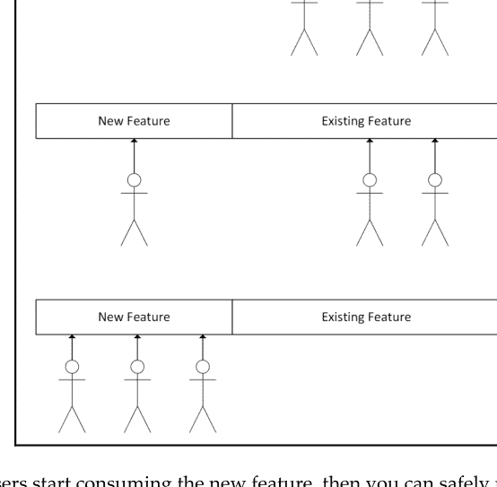

# 11 监控性能回归

## 监控性能回归

本章将介绍编写自动化测试来监控性能，以及将这些测试添加到**持续集成（CI）**和部署系统中。通过不断检查回归，你将避免意外构建出缓慢的应用程序。我们还将介绍如何在不强制系统离线的情况下安全地进行负载测试，以及如何确保测试尽可能模拟真实使用情况。

本章涵盖的主题包括以下内容：

- 性能剖析（Profiling）
- 负载测试
- 自动化测试
- 性能监控
- 持续集成与部署
- 真实环境和类似生产的数据
- 使用 Selenium 和 Phantom 无头浏览器的 UI 测试
- 用于转化优化的 A/B 测试
- 云服务和托管
- DevOps

你将看到如何自动化性能监控和测试，这样你就不需要记得手动重复执行。你将学习如何在问题造成麻烦之前及早捕获回归，以及如何安全地回退它们以进行返工。

NuGet 包是管理内部项目的好方法。在 Visual Studio 2017 中，你可以查看包的源代码并对其进行调试。这意味着不再需要包含大量项目的庞大解决方案，这些项目在 Visual Studio 中难以导航且构建缓慢。

绕过流程手动做事会引发问题，即使你遵循脚本也是如此。如果可以自动化，那么很可能就应该自动化，这也包括测试。

## 测试

测试对于生产高质量和高性能的软件至关重要。高效测试的秘诀是让测试变得简单、可靠和常规。如果测试困难，或者测试经常因与软件无关的问题（例如环境问题）而失败，那么测试将不会被执行，或者结果将被忽略。这将导致你错过真正的问题，并发布本可以轻松避免的缺陷。

测试有很多不同的种类，你可能熟悉用于功能验证的更常见的情况。在本书中，我们将主要关注与性能相关的测试。然而，这里的建议适用于许多类型的测试。

## 自动化测试

如前所述，改进几乎所有事情的关键是自动化。仅在开发人员工作站上手动运行的测试几乎没有价值。当然，测试应该可以在桌面上运行，但这不应该是正式结果，因为无法保证它们在服务器上能通过（而服务器的正确运行更重要）。

虽然自动化通常发生在服务器上，但自动化在开发人员工作站上运行的测试也可能很有用。你可以在 Visual Studio 2017 企业版中执行实时单元测试，而在其他版本中，你可以使用诸如 NCrunch 之类的插件。这会在你工作时运行测试，如果你实践测试驱动开发（TDD）并在实现之前编写测试，这将非常有用。

强制执行测试的一种方法是在 TFS 中使用门控签入，但这可能有点严厉，如果你使用 Git 等 SCM，那么在分支上工作并简单地阻止合并直到所有测试通过会更容易。你想鼓励开发人员尽早并频繁地签入，因为这会使合并更容易。


## 真实工作负载

执行真实测试的另一个重要部分是使用真实数据和真实工作负载。合成数据往往无法充分地对系统进行压力测试，也难以发现一些特殊的边界情况。你可以使用**模糊测试**来生成随机数据，但如果你有生产系统，那么可以直接使用其中的数据，并解析日志来生成真实的工作负载进行回放。

显然，不要在可能修改用户数据的实时系统上回放操作，同时要警惕数据隐私问题，或者任何可能产生外部事件的操作，例如发送群发邮件或向信用卡收费。

你可以使用专用的测试系统，但依然需要小心地桩接（stub）那些没有测试版本的外部 API。

另一种方法是使用虚拟用户进行测试，前提是你不介意真实用户发现这些假用户并可能与之交互。这种方法的一个案例是 Netflix 的邪典*示例节目*，那是一个员工带着笔记本电脑在办公园区奔跑的自制视频。

## 功能开关

除了虚拟用户或测试环境之外，另一种方案是在真实的在线环境中，让真实用户与你的 Web 应用交互时进行性能测试。你可以使用功能开关，将新功能逐步发布给一小部分用户，并监控系统是否出现过载。如果一切正常，就继续发布；否则，可以回滚。

你可能听到过类似概念的其他叫法，比如**功能标志**、**功能切换**、**金丝雀发布**或**通过抽象进行分支**。其中一些可能含义略有不同，但“逐步发布变更”这一总体指导原则是大致相同的。

下图展示了如何通过部署新功能但初始不启用它，来逐步将用户迁移到新功能。你的第一批用户可以是内部员工，这样任何问题都能尽早被发现：



一旦所有用户都开始使用新功能，你就可以安全地移除旧功能（以及功能开关本身）。定期进行这样的清理是一个好习惯，可以避免杂乱，并让后续工作更轻松。

如果你发现，随着新功能用户比例的逐步提高，系统出现了过载，那么你可以暂停发布，防止服务器过载并失去响应。这样你就有时间进行调查，然后要么回退变更，要么增加可用资源。

这种主题的一个变体是，当新功能需要数据迁移，而该迁移会消耗大量计算或网络资源时，例如，将用户上传的视频迁移到新位置并同时进行转码。在这种情况下，你监控到的过载只会是暂时的，你不需要回退功能。你只需要确保迁移速率足够低，不会过度消耗你的基础设施。

虽然新功能通常会在代码中通过分支实现，但如果使用蓝绿部署，你也可以在网络层面进行切换。这就是所谓的金丝雀发布，可以在 DNS 或负载均衡器层面完成。不过，具体的实现细节超出了本书的范围。更多关于 DNS 的内容，请访问作者网站 https://unop.uk/。

你可以在网上找到许多开源的功能开关库，也可以自己编写一个，稍后我们会演示如何做。FeatureToggle 是一个面向 .NET 的功能开关库，从第 4 版开始支持 .NET Core（https://github.com/Jason-roberts/FeatureToggle）。也有一些付费的云服务，例如 LaunchDarkly，它们提供了易用的管理界面。

.NET Core 和 ASP.NET Core 对库和框架的支持变化很快，因此请查看 https://github.com/jpsingleton/ANCLAFS 获取最新信息。

为了演示功能开关，让我们为一个 ASP.NET Core Web 应用构建一个极其简单的实现。首先，我们取默认的现有主页视图（Index.cshtml）并复制一份（IndexOld.cshtml）。然后我们对 Index.cshtml 进行修改，但这些修改对于本演示来说并不重要。

在 HomeController.cs 中，我们修改逻辑，使其以相对较小的概率返回新视图，否则返回旧视图。原始代码非常简单：

```
public IActionResult Index()
{
    return View();
}
```

WebKit 是一个开源的浏览器引擎，最初是 **KDE** Linux 桌面环境的一部分。它主要用于 Apple 的 Safari 浏览器，但一个名为 **Blink** 的分支被用于 Google Chrome、Chromium 和 Opera。你可以在 `webkit.org` 了解更多信息。

还有其他基于不同引擎的可自动化测试浏览器，但它们有一些限制。例如，**SlimerJS**（`https://slimerjs.org/`）基于 Firefox 使用的 **Gecko** 引擎，但并非完全无头。

你可能更想使用更高级的测试工具，而不是直接编写浏览器引擎脚本。一个提供许多有用抽象的工具是 **CasperJS**（`http://casperjs.org/`），它支持在 PhantomJS 和 SlimerJS 上运行。

另一个是 **Capybara**，它可以让你轻松地在 Ruby 中模拟用户交互。它支持 Selenium、WebKit、**Rack** 和 PhantomJS（通过 Poltergeist），尽管它更适合 Rails 应用。你可以在 `http://teamcapybara.github.io/capybara/` 了解更多。

还有 **TrifleJS**（`http://triflejs.org/`），它使用 .NET 的 `WebBrowser` 类（Internet Explorer 的 **Trident** 引擎），但这仍在开发中。此外，还有 **Watir**（`http://watir.com/`），它是一组面向 Internet Explorer 和 WebDriver 的 Ruby 库。然而，这两者都已有一段时间没有更新，而且 IE 最近发生了很大变化。

Microsoft Edge（代号 Spartan）是 IE 的新版本，Trident 引擎被分叉为 **EdgeHTML**。JavaScript 引擎（Chakra）已开源为 **ChakraCore**（`https://github.com/Microsoft/ChakraCore`）。

你使用哪种浏览器引擎并不太重要，PhantomJS 可以很好地作为自动化测试的第一选择。在使用无头浏览器之后，你总是可以用真实浏览器进行测试，也许使用 Selenium，或者通过 WebDriver 使用 PhantomJS。

当我们提到浏览器引擎（WebKit/Blink、Gecko 或 Trident/EdgeHTML）时，我们通常只指渲染和布局引擎，而不是 JavaScript 引擎（SFX/Nitro/FTL/B3、V8、SpiderMonkey 或 Chakra/ChakraCore）。

你可能仍然需要使用 CasperJS 这样的工具来简化测试编写，而且你可能还需要一个测试框架，比如 **Jasmine**（`https://jasmine.github.io/`）或 **QUnit**（`http://qunitjs.com/`）。你也可以使用同时支持 Jasmine 和 QUnit 的测试运行器，比如 **Chutzpah**（`http://mmanela.github.io/chutzpah/`）。

你可以将自动化测试与许多不同的 CI 系统集成，例如 Jenkins 或 JetBrains TeamCity。如果你更喜欢云托管方案，那么有 Travis CI（https://travis-ci.org/）和 AppVeyor（http://appveyor.com/），后者也适合构建 .NET 应用。

你可能更倾向于从部署系统中运行集成测试和 UI 测试，例如，在 Octopus Deploy 中验证部署是否成功。也有一些专门的、基于云的 Web 应用 UI 测试服务，例如 BrowserStack（https://www.browserstack.com/）。

## 自动化 UI 性能测试

自动化 UI 测试显然非常适合检查功能回归，但它们对性能测试也很有用。你可以通过编程方式访问浏览器开发者工具中网络检查器提供的相同信息。

你可以将 YSlow（http://yslow.org/）性能分析器与 PhantomJS 集成，这样你的 CI 系统就可以在每次提交时检查常见的 Web 性能错误。YSlow 出自 Yahoo!，它提供了一系列规则，用于识别可能降低 Web 应用用户体验的坏实践。这与 Google 的 PageSpeed Insights 服务（你可以通过其 API 实现自动化）思路类似。

不过，YSlow 已经相当老旧，而 Web 开发最近已经发生了一些变化，例如 HTTP/2。一个现代的替代方案是 sitespeed.io 的 coach，你可以访问 https://github.com/sitespeedio/coach 了解更多。你也应该看看他们的其他开源工具，比如使用 Graphite 和 Grafana 的仪表盘：https://dashboard.sitespeed.io/。

你还可以将网络结果（以行业标准的 HAR 格式）导出，并以你喜欢的任何方式进行分析，例如，以瀑布图形式进行图形化展示，就像你手动使用浏览器开发者工具所做的那样。


HTTP Archive（HAR）格式是一种表示受监控网络数据内容的标准方式，用于导出到其他软件。在某些浏览器开发者工具中，你可以通过右键单击网络请求来复制或另存为 HAR。


## 保持警觉

无论何时执行测试，尤其是 UI 或性能测试，你都会得到嘈杂的结果。可靠性并非完美无缺，总会出现并非由代码缺陷导致的失败。你不应让这些误报导致你忽略失败的测试，尽管最简单的做法可能是禁用它们，但正确的做法是让它们变得更可靠。

提示
有科学思维的人都知道，在二分类问题中不存在完美的过滤器，他们总是会关注系统的精确率和召回率。了解误报率和漏报率对于准确把握准确性和相关权衡非常重要。

为了避免测试疲劳，让开发人员参与进来并灌输修复失败测试的责任感会很有帮助。你不想让每个人都认为那是别人的问题。通过版本控制中的提交，应该很容易看出是谁破坏了构建，然后修复失败测试（并买饼干）就是他们的工作了。

你可以在这方面找点乐子，创造一些比墙上挂的仪表板更有趣的东西。虽然拥有**信息辐射器**很有用，前提是你不会对它们变得麻木。如今有大量廉价的**物联网（IoT）**硬件可用，这让你可以把一些有趣的物体变成构建失败警报器。例如，一个**Arduino**控制的红绿灯、一个**ESP8266**驱动的泡沫导弹炮塔，或者一个由树莓派驱动的电子玩偶。有关创意，请参见作者网站（https://unop.uk/）。

## DevOps

**DevOps**实践是指开发、运维和质量保证测试团队无缝协作。虽然DevOps更多是一种文化层面的考量，但仍有大量工具可以帮助实现自动化。我们之前已经涵盖了很多这方面的内容，现在唯一缺失的部分是配置基础设施并对其进行监控，然后在使用过程中对其进行监控。

当使用自动化和特性切换等技术时，必须对你的环境有清晰的了解，以便知道所有硬件的利用率。监控时，好的工具很重要，你希望能够轻松查看每台服务器的关键统计信息。这至少应包括CPU、内存和磁盘空间消耗，并且你会希望设置警报，以便在这些指标中的任何一个超出允许范围时收到提醒。

## DevOps 工具

DevOps 工具的一个主要主题是将基础设施定义为代码。其理念是，当你可以通过软件来为你执行任务时，你就不应该手动执行诸如设置服务器之类的任务。然后你可以重用这些配置脚本，这不仅会节省你的时间，还会确保所有机器的一致性，并且不会出现错误或遗漏步骤。

## 配置

有许多系统可用于配置和设置新机器。一些流行的配置管理自动化工具包括 Ansible（https://www.ansible.com/）、Chef（http://chef.io/）和 Puppet（http://puppet.com/）。

并非所有这些工具都能在 Windows 服务器上很好地工作，部分原因是 Linux 更容易实现自动化。但是，你可以在 Linux 上运行 ASP.NET Core，同时仍然在 Windows 上进行开发，使用 Visual Studio 并在虚拟机或容器中进行测试。为虚拟机开发是一个很好的主意，因为它解决了环境设置问题，以及“在我的机器上能跑”但在生产环境中却不行的问题。


Vagrant (http://vagrantup.com/) 是一个用于管理开发虚拟机的好用的命令行工具。它允许你轻松创建、启动和共享开发环境。

如果你将基础设施定义为代码，那么你的脚本可以像应用程序代码一样进行版本控制和测试。我们在此适可而止，以免偏离主题太远，但关键是，如果你拥有可靠的环境，并且可以轻松验证、实例化并在其上执行测试，那么持续集成（CI）就会容易得多。

## 监控

监控至关重要，尤其是对于 Web 应用程序而言，并且有许多工具可以帮助实现这一点。一个流行的开源基础设施监控系统是 Nagios（http://nagios.org/）。另一个更现代的开源警报和指标工具是 Prometheus（https://prometheus.io/）。

如果你使用云平台，那么会有内置的监控，例如 AWS CloudWatch 或 Azure Diagnostics。还有一些云服务可以直接监控你的网站，例如 **Pingdom**（https://www.pingdom.com/）、**Uptime Robot**（https://uptimerobot.com/）、**Datadog**（https://www.datadoghq.com/）和 **PagerDuty**（https://www.pagerduty.com/）。

你可能已经有了一个用于衡量可用性的系统，但你也可以使用相同的系统来监控性能。这不仅有助于确保响应迅速的用户体验，还可以为即将发生的故障提供早期预警信号。如果你积极主动地采取预防措施，那么你就可以避免被动地“救火”所带来的许多麻烦。

这不是一本关于运维的书，但在设计时考虑应用程序的支持需求会很有帮助。开发、测试和运维并非相互竞争的学科，如果你作为一个团队合作，而不是简单地把应用程序扔过栅栏并说“测试通过了，现在是运维的问题”，你更有可能成功。

## 托管

仔细考虑各种托管方案的影响非常值得，因为如果开发人员无法轻松访问他们所需的环境，这将降低他们的敏捷性。他们可能不得不绕过一个可用性问题，最终使用不充分或不合适的硬件，这将阻碍进展并导致未来的维护问题。或者他们的工作干脆被阻塞，交付日期被推迟。

除非你是一个非常大的组织，否则出于可靠性、灵活性和成本的原因，内部托管通常是一个糟糕的主意。除非你有一些非常敏感的数据，否则你可能应该使用数据中心。

你可以将服务器托管在数据中心，但那样你需要有随叫随到的员工来修复硬件问题。或者你可以租用一台物理服务器，在*裸机*上运行你的应用程序，但你仍然可能需要远程人工来执行重置或其他机器上的任务。

最灵活的方式是租用自助式虚拟机，也就是通常所说的云托管。有许多托管公司提供这项服务，但主要的参与者是亚马逊、谷歌和微软。

微软的 Azure 对于 .NET 开发团队来说是一个显而易见的选择，而且与最初的产品相比，它自发布以来已经有了巨大的改进。其用于托管 .NET 应用程序的**平台即服务（PaaS）**是最成熟、最容易快速上手的。它还提供了许多超越简单虚拟机范围的额外服务。
