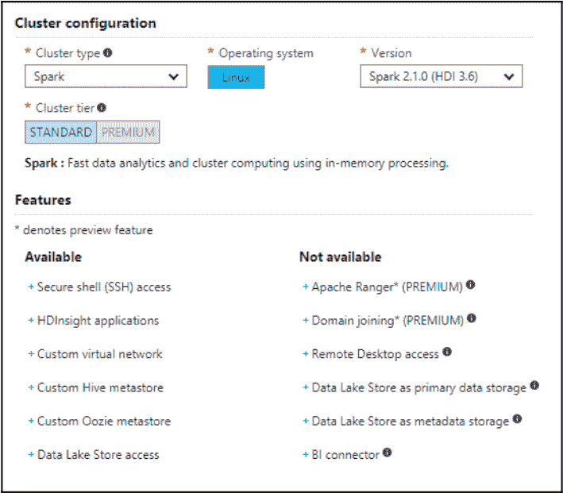

# 12 未来之路

## 未来之路

本章总结了你在本书中学到的内容。它重温了性能的主要原则，并提醒你应该始终保持务实。我们将回顾为什么你不应该为了优化而优化，以及为什么你应该始终衡量问题和结果。本章还介绍了一些更高级和奇特的技术，如果你需要更高的速度或者是一位严肃的性能爱好者，你可能希望考虑学习这些技术。

本章涵盖的主题包括以下内容：

- 前几章总结
- 原生工具链
- 备选 CPU 架构，例如 ARM
- 高级硬件（GPU、FPGA 和 ASIC）
- 机器学习与人工智能
- 大数据与 MapReduce
- Orleans 虚拟 actor 模型
- 自定义传输层
- 高级哈希函数
- 库和框架支持
- ASP.NET Core 的未来

我们将通过回顾前几章的经验教训来强化如何评估和解决性能问题。你还将了解其他可用的先进技术，这些技术可以帮助你实现高性能，你可能希望进一步研究这些技术。最后，我们将重点介绍哪些库和框架支持 .NET Core 和 ASP.NET Core，并尝试推测这些激动人心的平台未来可能的发展方向。

如果你不想为自己构建推荐引擎，那么 Azure 中有一个可立即使用的推荐 API。Azure 还提供人脸和语音识别、情感和情绪分析、内容审核、文本/语音翻译等 API。一些系统中模型的训练使用了大量数据，因此可以在不构建自己的语料库的情况下使用。

## 大数据和 MapReduce

大数据在今天可能是一个被过度使用的术语，有时被描述为大的通常更像是中等数据。大数据是指信息量如此之大，以至于难以在一台机器上处理，甚至存储。传统的处理方法在大数据面前往往会失效，因为它们不足以应对今天常见的海量自动获取的数据集。例如，物联网传感器或我们与在线服务交互时不断收集的数据量可能非常庞大。

大数据和机器学习的一个注意事项是，虽然它们擅长在大量数据点中寻找相关性，但不能用来寻找因果关系。你也需要牢记数据隐私问题，并非常小心不要仅基于预测的倾向性就对某人在其行动之前做出判断。

匿名化数据极其困难，远不止删除个人联系信息那么简单。曾有多起大型“匿名化”数据集被发布，而个人后来很容易从记录中被识别出来。

一种用于分析大数据的技术是 MapReduce，它是一种简化操作的方式，使其适合在分布式基础设施上并行运行。MapReduce 的流行实现是 Apache Hadoop，你可以在 Azure 上使用 HDInsight 使用它，HDInsight 还支持相关工具，包括 Apache Spark 和 Apache Storm。处理大型数据集的其他选项包括 Google 的 Cloud Bigtable 或 BigQuery。

你可以在门户中查看 Azure HDInsight 的可用选项。以下屏幕截图中显示了 Spark：

从此屏幕截图可以看出，Spark 仅在 Linux 上可用。Hadoop 更成熟，也可在 Windows 上使用，如以下屏幕截图所示：

### 集群配置

| 设置 | 值 |
| --- | --- |
| *集群类型 | Hadoop |
| *操作系统 | Linux Windows |
| *版本 | Hadoop 2.7.3 (HDI 3.6) |
| *集群层级 | STANDARD PREMIUM |

Hadoop：使用 MapReduce、Hive（Hadoop 上的 SQL）、Pig、Sqoop 和 Oozie 等 Hadoop 组件进行 PB 级处理。如果你正在寻找使用 LLAP 的 Hive，请创建交互式 Hive 集群。

### 功能

\* 表示预览功能

#### 可用

- 安全 shell（SSH）访问
- HDInsight 应用程序
- 自定义虚拟网络
- 自定义 Hive 元存储
- 自定义 Oozie 元存储
- Data Lake Store 访问

#### 不可用

- Apache Ranger*（PREMIUM）
- 域加入*（PREMIUM）
- 远程桌面访问
- Data Lake Store 作为主要数据存储
- Data Lake Store 作为元数据存储
- BI 连接器

在 Orleans 中，参与者被称为 grains，你可以通过继承接口用 C# 编写它们。这些随后由一个名为 silo 的 Orleans 服务器执行。Grains 可以持久化到存储中，例如 SQL 或 Azure Tables，以保存其状态并稍后重新激活。Orleans 还可以利用 Bond 序列化程序以获得更高的效率。

不幸的是，Orleans 目前不支持 .NET Core。计划在 Orleans 2.0 版本中提供支持，该版本目前正在开发中。Orleans 允许你使用低延迟编写简单且可扩展的系统，你可以在 http://dotnet.github.io/orleans/ 上阅读更多信息。

## 自定义传输

在第 6 章《解决网络性能》中，我们从 TCP/IP 的介绍开始，并简要提到了用户数据报协议（UDP）。我们还介绍了传输层安全（TLS）加密以及如何在仍然获得性能收益的同时最大限度地减少安全连接的影响。

UDP 比传输控制协议（TCP）更简单、更快，但你需要不关心可靠交付（多人游戏和语音/视频聊天）或自行构建提供此功能的层。在第 10 章《性能增强工具的弊端》中，我们重点介绍了 StatsD，它使用 UDP 来避免在记录到远程中央服务器时产生阻塞延迟。

如果你不受浏览器限制，TLS 有替代方案，但如果你正在开发 Web 应用程序，这可能只适用于你的服务器基础设施内部。例如，WhatsApp 消息应用程序在智能手机应用程序与其服务器之间使用 Noise Protocol Framework（http://noiseprotocol.org/）中的 Noise Pipes 和 Curve25519，另外还使用 Signal Protocol 进行端到端加密。

使用 Noise Pipes 而不是 TLS 会提高性能，因为设置连接所需的往返次数更少。具有类似好处的另一个选项是安全管道守护进程（spiped），它被用于并创建于安全 Linux/BSD 备份软件 Tarsnap。然而，你需要预先共享密钥，但你可以在 http://www.tarsnap.com/spiped.html 上阅读更多相关信息。

始终牢记，为了自身目的而优化是毫无意义的，除非这纯粹是学术练习。你需要衡量并权衡收益与弊端；否则，你可能会使情况变得更糟。很容易使事情变得更复杂、更难理解、更难维护，或全部兼具。

将这些务实的性能理念灌输到团队文化中很重要，否则团队不会始终遵守。然而，最重要的是，记住仍然要享受乐趣！

## 索引

- .NET Core 2.0
  - 新功能 10, 11
  - 性能改进 11, 12
- .NET Core 2
  - 安装 44, 52, 53, 58, 59
  - 与 Docker 64
- .NET Core 仓库 186
- .NET Core
  - 优势 186
  - 在 Linux 上 58
- .NET Native 35

### A

- A/B 测试 287
- ActiveMQ 239
- 地址解析协议（ARP） 88
- 高级压缩算法 138
- 高级 DB 主题 182
- 高级加密标准（AES） 124
- 高级硬件 299, 300
- 高级哈希 307
- 高级消息队列协议（AMQP） 239
- 高级打包工具（APT） 58
- 高级 SIMD 203
- 高级向量扩展（AVX） 203
- 聚合函数 176
- 聚合 175
- 敏捷开发流程 24
- 替代 .NET（ALT.NET） 34
- Amazon CloudFront 113
- Amazon Web Services（AWS） 35, 158, 294
- Amazon 的 Ion
  - 参考 203
- 动画 PNG（APNG） 142
- Ansible
  - 参考 292
- Apache Hadoop 302
- API 156, 157
- App Engine（GAE） 294
- Application Insights
  - 关于 263
  - 参考 265
- 应用层缓存 235
- 应用剖析 77
- 应用层协议协商（ALPN） 135
- 应用专用集成电路（ASICs） 200, 299
- AppVeyor
  - 参考 290
- Argon2 28, 307
- ARM Holdings 299
- 人工智能（AI） 300
- ASafaWeb
  - 参考 263
- ASP.NET Core 2 Web 应用程序
  - 创建，使用 VS for Mac 53, 54, 55, 56
- ASP.NET Core 2
  - 新功能 12, 13
  - 性能改进 13
  - 使用，与 Docker 67, 68, 69
- ASP.NET Core 库和框架支持（ANCLAFS） 11
- ASP.NET Core
  - 关于 187
  - 应用，创建 45, 46, 47, 48
  - 优势 186
  - 更改 141
  - 框架支持 308
  - 未来 308, 309, 310
  - 库支持 308
  - 参考 186
- Poly1305 消息认证码（MAC） 133
- 便携式网络图形（PNG） 142
- 务实解决方案，与硬件
  - 关于 111
  - 桌面示例 111
  - Web 应用程序 112, 113
- 前缀
  - 关于 273
  - 参考 273
- 私钥 125
- 处理器架构 298, 299
- 剖析 273
- 编程语言
  - 考虑因素 25, 26
- Prometheus
  - 参考 292
- 协议缓冲区 202
- 代理服务器
  - 关于 112, 232
  - 内容分发网络（CDNs） 150
- 伪随机数生成器（PRNG） 269
- 发布/订阅消息模式 240, 241
- 公钥 125
- 公钥基础设施（PKI） 126
- 发布/订阅（pub/sub） 235
- Puppet
  - 关于 232
  - 参考 292
- 推送通知 136

### Q

- 服务质量（QoS） 121
- Qualys SSL Labs
  - 参考 127
- 排队框架 243
- 快速 UDP 互联网连接（QUIC） 136
- QUnit
  - 参考 289

### R

- RabbitMQ
  - 关于 239, 242
  - 参考 242
- Rack 289
- 随机数生成器（RNG） 269
- Razor Pages 187
- Razor 视图引擎 187
- RC4 密码 128
- React 248
- ReactJS.NET 项目
  - 参考 248
- 实时通信（RTC） 136
- 实际工作负载
  - 功能切换 281, 285
- Red Hat 294
- Red Hat Enterprise Linux（RHEL） 58
- Redis 缓存 236
- Redis
  - 关于 99, 236
  - 参考 236
- 独立磁盘冗余阵列（RAID） 154
- 参考 19, 20
- 反射 215
- 正则表达式（regex） 215
- 远程桌面协议（RDP） 158
- 报告
  - 关于 175
  - 聚合 175
  - 采样 178
- 表述性状态转移（REST） 123, 249
- 请求流水线 122
- ReSharper 35
- 响应缓存
  - 参考 149
- RestBus
  - 参考 244
- 投资回报率（RoI） 257
- 每分钟转数（rpm） 154
- RFC 7725
  - 参考 123
- Rider 35
- Rivest-Shamir-Adleman（RSA） 125
- 往返时间（RTT） 158
- Route 53 169
- Ruby on Rails 23
- RyuJIT 186

## S
- salt 199
- sampling 178
- Scala 26
- Scalable Vector Graphics (SVG) 117
- Scientist library 286
- Scientist.NET
  - reference 287
- Scratch 299
- Search Engine Optimization (SEO) 123
- Secure Hash Algorithm (SHA) 196
- secure pipe daemon (spiped) 306
- Secure Shell (SSH) 158
- Secure Sockets Layer (SSL) 120
- Select N+1 problems
  - about 100, 101, 103, 104
  - paging 106, 108, 110
  - static site generators 110
- Selenium
  - about 288
  - reference 288
- Semantic Versioning (SemVer) 270
- Separation of Concerns (SoC) 248
- serialization
  - about 202
  - formats 202
  - reference 202
- Server Name Indication (SNI) 127
- server-side caching 148
- Service Oriented Architecture (SOA) 249
- Service Set Identifier (SSID) 199
- service worker
  - about 226
  - example 227, 228, 231
  - reference 226
- Service Workers 147
- ServiceStack framework 202
- ServiceStack.Text 202
- session resumption 132
- SHA-1 196
- SHA-1 certificates 126
- SHA-2 hashing algorithm 126
- SHA-256 126, 196
- SHA-3 307
- shards 135
- Shared Dictionary Compression for HTTP (SDCH) 138
- SignalR 308
- silo 306
- SIMD CPU instructions 203, 204
- simple asynchronous tools 98
- Simple Mail Transfer Protocol (SMTP) 86, 120
- Simple Object Access Protocol (SOAP) 202
- Simple Queue Service (SQS) 239
- Simple Speed Tester
  - reference 190
- Simple Text Orientated Messaging Protocol (STOMP) 242
- simulation 183
- Single Instruction Multiple Data (SIMD) 203
- Single Responsibility Principle (SRP) 248
- Single-Page Application (SPA) 22
- sitespeed.io
  - reference 290
- Skein
  - reference 307
- SlimerJS
  - reference 289
- slow testing 277, 278
- slow-start algorithm 121
- Socket.IO 137
- Software Development Kit (SDK) 39, 273
- Solid State Drive (SSD) 30, 96, 153
- solutions, latency-based problems
  - batching API requests 169, 170, 171, 172, 173
  - efficient DB operations 173
- source control management (SCM) 275
- Spark 303
- SPDY 135
- sprites 135
- SQL 72
- SQL Server Management Studio (SSMS) 73
- SQL Server Profiler
  - about 73, 74
  - MiniProfiler 77
  - query, executing 75, 76
- StackExchange.Redis
  - reference 236
- stale caches
- managing 270
- standards 14
- statistics 269
- StatsD
  - about 306
  - reference 268
- Storage Area Network (SAN) 96, 152
- stored procedures (SPs/sprocs) 275
- Storm 302, 305
- Streaming SIMD Extensions 2 (SSE2) 203
- string interpolation 15
- Subresource Integrity (SRI)
  - reference 113
- SUSE 294
- SUSE Linux Enterprise Server (SLES) 58
- sysinternals tools
  - reference 274
- System on a Chip (SoC) 299

## T
- Tabular Data Stream (TDS) 86, 176
- Tarsnap
  - reference 306
- Task Parallel Library (TPL) 204, 205, 206, 207, 208
- Team Foundation Server (TFS) 34
- Team Foundation Version Control (TFVC) 34, 275
- TeamCity 35
- Tensor Processing Unit (TPU) 201, 300
- TensorFlow
  - reference 300
- test-driven development (TDD) 93, 276
- testing fatigue
  - avoiding 291
- testing
  - A/B testing 287
  - about 184, 276
  - automated testing 276
  - continuous integration 277
  - load testing 278
  - performance regressions, fixing 278
  - slow testing 277, 278
  - user interface testing 287
- TFVC to Git
  - reference 275
- thread 98
- three-tier architecture 112
- Time To First Byte (TTFB) 84
- tools
  - about 33, 72
  - alternative tools 34, 35
  - building 165
  - Glimpse 77
  - IDE 81
  - MiniProfiler 77
  - SQL Server Profiler 73, 74
- Top Level Domain (TLD) 153
- Topshelf framework
  - reference 243
- Tracert 160, 162
- Traffic Manager 169
- Transact-SQL (T-SQL) 175
- Transmission Control Protocol (TCP) 306
- Transmission Control Protocol / Internet Protocol (TCP/IP)
  - about 120
  - slow-start algorithm 121
- Transport Layer Security (TLS) 120, 306
- Travis CI
  - reference 290
- TrifleJS
  - reference 289
- Trust on First Use (TOFU) 149
- tuples 18, 19
- two-tier architecture 112
- TypeScript 23

## U
- Ubuntu 294
- UI performance tests
  - automating 290
- unicast messaging pattern 239, 240
- unique constraint 181
- unit testing 93
- Universal Windows Platform (UWP) 9, 248
- Universally Unique Identifiers (UUIDs) 181
- upsert 183
- Uptime Robot
  - reference 293
- User Datagram Protocol (UDP) 120, 306
- user interface (UI) 97
- user interface (UI) testing 278, 287

## V
- Vagrant
  - about 236
  - reference 292
- Varnish configuration language (VCL) 232
- Varnish
  - about 112, 232
  - reference 232
- virtual file systems 155
- Virtual Machine (VM) 26
- Virtual Reality (VR) 310
- Visual Studio (VS) 81
- Visual Studio 2017
  - about 40
  - installing 41, 42, 43
- Visual Studio Code 56
- Visual Studio Team Services (VSTS) 34, 277
- VS for Mac
  - used, for creating ASP.NET Core 2 web application 53, 54, 55, 56
- VS Mac
  - about 49
  - installing 49, 50, 51

## W
- Watir
  - reference 289
- Web API 187
- web caching
  - about 221
  - HTTP headers 223, 224
  - overview 222
  - service worker 226
- web servers 232
- web UI testing tools 288, 289, 290
- WebDriver
  - about 288
  - reference 288
- WebKit engine 288
- WebKit
  - reference 289
- WebP 144
- WebSockets 136
- Wi-Fi Protected Access II (WPA2) 199
- Windows 39
- Windows 10 IoT (Internet of Things) Core 299
- Windows Communication Foundation (WCF) 202
- Windows Imaging Component (WIC) 145
- Windows Presentation Foundation (WPF) 14, 36
- Wireshark
  - about 87
  - download link 87
  - using 89
- WordPress 110

## X
- XMLHttpRequest (XHR) 229
- xz compression algorithm 138

## Y
- Yellow Screen Of Death (YSOD) 267
- Yeoman 23
- You Aren't Going to Need It (YAGNI) 246
- YSlow
  - reference 290

## Z
- Zopfli
  - about 142
  - reference 143

