# 亚马逊云科技账户与全球基础设施简介

我们将首先介绍**亚马逊全球基础设施**，它代表了遍布世界多个国家的庞大数据中心设施集合，您可以访问这些设施来设计、构建和部署云资源。您还将了解用于有效管理亚马逊云科技账户的各种工具。此外，您还将完成一系列练习，这些练习将帮助您将在多账户亚马逊云科技架构相关原则应用于实际场景。

# 充分利用本书——您的认证及未来

本书及其配套的在线资源旨在为您的DVA-C02考试提供全面的备考工具。

本书的编写方式旨在让您在获得认证后仍能应用这里所学的一切内容。随附本书的在线练习资源（*图1.1*）旨在提高您的应试技巧。其中包含限时模拟考试、交互式闪示卡和考试提示，以帮助您从现在到考试日提升备考状态。

> **在继续之前**
>
> 要了解如何访问这些资源，请前往本书末尾的*第17章，访问在线练习资源*。

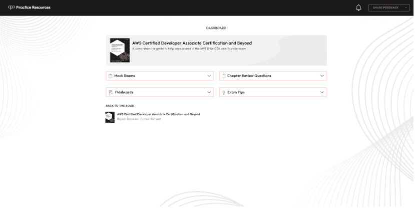

图 1.1 – 在线练习资源的仪表板界面

本学习指南将帮助您了解云如何满足TodoPlus Limited的需求和挑战。通过深入探讨安全性、可扩展性、高可用性以及高效的财务运营（FinOps），您将在如何提供满足这些需求并带来增长和创新潜力的解决方案方面获益。在此旅程结束时，您应清楚地理解如何在实际场景中利用云计算推动业务成功。您还将为通过AWS认证开发者（中级）考试做好充分准备。该考试将测试您在AWS上开发应用程序的知识和技能，学习如何保护应用程序代码的安全，并通过将持续集成和持续交付应用于应用程序设计工作流来理解DevOps的基本原理。

# 场景设置——背景信息

TodoPlus Limited总部位于新泽西州，专门面向中小型初创企业定制生产力应用。其独特的方式包括根据每个客户的具体需求定制应用程序。现在，他们有一个新目标——直接向公众开发并销售现成（OTS）生产力应用。

该公司此前专注于创建供客户内部使用或转售给最终用户的应用程序，如今希望推出自有产品线进入零售市场。第一步是在年底前为个人用户发布一款“待办事项列表”应用程序。之后，他们计划将产品扩展至企业市场。

董事会对新业务充满热情，并认为这是TodoPlus能够产生重大影响的领域。

在本学习指南中，您将看到AWS云平台如何促进TodoPlus的应用程序构建、设计、托管和管理。

# 业务需求

TodoPlus旨在创建一款可靠、用户友好且随时随地可访问的任务管理应用程序。该应用程序必须能够处理数百万并发用户而不降低服务质量。此外，鉴于信息的敏感性，安全性是一个重大关注点。最后，TodoPlus必须能够扩展其应用程序服务以支持全球用户，并预期最终用户的采用量，所有这一切都要在其内部营销团队能力的支持下进行，同时严格控制运营成本。

# 云如何满足这些需求

TodoPlus知道该应用程序需要在云平台上托管，该平台能提供所需的安全性、可扩展性和容错级别，并且具有成本效益。让我们看看亚马逊云科技如何满足这些核心底层业务需求：

- **安全性**：云提供商提供一系列内置安全功能，包括数据加密、双因素认证、防火墙等。这些功能使TodoPlus能够保护其敏感用户数据。
- **可扩展性**：云提供弹性，允许TodoPlus适应需求变化。如果应用程序用户数量增加，TodoPlus可以扩展服务器容量以满足此需求。相反，在需求较低的时期，他们可以缩减资源以最小化成本。
- **高可用性**：云计算服务通过在不同区域的多个数据中心中复制数据和应用来提供高可用性。这意味着即使一个数据中心发生故障，TodoPlus应用程序仍可供其用户访问。
- **FinOps（财务运营）**：得益于云的按需付费定价模式，TodoPlus只需为其使用的资源付费。这使公司能够有效控制成本。此外，许多云提供商提供成本分析工具，帮助TodoPlus监控和优化其云资源开销。

总之，云使TodoPlus能够创建满足其关于安全性、可扩展性、高可用性和有效财务管理的业务需求的任务管理应用程序。

当我们进入下一节时，您将更深入地了解云计算的基础知识，并探索亚马逊全球基础设施的广泛能力，为理解如何利用它服务于如TodoPlus用例这样的应用程序奠定坚实基础。

# 云计算与亚马逊全球基础设施简介

如前所述，计算指的是通过标准互联网或某种广域网形式对客户即时访问和交付IT服务。这些服务包括计算、网络、存储、数据库和**软件即服务（SaaS）**产品。云计算使企业无需预先投入昂贵硬件即可设计和部署应用程序。相反，它们从这类第三方提供商处租用/租赁所需的IT基础设施。

在提供云计算服务的众多提供商中，AWS是最大的提供商，提供多种云IT服务。这些服务分为不同的类别：**基础设施即服务（IaaS）**、**平台即服务（PaaS）**和**软件即服务（SaaS）**解决方案。企业可以消费这些服务，而不是创建自己专用的环境来托管应用程序。凭借跨多个国家的成熟基础设施和巨大的规模经济优势，AWS可以以极低的成本提供具有冗余、可扩展性、高可用性和安全性的基础设施和软件服务。

在接下来的部分中，您将了解亚马逊全球基础设施，它使全球各地的客户能够访问AWS服务。此外，一个地点的客户可以消费全球范围的云服务，从而能够接触全球客户群，并满足任何合规或监管需求。

# 亚马逊全球基础设施

**亚马逊全球基础设施**是遍布全球多个国家的庞大数据中心设施集合。AWS托管其数据中心服务的地理位置（包括计算、存储和网络）及其庞大的云服务项目被称为**AWS区域**。您可以在`https://aws.amazon.com/about-aws/global-infrastructure/`找到地图。

每个AWS区域内部都有一小群数据中心，它们在逻辑上和物理上相隔一段距离，彼此之间不超过100**公里（km）**（60英里）。这些在逻辑和物理上相互隔离的数据中心组形成了我们所说的**可用区（AZ）**。此外，AWS设计其区域时每个区域包含多个可用区。大多数AWS区域至少有三个可用区，有些则更多。例如，北弗吉尼亚区域（us-east-1）有六个可用区。

在下一节中，您将更详细地查看亚马逊全球基础设施的核心组件。

# 区域

如前所述，AWS区域是AWS托管其基础设施设施的全球物理位置。这些包括旨在让客户能够访问庞大基础设施服务集合的数据中心，利用这些服务可以部署云资源，如计算、网络、存储和数据库服务。客户可以连接全球基础设施中的任意特定区域。

选择区域来配置云资源最终取决于企业的用例。通常，这将基于多个因素，包括以下几点：

- 要求将基础设施资源托管在更接近最终用户的地方，以便您能够以较低的网络延迟托管应用程序。
- 要求将基础设施托管在政治和国界以内，以遵守严格的数据主权和合规法规。
- 要求将资源组彼此隔离，以支持灾难恢复和业务连续性用例。

> **注意**
>
> 对于我们的虚构客户TodoPlus来说，该应用程序的初始产品将以美国为基地，以满足在美国境内存储数据的合规和监管要求。如果产品成功，一旦分析了所有必要的法律和监管要求并采取措施遵守它们后，TodoPlus将寻求扩展到欧洲和亚太地区。


## 可用区（AZs）

在每个 AWS 区域中，你都会发现多个可用区（AZ）。可用区是每个区域内拥有一个或多个数据中心设施的大都市区域。每个可用区将托管服务器、存储和网络设备等硬件组件，并且都配备了冗余的电源、连接、冷却和安全控制。

在每个区域中设置多个可用区的主要目的是让客户能够以高可用性、容错性和可扩展性的方式托管其应用程序和工作负载。借助多个可用区，您可以在这些可用区之间托管应用程序资源的副本或副本资源，这最终意味着，即使给定区域中的一个可用区发生中断，您也可以继续为客户提供服务。

这一切之所以可能，是因为尽管每个可用区独立运行，但它们仍然通过高速、高带宽、低网络延迟且完全冗余的专用城域光纤连接互联。

> **注意**
> 对于我们公司 TodoPlus 来说，他们最初选择托管应用程序的区域将设置为 us-east-1（弗吉尼亚北部）区域。之所以选择该区域，是因为公司将开始在本地市场推广其新的生产力应用程序。不过，他们计划让该应用程序面向美国各地的客户提供服务，并最终面向全球。

## 边缘站点和区域边缘缓存

AWS 全球基础设施还包括边缘站点和区域边缘缓存。**边缘站点**或**接入点（POPs）**提供大量的存储、高带宽网络设备和边缘计算服务，使数据能够在更接近最终客户物理位置的地方被访问、处理和分析。

这些边缘站点通过 AWS 骨干网络连接到 AWS 区域。该网络包括完全冗余的多条 100-**千兆以太网（GbE）**并行光纤连接，可大幅提高吞吐量并提供低延迟连接。你可以在 https://aws.amazon.com/cloudfront/features/ 查看当前边缘站点（POPs）的列表和类型。

边缘站点与标准区域和可用区不同。你**无法**直接连接到给定的边缘站点来设置资源。相反，你使用某些 AWS 服务，这些服务利用边缘站点的存储、缓存和高网络连接性。Amazon CloudFront 就是使用这些边缘站点的服务之一。

区域边缘缓存类似于边缘站点。然而，它们被战略性地放置在具有更大存储容量的位置，以便比单个边缘站点更长时间地保存缓存数据。单个边缘站点的生存时间比区域边缘缓存短，从而确保过期数据不会被托管太长时间。如果之后再次访问相同的缓存数据，系统会先尝试查看这些数据在区域边缘缓存中是否仍然可用，然后再向源站发送请求。

Amazon CloudFront 是一项**内容分发网络（CDN）**服务，使你能够以降低整体延迟的方式高效地向最终用户分发内容。使用 CloudFront，经常访问的内容会被缓存在边缘站点和区域边缘缓存中，这些缓存为尝试访问你内容的最终用户提供最低的延迟。这意味着，如果这些用户请求的频繁访问的内容存在于缓存中，他们就不必从源站获取。

> **注意**
>
> 对于我们虚构的公司 TodoPlus Limited，应用程序将托管在弗吉尼亚北部（us-east-1）区域。CloudFront 可用于缓存静态内容（如图像、视频和用户指南），以帮助降低最终用户从美国各地以及最终在客户将其产品扩展到全球时从各大洲访问应用程序时的延迟。

边缘站点允许客户通过 AWS 骨干网络将数据上传到 Amazon S3 等 AWS 存储服务，使用称为 **S3 传输加速（S3TA）** 的服务提供低延迟和高带宽吞吐。

AWS 全球基础设施还包括其他基础设施服务，具体如下：

- **本地扩展区（Local Zones）** 是特殊的区域，旨在将计算、存储、数据库和其他选定的 AWS 服务更近地部署到最终客户的物理位置。如果你需要非常低延迟地访问云服务，这将特别有用。对于 TodoPlus Limited，这并非必需，因为其客户群在地理上分布在美国各地，并可能遍布全球。
- **Wavelength 区域**是 AWS 在 5G 网络提供商内部署计算和存储等基础设施服务的区域，以帮助优化移动边缘计算应用程序。
- **Direct Connect 站点**旨在建立客户数据中心设施与 AWS 云之间的高带宽网络连接。TodoPlus Limited 可能希望建立到 AWS 云的直接连接。由于更高的带宽能力，这将提高本地应用程序与云之间的数据传输速度。
- **Outposts** 通过将 AWS 基础设施服务、API 和工具扩展到客户的本地位置，实现真正的混合云计算设计。如果 TodoPlus Limited 计划继续采用混合云模式，那么 Outpost 配置将使他们能够在本地访问 AWS 服务，从而允许某些无法在云中托管的应用程序获得低延迟访问。如果他们有需要遵循严格合规性或监管要求的应用程序，那么 Outpost 设置也将有助于实现这一点，因为所有数据都将保存在本地本地。

本节考察了 AWS 全球基础设施，并确定了其一些核心组件。理解全球基础设施的架构方式将使你能够设计高可用性、可扩展性、安全性和成本效益的应用程序。

在下一节中，我们将了解作为客户如何通过 AWS 账户访问大量的 AWS 服务。

## AWS 账户概述

AWS 作为全球公共云提供商，提供了一套全面的基础设施、平台和软件服务。使用这些服务需要一个 AWS 账户，使客户能够创建广泛的资源并在 AWS 上托管其应用程序。

每个客户都需要有一个安全的环境来创建和管理 IT 资源；这就是 AWS 账户概念的由来。AWS 账户本质上提供了一个**隔离的资源容器**，授予对 AWS 服务的安全访问权限，并使客户能够配置必要的资源来托管其应用程序。

在设置 AWS 账户时，你必须提供电子邮件地址和密码。这些凭据用于创建主要所有者，该所有者对账户拥有完全控制权。在 AWS 上，我们将此所有者称为**根用户**。创建的每个 AWS 账户都有其专用的根用户。该根用户可以执行所有与账户和账单相关的活动，并在不再需要时关闭账户。每个 AWS 账户还为该账户中产生的成本提供了自然的账单边界，并与指定的付款方式相关联。总体而言，AWS 账户提供了一种安全管理所有资源的方法，并且只有你以及你选择授予访问权限的任何实体才能访问。

在下一节中，你将了解为什么许多公司选择设置多个 AWS 账户来处理不同的工作负载。你还将了解为什么这种多账户策略在行业中被视为最佳实践。

## 何时一个 AWS 账户不够用

虽然可以在单个账户中托管所有不同的应用程序、工作负载和环境，但这很容易变得难以管理。每个应用程序都需要不同的环境来支持其生命周期的各个阶段，例如开发、测试和生产。在单个账户中托管多个应用程序的多个环境是可能的，但这很快就会变得复杂。这种复杂性源于多种原因，包括需要确保工作负载和环境之间的分离和隔离，以保障安全性，或进行预算和成本分配。

此外，在一个 AWS 账户中托管所有应用程序工作负载和环境会增加重大事故的风险，这可能会摧毁你的所有应用程序及其不同的开发阶段。


为开发、测试和生产环境分别设立独立账户，并为实验性工作负载设置一个或多个独立账户是非常合理的。如图 1.2 所示，沙箱（实验性）账户中的任何不利事件都不会影响其他账户中的工作负载。

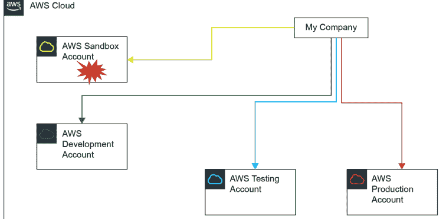

图 1.2 – AWS 组织 – 限制重大灾难的爆炸半径

AWS 强烈建议采用多账户策略，并提供特定的服务来帮助用户构建和管理这些多个账户。在接下来的子节中，你将了解 AWS Organizations 如何帮助安全且高效地管理多个 AWS 账户。

## 简介 AWS Organizations

你可以创建多个 AWS 账户来帮助隔离不同的工作负载或应用生命周期。然而，你需要一种机制来保护和管理它们。你还需要以护栏（guardrails）的形式定义策略和权限，从而指定每个账户可以消费哪些服务、可以部署哪些资源，甚至这些账户可以在哪些区域部署应用程序。这确保你遵守行业严格的合规性和监管要求，并帮助你满足公司治理和管理需求。

AWS Organizations 服务是帮助你有效配置和管理多个 AWS 账户的终极工具。要设置 AWS Organizations，你必须指定一个 AWS 账户作为管理账户。该账户托管你业务的实际 AWS Organizations 服务。然后，你可以邀请现有账户或创建额外的 AWS 账户，这些账户将成为组织的成员账户。

在接下来的子节中，我们将研究服务控制策略（SCPs），这是一种强制规则执行的机制，用于规定如何使用你的 AWS 账户、可以消费哪些服务，甚至可以访问哪些区域。

### 服务控制策略 (SCPs)

如图 1.2 所示，你可以应用作为**护栏**的 SCPs，以限制每个 AWS 账户中可以消费的服务。SCPs 是以**JavaScript 对象表示法 (JSON)** 格式编写的策略文档，它们使你可以定义在 AWS 账户中可以部署何种类型的资源，以及可以对这些服务执行何种操作。SCPs 还可以限制这些账户在哪些区域配置资源。护栏的设计旨在帮助确保在 AWS 账户中只能访问经过批准的服务。

> **注意**
> SCPs 不定义个人用户在 AWS 账户中可以执行的操作。它们定义管理员可以分配给这些用户的最大权限，以及允许对 AWS 服务执行哪些操作。

随后，AWS **身份和访问管理 (IAM)** 服务用于将这些允许的权限分配给这些个人用户。我们将在下一章中更详细地介绍 IAM 服务。

在设置 AWS Organizations 时，SCPs 是禁用的。当你启用它们时，一个名为 `FullAWSAccess` 的默认 SCP 策略会被附加到根节点，并应用于组织中的任何 OU 和 AWS 账户。

> **注意**
> 你还可以在账户级别应用策略。

SCPs 遵循默认拒绝的设计。因此，除非在从根节点、通过 OU 到路径中账户的所有级别都定义了允许特定操作的权限，否则该操作将被拒绝。当你首次启用 SCPs 时，`FullAWSAccess` 策略应用于从根节点、通过 OU 到最终直接应用于账户的所有级别；这意味着你在 AWS 账户中可以执行的操作或使用的服务没有任何限制。然后，你应该有策略地规划并应用策略，以符合你的企业要求。

如果你从特定的 OU 或账户解绑 `FullAWSAccess` 策略，你必须确保用一个指定你想访问的服务和希望执行的操作的策略来替换它。否则，你将无法在该账户中执行任何操作。

如果在账户路径的任何级别应用了拒绝权限 – 即，如果你将其应用于根节点或包含该账户的 OU – 那么拒绝规则将覆盖任何冲突的允许权限。

在下图，*图 1.4* 中，你会注意到两种不同的配置。在配置 A 中，执行操作的权限在所有级别都被应用，这导致在账户 B 中该权限被允许。然而，在配置 B 中，执行操作的权限在 OU 级别被拒绝，具体应用于生产 OU。这导致在账户 B 中该权限被拒绝，尽管有显式的允许规则应用于此账户。这是因为拒绝规则总是覆盖允许规则。此外，允许权限必须在所有级别显式定义，因为默认规则是拒绝该操作。

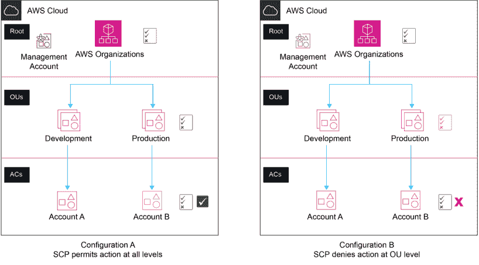

图 1.4 – 比较 SCPs 的允许和拒绝规则

SCP 策略可以包含多个语句，具有允许和拒绝权限。这使得起草和应用包含允许和拒绝权限的单一策略到 OU 和账户变得容易。

例如，你可以将以下策略附加到 OU（或成员账户）。这将导致能够执行除 Amazon S3 以外的所有服务的所有操作：

```json
{
    "Version": "2012-10-17",
    "Statement": [
        {
            "Sid": "AllowsAllActions",
            "Effect": "Allow",
            "Action": "*",
            "Resource": "*"
        },
        {
            "Sid": "DenyAmazonS3",
            "Effect": "Deny",
            "Action": "S3:*",
            "Resource": "*"
        }
    ]
}
```

此时如果策略的结构看起来有点复杂是完全正常的；你将在下一章中深入研究 JSON 策略文档的细节。

使用 AWS Organizations，你还可以使用包含在该服务中的**统一计费**功能更有效地管理与你 AWS 账户相关的成本。管理账户负责个别成员账户产生的费用，并为你提供这些费用的统一视图。此功能的主要好处之一是**批量折扣**。通过将你的账户成本合并，当你的总费用超过某些批量折扣阈值时，你可以获得折扣。

此外，你可以使用 AWS Organizations 在成员账户之间共享某些资源。例如，你可能希望共享某些网络资源，如 VPC 子网，或共享跨成员账户购买的预留实例。VPC 子网将在 *第 4 章，使用 Amazon VPC 在云中构建私有网络* 中进一步讨论。

本节分析了在 AWS 上设计多账户策略的使用案例。我们还了解了如何集中创建和管理多个 AWS 账户，以及应用 SCPs 来建立护栏，限制这些账户中可消费的服务。至此，显然在开始使用 AWS 的云计算之旅之前，细致的准备是必不可少的，包括结合安全最佳实践并执行公司治理。

在下一节中，我们将查看另一种允许你按照推荐指南设置和管理多个 AWS 账户并构建着陆区（landing zones）的 AWS 服务。

## AWS Control Tower

如前所述，为你的 AWS 之旅规划和创建多账户策略将使你能够确保安全、治理、合规和成本效率的更高层级。然而，构建多账户环境可能会变得非常复杂且耗时。你需要决定需要多少个 AWS 账户，某些账户是否将用于内部共享服务，以及需要多少个环境来满足需求。

AWS 提供工具来帮助你构建遵循最佳实践并符合*架构良好*原则的多账户环境，使用 **AWS Landing Zone**。这些蓝图将帮助设计和架构多账户部署，提供 IAM、治理、数据安全和审计日志功能。

为了帮助使用这些推荐蓝图自动部署多个账户，AWS 提供了一项名为 AWS Control Tower 的服务。该服务可以自动实施你的着陆区，包括以下内容：

- 你的 AWS Organizations 以及用于各种工作负载和环境的任何成员账户
- 提供 AWS SSO 默认目录服务的 IAM 服务
- 使用 SSO 进行账户联合
- 使用 AWS CloudTrail 和 AWS Config 进行集中日志记录

使用 AWS Control Tower，你还可以选择打包好的安全、运维和合规治理规则，并将它们应用于整个企业或特定的账户组。

AWS Control Tower 服务还具有一个仪表板功能，使你能够查看你的 AWS 环境。使用仪表板，你可以看到已配置的各种 OU 和账户，以及定义并应用于各种 OU 和账户的护栏数量。

在本节中，我们了解了如何使用 AWS 推荐的符合其架构良好原则的蓝图来自动化设计和实施你的多账户策略。

在下一节中，我们将查看访问你的 AWS 账户的可用选项。

## 使用 Web 管理控制台、CLI 和 SDK 访问你的 AWS 账户

有几种方法可以访问你的 AWS 账户以及平台上提供的服务。这些包括 AWS Web 控制台、**命令行接口 (CLI)** 和 **软件开发工具包 (SDKs)**。

让我们详细查看这些选项。


## AWS Web 管理控制台

你可以通过直观的 Web 界面访问 AWS 账户。登录 Web 控制台的 URL 是 `https://aws.amazon.com/console/`。

本书中的几个练习将使用 AWS Web 管理控制台完成，你将获得使用控制台的动手经验。以下是 AWS 控制台主页的截图：

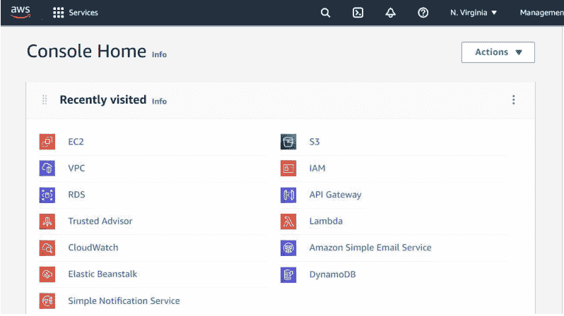

图 1.5 – AWS 管理控制台

要使用 Web 界面访问 AWS 账户，你必须使用根用户账户或 IAM 用户账户（下一章讨论）。根用户拥有 AWS 账户，并可以完全访问账户内的所有服务和资源。

最佳实践是，你不应使用根用户进行日常操作。AWS 允许你创建 IAM 用户，这些是在你的 AWS 账户中创建的其他用户账户。这些用户可以代表同事，并代表需要访问 AWS 服务的应用程序执行操作。IAM 用户可根据其角色获得访问权限，从而只能与工作职责所需的特定服务交互。这允许你实施最小权限原则，可能涉及将管理权限分配给关键个人。这样，你还可以确保仅在必要时使用根用户凭据。

接下来，你将探索如何使用 CLI 以编程方式访问 AWS 账户。

## AWS CLI

你可以使用 CLI 以编程方式访问 AWS 账户。这允许你直接从计算机的命令提示符（如果使用 Microsoft Windows）或终端窗口（适用于 macOS 和 Linux）发出命令来配置服务和预置资源。

AWS CLI 工具需要下载并安装到你的计算机上才能使用；你可以根据你的特定操作系统在 `https://aws.amazon.com/cli/` 访问该工具。

CLI 的最大优点在于，你通常会发现在完成任务上它比通过多次鼠标点击执行相同的一组任务更容易、更快捷。此外，使用 CLI，你仍然可以访问 AWS 服务的所有公共**应用程序编程接口（API）**，并且可以进一步开发脚本以发出多个命令来执行多个任务。这些脚本可以是 Bash 脚本和 Windows PowerShell 脚本。

要使用 CLI，你仍需要使用一组凭据对 AWS 账户进行身份验证。与 Web 控制台访问所需的用户名和密码不同，你必须配置一组访问密钥以供 CLI 使用。每个 IAM 用户最多可以有两个访问密钥。这些密钥类似于用户名和密码，由**访问密钥 ID**（类似于用户名）和**秘密访问密钥**（类似于密码）组成。

有趣的是，你不能自己选择访问密钥。AWS 会为你生成这些密钥，它们特定于特定 AWS 账户的 IAM 用户。这意味着你无需指定要登录的 AWS 账户的账户 ID，而使用 Web 控制台时则需要提供该 ID。

接下来，AWS 还通过其新的 **AWS CloudShell** 服务提供了 CLI 的在线版本。

## AWS CloudShell

你可以使用 AWS CloudShell 服务，而不是使用计算机上的命令行工具。这是一种基于浏览器的 shell，用于安全地与 AWS 服务和资源交互。

你可以通过 AWS Web 控制台访问 CloudShell 服务。它位于控制台屏幕右上角的链接图标处，如下面的截图所示：

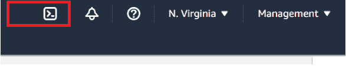

*图 1.6 – AWS CloudShell 服务*

当你访问 AWS CloudShell 服务时，它使用登录 AWS Web 控制台时使用的凭据。因此，无需像使用 AWS CLI 那样预先配置任何访问密钥。

## AWS SDK

接下来，我们将介绍 AWS SDK。SDK 是工具、库和文档的集合，使开发人员能够构建与 AWS 生态系统集成的应用程序。

SDK 又称开发工具包，是工具和程序的集合，允许开发人员为特定平台创建应用程序。SDK 包括开发人员嵌入其应用程序以编程方式与平台（此处为 AWS）交互的库、文档、代码示例和流程。

在 AWS 中，不同的编程语言有不同的 SDK。例如，你可以获得一个名为 Boto3 的 Python SDK，它为 AWS 基础设施服务提供 Python API。这使你可以构建能够与 Amazon S3、Amazon EC2、Amazon DynamoDB 等服务交互的 Python 应用程序。

本节讨论了以交互方式和编程方式访问 AWS 账户、配置服务和预置资源的各种选项。在下一节中，你将通过一系列练习来帮助你设置 AWS 账户并定义简单的多账户架构。

## 技术要求

要完成本章中的所有实践练习，你必须创建三个独立的 AWS 账户：一个管理账户、一个开发账户和一个生产账户。大多数练习必须在开发账户中执行。拥有这些账户的技术细节已在标题为 *一个 AWS 账户不够用* 的部分中说明。根据你的业务用例，你可能会有更多账户，但要成功完成本章中的练习并说明如何创建和集中管理这些账户，你只需要三个 AWS 账户。

要设置初始 AWS 账户，你必须能够使用手机和信用卡。虽然本章中的大多数练习都在 AWS 免费套餐范围内，但特定实验可能会花费少量美元。我们建议设置 25 美元的预算来完成本学习指南中的所有实验室和练习。我们将在本章后面的项目任务 1.8 – 配置预算警报中演示如何在你的 AWS 账户中设置预算警报。

你还必须为创建的每个 AWS 账户提供一个唯一的电子邮件地址。此电子邮件地址（以及你设置 AWS 账户时选择的密码）称为账户的根用户，是账户的主要所有者。以下小节解释了如何将一个 Gmail 账户（邮箱）与三个电子邮件别名结合使用，以有效为三个 AWS 账户提供三个电子邮件地址。这也使你的电子邮件管理更加容易，因为最终你只有一个 Gmail 邮箱。

## 一个 Gmail 账户

Gmail 允许你使用指向一个邮箱账户的任务特定电子邮件地址。如果你希望避免管理多个电子邮件邮箱但仍需要多个电子邮件地址，这非常有用。使用 Gmail，你可以创建一个电子邮件邮箱，例如 `your-email-id@gmail.com`，其中 `your-email-id` 是你选择的字符和/或数字字符串。创建此电子邮件账户后，你可以通过在电子邮件 ID 后附加加号（+）和另一个术语来描述该电子邮件地址的用途。例如，我们建议使用以下任务特定电子邮件地址：

- `your-email-id+management@gmail.com` 用于 AWS 管理账户
- `Your-email-id+development@gmail.com` 用于 AWS 开发账户
- `Your-email-id+production@gmail.com` 用于 AWS 生产账户

这些电子邮件地址中的每一个都指向同一个邮箱——在本例中为 `your-email-id@gmail.com`。当你设置各个 AWS 账户时，每个账户的验证电子邮件将发送到同一个 Gmail 邮箱，你可以从这个单一 Gmail 邮箱账户访问所有三个验证请求。

## 项目任务 – 为 TodoPlus Limited 构建多账户策略

虽然理解 AWS 平台上提供的各种服务的理论知识对于通过考试至关重要，但培养真实世界的动手经验对于你在 AWS 平台上作为开发人员甚至 DevOps 工程师取得成功也至关重要。这正是希望招聘新人才的公司一直在寻找的。

如本章前面所述，你将应用学习指南中获得的知识来满足一家名为 **TodoPlus Limited** 的虚构公司的业务需求。这将帮助你培养亟需的动手经验，以帮助你获得下一个工作角色。在以下项目任务系列中，你将设计并构建 TodoPlus Limited 的多账户环境。你还将设置一个 AWS Organization，并定义必要的 OU 和 SCP。


## 项目任务 1.1 – 设置您的第一个 AWS 账户

在本练习中，您将为我们的客户 TodoPlus 有限公司设置您的第一个 AWS 账户。您使用此 AWS 账户配置 AWS 组织，从而可以创建本章 *技术要求* 部分中讨论的另外两个账户。在整个本考试指南中，您将使用这些账户来获取宝贵的实践经验，并为 AWS *认证开发者助理* 考试做准备：

- 1. 使用您的 Web 浏览器，导航至 `https://aws.amazon.com/free/`。
- 2. 点击 **创建免费账户** 按钮，设置您的第一个 AWS 免费套餐账户。您将看到一个注册屏幕。
- 3. 对于 **根用户电子邮件地址**，请提供之前 *技术要求* 部分中讨论的 **管理账户电子邮件地址**。
- 4. 对于账户名称，请输入值 `Todo Plus Management`。
- 5. 点击 **验证电子邮件地址** 按钮，如 **图 1.7** 所示：

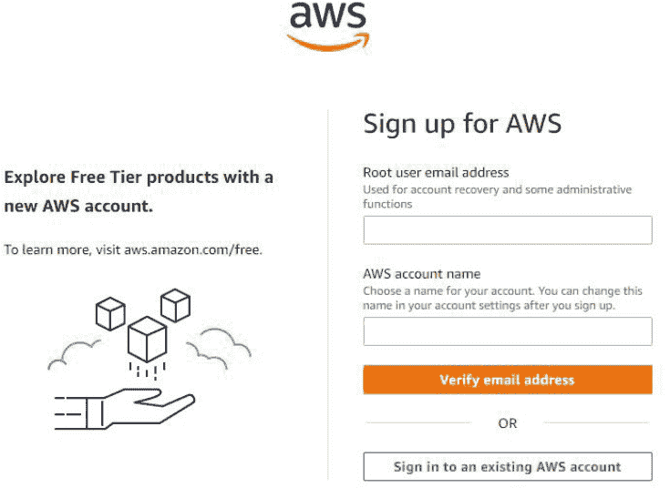

图 1.7 – 设置 AWS 免费套餐账户

- 6. 然后，您将看到一个 **确认您的身份** 对话框，您必须验证用于创建此账户的电子邮件地址。登录您的 Gmail 账户并获取发送给您的验证代码。在 **验证代码** 文本框中输入该代码，并点击 **验证** 按钮，如图 1.8 所示：

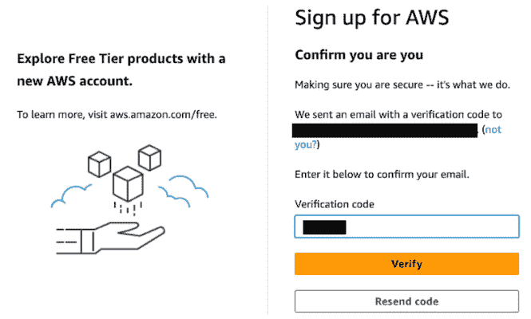

图 1.8 – 提供验证代码

- 7. 您需要为此账户创建一个密码。这将是根用户的密码。提供一个由小写字母、大写字母、数字和至少一个非字母数字字符组成的复杂密码。点击 **继续（第 1 步，共 5 步）**。
- 8. 对于 **联系信息**，请提供您的完整联系信息和地址详情。选择 **个人 – 用于您自己的项目** 选项。确保您选中表示同意 AWS 客户协议条款的复选框，然后点击 **继续（第 2 步，共 5 步）**。
- 9. 提供您的 **账单信息** 详情并点击 **继续（第 3 步，共 5 步）**。您需要一张信用卡或借记卡的访问权限以及您的账单地址详情。
- 10. 下一步涉及提供您的手机号码以进行验证。您可以选择发送短信 (SMS) 或语音呼叫。要完成操作，请点击 **短信 (SMS)** 并提供您的电话号码。
- 11. 在 CAPTCHA 框中输入字符，然后点击 **发送 SMS（第 4 步，共 5 步）**。
- 12. 现在，您将看到一个 **确认您的身份** 页面。查看您手机上来自 Amazon 的代码，然后在您的注册页面上的 **验证代码** 文本框中输入该代码，如 *图 1.9* 所示。

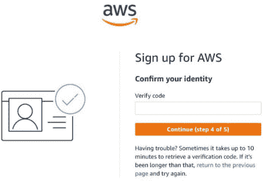

图 1.9 – 注册 AWS – 验证代码页面

- 13. 作为下一步，您需要为您的账户选择一个 AWS 支持计划。目前，请选择 **基础支持 – 免费** 计划并点击 **完成注册** 按钮。您将看到一个祝贺屏幕，并且可以导航到主登录页面。

恭喜，您现在已经创建了您的第一个 AWS 账户！现在，您可以使用之前定义的电子邮件地址和密码登录您的 AWS 账户。接下来，您应该考虑进一步保护您的账户。目前，仅凭电子邮件地址和密码即可访问您的账户。AWS 提供另一种机制来加强您的账户安全：多因素认证。

**多因素认证 (MFA)** 在授予服务或资源访问权限之前提供多种认证机制。在 AWS 上，这体现为您所知道的内容和您所拥有的内容。您知道的部分指的是您记住的电子邮件地址和密码。这是一组您知道的凭据。您拥有的部分进一步增强了您的账户安全性，因为登录时您需要一个定期变化的动态信息片段。如果您有在线银行账户，您可能已经使用过 MFA：您使用用户名和密码登录您的账户，然后还会在您的移动设备上收到一个 PIN，通常是一个有时效性的代码，您需要将其作为认证过程的一部分提供。

同样，您可以在 AWS 上设置带有 MFA 的账户。除了电子邮件地址（或下一章讨论的 IAM 用户的用户名）之外，您还可以设置 MFA 设备。这可以是物理或虚拟设备，例如您智能手机上的 MFA 应用程序。该 MFA 设备生成 **一次性密码 (OTP)**。该 OTP 是临时性的，您必须在认证过程中快速提供 PIN。

在下一个项目任务中，您将学习如何为管理账户的根用户设置 MFA。完成下一个项目任务需要访问具有互联网连接的智能手机。

## 项目任务 1.2 – 为您的根用户配置 MFA

在本练习中，您将设置并配置 AWS 管理账户根用户的 MFA：

- 1. 在管理账户上设置 MFA 之前，您必须在智能手机上安装 MFA 应用程序。Google Authenticator 是您可以下载并安装在手机上的此类应用程序之一。您可以在 Apple App Store 和 Google Play Store 上找到它。
- 2. 登录您的 AWS 账户。
- 3. 从顶部搜索栏中，搜索 IAM 并导航到 IAM Web 控制台。
- 4. 在主要的 IAM 仪表板上，您应该看到一个安全建议，建议为根用户添加 MFA，如下面的截图所示：

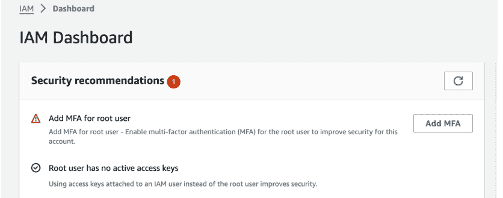

图 1.10 – 为根用户设置 MFA

- 5. 点击“添加 MFA”按钮。
- 6. 为您的 MFA 设备提供一个名称。
- 7. 在 MFA 设备下选择“认证器应用程序”选项。
- 8. 点击“下一步”，您将被引导到“设置设备”网页。
- 9. 该应用程序将扫描二维码并将 AWS 账户添加到设备中。它将显示一个由六位数字组成并在几秒后过期的 OTP，之后显示另一个 PIN，并且新的 PIN 生成循环在几秒后继续。按照显示顺序为 **MFA 代码 1** 和 **MFA 代码 2** 提供 PIN，并确保在第二个 PIN 过期前点击 **添加 MFA** 按钮。这将把 Google Authenticator 应用程序和您手机上的特定虚拟设备与您的 AWS 账户关联起来。
- 10. 当您下次登录您的 AWS 账户并提供根用户凭据时，系统会提示您提供 OTP。您需要启动手机上的应用程序，然后提供当前显示的 OTP，才能登录您的 AWS 账户。

在下一个任务中，您将学习如何配置您的 AWS 管理账户以使用 AWS Organizations，这样您就可以集中创建和管理其他 AWS 账户。

## 项目任务 1.3 – 设置 AWS 组织

在本练习中，您将登录您创建的 AWS 账户并配置 **AWS 组织** 服务。对于我们的客户 TodoPlus，此 AWS 账户将是您的 AWS 组织配置的管理账户，使我们能够为我们的应用程序创建用于开发和生产环境的额外 AWS 账户：

- 1. 登录您的 AWS 账户以访问 **控制台主页**。在此页面上，您可以通过点击屏幕右上角的 **服务** 链接或直接在顶部的搜索框中搜索服务名称来访问所有 AWS 服务。

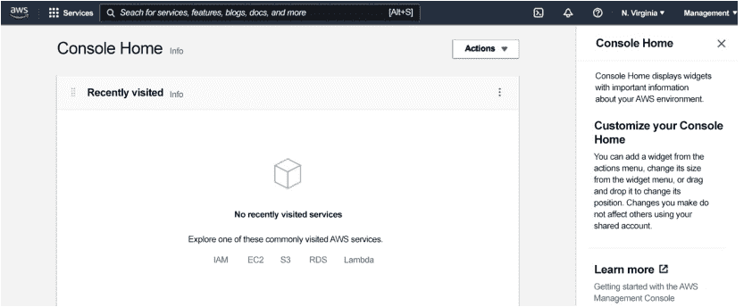

图 1.12 – AWS 管理控制台

- 2. 在顶部搜索框中输入 **AWS 组织**，并从下拉菜单中选择该服务，如下面的截图所示：

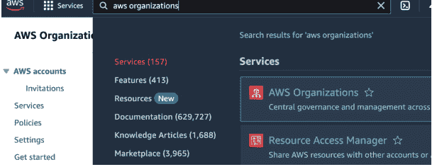

图 1.13 – 使用 AWS 管理控制台上的搜索框搜索服务

- 3. 您将被引导至 **AWS 组织** 控制台页面。
- 4. 点击屏幕右上角的 **创建组织** 按钮。这将创建您的 AWS 组织，并将您的 AWS 账户配置为主要根管理账户，如 *图 1.14* 所示。然后，此账户可以托管其他成员 AWS 账户，应用安全策略，并作为所有成员的 AWS 账户的中央计费账户。

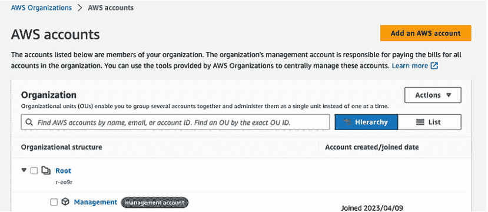

图 1.14 – AWS 组织

现在您已经创建了您的 AWS 组织，是时候配置一些 OU 了。这些 OU 使我们能够管理共享常见工作负载类型的多个账户，例如软件开发环境，如开发、测试和生产。


5. 选中复选框以在组织结构下选择 Root。
- 6. 点击操作下拉菜单，选择组织单元下的新建；你将进入“在 Root 中创建组织单元”页面。
- 7. 在组织单元名称下输入 `DevelopmentOU`。
- 8. 在标签部分点击添加标签。标签是您可以添加到 AWS 资源的键值对，以帮助识别、组织和保护您的 AWS 资源。每个资源最多可以有 50 个标签。创建两个标签，一个键为 Name，值为 DevelopmentOU；另一个键为 Project，值为 ProductivityApps，如图 1.15 所示：

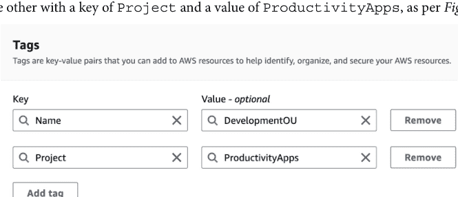

图 1.15 – AWS 组织标签

- 9. 点击创建组织单元。
- 10. 重复步骤 5 到 9，创建另一个名为 ProductionOU 的组织单元，这样你的组织中现在有两个组织单元，如图 1.16 所示：

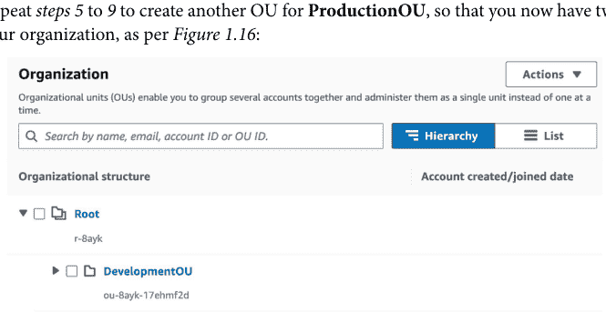

图 1.16 – AWS 组织单元

现在你已经为组织创建了组织单元，是时候创建更多 AWS 账户了，这将在下一个练习中描述。

## 项目任务 1.4 – 创建开发和生产 AWS 账户

在本练习中，你将创建两个额外的 AWS 账户：开发账户和生产账户。在本学习指南的后面部分，你将学习如何在这些账户中构建工作负载，还将了解应用程序开发如何按照最佳实践从开发环境过渡到生产环境。请执行以下步骤：

- 1. 重新登录你的 AWS 账户，如有必要，导航到 **AWS Organizations** 管理控制台。
- 2. 在左侧菜单中，确保选择了 **AWS Accounts**。
- 3. 在右侧窗格中，点击 **添加 AWS 账户** 按钮。
- 4. 你将可以选择创建新的 AWS 账户或邀请现有账户。选择 **创建 AWS 账户** 选项。
- 5. 在 **创建 AWS 账户** 部分，为你的 AWS 账户提供名称——在本例中为 `TodoPlus Development`。
- 6. 对于电子邮件地址，请提供开发电子邮件别名，如本章前面的 *技术要求* 部分所述。
- 7. 你还会注意到 IAM 角色已预填为 **OrganizationAccountAccessRole** 角色（将在下一章详细讨论）。这使得管理账户能够访问成员账户中的资源。
- 8. 在 **标签** 部分点击 **添加标签**。创建两个标签，一个键为 `Name`，值为 `DevAccount`；另一个键为 `Project`，值为 `ProductivityApps`。
- 9. 点击 **创建 AWS 账户**。
- 10. AWS 将需要一些时间来创建你的新 AWS 开发账户。

以这种方式创建的每个 AWS 账户都有该账户的根用户。根用户由你创建账户时使用的电子邮件地址定义。请注意，你没有设置密码。要为成员账户的根用户定义密码，你必须从 AWS 主登录页面请求对这些账户进行密码重置。密码重置链接将发送到成员 AWS 账户根用户的电子邮件地址，允许你设置一个复杂的密码。然后你可以登录这些成员 AWS 账户。

重复 *步骤 1 到 10* 为生产工作负载设置另一个 AWS 账户。确保将此账户命名为 `Todo Plus Production`。对于标签，创建一个键为 `Name`、值为 `ProdAccount`，另一个键为 `Project`、值为 `ProductivityApps`。

现在你已经设置了开发和生产账户，建议将这些账户放入你在上一个练习中设置的适当组织单元中，这将在下一个练习中进行配置。

## 项目任务 1.5 – 将 AWS 账户分配到相应的组织单元

在本练习中，你将把上一个练习中创建的账户关联到相关的组织单元：

- 1. 仍在 AWS Organizations 控制台中，点击选择组织结构下的 Todo Plus Development 账户。
- 2. 在 AWS 账户下的操作下拉菜单中点击移动。
- 3. 你将导航到“移动 AWS 账户 ‘Todo Plus Development’”页面。
- 4. 在“目标”下选择 DevelopmentOU。
- 5. 点击“移动 AWS 账户”按钮。
- 6. 对 Todo Plus Production 账户重复步骤 1 到 5，并确保将该账户移动到 ProductionOU，如图 1.17 所示：

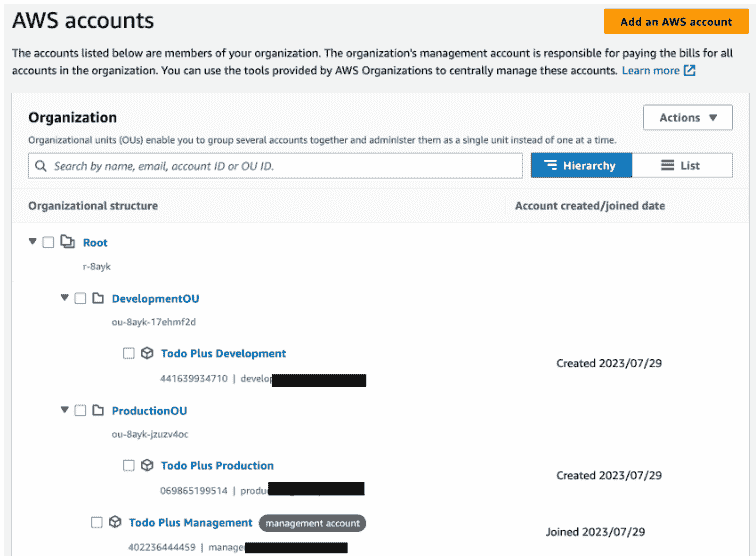

图 1.17 – 使用组织单元构建你的 AWS 账户

```json
{
  "Version": "2012-10-17",
  "Statement": [
    {
      "Effect": "Deny",
      "Action": [
        "organizations:LeaveOrganization"
      ],
      "Resource": "*"
    }
  ]
}
```

请根据此处显示的 *图 1.18* 复核你的策略：

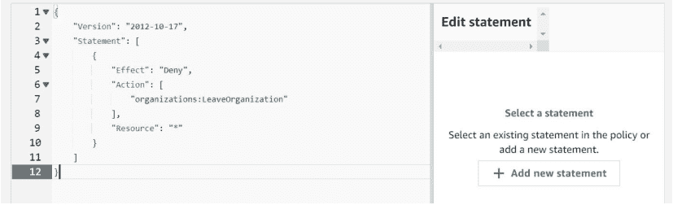

图 1.18 – 用于防止成员账户管理员离开组织的SCP

- 9. 向下滚动并点击 **创建策略** 按钮。你现在应该能够看到组织中可用的策略列表，如 *图 1.19* 所示：

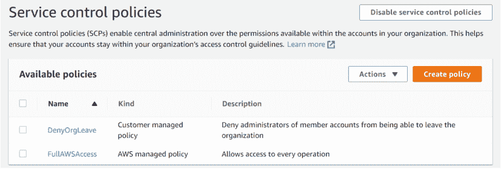

图 1.19 – 可用的SCP列表

- 10. 点击选择 **DenyOrgLeave** 策略，然后从 **操作** 下拉菜单中点击 **附加策略**。
- 11. 接下来，点击 **Production** 和 **Development** 两个组织单元。
- 12. 点击 **附加策略** 按钮。
- 13. 从左侧菜单中，点击 **账户**。
- 14. 接下来，在右侧窗格中，展开 **Development** 组织单元。

- 15. 点击 **Todo Plus Development 账户**。这将带你进入成员账户详细信息页面。
- 16. 在右侧窗格的下半部分，点击 **策略** 选项卡。你应该会看到 **FullAWSAccess** 和 **DenyOrgLeave** 策略均被列出。某些完全访问权限也从根账户继承。

在本练习中，你配置了默认未启用的SCP，然后设置了一个新的SCP，以防止成员账户的管理员离开组织。在下一个练习中，你将在 **Todo Plus Development** 账户上测试此策略。

## 项目任务 1.7 – 测试SCP

要完成本练习，请登录 **Todo Plus Development** AWS账户。由于你只知道该账户的电子邮件地址而不知道密码，你需要重置密码。你必须首先提供你的电子邮件地址并完成验证码挑战。接下来，按照根用户登录页面上的流程，点击 **忘记密码** 链接来重置密码：

- 1. 密码重置电子邮件将发送到你之前设置 **Todo Plus Development** AWS账户时提供的地址。请务必使用邮件中的链接重置密码。重置密码后，你就可以登录该 AWS 账户。
- 2. 搜索 `AWS Organizations` 并导航到其管理控制台页面。你将注意到此账户是 **Management** AWS 组织的成员。
- 3. 进一步向下滚动，点击 **离开此组织** 按钮。系统将提示你确认操作。点击 **离开组织** 按钮。
- 4. 你应该会看到一条错误消息，内容是 **您没有权限访问此资源。**，如图 1.20 所示：

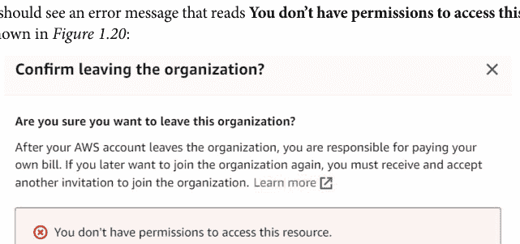

图 1.20 – SCP防止DevAccount的根用户离开组织

如你所见，即使是 **Todo Plus Development** 账户的根用户现在也无法离开组织。最终，此策略将确保只有管理账户的管理员才能控制成员账户的成员资格。

现在你已经配置了你的 AWS 账户并定义了某个 AWS 组织，你已准备好开始学习本指南其余部分中的项目任务。但在继续项目任务之前，强烈建议你创建一个账单告警，以便在练习中超过建议的 25 美元预算时通知你。建议你尽快完成本书中的练习，以免产生不必要的费用。完成项目练习并测试解决方案后，你必须终止所部署的资源，以避免产生进一步费用。

## 项目任务 1.8 – 创建账单告警

在本项目任务中，你将创建一个账单告警，以便在你超过 25 美元的支出预算时通知你：

- 1. 确保你已登录管理账户。
- 2. 在屏幕右上角，点击 **Todo Plus Management** 并选择 **账单和成本管理**，如以下截图所示：

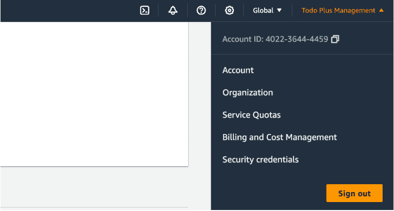

图 1.21 – 访问账单和成本管理控制台

- 3. 在 **账单和成本管理** 控制台中，在左侧菜单的 **首选项和设置** 下选择 **账单首选项**。


## 步骤 2：配置操作
在此步骤中，在“警报状态触发器”下选择**警报中**。

单击**创建新主题**。

在**创建新主题**下提供一个描述性名称...例如，你可以提供一个名称，如 `TodoPlus-Billing-Alarm`。

提供一个你希望接收警报的电子邮件地址，然后按照以下截图单击**创建主题**：

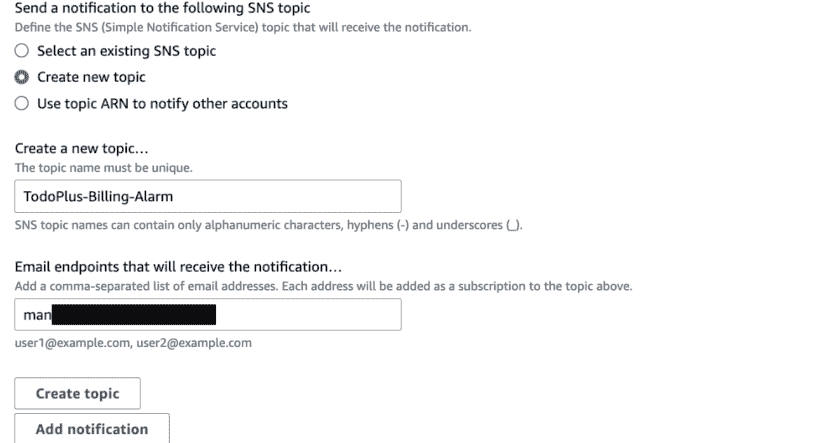

图 1.24 – 创建通知主题并定义电子邮件端点

滚动到屏幕底部，单击**下一步**。

## 步骤 3：添加名称和描述
在此步骤中，你将定义警报名称和可选描述。

单击**下一步**。

## 步骤 4：预览并创建
在此步骤中，你将检查设置，然后点击屏幕底部的**创建警报**按钮。

9. 虽然你现在已经创建了警报，但在你验证对通知主题的订阅之前，你将无法收到电子邮件警报。为此，你必须登录在前面的步骤中指定的电子邮件账户并确认订阅。

在下一节中，我们将提供本章的总结。

# 总结

本章讨论了多账户架构的重要性，探讨了设置和管理多个 AWS 账户的广泛用例。它属于 *AWS 认证开发人员助理考试*中的*领域 2：安全*，特别关注任务声明*为应用程序和 AWS 服务实现身份验证和/或授权*。具体来说，你了解到在不同的 AWS 账户中托管不同的工作负载甚至不同的环境，对于确保更高水平的安全性和减少一个环境中的事故影响另一个环境中的工作负载至关重要。通过多个 AWS 账户，你可以分离各个应用程序，甚至可以为其开发生命周期设立单独的账户。

通过多个 AWS 账户，你还可以将内部应用程序和工作负载与面向客户的应用程序和工作负载分开，进一步增强安全性。在本章中，你学习了如何使用 AWS Organizations 管理 AWS 账户。你学习了如何应用服务控制策略来防止成员账户使用特定服务、资源和区域。AWS 组织中的管理账户拥有最高权限，你甚至可以防止成员账户的管理员离开组织。

尽管 AWS Organizations 提供了为成员账户构建护栏的能力，但谁或什么可以使用这些被允许的服务并进行 API 调用，仍然需要通过 AWS IAM 或定义基于资源的策略来定义。我们将在下一章对 IAM 服务进行深入研究。

# 进一步阅读

以下是必读资源，帮助你了解在为你的企业和客户设计多账户架构时可以在现实世界中使用的方案：

- *使用多个账户组织你的 AWS 环境*：`https://docs.aws.amazon.com/whitepapers/latest/organizing-your-aws-environment/organizing-your-aws-environment.html`
- *服务控制策略示例*：`https://docs.aws.amazon.com/organizations/latest/userguide/orgs_manage_policies_scps_examples.html`

# 考试准备练习 – 章节复习题

除了扎实理解关键概念外，在时间压力下快速思考的能力也是帮助你在认证考试中脱颖而出的技能。这就是为什么在学习之旅的早期就锻炼这些技能至关重要。

章节复习题旨在随着你学习的每一章逐步提高你的应试技能，同时复习你对本章关键概念的理解。你可以在每章末尾找到这些题目。

> **如何获取这些资料**
> 要了解如何访问这些资源，请前往标题为*第 17 章，访问在线资源*的章节。

要打开本章的章节复习题，请执行以下步骤：

1. 单击链接 – `https://packt.link/DVAC02_CH01`。
   或者，你可以扫描以下**二维码**（*图 1.25*）：


图 1.25 – 为已登录用户打开章节复习题的二维码

2. 登录后，你将看到一个类似于图 1.26 所示的页面：

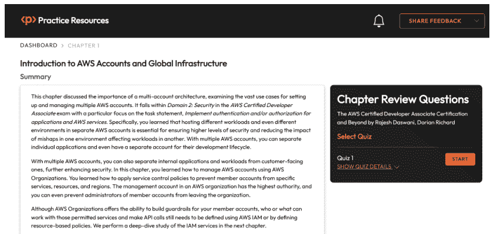

图 1.26 – 第 1 章的章节复习题

3. 准备好后，开始以下练习，多次重新尝试测验。

# 考试准备练习

对于前三次尝试，不要担心时间限制。

## 尝试 1

第一次，目标至少达到 40%。查看你做错的答案，并重新阅读本章中的相关部分，以弥补学习差距。

## 尝试 2

第二次，目标至少达到 60%。查看你做错的答案，并重新阅读本章中的相关部分，以弥补任何剩余的学习差距。

## 尝试 3

第三次，目标至少达到 75%。一旦你得分达到 75% 或以上，你就可以开始练习时间掌控。

> **提示**
> 你可能需要超过**三次**尝试才能达到 75%。这没关系。只需复习本章中的相关部分，直到你达到目标。

## 练习时间掌控

**目标**：你的目标是在尽可能快速回答这些问题的同时保持相同的分数。以下是你接下来的尝试应该是什么样子的示例：

| 尝试次数 | 分数 | 所用时间 |
|---|---|---|
| 尝试 5 | 77% | 21 分 30 秒 |
| 尝试 6 | 78% | 18 分 34 秒 |
| 尝试 7 | 76% | 14 分 44 秒 |

表 1.1 – 在线平台上的时间掌控练习示例

> **注意**
> 上表中显示的时间限制只是示例。根据网站上测验的时间限制，为每次尝试设置自己的时间限制。

每次新的尝试，你的分数应保持在 75% 以上，而完成所需的“花费时间”应“减少”。根据需要重复尽可能多的尝试，直到你自信地应对时间压力。
