# 使用 AWS 身份和访问管理保护访问

保护 AWS 托管的应用程序免受未经授权的访问对任何企业都至关重要。作为一个组织，你必须确保只有经过授权的实体才能对你的工作负载进行身份验证。此外，这些实体只能被允许创建和管理资源，并执行其获授权的任务。这个概念就是**最小权限原则（POLP）**，它是构建安全环境的基础。本章将教你为什么身份验证和授权服务至关重要。你将理解提供各种访问选项以对内部用户进行身份验证的重要性，并且在需要时，根据应用程序用例提供匿名的公共访问。

在本章中，你将学习 AWS 提供的基础安全服务之一：**身份和访问管理（IAM）**。你将学习如何创建用户、组和角色，以及如何使用 IAM 策略授予访问服务和配置资源的权限。你还必须了解的另一项服务称为 **IAM Identity Center**（以前称为 **AWS Single Sign-On**）。除其他功能外，此服务最适合让你的技术用户从单个门户访问多个 AWS 账户。此外，你还可以使用你的员工可能正在使用的现有第三方**身份提供商（IdPs）** 对 AWS 平台进行身份验证——这被称为**身份联合**。

本章还探讨了 **Amazon Cognito** 服务，这是一个无服务器且完全托管的身份管理系统，可以为你的 Web 或移动应用程序提供身份验证和授权功能。本章旨在让你掌握必要的知识，以利用 AWS 安全服务构建可靠、健壮且安全的云架构。任何有云雄心的企业都不可避免地会面临类似的挑战。你的架构设计模式必须始终遵循一个简单的原则——“安全设计”。


本章讨论的主题属于 AWS 认证开发者助理考试指南中的 *Domain 2: Security*。具体来说，它涵盖 *Task Statement 1: Implement authentication and/or authorization for applications and AWS services.*

本章涵盖的主题如下：

- Introduction to IAM
- Improving your security posture with **multifactor authentication (MFA)**
- Accessing AWS accounts using identity federation with **Security Assertion Markup Language 2.0 (SAML 2.0)** and Microsoft **Active Directory (AD)**
- Using web identity federation for application authentication
- Application authentication and authorization with Amazon Cognito
- Using AWS **Security Token Service (STS)** to create and manage temporary tokens
- Overview of the AWS IAM Identity Center
- Exercise 2.1 – creating an IAM user and an IAM group within your developer account
- Project task – creating an Amazon Cognito user pool for the Todo List application

在上一章讨论的业务场景的基础上，您将在本章中了解如何保护您的 AWS 账户。就我们的客户 **TodoPlus** Limited 而言，AWS IAM 可用于为用户和应用程序创建 IAM 用户、组和角色，并使用策略指定他们在 AWS 账户中被允许执行的操作。这些策略可以细化以遵循 POLP，仅授予执行任务所需的必要访问权限。

通过利用这些 IAM 功能，**TodoPlus** Limited 可以确保其 AWS 环境和任务管理应用程序的安全性和完整性，这是建立用户信任和确保应用程序成功的关键方面。

**TodoPlus** Todo List 应用程序也需要以安全为出发点进行设计。希望订阅该应用程序的终端用户需要能够注册和登录。Amazon Cognito 可用于帮助构建 Todo List 应用程序的强大且安全的终端用户身份验证和授权机制。

## Introduction to IAM

每个组织都有其独特的工具、系统、环境、项目和核心功能。在组织内部，存在许多人员群体、部门和业务单元共享相同的服务。然而，每个群体根据其在组织中的职能和角色，需要对这些服务拥有不同级别的访问权限。

例如，开发人员需要访问开发环境，以便他们能够试验和设计新的应用程序功能，而他们对生产环境的访问必须受到限制。同样，初级系统管理员只能被允许执行某些任务，而不能对关键工作负载拥有完全的管理权限。

在本节中，您将了解 AWS IAM 以及它如何用于实施云安全的重要元素。AWS IAM 是一项完全托管的服务，可帮助您定义谁或什么可以访问您的 AWS 账户，可以访问哪些服务，可以创建和配置哪些资源。通过 AWS IAM，您可以为 IAM 用户、组和角色配置特定的权限，这些权限可由人类用户或应用程序等实体使用以与您的 AWS 账户交互。

### But First, Let’s Talk about the Root User

当您创建 AWS 账户时，会自动配置一个 root 用户。它是您 AWS 账户的主要所有者，并且有权关闭账户。由于其对 AWS 账户拥有完全不受限制的访问权限，因此确保您保护此账户并妥善保管其凭证至关重要。

> **Best practice**
>
> 作为最佳实践，不建议将 root 用户账户用于日常操作。AWS 建议您创建单独的个人 IAM 用户（稍后会讨论），并赋予其执行履行其工作职能所需的所有任务的足够权限。

### What Are the IAM Components?

AWS IAM 允许您为 AWS 账户创建和配置身份。您可以将权限应用于这些身份，以确定授予的访问级别。

接下来，您将了解构成 AWS IAM 的各个组件。

### IAM Users

IAM 用户可能是一个登录 AWS 界面的真人，也是一个需要以编程方式向您的 AWS 环境发出服务请求的程序。可以将 IAM 用户账户分配给公司中任何需要使用 AWS 服务的人员，例如程序员、系统管理员和数据科学家。用户身份验证可以是交互式的，通过 Web 控制台，或以编程方式使用 **command-line interface (CLI)**。此外，应用程序可以使用 AWS 的 **software development kits (SDKs)** 来获得编程访问权限并执行 **application programming interface (API)** 调用以与服务和资源交互。

> **Best practice**
>
> 在授予服务访问权限时，您必须遵循 AWS 推荐的 POLP。这确保了这些身份仅被提供执行经批准的任务并履行其工作职能所需的必要访问权限。

如以下图所示，root 用户拥有不受限制的访问权限。然而，您首次创建 IAM 用户时，他们没有任何权限。尽管这些 IAM 用户可以登录 AWS 账户，但他们将无法访问任何服务或创建资源。IAM 用户需要由您可以附加到这些用户（或用户所属的组）的策略定义的权限。这些权限定义了这些用户在您的账户中可以执行的操作。

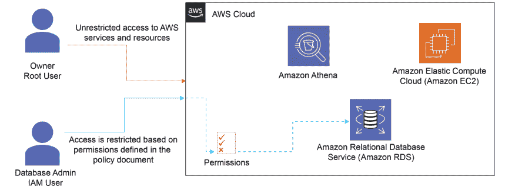

Figure 2.1 – Conceptual vision of the AWS user access

在 AWS 之旅开始时，将基于其工作职能拥有足够权限的 IAM 用户纳入其中是一项关键的安全最佳实践。

对于我们的虚构客户 TodoPlus Limited，您将创建一个代表组织开发人员之一的 IAM 用户。您将以此用户身份登录以执行本学习指南中的各种练习。（请参阅本章后面的练习 2.1。）

### IAM Groups

IAM 组使您能够汇总具有共同工作职能的单个 IAM 用户。这使您可以将权限分配给整个组，而组成员用户将继承这些权限。从管理角度来看，将权限分配给组要容易得多，因为它避免了直接为每个用户创建和附加多个策略。这使得管理权限分配和审计变得更加简单。

### IAM Roles

这种类型的身份独立于任何特定用户，具有一组定义的权限。这些权限在附加到角色的一个或多个策略中描述。角色可以被用户或应用程序承担，以获得对 AWS 账户内其他服务和资源的临时访问权限。通常没有某些权限的用户可能会被授予承担特定角色的能力，这些角色在需要时提供提升的访问级别。一个例子是 **Break Glass** 概念，其中团队中的初级成员可能能够承担一个角色，该角色在特定条件下授予特殊权限以执行受限任务。

角色也可以由使用第三方 IdP 的身份承担，从而实现身份联合。示例包括 OpenID 提供商，如 Facebook 和 Google，或企业目录服务，如支持 SAML 2.0 协议的 Microsoft AD。您还可以使用角色允许来自其他 AWS 账户的用户通过跨账户访问和角色切换访问您 AWS 账户中的服务和资源。

IAM 角色使用由 STS 创建和管理的临时凭证。角色未配置长期凭证（用户名和密码或访问密钥）。相反，当实体承担角色并请求访问资源时，它会获得用于针对服务或资源进行身份验证的临时凭证。这些凭证很快就会过期，如果请求继续并且实体继续拥有承担角色所需的权限，则会创建新的凭证。通过 IAM 角色，是 STS 服务在后台处理这些临时凭证的创建和管理。

IAM 角色也由相互交互的 AWS 服务使用。因此，如果 EC2 实例需要访问存储平台（如 Amazon Simple Storage Service (**Amazon S3**)) 或数据库服务（如 DynamoDB）上的某些数据，则该 EC2 实例必须能够承担一个角色，从而授予其必要的权限。

例如，关于我们的 Todo List 应用程序，如果网站前端托管在 EC2 实例上并提供时间管理技能视频，则这些视频可以托管在 Amazon S3 等廉价存储平台上，该平台旨在托管视频、图像和文档等资产。（我们将在第 3 章《Understanding Object Storage with Amazon S3, Hybrid Storage, and Static Website Hosting》中讨论 Amazon S3。）

为了允许在 EC2 实例上运行的应用程序访问这些时间管理视频，必须创建一个具有访问 S3 存储桶中视频所需权限的角色。然后将此角色分配给 EC2 实例。此过程涉及创建称为 EC2 实例配置文件的东西，它是您希望分配给实例的 IAM 角色的容器。一旦分配，EC2 实例上运行的应用程序就可以向 S3 存储桶发出 API 调用，以便最终用户可以访问视频。如果没有此 IAM 角色，尝试访问存储在 S3 存储桶中的视频将生成 **Access Denied** 错误。


替代方案是为一个“虚拟”的 IAM 用户硬编码凭证数据，该用户已被分配了一个 IAM 策略（稍后讨论），该策略授予该用户访问 S3 存储桶中视频的权限。这显然是不良做法，因为如果有人入侵应用程序代码，他们现在也将能够访问访问 S3 存储桶的凭证。无论如何，在应用程序代码中管理硬编码凭证是一项巨大的管理负担。因此，IAM 角色使您能够使用临时凭证授予对资源的访问权限，这些凭证管理更高效，并且消除了在应用程序源代码中硬编码凭证数据所带来的大部分风险。

在此处显示的图中，我们来看一下其架构上是如何工作的：

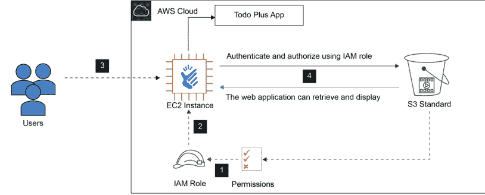

图 2.2 – Todo List 应用程序架构 – 配置了包含 IAM 角色的实例配置文件 的 EC2 实例，该角色授予对 Amazon S3 存储桶的访问权限

以下是图 2.2 中所示配置的快速高层次分解：

- 1. 为 EC2 服务创建一个 IAM 角色。这意味着 EC2 是受信任的实体。附加到该角色的权限策略授予对包含 Web 应用程序所需对象的 Amazon S3 存储桶的访问权限。在本例中，将是时间管理视频。
- 2. 然后通过实例配置文件将 IAM 角色附加到 EC2 实例。一次只能分配一个角色。但是，角色可以有一个或多个策略文档来定义不同的权限集。
- 3. 用户访问 Web 应用程序并尝试观看/下载时间管理视频。
- 4. EC2 实例承担该角色并被授予对 S3 存储桶中对象的访问权限。Amazon STS 服务创建必要的临时凭证并在后台管理访问。

与其直接将规则分配给 IAM 中的单个用户或组，管理员必须将其分配给角色。可以将多个 IAM 策略应用于单个 IAM 角色，然后该角色可以分配给一组用户或一个组。根据业务需求，存在几种类型的 IAM 角色。不同的 IAM 角色如下：

- **AWS IAM 角色：** 一个独立于任何特定用户或应用程序的身份，具有一个或多个策略来定义访问 AWS 上的服务和资源的权限集。
- **AWS 服务角色：** 由 AWS 服务用于代表您访问和管理您的 AWS 账户。服务角色对每个服务都是唯一的，并且只能用于控制单个 AWS 账户内的访问。我们在前面的示例中讨论了将角色附加到 EC2 实例。这种类型的角色称为服务角色。需要注意的是，此角色可以在 EC2 实例生命周期中的任何时间附加或分离。为了防止意外更改设置并确保实例从开始时就安全，建议在启动 Amazon EC2 实例时附加此角色。
- **AWS 服务链接角色：** 此类型角色授予服务特定功能调用其他 AWS 服务所需的权限。这些权限是预先确定的并在角色中定义。角色可以由服务自动创建或删除，并通过服务特定程序或向导进行修改或删除。许多 AWS 服务，例如 AWS Lambda 和 EC2 Auto Scaling，都使用服务链接角色。
- **角色链：** 角色链是一种旨在将命令行或 API 请求限制为最多一小时会话的机制。在通过 `AssumeRole` API 方法承担角色时，您可以使用 `DurationSeconds` 参数设置角色会话的时间限制，最长持续时间为 43,200 秒（12 小时）。请注意，使用角色链时，如果将 `DurationSeconds` 参数设置为大于一小时的值，操作将失败。有关更多详细信息，请查看本文：https://docs.aws.amazon.com/IAM/latest/UserGuide/id_roles_terms-and-concepts.html。
- **委派：** 这是指需要访问您 AWS 账户中资源的外部用户或应用程序。该过程涉及在包含资源（称为 **信任账户**）的账户与需要访问这些资源（称为 **受信任账户**）的账户之间建立安全连接。委派过程需要在受信任账户和信任账户之间建立信任策略。

以下图表说明了如何在两个 AWS 账户之间建立委派访问：

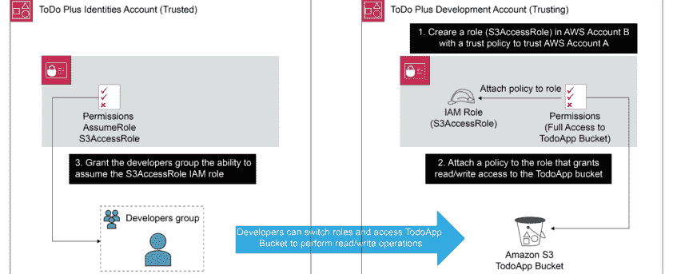

图 2.3 – 使用 IAM 角色配置跨账户访问

如图 2.3 所示，我们以 Identities 账户中的开发人员需要访问 development 账户中的 S3 存储桶（称为 TodoApp）为例。这称为跨账户访问，配置它涉及的主要步骤如下：

- I. 在 development 账户中，您必须配置一个具有信任策略的角色，该策略标识受信任的账户（在本例中为 Identities 账户）。在本例中，我们将 IAM 角色命名为 IAM-User-S3-AccessRole。配置要求您提供 Account A 的 ID。
- II. 您还需要配置一个包含对 Account B 中 TodoApp S3 存储桶执行读/写操作所需权限的策略。
- III. 最后，在 Account A 中，您需要配置另一个策略，授予开发人员承担在 Account B 中创建的 S3AccessRole 的能力。您通过在策略语句中指定 Account B 的 Account ID 和角色来执行此操作。策略将根据以下 JSON 脚本授予 sts:AssumeRole 权限：

```json
{
  "Version": "2012-10-17",
  "Statement": {
    "Effect": "Allow",
    "Action": "sts:AssumeRole",
    "Resource": "arn:aws:iam::Developer-Account-ID:role/S3AccessRole"
  }
}
```

一旦完成上述配置，开发人员就可以切换角色并访问 AWS Account B 中的 TodoApp S3 存储桶。

**注意**
使用新的 IAM Identity Center 服务（以前称为 AWS Single Sign-On），您可能不需要大量使用跨账户访问来访问 IAM 用户。这是因为 IAM Identity Center 提供了一种替代方法，可让您的员工用户访问您 AWS Organizations 中多个即用型账户中的账户。这些用户可以来自 AWS IdPs 以及外部提供商。我们将在本章后面讨论 IAM Identity Center。

- **联合身份验证：** 应用程序可以使用身份联合验证使用外部 IdP 对外部用户进行身份验证，而无需自定义登录代码。这可以使用与 **OpenID Connect (OIDC)**、Microsoft AD 或协议（LDAP）兼容的 Amazon、Facebook、Google 或其他 IdP 实现，这些 IdP 支持 SAML 2.0。通过这样做，可以在外部 IdP 和托管在 AWS 上的应用程序之间开发基于令牌的身份验证策略，从而消除对单独用户账户和密码的需求。

## IAM 策略

JSON 文档遵循 IAM 策略标准，该标准概述了特定 IAM 角色定义的权限。以下是此类策略的示例，该策略允许访问存储在 TodoApp S3 存储桶中的对象：

```json
{
    "Version": "2012-10-17",
    "Statement": [
        {
            "Sid": "AccessToDoAppBucket",
            "Action": [
                "s3:GetObject",
                "s3:ListBucket"
            ],
            "Effect": "Allow",
            "Resource": [
                "arn:aws:s3:::todoapp",
                "arn:aws:s3:::todoapp/*"
            ]
        }
    ]
}
```

现在，让我们探讨与 IAM 角色关联的策略类型：

- **信任策略**：此策略定义了被信任的服务。每个角色只能有一个信任策略。可以信任的服务包括 EC2、EMR、EC2 容器服务、**关系数据库服务（RDS）**、Lex 和 Glue。
- **权限策略**：授权策略指定角色可以访问哪些资源以及角色可以在这些资源上执行哪些操作。策略可以由 AWS 控制或由客户端控制，也可以与角色本身内联添加。更多信息请参见 https://docs.aws.amazon.com/IAM/latest/UserGuide/access_policies_managed-vs-inline.html。

## 权限边界

此功能允许您设置边界或限制 IAM 策略可以分配的最大权限。权限边界允许您限制执行特定任务的访问权限。当组织中有大量员工时，这是有益的，您希望允许他们创建和自定义自己的策略，同时确保他们不会超过权限边界指定的权限。

例如，假设您有一组系统管理员，他们应该完全访问 IAM、S3 和 RDS。您希望确保他们不会启动任何 EC2 实例。您可以向其账户添加一个策略，拒绝他们启动 EC2 实例的能力。但是，如果他们完全访问 IAM，他们可以删除该限制或创建另一个具有启动 EC2 实例权限的 IAM 用户。

可以将其权限边界应用于其账户，以便他们只能在附加了相同权限边界的情况下创建其他 IAM 用户账户。此外，权限边界将明确拒绝启动 EC2 实例的能力。现在，您有一个场景，即使管理员之一尝试创建另一个 IAM 用户账户，该新用户账户仍将被拒绝启动 EC2 实例的能力，从而防止任何规避策略的机会。

在本节中，我们回顾了 AWS IAM 的基本概念，包括其关键组件，例如 IAM 用户、IAM 角色和 IAM 策略。

默认情况下，以 IAM 用户身份访问 Web 控制台需要用户名和密码组合。此外，您还需要访问密钥（包括访问密钥 ID 和秘密访问密钥）进行命令行访问。

仅由用户名和密码组成的凭证存在安全风险，可以通过 MFA 来缓解。在下一节中，我们将详细研究这项技术。

## 使用 MFA 改善您的安全态势

MFA 是一种安全功能，通过要求用户除了用户名和密码之外还输入六位数字令牌来增强身份验证过程。AWS 强烈建议为您的 root 用户账户和 IAM 用户启用 MFA 以提高安全性。


## 基于安全令牌的多因素认证（MFA）

启用 MFA 后，必须由可信来源提供认证码才能访问管理控制台。您可以使用基于硬件或软件（虚拟）的 MFA 设备，为 AWS API 调用和用户控制台登录设置 MFA。

AWS 提供**通用第二因子（U2F）**作为基于开放认证标准的 MFA 选项。U2F 可以使用专用 USB 密钥或**近场通信（NFC）**设备（如智能卡技术），但 AWS 仅支持基于 USB 的 U2F，不支持 NFC 设备用于 MFA。

有关 U2F 的更多详细信息，请参阅 https://docs.aws.amazon.com/IAM/latest/UserGuide/id_credentials_mfa_enable_u2f.html 上的信息。

用户必须拥有 IAM 用户账户才能使用 MFA 令牌，MFA 令牌采用基于时间同步的一次性 PIN 码方式，使用六位数字进行身份识别。MFA 提供了额外的保护层，需要同时提供 MFA 令牌、用户名和密码才能访问账户。IAM 用户的 MFA 令牌仅由同步的 MFA 设备生成，并会定期更换。

## 使用 SAML 2.0 和 Microsoft AD 通过身份联合访问 AWS 账户

Microsoft AD 是各类规模企业中使用最广泛的 IAM 服务，尤其是在本地工作负载方面。Microsoft AD 存储了整个组织中的用户、角色和权限信息，并为 AWS 平台提供了一种替代认证方式。在下一节中，您将学习如何将 AWS 账户链接到现有的 **AD 联合服务（AD FS）**。

在本节中，我们讨论另一种利用现有 IdP 的选项：使用 Microsoft AD 和 SAML 2.0 对您的 AWS 账户进行认证。SAML 2.0 是一种开放标准，用于在 IdP（如 Microsoft AD FS）和**服务提供商（SP）**（此处指 AWS）之间交换认证和授权令牌。SAML 2.0 通常用于实现**单点登录（SSO）**功能，使用户能够使用一套凭据访问多个服务，而无需分别登录每个服务。

许多企业使用 AD 环境来管理本地托管服务的认证和授权。在拥有数千至数百万用户的大型组织中，用户的凭据、权限策略以及跨多个平台的访问可能变得越来越难以管理。身份联合允许您为外部身份授予使用 AWS 管理控制台或 API 的权限，从而无需为现有用户创建新的 IAM 用户账户，减少了管理开销。通过使用 AD FS，您可以将组织的 AD 资源无缝连接到 AWS。

下图描述了如何配置 AD FS 服务，以允许 AD 环境中的用户进行联合访问：

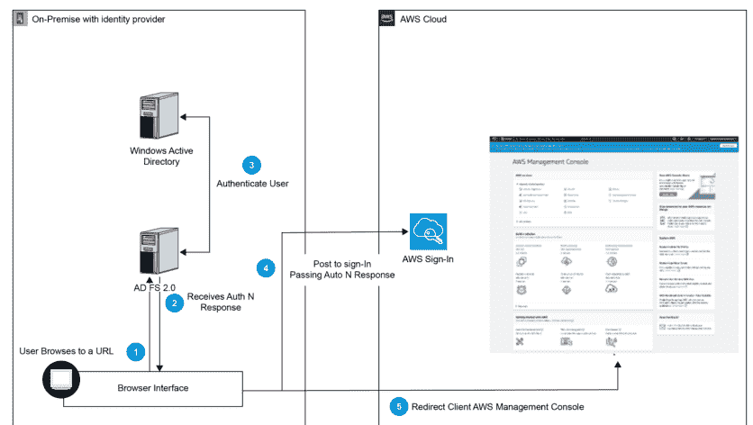

图 2.4 – 使用 AD 进行认证的流程

以下是使用 AD FS 访问管理控制台的步骤分解，如图 2.4 所示：

- 1. 在互联网浏览器中，您请求访问一个 AD FS 网站。https://HostName/adfs/ls/IdpInitiatedSignOn.aspx 是该 URL 的一个示例。当您在基于 Windows 的服务器上启用 AD FS 服务时，它会在您的 Web 服务器上生成一个名为 adfs 的虚拟目录。登录页面会自动生成。
- 2. 收到凭据后，AD FS 会对照 Windows AD 验证用户身份。
- 3. AD FS 向用户浏览器提供 SAML 断言，以促进认证响应。
- 4. 用户浏览器将 SAML 断言发布到 AWS 端点。在底层，AssumeRoleWithSAML 会请求临时令牌，然后生成一个登录链接，用于登录 AWS Web 界面。
- 5. 用户随后可以使用该登录 URL，并被重定向到管理控制台。

Microsoft AD 非常适合保护内部资源，但外部应用程序/资源呢？在下一节中，我们将了解如何使用 Amazon Cognito 和第三方 IdP 来保护您的工作负载。

## 使用 Web 身份联合进行应用程序认证

大多数 Web 和移动应用程序在终端用户使用其服务之前，都需要在应用程序层进行某种形式的认证和授权。

对于新的 Todo List 应用程序，客户需要注册订阅。接下来，为了确保只有有效客户才能访问此应用程序，需要构建一个登录流程，作为应用程序认证和授权安全功能的一部分。

开发用户数据库并验证其凭据是任何应用程序开发生命周期中的关键步骤。然而，将凭据数据存储在应用程序代码或设备中是极不安全且有风险的。为了解决这个问题，Amazon 建议在 Web 和移动应用程序的认证工作流中使用 Web 身份联合。这允许应用程序从 IdP 动态请求临时安全凭据，IAM 角色可以通过令牌提供者生成这些凭据。

Web 身份联合支持使用各种可信的第三方 IdP（如 Amazon、Google 和其他符合 OIDC 标准的 IdP）进行注册和登录，无需创建用户名和密码。一旦用户通过验证，软件便会颁发令牌，授予临时 AWS 访问权限。请注意，这些凭据与特定的 IAM 角色相关联，并且只能用于该角色明确授权的任务。

为了避免在应用程序中嵌入或分发凭据的安全风险，强烈建议将 Amazon Cognito 与 Web 身份联合结合使用，而不是开发自定义解决方案。Amazon Cognito 简化了移动和 Web 应用程序的注册和登录流程，支持第三方 IdP 的认证。

`https://aws.amazon.com/blogs/aws/aws-iam-now-supports-amazon-facebook-and-google-identity-federation/` 上的博客文章提供了使用在线身份联合的绝佳示例。

在下一节中，我们将了解 Amazon Cognito 如何帮助您简化应用程序的认证和授权工作流。

## 使用 Amazon Cognito 进行应用程序认证和授权

Amazon Cognito 是适用于您的 Web 和移动应用程序的身份服务。该服务允许您创建用户目录，或与 Google、Amazon、Facebook 等外部 IdP 联合。内部目录（或外部 IdP）用于验证用户身份并授权其访问您的应用程序。该服务消除了为应用程序创建自定义身份服务的相关开销。

Amazon Cognito 由两个关键组件组成，它们可以独立使用，也可以组合使用。我们接下来讨论这些组件。

### Amazon Cognito 用户池

Amazon Cognito 用户池是一项用户目录服务，为您的应用程序提供用户创建、管理和认证服务。终端用户可以注册用户账户，从而创建用户配置文件。您可以创建托管在 Amazon Cognito 中的独立用户目录，并使用 OIDC 生成的**JSON Web 令牌（JWT）**进行认证和授权。

或者，您也可以使用 Facebook、Google 和 Amazon 等第三方 IdP，在用户通过认证后，将这些第三方令牌交换为 Cognito 令牌。这使您能够避免创建另一个目录，避免用户再去记住另一套凭据。

Amazon Cognito 用户池允许您构建注册和登录工作流，并具有存储和管理用户数据的附加功能。您还可以使用组来更有效地管理用户。

其他关键功能包括：

- 可使用托管的**用户界面（UI）**进行注册和登录，或创建自定义 UI
- 使用用户名和密码进行认证；注册需要通过邮件等方式进行验证
- 实施 MFA 以增强安全性
- OAuth 2.0 流程
- 与 Facebook、Google 或 Amazon 等第三方 IdP 集成
- 集成 Lambda 触发器，在登录流程中添加钩子以实现附加功能
- 您还可以从第三方现有池迁移到 Cognito 用户池

用户通过 Cognito 用户池设置登录后，系统会颁发 JWT 等访问令牌，这些令牌可用于保护对某些 AWS 服务的访问。

#### 使用用户池访问后端资源

使用用户池时，您的用户登录后，您的 Web 或移动应用程序将收到用户池令牌，这些令牌可用于授予对后端资源的访问权限，如下方图表所示。例如，如果用户需要在社交媒体平台上更新其个人资料信息，数据最终存储在后台数据库中。为了使用户的更新成功执行，用户必须首先通过认证和授权，在此场景中由 Cognito 处理。


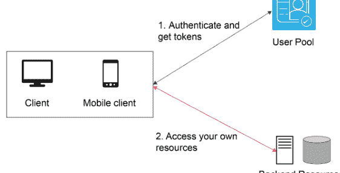

Figure 2.5 – 使用用户池访问后端资源

另一种选择是通过 API Gateway 或 Application Load Balancer 访问托管在 AWS 上的应用程序和 API。具体来说，你将使用你的令牌来保护 API 并实现对其访问的授权。这可以通过使用 Cognito authorizer（类型为 COGNITO_USER_POOLS）来完成，以通过 API Gateway 或 Application Load Balancer 授予对应用程序的访问权限。

API 部署后，已通过身份验证的用户可以检索身份或访问令牌，并使用它在授权头中附加令牌的情况下调用 API 方法。

下图说明了此工作流程：

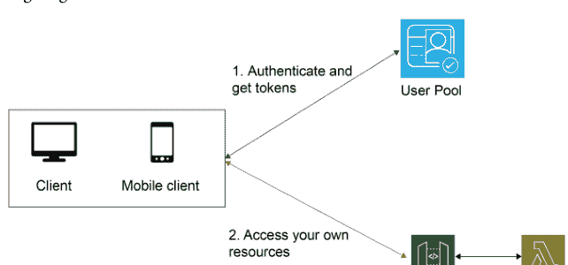

Figure 2.6 – 使用用户池通过 API Gateway 和 Lambda 访问资源

Amazon Cognito 用户池旨在用于限制 Web 和移动应用程序的 API 访问。

然而，用户池不能用于直接访问其他 AWS 服务，例如 Amazon S3 或 Kinesis。为此要求，你需要创建 Amazon Cognito **身份池**。让我们接下来讨论这个问题。

## Amazon Cognito Identity Pools

Amazon Cognito 身份池旨在用于在你想要授权经过身份验证或甚至匿名用户直接访问你的资源时使用。使用身份池时，你要么使用来自 Cognito 用户池的身份，要么使用第三方 IdP 的身份，并将用户池令牌（或第三方 IdP 的令牌）交换为临时的 AWS 凭证。然后你使用这些凭证访问 AWS API 和 AWS CLI。

当你的应用程序将凭证会话分配给经过身份验证的用户时，你可以授予对后端 AWS 资源（如 Amazon S3、Kinesis 和 DynamoDB）的访问权限。

Cognito 身份池的另一个功能是能够授予访客用户（匿名访问，如前所述）的访问权限。这涉及在用户未通过 IdP 进行身份验证的情况下向用户授予唯一标识符和 AWS 凭证。要启用访客访问，你需要在身份池的用户选项卡中激活它。

你还可以结合使用 Amazon Cognito 用户池和身份池，如下图所示，以促进你的用户注册和登录、管理他们的个人资料、访问你的应用程序，甚至访问后端 AWS 服务和资源。如果你不需要直接访问后端资源，则不需要这些临时的 AWS 凭证，在这种情况下，Amazon Cognito 用户池足以满足你的使用场景。

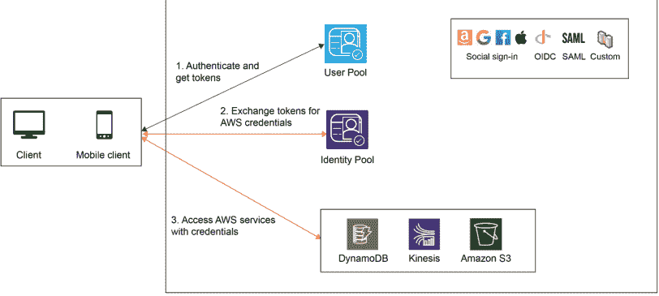

Figure 2.7 – 使用用户池和身份池访问 AWS 服务

最终，你可能会根据需求使用用户池、身份池，甚至两者兼用。总结来说，用户池旨在限制对 Web 和移动应用程序的 API 访问，仅限授权用户——你可以创建和管理自己的池来管理用户的身份（或与第三方提供商联合）。你还可以创建组并将用户关联起来。用户通过身份验证后，Amazon Cognito 会颁发访问令牌，然后用于通过 API Gateway 或 Application Load Balancer 授予对 API 的访问权限。

如果需要直接提供对后端服务（如 Amazon S3 或 DynamoDB）的访问，则需要使用身份池，因为你需要将访问令牌交换为 AWS 临时凭证。这些 AWS 临时凭证由 Amazon STS 创建和管理，我们接下来讨论它。

## How AWS STS Generates Temporary Tokens

STS 服务将自动生成凭证，这些凭证根据附加到身份的策略文档中定义的权限授予对 AWS 资源的有限访问。IAM 用户和联合用户都可以分配临时凭证。

临时安全凭证与 IAM 用户的永久访问密钥之间存在一些差异。虽然它们功能相似，但临时安全凭证具有一些独特功能：

- 临时凭证是为指定持续时间创建的，并在特定时间后过期
- 你可以配置凭证过期时间，从几分钟到数小时不等
- AWS 在过期后不再识别这些凭证，过期后进行的任何 API 请求都将被拒绝，除非继续具有续期凭证的权限

默认情况下，对 AWS STS 的调用会发送到其全局端点 https://sts.amazonaws.com，该端点会将请求重定向到 N. Virginia（us-east-1）区域。然而，你应考虑使用区域端点，其中大多数默认启用，以确保低延迟、增加冗余并提高会话令牌有效性。

以下是你可以使用 AWS STS 服务执行的常见操作：

- **AssumeRole**: 这会返回可用于访问你 AWS 账户中的资源或执行跨账户访问的临时凭证。凭证将包括访问密钥 ID、秘密访问密钥和安全令牌。在前面讨论的 IAM 角色部分中，你了解到如果 Todo List 前端网站托管在 EC2 实例上，并且网站需要访问托管在 S3 存储桶中的媒体内容，则需要将适当的角色分配给 EC2 实例作为实例配置文件。在这里，IAM 角色将由两个策略组成：一个信任策略，定义谁或什么可以承担该角色，在本例中为 EC2 服务。另一个策略包括承担角色的实体可以对资源执行的一组权限。因此，在本例中，它将是使用 GET 请求检索托管在 S3 中的媒体内容的能力。下图说明了此 AssumeRole 信任策略：

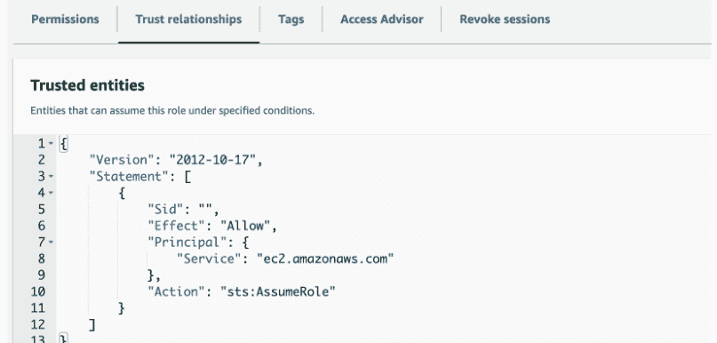

Figure 2.8 – AWS STS AssumeRole 信任策略

- **AssumeRoleWithSAML**: 这会返回通过 SAML 身份验证流程分配给经过身份验证用户的临时凭证。通常用于企业身份联合以实现 SSO 功能，组织可以通过其默认 IdP 联合身份验证。这允许用户使用现有的 IdP 身份验证凭证登录，并启用基于角色的 AWS 访问。使用 AssumeRoleWithSAML 生成的临时凭证默认持续 1 小时，但可配置为 1 小时到 12 小时之间的值。

- **AssumeRoleWithWebIdentity**: 这会为通过 Web IdP（如 OAuth 2.0 提供商，例如 Amazon、Google 或 Facebook）在 Web 或移动应用程序中进行身份验证的用户返回临时凭证。这使你能够构建和部署应用程序以请求临时凭证，而无需在应用程序中存储长期凭证。这是因为用户使用来自 Web IdP 的令牌进行身份验证。

- GetSessionToken: 这会为 IAM 用户返回临时凭证，通常用于当你希望通过 MFA 对某些 AWS API 操作（如 EC2 StopInstances）提供额外保护时。IAM 用户将使用 GetSessionToken 函数并提供其 MFA 设备上的 MFA 代码，从而能够执行实例停止请求。

在本节中，你了解了 AWS STS 以及它如何促进临时安全凭证的创建和管理，这些凭证被 IAM 角色等功能使用。

接下来，让我们看一下 Todo List 应用程序设计架构的高级概述，并特别强调 Amazon Cognito 服务以及它如何集成到设计中。

## Amazon Cognito and the Todo List Application

我们的客户 TodoPlus Limited 将利用 Amazon Cognito 服务来促进其 Todo List 应用程序的终端用户注册和登录流程。对于此应用程序的目的，你还将使用自定义 UI 而不是托管 UI。Amazon Cognito 将与多个其他 AWS 服务集成以提供安全功能。这些包括防止分布式拒绝服务（DDoS）攻击以及与 API Gateway 集成以控制谁调用这些 API 操作。

在下图中，你将看到 Todo List 应用程序的整体应用程序架构。此时架构工作流程可能看起来有点不熟悉也没关系。随着你逐步学习本学习指南，你将了解用于在 AWS 上设计、构建和部署此应用程序的核心基础技术。对于现在，我们在高层次上突出一些我们将使用的关键 AWS 服务。然后在后续章节中深入研究每个服务。

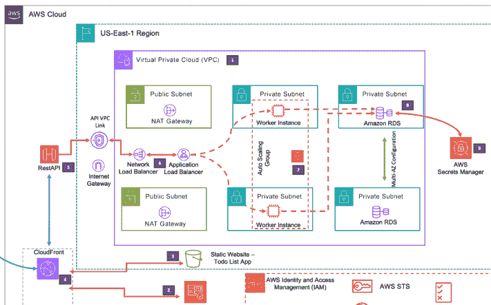

Figure 2.9 – Todo List 应用程序的高级架构设计


应用架构如[图 2.9](#)所示，由多个 AWS 组件组成。部分组件如下：

- **专有虚拟网络（VPC）**：使您能够创建隔离的网络以分离工作负载和应用程序。某些提供虚拟机计算服务的服务，例如 EC2 实例，必须托管在 VPC 中。您将使用 VPC 将面向公众的工作负载与您的 Todo List 应用程序的私有工作负载分离。
- **Amazon Cognito**：为您的 Web 和移动应用程序提供身份验证和授权服务。如前所述，Amazon Cognito 将允许最终用户登录 Todo List 应用程序。
- **Amazon S3**：这是一个高度可扩展且持久的对象存储平台，也可用于托管我们的 Todo List 应用程序的静态网站。
- **CloudFront**：提供了在边缘位置分发和缓存内容的能力，以确保低延迟连接。CloudFront 还可以与 **Lambda@Edge** 集成，以响应流入 CloudFront 的请求提供额外的功能。
- **API Gateway**：使开发者能够创建、发布和管理其 API。它还用于接受和处理多达数十万并发 API 调用，管理 API 流量，提供**跨源资源共享（CORS）**支持、授权、访问控制、限流、监控和 API 版本管理。
- **弹性负载均衡器**：自动将传入的应用程序流量分布到一个或多个**可用区（AZ）**中的多个目标（如 EC2 实例）和虚拟设备上。有不同类型的负载均衡器，本学习指南稍后部分将讨论适用于我们应用解决方案的类型。
- **自动缩放组**：为您的计算资源集群（如 EC2 实例）提供自动缩放功能。
- **Amazon RDS**：这是一项完全托管的关系数据库服务，将托管最终用户的所有 Todo List 数据。
- **AWS Secrets Manager**：帮助您管理、获取和轮换数据库凭据和应用程序凭据。您将使用 AWS Secrets Manager 存储 RDS 数据库凭据以进行安全访问。

在任务 2.1 – 为 Todo List 应用程序创建 Amazon Cognito 用户池中，您将有机会创建一个 Amazon Cognito 用户池，随着本学习指南的深入，该用户池将被用于您的应用程序架构。

除了 IAM 和 Amazon Cognito，AWS 还发布了新的 IAM Identity Center。它之前被称为 AWS Single-Sign-On，旨在帮助加速从其他 AWS 账户和外部 IdP 到第三方基于 SaaS 的应用程序集成的联邦访问构建。IAM Identity Center 非常适合管理跨越多个 AWS 账户的员工身份。接下来，让我们讨论一下该服务的概览。

## AWS IAM Identity Center 概览

IAM Identity Center 旨在帮助集中创建和管理您的员工身份。该服务实际上是 IAM 和 AWS Single Sign-On 服务的叠加。使用 IAM Identity Center，您可以使用默认的内部 AWS IdP 或连接并同步到外部 IdP（如 Microsoft AD Domain Services）。这使得授予 SSO 能力比标准 IAM 更简单。

您可以使用多账户权限将用户访问权限分配给 AWS Organizations 内的所有 AWS 账户。这比尝试配置跨账户访问和多个 IAM 角色以允许一个 AWS 账户中的用户访问组织内其他 AWS 账户的方法要容易得多。

使用 IAM Identity Center，您还可以分配对与 Identity Center 集成的应用程序或提供 SAML 2.0 集成的第三方应用程序的访问权限。在使用 IAM Identity Center 代替 AWS IAM 时存在多种用例，尤其是在员工用户管理方面。

就我们的客户 TodoPlus Limited 而言，您应该考虑使用 AWS IAM Identity Center 授予现有员工的访问权限。假设 TodoPlus 拥有现存的本地员工，其中一些人可能需要访问 AWS 平台来设计、构建和部署新的 TodoPlus 应用程序，整合他们的本地 IdP（如 AD）将有助于加快他们在 AWS 平台上的访问能力。此外，使用 IAM Identity Center，通过中央 Web 门户向您的员工用户授予对多个 AWS 账户（如开发、测试和生产环境）的访问权限要容易得多。

在下一节中，您可以完成几个练习，学习如何使用 AWS IAM 创建资源。

### 练习 2.1 – 在您的开发账户中创建 IAM 用户和 IAM 组

在这个练习中，您将使用现有的 AWS 开发账户（在上一章中创建的）创建一个 IAM 用户。该 IAM 用户将具有对 AWS 的控制台和程序化访问权限。该用户将在本学习指南后续的练习中用到，提供实践经验并帮助您为 AWS 认证开发者 – 助理级（AWS Certified Developer Associate）考试做准备。请按照以下步骤在您的开发账户中创建 IAM 用户和 IAM 组：

1. 登录到您的 AWS 开发账户，该账户在*第 1 章，AWS 账户和全球基础设施简介*中创建。您将作为 root 用户登录，因为您还没有创建任何 IAM 用户。
2. 在顶部搜索栏中搜索 IAM，然后从出现的下拉列表中选择 IAM 服务。然后您将进入 IAM 仪表盘。

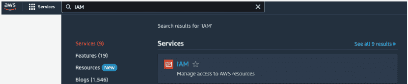

图 2.10 – 使用搜索栏搜索 AWS IAM 服务

3. 创建一个 IAM 组。此组将包含您为同事（包括 Alice）创建的所有开发者用户账户。
4. 在左侧菜单中，单击“用户组”。
5. 在右侧窗格中，单击“创建组”按钮。
6. 在“组名称”标题下提供一个名称。对于本练习，将您的组命名为 `developers`。

| 字段 | 描述 |
| :--- | :--- |
| 用户组名称 | 输入一个有意义的名称以标识此组。 |
| **developers** | 最多 128 个字符。使用字母数字和 '+=,._-' 字符。 |

图 2.11 – 命名组

7. 向下滚动，在子标题**附加权限策略 – 可选**下，在搜索框中搜索 Administrator，然后按 Enter。

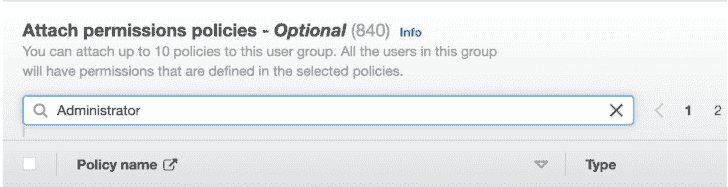

图 2.12 – 搜索现有托管 IAM 组

8. 在“策略名称”下的列表中，选择 AdministratorAccess。
9. 单击页面底部的**创建组**。AWS 将创建一个名为 **developers** 的组，该组附加了 AdministratorAccess 权限。
10. 在左侧菜单中，单击“用户”。
11. 在右侧窗格中，单击“创建用户”。
12. 在“用户名称”下输入 Alice。
13. 勾选**提供用户访问 AWS 管理控制台 – 可选**旁边的复选框。
14. 选择**自定义密码**并提供您选择的复杂密码。
15. 取消勾选**用户必须在下次登录时创建新密码（推荐）**。这是因为您将在这本书中的后续练习中以 Alice 的身份登录。但是，如果您为其他人创建用户账户，则强烈建议此选项。现在，单击“下一步”。
16. 您将被带到向导的**设置权限**部分。从列表中选择了 **developers** 组，然后单击“下一步”。

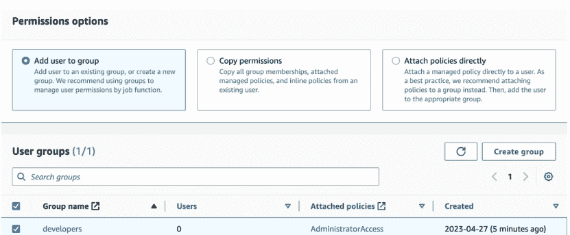

图 2.13 – 为 Alice 选择 developers 组

17. 查看您的配置，然后单击页面底部的“创建用户”。然后系统将提示您下载该用户的 .csv 文件，如下面的截图所示。当您需要同步凭据信息给用户时，这是理想的。但是，由于您将在未来的练习中以 Alice 的身份登录，因此您不需要下载 .csv 文件，因为您已经知道密码。

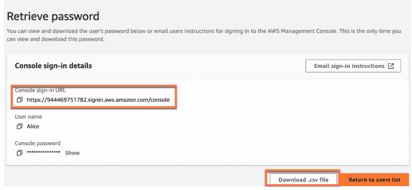

图 2.14 – 下载用户凭据

当作为 IAM 用户登录时，您必须提供要登录的账户 ID。您可以通过单击屏幕右上角的账户名称来记录账户 ID，或者记录控制台登录 URL（在前面的截图中显示）。此链接将您引导至包含预定义在登录屏幕中的账户 ID 的 AWS 登录网站。

我使用的是 Google Chrome 隐身窗口，因为我还是以 root 用户身份登录我的 AWS 账户。然后，您可以尝试使用您的 IAM 用户 ID 和关联密码登录该账户，如图 2.14 所示：


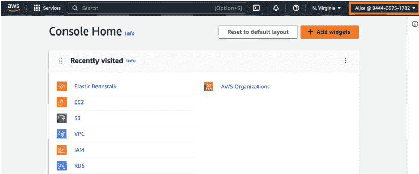

Figure 2.15 – Logged in as the IAM user, Alice

现在你已经设置了 IAM 用户和 IAM 组，可以确保所有后续练习都以 IAM 用户 Alice 的身份进行。避免在日常操作中使用 root 用户登录，因为这存在安全风险。虽然 Alice 已被分配 AdministratorAccess 权限，但仍有一些任务只有 root 用户才能执行，包括关闭 AWS 账户。此外，在本练习中授予我们的用户 Alice 管理权限的原因是为了帮助你轻松完成本学习指南中的剩余练习。在现实世界中，你需要确保遵循 POLP。

在下一个练习中，你将有机会开始构建托管 Todo List 应用的基础组件。具体来说，你将创建一个 Amazon Cognito 用户池，该用户池将由应用程序用于验证和授权终端用户访问其 Todo List 应用。

## Technical Requirements

要完成所有即将到来的项目任务，请确保以 IAM 用户 Alice 的身份登录你的 AWS Developer 账户。

## Project Task 2.1 – Creating an Amazon Cognito User Pool for the Todo List Application

在本项目任务中，你将开始着手我们在上一章中讨论的开发项目。如讨论所述，你将使用多个 AWS 服务并创建多个 AWS 资源，旨在为我们的虚构客户 Todo Plus Limited 托管和管理应用程序。

在本任务中，你将创建一个 Amazon Cognito 用户池，用于对应用程序的终端用户注册和登录功能进行身份验证和授权。

下图突出了你在本次项目任务中将要工作的整体架构计划区域。

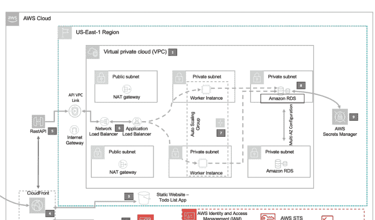

Figure 2.16 – Project Task – Create Cognito user pool

- 1. 以你在上一个练习中创建的用户 Alice 的身份登录你的 AWS 开发账户。
- 2. 通过在顶部搜索栏中搜索来导航到 Cognito 服务。
- 3. 点击页面右侧的 Create user pool 按钮，并确保你位于 N. Virginia 区域。

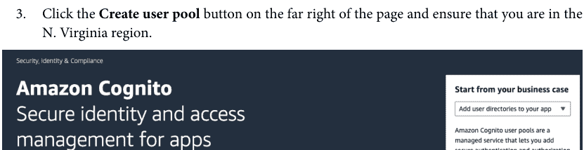

Figure 2.17 – Access the Amazon Cognito console

## Step 1 – Configure Sign-In Experience

- 1. 默认情况下，**Cognito user pool** 已被选中。此外，你还可以启用 **Federated identity providers**。此选项允许你使用 Facebook、Google、Amazon 和 Apple 等第三方 IdP 进行登录。请注意，你也可以禁用 Cognito 用户池而仅选择联合登录。然而，在这种情况下，用户将无法自行注册其个人资料，只有管理员可以创建用户。为本项目目的，仅选择默认选项。

    **Authentication providers**
    配置用户登录时可用的提供商。

    **Provider types**
    选择用户将登录到你的 Cognito 用户池、联合身份提供商还是两者。Amazon Cognito 对联合用户和用户池用户有不同的定价。了解更多关于定价的信息

    **Cognito user pool**
    用户可以使用其电子邮件地址、电话号码或用户名登录。用户属性、组成员身份和安全设置将存储在你的用户池中并进行配置

    **Federated identity providers**
    用户可以使用来自 Facebook、Google、Amazon 和 Apple 等社交身份提供商的凭据登录；或使用通过 SAML 或 Open ID Connect 的外部目录的凭据。你可以在用户池中管理联合用户的属性映射和安全设置。

    **Cognito user pool sign-in options** Info
    选择在用户池中用于登录的属性。如果你仅选择一个属性，或选择用户名和至少一个其他属性，你的用户可以使用所有选定的选项进行登录。如果你仅选择电话号码和电子邮件，你的用户在注册时将被提示选择两种登录选项之一。

    - User name
    - Email
    - Phone number

    > ⚠ Cognito user pool sign-in options can't be changed after the user pool has been created.

    Figure 2.18 – Setting Authentication providers in Amazon Cognito and choosing pool sign-in options

- 2. 在 **Cognito user pool sign-in options** 下选择 **Email** 并点击 **Next**。

## Step 2 – Configure Security Requirements

- 1. 定义你的密码策略。为此，只需选择 **Cognito defaults**。
- 2. 在 **Multi-factor authentication** 部分下选择 **No MFA**。在真实场景中，你应考虑配置 MFA 以获得额外保护。
- 3. 在 **User account recovery** 下，确保已选择 **Enable self-service account recovery – Recommended**。接下来，确保账户恢复的方法选择了 **Email only**。点击 **Next**。

    **User account recovery**
    配置用户忘记密码时如何恢复其账户。收件人消息和数据费率适用。

    Self-service account recovery Info

    ☑ Enable self-service account recovery - Recommended
    在你的用户池中允许忘记密码操作。在托管 UI 登录页面中，会显示“Forgot your password?”链接。当此功能未启用时，管理员将使用 Cognito API 重置密码。

    Delivery method for user account recovery messages Info
    选择你的用户池在用户请求账户恢复代码时如何发送消息。SMS 消息由 Amazon SNS 单独计费。电子邮件消息由 Amazon SES 单独计费。了解更多关于定价的信息。

    - Email only
    - SMS only
    - Email if available, otherwise SMS
    - SMS if available, otherwise email
    - SMS if available, otherwise email, and allow a user to reset their password via SMS if they are also using it for MFA

    Figure 2.19 – User account recovery

## Step 3 – Configure Sign-Up Experience

- 1. 在 **Self-service sign-up** 下确保已选择 **Enable self-registration**。
- 2. 在 **Attribute verification and user account confirmation** 下，确保已选择 **Send email message, Verify email address**。
- 3. 在 **Required attributes** 部分下，从 **Additional required attributes** 下拉菜单中选择 given_name。点击 **Next**。

## Step 4 – Configure Message Delivery

- 1. 在 **Email** 部分下，选择 **Send email with Cognito**。此选项专为开发和测试目的而设计，每天限发送 50 封电子邮件。对于生产环境，你希望使用 **Amazon Simple Email Service (Amazon SES)** 发送电子邮件，该服务提供高电子邮件发送量。点击 **Next**。

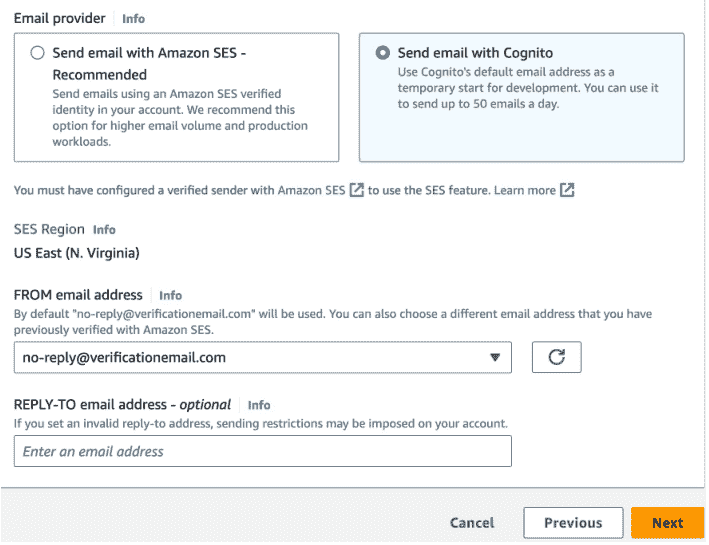

## Step 5 – Integrate Your App

- 1. 提供你选择的 user pool 名称。
- 2. 提供你选择的 app client 名称。
- 3. 在 **Client secret** 下，选择 **Don't generate a client secret** 选项。
- 4. 展开 **Advanced app client settings** 部分并从下拉列表中选择 `ALLOW_USER_PASSWORD_AUTH`。

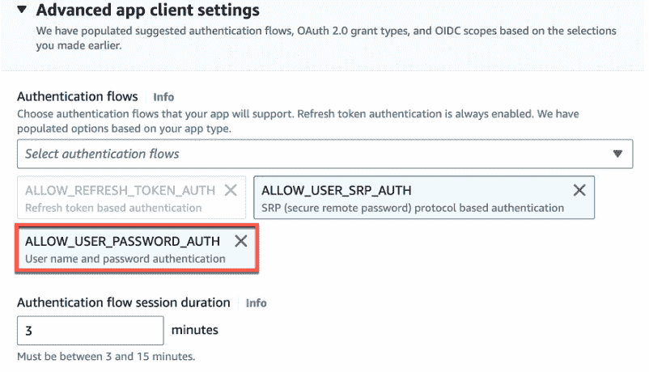

*Figure 2.21 – Advanced app client settings*

> **Note**
>
> 根据这些默认值，你会注意到 **Enable token revocation** 已启用，如以下屏幕截图所示。这允许你使用 Cognito API 或撤销端点撤销用户的刷新令牌，从而使先前签发的刷新令牌失效。
>
> 另一个已启用的默认设置是 **Prevent user existence errors**。通常，当用户尝试登录时，Cognito 会说明用户名或密码是否错误，或者用户是否根本不存在。启用此选项后，Cognito 仅说明用户名或密码错误，即使对于不存在的用户也是如此。这有助于防止凭据猜测攻击，为用户池增加了额外的安全措施。

- 5. 滚动到页面底部并点击 **Next**，接受所有剩余的默认值。


# 高级安全配置 - 可选

启用令牌撤销 Info
Amazon Cognito 将向访问令牌和 ID 令牌添加新的声明以启用撤销。这会增加令牌的大小。

防止用户存在错误 Info
Amazon Cognito 身份验证 API 返回通用身份验证失败响应，表示用户名或密码不正确，而不是表示未找到用户。

接受额外的用户上下文数据 Info
您的应用客户端接受您的应用添加到未经身份验证请求中的 IP 地址。此 IP 地址以及设备指纹会为 Amazon Cognito 高级安全功能的风险评估做出贡献。当您不接受额外的用户上下文数据时，您的应用客户端仅接受设备指纹。
您的用户池尚未设置以接受额外的用户上下文数据。请对您的应用客户端和用户池进行以下更改以激活此功能。

- 在创建用户池后，从 App integration 选项卡启用 Amazon Cognito 高级安全功能。

Figure 2.22 – Advanced security configurations – optional

## Step 6 – Review and Create

- 1. Review the configuration settings.
- 2. Once the configuration settings are confirmed, click the Create user pool button. At this stage, you have created your user pool that will be used for the application.

## Step 7 – Testing the Cognito User Pool

- 1. From the left-hand menu, click on User pools.
- 2. In the right-hand pane, click the user pool name.
- 3. Next, under Users, click Create user.

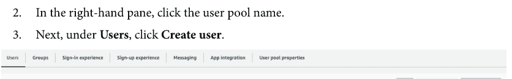

Figure 2.23 – Testing the Cognito Create user action

- 4. Under User information, select Send an email invitation.
- 5. Under Email address, provide a valid email address for your test user.

6. Click **Generate a password** in the **Temporary password** section.

Amazon Cognito > User pools > todolist-userpool > Create user

# Create user Info

# User pool sign-in and security requirements

Review the user pool security configuration that will be enforced when you create this user.

# User information

Configure this user's verification and sign-in options.

Invitation message Info
Configure invitation message templates in the Messaging tab

- Don't send an invitation
- Send an email invitation

Email address
Enter this user's email address. A user's email address can be used for sign-in, account recovery, and account confirmation.

Mark email address as verified

Temporary password
Amazon Cognito will send the password you generate to the user in an email message.

- Set a password
- Generate a password

Figure 2.24 – Create user

7. Click **Create user**. You should now receive an email with a temporary password.

8. The following is an Amazon Cognito dashboard showcasing your new user:

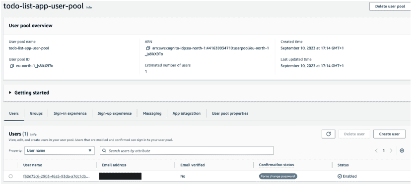

Figure 2.25 – Amazon Cognito dashboard displaying user pool and registered users

In upcoming chapters, you will use this user pool to allow end users to sign up and sign in to the Todo List application.

# Summary

In this chapter, you have learned about the AWS IAM service. AWS IAM offers authentication and authorization services to allow you to define who or what can access your AWS accounts, its services, and resources. You have covered the concepts of IAM users, groups, and roles, and how these features of IAM can help you address different access requirements.

Amazon Cognito was also discussed, which allows you to build an authentication and authorization service for your web and mobile applications. With Amazon Cognito, you can create a user pool to host your own user directory or federate with external IdPs such as those that are OIDC and SAML 2.0 compatible.

Finally, we looked at the new AWS Identity Center, which is a more streamlined process of managing your workforce identities and offers SSO features with external IdPs, such as Microsoft AD.

In the next chapter, we introduce you to the different types of storage services and specifically focus on Amazon S3, which is AWS’s object storage offering. Amazon S3 is highly scalable, reliable, and cost effective. It is particularly designed to host data for modern web and mobile applications and even fulfill data-related regulatory and compliance requirements. We also look at options for distributing data globally with minimum latency and building hybrid cloud storage offerings.

# Exam Readiness Drill – Chapter Review Questions

Apart from a solid understanding of key concepts, being able to think quickly under time pressure is a skill that will help you ace your certification exam. That is why working on these skills early on in your learning journey is key.

Chapter review questions are designed to improve your test-taking skills progressively with each chapter you learn and review your understanding of key concepts in the chapter at the same time. You’ll find these at the end of each chapter.

> **How to Access These Materials**
> To learn how to access these resources, head over to the chapter titled *Chapter 17, Accessing the Online Resources*.

To open the Chapter Review Questions for this chapter, perform the following steps:

- 1. Click the link – https://packt.link/DVAC02_CH02.

Alternatively, you can scan the following **QR code** (*Figure 2.26*):


Figure 2.26 – QR code that opens Chapter Review Questions for logged-in users

2. Once you log in, you’ll see a page similar to the one shown in Figure 2.27:

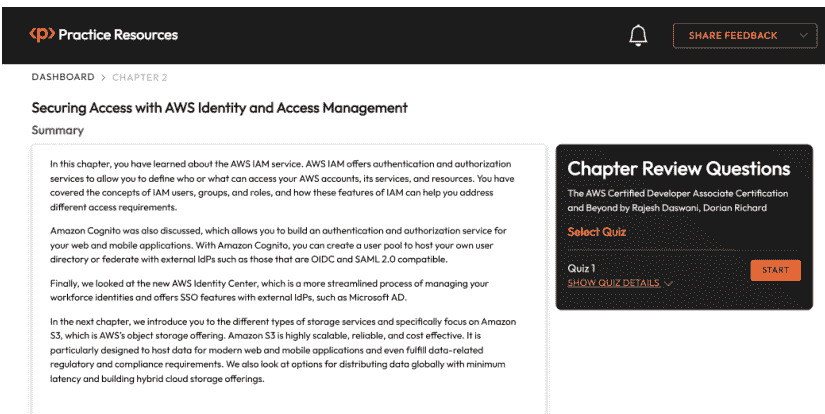

Figure 2.27 – Chapter Review Questions for Chapter 2

3. Once ready, start the following practice drills, re-attempting the quiz multiple times.

# Exam Readiness Drill

For the first three attempts, don’t worry about the time limit.

# ATTEMPT 1

The first time, aim for at least 40%. Look at the answers you got wrong and read the relevant sections in the chapter again to fix your learning gaps.

# ATTEMPT 2

The second time, aim for at least 60%. Look at the answers you got wrong and read the relevant sections in the chapter again to fix any remaining learning gaps.

# ATTEMPT 3

The third time, aim for at least 75%. Once you score 75% or more, you start working on your timing.

> **Tip**
> You may take more than three attempts to reach 75%. That’s okay. Just review the relevant sections in the chapter till you get there.

# Working On Timing

**Target:** Your aim is to keep the score the same while trying to answer these questions as quickly as possible. Here’s an example of how your next attempts should look like:

| Attempt | Score | Time Taken |
|---|---|---|
| Attempt 5 | 77% | 21 mins 30 seconds |
| Attempt 6 | 78% | 18 mins 34 seconds |
| Attempt 7 | 76% | 14 mins 44 seconds |

Table 2.1 – Sample timing practice drills on the online platform

> **Note**
> The time limits shown in the above table are just examples. Set your own time limits with each attempt based on the time limit of the quiz on the website.

With each new attempt, your score should stay above 75% while your “time taken” to complete should “decrease”. Repeat as many attempts as you want till you feel confident dealing with the time pressure.
