# Understanding Object Storage with Amazon S3, Hybrid Storage, and Static Website Hosting

Data creation, management, and storage have become paramount in our information age. Companies across the globe now hold thousands of exabytes. With the amount of data companies hold and process rising exponentially, there is a need to ensure that data is securely stored, enforce access restrictions, and run complex computational processes to analyze that data faster than ever.

With this need for security, processing power, and easy administration, choosing the right storage services is a vital task in both on-premises and cloud ecosystems. Storage options have matured, catering to different requirements and application use cases. The range of modern storage solutions considers performance needs, data accessibility, security, cost, and scalability. Options range from simple block storage to hybrid options.

This chapter looks at the fundamentals of storage, focusing on AWS's object storage offerings. You will delve into the Amazon Simple Storage Service (S3) to help you become acquainted with its most valuable features and role in contemporary application design. Moreover, you will discover ways to minimize costs while enhancing operational efficiency, developing disaster recovery strategies, and safeguarding cloud data access.


本章还将探讨 **TodoPlus Limited** 如何利用 Amazon S3 实现可靠且可扩展的数据存储解决方案，并在必要时集成混合存储方法。Amazon S3 还允许你构建静态网站，可用于为我们的 Todo List 应用程序搭建前端**用户界面（UI）**。Amazon S3 静态网站托管为全球数百万网站提供支持，是无服务器设计架构的关键组成部分；它与 DevOps 原则和工具一起，在 AWS 认证开发者助理考试中占据了相当大的比重。Amazon S3 也属于考试范围内的**领域 1 – 使用 AWS 服务进行开发**，具体来说是在**任务声明 3 – 在应用程序开发中使用数据存储**中。

借助 Amazon S3，TodoPlus 可以随时存储和检索任意数量的数据，为其不断增长的用户群提供所需的可扩展性。

本章将涵盖以下主题：

- 存储选项简介
- 使用 Amazon S3 进行对象存储简介
- 通过 Amazon S3 存储类管理数据存储成本
- 在 Amazon S3 中保护数据免遭意外删除
- 使用基于资源的策略实施数据保护
- 将 Amazon S3 版本控制与 S3 生命周期管理结合使用
- 使用基于资源的策略实施数据保护
- 使用 Amazon S3 构建静态网站
- 其他 Amazon S3 功能
- 使用 Amazon Storage Gateway 的混合存储解决方案
- 项目任务 – 为 *Todo List* 应用程序创建 Amazon S3 静态网站

## 存储选项简介

随着存储选项的日益多样化，如物理附加块存储、网络附加块存储和文件存储，以及更现代的对象存储，云工程师能够针对特定用例选择正确的存储选项变得非常重要。在接下来的部分中，你将了解 AWS 提供的三大类存储服务——块存储、文件存储和对象存储——并讨论它们之间的差异。

### 块存储

块存储将数据以固定大小的块存储在物理硬盘上。磁盘被划分为可通过网络接口供你的 EC2 实例（服务器）访问的卷。这使得你的服务器操作系统（OS）可以直接访问卷、格式化卷，并向卷写入数据以及从卷读取数据。服务器操作系统管理其获得访问权限的存储分区，并管理数据如何写入卷。例如，使用 Amazon Elastic Block Storage（EBS），你可以预置一个 100 GB 的卷，磁盘集群会分配 100 GB 的可用存储空间。

### 文件存储

这是一种将数据作为单个文件存储在集中式文件服务器上的方法，其他设备可以共享这些文件。例如，当你有多个节点需要访问共同共享的数据时，或者当你的员工需要一个中央位置来共享文档和协作时，就可以使用这种方法。文件存储的层级结构类似于现实生活中的文件柜。数据存储在文件夹和子文件夹中，访问这些数据需要知道该层级结构的位置和组成。这种类型的存储使用网络文件系统（NFS）、服务器消息块（SMB）和通用互联网文件系统（CIFS）协议。

### 对象存储

对象存储是一种将数据存储为对象（平面文件）的技术。这些对象以非结构化的平面文件形式存储，不使用前面讨论过的任何文件存储层级架构。对象与组成文件的数据片段、相关元数据和唯一标识符一起存储。对象存储的一个真正优势是能够提供无限的扩展性和更高的持久性水平。因此，对象存储通常用于云存储、内容分发网络（CDN）、数据湖、归档和备份以及媒体流等用例。

在本章中，你将探索对象存储，特别关注 Amazon S3 及其核心组件和功能。除了标准存储功能外，你还将了解 Amazon S3 如何用于托管静态网站，这一功能支持现代 Web 和移动应用程序解决方案的设计。

## 使用 Amazon S3 进行对象存储简介

对象存储是一种利用对象来存储数据的方法，对象中包含数据、用于上下文化关联的元数据以及一个标识符。

Amazon S3 是一种广泛使用的对象存储解决方案，具有高度的安全性、可扩展性和持久性，使其成为各种规模和行业企业的首选。借助 Amazon S3，你可以保护传输中和静态数据的安全，这要归功于它与 AWS Key Management Service（KMS）的紧密集成，后者提供加密服务。此外，你的对象会在给定区域内的多个可用区中的多个设备上进行复制和存储，从而提供更高水平的持久性。

组织将其用于各种目的，如数据湖、灾难恢复、日志归档、移动应用程序和大数据分析。Amazon S3 还提供工具，可根据商业、组织和法规要求来优化、组织和定制数据访问。Amazon 绝不会跨区域复制你的数据，从而使你能够确保遵守数据驻留法律。但是，如果这不构成限制，你可以自由配置跨区域的数据复制，以满足任何其他要求，例如通过让本地用户能够访问数据来确保更低的延迟，或者满足归档和灾难恢复需求。

Amazon S3 包含四个主要概念：

- **存储桶：** 充当对象的主要容器
- **对象：** 包含实际数据和元数据
- **键：** 存储桶中每个对象的唯一标识符
- **区域：** 表示存储桶存储的地理位置

你将在以下部分中逐一探讨这些概念，以进行全面理解。

### Amazon S3 存储桶

Amazon S3 提供两种类型的存储桶，作为你的数据容器：

- **通用存储桶**，最初的 S3 存储桶类型，专为广泛的用例和访问模式而设计。数据以平面文件形式存储在根级别，并具有唯一的全局名称。使用前缀和分隔符，可以对数据进行分类，以便于管理和获得更好的性能。
- **目录存储桶**利用 S3 Express One Zone 存储类（将在本章后面讨论），该类特别适合需要极高性能并受益于毫秒级 PUT 和 GET 延迟的应用程序。

Amazon S3 存储桶可以托管任意数量的对象。它们提供 11 个“9”（99.999999999）的持久性和 4 个 9（99.99）的可用性。这是因为对于大多数存储类，Amazon S3 会将你的对象复制到区域内的多个设备和所有可用区。对存储桶的访问通过存储桶策略和访问控制列表进行管理（将在本节后面讨论）。

### Amazon S3 对象

Amazon S3 不是将数据分解为更小的片段并存储在块存储上，而是将数据作为完整的对象保留。一个对象由三个要素组成——数据、元数据和唯一标识符。元数据包含关于对象的上下文相关信息，并以键值对的集合形式存储。它包含基本详细信息，如内容类型、长度和上次修改日期。在 Amazon S3 中，可以将两种类型的元数据链接到对象——用户定义的元数据和系统定义的元数据。

对象存储非常适合需要高持久性且存储平台可扩展的数据。与具有额外技术限制和更高成本的文件存储和块存储不同，像 Amazon S3 这样的对象存储服务非常适合托管数字资产，如视频、图像和文档。

对于我们的客户 **TodoPlus Limited**，对象存储可以用于在 Amazon S3 上托管归档数据，这通常成本更低。它还可以托管可用于其网站和 Web 应用程序的资产。例如，**TodoPlus Limited** 可以托管关于如何使用其即将推出的 Todo List 应用程序的培训视频，并可通过互联网访问这些视频。

### Amazon S3 对象的键

Amazon S3 中的对象以键值对的形式存储，其中键是对象的名称，值是以二进制形式保存的实际数据。存储桶中的每个项目都拥有唯一的键。此外，每个对象都有一个唯一的 URL，使其可以从互联网上的任何位置访问。该对象的 URL 由存储桶名称、键、URL 以及（如果存储桶启用了版本控制）版本号组成。这将在本章后面讨论。

例如，`https://packtpub.s3.amazonaws.com/books/chapter_03.pdf` 链接表示对象名称为 books/chapter_03.pdf，存储桶名称为 packtpub。

此外，上述 URL 中的 `book/` 表示一个前缀，后跟一个分隔符。多个对象可以与同一前缀关联，这可以帮助你对数据进行分类。更重要的是，它还有助于过滤你的列表请求，并允许你根据这些前缀应用访问权限。此外，如前所述，使用前缀和分隔符有助于提高你的读写吞吐量。

### Amazon S3 区域选择

Amazon S3 允许你指定希望存储桶托管在哪个区域，同时考虑合规性和延迟等因素。对象将保留在其创建的区域，除非用户决定将其移至其他位置。这使 AWS 能够确保遵守任何数据驻留法律。如果此法规不适用于你的用例，那么你可以在区域之间复制数据。

> **注意**
> 
> 对于我们的客户 **TodoPlus Limited**，所有美国客户的数据将存储在美国境内。即使业务将扩展到各大洲，也需要确保严格遵守数据驻留法律。在美国境内，有多个可用区域，这意味着 **TodoPlus** 可以在不同的美国区域托管数据的副本，以创建灾难恢复解决方案，并降低单一区域托管的风险。


同样需要注意的是，由于 AWS 会在一个区域内的多个设备和可用区中存储对象的多个副本，因此存在潜在的数据一致性问题。Amazon S3 提供两种数据一致性模型——**写后读一致性**和**最终一致性**。

对于使用 PUT 方法上传的新对象，Amazon 支持写后读一致性，这意味着对象可以立即被读取。对于覆盖 PUT 和 DELETE 等操作，Amazon 提供最终一致性，这意味着对现有对象的更改需要一段时间才能传播到所有数据中心。

Amazon S3 在其数据中心中使用多台服务器来确保高可用性，但这可能会导致某些行为，例如在替换对象后立即读取时出现对象列表延迟或信息过时。已删除的项目在删除过程完成之前可能仍然可见。

下一部分将探讨 Amazon S3 提供的不同类型的一致性模型。

## 写后读一致性

Amazon S3 中的写后读一致性可确保对数据库所做的更新立即可供所有客户端使用。当使用 PUT 操作将项目上传到存储桶时，即使在所有可用区中的所有副本都尚未完成复制的情况下，也可以在收到成功响应后立即读取该项目。

使用 PUT 操作创建新对象时，Amazon S3 提供写后读一致性，使对象键在上传后即可立即访问。值得注意的是，在更新传播到所有数据中心之前，该对象可能不会出现在列表中。

如果在创建对象之前使用 HEAD 或 GET 请求来验证对象是否存在，Amazon S3 提供的是写后读最终一致性。

## 最终一致性

Amazon S3 为覆盖 PUT 和 DELETE 操作增加了数据一致性支持。覆盖 PUT 是指用同名的新对象替换现有对象，而覆盖 DELETE 则是将对象从 Amazon S3 中删除。

覆盖 PUT 的最终操作只有在所有副本都在所有可用区中完成复制后才会发生。这可能会导致此期间出现不一致，因为 Amazon S3 的一致性模型决定了更改如何在可用区之间传播，以及如何从对象读取数据。如果用新内容覆盖对象，新版本可能需要一段时间才能传播到所有可用区。这意味着在读取请求期间，可能返回对象的旧版本或新版本。

同样，删除对象可能不会立即将其从 Amazon S3 中移除，除非删除操作已在区域内的所有可用区中完全传播，这可能会给需要立即删除对象的流程带来问题。

Amazon S3 为不同的存储类提供不同的一致性模型来解决这些问题。S3 Standard 和 S3 Intelligent-Tiering 具有强大的写后读一致性，确保读取请求始终返回对象的最新版本。相反，S3 Standard-IA、S3 One Zone-IA 和 S3 Glacier 提供最终一致性，这意味着更改可能需要一段时间才能传播到所有可用区，而且读取请求可能并不总是返回对象的最新版本。

下一部分将介绍 Amazon S3 存储类及其主要优势。

## 使用 Amazon S3 存储类管理数据存储成本

AWS 提供多种存储类，以满足不同的数据存储业务需求。有些存储类专为即时访问而设计，有些则适用于访问模式不可预测的数据场景，还有一些存储类面向归档使用场景。了解这些存储类的使用场景至关重要，这有助于你在考虑成本影响的同时，更有效地设计应用程序解决方案。

### Amazon S3 标准存储类

Amazon S3 Standard 是一种流行的存储类，非常适合频繁访问的数据。它为用户提供高吞吐性能和低延迟，确保他们频繁访问的数据能够快速、随时可用。这种通用的存储类可用于多种用途，例如云应用程序、大数据分析、内容分发、动态网页以及移动或游戏应用程序。

尽管 Amazon S3 标准存储类是所有存储类中最昂贵的，但它非常适合托管静态网站。这是因为对检索次数或检索大小没有限制。因此，最终用户可以无缝访问内容，包括 HTML 页面、图片和视频。

### Amazon S3-IA 存储

该存储类是一种经济高效的选项，专为访问频率较低但仍需要**即时**访问的数据而设计。

Amazon S3-IA 存储为用户提供了比 Amazon S3 Standard 成本更低的存储选项，同时保持相同的持久性和低延迟水平。

该存储类的主要优势之一是其灵活的定价模式。定价基于存储费用和检索费用的组合，使用户能够以更低的价格存储不常访问的数据，并仅在需要时支付检索费用，从而节省成本。这使得它成为需要存储大量不常访问数据的企业的一个绝佳选择。

借助 S3 生命周期管理，你还可以让用户在数据访问频率降低时自动将数据转换到 S3 Glacier 进行归档存储。通过自动化此过程，用户可以进一步优化存储成本，并确保其数据以尽可能高效且经济高效的方式存储。

### Amazon S3 One Zone-IA

另一种经济高效的存储类专为易于重新创建的数据而设计，例如非关键备份副本，这些数据访问频率较低，但在需要时仍要求即时访问。

Amazon S3 One Zone-IA 仅将数据存储在一个可用区中。对于不经常访问的数据，只要数据可以轻松重新生成或不需要高可用性，它就是一种成本更低的选项。

Amazon S3 One Zone-IA 的定价与 Amazon S3-IA 类似，存储费用和检索费用都更低，因此对于需要以更低成本存储数据的企业来说，这是一个经济高效的选项。

与 Amazon S3-IA 一样，Amazon S3 One Zone-IA 也支持数据生命周期管理。在数据访问频率降低时，用户可以自动将数据转换到成本更低的存储选项，例如 Amazon S3 Glacier。通过自动化此过程，用户可以优化存储成本，并确保其数据以最高效的方式存储。

### Amazon S3 Intelligent-Tiering

Amazon S3 Intelligent-Tiering 是一种存储类，旨在根据访问模式的变化自动在两个访问层之间移动数据。对于数据访问模式不断变化且需要快速访问的企业来说，这种存储类是理想之选。

Amazon S3 Intelligent-Tiering 提供一种高度经济高效的存储选项，其定价基于存储的数据量和每月监控与自动化请求的数量。这使得它成为需要长期存储大量数据、同时又需要在需要时快速访问数据的企业的一个绝佳选择。

Amazon S3 Intelligent-Tiering 的主要优势之一是其自动分层功能。此存储类会自动在两个访问层——**频繁访问**层和**不频繁访问**层——之间移动数据。频繁访问的数据存储在频繁访问层中以实现快速访问，而不频繁访问的数据存储在不频繁访问层中以降低存储成本。

除此之外，Intelligent-Tiering 存储类还为你提供了一个选项，可以将数据转换到归档存储，适用于访问模式未知、但数据在数月内不太可能被访问的情况。以下屏幕截图展示了一个示例配置：


Figure 3.1 – Intelligent-Tiering Archive configurations options

这里，同样存在两个访问层级：

- **Archive Access tier:** 此层级将在对象存放满最低 90 天后将其移出，并提供与 S3 Glacier 存储类别相同的性能和定价
- **Deep Archive Access tier:** 此层级将在对象存放满最低 180 天后将其移出，并提供与 S3 Glacier Deep Archive 存储类别相同的性能和定价

如果您尝试访问现已存放在其中一个归档访问层级中的数据，该数据会在数小时内移回频繁访问层级，然后即可检索。具体来说，存放在 Archive Access 层级中的对象需要 3–5 小时，而存放在 Deep Archive Access 层级中的对象需要 12 小时才能移回频繁访问层级。

## Amazon S3 Express One Zone

该存储类别旨在为延迟敏感型应用提供个位数毫秒的数据访问。这是因为数据存储在 S3 目录桶中，该桶将数据分层组织到目录中，而不是使用通用桶的扁平存储结构。目录式桶对前缀没有限制，且目录可以水平扩展。此外，使用此存储类别时，所有数据都驻留在单个可用区中，为了最大化延迟优势，建议您将应用程序和计算资源托管在同一可用区中，以进一步优化性能。最后，您可以在每个 AWS 账户中创建最多 10 个目录桶，且对象数量不受限制。

## Amazon S3 Glacier

Amazon S3 Glacier 是 **Amazon Web Services (AWS)** 提供的高度经济高效的存储服务，专为长期归档存储设计，用于存储很少访问但需要为合规、监管或业务目的而保留的数据。

Amazon S3 Glacier 专门为每年访问少于一次的数据而设计，提供高耐久性、低成本存储和灵活的检索选项。凭借对数据加密、版本控制和访问控制的支持，Amazon S3 Glacier 确保数据始终受到保护且安全。

该存储类别的一个关键优势是其低成本定价模式。该存储类别按存储的数据量计价，数据检索和传输另行收费。这使其成为企业需要长期归档存储大量数据，例如财务或医疗记录的绝佳选择。

Amazon S3 Glacier 还支持数据生命周期管理，允许用户自动化将数据从其他存储类别过渡到 S3 Glacier 以进行长期存储。通过自动化此过程，用户可以优化存储成本，并确保其数据以尽可能高效和经济的方式存储。

Amazon S3 提供以下三种 S3 Glacier 归档存储类别：

- **S3 Glacier Instant Retrieval**: 用于存储很少访问但可在毫秒级访问的数据。
- **S3 Glacier Flexible Retrieval**: 用于归档，其中数据的一部分可能需要使用 **Expedited Retrieval** 功能即时访问。对于不需要即时检索的大量数据，您可以使用 **Bulk** 检索选项，检索时间可能需要 5 到 12 小时。
- **S3 Glacier Deep Archive**: 用于存储很少访问且默认检索时间为 12 小时的数据。这纯粹用于必须为合规目的保留的旧归档，是 AWS 上最便宜的存储选项。

接下来，让我们研究 Amazon S3 的一些核心功能，特别是围绕创建和管理对象版本以防止意外数据删除的功能。

## Protecting Data from Accidental Deletion in Amazon S3

Amazon S3 版本控制允许用户在单个存储桶中存储对象的多个版本。此功能有助于在发生非预期更改、用户错误或应用程序错误时检索对象的先前版本。当为存储桶启用版本控制时，Amazon S3 会在并发写入请求下保留同一对象的多个副本。

版本控制通过允许用户恢复意外删除或覆盖的对象来防止数据丢失。当对象被删除时，Amazon S3 会添加删除标记而不是将其擦除。由删除标记指示的版本成为当前版本。覆盖对象会创建新版本，这意味着可以撤销先前的版本。

需要注意的是，版本控制在 Amazon S3 中并非自动启用，用户必须在存储桶级别允许它。当启用版本控制时，从存储桶中删除对象需要额外步骤。覆盖先前存储的对象会创建该对象的新版本，而删除对象会创建删除标记而不是完全删除它。删除标记成为对象的当前版本。通过删除删除标记，用户可以恢复到先前版本。

Amazon S3 的另一个有助于防止意外删除的功能是 **Object Lock**。该服务使用 **write-once-read-many (WORM)** 模型来防止 Amazon S3 对象被删除或覆盖。通常用于组织需要满足监管要求或增加额外保护层的环境，Amazon S3 Object Lock 可配置为两种方式：

- **Retention period**: 在此您指定对象被锁定的固定期限，可以通过在单个对象上设置保留期或为整个存储桶设置默认保留期来实现。您还可以使用 `s3:object-lock-remaining-retention-days` 存储桶策略条件语句配置最小和最大允许保留期。
- **Legal hold**: 在此对象会无限期受保护，没有保留期，直到您明确将其移除。

虽然防止意外或恶意删除数据是关键的安全措施，但确保数据仅可由授权方读取同样重要。这里，AWS 提供的与 Amazon S3 等 AWS 服务无缝集成的加密服务在您设计的任何解决方案中都至关重要。在下一节中，您将了解 Amazon S3 中数据在传输中和静态时的加密方式。

## Encryption Options for Amazon S3

AWS 为其客户提供加密托管在其平台上的数据的能力。有两种加密技术：

- **Encryption in transit**，使用 **Secure Sockets Layer/Transport Layer Security (SSL/TLS)**，这是一种保护互联网通信的加密协议
- **Encryption at rest**，确保数据在提交到磁盘进行长期存储时被加密

对于静态加密，AWS 提供多种选项来加密存储在 S3 存储桶中的数据。这些将在下面讨论：

- **Server-side encryption** 涉及在将数据保存到磁盘之前对其进行加密，并在从磁盘访问时对其进行解密。AWS 会为您处理所有加密和解密过程，这里有四个关键选项可用：

- **Server-side encryption with Amazon S3 managed keys (SSE-S3)**: 这是对象级加密的默认选项。AWS 还已强制对 2023 年 1 月 5 日起上传的所有新对象强制执行此加密方法，且不收取额外费用。此加密方法使用 AES-256 位加密，AWS 将创建和管理密钥以及加密过程。在执行 PUT 操作时，您必须设置标头以包含 `"x-amz-server-side-encryption": "AES256"`。

- **Server-side encryption with AWS KMS keys (SSE-KMS)**: 如果您需要在加密密钥的创建和管理方式上获得更大的灵活性，您可以使用 AWS **Key Management Service (KMS)** 来集中创建、编辑、监控、轮换和删除 KMS 密钥。此外，使用此加密选项，您可以限制谁可以使用密钥以及维护使用审计日志。这有助于您满足更严格的合规政策。请注意，要使用 KMS 加密和解密对象，您还需要分别具有 `kms:GenerateDataKey` 和 `kms:Decrypt` 权限。此外，对于 PUT 操作，您应设置标头以包含 `"x-amz-server-side-encryption": "aws:kms"`。
- **Dual-layer server-side encryption with AWS KMS keys (DSSE-KMS)**: 对于需要多层加密功能的组织，DSSE-KMS 提供上传到 Amazon S3 存储桶的对象的两层加密。请注意，请求 DSSE-KMS 时，KMS 密钥必须与对象位于同一区域。此外，使用 DSSE-KMS 时，对象元数据的一部分 S3 校验和以加密形式存储。在执行 PUT 操作时，您必须确保标头包含 `"s3:x-amz-server-side-encryption":"aws:kms:dsse"`。
- **Server-side encryption with customer-provided keys (SSE-C)**: 此选项使您能够创建和管理自己的加密密钥，然后提供给 Amazon S3 以为您执行所有加密和解密操作。密钥在完成加密和解密活动后会从内存中删除。此外，Amazon S3 使用加密密钥的随机加盐 **Hash-Based Message Authentication Code (HMAC)** 值（而不是保留它）来验证额外请求。需要注意的重要一点是，要使用 SSE-C，您必须使用 **HTTPS**，因为 S3 将拒绝通过 **HTTP** 发出的任何请求。
- **Client-side encryption** 是客户在对象发送到 AWS 之前在本地对其进行加密。此选项需要使用 Amazon S3 Encryption Client。这可确保您的未加密数据不会以任何方式暴露给 AWS，并且通常用于满足额外的合规要求。如果您丢失密钥，您也将失去对数据的访问，因此责任完全在于客户。

虽然您拥有如此多的加密数据选项，但也必须注意，作为设计架构的一部分，您可以使用策略强制执行加密，从而增加另一层安全性。例如，假设您希望确保用户无法将对象上传到存储桶，除非使用星号进行加密。您可以使用条件策略拒绝除非在标头中请求加密的 PUT 操作。以下 JSON 是此类策略的示例：


{
  "Version": "2012-10-17",
  "Id": "PutObjectPolicy",
  "Statement": [
    {
      "Sid": "DenyObjectsThatAreNotSSE S3",
      "Effect": "Deny",
      "Principal": "*",
      "Action": "s3:PutObject",
      "Resource": "arn:aws:s3:::DOC-EXAMPLE-BUCKET/*",
      "Condition": {
        "StringNotEquals": {
          "s3:x-amz-server-side-encryption": "AES256"
        }
      }
    }
  ]
}

在前面的 JSON 中，你会注意到除非请求包含 "s3:x-amz-server-side-encryption": "AES256" 头，否则 PUT 请求将被拒绝。

在下一节中，你将了解 Amazon S3 生命周期管理以及版本控制如何进一步纳入配置，为你的组织提供完整端到端的 数据管理服务。

## 使用 Amazon S3 版本控制与 S3 生命周期管理

Amazon S3 生命周期管理允许用户为一组对象定义规则，指定 Amazon S3 应采取的操作。通过将对象版本控制与 S3 生命周期结合，用户可以优化其数据保存策略并降低存储成本。

S3 生命周期可以执行两种操作——转换和过期。转换操作有助于管理存储类别转换，通过在指定时间后将项目转移到不同的存储类别。例如，根据以下截图，对象的当前版本将在 90 天后从 S3 Standard 存储类别移动到 S3 Standard-IA 存储类别，然后一年后移动到 Glacier 类别。同一对象的非当前版本将在 30 天后移动到 Glacier 类别。这种策略是有意义的，因为想要访问以前版本的概率急剧下降，这提供了自动降低总体成本的机会。

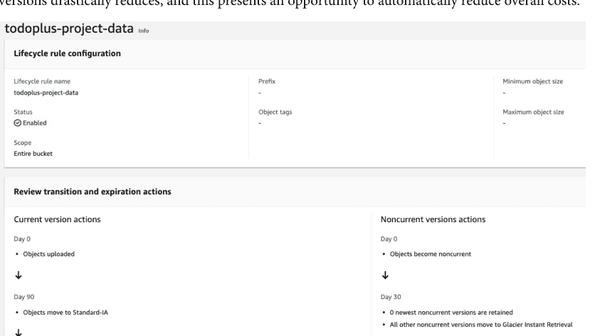

图 3.2 – 一个 Amazon S3 生命周期规则示例

过期操作允许用户指定对象何时过期，一旦对象过期，Amazon S3 会自动将其从存储中删除。

当对象符合生命周期操作条件时，无论 Amazon S3 实际执行操作需要多长时间，用户账单都会更新。使用对象版本控制与 S3 生命周期结合可以帮助控制存储成本并根据业务需求定制数据保留策略。

需要注意的是，如果 Amazon S3 延长了计划项目的过期期，不会因超出原始过期期而产生额外存储费用。但是，如果存在将项目迁移到不同存储层级的生命周期规则，计费不会调整，直到其被移动到该层级。

Amazon S3 生命周期管理可在各种场景中发挥作用，例如将循环日志文件转换到更便宜的存储类别，或归档不再频繁访问但需要为合规或法律目的保留的文档。此外，Amazon S3 可用于归档某些类型的数据，例如数字材料、医疗和财务记录、未处理的基因序列数据以及长期数据库备份。

Amazon S3 生命周期管理是控制存储成本和定制数据保留策略的强大工具。通过将对象版本控制与 S3 生命周期结合，用户可以优化其数据保存策略并降低存储成本。

## 使用基于资源的策略实施数据保护

本节探讨基于资源的策略，以强制实施最小权限原则并限制对 Amazon S3 存储桶和对象的访问。默认情况下，S3 存储桶是私有的；只有根用户和创建存储桶的 IAM 账户可以访问它。

与确定 IAM 用户或角色操作的 IAM 策略不同，基于资源的策略是附加到资源本身的内联策略语句。在 Amazon S3 中，这些策略称为存储桶策略，它们指定针对该资源及其访问来源的允许访问级别。

基于资源的策略还可以提供额外的权限级别，包括授予匿名访问的能力。此功能允许公共互联网上的用户访问你的资源。例如，你可能会作为营销策略的一部分提供免费电子书（无需最终用户注册）。Amazon S3 还允许你托管静态网站（稍后讨论），这意味着匿名访问功能是必需的，以便任何人都可以访问你的网站。此关键功能在 IAM 策略中不可用。策略要求你指定一个主体，它可以是 AWS 账户中的个人或另一个 AWS 账户，或通配符（*），它为 Amazon S3 存储桶提供匿名/公开访问。

以下示例说明了如何使用 `s3:GetObject` 权限为 `packt-aws-developer` 存储桶授予匿名公开访问权限。这允许匿名用户访问存储桶的内容，如以下代码所示：

```
```json
{
  "Version": "2012-10-17",
  "Statement": [
    {
      "Sid": "PublicReadGetObject",
      "Effect": "Allow",
      "Principal": "*",
      "Action": [
        "s3:GetObject"
      ],
      "Resource": [
        "arn:aws:s3:::Bucket-Name/*"
      ]
    }
  ]
}
```
```

在 Amazon S3 中，存储桶所有者有权将其策略附加到其存储桶。然而，如果存储桶内的对象由其他 AWS 账户拥有，则访问控制必须通过 **访问控制列表 (ACLs)** 定义。在这种情况下，存储桶所有者需要转移这些对象的所有权以获得对其的控制权。这使他们能够利用 IAM 策略或资源策略为这些对象设置访问控制。

转移对象所有权是一个强大的功能，使所有者能够控制由其他 AWS 账户上传的对象。这种方法有助于强制实施最小权限原则并提供更好的对象访问控制。通过利用策略，存储桶所有者可以定义访问级别并指定对存储桶内对象的访问来源。

使用策略有助于存储桶所有者控制由其他账户拥有的对象的访问，并确保只有授权用户才能对这些对象执行特定操作。这种方法提供了一个灵活的工具来强制执行安全策略并实施最小权限原则。

> **注意**
> 
> Amazon S3 存储桶策略有 20 KB 的大小限制，以促进高效处理。使用 S3 Web 控制台时，必须授予额外权限。这些是 `s3:ListAllMyBuckets`、`s3:GetBucketLocation` 和 `s3:ListBucket` 权限。

保护存储在 Amazon S3 中的数据访问的另一种方法是使用称为预签名 URL 的功能。让我们接下来看看这一点。

## CORS

CORS 协议使一个域上的 Web 应用程序能够与另一个域上的资源交互。当用户代理从与当前页面使用的域、协议或端口不同的域请求资源时，它会发送跨域 HTTP 请求。如果没有 CORS，请求将被拒绝，这要归功于现代浏览器中定义的安全协议。

Amazon S3 使用 CORS 规则来允许基于特定条件的跨域请求，例如将 `AllowedOrigin` 元素与请求的 `Origin` 头匹配，并检查请求方法和头是否符合定义的规则。了解如何在 Amazon S3 上管理 CORS 对于有效托管网站至关重要。

Amazon S3 提供了高级功能，其中一些将在下一节中讨论。

## 其他 Amazon S3 功能

到目前为止，你已经了解了一些核心基础功能，例如版本控制、生命周期管理和托管静态网站的能力，这些构成了任何无服务器架构的一部分。本节介绍一些作为开发人员你可能会觉得有用的功能。

### Amazon S3 Transfer Acceleration

Amazon S3 Transfer Acceleration 是一个存储桶功能，启用后允许最终用户通过本地边缘位置将对象上传到 S3 存储桶，从而通过 AWS 主干网络实现快速传输速度。如以下截图所示，如果你希望使用该服务，则需要启用 Amazon S3 Transfer Acceleration：

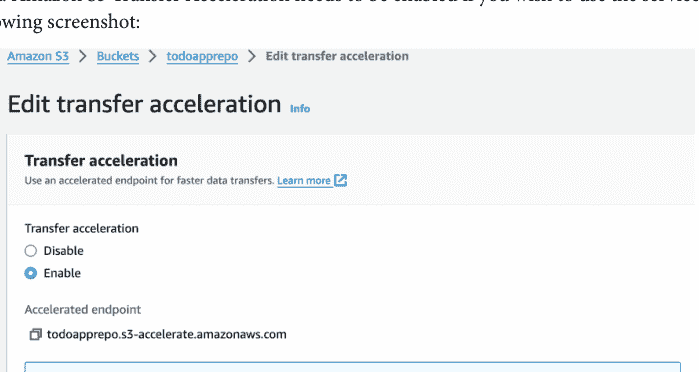

图 3.4 – 配置 Amazon S3 Transfer Acceleration


需要注意的重要一点是，你的存储桶名称中不得包含任何点号（.），并且必须符合 DNS 规范。此外，传输加速仅支持虚拟托管式请求。你必须是存储桶所有者才能配置传输加速，或者将 `s3:PutAccelerateConfiguration` 权限分配给其他用户以委派此功能。

在下一节中，你将了解 Amazon S3 事件通知，这是一项便于构建事件驱动应用程序的功能。

## Amazon S3 事件通知

Amazon S3 可以在存储桶或对象上发生事件时发送通知。这意味着你可以定义事件驱动规则，并在 Amazon S3 生态系统中为你的业务需求构建应用程序。

Amazon S3 可以基于以下事件创建通知：

- 对象创建事件
- 对象删除事件
- 对象恢复事件
- 对象 ACL 事件
- 对象标签事件
- 降低冗余存储（丢失事件）
- 复制事件
- 生命周期事件
- Intelligent-Tiering 事件

一旦上述任何类别中的事件发生，通知就可以发送到 Amazon SNS 主题、SQS 队列、AWS Lambda 函数或 Amazon EventBridge 等目标，如以下屏幕截图所示：

### 目标

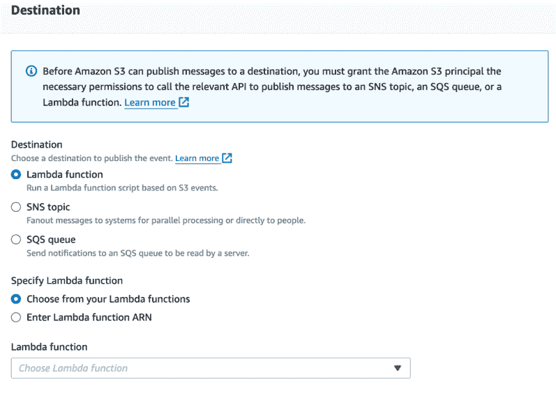

要使事件通知正常工作，你必须确保分配了适当的 IAM 权限。例如，为了使 Amazon S3 能够向 SNS 主题发送通知，就需要创建 SNS 资源访问策略。我们将在 *第 15 章，解耦应用程序堆栈和管理数据摄取* 中讨论 Amazon SNS 和 SQS。

另一个重要功能是通过仅访问你需要的对象来最小化检索成本。Amazon S3 可以检索对象的子集，从而大幅提高性能并降低总体成本。我们接下来将介绍 Amazon S3 Select 和 Glacier Select。

## Amazon S3 Select 和 Glacier Select

Amazon S3 Select 和 Glacier Select 是允许你对存储桶中的数据运行 **结构化查询语言（SQL）** 以过滤数据并仅检索所需子集的功能。这意味着你可以避免下载大量数据，从而降低成本和延迟。你可以在 CSV、JSON 或 Apache Parquet 文件格式的数据以及存储在压缩或加密文件中的对象上使用 Amazon S3 Select。

以下是需要考虑的一些额外要点：

- **双向复制** 是一项可用于在区域之间同步数据以实现故障转移目的或在区域路由出现问题时使应用程序高度可用的功能。
- **S3 批量复制** 是一项旨在按需将现有对象复制到不同存储桶的功能。复制服务在启动后，只会复制在激活后添加到存储桶中的对象。如果在启用复制服务之前已有对象，则必须手动复制这些对象。S3 批量复制可用于运行作业以复制现有对象。

## 复制要求

在两个存储桶之间启用复制需要满足以下关键要求：

- 源和目标区域必须对源存储桶所有者启用
- 源和目标存储桶都必须启用版本控制
- Amazon S3 必须拥有代表你进行复制所需的权限
- 如果源存储桶所有者不拥有其包含的对象，则对象所有者必须通过对象 ACL 授予 READ 和 READ_ACP 权限

Amazon S3 存储桶复制可以帮助公司满足运营和监管要求，并促进各种业务用例。

作为 AWS 开发人员，你在角色中可能会遇到的另一个常见场景是处理非常大的数据集。在下一节中，你将学习如何管理非常大的数据，以及如何从 Amazon S3 平台高效地上传和下载这些数据。

## Amazon S3 分段上传

Amazon S3 分段上传是一项允许你将对象分段上传的功能。AWS 会将你的对象拆分为多个连续的部分，这些部分可以按任意顺序上传。此外，如果某个部分上传失败，你可以重新尝试上传该部分。一旦所有部分都已上传，Amazon S3 将重新组装这些部分以构成完整对象。此功能的主要好处是，大型对象更有可能成功上传。此外，部分是并行上传的，这进一步提高了吞吐量，并且最终对象可以更快地重新组装。AWS 建议使用分段上传 API 上传任何大于 100 MB 的对象。

对象可以随时间上传，并且没有设定的过期时间，这意味着你必须在所有部分上传后完成操作，或终止分段上传操作。需要注意的是，不完整对象的部分仍将保留在你的 S3 存储桶中，直到你删除它们为止，从而产生存储成本。使用生命周期管理策略，你可以在设定的时间后清除不完整部分。

在下一节中，你将学习如何将 MFA 纳入 Amazon S3 的删除操作中。这为确保删除操作不会意外执行增加了另一层安全性。

## 强制 MFA 删除

请记住，在启用版本控制的情况下，你可以防止对象被意外删除。但是，通过在删除请求中指定版本 ID，仍然可以删除对象的特定版本。这会永久从平台中清除该版本。为了进一步增强安全性，你可以启用 MFA 删除。启用此功能后，在对对象的版本执行任何删除操作或更改存储桶的版本状态时，你需要提供两种形式的身份验证。启用 MFA 删除后，如果你的主要凭据被泄露，恶意行为者仍需要在任何删除操作成功之前访问你的 MFA 设备并获取 MFA 代码。

启用 MFA 删除后，任何删除操作的请求都必须包含 `x-amz-mfa` 请求头。此外，此类请求必须通过 HTTPS 传输。此头中的值必须包含身份验证设备的序列号与显示在其上的身份验证代码的连接，以空格分隔。没有此请求头，请求将失败。

以下部分讨论 Amazon S3 服务器访问日志。

## S3 服务器访问日志

Amazon S3 服务器访问日志是一项功能，启用后会记录对 S3 存储桶所做的所有请求。这对于使用情况的审计和分析特别有用。你必须在存储桶级别启用服务器访问日志。此外，你需要创建另一个存储桶（称为目标存储桶），它将作为日志数据的目的地。这是因为，如果你使用源存储桶作为日志数据的目的地，它将创建日志的无限循环，使识别相关日志数据变得困难。源存储桶和目标存储桶必须位于同一区域。你还可以为所有日志数据分配前缀，以便更轻松地将日志信息与其他数据分类。

虽然在 Amazon S3 平台上存储和管理数据是 AWS 的一项关键服务，但许多客户也需要构建混合云存储解决方案的能力。通常，由于特定的延迟相关问题、确保运营效率或数据主权法律，某些类型的数据需要保留在本地。这些公司可能还希望将大量数据卸载到云中，以受益于更低的存储成本和应用程序要求，或仅用于灾难恢复。

以下部分介绍 AWS Storage Gateway 服务，该服务旨在帮助构建混合云解决方案。

## 使用 AWS Storage Gateway 实现混合存储解决方案

AWS Storage Gateway 是一项混合存储服务，使企业能够将本地应用程序与云存储连接起来。Storage Gateway 支持三种类型的存储接口：文件、磁带和卷接口。它通过提供安全且可扩展的数据存储和备份解决方案，帮助企业弥合本地和云存储之间的差距。

该架构包括安装在本地的软件设备，与基于云的存储服务进行通信。软件设备提供 iSCSI 接口，使本地应用程序能够访问云中的存储卷。根据业务需求，Storage Gateway 可以以虚拟或硬件形式部署。

使用 NFS 和 SMB 协议，文件接口允许你通过标准文件存储协议在 Amazon S3 中存储和访问文件。此接口非常适合在多个位置存储和共享文件，例如文档和图像。

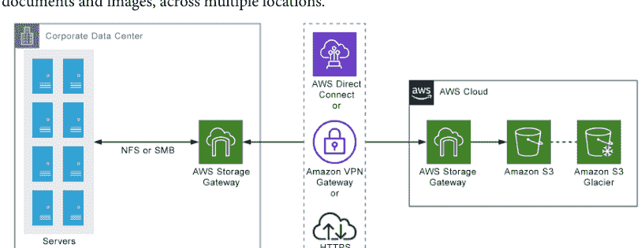

图 3.6 – 使用 AWS Storage Gateway 集成你的本地数据中心

磁带接口使企业能够将数据的备份存储在云中以用于灾难恢复。它提供虚拟磁带库（VTL），可模拟物理磁带库，使企业能够使用现有的备份基础设施与 Amazon S3 配合使用。此接口非常适合需要长期存储大量数据的企业。

卷接口（iSCSI）使企业能够在 Amazon S3 中存储和访问块级存储。它提供本地存储到云的无缝扩展，使企业能够将 Amazon S3 用作备份或归档存储层。此接口非常适合需要存储大量数据且需要高性能和低延迟的企业。


总之，AWS Storage Gateway 是一款功能强大的混合云存储服务，为企业提供灵活且可扩展的解决方案，用于连接本地存储与云存储。它支持多种存储接口，包括文件、磁带和卷接口，可根据您业务的具体需求进行定制。

在下一节中，您将回到 **TodoPlus Limited** 的客户项目。之前，您创建了一个 Amazon Cognito 用户池，将用于保护我们待办事项列表应用程序的访问权限。在下一个项目任务中，您将创建一个 Amazon S3 存储桶，上传我们 Web 应用程序前端 UI 的初始迭代，配置必要的访问权限，并将 S3 存储桶设置为静态网站。

## 项目任务 – 为待办事项列表应用程序创建 Amazon S3 静态网站

继续为 **TodoPlus Limited** 构建解决方案，您将配置一个 Amazon S3 存储桶来托管 **待办事项列表** 应用程序的前端 UI。以下图表展示了您将在解决方案架构中工作的特定技术区域。

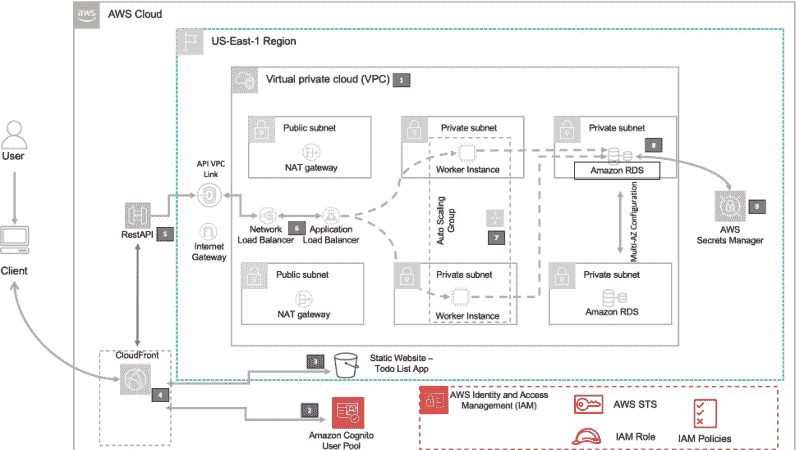

图 3.7 — 展示架构中 Amazon S3 部分的图表

要完成此项目任务，请从我们的 GitHub 仓库下载应用程序代码文件：https://packt.link/8J31G。

下载后，您需要解压文件，使文件夹的内容如以下屏幕截图所示：

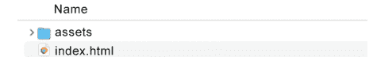

图 3.8 – 下载静态网站前端的源代码

### 项目任务 3.1 – 创建 Amazon S3 存储桶

以下步骤将创建一个 Amazon S3 存储桶，用于托管待办事项列表应用程序的前端静态网站。Amazon S3 静态网站服务可以托管所有 HTML 和 CSS 内容，以及所有前端功能所需的任何客户端脚本。此外，还可以集成标准 HTTP 方法以根据需要从后端服务调用 API：

1. 登录您在 *第 1 章，AWS 账户和全球基础设施简介* 中配置的 AWS 开发账户，并导航到 **Amazon S3** 服务。
2. 从屏幕右上角确保选择 **N. Virginia (us-east-1)** 区域，如果尚未选择该区域。
3. 从左侧菜单中单击 **Buckets**。
4. 在右侧窗格中单击 **Create bucket**。
5. 为您的存储桶提供一个名称。请记住，这些名称在全球范围内是唯一的。存储桶名称长度必须在 3 到 63 个字符之间，且必须为小写。可以包含数字、点 (.) 和连字符 (-) ，但不得格式化为 IP 地址。
6. 根据以下图示取消选中 **Block Public Access settings for this bucket** 下的所有复选框，并确保选中 **I acknowledge that the current settings might result in this bucket and the objects within becoming public.** 复选框。

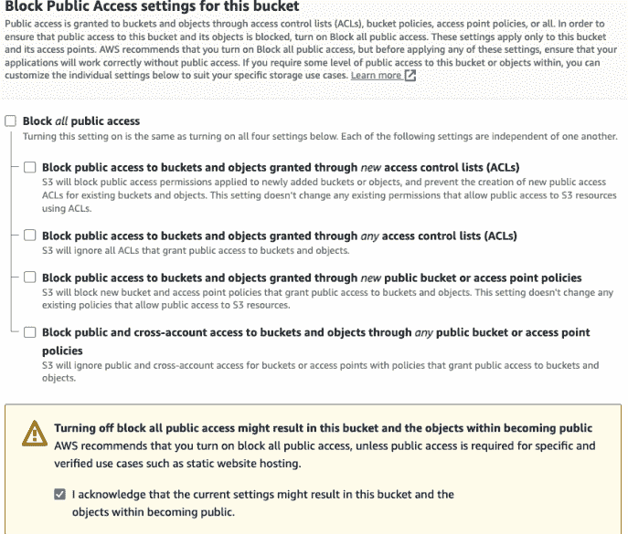

7. 单击 **Create bucket** 按钮，您应该会收到存储桶已创建的确认信息。您现在已创建了 Amazon S3 存储桶。

### 项目任务 3.2 – 上传前端源代码

在项目任务 3.1 中成功创建 Amazon S3 存储桶后，现在是时候进行项目任务 3.2 了。在此任务中，您将把前端源代码上传到刚刚创建的存储桶中。这将允许您的静态网站被托管并公开访问。

1. 如有必要，导航存储桶列表，然后单击您刚刚创建的存储桶。
2. 在右侧窗格中单击 **Upload** 按钮。这将打开 **Upload** 控制台。

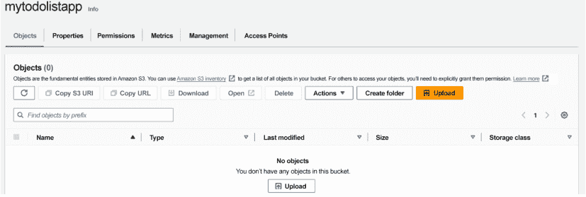

图 3.10 – 向您的存储桶上传对象

3. 您可以将文件和文件夹拖放到指定区域，或单击 **Add files** 或 **Add folder**。从文件资源管理器或 Finder（Mac）窗口拖放要容易得多。您必须确保文件和文件夹被复制到存储桶的根目录，如以下屏幕截图所示：

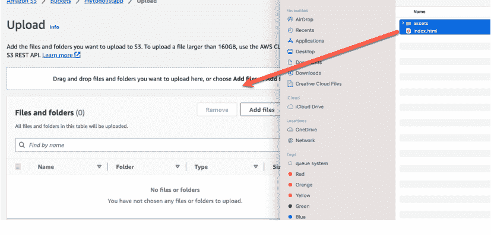

图 3.11 – 将 ZIP 文件的内容拖放到上传窗口

4. 单击 **Upload** 按钮。您应该会收到上传成功的消息。返回存储桶时，您会发现对象已上传，如下图所示：

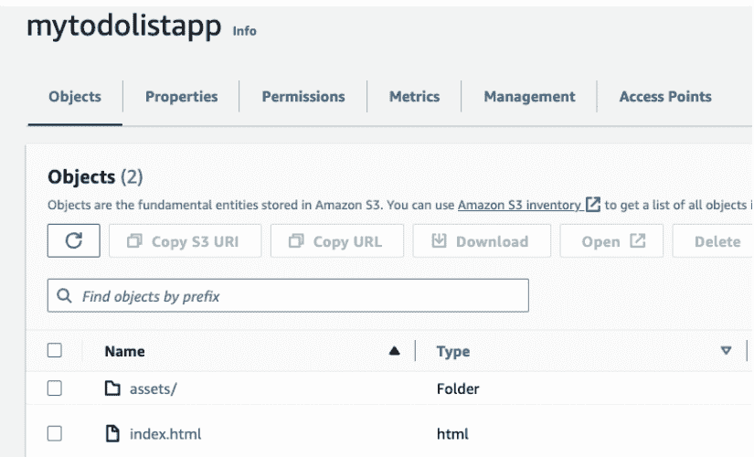

图 3.12 – 对象已上传到 Amazon S3 存储桶

5. 上传完成后，滚动到顶部并单击 **Close** 按钮。

### 项目任务 3.3 – 配置存储桶策略和权限

在此步骤中，您将创建一个存储桶策略，使存储桶作为 Web 应用程序的入口点而公开可访问。需要配置以下策略。请注意，Amazon S3 存储桶 **Amazon Resource Name (ARN)** 的高亮部分需要修改以反映您的存储桶名称：

```json
{
  "Version": "2012-10-17",
  "Statement": [
    {
      "Sid": "PublicReadGetObject",
      "Effect": "Allow",
      "Principal": "*",
      "Action": "s3:GetObject",
      "Resource": "arn:aws:s3:::REPLACE_WITH_BUCKET_NAME_HERE/*"
    }
  ]
}
```

1. 在 Amazon S3 控制台中，从左侧菜单单击 **Buckets**。
2. 在右侧窗格中单击您的存储桶名称以访问其配置详细信息。
3. 从右侧窗格中选择 **Permissions** 选项卡，如屏幕截图所示：

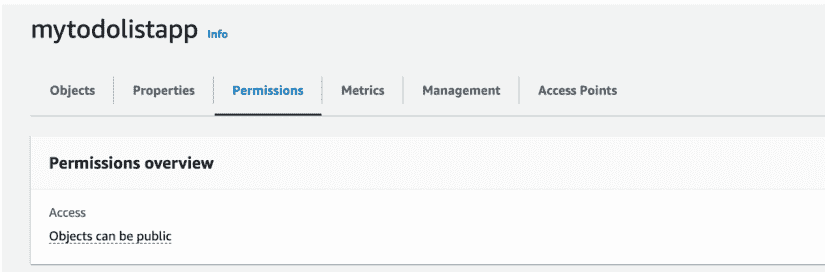

图 3.13 – Amazon S3 存储桶的权限选项卡

4. 在 **Bucket policy** 部分下单击 **Edit** 按钮。
5. 用前述策略替换任何默认策略，确保使用存储桶的正确 ARN。
6. 在页面底部单击 **Save changes**。
7. 您应该会收到一条成功消息，确认新存储桶策略已应用。

### 项目任务 3.4 – 配置静态网站托管

在此任务中，您将为 Amazon S3 存储桶配置静态网站托管。这将允许您的 Web 应用程序从存储桶中公开托管和访问。

1. 在 Amazon S3 存储桶的配置窗格中，单击 **Properties** 选项卡。
2. 向下滚动至底部，直到找到 **Static website hosting** 部分。
3. 单击 **Edit**。

4. 接下来，根据以下屏幕截图选择在静态网站托管下启用：

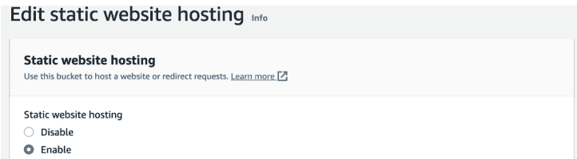

图 3.14 – 启用静态网站托管

5. 在托管类型部分下选择托管静态网站。
6. 接下来，在索引和错误文档下的文本框中输入 index.html。
7. 在页面底部单击 Save changes。
8. 您现在应该会收到确认信息，表明您已成功编辑静态网站托管。

### 项目任务 3.5 – 测试网站

在此任务中，您将测试网站以确保其按预期公开托管和访问。这是验证 Web 应用程序设置成功的关键步骤。

1. 在存储桶的 Properties 选项卡中，仍保持在该选项卡，滚动回页面底部以查看静态网站托管部分。
2. 您应该会发现已为您的网站配置了 URL，如以下屏幕截图所示：

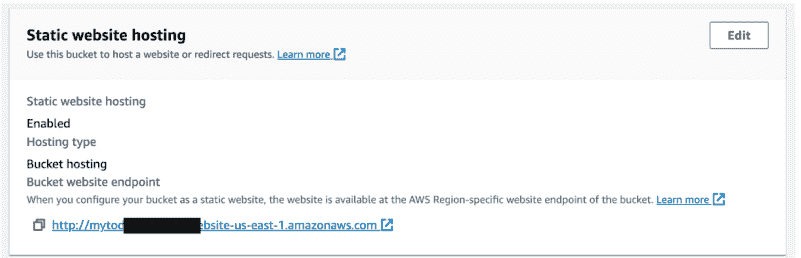

图 3.15 – 静态网站 URL

3. 单击此 URL，您应该能够查看初始网站前端页面，如以下屏幕截图所示：

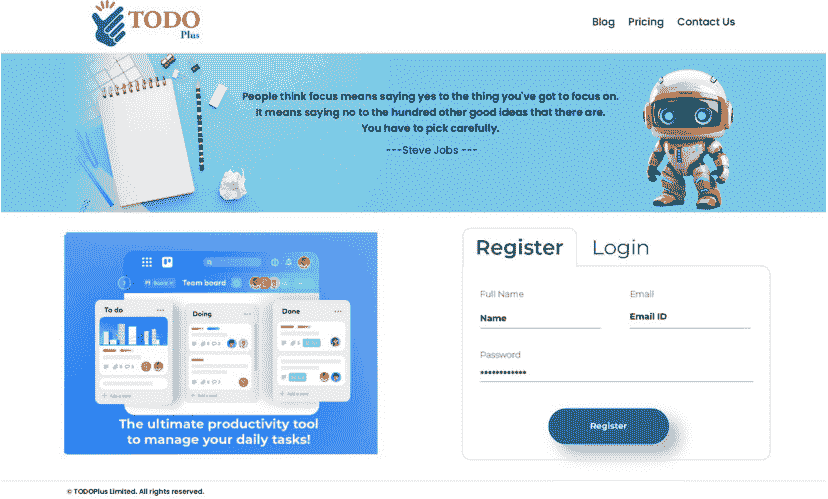

图 3.16 – TodoPlus List Web 应用程序的静态网站托管前端部分

> **Note**
>
> 注册和登录表单在此阶段尚不具备功能。这是因为您仍需要配置由 EC2 实例、API Gateway 和 Lambda 组成的后端服务——所有这些都将在后续章节中讨论，我们将部署应用程序解决方案。


## Summary

在本章中，你已经发现了 AWS 上的一项关键服务——Amazon S3。该服务因其低成本、耐用性和可靠性而广受欢迎。它允许 AWS 用户存储各种各样的数据，从归档到为数据工程和分析项目设计具有成本效益的数据湖。

Amazon S3 的一个关键特性是其能够托管静态网站，这些网站可以作为大多数当代应用程序的入口点。此外，Amazon S3 的这一特性非常适合设计完整的端到端无服务器架构，这将在本书后面进行讨论。

除了在云中提供存储解决方案外，还可以在云中构建私有网络。AWS 提供了一个名为 **Virtual Private Cloud (VPC)** 的功能，允许你定义和配置私有网络，从而实现工作负载的分离。

借助 VPC，你可以通过建立单独的网络来容纳它们，从而将可能在同一 AWS 账户中运行的应用程序分开。这提供了额外的安全性，以及更好地管理资源如何配置和分配。

在下一章中，你将了解云中的网络并探索虚拟私有网络。你还将探索 Amazon Route 53，它提供域名命名服务，并帮助你设计流量如何定向到你的资源，无论是通过互联网还是在 VPC 内部。

## Exam Readiness Drill – Chapter Review Questions

除了对关键概念有扎实的理解外，在时间压力下快速思考的能力将帮助你通过认证考试。这就是为什么在学习之旅早期就练习这些技能至关重要。

章节复习问题旨在随着你学习和复习每一章而逐步提高你的应试技能，同时检查你对本章关键概念的理解。你会在每一章的末尾找到这些问题。

### How to Access These Materials

要了解如何访问这些资源，请前往标题为 *Chapter 17, Accessing the Online Resources* 的章节。

要打开本章的章节复习问题，请执行以下步骤：

1. 点击链接 – `https://packt.link/DVAC02_CH03`。
   或者，你可以扫描以下二维码（*Figure 3.17*）：

   

   Figure 3.17 – QR code that opens Chapter Review Questions for logged-in users

2. 登录后，你会看到与图 3.18 所示类似的页面：

   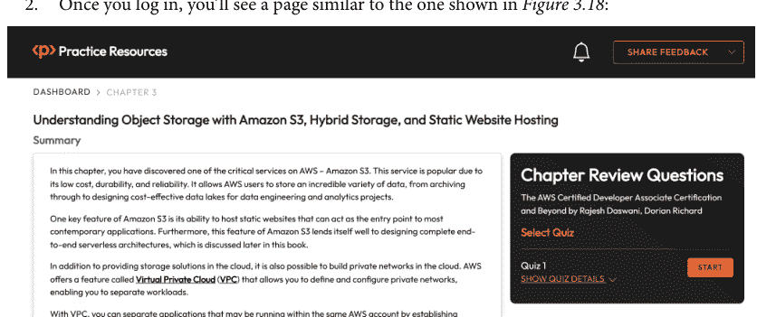

   Figure 3.18 – Chapter Review Questions for Chapter 3

3. 准备好后，开始以下练习测验，多次重做测验。

### Exam Readiness Drill

前三次尝试时，不必担心时间限制。

### Attempt 1

第一次，目标至少达到 40%。查看答错的题目并重新阅读章节中的相关部分以弥补学习差距。

### Attempt 2

第二次，目标至少达到 60%。查看答错的题目并重新阅读章节中的相关部分以弥补剩余的学习差距。

### Attempt 3

第三次，目标至少达到 75%。一旦得分达到 75% 或以上，你就开始练习计时。

**Tip:** 你可能需要超过 **three** 次尝试才能达到 75%。这没关系。只要一直复习章节中的相关部分直到达到目标即可。

### Working On Timing

**Target:** 你的目标是在保持分数不变的同时，尽可能快速地回答这些问题。以下是你的下几次尝试应如何进行的示例：

| Attempt | Score | Time Taken |
| :--- | :--- | :--- |
| Attempt 5 | 77% | 21 mins 30 seconds |
| Attempt 6 | 78% | 18 mins 34 seconds |
| Attempt 7 | 76% | 14 mins 44 seconds |

Table 3.1 – Sample timing practice drills on the online platform

**Note:** 上表中显示的时间限制仅为示例。根据网站上测验的时间限制，为每次尝试设定自己的时间限制。

随着每次新的尝试，你的分数应保持在 75% 以上，而完成所需“时间”应“减少”。重复尽可能多的尝试，直到你有信心应对时间压力。
