## Building Private Networks in the Cloud with Amazon VPC

在将应用程序部署到云中之前，你必须确保以安全为出发点设计架构。安全需要在应用程序堆栈的各个层中按照最佳实践纳入——这包括底层网络和基础设施层、计算和存储层、数据库以及应用程序本身。

关于网络层安全，**Amazon Web Services (AWS)** 提供了创建和构建隔离虚拟网络的能力，其服务名为 **Amazon Virtual Private Cloud (Amazon VPC)**。VPC 可保护你的工作负载和应用程序免受可能包含恶意内容的未经授权网络流量的侵害。它们还允许你分离工作负载和应用程序并将它们彼此隔离，以满足任何合规或监管要求，同时减少整体管理任务的负担。

AWS 上的多个关键服务要求你预配一个 VPC，然后在其中部署构成底层基础设施以托管应用程序的资源。这些包括提供计算容量以运行应用程序的 EC2 实例、用于容器化应用程序的 ECS 集群，以及运行在 **Amazon Relational Database Service (Amazon RDS)** 上的后端数据库。其他服务如 Amazon S3 则不需要你预配 VPC。

专注于 Amazon VPC，你将学习如何在云中构建私有网络，以安全地托管将用于支持应用程序的资源。虽然对于 AWS Certified Developer Associate 考试来说成为网络专家并非必需，但理解网络基础知识将有助于确保你的应用程序以安全且符合最佳实践的方式构建和部署。例如，领域 1 的 **Task Statement 2: Develop code for AWS Lambda** 要求你了解如何使用 AWS Lambda 代码访问 VPC 中的私有资源。这在 *Chapter 8, Event-Driven Computing with AWS Lambda and Securing Access to Backend APIs with Amazon API Gateway* 中有所介绍。

本章将介绍网络连接和安全的基础知识，并解释你的应用程序如何连接到其他公共 AWS 服务甚至外部网络，例如本地资源。

此外，借助 Amazon VPC，TodoPlus Limited 将在 AWS 云中创建一个私有、隔离的区域，在虚拟网络中启动资源以托管和支持 Todo List 应用程序。对其虚拟网络环境的这种控制水平可以显著增强其应用程序的安全性和连接性。

本章涵盖的主题如下：

- Introduction to VPC fundamentals
- Managing external resources exposure using IGWs and NAT gateways
- Securing your AWS resources within the VPC with NACLs and security groups
- Configuring VPC interconnectivity
- Securing connectivity between VPCs and other AWS public services
- Connecting VPCs to external networks
- Monitoring traffic with VPC Flow Logs
- Project – set up a VPC to host the Todo List application

到本章结束时，你将知道如何构建专为最佳连接性和低延迟而设计的<|message|>

访问外部资源和/或允许来自互联网的入站连接需要配置并部署网关，例如互联网网关。一旦配置完成，你的 VPC 就会变为 **互联网启用**。然而，你仍需定义如何将 VPC 子网中的资源产生的流量路由到网关以实现外部访问。同样，来自互联网的入站连接也需要互联网网关以及确定将该流量发送到哪个资源的方式。让我们通过查看图 4.2 中的图表，更详细地研究这些网关的工作原理：

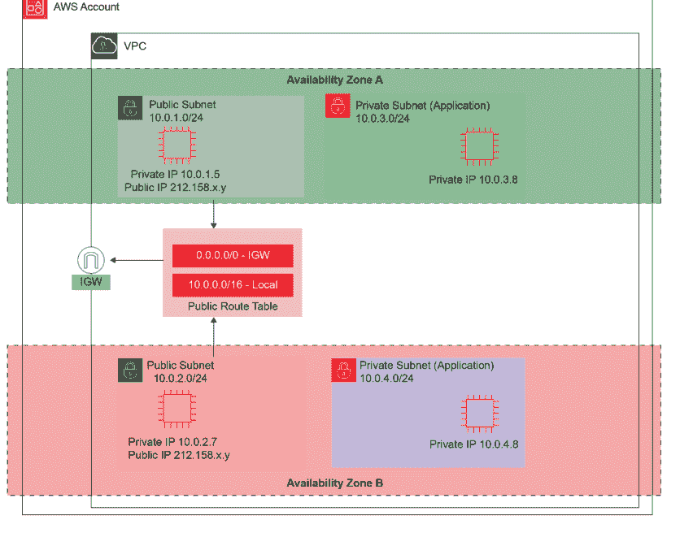

图 4.2 – 具有公有和私有子网的 VPC 图

上图显示 VPC 已配置了 **互联网网关 (IGW)**。这为 VPC 提供了互联网访问。你将在接下来研究其工作原理。

## IGW 如何工作

IGW 由 AWS 高度可扩展且完全托管。它位于你的 VPC 边缘，使你的公有子网与互联网之间以及与 AWS 提供的其他公有服务之间能够进行入站和出站连接（稍后会更详细地讨论）。

一旦 IGW 附加到 VPC，你就需要配置路由表，为 VPC 的公有子网中的资源（例如 EC2 实例）提供访问网关以将流量发送到互联网的机制。

如前图所示，公有路由表配置了两条路由，一条用于本地内部流量，另一条用于发往互联网的流量。路由表附加到公有子网，这意味着这些子网内的资源可以通过互联网网关将流量发送到互联网。在此情况下，任何目标为 0.0.0.0 /0 的流量（即发往 10.0.0.0/16 范围之外的网络）都将被发送到 IGW 目标。IGW 然后根据目标 IP 地址将流量转发到其他网络。

使用 IGW 将流量发送到互联网的一个关键要求是资源本身也必须具有公有 IP 地址或弹性 IP 地址。弹性 IP 地址与公有 IP 地址相同，只是弹性 IP 地址是静态的，在资源关闭并重新启动后不会改变。而标准公有 IP 地址则可能发生变化。弹性 IP 地址在你希望为资源使用相同的静态 IP 地址且不发生变化时很有用。在图 4.2 中图表所示的示例中，请注意两个 EC2 实例具有私有 IP 地址和公有 IP 地址。

请注意 EC2 实例并不知晓自己拥有公有 IP 地址。IGW 维护着分配给这些 EC2 实例的公有 IP 地址表，并维护资源公有 IP 地址与私有 IP 地址之间的一对一映射。这使得 IGW 能够充当网络地址转换（NAT）服务，以便将对出站请求的回复中继回资源。此外，来自互联网产生的流量可以发送到具有公有 IP 地址的服务器，例如当你想通过 SSH 远程管理服务器时。

> **注意：**
> 作为最佳实践，你希望确保只有特定类型的实例应放置在具有直接出站互联网访问的公有子网中，例如充当管理服务器的堡垒主机，以允许远程管理位于私有子网中的其他 EC2 实例。

Web 服务器无需放置在公有子网中，因为即使将它们置于 ALB 后面，之前已讨论过，它们仍可从互联网访问。

在如图 4.3 所示的多层架构设计中，私有子网中的资源将无法直接访问互联网。这些私有子网将不会与公有路由表关联，也不会分配公有或弹性 IP 地址。这是因为这些资源旨在保持私有，仅可从 VPC 内的其他资源（如负载均衡器或数据库）访问。

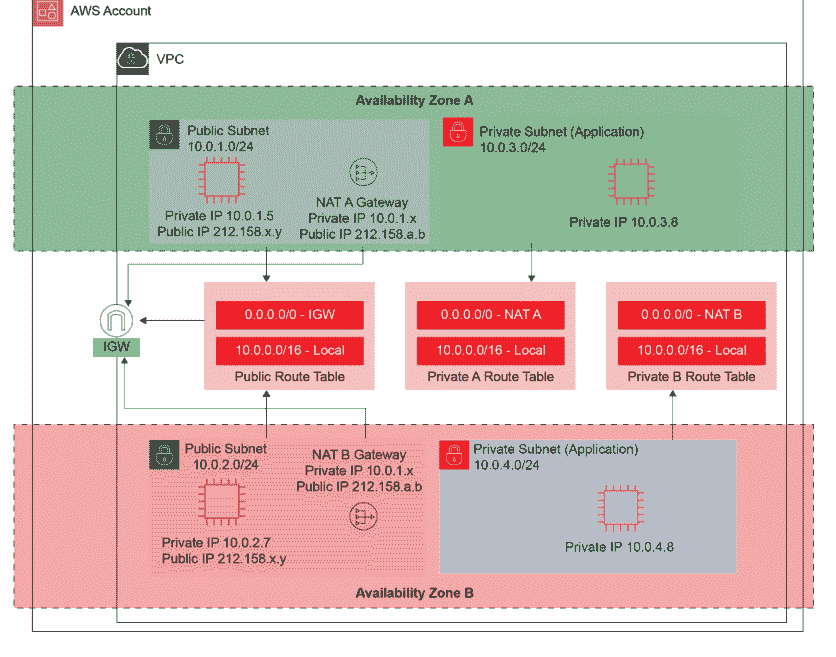

图 4.3 – VPC 具有私有子网和路由表，可通过 NAT 网关允许 EC2 实例访问互联网

尽管如此，私有子网中的资源仍需要访问互联网甚至 AWS 上的其他公有服务。为了在不为这些资源分配公有 IP 地址的同时授予其互联网访问权限并确保更高级别的安全性，你可以配置 NAT 网关。

安全组通常可被视为资源的首要防御，默认情况下拒绝所有入站流量，直到你创建 **允许** 规则为止。网络 ACL 可被视为额外的安全护栏，可帮助你为整个子网定义规则。每个 VPC 都附带一个默认网络 ACL，顺带允许所有入站流量。这是因为最终，你的安全组将默认阻止所有入站流量，直到你创建入站允许规则为止。此外，不可能在未创建和/或附加安全组（默认会阻止所有入站流量）的情况下部署 EC2 实例等资源。

网络 ACL 的一个关键特性是你可以配置拒绝规则。这在你可能需要允许入站流量时特别有用，例如从更广的互联网允许端口 80 的流量，但同时拒绝来自特定 CIDR 范围的同一端口的流量。规则按优先级顺序定义，编号越低的规则优先级越高。并且，较高优先级的拒绝规则将覆盖较低优先级的允许规则。因此，在我们的示例中，如果你需要拒绝来自特定 IP 范围的端口 80 流量，但允许互联网其余部分访问，你将创建如下图所示的规则：

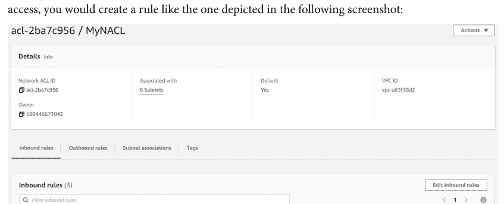

图 4.5 – 网络 ACL 配置为拒绝来自特定源的流量，但允许其他互联网访问子网的端口 80（HTTP）

在上图中，网络 ACL 将允许从更广的互联网对子网端口 80（HTTP）的入站流量，同时拒绝规则 50 中指定的 IP 地址的流量。由于规则 50 的编号低于规则 100，因此来自该特定 IP 地址的流量将被拒绝，但来自其他 IP 地址的流量将被允许。

有时你可能需要创建多个 VPC，例如用于不同的工作负载或不同的区域。然而，你可能还需要 VPC 之间具有网络连接。你将接下来探索 VPC 互连。

## 配置 VPC 互连

通常单个 VPC 不够用，你会为不同的工作负载和应用程序以及不同的分支机构和位置创建单独的 VPC。有时你可能需要与其他 VPC 共享资源。在 *第 1 章，AWS 账户和全球基础设施简介* 中，你了解了托管 AWS 账户以管理所有共享基础设施资源的概念。属于公司其他部门或分支的 VPC 可能希望访问此类共享 VPC 中的资源。一种授予访问权限的方法是建立 VPC 之间的网络连接。

AWS 提供了多种连接 VPC 的选项，将在接下来进行探讨。

## VPC 对等连接

VPC 对等连接是在两个 VPC 之间建立的网络连接，流量在它们之间通过 AWS 主干网络使用私有 IP 地址空间进行传输。 一个 VPC 中的 EC2 实例然后可以与对等 VPC 中的资源进行通信。对等连接可以在你的 AWS 账户中的 VPC 之间配置，甚至可以在属于其他 AWS 账户的 VPC 之间配置。对等连接也可以在同一区域内或跨区域的 VPC 之间建立。

一个典型示例是，你在公司的分支机构的不同区域拥有 VPC，并且需要建立对等连接以共享对集中化资源的访问。

VPC 之间的连接永远不会经过公共互联网，这进一步提高了你的安全态势，避免了来自互联网的 DDoS 攻击和常见利用。

设置对等连接需要从一个 VPC（请求方）向另一个 VPC（接受方）发送请求。一旦请求被接受，对等连接即建立。请注意，你仍需在路由表中配置必要的路由规则以实现新建立的网络连接。VPC 对等连接中每个 VPC 的所有者必须在相关路由表中创建必要的路由，以允许流量在 VPC 之间流动。

如下图所示，你还可以建立多个 VPC 对等连接：

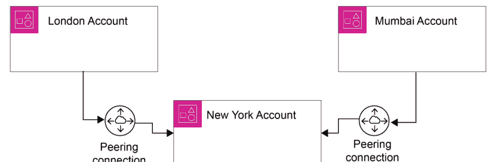

图 4.6 – VPC 对等连接

设置 VPC 时有一些重要的注意事项，如下所示：

- VPC 对等连接不支持传递路由。在上图中，纽约 VPC 与伦敦 VPC 和孟买 VPC 均建立了对等连接。但是，仅靠这些连接并不能让伦敦 VPC 中的资源向孟买 VPC 中的资源发送流量。如果你需要伦敦和孟买的 VPC 访问彼此的资源，则需要在两者之间建立明确的对等连接。
- 也不支持通过网关进行边缘到边缘路由。这意味着，如果孟买 VPC 可以访问互联网网关，伦敦的 VPC 将无法使用该网关来访问互联网上的资源。
- 不允许在 IP 地址范围相同或重叠的 VPC 之间建立 VPC 对等连接。

AWS 提供了多种服务，这些服务的资源需要在 VPC 内进行配置。其中包括 EC2 实例和 RDS 数据库。但是，也有多种服务所配置的资源不在 VPC 内。这些服务包括 SNS 主题、S3 存储桶、DynamoDB 表等。你可以将这些服务称为公共服务，但从 VPC 内的资源访问这些服务通常需要互联网访问。

VPC 中的 EC2 实例需要穿越互联网才能访问这些公共 AWS 服务。这通常意味着 VPC 需要互联网网关；如果 EC2 实例位于私有子网中，则还需要 NAT 网关。

但是，你可能希望阻止 EC2 实例的此类流量穿越公共互联网，仅为了返回 AWS 生态系统访问诸如 DynamoDB 表之类的资源。接下来我们将介绍 VPC 终端节点，这一功能可以帮助我们实现这种配置，并解决与安全性和合规性相关的担忧。

## 保护 VPC 与其他公共 AWS 服务之间的连接

许多服务允许你创建需要 VPC 的资源。EC2 实例和 RDS 数据库就是例子。其他 AWS 服务不会在你的 VPC 内部署资源。例如，Amazon S3 存储桶位于 AWS 公共环境中，而不是在你的 VPC 内。如果你的 EC2 实例需要访问这些存储桶（可能为了上传或下载对象），那么你需要考虑来自实例的网络流量如何到达这些存储桶。作为默认网络配置，你的 VPC 将具有互联网网关。这意味着来自这些 EC2 实例的流量必须首先穿越互联网网关，才能访问 AWS 公共空间中的 S3 存储桶。

你可以从部署在 VPC 内的 EC2 实例访问各种 AWS 服务和资源。通常，这要求流量从 VPC 穿越到互联网，然后再返回这些公共 AWS 服务。对于位于私有子网内的 EC2 实例，你还必须部署 NAT 网关以促进互联网连接。虽然这是一个完全可行的解决方案，但你可能担心流量在到达使用其他公共 AWS 服务创建的资源之前会穿越公共互联网。此类担忧可能与安全性或与启用面向互联网的访问（例如使用 NAT 网关）相关的成本有关。

AWS 提供了一种称为 VPC 终端节点的替代方案。这些终端节点使你能够通过 AWS 私有骨干网络，将 VPC 中的资源连接到其他 VPC 中的资源以及 AWS 公共域内的资源，而无需穿越公共互联网。

你可以创建两种类型的 VPC 终端节点：

- **接口：** 接口终端节点使你能够使用一个或多个具有私有 IP 地址的弹性网络接口从 VPC 连接到 AWS 服务，这些接口充当该服务的入口点。通过接口终端节点的流量通过 AWS PrivateLink 进行。可通过接口终端节点连接的服务示例包括 Amazon SNS 和 SQS。
- **网关：** 网关终端节点仅用于 Amazon S3 和 DynamoDB。它们使用 Amazon VPC 路由表中的特定 IP 路由，这些路由是前缀列表，其中定义了这些服务的路由目标。网关终端节点不支持 AWS PrivateLink。

接下来，让我们探讨如何将 VPC 连接到外部网络，例如你的本地网络。

## 将 VPC 连接到外部网络

大多数公司都有想要连接到其 AWS 账户和资源的本地网络。根据计划执行的任务类型以及所需的带宽量，有多种选项可以实现此目的。

将私有本地网络连接到 AWS 云的选项包括以下内容：

- **站点到站点虚拟专用网络（VPN）：** 这允许你在 VPC 和远程网络之间创建相对廉价的 IPsec VPN 连接。这样，流量在穿越公共互联网时会进行加密。
- **Direct Connect：** 这是你的本地办公室与本地 Direct Connect 合作伙伴之间的专用光纤布线网络。然后，流量将通过私有网络路由到 AWS 平台，并且永远不会穿越公共互联网。AWS Direct Connect 提供比传统 VPN 连接更专用且更高的带宽。

AWS Direct Connect 有时需要一定的准备时间，因为可能首先需要在你所在位置与 Direct Connect 合作伙伴之间配置底层线缆基础设施。

既然你已经了解了 VPC 的关键组件，并检查了其各种安全性和网络组件，你还必须能够监控进出网络的流量类型。AWS 提供了几种监控工具来帮助你。你可能会用到的一种工具是 VPC 流日志（VPC Flow Logs），接下来你将探讨它。

## 使用 VPC 流日志监控流量

VPC 流日志是一项服务，旨在帮助你监控进入和离开整个 VPC、特定子网或特定网络接口（例如附加到某个 EC2 实例的虚拟网卡）的 IP 流量。

然后，这些数据可以被导入 Amazon CloudWatch Logs、Amazon S3 或 Amazon Kinesis Data Firehose，以进行进一步的分析和存储。VPC 流日志可用于以下目的：

- 识别过于严格的安全组规则 – 例如，当某些类型的流量无法到达你的资源时
- 监控到达实例的流量类型 – 例如，帮助你确定该流量是已授权还是恶意流量
- 识别进出你的 AWS 账户中资源的流量方向

你的流日志数据会以流日志记录的形式记录下来，并可以推送到预先创建的 CloudWatch Logs 日志组。你还需要以 IAM 角色的形式设置必要的权限，以便将流日志写入 CloudWatch Logs 日志组。

设置 VPC 流日志时，你需要定义以下内容：

- 要为其创建流日志的资源（例如，整个 VPC、子网或网络接口）
- 要捕获的流量类型（已接受流量、已拒绝流量或所有流量）
- 流日志数据的目标位置

以下是在我们的测试 AWS 账户中捕获的流日志信息的屏幕截图：

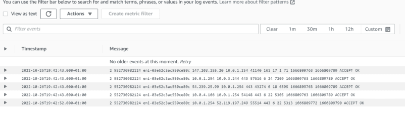

### 图 4.7 – VPC 流日志示例

数据以纯文本形式捕获；所有字段均为 STRING 类型。时间戳旁边的消息数据主体被分成多个部分，如下图所示：

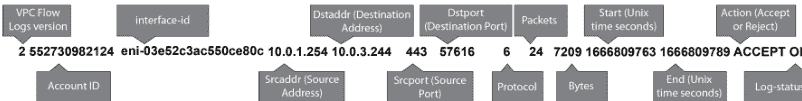

### 图 4.8 – VPC 流记录示例

如你所见，流记录包含有关进入 VPC 的流量类型、该流量的来源、所用协议以及该流量是被接受还是被拒绝的信息。VPC 流日志是你可以用来分析进入 AWS 平台上虚拟网络的流量的众多工具之一。

在下面的练习中，你将继续构建支持 Todo List 应用程序的基础设施。你将了解 ToDoplus Limited 如何利用 Amazon VPC 服务来构建 VPC。随着项目的推进，你还将探索设计 VPC 的最佳实践。

## 项目 – 构建一个 VPC 来托管 Todo List 应用程序

到目前为止，你已经构建了一个 Cognito 用户池和一个配置为托管应用程序前端静态网站的 Amazon S3 存储桶。根据下面的架构图，你现在需要构建一个 VPC，用于托管各种额外的 AWS 资源，以支持应用程序的核心基础设施。这些资源包括：

- 网络组件，例如 NAT 网关和负载均衡器
- 计算服务，例如 EC2 实例
- 数据库服务，例如 Amazon RDS 实例

下图描绘并突出了应用架构中的网络部分，该部分在*第2章《使用AWS身份和访问管理保障访问安全》*中的*图4.9*中已有讨论。

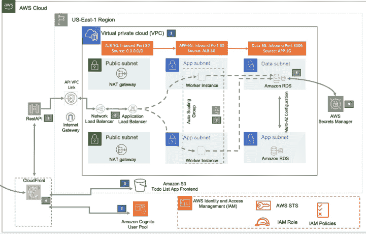

图4.9 – 用于托管Todo List应用程序的VPC构建项目

你会注意到，VPC包含以下几个组件：

- **区域** – 你将在北弗吉尼亚（US-East-1）区域构建VPC。
- **可用区** – 为了高可用性，你将使用两个可用区（AZ）。
- **子网** – 你将部署六个子网：两个公有子网和四个私有子网，其中两个用于承载后端应用层，另外两个用于数据库环境。
- **NAT网关** – 你将部署NAT网关，以允许部署在私有子网中的虚拟机访问互联网。
- **安全组** – 你将创建多个安全组，以确保流量按照最佳实践从互联网路由到后端服务器，并最终到达数据库。

## 技术要求

要完成本章的练习，你需要使用在*第1章《AWS账户与全球基础设施简介》*中创建的**Developer**账户登录，并使用你在*第2章《使用AWS身份和访问管理保障访问安全》*中创建的IAM用户“Alice”。

## 项目任务4.1 – 创建VPC（us-east-1区域）

在此任务中，你将创建一个基础VPC。随后，你将在后续步骤中配置其组件：

1. 使用AWS管理控制台登录到你的AWS账户。
2. 导航到VPC控制台，并通过右上角的下拉列表选择“北弗吉尼亚”区域，确保你位于该区域，如下图所示：

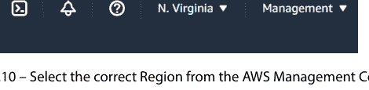

3. 从左侧菜单中，点击“你的VPC”。
4. 点击屏幕右上角的“创建VPC”按钮。系统会显示一个“创建VPC”表单。确保选中“仅VPC”，因为我们将手动构建所有组件以获得更多动手实践体验：

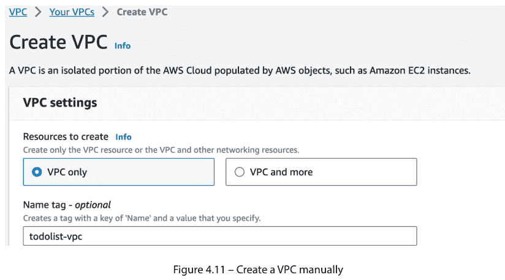

5. 对于**名称标签**，请输入一个合适的名称，例如`todolist-vpc`，我们将在本学习指南的后面使用该名称。

6. 向下滚动并输入以下详细信息：

- I. 在**IPv4 CIDR块**下，确保选中**IPv4 CIDR手动输入**
- II. 对于**IPv4 CIDR**，提供IP地址块范围10.0.0.0/16
- III. 在**IPv6 CIDR块**下，选择**无IPv6 CIDR块**
- IV. 确保在**租期**下选择**默认**

7. 点击**创建VPC**按钮。

## 项目任务4.2 – 创建并附加互联网网关

在此任务中，你将创建一个互联网网关并将其附加到你的VPC：

1. 确保你已登录到AWS账户，并位于北弗吉尼亚区域的VPC控制台中。你应该能够看到你的VPC列在列表中：

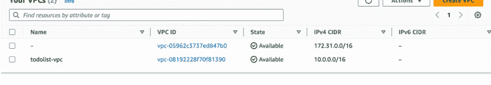

图4.12 – VPC列表

2. 从左侧菜单中，点击**互联网网关**。
3. 点击屏幕右上角的**创建互联网网关**按钮。

4. 为你的互联网网关提供一个名称，例如`todolist-igw`。

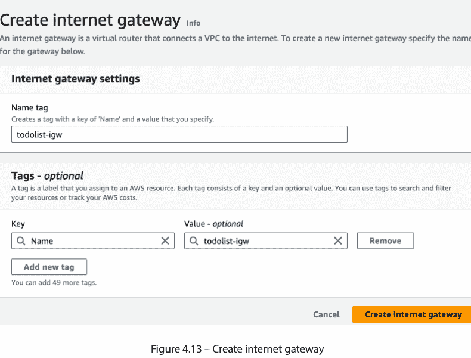

5. 点击**创建互联网网关**按钮。你将会收到一条成功消息。

6. 现在你需要将互联网网关附加到你的VPC。从**操作**下拉列表中，选择**附加到VPC**。（如果你不小心离开了此屏幕，可以通过从左侧菜单选择**互联网网关**，然后选择`todolist-igw`来重新访问该屏幕。）

7. 在**可用VPC**下，选择`todolist-vpc`，然后点击**附加互联网网关**按钮，如下图所示：

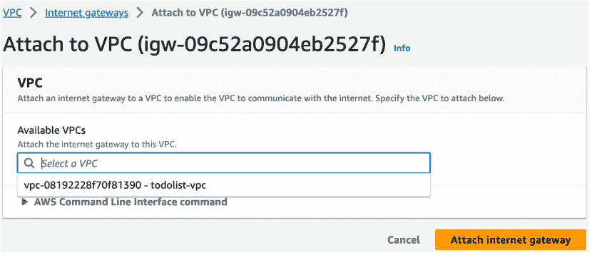

*图4.14 – 将互联网网关附加到VPC*

你将收到一条消息，说明互联网网关已成功附加到VPC。现在，你将能够创建公有路由表。当你创建VPC时，AWS会创建一个默认的主路由表。当你创建新的子网时，它们会自动与默认路由表（也称为**主路由表**）关联。

在本练习中，你将使用主路由表来承载私有子网的路由，并为公有子网创建另一个路由表。

## 项目任务4.3 – 创建公有路由表

现在，你将创建另一个用于公有子网的路由表。确保你已登录到AWS账户，并位于**北弗吉尼亚区域**的VPC控制台中：

1. 从左侧菜单中，选择**路由表**。
2. 在右侧窗格中，你会注意到两个默认路由表。一个是每个区域都存在的默认VPC的路由表，另一个是你创建的VPC的路由表。AWS不会自动添加**名称**标签，因此最好自己手动设置名称标签。
3. 在VPC明确标记为todolist-vpc的行中，将鼠标悬停在**名称**列中的连字符（-）旁边，即可获得编辑标签的选项。

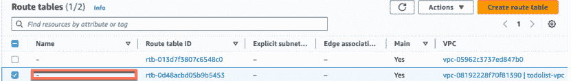

*图4.15 – 路由表列表*

4. 你会看到一个编辑图标弹出。点击它来编辑名称，并将路由表名称设置为`todolist-mainrt`。
5. 点击屏幕右上角的**创建路由表**按钮。
6. 为公有路由表输入一个名称，例如`todolist-publicrt`。
7. 在**VPC**下的下拉菜单中选择`todolist-vpc`。
8. 点击屏幕右下角的**创建路由表**按钮。
9. 系统将显示路由表已成功创建的确认信息。向下滚动，在**路由**窗格下，点击**编辑路由**，如下图所示：

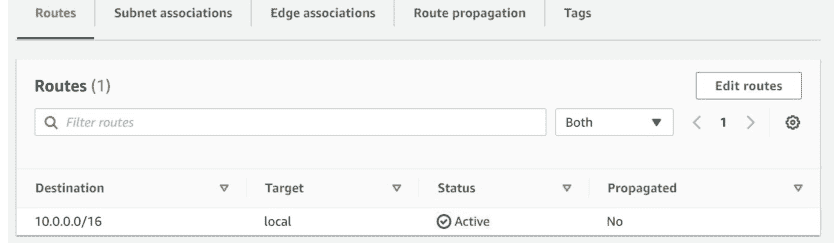

图4.16 – 编辑路由

10. 随后，系统会显示**编辑路由**屏幕。你需要添加一条通往互联网的新路由。为此，点击**添加路由**，然后执行以下操作：

- I. 在目标位置，输入0.0.0.0/0。
- II. 在**目标**下，选择**互联网网关**，然后选择`todolist-igw`。接下来，点击**保存更改**按钮。你的公有路由表现已创建完成。

接下来，你需要创建子网，然后将公有子网附加到你刚刚创建的公有路由表上。

- 7. 对于**第4个子网（共4个）**：
  - I. 子网名称：`todolist-app-subnet02`
  - II. 可用区：`us-east-1b`
  - III. IPv4 CIDR块：`10.0.11.0/24`

  点击**添加新子网**。

- 8. 对于**第5个子网（共5个）**：
  - I. 子网名称：`todolist-data-subnet01`
  - II. 可用区：`us-east-1a`
  - III. IPv4 CIDR块：`10.0.20.0/24`

  点击**添加新子网**。

- 9. 对于**第6个子网（共6个）**：
  - I. 子网名称：`todolist-data-subnet02`
  - II. 可用区：`us-east-1b`
  - III. IPv4 CIDR块：`10.0.21.0/24`

- 10. 检查你已配置的设置，然后点击屏幕右下角的**创建子网**按钮。

子网创建完成后，它们将附加到主路由表。对于私有子网来说，这是可以的，因为在本学习指南的后面，你只需要配置内部路由以及指向NAT网关以访问互联网的路由。但是，你需要将公有子网与公有路由表关联起来，因为它们将使这些子网中的资源能够通过互联网网关直接访问互联网。

## 项目任务4.5 – 将公有子网关联到公有路由表

在此任务中，你将把公有子网与你之前创建的公有路由表关联起来：

1. 如果需要，请登录到你的AWS账户，并导航到VPC控制台。确保你位于北弗吉尼亚区域。
2. 从左侧菜单中，点击**路由表**。
3. 在右侧窗格中，选择**todolist-publicrt**路由表。
4. 点击**子网关联**选项卡。

- 5. 单击 Edit subnet associations 按钮。

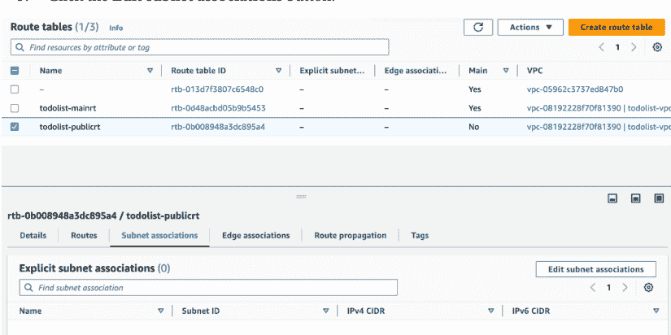

Figure 4.17 – Public route table subnet associations

- 6. 在弹出的对话框中，选择 todolist-pub-subnet01 和 todolist-pub-subnet02。
- 7. 单击屏幕右下角的 Save associations 按钮。

此时，两个公有子网已与公有路由表关联。公有路由表已配置了经由互联网网关访问互联网的路由。

接下来，你可以为你的 VPC 设置安全组。安全组将保护与其关联的资源，例如 EC2 实例。

## Project Task 4.6 – Creating Security Groups

在此任务中，你将创建三个安全组以允许特定流量进入你在 AWS 上部署的资源。从互联网到 VPC 中资源的流量流向如下图所示：

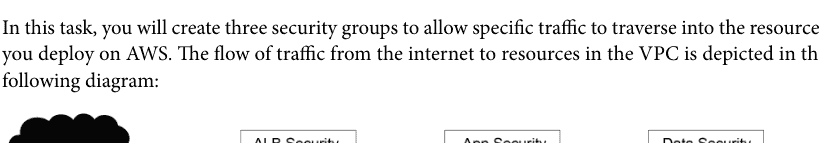

Figure 4.18 – Security group traffic flow

在前述图所示的工作流程中，来自 **internet** 的端口 80（HTTP）流量将被允许从互联网进入你在本学习指南后面部署的 ALB。此外，运行你的应用程序的 EC2 实例将托管在 app 子网中并与 app 安全组关联。该组将允许来自 ALB 安全组的端口 80（HTTP）入站流量。这可确保所有面向互联网的流量必须先连接到负载均衡器，然后负载均衡器再将该流量转发到健康的 EC2 实例。

接下来，你的 EC2 实例需要连接到运行 MySQL 的后端数据库。为了确保只有授权服务器被允许连接到数据库，你将配置数据安全组，仅接受来自与 app 安全组关联的 EC2 实例的端口 3306（MySQL）入站连接。

以下是为 ALB 配置安全组的步骤：

- 1. 确保已登录你的 AWS 账户并导航到 VPC 控制台。确保你也在 **N. Virginia** 区域。
- 2. 从左侧菜单中，选择 **Security** 类别的 **Security groups**。
- 3. 在右侧窗格中，单击 **Create security group** 按钮。
- 4. 为你的安全组提供一个名称，例如 ALB-Security-Group。
- 5. 在 **Description** 下，提供适当的值，例如 `Security Group for Application Load Balancer`。
- 6. 在 **VPC** 下，选择 **todolist-vpc**。
- 7. 在 **Inbound rules** 窗格上，单击 **Add rule** 按钮。
- 8. 配置端口 80（HTTP）的入站规则，并将该流量的来源设置为 `0.0.0.0/0`，如 Figure 4.19 的屏幕截图所示。你也可以选择性地添加描述。

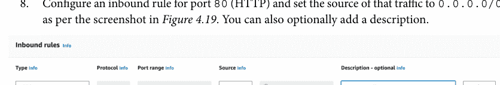

Figure 4.19 – ALB-Security-Group inbound rules

- 9. 单击屏幕右下角的 **Create security group** 按钮。你应该会收到一条安全组已创建的消息。请注意，默认存在 *allow all traffic outbound* 规则。由于此流量目标为互联网，你可以将其保持为默认值。在其他环境中，你可能希望限制出站流量以增强安全性，确保流量仅目标为特定网络。
- 10. 再次从左侧菜单单击 **Security groups**。

在右侧窗格中，通过查看 **Security group name** 列来识别你刚刚创建的安全组。编辑并更新相应的 **Name** 列以提供相同的名称，在本例中为 `ALB-Security-Group`，如下图所示。这将确保你以后可以快速识别该安全组。请注意，你也可以在创建安全组时使用 **Tag** 部分设置此项。

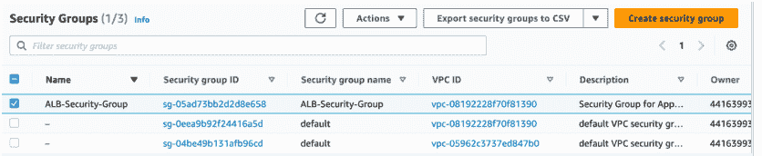

Figure 4.20 – List of security groups

让我们现在为你的应用程序服务器创建一个安全组。

- 1. 从左侧菜单中，选择 **Security** 类别的 **Security groups**。
- 2. 在右侧窗格中，单击 **Create security group** 按钮。
- 3. 为你的安全组提供一个名称，例如 `App-Security-Group`。
- 4. 在 **Description** 下，提供适当的描述，例如 `Security Group for Application Servers`。
- 5. 在 **VPC** 下，选择 `todolist-vpc`。
- 6. 接下来，在 **Inbound rules** 窗格上，单击 **Add rule** 按钮。
- 7. 配置端口 80（HTTP）的入站规则，并为该流量的来源确保 **Source** 设置为 **Custom** 并单击搜索框。向下滚动直到找到 **ALB-Security-Group** 并选择它，如下图所示：

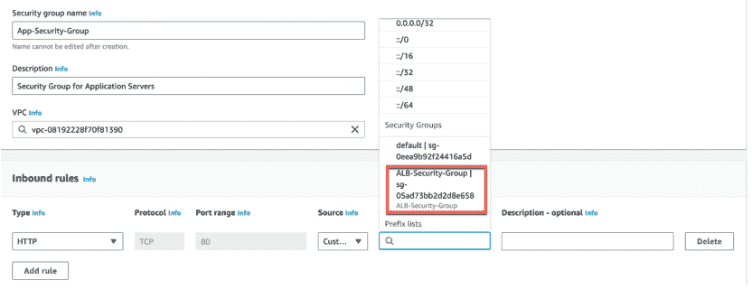

Figure 4.21 – Ensure you select the right security group as the source; in this case, ALB-Security-Group

- 8. 接下来，单击 **Create security group** 按钮。你应该会收到一条安全组已创建的消息。
- 9. 再次从左侧菜单单击 **Security Groups**。

在右侧窗格中，通过查看 **Security group name** 列来识别你刚刚创建的安全组。编辑并更新相应的 **Name** 列以提供相同的名称，在本例中为 App-Security-Group。这将确保你以后可以轻松识别该安全组。

让我们创建数据库安全组。

- 1. 从左侧菜单中，选择 **Security** 类别的 **Security groups**。
- 2. 在右侧窗格中，单击 **Create security group** 按钮。
- 3. 为你的安全组提供一个名称，例如 Data-Security-Group。
- 4. 在 **Description** 下，提供适当的描述，例如 `Security Group for Database Instances`。
- 5. 在 **VPC** 下，选择 **todolist-vpc**。
- 6. 在 **Inbound rules** 窗格上，单击 **Add rule** 按钮。
- 7. 配置端口 **3306**（MySQL/Aurora）的入站规则，并为该流量的来源确保 **Source** 设置为 **Custom** 并单击搜索框。向下滚动直到找到 `App-Security-Group`。
- 8. 单击 **Create security group** 按钮。你应该会收到一条安全组已创建的消息。
- 9. 再次在左侧菜单中单击 **Security Groups**。

在右侧窗格中，通过查看 **Security group name** 列来识别你刚刚创建的安全组。编辑并更新相应的 **Name** 列以提供相同的名称，在本例中为 `Data-Security-Group`。这将确保你以后可以轻松识别该安全组。

你现在拥有了三个安全组以及 VPC，它们将在本学习指南后面用于部署资源。你会注意到我们尚未部署任何 NAT 网关或负载均衡器。它们只会在本学习指南后面的相关练习中需要时才部署，因为它们可能会产生少量费用。

## Summary

在本章中，你学习了 Amazon VPC。VPC 代表 AWS 平台内一个隔离的网络环境，用于托管某些计算、存储和数据库资源。VPC 跨越整个区域，这意味着你可以定义一个利用多个 AZ 来托管你的应用程序的架构。根据你如何配置资源，你可以确保支持你的应用程序的副本工作负载分布在这些 *AZs* 中，这提供了更大的弹性和冗余。

多个 VPC 也可以使用 VPC 对等连接相互连接。这意味着你可以将不同区域中的 VPC 相互连接，其中这些 VPC 之间的流量始终驻留在 AWS 主干网络上，并且仅需要私有 IP 地址。这不仅降低了成本，还确保了这些 VPC 之间安全且高带宽的连接。你还可以通过 VPN 或 Direct Connect 将本地网络连接到你的 VPC 来构建混合云解决方案。

在下一章中，你将转向 AWS 上的计算服务。现在你已经构建了一个安全的 VPC 环境，下一章将教授如何配置 EC2 实例（虚拟服务器）并在你的 VPC 中为你的应用程序部署它们。

# 考试准备演练 – 章节复习题

除了对关键概念有扎实的理解外，在时间压力下快速思考的能力也会帮助你顺利通过认证考试。这就是为什么在学习之旅早期就开始练习这些技能至关重要。

章节复习题旨在随着你学习和复习每一章而逐步提高你的应试技巧，同时复习你对本章关键概念的理解。你会在每一章的末尾找到这些题目。

**如何访问这些材料**
要了解如何访问这些资源，请前往标题为 *第 17 章，访问在线资源* 的章节。

要打开本章的章节复习题，请执行以下步骤：

+   1. 点击链接 – https://packt.link/DVAC02_CH04。

或者，你可以扫描以下 **二维码** (*图 4.22*)：

图 4.22 – 打开已登录用户的章节复习题的二维码

2. 登录后，你会看到与图 4.23 所示类似的页面：

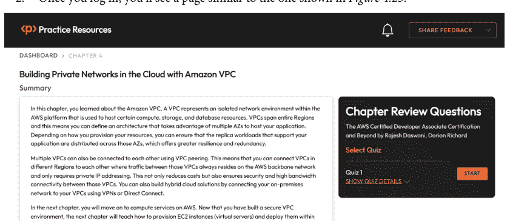

图 4.23 – 第 4 章的章节复习题

3. 准备好后，开始以下练习测验，并多次重做测验。

## 考试准备演练

前三次尝试时，不必担心时间限制。

## 第一次尝试

第一次，目标至少达到 40%。查看答错的题目并重新阅读章节中的相关部分，以弥补学习上的不足。

## 第二次尝试

第二次，目标至少达到 60%。查看答错的题目并重新阅读章节中的相关部分，以弥补剩余的学习不足。

## 第三次尝试

第三次，目标至少达到 75%。一旦得分达到 75% 或以上，你就开始练习时间控制。

提示
你可能需要超过三次尝试才能达到 75%。这没关系。只要一直复习章节中的相关部分，直到达到目标为止。

## 练习时间控制

目标：你的目标是在保持分数不变的同时，尽可能快速地回答这些问题。以下是你后续尝试应呈现的示例：

| Attempt | Score | Time Taken |
|---|---|---|
| Attempt 5 | 77% | 21 mins 30 seconds |
| Attempt 6 | 78% | 18 mins 34 seconds |
| Attempt 7 | 76% | 14 mins 44 seconds |

表 4.1 – 在线平台上的示例时间练习测验

注意
上表中显示的时间限制仅为示例。根据网站上测验的时间限制，为每次尝试设定自己的时间限制。

每次新的尝试，你的分数应保持在 75% 以上，而完成所需的“用时”应“减少”。重复尽可能多的尝试，直到你感觉有信心应对时间压力为止。

在使用 Amazon EC2 实例时，你还必须了解计算资源的存储需求。EC2 实例需要块存储来托管操作系统。此外，根据应用程序用途，需要考虑具有不同性能级别的数据卷，这在跨服务器集群共享数据时适用。这些存储选项也在本章中进行了讨论。

最后，本章还涵盖了如何使用诸如 AWS Systems Manager Session Manager 之类的服务安全地访问你的 EC2 实例等主题，这对系统管理员和开发人员都至关重要。

借助 Amazon EC2，**TodoPlus Limited** 将利用 AWS 云的强大功能和灵活性，部署和管理专门为待办事项应用程序量身定制的实例。通过利用 EC2 的强大功能，他们旨在实现最佳性能，并确保应用程序能够根据不同的需求无缝扩展。这一战略选择使他们能够提供一致且高效的用户体验。

在本章中，你将了解以下主题：

- Amazon EC2 简介
- EC2 的不同定价模式
- EC2 生命周期概述
- 利用 AMI 启动 Amazon EC2 实例
- 其他 EC2 功能
- 访问你的 EC2 实例
- Amazon EBS 简介
- Amazon EFS 简介
- 项目任务 – 为 TodoPlus Limited 部署 EC2 实例并创建企业 AMI 镜像

在本章结束时，你将对为应用程序需求配置 EC2 实例、相关存储和安全选项有扎实的掌握。你还将学会如何根据工作负载持续时间选择 EC2 实例并识别节省成本的选项。本章后面的项目练习将教你如何构建服务器镜像，以帮助加快应用程序部署。

## Amazon EC2 简介

Amazon Elastic Compute Cloud，或 EC2，提供可调节且经济高效的计算资源，如虚拟机，支持 Linux、Windows 和 macOS 操作系统。本章旨在让你熟悉 Amazon EC2 的基本方面，包括其特性、潜在应用以及使用该服务满足云计算需求的优势。

## Amazon EC2 的用例

Amazon EC2 可用于各种应用程序和工作负载，包括以下内容：

- Web 和移动应用程序：你可以托管标准的前端网站以及用于后端处理和业务逻辑的应用程序。
- 大数据分析：你可以部署提供数据分析的专有第三方应用程序。
- 备份和恢复：你可以构建支持灾难恢复策略的服务器，从配置最小的副本服务器集到全功能的跨站点部署。
- 高性能计算：非常适合信用卡欺诈检测、提供自助技术支持、教授自动驾驶汽车以及改进医疗诊断等应用程序。

## 使用 Amazon EC2 的优势

Amazon EC2 按需提供可靠、可扩展的计算基础设施，并具有优化性能和成本的能力。这种灵活性体现在种类繁多的实例类型和功能上，使用户能够构建和部署满足其特定要求的应用程序。用户友好的界面和完善的 API 使 Amazon EC2 易于使用，使开发人员能够快速入门并管理实例。此外，利用 AWS 的全球基础设施增强了服务的可靠性，为用户提供了数据中心稳健性和冗余性。Amazon EC2 是 AWS 的核心组件，为各类型企业提供高度可扩展且经济高效的计算解决方案。其灵活性、安全性和易用性使其成为开发人员和希望利用云计算能力的组织的有吸引力的选择。

就操作系统而言，AWS 提供广泛的选择，包括 Microsoft Windows、Linux 和 macOS。此外，你可以从 AWS Marketplace 获取许多捆绑了额外软件的第三方操作系统构建。此外，你还可以创建自己的 Amazon Machine Images（AMI），其中包含操作系统层以及构成企业服务器构建一部分的任何软件应用程序、库和实用程序。AMI 将在本章后面详细介绍。

要访问你的 EC2 实例，你可以允许使用 SSH 或 RDP 直接通过互联网访问。通过创建加密的公钥/私钥对来建立安全访问，该对用于加密和解密你的访问。例如，对于基于 Windows 的实例，密钥对会加密管理员密码，该密码可使用私钥解密并用于通过 RDP 客户端远程管理实例。对于基于 Linux 的系统，创建的密钥对中的私钥是必需的才能通过 SSH 连接。

为了进一步增强安全性，可以使用 AWS Systems Manager Session Manager 和其他工具，提供更高的安全级别。这些将在后续章节中讨论。接下来，你将研究获取 EC2 实例的各种定价选项。

# EC2 的不同定价模型

Amazon EC2 提供多种定价模型，以满足用户多样化的需求。这些定价选项使企业能够优化其云计算成本，同时确保为工作负载提供所需的资源。您将**接下来探索这四种不同的定价选项。**

## 按需实例

按需实例允许您根据所选实例类型，按小时或按秒支付计算容量费用。此选项无需长期承诺或预付款，因此非常适合短期、不规则的工作负载或使用模式不可预测的应用程序。按需实例提供了灵活性，并帮助您避免容量规划的成本和复杂性。

## 预留实例 (RIs)

预留实例 (RIs) 允许您以低于按需实例的折扣价，为特定时间段（通常为一年或三年）预留计算容量。RIs 适用于可预测的、稳态的工作负载或具有长期承诺的应用程序。RIs 有三种付款选项：全部预付、部分预付和无需预付。您预付的金额越多，获得的折扣就越大。通过使用 RIs，您可以在确保应用程序资源可用性的同时实现显著的成本节约。

## 节省计划

节省计划是一种灵活的定价模型，提供类似预留实例的折扣，但具有更大的简便性和灵活性。通过节省计划，您可以降低账单，以一年或三年的支出承诺换取最高 72% 的按需价格折扣。节省计划有三种类型：

- **计算节省计划**：这些计划为 AWS 计算服务（如 Amazon EC2、AWS ECS Fargate 和 AWS Lambda）提供折扣。您还可以在任何实例上应用折扣，包括实例系列、大小、区域或操作系统。计算节省计划在应用折扣方面提供了更大的灵活性。

- **EC2 实例节省计划**：这些计划为特定区域内特定 EC2 实例系列提供折扣。您只能在实例大小、可用区、操作系统和租户类型上应用折扣。然而，EC2 实例节省计划提供了最大的折扣。

- **Amazon SageMaker 节省计划**：与按需价格相比，该计划可为任何 ML 实例类型、大小和区域提供最高 64% 的折扣。

节省计划需要承诺一年或三年，并可选择全部预付、部分预付或无需预付。此模式非常适合寻求成本节约但又不希望被绑定到特定实例类型或系列的企业。

## 竞价实例

竞价实例允许您竞标未使用的 Amazon EC2 容量，价格远低于按需实例。这些实例非常适合能够容忍中断的容错、灵活工作负载，因为如果竞价价格超过您的出价或容量不再可用，它们可能会在短时间内被终止。竞价实例可用于各种应用程序，如大数据分析、批处理或开发和测试环境，帮助您实现大幅成本节约。

Amazon EC2 提供了一系列定价模型，以适应不同的使用场景和预算需求。通过理解这些定价选项，您可以做出明智的决策，在确保工作负载所需资源可用的同时优化您的云计算成本。

## EC2 生命周期概述

理解 Amazon EC2 生命周期对于有效管理和优化您的实例至关重要。生命周期由多个阶段组成，从启动实例到最终终止实例。本章概述了 EC2 生命周期中的关键阶段以及您在每个阶段可以执行的操作，如图 5.1 所示。

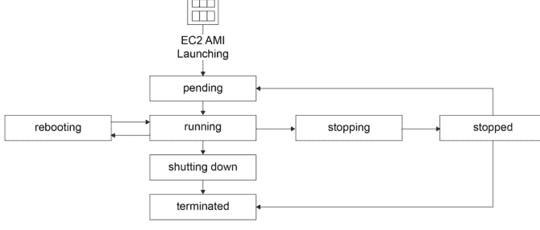

图 5.1 – 实例生命周期

下表（表 5.1）概述了 EC2 实例状态及其描述。

| 实例状态 | 描述 |
|---|---|
| pending | 实例的启动过程即将完成。Pending 是实例首次启动或从暂停状态恢复后的初始状态。 |
| running | 此时实例已启动并运行正常。 |
| stopping | 实例正准备停止。 |
| stopped | 实例已被终止且不再可用。您可以随时启动实例。（注：原文此处逻辑可能有误，Stopped通常指停止但保留，Terminated才是彻底删除，此处忠实翻译原文描述） |
| shutting down | 关闭实例的过程已开始。 |
| terminated | 实例已被不可逆地清除，无法恢复。 |

表 5.1 – 实例生命周期状态详解

Amazon EC2 由基于云端的虚拟服务器组成，需要操作系统才能运行。在以下部分中，您将熟悉 Amazon 机器镜像 (AMIs) 的基础知识以及如何利用它们来创建 Amazon EC2 实例。

## 利用 AMI 启动 Amazon EC2 实例

AMI 是创建实例的模板，包含必要的操作系统、应用程序和配置。在启动 EC2 实例时，根据需求选择合适的 AMI 至关重要，因为它决定了操作系统和任何预装软件。

一个 AMI 包含以下内容：

- 一个或多个 **弹性块存储**（本章稍后讨论）快照，或者如果您使用的是实例存储支持的 AMI，则是实例根卷的模板
- 启动权限，该权限授予可以启动该 AMI 的 AWS 账户
- 任何指定在启动实例时附加的额外卷的块设备映射

### AMI 类型

有三种类型的 AMI 可供选择：

- **AWS 提供的 AMI**：这些是 AWS 提供的官方 AMI，包括各种操作系统，如 Amazon Linux、Ubuntu、Windows Server 等。
- **社区 AMI**：这些是由 AWS 用户创建和共享的，可供公众使用。社区 AMI 可以包含预装软件和自定义配置。
- **自定义 AMI**：您可以创建自定义 AMI，以根据具体需求定制实例，并符合您的公司政策和/或应用程序和项目要求。

以下是一些常见的实例元数据用例：

- **动态配置**：实例元数据可用于动态配置在实例上运行的应用程序。例如，您可以获取实例的公共 IP 地址，并使用它来更新 DNS 记录或配置负载均衡器。
- **条件执行**：您可以使用实例元数据，根据实例类型、启动时间或其他元数据条件性地运行脚本或应用程序。这使得您能够根据实例的特性优化应用程序的行为。
- **安全性**：实例元数据可用于通过获取有关实例安全组或 IAM 角色的信息来增强安全性。这些信息可用于实施细粒度的访问控制或审计实例权限。
- **日志记录和监控**：您可以使用实例元数据为日志文件或监控数据添加标签，包含相关信息，如实例 ID 或实例类型。这使得识别和排除与特定实例相关的问题变得更加容易。

## 实例用户数据

在启动实例时，您可以指定实例用户数据，这允许您提供一个脚本，该脚本将在实例首次启动时执行。例如，您可以运行用 bash 编写的脚本（针对 Linux）或用 PowerShell 编写的脚本（针对基于 Windows 的 EC2 实例）。如果您需要为实例配置特定设置，例如升级操作系统内核或安装应用程序和实用工具，此功能特别有用。

虽然自定义 AMI（前文已讨论）可用于创建包含实例所需大多数应用程序和实用工具的镜像，但在启动时可能仍需对实例进行特定修改。例如，您可能有一个包含基础操作系统、Apache Web 服务副本以及为 Web 服务器实例预定义运行环境的自定义 AMI 镜像。然而，根据是在开发、测试还是生产环境中启动，可能需要进一步修改该配置。在这种情况下，可以作为用户数据的一部分在运行时提供脚本来执行这些额外的配置。

## AWS 系统监控：概述

AWS 提供了一套全面的监控工具和服务，使用户能够跟踪其云资源、应用程序和基础设施的性能、健康状况和利用率。一项关键服务是 Amazon CloudWatch，这是一种监控和可观察性服务，它收集并分析来自 AWS 资源、应用程序和服务的运营数据。CloudWatch 收集指标、日志和事件，帮助用户检测异常、设置警报并根据预定义阈值自动执行操作。

除了 CloudWatch 之外，AWS 还提供其他针对特定需求的监控服务。这些服务包括用于威胁检测的 Amazon GuardDuty、用于应用程序分布式追踪的 AWS X-Ray，以及用于分析 AWS 资源并就成本优化、性能和安全提供建议的 AWS Trusted Advisor。通过利用这些 AWS 监控服务，用户可以维护其云环境的可见性、优化性能、排查问题并增强安全性。状态检查有两种类型：

- **系统状态检查：** EC2 实例状态检查有助于对支持 EC2 实例的 AWS 基础设施进行持续监控。此检查有助于识别可能由各种因素引起的故障，例如网络连接中断、电源中断或宿主机硬件或软件问题。检测到故障后，AWS 会采取措施解决问题。同时，用户可以停止并重新启动受影响的实例，从而有效地将其迁移到不同的宿主机。
- **实例状态检查：** 监控的目的是监督 EC2 实例的软件和网络配置。各种因素都可能触发错误，例如网络或启动设置不当、内存不足或文件系统损坏。如果出现任何问题，用户必须自行解决；在严重的情况下，可能需要终止有问题的实例并创建新实例。保持充分的数据备份对于避免数据丢失至关重要。

在本节中，您了解了 Amazon EC2 服务的其他功能。在下一节中，您将了解访问 EC2 实例的各种选项。

## 访问您的 EC2 实例

从互联网访问您的 EC2 实例需要确保足够的安全级别，并实施策略或规则来限制允许进入实例的流量类型。对于基于 Linux 的 EC2 实例，您可以使用安全外壳（SSH）；对于基于 Windows 的 EC2 实例，您可以使用远程桌面协议（RDP）通过互联网远程连接到实例。

如何连接到您的 EC2 实例还取决于它在您的 VPC 中的位置。例如，放置在公有子网中且可直接访问互联网的实例，只要安全组允许相关端口的入站连接，且您的 VPC 具有互联网网关，就可以轻松访问。此外，您的网络访问控制列表（NACL）必须允许与托管 EC2 实例的子网之间的入站和出站连接。

下图描述了使用堡垒主机时的架构：

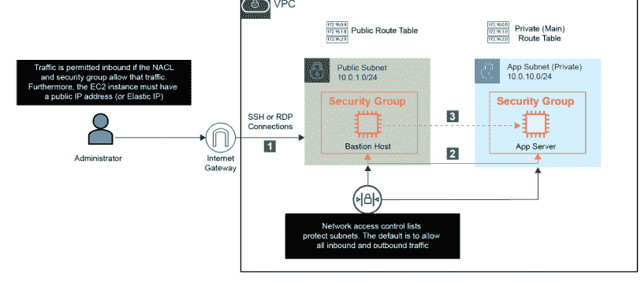

图 5.3 – 使用堡垒主机连接到私有子网中的 EC2 实例

在图 5.3 中，管理员将首先与堡垒主机建立远程连接，然后从该主机继续与私有子网中的应用程序服务器建立新的远程连接。以下是一些需要注意的要点。

与堡垒主机关联的安全组必须允许来自互联网或公共互联网上指定 IP 地址/范围的入站连接。您可以将连接限制到特定端口，例如 SSH 的端口 22 或 RDP 的端口 3389。

第二个安全组与应用程序服务器关联，用于远程管理流量，仅允许来自堡垒主机的入站连接。

正确配置安全组和网络 ACL 后，管理员即可访问私有子网中的 EC2 实例。

使用堡垒主机连接到您的其他 EC2 实例是在云端远程管理服务器的一种选择。然而，这种方法存在一些风险因素。最值得注意的是，堡垒主机放置在公有子网中，因此暴露在公共互联网上。虽然安全组规则会阻止除指定端口流量外的任何访问，但这些实例仍会受到恶意互联网请求的轰炸——这些数据包虽然因安全组限制而被丢弃，但仍会由实例进行处理。此类恶意请求很容易淹没堡垒主机。您必须确保设计额外的配置，以降低任何人通过暴力破解访问您的环境的风险。

作为替代方案，AWS 提供了另一种解决方案，无需在防火墙上打开端口即可远程、安全地管理您的实例。该解决方案由一项名为 Systems Manager Session Manager 的服务提供。接下来让我们了解一下这项服务。

## 使用 AWS Systems Manager Session Manager 访问您的 EC2 实例

AWS Systems Manager 提供了许多工具和实用程序来管理您的资源，例如 AWS 上的 EC2 实例。其功能包括补丁管理、清单管理、在实例队列中运行命令而无需物理连接这些实例，以及使用 Session Manager 远程管理您的 EC2 实例。

Session Manager 使您能够远程连接到云中的 EC2 实例以及本地虚拟机和物理服务器。使用 Session Manager，您无需打开端口或管理 SSH 密钥。此外，您可以创建策略并遵守公司的流程和规程，确保仅访问经授权的节点，同时保留必要的审计日志和节点访问详细信息。

要将您的 EC2 实例配置为可以使用 Session Manager 进行管理，您需要确保满足以下先决条件：

- **操作系统（OS）支持**：Session Manager 支持所有 Linux 版本以及 Windows Server 2012 及更高版本。此外，Session Manager 还支持 macOS。要使用 Session Manager，您必须确保您的 EC2 实例运行在受支持的操作系统上。
- **SSM Agent**：Session Manager 要求您在 EC2 实例或本地虚拟服务器上安装 SSM Agent，然后才能将其注册为托管节点。AWS 提供的大多数最新 AMI 都预装了该代理。如果需要安装，请务必安装尽量新的版本。
- **SSM-user**：Session Manager 在您的托管节点上使用一个具有管理权限的唯一身份。请注意，如果需要管理配置为域控制器的 Microsoft Windows Server 实例，则必须手动操作。创建该用户，并为其分配域管理员权限。
- **IAM 角色**：要使用 Session Manager 访问您的 EC2 实例，您必须确保为实例分配一个 IAM 角色，允许 Session Manager 与该实例通信并进行管理。该角色必须附加 `AmazonSSMManagedInstanceCore` 策略。

满足这些先决条件后，您现在可以访问并远程管理您的 EC2 实例，而无需堡垒主机，如下图所示。

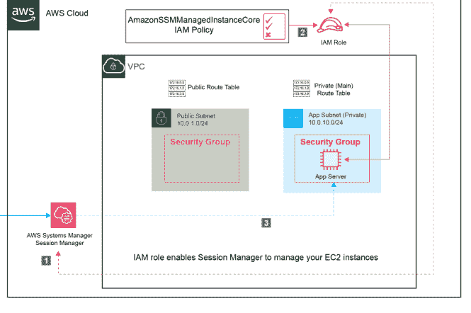

图 5.4 – 使用 AWS Session Manager 远程管理 EC2 实例

在图 5.4 中，您可以看到管理员如何使用 AWS Systems Manager Session Manager 服务远程访问 EC2 实例，整个过程无需打开端口，也无需使用堡垒主机。

以下是一些需要注意的要点：

- 您需要配置 Session Manager 来管理您的节点；这涉及在 EC2 实例上安装 SSM Agent。
- 您必须拥有一个 IAM 角色，使 Session Manager 能够管理该节点。
- 您可以访问 EC2 实例，甚至可以通过远程桌面客户端访问 Microsoft Windows 桌面环境。
- 对于 VPC 私有子网中的实例，您必须确保配置 VPC 端点，或部署具有必要路由表配置的 NAT 网关，以提供 VPC 中实例与 AWS Systems Manager 之间的连接。如果您选择通过 NAT 网关允许出站互联网访问，则还必须确保允许 HTTPS（端口 443）出站到 `ssm.region.amazonaws.com`、`ssmmessage.region.amazonaws.com` 和 `ec2messages.region.amazonaws.com`。

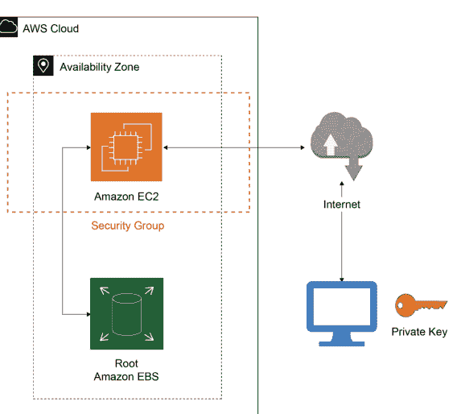

Figure 5.5 – 部署在单个可用区中的 EC2 实例

Amazon EBS 还提供另一种称为 EBS Multi-Attach 的块存储类型，允许将单个 EBS 卷同时附加到多个实例上。然而，此功能带有某些限制。例如，启用 Multi-Attach 的卷最多可附加到 16 个基于 Nitro 系统的实例，且这些实例必须位于同一可用区中。

Amazon EBS 提供多样化的存储选项，例如通用型 SSD（gp2 和 gp3）、预配置 IOPS SSD（io1 和 io2）、吞吐量优化 HDD（st1）、冷 HDD（sc1）和磁性 HDD（MHDS）。这些选项提供不同的性能水平和成本，让您可以为应用需求选择最合适的解决方案。尽管所有选项都被建议，但理想的选择取决于用户工作负载的具体需求。

Amazon EBS 提供的存储选项如下所示：

- **通用用途磁盘（gp2 和 gp3）（SSD）：** 这些磁盘经济实惠，同时为许多不同类型的事务性工作负载提供足够的吞吐量。其中包括虚拟桌面、中等规模的单实例数据库、交互式程序、测试环境和启动驱动器等。总体而言，这些数量是建议使用的。Amazon EBS 提供两种通用型 SSD 卷类型：
  - **通用型 SSD（gp3）卷** – 用于广泛使用的最新一代 SSD 卷
  - **SSD 通用型（gp2）卷**
- **预配置 IOPS SSD 卷（SSD）：** 这些是性能最高的 Amazon EBS 存储卷，专为关键的、IOPS 密集型和吞吐量密集型工作负载而构建，这些工作负载要求最低的延迟。Amazon EBS 提供三种不同类型的预配置 IOPS SSD 卷：
  - **IOPS SSD（io2）卷**
  - **IOPS SSD（io2）Block Express 卷**
  - **IOPS SSD（io1）卷**
- **Amazon EBS HDD 支持的卷** 属于以下类别：
  - **吞吐量优化硬盘（HDD）：** 一种经济实惠的 HDD，旨在满足定期访问且需要高吞吐量的工作负载。
  - **冷 HDD：** 用于不频繁访问工作负载的最经济的 HDD 架构。
- **磁性卷：** 磁性驱动器非常适合不频繁访问的数据以及需要为小容量提供经济存储的场景，可执行读写操作。这些驱动器的卷大小范围从 1 GB 到 1 TB，通常提供 100 IOPS，突发容量可达数百。

## 使用 Amazon EBS 快照优化备份和恢复

可以使用 Amazon S3 创建 Amazon EBS 卷的备份，该服务会创建您数据的点时间快照。这些快照旨在仅存储自上次备份以来更改的块，从而减少数据重复并降低存储成本。每个快照都包含指令，允许您将数据恢复到新的 EBS 卷。

通过克隆现有卷创建新的 EBS 卷时，新卷成为从快照中获取的原始卷的精确副本。一旦新卷生成，它即可立即使用，数据在后台加载。当您访问尚未加载的数据时，它会从 Amazon S3 下载并在后台加载。

### 加密您的 Amazon EBS 快照

以下是您可以加密 Amazon EBS 快照的不同方式：

- EBS 使用的加密可与 EBS 创建的快照完美配合。
- 对加密磁盘进行快照也会为您加密快照。
- 从加密快照创建的卷本质上也是加密的。
- 如果您拥有或有权访问未加密的快照，您可以选择即时加密从其创建的卷。
- 您拥有的未加密快照可以复制并根据需要进行加密。
- 在复制快照之前，您可以使用不同的密钥重新加密您有权访问或控制的快照。
- 从未加密的快照创建加密卷时，第一个快照始终是完整快照。

对于希望将专用块存储磁盘连接到特定 EC2 实例的人来说，Amazon Elastic Block Storage（EBS）是一个极佳的选择。在下一节中，您将探索 Amazon Elastic File System（EFS），这是一种适合建立可由多个实例同时访问的文件系统的解决方案。

## Amazon EFS 简介

Amazon EFS 是一种完全托管的文件存储系统，使您能够使用 **网络文件系统（NFS）** 版本 4 协议共享数据。运行在您的 EC2 实例上的应用程序和 Lambda 函数均可通过挂载点和访问点访问文件系统。利用 Amazon EFS，您可以存储和共享文件，而无需担心基础设施、容量或性能。系统可随着文件的添加或删除而动态扩展或收缩，支持 PB 级增长而不会影响应用程序。Amazon EFS 旨在通过其直观的 Web 服务界面轻松设置和定制，代您处理复杂文件系统的安装和修补。

使用 Amazon EFS，没有最低费用或设置费用，您只需为文件系统占用的空间付费。各种存储层可满足不同用途，例如 EFS Standard 和 EFS Standard-Infrequent Access（Standard-IA）存储类别，它们提供多可用区弹性以及最高水平的耐用性和可用性。相比之下，EFS One Zone 和 EFS One Zone-Infrequent Access（EFS One Zone-IA）存储类别允许数据存储在单个可用区中，从而实现额外节省。

该服务专为可扩展性、可用性和耐用性而设计。具有 Standard 存储类别的 Amazon EFS 文件系统会在 AWS 区域内的多个可用区中分发数据和信息，可容纳 PB 级数据，提供顶级性能，并促进大量并行数据访问。它的运行方式类似于标准文件系统，具有传统接口和全面的文件系统访问语义。使用 NFS 版本 4.1，任何 Amazon EC2 Linux 实例均可通过 NFSv4.1 协议访问 Amazon EFS，允许您在挂载后像在普通硬盘上一样访问和修改文件和文件夹。

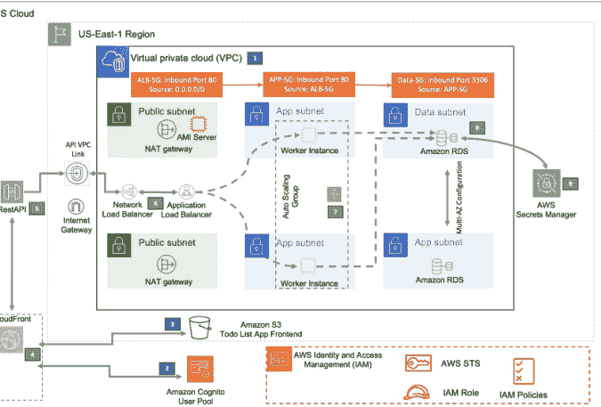

Figure 5.7 – 待办事项列表应用程序 – EC2 实例组件

为了让您能够连接到实例并安装所需软件，您还将配置 AWS Systems Manager Session Manager 以避免使用堡垒主机，正如前面讨论的那样，使用堡垒主机存在您希望缓解的多个风险因素。需要注意的重要一点是，为了让 AWS Systems Manager 授予您访问 EC2 实例的权限，您还需要配置必要的 IAM 角色。

## 技术要求

要完成以下任务，您需要以 IAM 用户 Alice 的身份登录到您的 AWS 开发账户，并确保已完成之前章节中的所有先前项目任务。

## 项目任务 – 部署 EC2 实例并为 ToDoPlus Limited 创建企业 AMI 镜像

在以下一系列项目任务中，您将学习如何按照关键最佳实践部署 EC2 实例。您还将学习如何使用 AWS Systems Manager Session Manager 安全地访问您的 EC2 实例。这是远程管理 EC2 实例的推荐方法，因为它比从互联网打开网络端口要安全得多。

接下来，您将构建一个 AMI，该 AMI 将用于部署您的待办事项列表应用程序的后端应用程序服务。

# 项目任务 5.1 – 为您的 EC2 实例准备 AWS Systems Manager Session Manager

在本项目任务中，您将执行一些先决条件任务，以确保在部署 EC2 实例时可以使用 Session Manager 连接到它们：

- 1. 使用 IAM 用户 Alice 的凭据登录您的 AWS 开发者账户。
- 2. 从顶部搜索栏菜单中，导航到 AWS Systems Manager。
- 3. 在主启动屏幕上，点击 Get Started with Systems Manager 按钮，如图 5.8 所示。这将带您进入 AWS Quick Setup 页面。

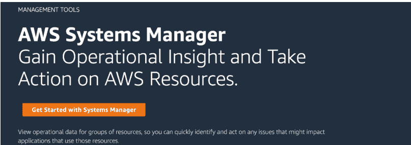

图 5.8 – 开始使用 AWS Systems Manager

- 4. 在右侧窗格中，从下拉列表中选择 us-east-1 并点击 Get started，如以下屏幕截图所示：

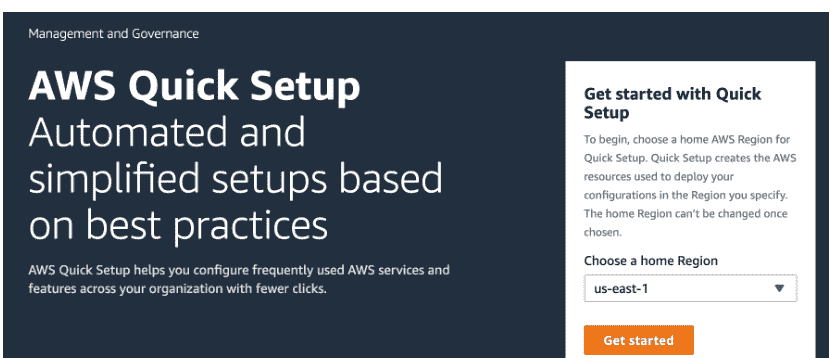

图 5.9 – AWS Systems Manager 快速设置

- 5. 现在您已选择了主区域，请随意快速浏览控制台。在左侧菜单中，您会注意到 AWS Systems Manager 提供的各种工具和服务。您还会注意到在 **Node management** 下列出了 **Session Manager** 工具。Session Manager 是一个功能强大的工具，但对于本项目，您将专注于使用它来访问后端 EC2 实例以进行远程管理。
- 6. 您必须创建一个 IAM 角色，使 Session Manager 能够管理您的 EC2 实例。从顶部搜索框中搜索 IAM 并在另一个浏览器标签页中打开其控制台。
- 7. 在您的 IAM 控制台中，从左侧菜单中选择 **Roles**。
- 8. 在右侧窗格中，点击 **Create role** 按钮并执行以下步骤：
  - I. 在 **Select trusted entity** 下，确保您选择 **AWS service** 选项。

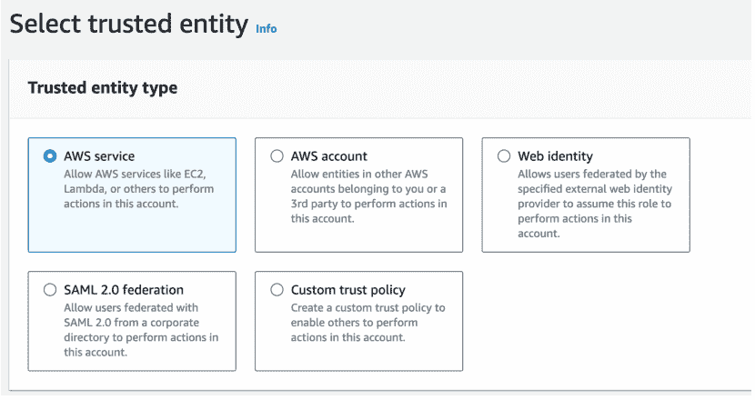

图 5.10 – 为 Session Manager 设置 IAM 角色

- II. 在 **Service or use case** 下的下拉列表中选择 **EC2**。
- III. 在 **Choose a use case for the specified service** 下，选择 **EC2 Role for AWS Systems Manager** 并点击 **Next**。
- IV. 您会注意到 `AmazonSSMManagedInstanceCore` IAM 策略已添加到此角色中。点击 **Next**。
- V. 提供一个角色名称，例如 `todo-ec2-iam-master-role`。

VI. 提供合适的描述，然后点击页面底部的 Create role 按钮。您现在应该会收到角色已创建的确认信息，如以下屏幕截图所示。

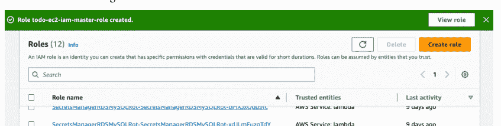

图 5.11 – 您的 EC2 实例用于访问 AWS Systems Manager 等服务的 IAM 角色

接下来，让我们启动一个 EC2 实例，该实例将用于创建您的自定义 AMI。

## 项目任务 5.2 – 启动 EC2 实例

在本项目任务中，您将在 Todo List VPC 公共子网中部署一个 EC2 实例。此 EC2 实例将配置有应用程序将使用的软件。稍后，您将创建一个 AMI，供 TodoPlus Limited 用于部署托管应用程序的多个实例。

配置自定义 AMI 的目的是确保您拥有经客户批准可供使用的企业映像，并加快部署支持应用程序所需的实例的速度：

- 1. 从 AWS 管理控制台，在顶部搜索栏中搜索 EC2 并导航到 EC2 管理控制台。
- 2. 从左侧菜单中选择 Instances。
- 3. 在右侧窗格中，点击 Launch instances 按钮。
- 4. 在 Launch an instance 控制台中，为您的实例提供一个名称，例如 Todo AMI Image Instance。
- 5. 在 Quick Start 下选择 Amazon Linux 并确保 Amazon Linux 2023 AMI 已被选为用于创建自定义 AMI 的映像。此外，确保您选择 64-bit x86 架构，如以下屏幕截图所示。

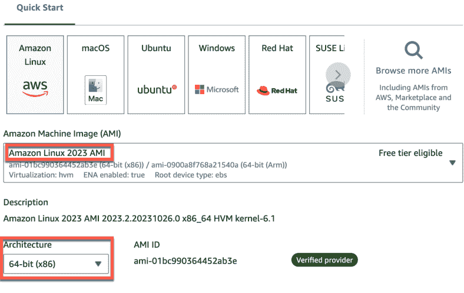

图 5.12 – 启动 EC2 实例

- 6. 对于 **Instance type**，确保选择 **t2.micro**。
- 7. 对于 **Key pair name – required**，从下拉菜单中选择 **Proceed without a key pair (Not recommended)**。您没有为此实例配置密钥对，因为您将使用 Session Manager 连接到它，而它不需要密钥对。
- 8. 在 **Network settings** 下，点击 **Edit** 按钮。
- 9. 从 **VPC** 下拉列表中选择 **todolist-vpc**。
- 10. 在子网下，选择 **todolist-pub-subnet-01**。
- 11. 从 **Auto-assign public IP** 下拉框中，选择 **Enable**。
- 12. 在 **Firewall (security groups)** 部分，点击 **Select existing security group** 选项。

13. 从常用安全组下拉列表中选择默认安全组，如以下屏幕截图所示：

# Network settings Info

VPC - required Info
vpc-08192228f70f81390 (todolist-vpc)
10.0.0.0/16

Subnet Info
subnet-00e2933bd237d2957 todolist-pub-subnet01
VPC: vpc-08192228f70f81390 Owner: 441639934710 Availability Zone: us-east-1a
IP addresses available: 250 CIDR: 10.0.1.0/24

Auto-assign public IP Info
Enable

Additional charges apply when outside of free tier allowance

Firewall (security groups) Info
A security group is a set of firewall rules that control the traffic for your instance. Add rules to allow specific traffic to reach your instance.

Create security group
Select existing security group

Common security groups Info
Select security groups
default sg-0eea9b92f24416a5d
VPC: vpc-08192228f70f81390

Security groups that you add or remove here will be added to or removed from all your network interfaces.

图 5.13 – EC2 实例 VPC 配置

- 14. 进一步向下滚动并展开 Advance detail 部分。
- 15. 在 IAM instance profile 下拉列表下，选择您在上一个任务中创建的 IAM 角色。
- 16. 滚动到页面底部，然后点击 Launch instance。
- 17. 您应该会收到确认实例已启动的成功消息。
- 18. 从左侧菜单中点击 Instances。
- 19. 实例需要几分钟才能成功启动。请确保 Status check 部分确认两个检查均已通过，如图 5.14 所示：

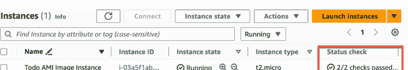

在右侧窗格中，通过点击 Name 实例旁边的复选框选择实例并点击 Connect 按钮。

您有四种连接实例的方法。选择 Session Manager 并点击 Connect 按钮。

这将使您连接到 EC2 实例 shell 界面，如以下屏幕截图所示：

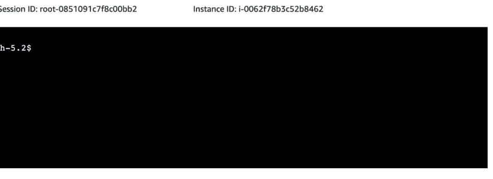

使用 Session Manager 连接时，您将使用 SSM-User 账户登录。通过键入 `sudo su` 命令并按 **Enter** 将您的用户更改为 root 用户。

执行以下步骤以安装所需的软件包：

通过键入 `yum update -y` 命令并按 **Enter** 更新操作系统。如果没有需要执行的更新，您将被通知。

键入 `curl -fsSL https://rpm.nodesource.com/setup_20.x -o nodesource_setup.sh` 并按 Enter。

键入 `bash nodesource_setup.sh` 并按 **Enter**。

键入 `yum install -y nodejs` 并按 **Enter**。

键入 `npm i -g pm2` 并按 **Enter**。

您的 EC2 实例现在已拥有构建 AMI 所需的所有软件包。在下一个项目任务中，您将创建此 EC2 实例的 AMI。此 AMI 然后可用于部署您的 EC2 实例，这些实例将执行所有后端操作并托管您的 API。

## 项目任务 5.3 – 创建自定义 AMI

您现在将为当前 EC2 实例创建 AMI：

- 1. 确保您已以 IAM 用户 Alice 的身份登录到开发账户。
- 2. 像之前一样导航到 EC2 仪表板。
- 3. 从左侧菜单中选择 Instances。
- 4. 在右侧窗格中，点击 Todo AMI Image Instance 实例标签旁边的复选框，如图 5.16 所示：

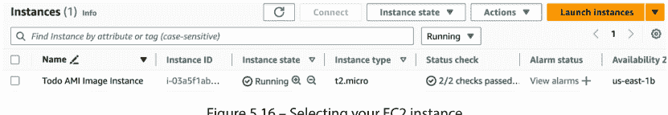

- 5. 您最好先关闭实例再制作映像。从 Instance state 下拉列表中选择 Stop instance。
- 6. 系统会提示您确认停止实例。请继续点击 Stop。
- 7. 实例关闭后，从 Actions 下拉列表中选择 Image and templates，然后选择 Create image，如图 5.17 所示：

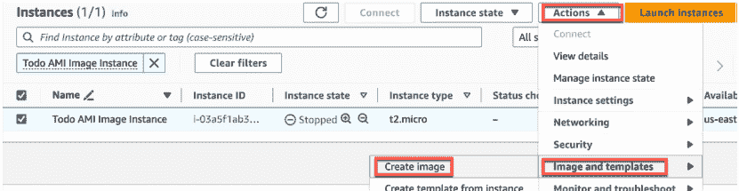

- 8. 您将看到 Create image 页面。在这里，您会注意到 EC2 实例已被列为您正在创建映像的对象。
- 9. 为您的映像提供一个名称 – 例如，todolist-worker-ami。

10. 提供描述，然后点击屏幕底部的 **Create image**。
11. 你会看到一条通知，表示 AMI 正在创建中。
12. 从左侧菜单中，在 **Images** 下选择 **AMIs**。
13. 在右侧窗格中，你会注意到 AMI 被创建，并在几分钟后处于 **Available** 状态，如 *Figure 5.18* 所示。

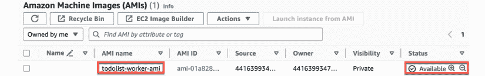

Figure 5.18 – Available AMIs

14. 你将在后续章节中使用此 AMI 来启动你的 worker 实例。由于你不再需要此 EC2 实例，可以终止该实例。点击左侧菜单中的 **Instances**，在右侧窗格中选择该实例。
15. 接下来，从 **Instance state** 下拉菜单中选择 **Terminate instance**。
16. 在出现的对话框中，点击 **Terminate** 按钮。你的实例现在将被终止。

创建和管理 AMI 以满足你的计算需求可确保你能快速有效地部署新实例。此外，通过对 AMI 构建方式应用严格的配置控制，你可以确保符合企业政策和治理要求，并满足任何监管要求。

## Summary

在本章中，你学习了如何创建和管理名为 Amazon Elastic Compute Cloud (EC2) 实例的虚拟服务器，以在云中运行应用程序和服务。你还了解了 Amazon machine images (AMIs)，它们是预配置的模板，可使启动 EC2 实例更快更简单。

此外，你还学习了如何将 Elastic Block Store (EBS) 存储附加到你的 EC2 实例，这提供了在可轻松附加和分离的虚拟硬盘上存储数据的能力。你还了解了 Amazon Elastic File System (EFS)，这是一种完全托管且可扩展的文件存储服务，用于在云中创建和配置文件系统。AWS Certified Developer Associate 考试将测试你对 EC2 服务核心概念以及 EBS 和 EFS 存储服务的知识。你还将被测试 AMI 的使用、用户数据和元数据以及安全功能。

下一章将介绍 AWS 上的数据库服务，重点探讨可用的不同数据库平台，包括用于关系数据库的 Amazon Relational Database Service (RDS) 和用于非关系数据库的 Amazon DynamoDB。

2. 登录后，你会看到与 Figure 5.20 所示类似的页面：

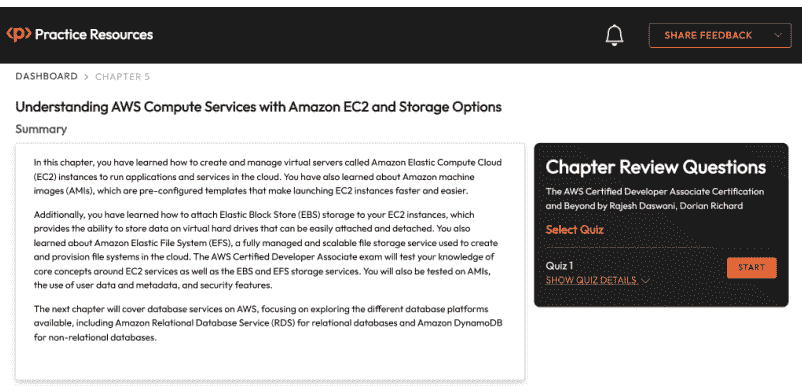

3. 准备好后，开始以下练习测验，多次重做测验。

## Exam Readiness Drill

前三次尝试时，不必担心时间限制。

## ATTEMPT 1

第一次尝试，目标至少达到 40%。查看答错的题目并重新阅读章节中的相关部分以弥补学习差距。

## ATTEMPT 2

第二次尝试，目标至少达到 60%。查看答错的题目并重新阅读章节中的相关部分以弥补剩余的学习差距。

## ATTEMPT 3

第三次尝试，目标至少达到 **75%**。一旦得分达到 75% 或以上，你就开始练习时间。

> **Tip**  
> 你可能需要超过 **three** 次尝试才能达到 75%。这没关系。只要在达到目标前不断复习章节中的相关部分即可。

## Working On Timing

**Target:** 你的目标是在保持分数不变的同时，尽可能快速地回答这些问题。以下是你的下几次尝试应有的示例：

| Attempt | Score | Time Taken |
| :--- | :--- | :--- |
| Attempt 5 | 77% | 21 mins 30 seconds |
| Attempt 6 | 78% | 18 mins 34 seconds |
| Attempt 7 | 76% | 14 mins 44 seconds |

Table 5.2 – Sample timing practice drills on the online platform

> **Note**  
> 上表中显示的时间限制仅为示例。根据网站上测验的时间限制，为每次尝试设定自己的时间限制。

随着每次新的尝试，你的分数应保持在 **75%** 以上，而完成所需“时间”应“减少”。重复尽可能多的尝试，直到你有信心应对时间压力。
