## Managing Multiple Datasets with AWS Relational and Non-Relational (NoSQL) Databases

数据是每个应用程序的核心，高效管理数据涉及根据用例和数据类型使用适当的存储服务和数据库软件应用程序。AWS 为各种用例提供了多种数据库解决方案。有标准的关系型和非关系型数据库，如 Amazon **Relational Database Service (RDS)** 和 Amazon Dynamo DB。此外，还有更专业的数据库服务，如 Amazon Redshift，一种数据仓库解决方案，Amazon Neptune，一个图数据库，以及许多其他服务。

本章探讨 Amazon RDS 和 Amazon DynamoDB、它们的典型用例以及如何配置这些数据库。如果你正在准备 AWS Certified Developer Associate 考试，你需要了解这两种数据库选项的核心基础。关系型和非关系型数据库均在考试范围内，具体在 *Domain 1: Development with AWS Services (Task 3: Use data stores in application development).* 考试期望你了解 Amazon DynamoDB、与一致性模型相关的概念、查询和扫描操作之间的区别、键、以及索引和缓存策略。

为了在本章中获得实践经验，我们客户 **TodoPlus** Limited 的项目练习将帮助你巩固这些知识，通过将后端数据库纳入应用程序设计架构，使你能够在 AWS 上构建真实世界的解决方案。

本章涵盖的关键主题如下：

- Introduction to Amazon RDS
- Improving Security with AWS Secrets Manager
- Enterprise Solutions with Amazon Aurora
- Caching Data with Amazon ElastiCache
- Introduction to Modern NoSQL Databases with Amazon DynamoDB
- Project Task – Deploying and Securing Access to an Amazon RDS Database for the Todo List Application

借鉴我们的业务场景，本章探讨 TodoPlus 如何利用 AWS 多样的数据库产品高效管理其数据。在本章中，你将使用 Amazon RDS 来托管使用 Todo List 应用程序创建的数据。

Amazon RDS 使在云中设置、操作和扩展关系数据库变得简单。它提供具有成本效益且可调整大小的容量，同时管理耗时的数据库管理任务。这对于 TodoPlus Todo List 应用程序中的结构化数据和复杂查询来说是理想的。另一方面，Amazon DynamoDB 是一种键值和文档数据库，可在任何规模下提供单位数毫秒的性能。它是一种完全托管的、多区域、多活动、持久的数据库，具有内置安全、备份和恢复以及内存缓存功能。

对于 Todo List 应用程序中可能存在的非结构化数据或快速变化的数据，DynamoDB 将是一个极佳的选择。

## Introduction to Amazon RDS

关系数据库也被称为 SQL 数据库（与非关系数据库相对，后者归类为 NoSQL 或 Not Only SQL）。你将在本章后面了解更多关于非关系型或 NoSQL 数据库的信息。然而，这个定义是不正确的。SQL 代表 Sequel Query Language，是一种用于管理数据（添加、编辑、更新、检索和删除数据等）的语言。SQL 这个术语经常与关系数据库互换使用。

Amazon RDS 是一种托管的关系数据库服务，提供六种数据库引擎。它们是 MySQL、PostgreSQL、Microsoft SQL Server、Oracle、MariaDB，以及 Amazon 自有的专有数据库 Amazon Aurora。需要注意的是，Amazon Aurora 是一个不同的产品，你将在本章后面更详细地了解它。

关系数据库使用表的概念来存储数据。关系数据库允许你在数据库中定义多个表；每个表可以包含一定子集的相关数据，并且这些表之间可以具有相关内容。例如，你可能有一个存储客户联系详细信息的表，另一个存储客户订单的表。

为什么不能只用一个表同时包含客户联系详细信息和他们下单的订单？你可以，但这种方法会导致数据重复，因为客户联系详细信息只需要存储一次，而客户可能有多个订单。如果你将客户联系详细信息和他们的单个订单都放在一个表中，你将为客户的每个订单都有多个相同的联系详细信息条目。这变得极其低效并导致资源浪费。下面的表格说明了这种重复数据问题：


## Amazon RDS 的功能

Amazon RDS 是 AWS 的关系型数据库解决方案。由于它是完全托管的，您无需担心安装、修补或更新数据库应用程序，因为 AWS 会负责这些工作。另一种选择是在 EC2 实例上安装某些数据库软件，如果您需要一个可能不在当前 Amazon RDS 提供的引擎中引擎，这仍然是一个选项。但是，与任何其他软件一样，如果您选择在 EC2 实例上安装数据库，您必须管理该实例并确保其已修补、更新且安全。Amazon RDS 将所有这些管理负担从客户身上移除了。此外，Amazon RDS 还提供冗余和高可用性选项，以及执行数据自动和手动备份的策略和工具。

尽管 Amazon RDS 是 AWS 的完全托管服务，但它并不严格归类为无服务器数据库解决方案，也称为 **数据库即服务 (DBaaS)**。您仍需要定义希望用于托管数据库引擎的实例类型和大小。如果需要，您可以选择通过增加其计算容量或添加更多存储来垂直扩展实例。这种管理工作仍由您负责，尽管您无需自行修补这些服务器或更新实例。在设置新的 Amazon RDS 数据库时，您是在托管服务平台上配置数据库引擎。然后，您可以在实例上设置一个或多个数据库表。

在下面的屏幕截图中，请注意数据库实例类选项的选择以及对不同存储类型的访问。

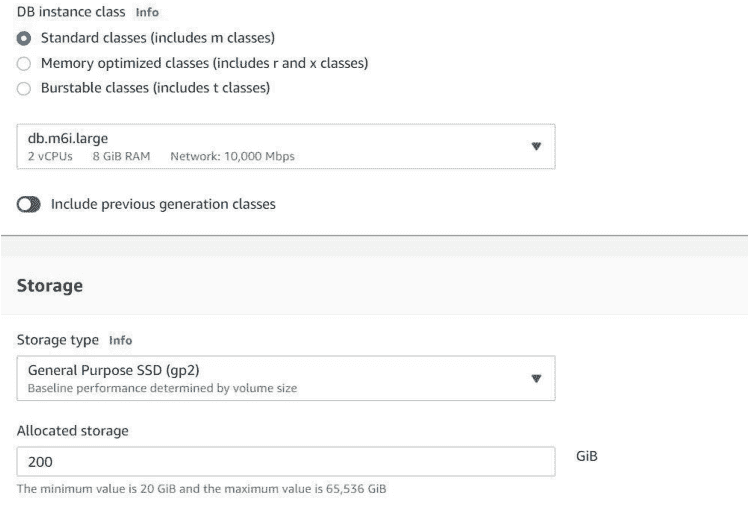

图 6.4 – 选择数据库实例类（类型和大小）及存储

对于存储，您可以选择 EBS 卷类型（通用型 SSD 如 gp2 或 gp3、预置 IOPS 如 io1，或磁性存储），并且需要定义存储卷的大小。就选择而言，预置 IOPS 选项非常适合高强度工作负载和需要低延迟和稳定吞吐量的应用程序，而通用型最适合开发和测试环境。Amazon RDS 提供自动扩展存储的能力，因此当您接近存储分配限制时，可以自动增加存储大小以处理更多数据的添加。

当您选择配置 Amazon RDS 数据库时，您需要选择一个 Amazon VPC 来部署它，与在上一章中讨论的部署 EC2 实例的方式类似。让我们简要了解一下如何创建部署 RDS 实例所需的 VPC 架构。

## 部署 Amazon RDS 实例

要部署 Amazon RDS 实例，您需要先创建或选择一个现有 VPC。Amazon RDS 要求您在 VPC 内定义一个子网组，以在其中部署数据库实例。回想一下第 4 章 *使用 Amazon VPC 在云中构建私有网络* 中，子网是绑定到特定可用区内的 VPC 的隔离网络部分，您可以在其中部署资源，例如 EC2 实例。要部署 RDS 数据库，您需要设置一个数据库子网组，该组必须包含跨两个不同可用区的至少两个子网。这告诉 Amazon RDS 数据库实例可以部署到哪些子网中。在下面的图表中，您可以看到我们已配置了一个数据库子网组。

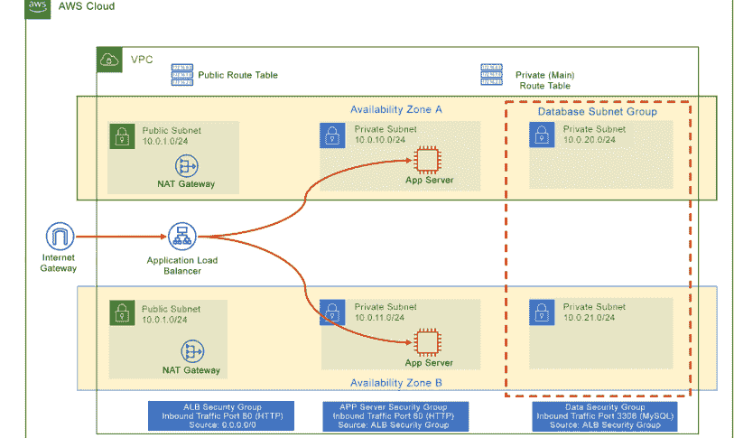

图 6.5 – 在您的 VPC 中定义数据库子网组

在 AWS 上设置数据库实例时，您可以通过配置名为 **Multi-AZ** 的功能来构建解决方案以提供更高级别的冗余。您将在接下来探索此功能。

## 使用 Multi-AZ 实现高可用性

您的数据对业务至关重要，您希望确保在需要时可以访问该数据。Amazon RDS Multi-AZ 部署为您的关系型数据库提供高可用性和冗余功能。实现 Multi-AZ 部署有两种主要选项如下。

### *Multi-AZ 实例部署*

使用 Multi-AZ 实例部署，您有一个部署在一个可用区中的数据库主副本，以及部署在另一个可用区中的数据库辅助待机副本。数据库主副本提供读写功能。请注意，待机副本仅用于灾难恢复和故障转移目的，在待机状态下不提供任何读取功能。

数据会从主库同步复制到待机库，并在写入磁盘时进行复制，这确保了在主副本发生故障的情况下，您可以在待机库中获得一个精确的副本以进行故障转移。对于 MariaDB、MySQL、Oracle 和 PostgreSQL 数据库实例，AWS 使用其标准故障转移方法。对于 Microsoft SQL Server，则使用 **数据库镜像 (DBM)** 或 Always On **可用性组 (AGs)**。

如以下图所示，Amazon RDS 为您提供一个端点 URL 以连接到数据库主副本。在故障转移期间（例如计划的系统维护、数据库故障或可用区中断），数据库主副本将被终止，数据库待机副本将被提升为新的主库。Amazon 会对 DNS 配置进行必要的修改，以便相同的 URL 端点现在指向新提升的主库。

使用 Multi-AZ DB 集群部署的额外好处包括，与单待机配置相比，您可以拥有两倍的交易提交次数。此外，您可以将实例部署到 AWS Graviton2 以获得高计算性能。

图 6.7 描述了该配置：

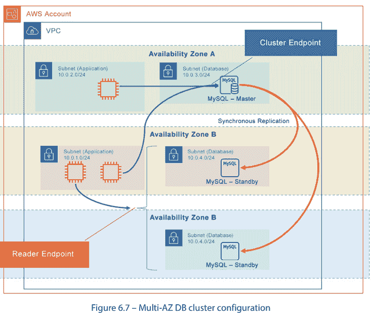

为了实现这些各种选项，Multi-AZ DB 集群部署提供多个端点如下：

- **集群端点：** 也称为写入端点，它连接到 DB 集群的主数据库实例，可用于所有写操作，例如 DDL 和 DML 语句。如果写入数据库实例发生故障，Amazon 会自动将故障转移到其中一个读取数据库实例，具体取决于哪个实例具有最新的更改记录。
- **读取端点：** 设计用于提供对 DB 集群的只读连接访问，以及作为可执行故障转移的待机实例。


## 实例端点

-   每个数据库（DB）实例都有自己的端点地址，因此写入器 DB 实例拥有端点，而两个阅读器实例也拥有它们各自的端点地址。仅当您的客户端应用程序需要访问特定实例时，才允许使用实例端点。

在使用**命令行界面 (CLI)** 时，您可以使用 `aws rds describe-db-cluster-endpoints` 命令查看 Amazon Aurora 数据库的集群详细信息。

多可用区（Multi-AZ）配置主要旨在灾难、计划内维护任务或可用区故障的情况下提供高可用性和故障转移选项。此外，当配置为 Multi-AZ DB 集群时，您还将获得额外的好处，即可以使用阅读器实例来引导读取流量，从而减轻写入器实例的负载。请注意，目前此配置仅适用于 PostgreSQL 和 MySQL。

然而，如果您希望设计一个包含多个阅读器实例的数据库解决方案，Amazon RDS 提供了另一种配置，称为读取副本（Read Replicas），您将在下文进行探讨。

## 读取副本（Read Replicas）有哪些优势？

虽然 Multi-AZ 提供了灾难恢复功能，但 AWS 提供的另一项功能是**读取副本**，它们旨在帮助提高读取性能和可扩展性。开箱即用，Amazon RDS 仅提供一个主数据库实例，该实例同时处理读取和写入功能。这往往会形成瓶颈，尤其是当您可能拥有只需要读取数据访问权限的额外应用程序时，例如与商业智能或分析相关的应用程序。

为了满足这些只读应用程序的需求，您可以创建数据库的额外读取副本，从而减轻主实例的总体负载。这使您能够在主 DB 实例不可用时为应用程序提供读取服务。

使用读取副本的另一项好处是，您可以将其作为灾难恢复的一部分。因此，如果在主实例发生重大故障，您可以将读取副本提升为新的独立实例。

读取副本的一个附加功能是，它们可以配置在同一区域以及其他区域中，如以下图表所示：

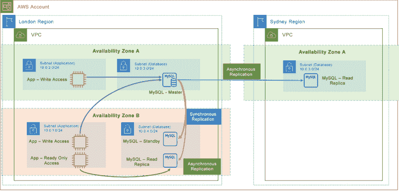

在上面的图表中，请注意，在悉尼区域配置了一个额外的读取副本。这确保了您在遥远的区域拥有数据库的读取副本，这些区域可能有访问该数据的本地需求，从而降低延迟。此外，通过在其他区域拥有读取副本，您可以应对最终的区域灾难，以防发生重大区域故障。

在配置方面，需要注意的是，只有在源 DB 实例上配置了自动备份并将保留值设置为非 0 的数字时，读取副本功能才可用。您将在下一节中更多地了解自动备份。

根据您使用的数据库引擎类型，有一些需要了解的规范和限制。包括以下内容：

-   您可以为 MariaDB、MySQL 和某些版本的 PostgreSQL 创建现有读取副本的读取副本。您不能对 Oracle 或 Microsoft SQL 执行此操作。
-   不支持循环复制。这意味着您不能有从现有读取副本回到源的复制。复制是单向的，例如，如果您有一个名为 `MyDBInstance` 的源数据库，它复制到 `ReadReplica1`，则不建议（通常也不可能）将 `ReadReplica1` 配置为将数据复制回 `MyDBInstance`。

虽然 Multi-AZ 和读取副本可以帮助解决源数据库故障带来的担忧，但您必须记住，它们不一定能防止数据损坏。如果源数据库实例中的数据发生损坏，那么由于复制的性质，这些损坏的数据将复制到 Multi-AZ 备用实例以及任何读取副本。在这种情况下，您应该恢复希望是在数据损坏发生之前创建的备份。您可以为 Amazon RDS 配置自动备份和手动备份，您将在下文更多地了解这一点。

## 自动备份和手动备份

Amazon RDS 为您的数据库实例提供两种备份选项。这些是手动快照和自动备份。作为托管服务，您只需要启用自动备份或启动手动快照，AWS 将负责处理快照的获取和存储等其余工作。所有备份数据都存储在 AWS 管理文件夹内的 Amazon S3 中，因此您无法直接访问包含您数据的 S3 存储桶。

让我们来看看每种备份选项及其在 Amazon RDS 平台中的工作原理。

## 手动快照

您可以随时对数据库实例进行手动快照。当您执行备份时，您正在对整个数据库实例进行快照，因此这将包括在该实例上创建的所有数据库。

您可以按自己喜欢的高频率进行手动快照，这意味着您越频繁地执行备份，您的**恢复点目标 (RPO)** 就越低。RPO 指的是以时间衡量的可接受数据丢失量。例如，如果您每 24 小时执行一次备份，那么您的 RPO 就是 1 天，这意味着您愿意接受最坏情况下丢失一天数据的情况。

另一个需要考虑的因素是，如果您对单个 DB 实例执行备份，将会发生短暂的 I/O 暂停，根据数据库的大小，持续时间可能在几秒到几分钟之间。这是正常行为，理想情况下，您应该在正常工作时间之外进行快照。如果您希望在工作时间进行更频繁的备份，请考虑使用 Multi-AZ 配置您的数据库。在此配置中，备份是从数据库的备用副本中获取的，因此数据库的最终用户不会察觉到任何 I/O 暂停。

> **注意**
>
> 通过 Multi-AZ 配置（其中备份从备用实例获取）来避免短暂 I/O 暂停的功能不适用于 Microsoft SQL Server。在此引擎类型上，即使配置了 Multi-AZ，客户在备份期间也会经历短暂的 I/O 暂停。

手动备份根据消耗的存储空间计费，并且即使删除数据库后它们仍然存在。如果您不再需要这些备份，需要手动删除它们。手动快照没有默认的过期设置。

您可以将手动快照复制到其他区域，这意味着如有需要，您可以在其他区域执行恢复操作。快照还可以跨其他 AWS 账户共享。这允许授权的账户复制快照。请注意，如果您共享的快照已加密，则授权的 AWS 账户需要先复制快照，然后从副本执行恢复。

另一个需要理解的重要概念是，当您从快照恢复时，Amazon 会创建一个新的数据库实例。实际上，您并不是恢复到一个现有的 DB 实例中。要执行恢复，您需要提供快照名称以及您希望从该快照创建的新 DB 实例名称。一旦状态变为可用，您就可以立即使用恢复的 DB 实例。请注意，即使状态显示为可用，后台可能仍在进行数据恢复；这是一个称为延迟加载（lazy loading）的功能。

在使用延迟加载时，如果您尝试访问尚未完全恢复的数据，DB 实例将从 Amazon S3 下载数据。另外请注意，通过使用 `Select *` 语句，您可以减少延迟加载的影响，因为您正在执行全表扫描。

接下来，您将探讨自动备份。

## 自动备份

第二种备份选项是自动备份。自动备份从完整备份开始，这是磁盘上所有数据的时间点完整备份。后续的备份操作是增量执行的，仅备份数据库中已更改或新增的数据。

在这里，同样重要的是确保您的数据库配置为 Multi-AZ，以便备份操作在数据库的备用副本上而不是主实例上执行。这允许客户在备份过程初始化时避免经历短暂的 I/O 暂停。

使用自动备份时，您可以配置最长 35 天的保留期，之后备份将被删除。在设置自动备份时，您可以将保留期设置为 0 到 35 天之间的任何值（0 表示已禁用自动备份）。此外，您可以指定每天执行备份的特定时间。删除数据库时，您可以选择保留自动备份。但请注意，自动备份在配置的保留期结束后仍会被删除。如果您需要保留数据库的副本，请在删除数据库时选择创建最终快照。此最终快照与其他手动快照类似，由您完全控制。


自动备份的一个重要方面是，你每天只能运行一次备份。但是，该服务还会每 5 分钟将数据库实例的事务日志上传到 Amazon S3，其中包含数据库上发生的变更。这意味着当你恢复数据库时，需要从之前的每日备份开始恢复，然后重放这些事务日志。这样，你可以将数据库恢复到过去 35 天内的任意时间点（假设你定义了 35 天的保留期），直至 `LatestRestorableTime`，该时间通常位于最近 5 分钟内。可以通过调用 `DescribeDBInstances` API 来确定最新的可恢复时间。

与手动快照类似，你可以将备份和事务日志复制到另一个区域。此功能默认未启用，需要你显式配置。

你需要记住，虽然只读副本可以大幅降低 RPO，但它们并不是为处理数据损坏而设计的。因此，你需要在整体的 Amazon RDS 设计架构中同时纳入自动备份和手动快照。

接下来，你将探索一些与 Amazon RDS 相关的关键且重要的安全概念。

## Amazon RDS 安全

Amazon RDS 提供多项安全功能，涵盖数据安全、身份认证、授权和网络访问。在本节中，你将了解一些核心安全功能，首先从数据库的加密服务开始。

### Amazon RDS 加密

对于任何客户来说，数据安全始终是一个主要关注点。在 Amazon RDS 上，你可以在不同 RDS 引擎下选择不同的加密选项。一般来说，有两种加密类型：传输中加密和静态加密。

第一种加密类型是**传输中加密**。这是指客户端与数据库之间的连接使用**安全套接字层（SSL）**和**传输层安全（TLS）**进行加密。Amazon RDS 将使用自动安装在你创建的所有数据库实例上的服务器证书来配置 SSL/TLS 加密。然后，你可以强制要求客户端与服务器之间的所有通信都必须加密。

第二种加密类型是**静态加密**。启用静态加密后，底层存储（EBS 卷）上存储的所有数据，以及只读副本、自动备份和快照，都在托管数据库实例的服务器上使用 AES-256 加密算法进行加密。

Amazon RDS 会透明地管理你的数据的访问和解密，而无需你修改客户端应用程序。数据库本身不会感知到加密和解密操作，因为这些操作由宿主机处理，如下图所示：

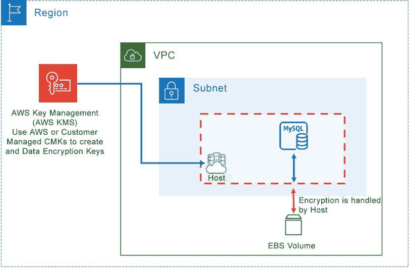

根据引擎的不同，你会有不同的静态加密选项。例如，对于 MySQL 和 PostgreSQL，你可以使用 AWS Key Management Service（KMS）和 EBS 加密，这由 RDS 宿主机和底层的 EBS 存储处理。使用 KMS 时，你可以使用 AWS 托管或客户托管的客户主密钥（CMK）来生成所需的数据密钥。这些数据密钥用于实际加密和解密你的数据。

对于 Oracle 和 Microsoft SQL Server 等引擎，静态加密是使用透明数据加密（TDE）配置的。这里的不同之处在于，实际的加密和解密由数据库本身处理，而不是宿主机。

对于 Oracle，AWS 还提供 CloudHSM 来创建和管理加密密钥，让客户完全控制这些密钥，并与其他客户隔离，如图 6.10 所示。

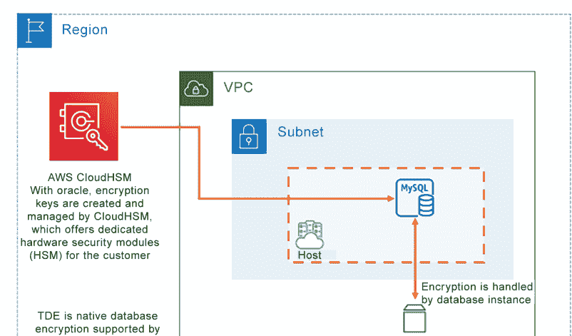

图 6.10 – 使用 CloudHSM 的 Amazon RDS 加密

AWS CloudHSM 由分配到你的 AWS 账户的专用硬件安全模块（HSM）组成。CloudHSM 负责处理密码运算，并安全地存储你的加密密钥。它通过了 FIPS 140-2 Level 3 验证，非常适合那些出于合规和监管原因而限制使用共享硬件安全模块的严格场景。

在下一节中，你将了解更多关于 Amazon RDS 的身份认证和授权信息。

## Amazon RDS 身份认证与授权

Amazon RDS 提供不同的身份认证选项，具体如下：

- **密码认证：** Amazon RDS 引擎可以配置数据库用户和相关联的密码。这些凭据在数据库本身内部管理，理想情况下，你需要确保为创建的用户使用复杂的密码。你必须记住，在密码认证方式下，数据库引擎会以明文形式生成这些密码，因此建议使用诸如 Amazon Secrets Manager 之类的工具来存储和管理你的密码。
- **IAM 认证：** 你可以将数据库配置为使用 IAM 用户认证。这适用于 MySQL 和 PostgreSQL 数据库引擎，并且你无需创建密码。相反，你可以使用 IAM 认证令牌。带有必要策略的 IAM 用户和角色，可将 IAM 用户/角色映射到本地数据库用户。通过该映射，相关身份可以运行 `generate-db-auth-token`，从而生成一个有效期为 15 分钟的认证令牌。
  - 你还可以创建带有必要角色和权限的 EC2 实例配置文件，以允许实例上的应用程序访问数据库。
- **Kerberos 认证：** 你还可以使用第三方身份和访问管理服务（如 Microsoft Active Directory），通过 Kerberos 认证流程对数据库进行身份认证。Kerberos 允许你使用票据和对称密钥加密技术，让你无需通过网络传输密码即可完成身份认证。这被视为授予数据库访问权限的一种高度安全的方法。

至此，你已经了解了 Amazon RDS 的基础知识，并认识了它的一些核心功能。在接下来的项目任务中，你将有机会部署一个 Amazon RDS 数据库，用于托管我们客户的 Todo List 应用程序的所有后端数据。

具体来说，该数据库将用于托管用户填充到数据库中的所有任务和待办事项。当用户在 Todo List 应用程序上注册账户后，他们将能够访问自己的 Todo List。然后，他们可以在 Web 应用程序中添加和管理自己的任务和待办事项列表，具体如下：

- 用户将能够登录 Web 应用程序，并只能看到自己的待办事项列表。
- 用户将能够创建新的待办事项，并指定其任务的开始日期和截止日期。
- 用户将能够按照财务、健康、职业、个人和其他等类别对待办事项进行分类。
- 用户将能够修改并更新每个事项的状态，指定事项状态为未开始、已开始、进行中、已完成或已延迟。
- 根据事项状态，系统将使用颜色指示器来快速展示 Todo List 的健康状况。如果红色过多，则表示用户没有按时完成任务；同样，如果大多为绿色状态，则表示用户完成了大部分待办事项。该功能将进一步增强用户的体验。

下表展示了用户将填充的表的关键字段（属性），并定义了其表结构：

| 字段 | 类型 | 可空 | 键 |
|---|---|---|---|
| Id | int | 否 | PRI |
| category | varchar(191) | 否 | |
| description | varchar(191) | 是 | |
| startDate | datetime(3) | 否 | |
| endDate | datetime(3) | 否 | |
| status | varchar(191) | 否 | |
| userId | int | 是 | MUL |

表 6.1：用户 Todo List 表的结构定义

接下来，让我们从架构的角度来考察数据库将如何部署。如下图所示，AWS 建议你采用多可用区（Multi-AZ）配置来部署数据库。

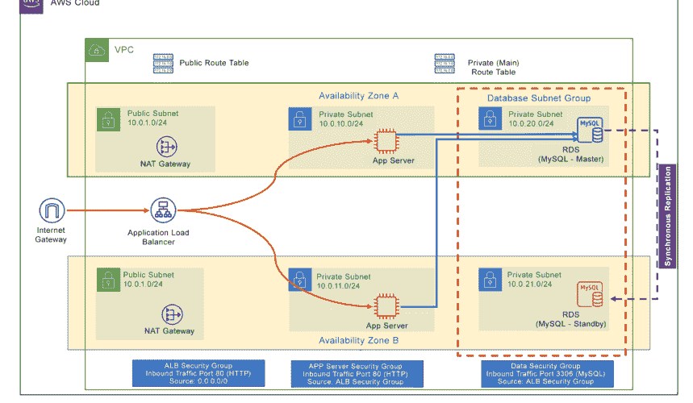

图 6.11 – Todo List 应用程序的 Amazon RDS 架构设计


## 使用 AWS Secrets Manager 提升安全性

RDS 数据库将以配置了 Multi-AZ 的方式进行部署。此外，你在此项目中使用的数据库引擎将是 MySQL 引擎。请注意，数据库实例的主副本和备用副本将分别放置在为 RDS 分配的私有子网中的两个可用区之间。这在此前被定义为数据库子网组。主副本的数据将同步复制到备用副本。

另外，RDS 数据库实例将与图中所示的数据安全组关联，以仅允许来自应用程序服务器在端口 3306（MySQL 引擎监听的默认端口）上的流量。此安全措施将确保没有其他服务可以尝试访问数据库。

应用程序还需要一种机制来对数据库进行身份验证。如前所述，Amazon RDS 有三种不同的身份验证选项：**密码身份验证**、**IAM 身份验证**和**Kerberos 身份验证**。

对于此项目，你将使用密码身份验证。这包括在即将到来的项目任务中首次创建数据库时定义的用户名和密码。应用程序需要配置为使用这些凭据，以便能够访问数据库并代表客户执行所有必要的 CRUD 操作。

然而，这种方法的问题在于，你需要将凭据硬编码在应用程序代码中，或以纯文本形式放置在某处，以便应用程序能够检索并使用它们来对数据库进行身份验证。这种方法伴随着许多安全风险以及管理负担，如下所示：

-   - 如果应用程序代码被访问，存在凭据数据泄露的安全风险。
-   - 如果你的应用服务器遭到入侵，凭据将以纯文本形式存在，并且很容易被访问。
-   - 通常建议定期轮换凭据数据。这必须手动完成，并且需要更新整个计算实例集群中所有实例上的应用程序代码，这增加了管理负担。

为了防止任何安全漏洞，Amazon 提供了一项可用于增强数据库访问整体安全性的服务，这就是 AWS Secrets Manager。接下来，让我们讨论该服务的主要特性。

管理凭据信息、API 密钥和其他类型的机密数据一直是一项挑战。AWS Secrets Manager 旨在帮助你安全地管理、检索和轮换你的数据库和应用程序凭据、API 密钥以及其他机密数据。

AWS Secrets Manager 允许你在需要时通过发出 API 调用动态访问机密，前提是你已获得相应的权限和授权级别。因此，你可以使用 Secrets Manager 来改善应用程序的安全状况，因为不再需要在应用程序代码中硬编码凭据数据。

以下是 AWS Secrets Manager 的主要特性：

-   - **机密（Secret）** – 由机密信息组成，包括一个值和元数据。机密值可以是字符串或二进制。你也可以使用 JSON 文本字符串和键/值对作为机密。机密元数据包括机密的名称（需要唯一）和 **Amazon 资源名称（ARN）**，这两者都可被引用来调用机密。要访问机密，你需要 IAM 权限，这可以通过附加到 IAM 策略的 IAM 角色授予。
-   - **版本（Version）** – 如果机密值发生变化，AWS Secrets Manager 将保存机密的多个副本。每次值被更改或轮换时，都会创建一个新版本。
-   - **轮换（Rotation）** – AWS Secrets Manager 使你能够自动轮换机密数据，从而使其更加安全并减少管理负担。你可以按指定的时间间隔或计划设置自动化轮换，以符合公司关于密码/机密轮换的政策。由于 AWS Secrets Manager 与 Amazon RDS 等各种 AWS 服务良好集成，凭据的自动机密轮换非常容易，且完全由 AWS 托管。如果你需要轮换其他类型的机密数据，可以创建必要的 Lambda 函数来代你执行轮换。

下图说明了 Amazon Secrets Manager 如何用于保护敏感和机密数据：

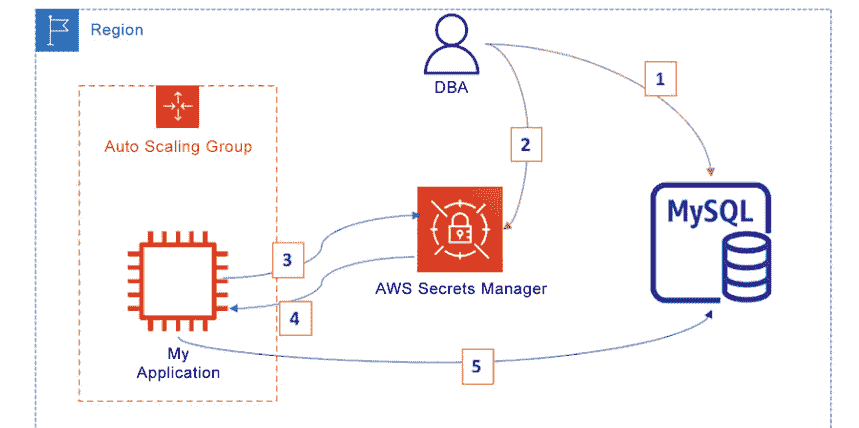

图 6.12 – 使用 AWS Secrets Manager 管理数据库凭据数据

为你的应用程序配置 AWS Secrets Manager 来托管和管理敏感凭据数据，关键步骤如下：

-   1. 数据库管理员为你的数据库配置一组将由应用程序使用的凭据。
-   2. 数据库管理员将凭据信息作为机密存储在 Secrets Manager 中。该数据也会由 Secrets Manager 加密。
-   3. 当应用程序需要访问数据库时，应用程序代码被设计为首先通过 API 调用查询 Secrets Manager 以检索凭据数据。
-   4. Secrets Manager 将检索机密并解密，通过 HTTPS 将机密的明文版本返回给客户端应用程序。
-   5. 然后，客户端应用程序将使用凭据数据以及任何其他信息（如数据库端点名称）来访问数据库及其包含的信息。

AWS Secrets Manager 可以使用 AWS **密钥管理服务（KMS）** 以加密格式存储敏感凭据。该过程涉及使用 KMS CMK 生成并加密一个对称数据密钥，然后用该密钥来加密机密凭据数据（如密码）。该过程涉及在 KMS 外部使用明文数据密钥来加密机密，之后该密钥会从内存中丢弃。同一数据密钥的加密版本存储在机密的元数据中，以便用于解密机密值。

但是，数据密钥的加密版本或加密后的机密永远不会通过应用程序发出的任何 API 调用返回。相反，当应用程序需要凭据信息时，它会使用 Secrets Manager 向 AWS KMS 解密操作发起 API 调用，并将加密的数据密钥传递给 KMS。AWS KMS 随后解密数据密钥，并将该密钥的明文版本返回给 Secrets Manager。AWS Secrets Manager 随后使用这个明文数据密钥解密机密，并将其传递给应用程序。

对于 TodoPlus Limited 和我们的 Todo List 应用程序，强烈建议你集成 AWS Secrets Manager，以自动管理数据库凭据信息的生命周期。

如下图所示，你的应用程序代码将在部署于 App 子网中的 EC2 实例上运行。应用程序需要获知它所需要连接的数据库的详细信息，例如数据库端点、数据库名称、用户名和密码。这些详细信息可以轻松地存储在 AWS Secrets Manager 的机密中，应用程序可以被设计为动态检索该机密。

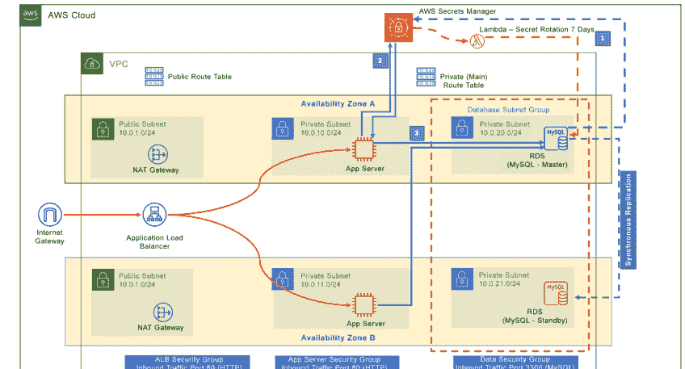

图 6.13 – 用于 Todo List 应用程序的 AWS Secrets Manager

你可以在启动 RDS 数据库的同时配置 AWS Secrets Manager。然而，在我们的项目练习中，你将使用标准的用户名和密码部署 RDS 数据库，然后作为第二步再配置 AWS Secrets Manager。这样做只是为了让你学习如何将 AWS Secrets Manager 与未使用它而启动的现有 RDS 数据库集成。

如前面的图所示，关键阶段如下：

-   1. 配置 AWS Secrets Manager 来管理 RDS 数据库凭据，并指定 Todo List 应用程序数据库作为要管理的数据库。同时，将轮换计划设置为 7 天，以便 AWS Secrets Manager 每七天自动轮换一次数据库的凭据信息。
-   2. 更新/部署你的应用程序代码，这些代码现在使用 AWS Secrets Manager SDK 通过对 AWS Secrets Manager 发出必要的 API 调用来动态访问数据库凭据。
-   3. 使用 AWS Secrets Manager 提供的凭据，Todo List 应用程序可以访问后端 Amazon RDS 数据库并执行所有 CRUD 操作。


这将改善您的应用程序安全态势，因为您可以避免在应用程序代码中硬编码凭据数据，这种做法风险极高，可能会导致恶意攻击。使用 AWS Secrets Manager 来管理凭据等秘密的生命周期，有助于防止此类攻击。

下一节将概述另一种关系数据库——Amazon Aurora。

## 使用 Amazon Aurora 的企业级解决方案

尽管作为 Amazon RDS 解决方案的一部分提供，但 Amazon Aurora 本身确实应被视为一个独立的关系数据库解决方案。该服务是 AWS 提供的专有数据库产品，兼容 MySQL 和 PostgreSQL，并且开箱即用地具备企业级功能。在本节中，您将了解其中一些核心功能。

Amazon Aurora 配置为一个包含单个主实例的集群。除主数据库实例外，您最多还可以拥有 15 个 Aurora 副本，总计 16 份数据副本。Aurora 使用一个**集群卷**，该卷包含跨多个可用区的存储卷，每个可用区都有一份数据副本。如下图所示：

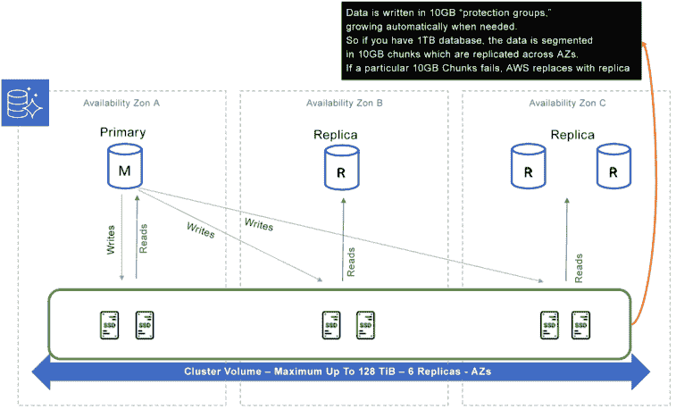

图 6.14 – Amazon Aurora 架构

使用 Amazon Aurora，您可以在**三个可用区中分布六份数据副本**。此外，集群卷会随着您的数据存储需求增加而自动扩展，并且根据您的数据库引擎版本，最大卷大小可达 128 TB。

与 Amazon RDS 上的其他引擎不同，Aurora 上的存储是弹性的。这意味着当您删除数据时，为该数据分配的空间会被释放。存储与 Aurora 实例分开管理，允许您添加连接到现有共享存储卷的实例。

与 Amazon RDS 一样，Amazon Aurora 一次只能有一个主实例——这是可以对数据库执行写入操作的实例。除主实例外，Amazon Aurora 最多可以有 15 个只读副本，所有这些副本都配置为从主实例复制数据。这意味着在主实例发生故障时可以进行自动故障转移。另一点需要注意的是，您的只读副本可以提供跨区域支持。

为了促进主实例的无缝故障转移，Amazon Aurora 提供了端点，这些端点是用于连接数据库以进行写入和读取的 DNS 地址。以下是 Amazon Aurora 提供的端点：

- **集群端点（写入端点）：** 这是提供给任何需要对数据库进行读写访问的应用程序的端点。此端点指向当前主实例，并支持所有写入操作，包括**数据定义语言（DDL）**语句。
- **读取端点：** 旨在为对数据库集群的只读请求提供负载均衡支持。任何只需要对数据库执行读取查询的应用程序都应使用此端点。读取端点仅连接到只读副本，从而释放主实例。
- **自定义端点：** 这是您通过选择目标实例来定义的端点。您可以根据各种因素（例如按应用程序）选择一组实例。
- **实例端点：** 每个数据库实例也有自己的端点地址。这可用于直接控制与数据库集群的连接。

现在您已经对 Amazon Aurora 有了高层了解，也学习了关系数据库，接下来看看如何使用内存缓存引擎来提高应用程序和数据库的性能。此外，关系数据库应用于长期存储数据，但应用程序也倾向于存储和访问临时数据，例如会话状态或游戏排行榜。对于管理这类数据，内存缓存引擎可能比传统关系数据库更具成本效益。

## 使用 Amazon ElastiCache 缓存数据

Amazon ElastiCache 是一种内存缓存引擎，旨在帮助改善读取量大且不经常变化的工作负载的延迟和吞吐量。AWS 提供两种完全托管的内存引擎——Redis 和 Memcached。

Amazon ElastiCache 可用于为关系数据库（如 Amazon RDS）提供内存缓存服务。

Redis 专为更复杂的数据类型而设计，并提供高级功能，例如高可用性、自动故障转移、备份和恢复，以及在启用集群模式时的在线重新分片。

### 缓存策略

以下是 Amazon ElastiCache 提供的一些关键缓存策略：

- **惰性加载** – 一种仅在必要时加载数据的策略，通常会导致缓存未命中。这可以确保您避免为不经常访问的数据填满缓存。如果数据不在缓存中，应用程序必须从数据库中检索该数据，然后将该数据写入缓存。请注意，如果只实施惰性加载而没有实施其他策略（例如**生存时间（TTL）**），数据可能会变得陈旧。
- **直写** – 这确保每当对底层数据库发出新的写入或更新请求时，缓存都会更新，从而使缓存数据保持最新，并确保数据永远不会陈旧。但请注意，每次写入都涉及两次往返：一次写入数据库，一次写入缓存。请注意，一个主要缺点是大多数数据永远不会被读取，这可能导致资源浪费。添加 TTL 可以通过使不再需要的数据过期并清除来帮助减少这种浪费。

**Amazon ElastiCache** 旨在帮助减轻数据库的读取负担，这通常成本更高，尤其是对于频繁查询的数据或昂贵计算任务的结果以及会话状态。

在下一节中，您将了解 AWS 上可用的非关系数据库选项。

## 使用 Amazon DynamoDB 的现代 NoSQL 数据库简介

除了传统的关系数据库之外，AWS 还提供旨在提供更好性能和无缝可扩展性的 NoSQL 数据库。Amazon DynamoDB 是 AWS 的 NoSQL 数据库解决方案，具有高度可扩展性，使用分布式硬件集群来提高吞吐量而不会增加延迟。

Amazon DynamoDB 专为大多数现代 Web 和移动应用程序而设计，作为完全托管的服务，可以支持基于服务器和无服务器应用程序架构。使用 DynamoDB，您也无需对底层计算或存储基础架构做出决策，因为 AWS 会根据您的容量需求来负责处理。这样完全托管意味着您可以专注于设计和构建稳健的高性能应用程序。

DynamoDB 的另一个关键方面是它是无模式的。每个表都必须有一个主键，就像传统关系数据库一样，用于唯一标识记录。然而，除此之外，没有传统 SQL 数据库中的其他约束。DynamoDB 可用于托管结构化和半结构化数据，包括 JSON 文档。此外，DynamoDB 以完整的 Web 服务形式呈现，您可以使用 HTTP(S) 请求和响应来调用数据库。使用 DynamoDB，您可以使用 DynamoDB API 或 PartiQL（一种兼容 SQL 的查询语言）来向表中添加和检索数据。

以下是一个适用于 DynamoDB 的 PartiQL 查询示例：

```sql
SELECT AlbumTitle, Year, Price
FROM Music
WHERE Song='All Night Long'
```

与关系数据库一样，DynamoDB 使用表的概念，表可以包含具有属性（值）的项目（记录）。主键用于唯一标识项目，您还可以拥有二级索引以提供更多查询选项。接下来您将了解这些核心组件。

### DynamoDB 核心组件

以下是 DynamoDB 数据库的核心组件：

- **表：** 与其他关系数据库一样，数据存储在表中。表表示数据的集合。例如，Employees 表将包含所有员工详细信息、他们的薪资信息、养老金缴款等。
- **项目：** 每个表可以包含一个或多个项目。这是定义项目及其特征的一组属性。例如，在 Employees 表中，每个员工都将表示为一个项目。每个项目都需要分配一个主键来唯一标识该项目。
- **属性：** 每个项目包含一个或多个属性。这些属性用于存储与项目关联的值。例如，Employees 表中的属性示例包括**名**、**姓**和**部门**。这些属性帮助您定义表中每个项目的值。


最终，项目（items）类似于传统关系型数据库中的行，而属性（attributes）类似于其中的列。以下截图对此进行了更详细的说明。

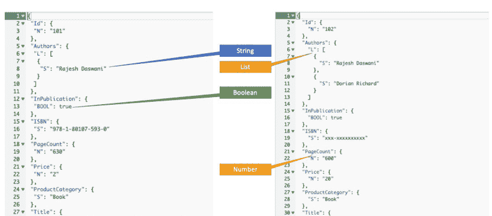

图 6.16 – DynamoDB 中的数据类型

属性在 DynamoDB 中可以具有以下数据类型：

- **标量类型** – Numbers、String、Boolean、Binary 和 Null
- **多值类型** – String Set、Number Set 和 Binary Set
- **文档类型** – List 和 Map

你可以在 DynamoDB 中使用映射来存储 JSON 风格格式的文档，从而创建具有多个嵌套值的文档结构。你也可以拥有列表，如前面的截图所示。

> **注意**
> 项目的最大大小可达 400 KB。

接下来，让我们更详细地了解主键及其相关组件。

## 关于主键和排序键的一切

DynamoDB 表中的每个项目都需要一个唯一的主键。此键也称为分区键，可用于唯一标识一个项目。DynamoDB 支持两种类型的主键：

- **分区键** – 这只是作为唯一标识项目的一个属性的主键，同时也是用于确定项目在 AWS 上物理存储位置的**内部哈希函数**的输入。因此它也被称为分区键。如果表只有一个分区键，则没有两个项目可以具有相同的键。
- **分区键和排序键** – 这也称为复合键，因为它由两个属性组成——分区键和排序键（也称为范围键）。分区键用于使用 DynamoDB 的内部函数确定项目的存储位置。使用复合键配置时，如果排序键唯一标识一个项目，则可以有多个具有相同分区键的项目。因此，与特定分区键关联的排序键也存储在由哈希函数确定的同一位置。

例如，考虑一个音乐数据库，其中艺术家名称可以是分区键，歌曲标题为排序键。如果你仅提供艺术家名称执行查询，你将获得该艺术家的所有歌曲列表。如果你还指定了曲目的歌曲标题，则只检索该项目。

除了 DynamoDB 的标准主键和复合键之外，你还可以配置一个或多个二级索引。二级索引使你能够使用替代键查询表，从而提供更大的灵活性，而无需扫描整个表，这将消耗大量读取吞吐量。二级索引包含基表属性的子集。这是通过将特定属性从基表投影到索引来实现的。DynamoDB 支持两种类型的索引：

- **全局二级索引 (GSI)**：这是一个具有与表不同的分区键和排序键的索引。该索引被归类为全局索引，因为查询可以跨表的所有分区中的所有数据进行。索引的大小没有限制，并且可以为所有读写操作配置自己的吞吐量设置。此外，你不仅可以在启动表时创建此索引，还可以在之后任何时间创建（这是本地二级索引无法做到的）。你最多可以拥有 20 个 GSI。
- **本地二级索引 (LSI)**：这是一个与表具有相同分区键但不同排序键的索引。索引的项目限制为每个分区 10 GB，并且索引只能在表创建时创建。你可以从查询中返回未投影到索引中的属性。你必须注意，你的 LSI 的容量需求继承自主表的配置。最后，每个表最多可以有五个 LSI。

当你需要查询结果具有强一致性时，LSI 是理想选择。然而，在大多数情况下，更倾向于使用 GSI。

使用前面音乐数据库的示例，你可以使用分区键和排序键，分别由艺术家和歌曲标题组成。但是，你可能还希望根据流派或专辑标题查询你的集合。在这种情况下，全局二级索引会很有用。

对于索引，你可以将流派分类为替代分区键，专辑标题将是排序键。

请注意，当你确认二级索引后，DynamoDB 将自动维护该索引。当你向表中添加和删除项目时，DynamoDB 将在索引中添加和删除任何相关的键属性。

现在你已经了解了主键（分区键）、排序键和二级索引的基础知识，接下来可以探索 DynamoDB 如何为你的应用程序配置容量。

## DynamoDB 容量配置

为 DynamoDB 配置容量时，你无需指定实例类型或大小来定义所需的存储量，就像使用 Amazon RDS 时那样。相反，AWS 会完全管理和配置基于你的应用程序读写吞吐量需求所需的容量。为此，你只需定义读取和写入容量单位，接下来会进行讨论。

Amazon DynamoDB 提供两种容量模式，让你确定容量需求：

- **按需** 是一种灵活的计费方式，可让你在应用程序需求变化时提供所需的容量。Amazon DynamoDB 将提供必要的容量，且无需容量规划。此模式在以下情况下理想：
  - 你不确定计划运行的工作负载类型
  - 数据库流量不可预测
  - 你希望按**使用付费模式**计费

- **预配置** – 在此模式下，你定义应用程序每秒所需的读取和写入次数。这是创建新表时的默认模式。你还可以配置表以自动扩展，从而根据流量需求变化调整预配置容量。此模式在以下情况下理想：
  - 你了解应用程序流量使用模式
  - 你有逐渐增加的稳定流量
  - 可以进行容量预测

关于预配置容量的额外一点是，你可以以折扣价购买预留的读取和写入容量以降低成本。你可以在 24 小时内切换一次模式。

使用预配置模式时，你必须定义 **读取容量单位 (RCUs)** 和 **写入容量单位 (WCUs)**。使用这些参数，DynamoDB 将为表配置所需的基础设施以支持你的容量需求。RCU 和 WCU 值使 DynamoDB 能够确保你拥有满足应用程序需求的正确数量的基础设施资源。让我们来看看 DynamoDB 如何消耗 RCU 和 WCU：

- **读取请求：**
  - 如果你使用强一致性读取，则每个最多 4 KB 的项目需要 **一个 RCU**。
  - 如果你使用最终一致性读取，则每个最多 4 KB 大小的项目需要 **½ RCU**。
  - 对于最多 4 KB 大小的项目的事务性读取请求，你将需要两个读取请求单位。事务性读取和写入请求与标准读取/写入请求不同之处在于，它们保证单个事务集中的所有操作要么全部成功，要么全部失败。

> **有关读取一致性的更多信息**
> 
> 使用 RCU 时，你需要决定是否想要强一致性读取或最终一致性读取。使用最终一致性读取时，当你执行读取请求时，响应可能不会反映最近完成的写入操作。如果你重复查询，很可能会检索到更新后的数据。使用强一致性读取可获得最新数据，反映所有先前的写入操作。后者成本更高，并且在 GSI 上不受支持。
> 
> 要使用强一致性读取，你必须在 API 调用中将 `ConsistentRead` 参数设置为 `True`，用于你的 `GetItem`、`BatchGetItem`、查询和扫描请求。
> 
> 例如，假设你的项目大小为 8 KB。在这种情况下，强一致性读取需要两个 RCU，最终一致性读取需要一个 RCU，事务性读取请求需要四个 RCU。

- **写入请求：**
  - 大小最多为 1 KB 的项目的写入请求需要一个 WCU
  - 大小最多为 1 KB 的事务性写入请求需要两个 WCUs

> **有关写入容量的更多信息**
> 
> 例如，如果你的应用程序以每秒 100 次写入的速度写入，并且每个项目大小为 4 KB，则你需要 400 个 WCUs（100 x (4KB / 1KB)）。


最终，配置容量需要理解应用程序的需求。接下来，你将了解 DynamoDB 管理预配置容量的一些额外概念。

DynamoDB 已自动启用 **自适应容量**。此功能使 DynamoDB 能够运行性质不可预测的工作负载，并有助于最大限度地减少限流异常。该功能还提供了一种更好的机制来处理 *热分区*。热分区是指与其它分区相比接收到更高量的读写请求的分区。DynamoDB 利用其自适应容量通过自动为接收到比其它分区更多流量的分区增加吞吐量，来处理不均匀的访问模式。为了说明这一概念，让我们来看一下下面的图表：


图 6.17 – DynamoDB 自适应容量

在前面的图表中，你有一个预配置了 400 WCUs 并均匀分布在四个分区中的表。假设分区 4 有一些非常受欢迎的数据并成为热分区。由于需求，分区 4 所需的总容量为 150 WCU/秒。随着写入容量的巨大增加，最终你会期望流量被限流，因为它超过了 100 WCU/秒。然而，有了自适应容量，DynamoDB 将增加分区 4 的容量，利用其它分区中的可用容量来帮助处理 150 WCU/秒的更高工作负载，而不会被限流。

另一个功能被称为 **突发容量**。在此，DynamoDB 为处理偶尔出现的用量峰值保留了一部分未使用的容量（最多 300 秒未使用的读写容量）。

请注意，如果你超过了表的最大允许预配置吞吐量，则可能会收到 `ProvisionedThroughputExceededException` 错误消息。这可能发生在你的请求速率过高时，你有一个热键，其中一个分区键被读取次数过多，或者你有非常大的项目。通常，DynamoDB 的 AWS SDK 会自动重试请求，并且这些请求最终会成功，除非重试队列过大而无法完成。为了解决此问题，你可以使用 **指数退避**，它会在重试之间使用逐渐更长的等待时间。你也可以尽可能多地分发你的分区键，以防问题是由过度的读取引起的，并考虑实现 **DynamoDB Accelerator (DAX)**，它将在本章后面讨论。

现在你已经了解了 DynamoDB 如何配置和管理容量，让我们继续讨论如何访问和使用 DynamoDB。

## DynamoDB 访问方法

有几种方法可以访问 DynamoDB 以及服务中创建的表。以下选项可用于访问 DynamoDB 表：

- **AWS CLI** – 与其它 AWS 服务一样，你可以使用 AWS CLI 或 Amazon CloudShell 来访问 DynamoDB 服务、配置和管理 DynamoDB 表，并执行标准数据库操作，包括查询和扫描操作。
- **NoSQL Workbench** – 一个跨平台、客户端基于 GUI 的应用程序，可用于执行所有数据库开发和操作。NoSQL Workbench 带有 IDE 工具，可促进你的 DynamoDB 表的数据建模、可视化和查询开发。
- **PartiQL** – 一种与 SQL 兼容的查询语言，可用于通过执行 **创建、读取、更新和删除 (CRUD)** 操作与 DynamoDB 表交互。

AWS DynamoDB 还支持 AWS SDK 以便以编程方式访问和操作表中的数据。然后你可以使用 Python、Java 和 .NET 等标准编程语言。DynamoDB 以协议级接口的形式公开低级 API。然后使用 HTTP(S) 请求对数据库的请求可以使你的应用程序代表你构建低级 API 请求。DynamoDB 将返回 HTTP 成功代码（200 OK），以及任何请求操作的結果。

任何不成功的操作都会导致错误代码。例如，HTTP 400 状态代码之类的错误代码表明请求存在问题，例如身份验证错误或缺少参数。HTTP 5xx 的错误代码表明必须由 AWS 解决的问题，例如瞬态错误或 DynamoDB 服务问题，通常会导致 HTTP 503 状态代码。

接下来，让我们来看一些常见的 API 以及从 DynamoDB 检索数据的选项。

## 有关 DynamoDB API 和数据检索选项的更多信息

如前所述，DynamoDB 公开了 API，使你能够对表和数据执行支持的操作。有关 API 操作的完整列表，请参阅 https://docs.aws.amazon.com/amazondynamodb/latest/APIReference/API_Operations_Amazon_DynamoDB.html。

一些常见的 API 包括以下内容：

- PutItem – 允许你创建新项目或完全替换旧项目。PutItem 请求将消耗 WCUs。你可以使用条件 put 操作，例如在主键不存在时添加项目或仅在特定属性值存在时更新项目。这使你能够验证任何更新，以确保新项目不会替换现有项目，使用诸如 **attribute-not-exists** 函数之类的条件表达式。然后操作只有在不存在匹配项时才会成功。
- UpdateItem – 允许你编辑现有项目或在不存在时添加新项目。你可以根据特定预期属性值使用条件更新操作。此操作的使用情况是当你只需要更新现有项目的几个属性时，而不像 PutItem 操作那样。UpdateItem 操作还可用于实现 **原子计数器**。这是一个数字属性，每次调用 UpdateItem 操作时都会递增，无论操作成功还是失败。这对于各种用例都很有用，例如跟踪访问你网站的访客数量，如果你能容忍任何多计数或少计数。
- GetItem – 允许你在指定主键或主键和排序键时返回项目的属性集。GetItem 最终是一致的。如果需要强一致性读取，可以将 ConsistentRead 设置为 true。请注意，强一致性读取将需要额外的 RCUs，并且你的应用程序可能会遇到一些延迟。你也可以使用 ProjectExpression 仅检索某些属性。
- DeleteItem – 允许你从表中删除项目。你也可以使用条件删除操作。请注意，如果你希望删除表本身，则使用 DeleteTable 操作。
- Batch Operations – 允许你通过减少 API 调用次数来节省延迟。批量操作更有效，因为它们作为并行操作执行。批量操作的示例包括以下内容：
  - BatchWriteItem – 在一个或多个表中执行多个 put 或 delete 操作。它可以执行多达 25 个项目 put 或删除操作。BatchWriteItem 可以传输多达 16 MB 的数据，每个单独的项目可达 400 KB。请注意，你不能使用 BatchWriteItem 来更新项目，因为任何尝试更新项目的尝试都将简单地导致原始项目被覆盖。
- `BatchGetItem` – 使你能够从一个或多个表中返回一个或多个项目的属性。单个操作可以检索多达 100 个项目，总数据大小为 16 MB。如果超过大小限制，操作将导致部分结果。

除了 API 操作之外，还有两个关键选项可用于从数据库检索数据 – 执行扫描或查询操作。你将在下一节中了解它们之间的主要区别。

## DynamoDB 扫描与查询

扫描操作将在返回你要查找的项目之前访问表或二级索引中的每个项目。这意味着操作需要查看每个项目及其属性，从而使整个过程效率更低。这将导致 RCUs 的更大消耗。你可以通过使用 `ProjectionExpression` 参数来减少返回的属性数量。例如，你可以在扫描请求中仅返回产品的品牌和型号，而不是表中产品项目关联的所有属性。

另一个选项是使用 `FilterExpression` 减少返回的项目数量，在其中根据特定值过滤返回的数据，例如，所有由 Apple 制造的手机。但是，你仍然会扫描表上的每个项目并因此消耗 RCUs。你可以使用 Limit 参数定义返回的最大项目数或指定最多 1 MB 的数据。

此外，扫描操作是顺序执行的。可以通过提供 `Segment` 和 `TotalSegments` 参数来执行并行扫描操作。你应该注意，扫描操作在默认情况下访问表中的数据时使用最终一致性读取。如果你需要强一致性读取操作，可以将 `ConsistentRead` 参数设置为 `true`。

使用 **查询操作**，你可以根据主键属性和你要搜索的特定值检索表上的项目。例如，你可能希望通过提供员工 ID（员工数据库的可能主键）来检索与特定员工相关的所有数据。你也可以使用可选的排序键来细化结果。查询将返回项目的全部属性，但同样，你可以使用 `ProjectionExpression` 来限制检索其值的属性。

使用查询操作，因为你指定了主键和可选排序键，操作将消耗的 RCUs 比扫描操作少。

接下来，让我们研究一些额外的策略，以确保数据免受意外更新和覆盖。AWS DynamoDB 提供了条件写入和乐观锁定的概念，你将接下来查看。


## DynamoDB 乐观锁定

乐观锁定旨在防止你意外覆盖他人所做的更改，反之亦然。此功能要求表中的每个项目都具有一个属性，该属性可以充当版本号。只有在你能引用正确（或最新）的版本号作为更新条件时，对该项目的更新才能成功。

例如，在下图中，请注意，在没有使用版本号的情况下，客户端 B 已成功将产品价格更新为 15 美元，尽管客户端 A 刚刚在片刻之前执行了更新，将价格改为 17 美元。虽然这可能是一个可接受的更改，但也可能是客户端 B 执行的一个错误。

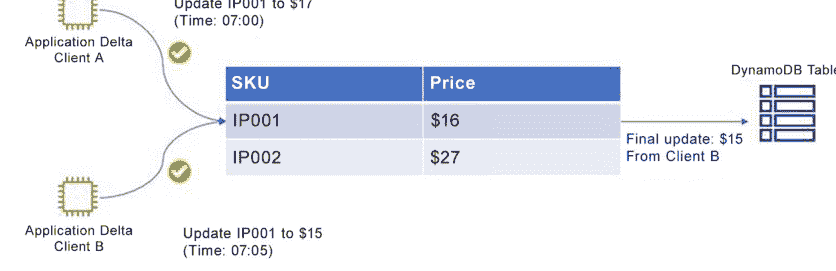

图 6.18 – 未使用乐观锁定的数据库更新

请注意，在上图中，客户端 B 能够更新表并将价格设置为 15 美元。虽然在某些情况下这可能是可以接受的，但也可能是一个错误。使用乐观锁定时，每个项目都需要有一个可以充当版本号的属性。在从表中检索项目时，应用程序会记下版本号。这使得客户端设备上的应用程序能够在版本号在此期间未发生变化的前提下更新表中的项目。如果因为另一个客户端能够更新该项目而导致版本号不匹配，那么你的更新将失败。

在下图中，请注意，由于版本号不匹配，客户端 B 的更新失败了。

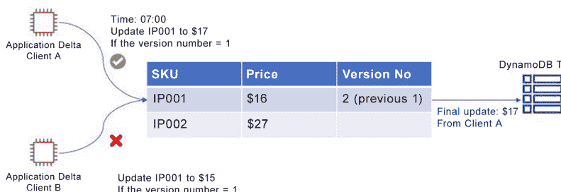

图 6.19 – 使用乐观锁定的数据库更新

当客户端 A 更新该项目时，版本号递增为 2。这意味着当客户端 B 尝试执行更新时，出现了版本不匹配，更新失败。

最终，乐观锁定可确保你在客户端更新或删除的任何项目与 DynamoDB 表中的项目相同。接下来，让我们看看条件写入。

## DynamoDB 条件写入

DynamoDB 条件写入可以帮助你防止意外写入操作，例如 PutItem、UpdateItem 和 DeleteItem。

仅当项目的属性与特定条件匹配时，条件写入才会成功。如果条件不满足，则写入操作将失败。

在以下示例中，仅当 Id 主键不存在时，PutItem 写入操作才会成功——换句话说，如果 PutItem 写入操作不会覆盖现有项目：

```
aws dynamodb put-item \
  --table-name ProductCatalog \
  --item file://item.json \
  --condition-expression "attribute_not_exists(Id)"
```

条件写入和乐观锁定使你能够确保数据不会意外写入表中，并且必须将其作为整体应用程序设计架构的一部分。

在下一节中，你将探索 DynamoDB 的一些附加功能。从 **DynamoDB 生存时间（TTL）** 开始。

## DynamoDB 生存时间（TTL）

通常，你存储在表中的数据具有有限的生命周期。有限生命周期的示例包括以下内容：

- 在应用程序中一段时间不活动后删除用户或传感器数据
- 删除会话数据或旧日志数据
- 使用 DynamoDB Streams 将项目存档到 Amazon S3 数据湖
- 敏感数据在特定时间后过期以满足合规性或监管要求

DynamoDB 的 TTL 功能可用于定义每个项目的时间戳，该时间戳指定数据不再需要的时间。然后 DynamoDB 可以从表中删除该项目，从而节省存储的数据量。

> **注意**
> TTL 功能无需额外费用，并且不会消耗任何 RCU 或 WCU。

与尝试手动清除不再需要的数据相比，这是一种降低总存储量的高性价比方法。后者需要搜索数据，然后执行删除操作，这将消耗 RCU 和 WCU。

DynamoDB 通常会在过期后的 48 小时内删除过期项目，并且这些删除操作也会在任何 LSI/GSI 索引上执行。

接下来，让我们探讨另一个称为 DynamoDB Streams 的功能。

## DynamoDB Streams

DynamoDB Streams 是一项可以捕获表中项目级操作（如 put 和 update）的时间有序序列的功能。该信息随后会存储最多 24 小时，并可由应用程序用于多种用例。你可能希望基于表中执行的项目修改来启动一个流程。例如，假设你拥有产品信息并希望监控表中项目发生的所有更新，其中产品颜色发生了变化。

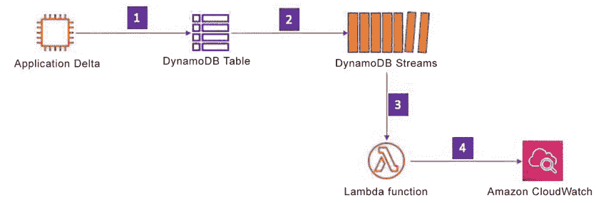

图 6.20 – DynamoDB Streams 示例

在上图中，请注意流程。当应用程序在 DynamoDB 表中写入和更新数据时，更改会记录在 DynamoDB Streams（如果启用）中。这些更改会存储 24 小时，并且可用于触发 Lambda 函数以执行特定操作或处理更改。有关更改的数据也可以写入 CloudWatch。

每当你的应用程序执行项目级修改时，DynamoDB Streams 都会写入一个流记录，其中包含被修改项目的主键属性。你可以访问诸如实际所做的修改以及修改前后项目映像等信息。

DynamoDB Streams 可以在你创建表时或稍后阶段启用。StreamSpecification 参数定义了流的配置方式。

配置 DynamoDB 流时，你还可以指定将写入流的数据类型，如下所示：

- KEYS_ONLY – 修改后的项目的主键属性将写入流
- NEW_IMAGE – 修改后的项目将写入流
- OLD_IMAGE – 修改前整个项目将写入流
- NEW_AND_OLD_IMAGE – 项目的新旧映像都将写入流

尝试在已配置流的表上启用流将导致 ResourceInUseException 错误消息。

DynamoDB 提供的另一个关键功能是一项内存缓存服务，可以帮助实现 10 倍的性能提升，将速度从毫秒级提升到微秒级。该功能由名为 Amazon DynamoDB Accelerator（DAX）的服务提供，你将在下一节中探讨该服务。

## 使用 DynamoDB Accelerator（DAX）提升性能

Amazon DAX 是一种内存缓存服务，旨在帮助提高应用程序的读取性能。DAX 可以帮助你的应用程序在亚毫秒（微秒）级别实现性能提升。

DAX 作为部署在 VPC 中的集群运行，每个集群最多支持 11 个节点（一个主节点和最多 10 个只读副本）。因此，你需要定义一个 VPC 来托管 DAX 集群，或者接受所选区域默认 VPC 中的默认部署。由于 DAX 集群运行在 Amazon VPC 中，你还需要相应地配置安全组。DAX 集群需要配置一个安全组，允许端口 8111 上的入站流量，以便你的应用程序在 EC2 实例上运行并与集群通信。

下图显示了 DAX 在高层架构设计模式中的位置：

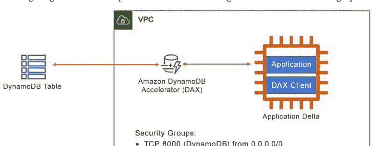

图 6.21 – 配置 DAX 集群

你的应用程序需要在部署的 EC2 实例上配置 DAX 客户端。DAX 客户端将所有应用程序读取请求定向到 DAX 集群。以下 API 调用可以由你的 DAX 集群处理：GetItem、BatchGetItem、query 和 scan。如果 DAX 拥有该项目，则它无需访问 DynamoDB 即可返回该项目。这称为缓存命中。但是，如果 DAX 没有该项目（否则称为缓存未命中），则它会将其传递给 DynamoDB。当收到响应时，结果会返回给应用程序并写入缓存。请注意，此过程仅适用于最终一致的读取请求。对于强一致读取，DAX 会将请求传递给 DynamoDB，而不是尝试从缓存中检索数据。

请注意，DAX 不支持延迟加载。此功能是一种缓存策略，仅在必要时将数据加载到缓存中。相反，DAX 支持直写缓存。


在本节中，您已经探索了亚马逊的 NoSQL 数据库解决方案和 DynamoDB。AWS DynamoDB 是一种高度可扩展、可靠且经济高效的 NoSQL 数据库，专为大多数现代 Web 和移动应用程序而设计。AWS DynamoDB 非常适合无服务器设计架构，因为您无需管理服务器，也无需规划和设计要为工作负载预置的实例类型或大小。在本学习指南的后续部分，您将重新探讨 AWS DynamoDB，届时您将更详细地研究无服务器应用程序。

AWS DynamoDB 可以配置为按需提供所需的容量，或者您可以根据应用程序的要求指定所需容量，DynamoDB 将为您管理这些容量。

在设计应用程序架构时，理解 DynamoDB 的核心组件、其架构参考及其特性至关重要。这包括确定要使用哪些功能，以及如何配置它们以实现最佳性能、可靠性和安全性。

在下一节中，您将继续进行项目练习，为 TodoPlus Limited 客户构建基础设施，该基础设施将用于部署和管理 Todo List 应用程序。

# 项目任务 – 为 Todo List 应用程序部署和保护 Amazon RDS 数据库的访问

在以下项目任务中，您将学习如何部署一个功能完备的 Amazon RDS 数据库，该数据库将用于托管 Todo List 应用程序的最终客户的待办事项。该数据库将使用 MySQL 引擎部署，并且只允许运行后端应用程序的 EC2 实例访问它。

为了确保您的 EC2 实例能够访问数据库，您将在 AWS Secrets Manager 中部署一个密钥。该密钥将安全地存储数据库凭据，并使其仅对运行您的应用程序的授权实例可访问。

# 技术要求

要完成本系列项目中的任务，请确保您以 IAM 用户 Alice 的身份登录 AWS 开发账户。

# 项目任务 6.1 – 在 AWS 上部署 RDS 数据库

在此项目任务中，您将在开发账户中于 AWS 上部署一个 RDS 数据库。正如本章前面所讨论的，RDS 数据库需要部署在虚拟私有云（VPC）中。您应该已经在第 4 章“使用 Amazon VPC 在云中构建私有网络”的练习中创建了一个名为 `todolist-vpc` 的 VPC。现在您将使用这个相同的 VPC 来部署您的 RDS 数据库。在开始以下步骤之前，请确保您位于北弗吉尼亚区域。

## 配置 RDS 子网组

要在您的 VPC 内部署 RDS 数据库，您应首先配置一个子网组——这是为您的 RDS 数据库实例分配的一组子网。您至少需要两个子网来组成该组。在您的 `todolist-vpc` 中，您已经定义了两个将用于数据库的子网，如下图所示：

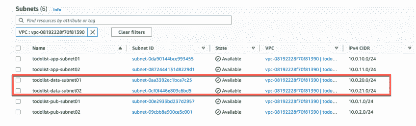

图 6.22 – VPC 子网组（第 4 章中定义的子网）

请执行以下操作来启动您的 RDS 数据库：

1. 登录您的 AWS 开发账户，并通过在 AWS 管理控制台顶部的搜索栏中搜索 RDS 来导航到 RDS 控制台。
2. 从左侧菜单中，选择 **子网组**。
3. 从右侧窗格中，单击橙色的 **创建数据库子网组** 按钮。
4. 为您的子网组提供一个名称，例如 `todo-list-db-subnet-group`。
5. 确保从 VPC 下拉列表中选择 `todolist-vpc`。
6. 在 **添加子网** 下，从 **可用区** 下拉菜单中选择 **us-east-1a** 和 **us-east-1b**。
7. 接下来，选择每个可用区下的数据库子网。如下面的屏幕截图所示，您需要根据先前为子网定义的 IP CIDR 块，在每个可用区下选择正确的子网，尤其是因为未提供子网名称。

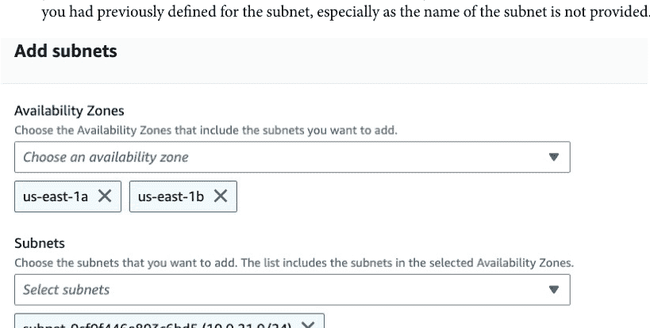

图 6.23 – 为数据库安全组选择子网

8. 单击 **创建** 按钮。您应该会收到一条消息，说明数据库子网组已成功创建。

## 启动 RDS 免费套餐数据库

在此步骤中，您将使用免费套餐选项启动一个带有 MySQL 引擎的 RDS 数据库实例。免费套餐选项不允许您配置 Multi-AZ 部署。但是，对于此项目练习而言，您不需要此项。在现实生产环境中，您必须考虑使用 Multi-AZ 部署您的 RDS 实例：

1. 从左侧菜单中，单击 **数据库**。
2. 从右侧窗格中，单击橙色的 **创建数据库** 按钮。
3. 在 **选择数据库创建方式** 下，选择 **标准创建**。
4. 接下来，在 **引擎** 选项下，选择 **MySQL** 引擎单选按钮。
5. 将引擎版本保留为默认版本，并从 **模板** 中选择 **免费套餐** 单选按钮。
6. 在 **设置** 下，提供以下详细信息：
   - I. 将 **数据库实例标识符** 的名称设置为 `tododb`。
   - II. 对于 **凭据设置**，将 **主用户名** 设置为 **admin**。
   - III. 在 **凭据管理** 下，暂时选择 **自我管理** 选项。您将在另一个项目任务中配置 Secrets Manager。
   - IV. 提供一个 *密码* 作为 **主密码**，您必须记下该密码。在 **确认主密码** 文本框中重新输入您选择的密码。
7. 在 **实例配置** 下，确保选择了 `db.t3.micro` 实例类型。
8. 接下来，在 **存储** 下：
   - I. 确保选择了 **通用型 SSD（gp2）**。
   - II. 将 **分配的存储** 设置为 20 GiB。
   - III. 展开 **存储自动扩缩** 子部分。
9. 取消选中 **启用存储自动扩缩** 复选框，因为我们的数据库不需要超过 20 GiB 的存储空间。

**存储**
存储类型 信息
预配置 IOPS SSD（io2）存储卷现已可用。

**通用型 SSD（gp2）**
基线性能由卷大小决定

**分配的存储**
信息
20
GiB

最小值为 20 GiB，最大值为 6,144 GiB

> 在为数据库实例修改存储后，数据库实例的状态将处于存储优化中。存储优化操作完成后，您的实例将保持可用。了解更多

**存储自动扩缩**
存储自动扩缩 信息
根据您的应用程序需求，为您的数据库存储提供动态扩缩支持。

**启用存储自动扩缩**
启用此功能后，存储将在超出指定阈值后增加。

图 6.24 – 您的 RDS 数据库实例的存储配置

10. 接下来，在 **连接** 下：
    - I. 确保选择了 **不连接到 EC2 计算资源**。
    - II. 在 **虚拟私有云（VPC）** 下，从下拉列表中选择 `todolist-vpc`。
    - III. 接下来，在 **数据库子网组** 下，确保选择了您在步骤 I 中创建的相同子网组。
    - IV. 将 **公开访问** 设置为 **否**。这是因为 RDS 数据库将根据最佳实践部署在私有子网中。
    - V. 接下来，对于 **VPC 安全组**（防火墙），从 **现有 VPC 安全组** 下拉列表中选择 **Data-Security-Group**。您还可以单击 **默认** 旁边的 X 符号以移除默认安全组，这并非必需。
    - VI. 在 **可用区** 下，您可以选择一个可用区，或将其保留为 **无偏好**，如下面的屏幕截图所示：

**现有 VPC 安全组**
选择一个或多个选项
Data-Security-Group ×

**可用区**
信息
无偏好

图 6.25 – 您的 RDS 数据库的连接选项

11. 在 **数据库身份验证** 下，确保选择了 **密码身份验证**。
12. 接下来，展开 **其他配置** 子部分，并：
    - I. 将初始数据库名称设置为 `tododb`。
    - II. 将 **数据库参数** 组和 **选项** 组保留为其默认值。
    - III. 接下来，在 **备份** 下，确保选择了 **启用自动备份**，并将 **备份保留期** 设置为 1 天。
    - IV. 将 **加密** 和 **维护** 参数保留为其默认值。
13. 滚动到页面底部，单击 **创建数据库** 按钮。


数据库启动需要几分钟时间。请记下以下参数，你将在后续的练习中使用它们：

- **数据库实例标识符** - `tododb`
- **用户名** - `admin`
- **密码** - *你选择的密码*
- **数据库名称** - `tododb`

数据库启动后，你应该能够在 **数据库** 仪表盘中看到状态为 **可用** 的数据库，如下面的截图所示：

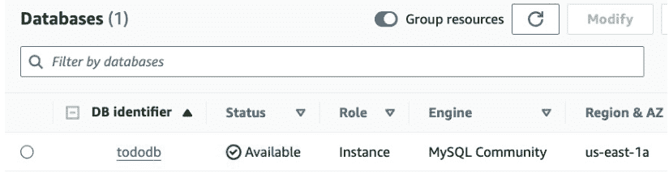

图 6.26 – 成功创建 RDS 数据库

在本项目任务中，你成功在 VPC 的数据子网中部署了 RDS 数据库。在下一个项目任务中，你将在 AWS Secrets Manager 中创建一个带有凭据轮换的密钥。稍后，当你编写待办事项列表（Todo List）应用程序时，它将需要访问 AWS Secrets Manager 中的密钥，以获取连接数据库所需的数据库凭据。

## 项目任务 6.2 – 集成 AWS Secrets Manager

在本项目任务中，你将配置一个密钥来托管你在前一个任务中创建的数据库的 RDS 数据库凭据数据。作为推荐的最佳实践，你还将按照 TodoPlus Limited 的公司策略，配置每七天进行一次凭据轮换。

### 前提条件：配置 VPC 以准备使用 Secrets Manager

AWS Secrets Manager 需要在 VPC 内部更新你的 Amazon RDS 数据库的凭据信息。此外，为了自动轮换凭据，将在你的数据库的子网组内的 VPC 中创建一个 Lambda 函数。该 Lambda 函数需要与 Secrets Manager 通信，因此你需要授予该函数互联网访问权限或创建 VPC 端点，两者都允许 Lambda 函数与位于 VPC 外部的 Secrets Manager 通信。

为了促进从 VPC 发出的此出站通信，你还需要设置 NAT 网关。这将使 Lambda 函数能够将流量发送到 VPC 外部。请注意，NAT 网关是一项收费服务，不属于免费套餐提供的内容：

- 1. 在你的 AWS 管理控制台中，通过在屏幕顶部的搜索栏中搜索 Amazon VPC 来导航到它。在单独的浏览器标签页中打开 VPC 控制台。
- 2. 从左侧菜单中，点击 **NAT 网关**。
- 3. 接下来，从右侧面板中，点击 **创建 NAT 网关**。
- 4. 为你的 NAT 网关提供一个合适的名称，例如 `todolist-nat`。
- 5. 确保你选择了 `todolist-vpc` 的一个公共子网来放置 NAT 网关，如下面的截图所示：

### NAT 网关设置

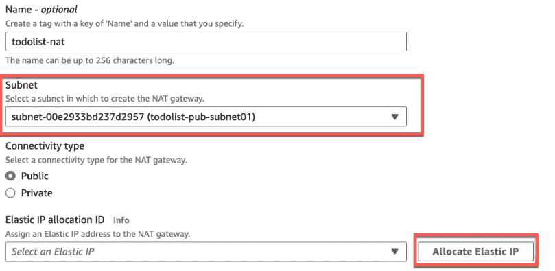

图 6.27 – NAT 网关配置

- 6. 同样根据前面的截图，点击 **分配弹性 IP** 为你的 NAT 网关指定一个弹性 IP 地址。
- 7. 接下来，点击屏幕底部的 **创建 NAT 网关** 按钮。
- 8. 一旦你的 NAT 网关设置完成并处于 **可用** 状态，如下面的截图所示，你可以继续下一步：

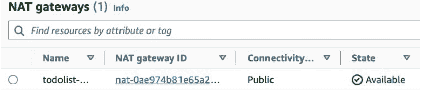

图 6.28 – NAT 网关处于可用状态

- 9. 接下来，你需要更新你的路由表。从左侧菜单中，点击 **路由表**。
- 10. 接下来，在右侧面板中，选择主路由表 **todolist-mainrt**。
- 11. 接下来，点击右侧面板下半部分中的 **路由** 选项卡，并点击 **编辑路由**。
- 12. 点击 **添加路由**。
- 13. 对于 **目标**，输入 `0.0.0.0/0`，这指定了包括互联网在内的外部网络。对于 **目标**，从下拉菜单中选择 **NAT 网关**，并确保从列出的选项中选择你刚刚创建的正确 NAT 网关：

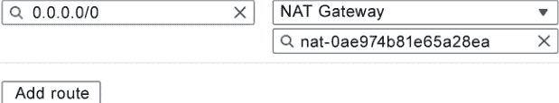

图 6.29 – 选择正确的 NAT 网关

- 14. 点击 **保存更改**。
- 15. 需要注意的一个重要点是，当 AWS Secrets Manager 为自动轮换创建你的 Lambda 函数时，它会将其分配给与关联的 RDS 数据库相同的安全组。你曾将此安全组命名为 **Data-Security-Group**。当你在 *第 4 章 使用 Amazon VPC 构建私有网络* 中创建此安全组时，它被配置为仅接受来自与 **App-Security-Group** 关联的任何设备在端口 3306 上的流量。然而，这种受限的配置将不允许 Lambda 函数与 RDS 数据库通信。因此，你需要修改 **Data-Security-Group** 的入站规则。
- 16. 从左侧菜单中，点击 **安全组**。
- 17. 接下来，在右侧面板中选择 **Data-Security-Group**。
- 18. 在右侧面板的下半部分，点击 **入站规则** 选项卡，然后点击 **编辑入站规则**。
- 19. 点击 **添加规则** 按钮。
- 20. 将 **类型** 设置为 **MySQL/Aurora**，对于来源，选择与数据库安全组本身相同的安全组，如下面的截图所示：

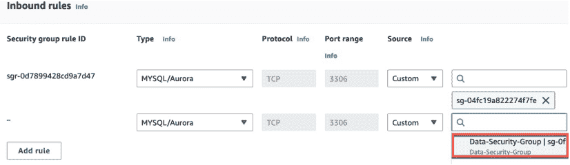

图 6.30 – 更新 Data-Security-Group 的入站规则

- 21. 由于 AWS 创建的 Lambda 函数将附加到与 RDS 数据库相同的安全组，你可以轻松确保任何附加到相同安全组的其他服务/资源都可以发送端口 3306 上的流量。另一种方法是创建一个新的安全组，但然后你必须更新 Lambda 配置页面，以使用这个新的安全组来修改默认配置。

### 启用带轮换的 Secrets Manager

现在你已经完成了前提条件，是时候设置 AWS Secrets Manager 了：

- 1. 从管理控制台开始，通过在顶部搜索框中搜索该服务来导航到 AWS Secrets Manager 控制台。这将把你带到主 **AWS Secrets Manager** 屏幕，如下面的截图所示：

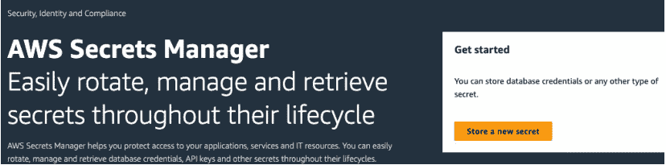

图 6.31 – AWS Secrets Manager

- 2. 点击 **存储新密钥** 按钮。
- 3. 接下来，在 **密钥类型** 下，选择 **Amazon RDS 数据库凭据** 选项。
- 4. 接下来，在 **凭据** 下，提供你在上一个项目任务中创建的 RDS 数据库的 **用户名和密码**。
- 5. 接下来，将加密密钥保留为默认值。
- 6. 确保你在 **数据库** 部分中选择了 **tododb** 数据库，如下面的截图所示，然后点击 **下一步**：

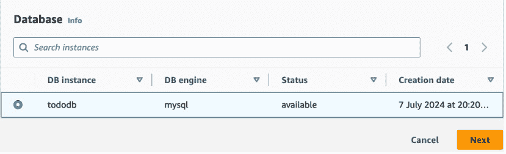

图 6.32 – 配置 AWS Secrets Manager

- 7. 接下来，在 **密钥名称和描述** 下，为你的密钥提供一个描述性的名称。使用分隔符 (`/`)，你还可以对密钥名称进行分类。在下面截图所示的例子中，你将密钥命名为 `dev/todolist/mysql`。
- 8. 接下来，提供适当的描述。将剩余部分保留为默认值，然后点击 **下一步**。
- 9. 现在你将看到一个配置自动轮换的屏幕。切换开关以启用自动轮换。
- 11. 接下来，在 **轮换函数** 下，在 **SecretsManager** 标签旁边将函数名称设置为 `todo-list-latest`：

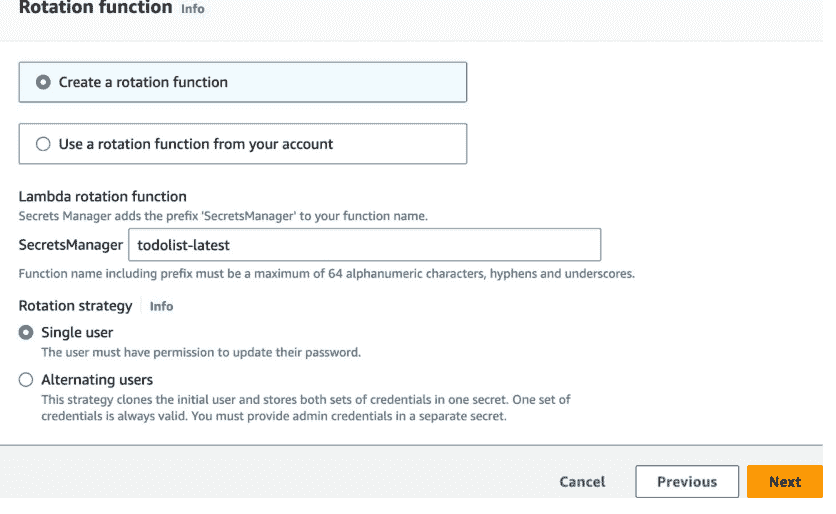

在图 6.34 的截图中，你可以选择‘单用户’或‘交替用户’轮换策略。‘单用户’策略适用于大多数使用场景，但在密钥轮换期间数据库拒绝调用的风险略有增加。这种风险源于在轮换过程中，数据库中的密码变更与密钥更新之间存在非常短暂的时间间隔。‘交替用户’策略涉及在一个密钥中创建两个用户。每次启动轮换操作时，一个用户的密码会更新，而另一个用户保留之前的有效密码。此策略适用于需要高可用性并降低轮换过程中拒绝风险的应用程序。

对于本项目任务，确保你选择‘单用户’策略。


12. 点击 **Next**。

13. 在 **Review** 页面重新检查所有设置，然后点击 **Store**。

14. 您的密钥现在将被创建。请注意，完成并设置计划轮换配置需要几分钟时间。这种延迟是由 AWS CloudFormation 造成的，它会在后台构建一个包含您的 Lambda 函数的堆栈。几分钟后刷新页面，您的自动轮换应该显示为已启用。

15. 要测试 Secrets Manager 是否可以访问您的 RDS 数据库并轮换凭证，请从左侧菜单点击 **Secrets**，然后点击您创建的 **secret** 以打开配置，如以下屏幕截图所示：

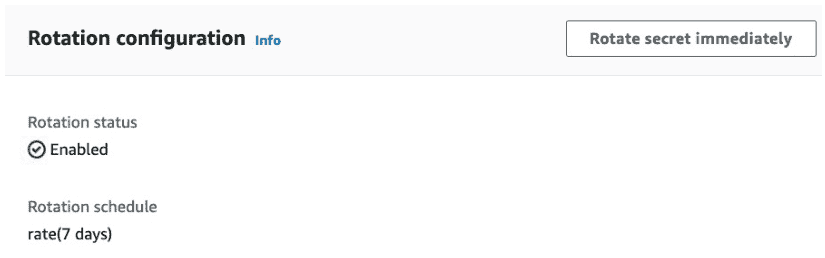

图 6.35 – Secrets Manager Todo List 密钥配置

16. 接下来，点击 Rotate secret immediately。您会收到一个提示，询问是否要轮换密钥。点击 Rotate。

17. 然后您应该会看到一条成功消息，显示 **Secret scheduled for rotation**。

18. 如果现在点击 **Retrieve secret value** 按钮，您应该会看到更新后的凭证，类似于以下屏幕截图：

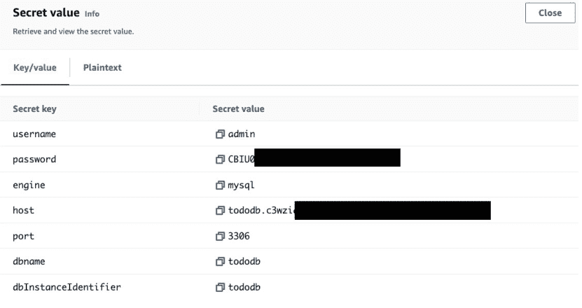

图 6.36 – 更新后的 RDS 凭证

在本系列项目任务中，您在 VPC 中部署了一个 RDS 数据库，将用于托管您的 Todo List 应用的后端数据。为了确保遵循最佳实践，您还在 AWS Secrets Manager 中创建了一个密钥，以每七天自动轮换和管理您的 RDS 凭证，与 TodoPlus Limited 的公司政策保持一致。

您还了解了确保 AWS Secrets Manager 能连接到您 VPC 中的 RDS 实例并部署将执行计划轮换的 Lambda 函数的关键先决条件。

## Summary

在本章中，您了解了 AWS 上的关系型和非关系型数据库。每个应用的核心都是数据；您不仅需要一种工具以高效且经济的方式存储数据，还需要能够扫描、查询并最终操作这些数据以从中提取关键信息。

根据应用需求，您可能需要部署传统的数据库引擎，如 MySQL 或 Oracle，或非关系型键值存储数据库，如 Amazon DynamoDB。此外，您的应用可能还需要内存缓存引擎，以帮助改善延迟并降低成本。无论您选择哪种数据库模型，了解数据库的基础知识以及它们应如何配置和部署，对于任何应用都至关重要。

到目前为止，您已了解 AWS 提供的核心基础设施服务，主要包括计算、网络、存储，以及本章中的数据库。这四个关键基础设施组件构成了任何多层应用架构的基础。在下一章中，您将研究如何使用这四项关键技术部署多层解决方案。您还将探索更多可用于确保应用解决方案具有高可用性和可扩展性的工具。

## Exam Readiness Drill – Chapter Review Questions

除了对关键概念有扎实的理解外，在时间压力下快速思考的能力将帮助您顺利通过认证考试。这就是为什么在学习之旅早期就练习这些技能至关重要。

章节复习问题旨在随着您学习和复习每一章而逐步提高您的应试技巧，同时检验您对本章关键概念的理解。您会在每一章末尾找到这些问题。

### How to Access These Materials

要了解如何访问这些资源，请前往标题为 *Chapter 17, Accessing the Online Resources* 的章节。

要打开本章的章节复习问题，请执行以下步骤：

-   1. 点击链接 – https://packt.link/DVAC02_CH06。
    -   或者，您可以扫描以下二维码（图 6.37）：


图 6.37 – 打开已登录用户的章节复习问题的二维码

-   2. 登录后，您会看到类似 *Figure 6.38* 所示的页面：

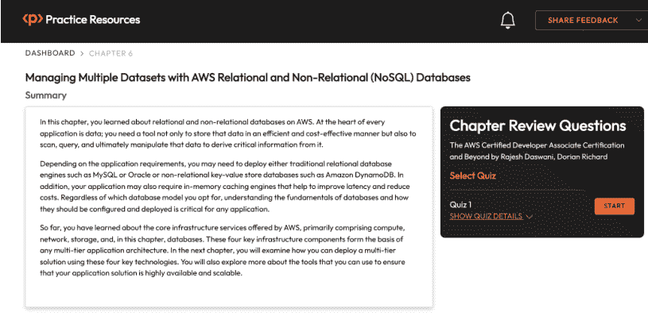

图 6.38 – 第 6 章的章节复习问题

-   3. 准备好后，开始以下练习测验，多次重做测验。

## Exam Readiness Drill

前三次尝试时，不必担心时间限制。

### ATTEMPT 1

第一次，目标至少达到 40%。查看答错的题目并重新阅读章节中的相关部分，以弥补学习差距。

### ATTEMPT 2

第二次，目标至少达到 60%。查看答错的题目并重新阅读章节中的相关部分，以弥补剩余的学习差距。

### ATTEMPT 3

第三次，目标至少达到 **75%**。一旦得分达到 75% 或以上，您就开始练习时间。

> **Tip**
>
> 您可能需要超过 **三次尝试** 才能达到 75%。这没关系。只要在达到目标前继续复习章节中的相关部分即可。

### Working On Timing

**目标：** 您的目标是在保持分数不变的同时，尽可能快速地回答这些问题。以下是您下一次尝试应呈现的示例：

| Attempt | Score | Time Taken |
|---|---|---|
| Attempt 5 | 77% | 21 mins 30 seconds |
| Attempt 6 | 78% | 18 mins 34 seconds |
| Attempt 7 | 76% | 14 mins 44 seconds |

表 6.2 – 在线平台上的示例计时练习测验

> **Note**
>
> 上表中显示的时间限制仅为示例。根据网站上测验的时间限制，为每次尝试设定自己的时间限制。

随着每次新的尝试，您的分数应保持在 75% 以上，而完成所需“时间”应“减少”。重复尽可能多的尝试，直到您有信心应对时间压力。
