## Building Application Solutions with High Availability, Elasticity, and Data Security

与托管网站或 Web 应用相关的一个最大挑战是确保其始终可供最终用户使用，并且能够处理业务所需处理的任何流量。您必须将应用架构设计为 **高可用** 且 **可扩展**。

客户在讨论网站扩展计划时可能会使用“水平扩展”和“微服务”等术语，但他们可能并不完全了解如何开始扩展其网站。本章讨论各种扩展选项。例如，本地解决方案可以利用云，即使现有工作负载托管在传统数据中心，也可以扩展操作同时保持成本低廉。如果您的工作负载已在云中，您也可以使用预配置的解决方案。

本章将教您如何架构基于服务器的环境，使用 Amazon Elastic Load Balancers 将流量分发到您的应用。根据用例，您将学习配置哪种类型的负载均衡器，以及健康检查和监听器规则。此外，本章还介绍了自动水平扩展，旨在为您的应用提供弹性并使用 Amazon Auto Scaling 管理应用需求。

本章还旨在帮助您为 AWS Certified Developer Associate 考试做准备。它涵盖与应用部署方法相关的概念，特别是根据 *Domain 2: Security, Task Statement 2: Implement encryption using AWS services* 的数据安全概念。

在我们的业务场景基础上，本章还将探讨 **TodoPlus Limited** 如何利用 AWS 云服务的强大功能，将其任务管理应用 **Todo List** 设计为高可用、弹性且安全的系统。

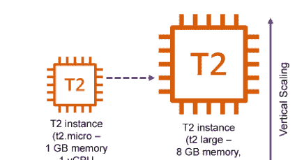

图 7.1 – 垂直扩展存在局限性

需要指出的是，垂直扩展在实例发生故障或托管实例的可用区发生中断时无法提供支持，从而导致客户体验不佳。

AWS 提供了另一种扩展配置，称为 **水平扩展**。在此配置中，多个实例充当托管您应用副本的舰队中的 *节点*。此外，您可以将节点分布在每个区域的多个可用区中。这意味着如果一个节点发生故障或特定可用区发生中断，用户可以被重定向到舰队中的其他节点。

通过水平扩展，流量可以使用 **Elastic Load Balancing** 服务在实例舰队（节点）之间进行分发。AWS Elastic Load Balancing 是一项服务，旨在将流量分发到资源舰队（在本例中为 EC2 实例），这有助于避免某些实例过载而其他实例闲置，并改善响应时间。通过将客户端/用户请求分发到根据图 7.2 中的图表部署在多个可用区中的实例，您可以在区域内实现 **高可用性** —— 这是使用云计算的关键优势。

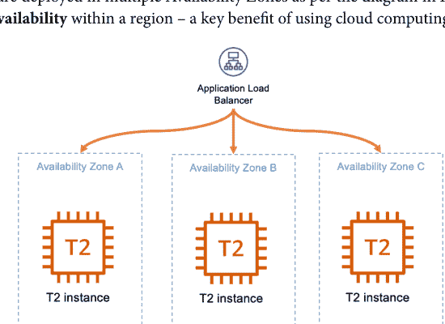

图 7.2 – 水平扩展访问可用区有助于实现高可用性


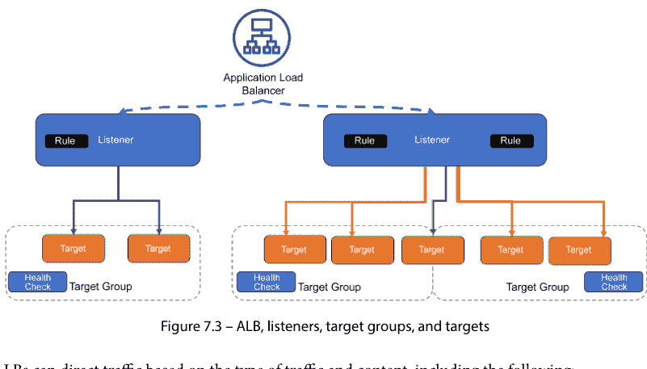

ALBs 可以根据流量类型和内容进行流量定向，包括以下内容：

- **基于主机的路由：** 流量根据 HTTP 头中的主机字段进行转发。
- **基于路径的路由：** 流量根据 URL 进行转发，使你能够将流量在应用程序的不同服务或组件之间拆分。
- **请求属性**（例如 X-Forwarded-For 头）：流量根据请求头中的字段进行转发，包括查询参数、源 IP 地址等。
- **重定向：** 你可以将请求从一个 URL 重定向到另一个 URL。
- **Lambda 函数：** 流量可以定向到 Lambda 函数。
- **容器化应用程序：** 流量可以定向到容器任务以及更多内容。

ALBs 还通过 SSL/TLS 协议提供应用程序安全加密，确保数据在传输过程中得到加密。

接下来，让我们来看网络负载均衡器。

## 网络负载均衡器 (NLBs)

NLBs 在 OSI 模型的第 4 层运行。这种负载均衡器旨在通过 **TCP、UDP、TCP_UDP** 和 TLS 协议分发网络流量。NLBs 可以 **每秒处理数百万个请求**，应对 **流量波动**，并 **支持负载均衡器的静态 IP 地址**。还可以为负载均衡器的每个子网分配一个 Elastic IP 地址。

NLBs 使用基于流的路由机制，这意味着一旦连接建立，网络数据包就会沿着相同的路由。 这意味着 NLBs 高效处理 TCP、UDP 和 TLS 流量。NLBs 还支持通过对等连接在 VPC 之间以及通过 AWS Direct Connect 从本地连接的连接。NLBs 更适合网络型应用程序、监控工具、物联网遥测数据或媒体流。

与 ALBs 一样，你必须为 NLBs 配置一个或多个目标组，这些目标组将托管 EC2 实例、微服务和容器等目标。此外，一个目标可以属于多个目标组。 一个关键区别是，你的侦听器必须配置为侦听 TCP、TLS、UDP 和 TCP_UDP 等网络协议。

一些附加功能包括以下内容：

- **TLS 卸载：** NLB 处理所有 TLS 终止任务并保留应用程序的源 IP 地址。这可以释放后端 Web 服务器专注于响应客户端请求，而不是使用宝贵的计算资源来加密和解密流量。
- **会话保持：** 确保来自客户端的请求被路由并继续传递到特定目标。
- **保留源 IP 地址：** 确保后端应用程序可以看到源客户端的 IP 地址。
- **DNS 故障转移：** 确保如果某个区域没有健康的后端目标或该区域的负载均衡器节点发生故障，则流量会被路由到另一个可用区中的其他节点。这种故障转移和重定向由 Amazon Route53 处理，我们将在本学习指南后面讨论。

接下来，让我们讨论网关负载均衡器。

## 网关负载均衡器 (GWLBs)

进入和离开应用程序的网络流量通常需要在允许入站和出站之前进行检查和分析。 公司通常部署第三方防火墙解决方案、**入侵检测/预防系统 (IDSs/IPSs)** 和 DDoS 保护设备。

其中许多设备如今在 AWS Marketplace 上提供，并且可以轻松部署到你的 AWS 账户中。 客户选择这些设备是因为其功能和丰富的网络保护能力。

管理进入和离开这些设备的流量需要确保这些服务的高可用性并最大限度地减少停机时间。 你希望这些网络工具能够持续访问和可用，并且能够处理大量流量，并在流量进入和离开你的网络和资源时执行安全处理。

AWS GWLBs 解决了这些问题。 GWLBs 旨在帮助你部署、管理和扩展第三方虚拟设备。 GWLB 由网关服务和负载均衡器服务组成。

如图 7.4 所示的图表中，当源发送流量到目标时，其数据包需要首先由你的虚拟设备检查。

流量首先通过第 3 层网关组件，该组件代表路由中的下一跳，且不进行数据包重写。 一旦 GWLB 接收到流量，它就充当第 4 层负载均衡器，提供典型的功能，例如扩展和流粘性，这使设备能够在两个方向上看到流量并对其采取行动。

它还执行健康检查。 如果设备发生故障，流量可以被重新路由到另一个设备。 原始流量还使用 Geneve（通用网络虚拟化封装）协议封装在第 3 层头中。 这确保第 3 层数据包不会被更改而看到。 设备可以看到数据包原样，可以解封装并检查它，并采取适当措施将其重新发送到目标。 这里的关键好处是源和目标应用程序无需意识到 GWLB 的存在，确保无需进行任何应用层更改。

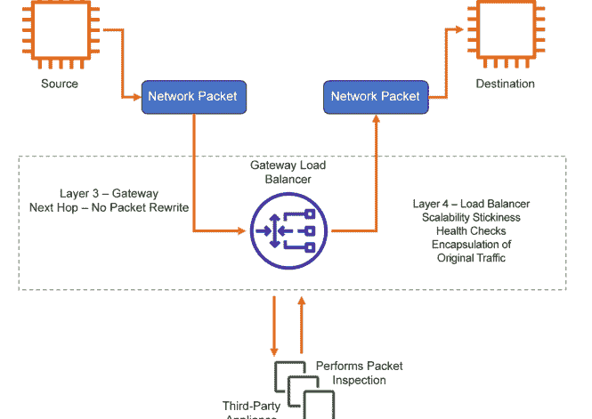

图 7.4 – GWLB

GWLBs 旨在为你在 AWS 上管理第三方设备群提供容错、扩展性和高可用性。

最后，让我们简要讨论经典负载均衡器。

## 经典负载均衡器 (CLB)

经典负载均衡器是上一代负载均衡器，AWS 不建议将其用于任何现代生产级应用程序环境。 如以下屏幕截图所示，CLB 可以支持第 7 层和第 4 层流量，但缺乏 ALB 和 NLB 的许多高级功能和健壮性。

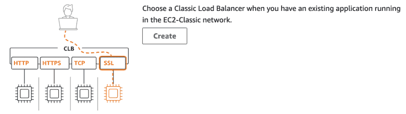

图 7.5 – 设置 CLB

CLBs 支持 SSL 终止，如图 7.5 所示的图表中，将加密任务卸载到负载均衡器，并管理 SSL 证书。 还支持 IPv4 和 IPv6 流量。

在本节中，我们详细研究了 AWS Elastic Load Balancers，并了解了如何构建应用程序架构以通过处理和分发流量到托管在你的 AWS 账户中的资源来提供高可用性。 在下一节中，你将了解有关可扩展性的更多信息，可扩展性是使组织能够设计弹性解决方案、确保一致性、可靠性、可访问性和成本控制的重要因素。 下一节将讨论 EC2 实例的 Auto Scaling。

## 使用 Amazon Auto Scaling 扩展你的应用程序

虽然负载均衡使你能够在不同可用区中的多个 EC2 实例之间分发流量，确保高可用性，但定义你需要多少实例来支持你的用户群是整体架构设计的关键组成部分。

为了确保你在 AWS 上部署的 **Todo List** 应用程序能够处理终端用户需求，你必须确保你的 EC2 集群具有足够的节点并且容量符合要求。 通常，很难预测需求，过去这意味着公司会遵循 **峰值负载配置** 的概念。 这就是你采购必要的<|message|> 基础设施和资源以处理你的峰值负载需求。 通常，这会导致需求低时资源浪费，并且资源处于空闲状态。

Amazon Auto Scaling 服务（无论是用于你的 EC2 实例、RDS 数据库，还是提供自动扩展能力的其他服务）通过在需求增加时部署额外的实例和节点，并在需求下降时终止这些资源来解决此问题。 这不仅可以让你控制成本，还能满足 Well-Architected Framework 可持续性支柱的要求。

### 什么是 EC2 的 Auto Scaling？

Amazon EC2 Auto Scaling 确保你的应用程序始终拥有足够的 EC2 实例来处理工作负载。 EC2 实例被分组到 **Auto Scaling 组** 中，你可以为每个组设置最小实例数。 Amazon EC2 Auto Scaling 永不会允许组大小低于此阈值。 你还可以限制组中的最大实例数，这有助于确保某些异常进程不会导致 Auto Scaling 服务部署不必要的实例。

如果在建立组时指定了所需的容量，Auto Scaling 服务将确保你的组具有指定数量的实例。 该服务可以根据你定义的扩展参数自动启动和终止实例，以响应应用程序使用量的峰值和低谷。

多个 AWS 服务可以促进基础设施元素的自动扩展并减少扩展的管理负担。 Amazon CloudWatch，一项监控服务，作为两者之间的中介，提供数据和洞察来监控你的应用程序和基础设施并适应性能或资源使用变化。


缩放可以通过手动向 Auto Scaling 组中添加或移除 EC2 实例，或通过动态定义基于资源使用或需求增加或减少组容量的规则来实现。这允许创建响应负载变化的规则，例如请求数、CPU 和内存使用情况。

以下讨论了可用的三种 **动态扩展策略** 类型：

- **目标跟踪**：此策略根据给定指标的目标值调整 Auto Scaling 组的当前预期容量，例如 CPU 或内存利用率。此策略可确保容量保持一致，并在需要时添加或移除 EC2 实例以维持所需的利用率水平，例如 60%。
- **阶梯式扩展**：此策略根据预先确定的扩展调整集，在当前容量基础上向 Auto Scaling 组添加或移除 EC2 实例，这些调整会根据警报违规的严重程度而增加或减少。例如，如果 Auto Scaling 组有三个用于监控 CPU 利用率的级别，则在 CPU 利用率为 40% 时会触发警报，添加一台 EC2 实例；在 CPU 利用率为 60% 时，添加两台 EC2 实例；在 CPU 利用率为 80% 时，添加三台 EC2 实例。
- **简单扩展**：此策略允许通过单一扩展调整来增加或减少 Auto Scaling 组的容量。当预先确定的警报被触发时，可以启动新的 EC2 实例。

按需实例扩展和 Spot Fleet 实例自动扩展功能使能够根据需求动态增加或减少 Spot Fleet 的容量。AWS Auto Scaling 机制依赖于多个组件，必须在利用之前创建，我们将在下一节中讨论这些组件。

## 使用 AWS 组件自动调整容量

Amazon **Elastic Compute Cloud (EC2)** Auto Scaling 依赖于多个组件来管理工作负载，包括以下内容：

- **自动扩展组** 将实例分组在一起以便于扩展和管理。在创建组时可以设置最小、最大和首选实例数。
- **配置模板**，例如启动配置或启动模板，允许自定义实例详细信息，例如 AMI ID、实例类型、密钥对、安全组和块设备映射。
- **扩展选项** 允许 Auto Scaling 组以多种方式进行扩展，使用 Amazon EC2 Auto Scaling。组可以根据特定触发器或预定计划动态扩展。

以下部分将讨论在应用程序中实现自动扩展机制。

## 使用 Auto Scaling 提供高可用性应用程序

通过将 Amazon EC2 Auto Scaling 纳入应用程序设计中，您可以最大化 AWS 云的好处。例如，自动扩展通过自动关闭不健康的实例并用新实例替换它们来提供更高的容错能力。Amazon EC2 Auto Scaling 还可以使用多个可用区在不同区域部署实例。

自动扩展还通过自动调整资源以满足用户需求来提高商品和服务的可用性。这确保您的应用程序拥有高效运行所需的资源。

此外，Amazon EC2 Auto Scaling 通过允许按需弹性扩展资源来实现更智能的预算。仅在需要时启动 EC2 实例，并在不使用时终止它们，有助于节省成本，因为您只需为使用的实例付费。

在将 EC2 自动扩展纳入以实现弹性、负载均衡和高可用性时，您最终会得到一个提供可靠性、可扩展性和成本效益的强大解决方案。

现在您已经了解了构建可扩展、高可用且经济高效的解决方案的架构模式，是时候检查您的数据和应用程序的安全性了。在下一节中，您将转向 AWS 上的加密技术，并检查 AWS Key Management Service（AWS KMS）。

## AWS 和 KMS 加密简介

当您计划在云中托管和访问应用程序时，安全性至关重要。在第 2 章《使用 AWS Identity and Access Management 安全访问》中，您发现了身份验证和授权的重要性。后来，在第 4 章《使用 Amazon VPC 在云中构建私有网络》中，您了解了网络安全以及确保仅允许与我们的应用程序相关的特定流量的措施。在本节中，您将了解数据加密以及 AWS 上的服务，这些服务可以帮助确保您的数据对没有授权查看数据的人不可读。这是您整体安全设计的关键组成部分。

以下是您在处理数据时需要了解的两种加密方法：

- **传输中加密** – 这是指网络端点之间传输的加密数据。它可能以未加密的形式存储在磁盘上。
- **静态加密** – 这是指存储在磁盘上时加密的数据。当数据在存储系统上创建/存储时，它会被加密。从磁盘访问数据需要先解密才能使其可读。

根据您在 AWS 上使用的服务，您可以选择加密您的数据。对于端到端加密要求，您通常会同时实施这两种选项。

AWS KMS 是 Amazon S3 和 AWS 上其他服务用于加密的重要服务。让我们通过讨论 KMS 的关键功能以及如何使用此服务有效地管理您的加密需求来深入了解。

### AWS KMS 概述

**AWS KMS** 是您用于构建和集成托管在 AWS 上的应用程序和数据的加密功能的主要服务。**AWS KMS 符合 FIPS 140-2 标准并使用共享安全硬件模块**来生成加密密钥，用于执行加密操作。

**AWS KMS 密钥**（以前称为客户主密钥或 CMK）执行所有数据加密、解密和重新加密。CMK 设计为仅加密最大 4KB 的数据。要加密更大的数据集，您必须创建数据密钥，如后面所述。

**AWS KMS 密钥**可以是客户管理的或 AWS 管理的。以下是区别：

**客户管理的 CMK** 是您创建、拥有和管理的密钥。您完全控制密钥策略并能够启用和禁用它们。您可以选择性地定义密钥轮换策略，后续可以禁用，而 AWS 管理的密钥则不能。

**AWS 管理的 CMK** 是由任何使用 AWS KMS 的原生服务代表您创建、管理和使用。虽然某些服务会让您选择 AWS 管理的密钥或客户管理的密钥，但通常，除非您需要对密钥有更大的控制权，否则您可以选择 AWS 管理的密钥。对于 AWS 管理的密钥，密钥轮换每年自动执行且无法禁用，并且密钥无法删除。AWS 管理的密钥也不收费。

需要了解的一个重要概念是，您可以处理两种类型的加密 – *对称* 和 *非对称加密* – 相应地，您将使用对称密钥或非对称密钥。让我们接下来看看这些。

### 对称 KMS 密钥

对称 KMS 加密密钥用于您希望使用相同的密钥执行加密和解密操作时。密钥安全存储在 KMS 中；您必须调用 KMS 来执行所需的加密和解密任务。请注意，与 KMS 集成的 AWS 服务仅使用对称加密。

对称密钥可用于加密、解密和重新加密数据。它们还可用于生成数据密钥和数据密钥 *对*，我们将在本节后面讨论。支持多区域对称加密，并且如果您愿意，可以导入您的密钥材料。


## 非对称 KMS 密钥

非对称 KMS 加密密钥由密钥对组成——一个私钥和一个公钥。当你需要让外部方对稍后需要由你解密的数据执行加密操作时，这种加密选项具有优势。使用公钥/私钥密钥对可以保持安全性，即使你自由地在 AWS 环境外分发公钥，因为只有你能使用私钥解密任何已加密的数据。

私钥存储在 KMS 中，且永远不会以未加密的形式离开。你需要调用 KMS 来使用此私钥执行解密操作。

选择哪种加密密钥选项取决于你的用例。如果你需要在 AWS 外部执行加密操作，且无法访问 KMS，你可以使用非对称密钥。如果你需要使用 AWS 服务（如 Amazon S3）来存储和管理所有加密和解密操作，那么对称加密密钥是一个绝佳的选择。

如前所述，你可能需要创建数据密钥甚至数据密钥对来加密大于 4 KB 的数据。让我们接下来探讨这个概念。

## 什么是数据密钥？

AWS KMS 密钥（AWS 管理或客户管理）用于加密和解密最大大小为 4 KB 的明文数据。由于你通常需要加密大得多的数据集，你可以使用 KMS 密钥通过 GenerateDataKey API 创建和加密数据密钥。这些数据密钥是对称的，用于数据加密，因为它们可以加密超过 4 KB 大小的数据，并且可以下载并在 AWS 外部使用。该操作将同时返回数据密钥的明文副本和加密副本。

让我们查看使用数据密钥加密数据的工作流程，如*图 7.7*所示：

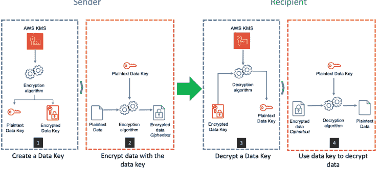

图 7.7 – 使用数据密钥加密你的数据

以下是工作流程的步骤：

- 1. 使用 AWS KMS 生成的数据密钥；加密的数据密钥及其明文格式可供下载。
- 2. 使用数据密钥的明文版本加密你的数据，然后从内存中丢弃该密钥。
- 3. 将加密的数据和数据密钥的加密版本发送给接收方。加密的数据密钥需要首先使用 KMS 进行解密以生成明文数据密钥。
- 4. 然后使用明文数据密钥解密加密的数据。

KMS 将使用 KMS 密钥创建数据密钥和数据密钥的加密版本。KMS 将能够使用 KMS 密钥解密加密的数据密钥。

除了之前提到的 GenerateDataKey API，你还可以编程调用其他 API 来与 KMS 进行接口交互和工作。常见的 API 调用包括：

- **GenerateDataKeyPair** – 此操作返回一个非对称数据密钥对，你可以将其用于 AWS KMS 之外。你将获得明文公钥，以及私钥的明文和加密副本。
- **GenerateDataKeyWithoutPlaintext** – 此操作返回用于 AWS KMS 之外的对称数据密钥。通过此操作，你获得指定加密密钥下的加密数据密钥。此操作不返回数据密钥的明文副本，当你不打算立即加密数据时很有用。当你需要执行加密操作时，你调用加密密钥副本上的 Decrypt 操作。
- **Encrypt** – 此操作用 KMS 密钥加密最大 4 KB 大小的明文，可用于对小型数据（如个人标识符、密钥或数据库密码）执行对称和非对称加密。你不使用此操作来加密数据密钥。对于数据密钥，你改用 GenerateDataKey 和 GenerateDataKeyPair 操作。

既然你了解了 AWS KMS 工作原理的基础，让我们看看一些与加密功能无缝集成的 AWS 服务。我们将从查看 Amazon S3 服务以及数据是如何加密的开始。

在你想强制使用特定 KMS 密钥进行服务端加密的情况下，你必须使用 `s3:amz-server-side-encryption-aws-kms-key-id` 头。如果你不指定 AWS KMS 密钥 ID，Amazon 将改用 AWS 管理的 KMS 密钥。

## 使用 AWS KMS 密钥的双层服务端加密 (DSSE-KMS)

此选项使用两层对象级加密。当你将数据上传到 Amazon S3 时，它自动使用 S3 管理的密钥对其进行加密。DSSE-KMS 允许你使用 AWS KMS 密钥来加密 S3 管理的密钥，从而创建双层加密。如果你需要多层加密来满足监管要求，此选项非常有用。使用 KMS，你对密钥有更多的控制权，并可以安全地管理它们。请注意，DSSE-KMS 密钥必须与存储桶位于同一区域。

## 使用客户提供的密钥的服务端加密 (SSE-C)

这使你能够完全管理加密密钥，而 AWS 处理所有加密或解密任务。

## 客户端加密

这指的是在客户端加密数据并将其上传到 Amazon S3 的过程。客户必须创建和管理密钥及加密过程。使用客户端加密的关键好处是你的数据对任何第三方（如 AWS）都不可访问。AWS 接收完全加密的数据，无法读取该数据。由于你在客户端加密数据，AWS 不会对数据执行任何加密或解密活动。它也不会识别该数据已被加密，只将其视为正常数据。

如果你的组织需要遵循某些严格的监管要求，你可能会选择客户端加密。

请注意，在涉及 Amazon S3 加密时，被加密的是对象，而不是存储桶。在将对象上传到 Amazon S3 时，你可以通过创建**存储桶策略**来强制对象加密，该策略拒绝任何 PUT 请求，除非请求中包含 `x-amz-server-side-encryption` 头。在指定此头时，你可以使用 AES256 作为 S3 管理密钥，或使用 `aws:kms` 作为 KMS 管理密钥。

以下是你通常可以使用的一个策略示例，如*图 7.8*所示：

```json
{
  "Version": "2012-10-17",
  "Id": "PutObjPolicy",
  "Statement": [
    {
      "Sid": "DenyIncorrectEncryptionHeader",
      "Effect": "Deny",
      "Principal": "*",
      "Action": "s3:PutObject",
      "Resource": "arn:aws:s3:::<bucket_name>/*",
      "Condition": {
        "StringNotEquals": {
          "s3:x-amz-server-side-encryption": "AES256"
        }
      }
    },
    {
      "Sid": "DenyUnencryptedObjectUploads",
      "Effect": "Deny",
      "Principal": "*",
      "Action": "s3:PutObject",
      "Resource": "arn:aws:s3:::<bucket_name>/*",
      "Condition": {
        "Null": {
          "s3:x-amz-server-side-encryption": true
        }
      }
    }
  ]
}
```

图 7.8 – 强制对象上传加密

对于此策略，你必须指定你的存储桶的正确 Amazon 资源名称（arn）。

到目前为止，你已经查看了 Amazon S3 可用的加密选项。在下一节中，你将了解如何将加密应用于其他类型的存储服务。

## Amazon EBS 加密

**待办事项列表**应用程序的后端服务将运行在分布在弗吉尼亚北区多个可用区中的 EC2 实例群上。这将确保存储在存储服务上的所有数据将继续位于美国境内，以满足业务的数据驻留要求。虽然由待办事项列表应用程序的最终客户创建和管理的数据将驻留在上一章中部署的 Amazon RDS 数据库中，但同样重要的是要考虑加密托管后端应用程序的实例所附带的 EBS 卷。

Amazon EBS 使用 AWS KMS 进行所有加密服务，使你能够使用 AES-256 数据加密来加密根卷和数据卷。当你加密 EBS 卷时，驻留在卷上的所有数据以及卷和实例之间移动的任何数据都会被加密。加密操作在托管 EC2 实例的服务器上执行。


你可以在同一时间将加密和非加密卷同时附加到 EC2 实例上。此外，从加密卷创建的快照以及由此类快照产生的后续卷也将被加密。

接下来，你将了解有关 Amazon RDS 加密的更多信息。

## Amazon RDS 加密

Amazon RDS 提供静态数据加密，其中包括底层存储、自动备份、快照、日志和只读副本。与 Amazon EBS 类似，Amazon RDS 使用行业标准的 AES-256 位加密，并使用 AWS KMS 密钥执行所有加密操作。

需要了解的一些重要概念包括以下内容：

- 如果只读副本与主数据库实例位于同一区域，则必须使用相同的 KMS 密钥。
- 如果只读副本与主实例位于不同区域，则必须使用只读副本所在目标区域的 KMS 密钥。
- 你可以使用 **透明数据加密 (TDE)** 对 Oracle 和 SQL Server 数据库实例进行加密。
- 复制加密快照时，可以使用与用于加密原始快照的密钥不同的 KMS 密钥。

此外，加密 Amazon RDS 数据存在某些限制，其中一些列如下：

- 你只能在首次创建数据库实例时对其进行加密。数据库启动后无法再对其进行加密。变通方法是创建快照，将快照复制到另一位置，并在复制过程中对其进行加密，然后从加密的快照中恢复数据库。
- 一旦创建了加密的数据库实例，就无法禁用加密。
- 你无法为未加密的实例创建加密快照。

总之，AWS KMS 与多个 AWS 服务提供原生集成以提供数据加密。你可以选择使用 AWS 管理的密钥或使用自己的客户托管密钥以获得更大的控制权。将数据的加密纳入应用程序架构设计模式中非常重要，以增加额外的安全层。

下一节将引导你完成项目任务，了解 TodoPlus Limited 如何部署一个高可用且可扩展的应用程序。之前，你已在第 3 章 *使用 Amazon S3、混合存储和静态网站托管理解对象存储* 中部署了前端用户界面。在本章中，你将部署后端应用程序组件，该组件托管 API 以使你的终端用户能够与数据库交互并存储他们的待办事项列表。

## 项目任务 – 为待办事项列表应用程序部署一个高可用且可扩展的后端应用程序组件

到目前为止，你已经构建了核心基础设施的很大一部分，如下图所示，该基础设施将用于部署和托管待办事项列表应用程序。

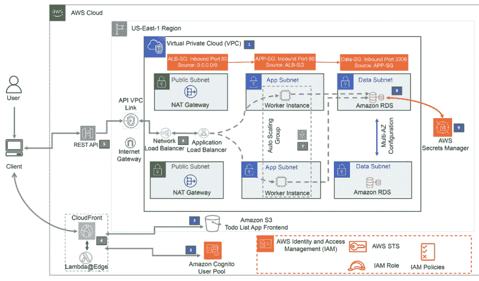

具体来说，你已部署了以下核心基础设施服务：

1. IAM 的设置和配置，具有对账户的访问权限的特定用户，定义了一些具有权限的 IAM 角色以连接到 AWS Session Manager，从而实现我们将部署的应用程序服务器的远程管理。该角色将在项目任务进行过程中进一步修改以包含额外的策略。
2. Amazon Cognito 用户池的设置和配置，将用于创建和管理我们应用程序的虚构用户。
3. Amazon S3 静态网站目前托管应用程序的前端 **用户界面 (UI)**。将在 Amazon S3 上执行额外的任务，例如托管登录用户可见的网页并托管应用程序源代码作为部署的存储库。
4. 一个多层 VPC 托管六个子网、一个互联网网关、安全组和路由表以分离子网角色。本章在部署 NAT 网关时将执行额外的任务。
5. 一个包含预安装的基础软件的 EC2 AMI，包括 Node.js 和 PM2，将用于加快未来应用程序层部署。
6. 一个 RDS 数据库，将托管终端用户的待办事项列表数据，并配置为将其凭据存储在 Amazon Secrets Manager 中。

在本节中，我们将继续构建我们的架构解决方案，通过使用负载均衡器构建一个高可用组件，并添加可扩展性选项以部署我们的后端服务器。

## 技术要求

你应已完成之前章节中的所有任务以完成本章的项目任务。确保在以 IAM 用户 Alice 登录时使用你的 AWS 开发账户。

此外，你需要从我们的 GitHub 仓库链接下载源代码和 UserData 脚本文档：https://packt.link/LJB2S。

### 项目任务 7.1 – Amazon S3 – 创建应用程序源代码存储库

在此步骤中，你将创建另一个 Amazon S3 存储桶用作应用程序源代码的存储库。你有两个网页 – 前端网页，邀请用户注册账户并登录，以及后端 Web 应用程序，使已注册用户能够访问他们的待办事项列表数据并创建和修改他们的待办事项列表。后端应用程序的源代码将存储在此 Amazon S3 存储桶中：

1. 登录你的 AWS 开发账户，即你为所有过去项目任务所使用的账户。确保以具有完全管理员访问权限的 IAM 用户 Alice 登录。
2. 从 AWS 管理控制台页面，使用顶部的搜索栏搜索 Amazon S3，然后在新的浏览器标签页中打开 Amazon S3 控制台。
3. 你会注意到一个现有的存储桶托管待办事项列表应用程序的前端网页。点击控制台右侧窗格中的 **Create bucket** 按钮。
4. 提供存储桶名称并确保你在 **US East (N. Virginia) us-east-1** 区域创建此存储桶，如以下屏幕截图所示：

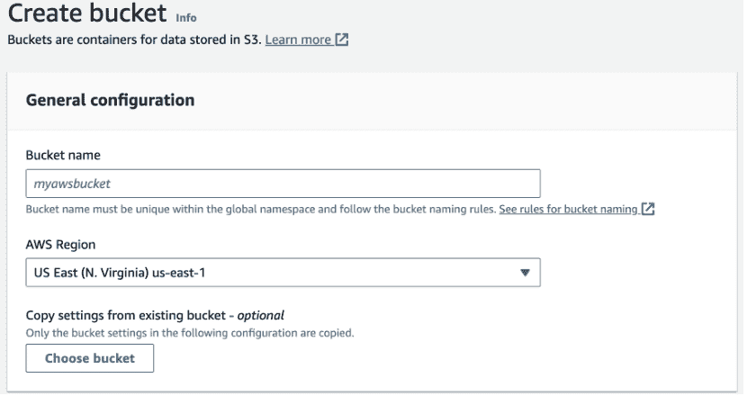

*Figure 7.10 – Creating an Amazon S3 bucket to host your application source code*

5. 滚动到 **Bucket Versioning** 并点击 **Enable** 单选按钮。
6. 将所有其他设置保留为默认值，然后点击页面底部的 **Create bucket** 按钮。
7. 在存储桶创建完成后，它已准备好供你上传源代码。代码可在我们的 **Github Repository** 中找到，具体在技术存储库部分。请确保在继续上传之前将源代码下载到本地计算机。
8. 要上传源代码，请导航到你刚刚创建的 Amazon S3 存储桶，如以下屏幕截图所示：

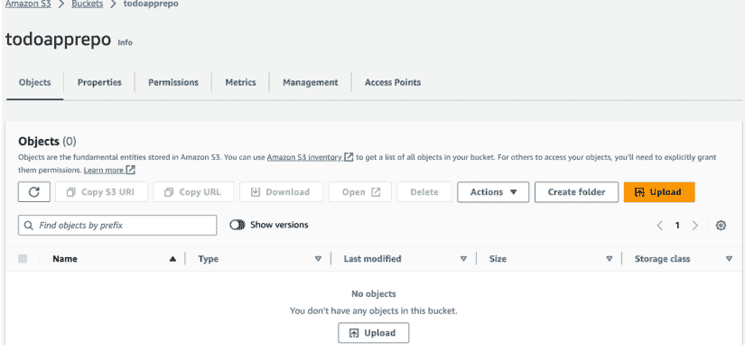

*Figure 7.11 – Amazon S3 bucket to be used as your source code repository*

- 点击 **Upload** 按钮。
- 点击 **Add files** 然后从本地计算机选择 `todo-plus-nodejs.zip` 文件。
- 点击 **Upload** 按钮，如以下屏幕截图所示。你应收到上传成功的消息。

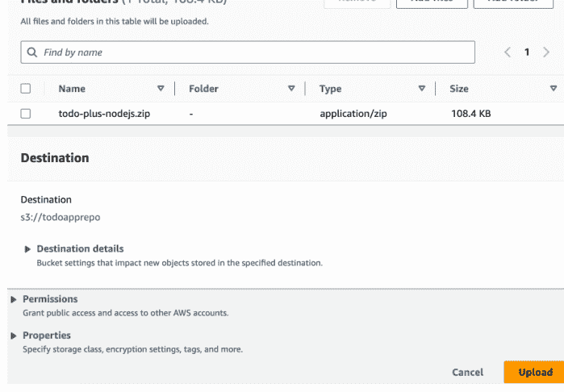

*Figure 7.12 – Uploading the source code to your bucket*

现在你已设置好 Amazon S3 存储桶并为待办事项列表后端应用程序上传了源代码文件，你应创建一个 IAM 策略，该策略将授予你的 EC2 实例从存储桶下载源代码文件的权限。稍后，你将创建一个 IAM 角色，该角色将用于授予你的 EC2 实例此策略中定义的权限。

1. 在另一个浏览器标签页中，导航到位于此处的 AWS 策略生成器网站：`https://awsypolicygen.s3.amazonaws.com/policygen.html`。
2. 从 **Select Type of Policy** 下拉列表中选择 **IAM Policy**。确保 **Effect** 设置为 **Allow**。
3. 从 **AWS Service** 下拉列表中选择 **Amazon S3**。
4. 在 **Actions** 下拉列表中，选择 **GetObject** 操作。
5. 你需要提供存储桶的 **Amazon Resource Name (ARN)**。你可以在 Amazon S3 控制台中，在存储桶的 **Properties** 选项卡下找到它，如以下屏幕截图所示：

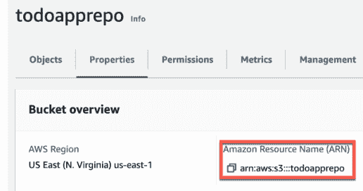

*Figure 7.13 – The ARN of your Amazon S3 bucket*

6. 复制此 ARN 值并将其粘贴到策略生成器网页上 **Amazon Resource Name (ARN)** 文本框标签旁边的文本框中。你必须确保也在存储桶的 ARN 后添加值 *斜杠和星号* (`/*`)。这表示你授予对存储桶内所有内容的访问权限。参见屏幕截图以明确说明：


## 步骤 2：添加语句

语句是单一权限的正式描述。请查看您可以用于语句中的元素说明。

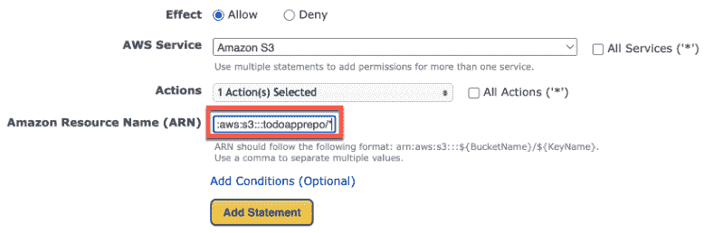

图 7.14 – 指定存储桶的 ARN，后跟斜杠和通配符 (/*)

- 7. 单击**添加语句**。
- 8. 接下来，单击**生成策略**。您应该会得到一个类似以下内容的 JSON 策略语句（将此策略复制到剪贴板）：

### 策略 JSON 文档

单击下方进行编辑。若要保存策略，请将下方文本复制到文本编辑器中。在下方所做的更改不会反映在策略生成工具中。

```
{
  "Version": "2012-10-17",
  "Statement": [
    {
      "Sid": "Stmt1700830761340",
      "Action": [
        "s3:GetObject"
      ],
      "Effect": "Allow",
      "Resource": "arn:aws:s3:::todoapprepo/*"
    }
  ]
}
```

图 7.15 – 示例 JSON 策略

- 9. 从 AWS 管理控制台中，搜索 IAM 并在单独的浏览器标签页中导航到 IAM 控制台。
- 10. 从左侧菜单中，选择**策略**。
- 11. 在右侧窗格中，单击**创建策略**。
- 12. 单击**JSON**按钮。这将打开**策略编辑器**。
- 13. 删除现有的示例策略，并将您在策略生成器中创建的 JSON 策略粘贴进去。
- 以下代码片段中提供了一个策略示例。请将 `YOUR BUCKET NAME` 占位符替换为您用作源代码存储库的存储桶名称：

```
{
  "Version": "2012-10-17",
  "Statement": [
    {
      "Sid": "Stmt1716962066285",
      "Action": [
        "s3:GetObject"
      ],
      "Effect": "Allow",
      "Resource": "arn:aws:s3:::[YOUR BUCKET NAME]/*"
    }
  ]
}
```

- 14. 为您的策略提供一个名称，例如 `todo-list-s3-sourcecode-access-policy`，以及可选的描述。
- 15. 滚动到页面底部并单击**创建策略**按钮。
- 16. 您应该会收到一条消息通知，指出策略已创建。稍后您将在此 IAM 角色中使用此策略。

既然您已经拥有源代码存储桶并配置了 IAM 策略，我们可以继续本项目练习的*步骤 2*。

## 项目任务 7.2 – 修改当前已为您的 EC2 实例配置的 IAM 角色

在本步骤中，您将针对我们在*第 5 章、使用 Amazon EC2 和存储选项了解 AWS 计算服务*中为我们的 EC2 实例创建的现有 IAM 角色执行多项配置。这是因为您一次只能为您的 EC2 实例附加一个 IAM 角色。然而，每个角色可以关联多个 IAM 策略。在*第 5 章、使用 Amazon EC2 和存储选项了解 AWS 计算服务*中，您配置了一个名为 `todo-ec2-iam-master-role` 的 IAM 角色。该角色配置了 AmazonSSMManagedInstanceCore，使您能够使用 AWS Systems Manager 会话管理器服务远程连接与此角色关联的任何 EC2 实例。

在本步骤中，您将向同一角色添加两个额外的策略；第一个策略允许运行在 EC2 实例上的应用程序访问包含 RDS 数据库凭证数据的密钥，应用程序需要这些数据来连接。您将附加到角色的第二个策略是您在上一步骤中创建的策略：

- 1. 从主**AWS 管理控制台**页面，在新的浏览器标签页中导航到 IAM 控制台。
- 2. 从左侧菜单中，选择**策略**。
- 3. 单击**创建策略**按钮。
- 4. 您将使用可视化编辑器创建策略。从**选择服务**下拉列表中，选择**Secrets Manager**。
- 5. 展开**读取**访问级别，并选择**GetSecretValue**访问级别，如下截图所示：

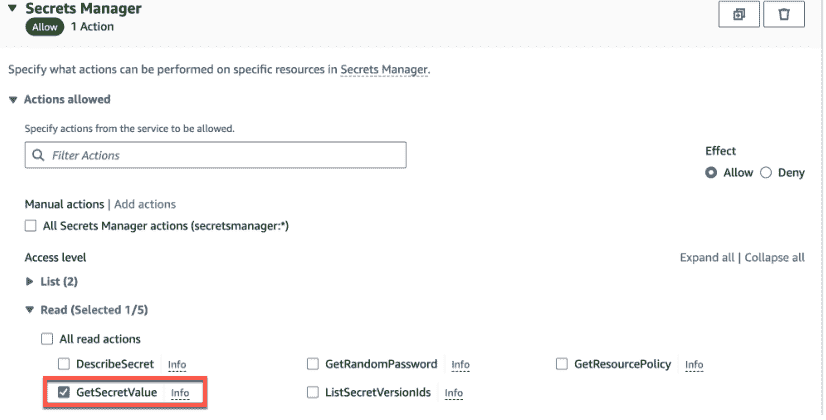

图 7.16 – 配置 IAM 策略以从 AWS Secrets Manager 读取密钥值

- 6. 在**资源**下，您需要指定您在*第 6 章、使用 AWS 关系型和非关系型（NoSQL）数据库管理多个数据集*中创建的密钥的 ARN。在另一个浏览器标签页中，导航到 AWS Secrets Manager 控制台。单击您创建的密钥，从详细信息页面中，将**Secret ARN**值复制到剪贴板，如下截图所示：

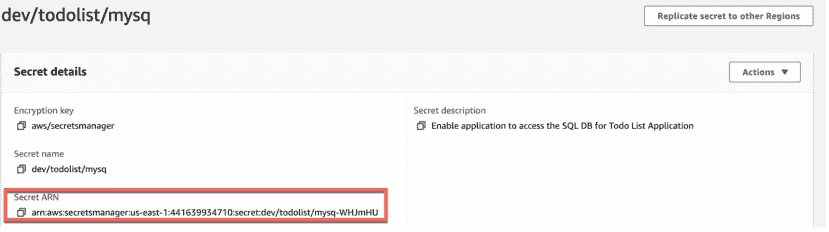

图 7.17 – AWS Secrets Manager，您在*第 6 章*中创建的密钥的 ARN

- 7. 接下来，回到您正在创建 IAM 策略的浏览器标签页。
- 8. 在策略配置的**资源**部分下，选择**特定**。
- 9. 接下来，单击**添加 ARN**，如下截图所示：

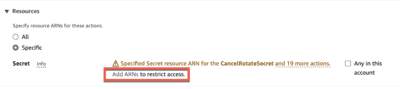

图 7.18 – 选择添加 ARN 以粘贴您之前复制的密钥的 ARN

- 10. 在出现的对话框中，选择**文本**按钮，并将您的 ARN 粘贴到文本框中。单击**添加 ARN**按钮。单击**下一步**。
- 11. 在**审查和创建**页面上，为您的策略提供一个名称，例如 `todo-list-secret-access-policy`。此外，提供一个可选的描述并单击**创建策略**按钮。您的策略现在应该已创建，该策略将授予对您之前在*第 6 章、使用 AWS 关系型和非关系型（NoSQL）数据库管理多个数据集*中创建的特定密钥的访问权限。
- 12. 从左侧菜单中，选择**角色**。
- 13. 搜索并选择在*第 5 章、使用 Amazon EC2 和存储选项了解 AWS 计算服务*中创建的 `todo-ec2-iam-master-role` IAM 角色。
- 14. 在**权限**选项卡下，单击**添加权限**下拉箭头并选择**附加策略**。
- 15. 您将看到**将策略附加到 todo-ec2-iam-master-role**。（请注意，如果您为 IAM 角色起了不同的名称，则会看到该名称。）
- 16. 在**其他权限策略**下的搜索框中，搜索并勾选您创建的两个策略旁边的复选框 – 一个用于访问 AWS Secrets Manager 中的密钥，另一个用于您在本项目任务*步骤 1*中创建的 Amazon S3 访问策略，如下截图所示：

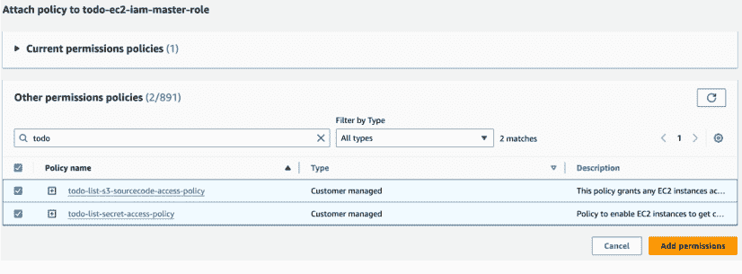

- 17. 单击**添加权限**按钮。您应该会收到一条通知，指出策略已成功附加到角色。

这样，您的 IAM 角色就配置了必要的策略，以便使用会话管理器远程管理您的应用程序，使您的 EC2 实例能够下载应用程序源代码，并允许应用程序从 AWS Secrets Manager 获取数据库凭证。稍后，您将在此后续项目任务中部署的应用程序的所有 EC2 实例上附加此 IAM 角色。

## 项目任务 7.3 – 为您的 EC2 实例创建密钥对

在本项目任务中，您将为您的 EC2 实例创建*密钥对*。虽然我们将使用 AWS 会话管理器远程管理 EC2 实例，但拥有一套用于远程访问的密钥对始终是个好习惯。例如，在受 VPN 保护的企业环境中，如果您需要通过 Ansible 等第三方工具连接到 EC2 实例，那么拥有这些密钥对将会很有帮助：

- 1. 从**AWS 管理控制台**页面，在页面顶部的搜索框中搜索 `key pairs`。然后选择**密钥对**功能。
- 2. 从右侧窗格中，单击**创建密钥对**。
- 3. 为密钥对提供一个名称，例如 `todo-list-ec2-keys`。
- 4. 确保您为**私钥文件格式**选择了 **.pem**。
- 5. 单击**创建密钥对**按钮。这将创建一个公钥/私钥对，其中私钥将自动下载到您的本地计算机。确保您将此私钥存放在安全的地方。

接下来，您将创建一个自动缩放服务和 ALB。如前所述，自动缩放服务将设计为部署您的 EC2 实例并配置服务器以托管应用程序。此外，自动缩放服务将确保跨多个可用区部署的最小一组 EC2 实例始终可供您的客户使用。通常，您还会定义伸缩出和伸缩入策略以应对需求波动。然而，对于本项目练习，您必须确保您的集群中始终有一组最小实例可用。

ALB 将启用流量分发到自动缩放服务部署的实例集群。这将确保您的应用程序具有高可用性。

## 项目任务 7.4 – 创建目标组

在本步骤中，您将创建一个目标组，用于将流量路由到您的目标，在本例中，是由自动缩放服务部署的 EC2 实例，这些实例将配置有您的应用程序源文件及必要配置。目标组还将对其目标执行健康检查，识别健康和不健康的目标，并确保负载均衡器仅将流量 directed 到处于健康状态的 EC2 实例。

当您为 ALB 配置监听器规则时，您将定义将相关流量路由到哪个目标组。因此，您会在任何负载均衡器配置之前创建目标组。

此外，在设置目标组时，您需要定义您将要连接的目标类型 – 在本例中，将是以下之一：

- **实例**：目标由实例 ID 指定
- **IP**：目标由 IP 地址指定。
- **Lambda**：目标是 Lambda 函数


配置目标组的步骤如下：

- 1. 从 AWS 管理控制台搜索 EC2 并进入 EC2 控制台。请确保你位于 **us-east-1 (N. Virginia)** 区域。
- 2. 从左侧菜单的 **Load Balancing**（负载均衡）部分选择 **Target Groups**（目标组）。
- 3. 在右侧窗格中，点击 **Create target group**（创建目标组）按钮。
- 4. 从 **Choose a target type**（选择目标类型）部分选择 **Instances**（实例）。
- 5. 接下来，在 *Target group name*（目标组名称）下方的文本框中提供一个描述性名称，例如 `todo-list-ec2-target-group`。
- 6. 按照以下截图所示，确保将 **Protocol**（协议）和 **Port**（端口）分别设置为 **HTTP** 和 **80**：

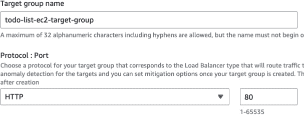

图 7.20 – 为你的负载均衡器配置目标组

- 7. 将 **IP address type**（IP 地址类型）设置为 **IPv4**。
- 8. 从 VPC 下拉框中选择你之前创建的 **todolist-vpc**。
- 9. 确保从 *Protocol*（协议）版本中选择了 **HTTP1**。
- 10. 保持其余所有设置为默认值，并点击页面底部的 **Next**（下一步）。
- 11. 你会注意到目前没有任何可用实例可以添加到该目标组中。这是没问题的，因为你稍后配置自动扩缩组时，会自动将新启动的实例与该目标组关联。现在，请点击 **Create target group**（创建目标组）按钮。
- 12. 你应该会收到一条通知，指示目标组已成功创建。

接下来，你将创建自动扩缩服务的启动模板。**启动模板**允许你指定配置详情，如 AMI ID、实例类型和族、用于连接实例的密钥对，以及需要与实例关联的任何安全组。AWS 强烈建议使用**启动模板**来定义这些配置项，而不是使用以前的**启动配置**。这是因为模板提供了额外功能，并且你可以拥有启动模板的多个版本。托管多个版本可以让你快速为不同的用例配置你的机群；例如，你在一套 AMI 用于开发，另一套用于生产。

让我们继续设置启动模板。

## 项目任务 7.5 – 创建启动模板

在此步骤中，你将创建一个启动模板。作为配置的一部分，你将引用在*第 5 章，使用 Amazon EC2 了解 AWS 计算服务及存储选项*中创建的 **Amazon Machine Image (AMI)**。该 AMI 已经嵌入了某些配置，例如 Node.js 和 PM2 的安装。虽然就本项目任务而言，安装这些组件所花的时间很少，但你可以想象，拥有预配置的 AMI 如何能显著加快你的 EC2 实例的部署过程：

- 1. 确保你仍在 EC2 管理控制台中，并且位于 **us-east-1 (N. Virginia)** 区域。
- 2. 从左侧菜单的 **Instances**（实例）部分选择 **Launch Templates**（启动模板）。
- 3. 在右侧窗格中，点击 **Create launch template**（创建启动模板）按钮。
- 4. 在出现的启动模板向导中，为你的模板提供一个合适的名称，例如 `todo-list-launch-template`。
- 5. 接下来，为你的启动模板提供描述。
- 6. 在 **Application and OS Images (Amazon Machine Image)**（应用程序和操作系统镜像（Amazon 机器映像））下，选择 **My AMIs**（我的 AMI）选项卡，并从 **Amazon Machine Image (AMI)**（Amazon 机器映像）下拉列表中选择你在*第 5 章，使用 Amazon EC2 了解 AWS 计算服务及存储选项*中创建的 AMI，如下图所示：

### 应用程序和操作系统镜像 (Amazon Machine Image) 信息

AMI 是一个模板，包含启动你的实例所需的软件配置（操作系统、应用程序服务器和应用程序）。如果你在下文中没有找到正在寻找的内容，请搜索或浏览 AMI。

搜索我们的完整目录，包括数千个应用程序和操作系统镜像

- 最近的
- 我的 AMI
- 快速启动

不要包含在启动模板中

我拥有的

分享给我

浏览更多 AMI
包括来自 AWS、市场（Marketplace）和社区的 AMI

Amazon Machine Image (AMI)

todolist-worker-ami
ami-01a82b0668b883e1
2024-03-21T06:35:32.000Z 虚拟化: hvm ENA 已启用: true 根设备类型: ebs

图 7.21 – 启动模板配置：选择你的企业 AMI

- 7. 接下来，在实例类型部分，选择 t2.micro，它符合免费套餐资格。
- 8. 从密钥对名称下拉列表中选择你在步骤 3 中创建的密钥对。
- 9. 接下来，在网络设置部分，确保在子网下拉列表中选择了 Don't include in launch template（不包含在启动模板中）。

10. 接下来，在防火墙（安全组）子部分中，确保选择了 Select existing security group（选择现有安全组），然后从 Security groups（安全组）下的下拉列表中选择你在*第 4 章，使用 Amazon VPC 在云中构建私有网络*中创建的应用程序安全组，如下图所示。请记住，应用程序安全组是你将关联到 EC2 实例的安全组，因为它允许负载均衡器向实例上运行的应用程序传输入站流量。

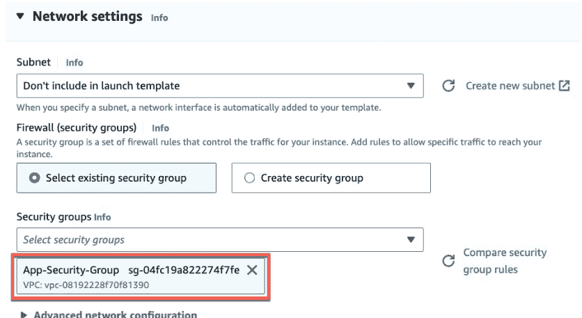

图 7.22 – 配置你的启动模板的网络设置

11. 接下来，向下滚动并展开高级详细信息部分。

12. 选择 IAM 实例配置文件下拉箭头，并选择你在*第 5 章，使用 Amazon EC2 了解 AWS 计算服务及存储选项*中创建的 IAM 角色。请记住，该角色命名为 todo-ec2-iam-master-role，并与以下三个策略关联：

- I. AmazonSSMManagedInstanceCore - 这是一个 AWS 管理的策略
- II. todo-list-s3-sourcecode-access-policy - 这是一个客户管理的策略
- III. todo-list-secret-access-policy - 这是一个客户管理的策略

13. 接下来，滚动到用户数据 – 可选部分。在用户数据文本框中，你必须粘贴我们在 GitHub 仓库中提供给你的 Bash 脚本 (user-data.sh)。请参阅以下截图作为示例：

```
1  #!/bin/bash
2
3  AWS_REGION=us-east-1
4  SECRET_NAME=[Secret Name]
5  DB_HOST=[Database Endpoint]
6  DB_PORT=3306
7
8  yum update -y
9  aws s3 cp s3://[S3 Bucket Name]/todo-plus-nodejs.zip /var
10 unzip /var/todo-plus-nodejs.zip -d /var
11 cd /var/todo-plus-nodejs
12 npm install
13 npm run build
14
15 echo "export AWS_REGION=$AWS_REGION" >> ~/.bashrc
16 echo "export SECRET_NAME=$SECRET_NAME" >> ~/.bashrc
17 echo "export DB_HOST=$DB_HOST" >> ~/.bashrc
18 echo "export DB_PORT=$DB_PORT" >> ~/.bashrc
19 source ~/.bashrc
20 pm2 start dist/main.js+
```

图 7.23 – 示例用户数据脚本

14. 确保填写你在*第 6 章，使用 AWS 关系型和非关系型 (NoSQL) 数据库管理多个数据集*中创建的机密名称。

15. 用你的 RDS 数据库的端点地址填充 DB_HOST 占位符值。你可以在 RDS 仪表板下的“数据库”中找到它。点击你在*第 6 章，使用 AWS 关系型和非关系型 (NoSQL) 数据库管理多个数据集*中部署的数据库，以查看其连接性和安全性设置。你会发现提供了端点地址，你可以将其复制并粘贴到代码中，替换占位符值。

16. 最后，替换你之前在项目任务 7.1 中创建的 Amazon S3 存储桶名称的占位符。

17. 接下来，点击 Create launch template（创建启动模板）按钮。

18. 你应该会收到一条通知，表明启动模板已成功创建。

现在你已经创建了启动模板，是时候设置自动扩缩组了。自动扩缩组使用启动模板中提供的详细信息，并允许你定义组的最小和最大大小。你还可以指定自动扩缩服务旨在满足的期望容量。自动扩缩服务还将配置为使用目标组配置执行健康检查。在固定实例数量配置中，如果某个实例未通过健康检查，自动扩缩服务将终止该故障实例并用一个新实例替换它。

如本章前面所讨论的，你还可以定义扩缩策略，如目标跟踪扩缩策略或步骤扩缩。然而，就本项目而言，我们将配置自动扩缩服务以维护机群中固定数量的实例。

## 项目任务 7.6 – 创建自动扩缩组

在此任务中，你将继续配置你的自动扩缩组：

- 1. 确保你仍在 EC2 管理控制台中，并且位于 **us-east-1 (N. Virginia)** 区域。
- 2. 从左侧菜单的 **Auto Scaling**（自动扩缩）部分选择 **Auto Scaling Groups**（自动扩缩组）。
- 3. 接下来，在右侧窗格中，点击 **Create Auto Scaling group**（创建自动扩缩组）按钮。
- 4. 为你的自动扩缩组提供一个描述性名称，例如 `todo-list-auto-scaling-group`。
- 5. 从下拉框中选择你在上一步中创建的启动模板，如下图所示：

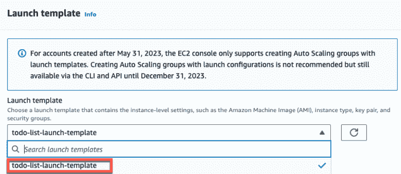

图 7.24 – 配置自动扩缩组并为组选择启动模板


- 6. 单击**下一步**。
- 7. 在**网络**部分，确保你选择了为 Todo List 应用创建的 VPC。
- 8. 对于**可用区和子网**，确保选择两个应用子网，这两个子网是私有子网，你的 EC2 实例将部署在其中，如以下屏幕截图所示：

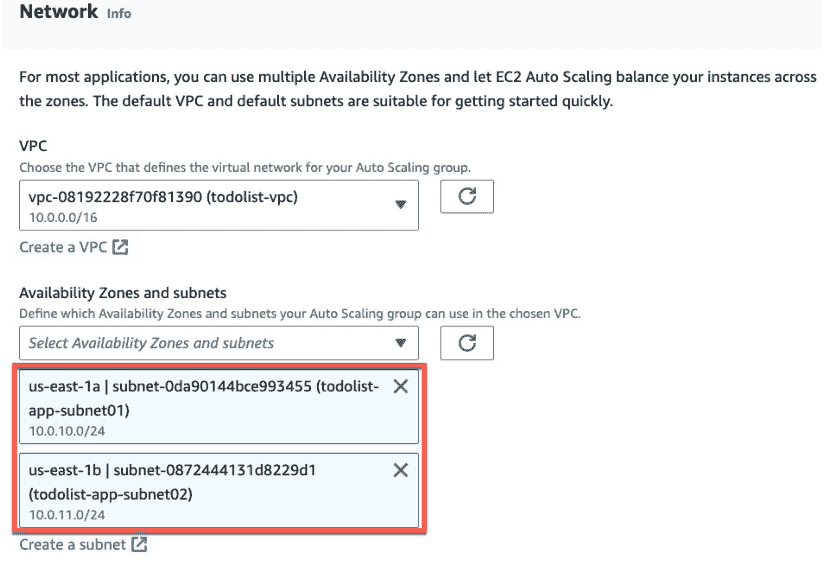

图 7.25 – 为你的 EC2 实例选择应用子网

- 9. 单击**下一步**。
- 10. 在**负载均衡**下，选择**附加到现有负载均衡器**选项。

11. 接下来，在现有负载均衡器目标组下拉列表中，选择你在步骤 4 中创建的目标组，如以下屏幕截图所示：

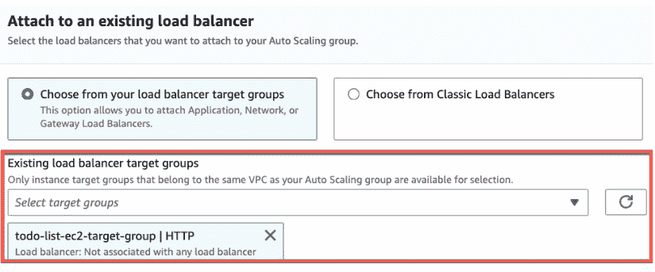

图 7.26 – 选择在步骤 4 中创建的目标组

12. 在运行状况检查下，选择**开启 Elastic Load Balancing 运行状况检查**选项。这决定了负载均衡器是否会监控实例以检查其是否健康。负载均衡器会将任何需要替换的不健康实例通知给 Auto Scaling 服务。注意：终止和启动新实例的是 Auto Scaling 服务。负载均衡器仅用于在健康实例之间分配流量。

13. 单击**下一步**。

14. 对于组大小，将所需容量设置为 2。同时，将最小所需容量和最大所需容量设置为 2。对于此项目，我们不会测试任何扩展策略。

15. 将自动扩展设置为**无扩展策略**，如以下屏幕截图所示：

## 扩展信息

你可以手动或自动调整 Auto Scaling 组的大小，以满足需求变化。

## 扩展限制

设置所需容量可以增加或减少的限制。

最小所需容量
2
小于或等于所需容量

最大所需容量
2
大于或等于所需容量

## 自动扩展 - 可选

选择是否使用目标跟踪策略 Info

创建 Auto Scaling 组后，你可以设置其他基于指标的扩展策略和计划扩展。

无扩展策略
你的 Auto Scaling 组将保持其初始大小，并且不会动态调整大小以满足需求。

目标跟踪扩展策略
选择 CloudWatch 指标和目标值，让扩展策略根据指标值按比例调整所需容量。

图 7.27 – 设置 Auto Scaling 组大小和扩展策略

- 16. 接下来，在**实例维护策略**下，选择**无策略**选项。
- 17. 单击**下一步**。
- 18. 在**添加通知 – 可选**页面上，单击**下一步**。
- 19. 在**添加标签 – 可选**页面上，单击**下一步**。
- 20. 最后，单击**创建 Auto Scaling 组**。

现在，你已经创建了 Auto Scaling 组，还必须创建一个应用程序负载均衡器，负责将最终用户流量分发到由 Auto Scaling 组管理的实例。

> **重要说明**
> 
> 如*图 7.28*所示，建议将应用程序负载均衡器托管在内部，并通过 AWS API Gateway 为最终用户流量提供服务。这是因为 API Gateway 提供了安全的授权功能。

由于你将使用 Amazon Cognito 对用户进行身份验证，因此将 Cognito 用户池用作授权方也非常容易。采用这种方法，用户只有在登录用户池并获得有效的访问令牌后，才能调用 API 方法访问 Todo List 应用的后端服务。

有了这样的配置，你就能避免有人获取负载均衡器的 DNS 名称并直接调用它的情况。否则，这会增加你的 API 遭受**拒绝服务（DoS）**攻击的可能性。因此，建议使用 API Gateway 进行授权。

然而，同样重要的是，确保负载均衡器随后被配置为内部 ALB。这需要将私有子网注册到负载均衡器，而不是公有子网，从而使其能够仅在私有子网中部署负载均衡器节点。即使有人获得了负载均衡器的 DNS，请求也会超时，因为这些 DNS 名称只指向私有 IP 地址。

这种方案会使架构变得复杂，因为目前没有针对私有 ALB 的 API Gateway 直接集成。因此，该架构需要你使用 NLB，并将 API Gateway 请求转发到私有 ALB。API Gateway 还需要使用 API Gateway VPC link，它在网关和负载均衡器之间充当安全隧道，以允许流量通过。

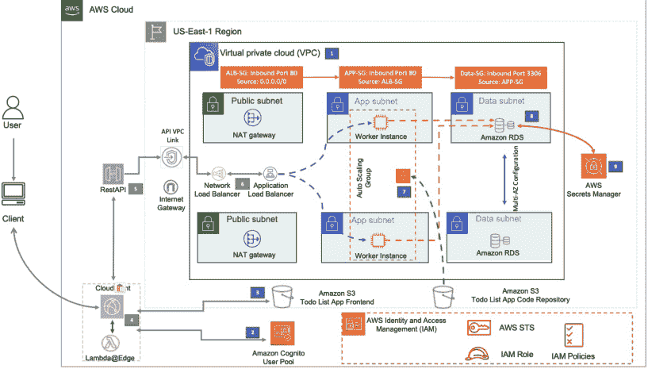

图 7.28 – 使用 Auto Scaling 和 ALB 的 Todo List 应用架构

此步骤涉及的组件包括：

- * 额外的 Amazon S3 存储桶将托管应用程序源代码并充当存储库
- * 修改 IAM 角色，使其包含从 AWS Secrets Manager 访问凭据数据的额外权限，以及从新的 Amazon S3 存储桶下载应用程序源代码的能力
- * 创建 EC2 密钥对，作为最佳实践
- * 创建目标组，用于托管 EC2 实例并执行运行状况检查
- * 创建启动模板，为应用服务器选择正确的 AMI，并使用应用程序对其进行配置
- * 创建 Auto Scaling 组，以定义 EC2 实例群的参数以及适用的扩展策略
- * 创建 ALB，将传入的 HTTP 流量分发到 EC2 实例群

接下来，让我们继续构建应用架构的最后一个组件，即内部 ALB。

## 项目任务 7.7 – 应用程序负载均衡器

在此项目任务中，你将部署一个 ALB，用于将入站流量分发到由 Auto Scaling 组部署的 EC2 实例。负载均衡器使你能够在多个实例之间分配流量，这些实例都提供对同一应用程序的访问，从而为你的应用程序实现高可用性。如果某个 EC2 实例发生故障，负载均衡器会将流量重定向到其他健康实例。

尽管本章提供了构建内部 ALB 的说明，你也可以自由尝试部署面向 Internet 的负载均衡器。你需要确保负载均衡器注册在公有子网中。然后，你可以测试后端工作实例的路径，例如 `/`、`/health` 和 `/doc`，用于测试目的。完成后，终止该负载均衡器，并将其替换为内部负载均衡器。

只有在下一章中部署 API Gateway 并集成前后端服务后，你才能看到一个功能完整的应用程序：

- 1. 确保你位于 EC2 管理控制台中，并且仍处于 **us-east-1**（**弗吉尼亚北部**）区域。
- 2. 在左侧菜单中，选择**负载均衡（Load Balancing）**下的**负载均衡器（Load Balancers）**。
- 3. 在右侧窗格中，单击**创建负载均衡器**按钮。

- 4. 接下来，在**应用程序负载均衡器（Application Load Balancer）**部分下，单击**创建**按钮。

- 5. 接下来，为你的 ALB 提供一个合适的名称，例如 `todo-list-alb`。

- 6. 确保在**方案（Scheme）**下选择**内部（Internal）**选项。

- 7. 在**IP 地址类型**下选择 **IPv4** 选项，如以下屏幕截图所示：

### 基本配置

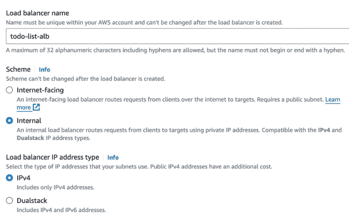

图 7.29 – 配置内部 ALB

- 8. 接下来，在**网络映射**下，确保你选择了为 ToDo List 应用创建的 VPC。

- 9. 接下来，在**映射**下，同时选择 **us-east-1a** 和 **us-east-1b**。对于每个可用区，确保选择相应的应用子网，如以下屏幕截图所示：

### 网络映射

负载均衡器会根据你的 IP 地址设置，将流量路由到所选子网中的目标。

VPC 信息
为你的目标选择虚拟私有云（VPC），或者创建新的 VPC。创建负载均衡器后，所选 VPC 无法更改。要确认目标的 VPC，请查看你的目标组。

todolist-vpc
vpc-081922287f0f81390
IPv4 VPC CIDR: 10.0.0.0/16

映射信息
至少选择两个可用区，并且每个可用区选择一个子网。负载均衡器仅将流量路由到这些可用区中的目标。负载均衡器或 VPC 不支持的可用区无法选择。

us-east-1a (use1-az1)
子网
subnet-0da90144bce993455 todolist-app-subnet01
IPv4 地址
从 CIDR 10.0.10.0/24 分配

us-east-1b (use1-az2)
子网
subnet-0872444131d8229d1 todolist-app-subnet02
IPv4 地址
从 CIDR 10.0.11.0/24 分配

图 7.30 – 为负载均衡器选择适当的子网

- 10. 接下来，在**安全组**下，确保你选择为负载均衡器配置的安全组，例如在《第 4 章 使用 Amazon VPC 在云中构建私有网络》的项目任务 4.6 中创建的 ALB-Security-Group。

- 11. 在**监听器和路由**下，配置一个 HTTP 协议、端口 80 的监听器，从下拉列表中选择你在步骤 4 中创建的目标组，使其指向该目标组。

- 12. 将所有其他部分保留为默认值，然后点击页面底部的**创建负载均衡器**按钮。

- 13. 你应该会收到一条消息，说明负载均衡器已成功创建。然后，你可以单击**查看负载均衡器**按钮。负载均衡器需要几分钟时间完成预置。预置完成后，你可以测试 EC2 实例是否处于健康状态。


- 14. 从左侧菜单中，点击**负载均衡**下的**目标组**。在右侧窗格中，选择您在*第4步*中创建的目标组。在此页面的下半部分，您应该会看到您的实例处于健康状态，如以下截图所示：


| 实例 ID | 名称 | 端口 | 可用区 | 健康状态 |
|---|---|---|---|---|
| i-069c9a4881b9896bd |  | 80 | eu-west-2b | 健康 |
| i-07f8476f18d9d3ba9 |  | 80 | eu-west-2b | 健康 |

**图7.31** – 检查实例是否向负载均衡器报告健康状态

虽然您无法通过内部负载均衡器访问您的应用程序，但健康状态意味着实例已成功部署。这是因为您仍然需要部署API Gateway和NLB，我们将在下一章中讨论这些内容。

## 总结

在本章中，您已经了解了如何在AWS云上部署高可用架构。高可用系统值得信赖，因为即使某些部件发生故障，它们也能持续运行。这些系统也很健壮，这意味着它们能够承受运行中的冲击而不损害其功能，并且在遇到挫折后能够快速、轻松地恢复。可用时间百分比是衡量可用性的标准指标。“几个九”通常被用作衡量极高可用性的指标。例如，“四个九”的正常运行时间表示系统在99.99%的时间内可用，每年停机时间不超过1小时。

负载均衡器提供了构建高可用系统的能力，而Auto Scaling是一项能够让您为应用程序设计弹性的服务。随着应用程序需求的增加，AWS Auto Scaling可以通过部署额外的EC2实例来快速应对负载。利用创新的扩缩策略，您可以配置同一服务在需求下降时终止不必要的实例，从而确保成本得到控制。

至此，您已经构建了应用程序的主要组件。负载均衡器将提供高可用性，Auto Scaling服务将确保弹性和可扩展性。下一章将介绍API Gateway服务，以及它如何允许您创建、管理和保护API，从而访问后端应用程序的数据、逻辑和功能。就我们的Todo List应用程序而言，这些后端组件将实现与数据库的交互，该数据库将托管最终用户的待办事项列表项，并允许用户创建和更新其待办事项。

## 考试准备练习 – 章节复习题

除了扎实理解关键概念之外，在时间压力下快速思考的能力也是帮助您在认证考试中取得优异成绩的一项技能。这就是为什么在学习之旅的早期就培养这些技能至关重要。

章节复习题旨在让您随着每一章的学习逐步提高应试技能，同时复习您对本章关键概念的理解。您可以在每章末尾找到这些题目。

> **如何访问这些资料**
> 
> 要了解如何访问这些资源，请前往标题为*第17章：访问在线资源*的章节。

要打开本章的章节复习题，请执行以下步骤：

- 1. 点击链接 – `https://packt.link/DVAC02_CH07`。

或者，您可以扫描以下**二维码**（*图7.32*）：


图7.32 – 供已登录用户打开章节复习题的二维码

- 2. 登录后，您将看到与*图7.33*类似的页面：

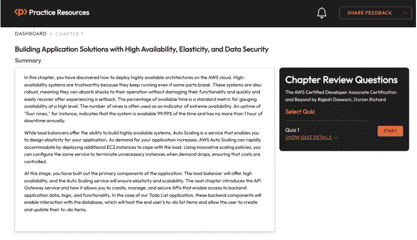

*图7.33 – 第7章的章节复习题*

- 3. 准备好后，开始以下练习，多次重新尝试测验。

### 考试准备练习

在最初的三次尝试中，不必担心时间限制。

### *第一次尝试*

第一次，目标至少达到**40%**。查看您答错的题目，并重新阅读本章的相关部分，以弥补学习中的不足。

### *第二次尝试*

第二次，目标至少达到**60%**。查看您答错的题目，并重新阅读本章的相关部分，以弥补剩余的学习不足。

### 第三次尝试

第三次，目标至少达到75%。一旦得分达到75%或以上，您就可以开始练习时间把控。

> **提示**
> 您可能需要超过**三次**尝试才能达到75%。这没关系。只需复习本章的相关部分，直到达到目标。

### 时间把控练习

**目标**：您的目标是保持分数不变，同时尽可能快速地回答这些问题。以下是您后续几次尝试应达到的效果示例：

| 尝试 | 分数 | 所用时间 |
|---|---|---|
| 第5次尝试 | 77% | 21分30秒 |
| 第6次尝试 | 78% | 18分34秒 |
| 第7次尝试 | 76% | 14分44秒 |

表7.1 – 在线平台上的时间把控练习示例

> **注意**
> 上表中显示的时间限制仅为示例。请根据网站上测验的时间限制，为每次尝试设定您自己的时间限制。

每次新的尝试，您的分数应保持在75%以上，同时完成测验所用的“时间”应“减少”。根据需要重复尽可能多的尝试，直到您有信心应对时间压力。
