## 使用AWS Lambda实现事件驱动计算，并使用Amazon API Gateway保护对后端API的访问

在快速发展的云计算世界中，无服务器架构和事件驱动计算带来了范式转变，改变了我们对基础设施、可扩展性和资源利用的思考方式。本章深入探讨了AWS上无服务器计算的核心——AWS是一个重新定义了应用程序开发和部署格局的平台。本章聚焦于AWS Lambda和Amazon API Gateway，旨在使您掌握使用这些强大服务构建高效、可扩展且经济高效的无服务器应用程序所需的知识和技能。

AWS Lambda是事件驱动无服务器架构的基石。它允许您在无需管理服务器的情况下运行响应事件的代码，从根本上改变了应用程序的构建和部署方式。Lambda的事件驱动特性使其成为从简单Web应用程序到复杂数据处理工作流等众多应用程序的理想选择。在本章中，我们将探讨AWS Lambda的基础知识，深入介绍其运行模型、用例以及它如何与其他AWS服务无缝集成。我们将逐步引导您创建第一个Lambda函数，演示如何使用来自其他AWS服务（如S3）的事件触发该函数。

然而，仅孤立地理解AWS Lambda是不够的。要充分释放其强大功能，您需要了解它所处的生态系统。这就引出了Amazon API Gateway，这是一项允许您以任何规模创建、发布、维护、监控和保护API的服务。它充当应用程序访问后端服务中的数据、业务逻辑或功能的前门。本章将指导您完成API Gateway的设置，向您展示如何管理对Lambda函数和其他后端资源（例如在EC2实例上运行的API，就像我们的客户Todo Plus Limited那样）的访问。

本章还涵盖了与AWS认证开发者助理（AWS Certified Developer Associate）考试相关的概念，特别是*领域1：使用AWS服务进行开发*和*领域3：部署*中的主题。该考试大量测试与AWS Lambda和API Gateway相关的概念，理解这些技术对于成功通过考试至关重要。

在本章中，您将构建一个API网关，它将作为**Todo List**应用程序后端操作的前门。该网关将允许注册服务的用户访问他们的*待办事项列表*并与应用程序交互。

本章涵盖以下主题：

- 使用AWS Lambda构建事件驱动解决方案
- Lambda高级概念
- 使用API Gateway管理对后端服务的访问
- **项目任务** – 部署API Gateway，以实现对Todo List应用程序提供的后端服务的安全访问

### 使用AWS Lambda构建事件驱动解决方案

事件驱动架构是软件应用程序设计、构建和运行方式的一次范式转变。**AWS Lambda**是一项无服务器计算服务，允许您在无需配置或管理服务器的情况下运行代码以响应事件；它提供了高可扩展性、灵活性和成本效益。

### 理解事件驱动架构中的AWS Lambda

AWS Lambda在事件驱动场景中表现出色，因为它可以实时响应事件。事件源（如Amazon S3、DynamoDB或自定义应用程序）触发Lambda函数，该函数执行其代码以响应事件。事件驱动架构还使您能够构建和设计分布式应用程序与微服务。这确保了应用程序的不同组件可以独立扩展，消除了单体架构中常见的层级依赖。

此外，AWS Lambda可以帮助您构建无服务器架构，因此您无需管理底层基础设施。只要应用程序的计算需求在Lambda的范围和限制之内，就可以构建一个完全功能性的应用程序，使用AWS Lambda执行所有计算操作。


要更好地理解 AWS Lambda 的工作原理，首先了解其关键特性非常重要，如下所示：

- **设计 Lambda 函数：** 在设计 Lambda 函数时，考虑任务的性质至关重要。由于 Lambda 函数是无状态的，它们最适合短小、独立的任务。函数应具有幂等性，即对于相同的输入，重复执行应产生相同的输出。

- **事件源架构：** 配置事件源是至关重要的一步。AWS Lambda 可以响应来自 S3、DynamoDB、Kinesis 甚至自定义应用程序等服务的事件。具体设置因来源而异，但原理相同：当事件发生时，Lambda 会执行你的函数。

- **错误处理与重试：** 在事件驱动架构中，健壮的错误处理至关重要。AWS Lambda 支持自动重试和死信队列来处理函数执行失败。务必设计 Lambda 函数以优雅地处理错误，并确保它们能够多次处理同一事件而不会产生不良影响。

下一节将提供一些 AWS Lambda 用于事件驱动应用程序的用例。

## AWS Lambda 在事件驱动架构中的用例

了解如何将 AWS Lambda 用于你的应用程序的最佳方式是查看一些用例。以下是一些示例。

### 实时文件处理

AWS Lambda 可以处理上传到 Amazon S3 的对象。例如，你可以自动将上传的图片转换为不同格式，或分析日志文件。当你将对象上传到 Amazon S3 时，它会在 S3 存储桶中创建该对象。这会触发*新对象创建事件*，可通过事件通知服务用于触发 Lambda 函数。

### 数据转换与加载

Lambda 可以在数据处理管道中即时转换数据，因为数据正在加载到 Amazon RDS 或 DynamoDB 等数据库。例如，DynamoDB 的一个关键特性是 DynamoDB Streams 服务。该特性记录表上的所有项目级修改。DynamoDB 流可以配置为调用 Lambda 函数对该更改采取某些操作。例如，当向表中添加新的客户记录时，你可以触发 Lambda 函数发送欢迎消息。

### 实时流处理

借助 Amazon Kinesis 或 DynamoDB Streams 等服务，Lambda 函数可以实时处理流式数据，这对分析和日志处理非常有用。下图提供了 AWS 事件驱动集成模型的流程图，展示了事件从产生到 Lambda 函数执行并可能触发通知服务的完整过程。

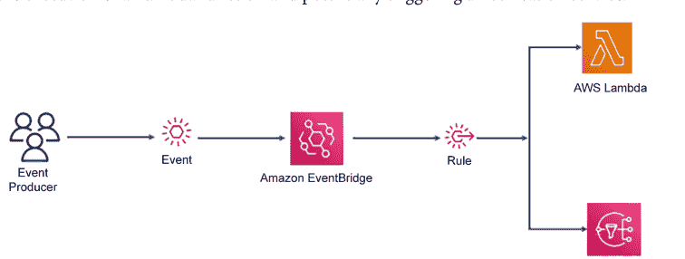

图 8.1 – Lambda 事件驱动架构

以下是此架构的关键组件：

- **事件生产者：** 这代表事件的来源，例如生成事件的用户操作或系统事件。它可以是应用程序、服务或手动过程。
- **事件：** 启动流程的实际发生事件。它表示系统需要处理某些事情已经发生的信号。
- **Amazon EventBridge 事件总线：** 该服务从生产者处接收事件。EventBridge 事件总线充当事件的中央路由器，根据事件模式将事件定向到相应的规则和目标。
- **规则：** 在 EventBridge 中设置的条件，用于将传入的事件匹配到正确的处理逻辑。规则可以筛选和转换事件，确保只有相关的数据才会触发 Lambda 函数。
- **AWS Lambda：** 一种无服务器计算服务，用于响应事件运行你的代码。当满足指定规则时，AWS Lambda 将会被触发以执行关联函数。
- **Amazon Simple Notification Service (SNS)：** 流程中可选的步骤，Lambda 函数可以调用 SNS 根据事件发送通知。SNS 是一种托管服务，提供从发布者到订阅者（例如电子邮件、短信或其他 Lambda 函数）的消息传递。

通过集成这些服务，AWS 提供了构建和管理事件驱动应用程序的健壮基础设施。此模型允许松耦合的组件，每个服务在无需管理应用程序的情况下响应事件并发挥其作用，从而增强了可扩展性和可靠性。

在下一节中，你将了解更多有关 Lambda 最佳实践的内容。

## AWS Lambda 最佳实践

使用 AWS Lambda 时，需要考虑某些最佳实践，以确保应用程序的技术可行性以及与业务要求和目标的一致性：

- **保持函数功能专一**：编写小型、单一用途的函数。这使你的 Lambda 函数更可靠、更易于管理，并能缩短执行时间。
- **高效管理依赖**：将部署包大小最小化到运行时所需的必要内容。这减少了 Lambda 解压和设置函数代码所需的时间。
- **安全性**：遵循最小权限原则。确保你的 Lambda 函数只拥有执行任务所需的权限。需要触发 Lambda 函数的 AWS 服务需要适当的权限。同样，如果你的 Lambda 函数需要调用其他服务，它需要具备必要权限的合适角色。
- **监控与日志记录**：使用 Amazon CloudWatch 监控函数执行和日志数据。有效的日志记录和监控是维护和排查 Lambda 函数的关键。
- **优化内存和超时设置**：根据需求调整函数的内存大小和超时设置。过度配置会导致不必要的成本，而配置不足则可能导致性能问题。

接下来的几节将深入探讨 AWS Lambda 的一些高级主题。

## Lambda 高级概念

随着 AWS Lambda 应用的不断演进，对于希望充分利用无服务器计算能力的架构师和开发人员来说，理解高级概念变得至关重要。

### 无状态环境中的状态管理

AWS Lambda 函数是无状态的；它们不会在调用之间保留状态数据。要在无服务器架构中管理状态数据，你可以使用 Amazon DynamoDB（提供快速灵活的 NoSQL 数据库服务）或 AWS Step Functions（可将多个 AWS 服务编排为无服务器工作流）等服务。

### Lambda 执行环境与生命周期

当 Lambda 函数被调用时，AWS 会提供一个执行上下文，其中包含用于执行函数的临时运行时环境。如果在短时间内再次发起调用，该环境将用于后续调用，从而跳过初始化步骤（即冷启动），提高性能。理解并优化这一生命周期对于高性能无服务器应用至关重要。

### 依赖管理

Lambda 支持层（Layers），这一功能允许你在 Lambda 函数之外包含额外的代码和内容。使用层可以更高效地管理依赖，保持部署包较小，并减少 AWS 解压和准备函数执行所需的时间。图 8.2 显示了在设置 Lambda 函数时的层元素：

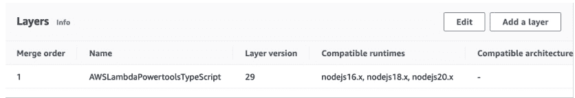

图 8.2 – 配置 Lambda 层函数

### 版本管理与别名

Lambda 函数可以有多个版本，可通过唯一的 Amazon Resource Name（ARN）访问。别名是指向特定函数版本的指针，可用于管理部署阶段（如开发、测试和生产）或金丝雀发布策略，如图 8.3 所示：

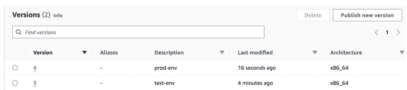

图 8.3 – Lambda 函数版本


## 异步调用与事件源映射

Lambda 函数可以同步调用（等待结果）或异步调用（将调用排队）。对于异步调用，Lambda 会在处理前将事件排队；如果失败，它会自动重试。事件源映射是一种将 Lambda 函数连接到事件源（如 Amazon SQS 或 Kinesis）的方式，具有内置的重试和故障处理机制。下图展示了这些差异：

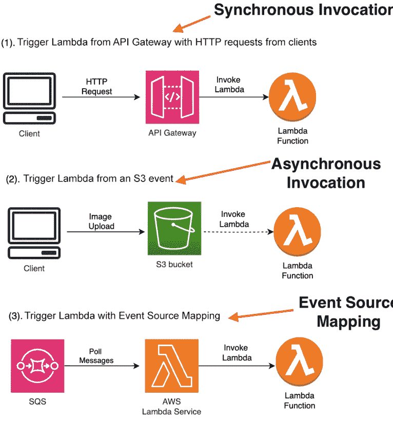

图 8.5 – Lambda 调用选项

## 性能监控与调优

Amazon 提供了 Amazon CloudWatch 和 AWS X-Ray 等工具来监控 Lambda 函数的性能。这些工具有助于识别瓶颈、了解调用模式，并优化资源分配以获得更好的性能。

## VPC 集成

Lambda 可以配置为访问虚拟私有云（VPC）内的资源。这种集成需要设置网络配置（如子网和安全组），并且可能因弹性网络接口（ENI）的配置而引入延迟。对于需要安全访问私有资源的架构来说，理解 VPC 集成至关重要。

需要注意的是，必须为 Lambda 函数提供连接能力，以便其访问 VPC 外部的服务和资源。一种选择是通过网络地址转换（NAT）网关确保 Lambda 函数能够访问 VPC 外部的服务，这最终会导致请求通过互联网发送。另一种更安全的替代方案是为相应的服务配置必要的 VPC 端点。

## 自定义运行时与 Lambda 扩展

AWS Lambda 支持自定义运行时，允许您使用 AWS 原生不支持的语言或特定语言版本。扩展使您能够通过集成外部工具，为 Lambda 函数增加额外的监控、安全和治理能力。

## 冷启动与执行模型

冷启动是指 Lambda 函数在空闲后被调用时的初始化时间。这可能会影响用户体验。为了减少冷启动延迟，请保持函数代码和依赖项精简。此外，还可以考虑使用预置并发（Provisioned Concurrency），该功能可保持指定数量的 Lambda 函数处于初始化状态，并准备就绪以立即响应事件。如图 8.6 所示：

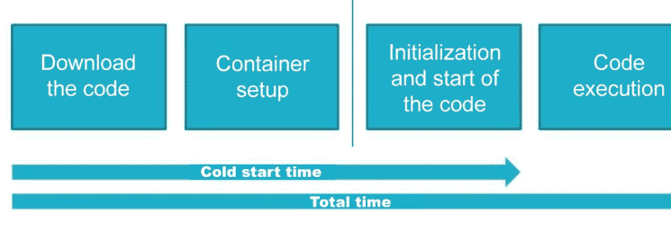

图 8.6 – Lambda 函数冷启动

## 错误处理与死信队列（DLQ）

正确的错误处理对于无服务器应用的韧性至关重要。Lambda 支持使用 DLQ 来管理多次处理失败的事件。这允许将错误处理逻辑与核心函数逻辑解耦，为管理异常和操作问题提供了一种稳健的机制。

## 安全最佳实践

在安全方面，请遵循最小权限原则，仅向 Lambda 函数授予必要的权限。使用 AWS IAM 角色和策略来管理这些权限，并应用最佳实践来保护函数代码和环境变量。

## 用于配置管理的环境变量

Lambda 中的环境变量可用于管理函数的配置设置和机密信息，如图 8.7 所示。此外，您还可以使用 AWS Secrets Manager 和 AWS Systems Manager Parameter Store 安全地管理敏感信息。因此，与其在应用程序中硬编码数据库凭据或 API 密钥等敏感数据，不如将其安全地存储在 AWS Secrets Manager 中，并在运行时检索，从而改善您的安全态势。

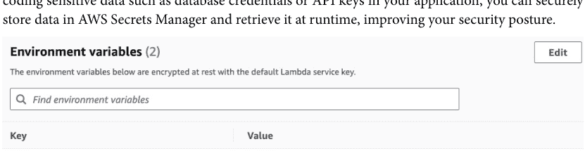

图 8.7 – Lambda 函数环境变量

## 集成模式

Lambda 函数可以与各种 AWS 服务和第三方 API 集成，构成无服务器应用架构的骨干。常见模式包括使用 Amazon API Gateway 的 API 后端、数据处理管道，以及使用 Amazon S3 触发器进行实时文件处理。

在本节中，我们探讨了 AWS Lambda 的关键特性和高级概念，以及如何使用它来构建无服务器事件驱动型应用。AWS Lambda 提供了一种强大的方式，无需配置和管理服务器即可构建完整的端到端解决方案，而其成本仅为标准 EC2 计算费用的一小部分。

在下一节中，您将了解 API Gateway 及其核心功能，这些功能可帮助您创建、发布和管理 API。

## 使用 API Gateway 管理对后端服务的访问

API Gateway 是客户端应用与后端 AWS 服务之间的关键中介。这个前端接口负责处理来自 Web 应用、移动客户端或其他外部服务的传入 HTTP 请求。在这种情况下，API Gateway 的职责和能力是多方面的，对应用的整体性能和安全性至关重要。使用 API Gateway 管理对后端服务的访问涉及多个分层组件，这些组件在用户请求与应用的后端服务之间提供了一个稳健的接口。

下图展示了一个使用 AWS 服务的简单无服务器架构模式，描绘了 API Gateway、AWS Lambda 和 DynamoDB 之间的数据流：

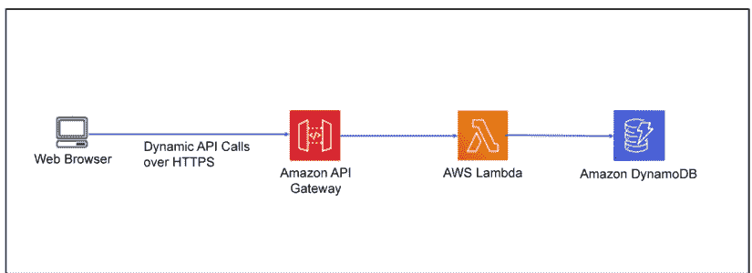

图 8.8 – 无服务器架构设计

以下是此架构中每个组件的角色和职责的详细说明：

- API Gateway 代表客户端 API 调用的入口点。客户端请求在此被接收，根据配置，它可以对请求进行身份验证和授权、验证输入，甚至在将请求转发到下一阶段之前转换请求格式。
- 收到请求后，API Gateway 会调用相应的 Lambda 函数。该函数包含业务逻辑，其范围可能包括处理数据、执行计算，以及根据收到的输入做出决策。Lambda 函数被设计为无状态的，其执行基于事件触发，使其成为可扩展且响应迅速的后端操作的理想选择。
- 在此示例中，Lambda 函数处理业务逻辑，并对后端 DynamoDB 数据库执行必要的 CRUD（**创建、读取、更新和删除**）操作。处理后的数据可以被存储、检索或修改。Lambda 函数可能会向数据库添加新条目、更新现有条目，或查询数据库以根据请求检索信息。

这种无服务器架构演示了创建可扩展且高效的云应用的一种常见模式。通过集成这些服务，开发人员可以构建能够随需求自动扩展、具有内置高可用性，并提供按需付费定价模式（降低拥有成本）的系统。

AWS API Gateway 是一个灵活、稳健的应用前端，可以安全管理流量、授权用户并路由请求。

下一节将概述不同的 API 类型和端点配置。

### API 类型与端点

API Gateway 核心提供 RESTful 和 WebSocket API 接口。RESTful API 专为无状态操作设计，遵循请求/响应周期。RESTful API 可分为 REST API 和 HTTP API。以下是它们的主要属性：

- **REST API** 是资源和方法的集合。资源通过资源路径表示应用的逻辑入口点。方法是指用户向 API 发出的 REST API 请求并收到对该请求的响应，例如 GET 或 PUT 方法。REST API 支持与 AWS 上的后端服务集成，并且诸如使用 API 密钥进行管理以及按客户端限流等功能也仅在 REST API 中可用。
- **HTTP API** 提供与 REST API 类似的功能，但功能更少，因此价格更低。HTTP API 仅支持区域端点，而 REST API 还可以支持边缘优化端点和私有端点。

另一种 API 类型是 **WebSocket API**。它同样可以与后端服务（如 Lambda 函数、HTTP 端点和其他 AWS 服务）集成。WebSocket API 提供双向通信，这意味着客户端可以向服务发送消息，服务也可以独立地向客户端发送消息。这种 API 类型非常适合构建实时应用，如聊天、游戏或金融交易。

除了 API 类型之外，您的 API 还有三种端点类型。具体如下：

- **边缘优化 API 端点：** 这些端点将请求路由到最近的 CloudFront 边缘节点，使您能够为地理分布广泛的用户群构建解决方案。
- **区域 API 端点：** 这些端点适用于与 API 位于同一区域的客户端。您可以将自己的 CloudFront 分配与区域 API 结合使用，从而在分配的缓存策略方面获得灵活性。


- **私有 API 端点**：这些端点设计为可通过接口端点从您的 Amazon VPC 中访问。

API Gateway 结合了多种机制来保护您的 API。它使用 AWS IAM 进行访问控制，允许您定义谁可以调用您的 API。它还可以与 Amazon Cognito 或其他身份提供商集成，以支持用户身份验证和授权，使您能够构建需要用户使用用户池登录的 API。

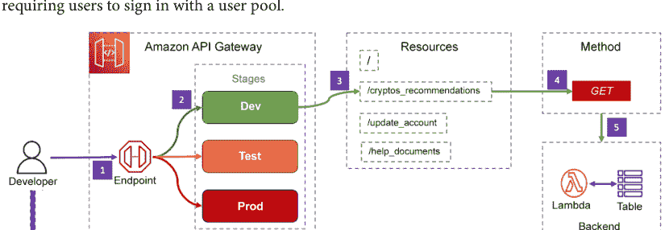

图 8.9 – 加密货币应用 API

在前面的图中，一位开发人员正在使用 API Gateway 构建加密货币应用程序并尝试访问加密货币应用程序中的资源。该图说明了开发人员使用 HTTPS URL 调用 API。以下工作流程提供了开发人员如何使用该应用程序访问资源的详细信息：

- 1. 端点表示 API 的配置方式。例如，如果您使用 REST API 构建解决方案，可以配置边缘优化、区域或私有 API 端点。
- 2. 阶段代表您 API 的生命周期状态。例如，您可能有多个 API 版本，如 v1 或 v2，或 dev、test 和 prod。每个阶段都是一个完整的 API 生命周期，您可以拥有多个阶段。图 8.9 显示开发人员正在访问 API 的 dev 生命周期（阶段）。每个阶段都有其配置，您将 API 部署到阶段中。阶段由 API ID 和阶段名称组成，会包含在您用于调用 API 的 URL 中。
- 3. 请注意，在示例中，URL 为 https://nuowwp f0x4.execute-api.us-east-1.amazonaws.com/dev/cryptos_recommendations。这里，/cryptos_recommendation 代表开发人员或最终用户与之交互以调用应用程序特定资源的资源。/ 符号代表该资源层次结构的根；在其中，图中描绘了多个资源。
- 4. 您可以为每个资源提供一个或多个方法。在此示例中，正在使用 GET 方法与资源交互。因此，例如，开发人员检索加密推荐，也许是推荐购买的加密货币列表。
- 5. 最后，当方法被调用时，数据从 Lambda 函数检索，该函数查询 DynamoDB 表。

*图 8.10* 展示了 API Gateway 控制台显示 API 阶段的配置，以及与其资源和方法：

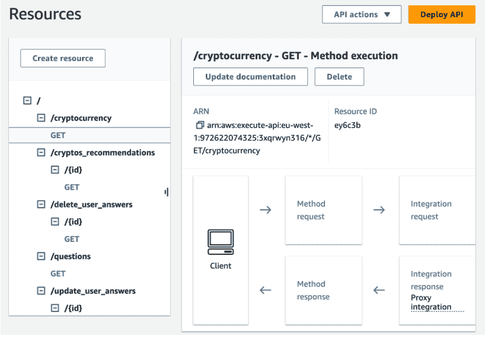

图 8.10 – API Gateway 资源

> **重要说明**
> 
> 当您管理 API 的各个阶段并对其进行更新和更改时，必须将 API 重新部署到现有或新的阶段。这涉及修改路由、方法、集成、授权器和资源策略。

在下一节中，您将了解 API Gateway 如何通过集成使客户端能够连接到后端服务。

## API Gateway 集成

API Gateway 使您能够大规模发布和管理您的 API。它是通往后端服务和资源的入口。客户端使用端点 DNS 名称连接到 API。它充当客户端与后端服务之间的中介，被称为集成，使这些服务能够通过 API 调用履行请求。

API Gateway 提供了在请求和响应流经服务时进行转换的灵活性。这在后端服务需要特定输入格式或您需要在发送回客户端之前转换输出时特别有用。通过使用 **Velocity Template Language (VTL)** 模板，您可以自定义数据的格式和处理方式。

当客户端向后端服务发出请求时，例如根据 *图 8.8* 中讨论的示例说明检索加密货币推荐列表，该请求需要经过授权、验证，并在必要时转换为后端服务可以理解的格式。同样，响应是后端服务提供的输出，可能需要在发送回客户端之前进行转换和准备。

根据您的用例和集成类型的选择，您可能会将数据从客户端按原样传递到后端服务，而不进行任何转换，这称为代理。

有各种集成类型，选择特定类型将取决于集成端点以及您是否需要转换数据或按原样传递。以下是各种集成类型：

- **AWS**：此集成类型公开 AWS 服务操作。您必须配置集成请求和响应。您还必须设置从方法请求到集成请求的数据映射，然后从集成响应到方法响应。您也可以将此集成类型用于 Lambda 函数，但同样，您必须配置从客户端传入的数据如何映射到端点，反之亦然。
- **AWS_PROXY**（Lambda）：此类型的集成使您能够使用简化的集成设置调用 Lambda 函数。您无需设置集成请求和响应，数据会按原样从客户端传递到集成端点。Lambda 必须能够解释发送给它的数据，然后以 API Gateway 预期为响应的格式进行响应。
- **HTTP**：这也称为 HTTP 自定义集成；您必须配置集成请求和响应。这是因为请求可能不是端点期望的格式，因此需要一些数据转换。
- **HTTP_Proxy**：与 AWS_Proxy 类似，这是在单个 API 方法上进行简化的设置。您无需配置集成请求和响应。请求中的数据会从客户端传递到 HTTP 端点，响应会按原样从端点传递回客户端。
- **Mock：** 此集成类型专为测试目的而设计。API Gateway 在不将请求发送到后端服务的情况下发送响应，使您能够在无需产生费用情况下测试集成设置。此外，您无需创建真实后端即可完成测试。配置模拟集成时，您决定 API Gateway 如何响应请求，指定响应状态代码，并配置集成请求正文映射模板以返回代码，例如 200 响应代码。

最终，您选择的集成类型将取决于后端服务类型和应用程序的用例。

在下一节中，您将了解 API Gateway **跨源资源共享 (CORS)**。

## API Gateway CORS

您还可以启用 **CORS** 以运行从浏览器中运行的脚本发起的跨源 HTTP 请求。这是浏览器安全功能，可防止从不同域、端口或协议运行脚本的潜在恶意攻击。如果您需要启用跨源请求，则需要启用 CORS。

API 资源的结构表明 API 设计用于处理与用户相关的各种操作，例如获取加密货币信息，以及管理用户答案、问题和其他用户相关数据。这些操作中的每一个都有相应的 HTTP 方法，指示可以对这些端点进行何种请求，例如 GET 用于检索数据，POST 用于提交数据，以及 OPTIONS 用于请求每个资源的通信选项信息。

所示的布局和选项是 Amazon API Gateway 在配置和设置 RESTful API 时的典型情况。

## 限流和流量管理

流量管理对于维护后端服务的性能和可用性至关重要。API Gateway 提供限流功能，限制每秒请求数，保护后端服务免受一次太多请求而过载。API Gateway 按区域为 AWS 账户中的所有 API 限制稳态 **每秒请求数 (RPS)**。它还限制突发，表示最大并发请求提交数。如果请求超过此最大值，API Gateway 将返回 429 Too Many Requests 错误。这些限流设置可以根据 API 的不同阶段（如开发、测试和生产）的需要进行自定义。

在下一节中，您将了解更多关于 API Gateway 阶段和阶段变量的信息。


访问 API Gateway 中 stage 变量的格式是 ${stageVariables.variableName}。

图 8.12 进一步说明了 stage 变量的使用：

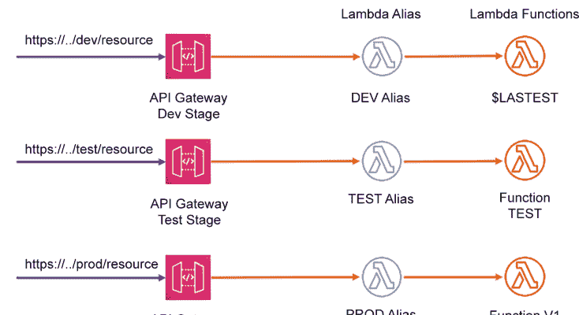

图 8.12 – 示例 stage 变量配置

使用 stage 变量使你能够为你的 API 管理多个发布阶段。在本示例中，每个 stage 变量指向一个特定的 Lambda 别名，对应于特定的 Lambda 函数。因此，当开发者调用 dev 端点时，API Gateway 返回 $Latest Lambda 函数。这通常是最新的已部署 Lambda 函数，并且是可变的，意味着它可能会发生变化。你希望确保为生产使用场景提供固定的函数。在本示例中，当开发者调用 prod 端点时，API Gateway 返回 V1 函数，这可能是应用程序的稳定版本，例如用于生产使用场景的发布。

在下一节中，你将了解 API Gateway 如何提供缓存服务，有助于提高性能并降低成本。

## API Gateway Caching

API Gateway 提供缓存功能，有助于减少你对端点的调用次数，从而改善对 API 请求的整体延迟。你可以为某个阶段启用缓存，响应将被缓存指定的生存时间（TTL）期间。默认 TTL 为 300 秒，最大为 3,600 秒。缓存大小可在 0.5 GB 到 237 GB 之间。

理想情况下，你应该为生产工作负载启用缓存，但不一定为开发工作负载启用，因为这会增加成本。

你可能还需要不时使缓存失效。这时你会立即刷新整个缓存。客户端可以通过传递包含 Cache-Control: max-age=0 的请求头来使特定请求的缓存失效并从集成端点重新加载缓存。为了确保此操作成功，你还必须配置附加到用户 IAM 执行角色的 IAM 策略。以下是可使用的 IAM 策略片段：

```json
{
  "Version": "2012-10-17",
  "Statement": [
    {
      "Effect": "Allow",
      "Action": [
        "execute-api:InvalidateCache"
      ],
      "Resource": [
        "arn:aws:execute-api:region:account-id:api-id/stage-name/GET/resource-path-specifier"
      ]
    }
  ]
}
```

此策略使 API Gateway 执行服务能够使特定资源上请求的缓存失效。

现在你已经彻底掌握了 API Gateway 及其核心功能，是时候将新获得的知识付诸实践了。在下一节中，我们将进入项目练习，其中涉及为我们的虚构客户 Todo Plus Limited 构建一个待办事项列表应用程序。在本章的项目任务中，你将实现 API Gateway，以帮助促进前端网站与用户与后端应用程序交互之间的集成，这将使用户能够访问他们的待办事项列表。

## Project Task – Deploy an API Gateway to Enable Secure Access to the Backend Services Provided by the Todo List Application

在上一章中，你完成了在由应用程序负载均衡器支持的高可用性自动扩展组中部署的 EC2 实例群上部署后端应用程序 API。

在此之前，你还部署了架构的多个其他组件，例如托管前端静态网站的 S3 存储桶、VPC 和数据库，并实施了 AWS Secrets Manager 以安全地管理 RDS 凭据，如图 8.13 所示：

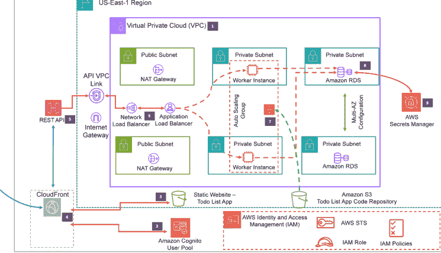

图 8.13 – Todo List 应用程序架构设计

在本项目练习中，你将部署 API Gateway，它将通过 CloudFront 分发接受来自客户端的入站连接，确保安全地访问网关。API Gateway 然后通过网络负载均衡器经由 API VPC 链接（VPC 端点）使入站流量能够到达应用程序负载均衡器。如第 7 章《Building Application Solutions with High Availability, Elasticity, and Data Security》中所讨论的，这种额外复杂性的原因是你希望将应用程序负载均衡器部署为内部负载均衡器，防止任何人仅通过导航到负载均衡器的公共 DNS 记录来尝试访问后端服务。所有入站连接应仅通过 API Gateway 进入，以确保高度安全性。

与此同时，由于 API Gateway 与内部应用程序负载均衡器之间没有直接集成，你将需要部署一个网络负载均衡器。此网络负载均衡器也将是具有 API VPC 链接（VPC 端点）的内部负载均衡器；你可以定义一个安全隧道以允许 API Gateway 与网络负载均衡器之间的流量。

这将允许来自 API Gateway 的流量通过网络负载均衡器转发到应用程序负载均衡器，然后将其分发到托管应用程序堆栈的 EC2 实例。

接下来，我们将部署 Todo List 应用程序架构所需的组件。

## Technical Requirements

要完成本章的项目任务，你必须以 IAM 用户 Alice 的身份登录到 AWS 开发账户。

## Project Task 8.1 – Create a Security Group for the Network Load Balancer

在本练习中，你将在 Todo Plus VPC 中创建一个额外的安全组，该安全组将在稍后部署的网络负载均衡器中使用：

- 1. 以 IAM 用户 Alice 的身份登录到你的 AWS 开发账户。
- 2. 在顶部搜索栏中搜索 VPCs 并导航到 VPC 管理控制台。
- 3. 在左侧菜单中选择 Security groups。在右侧窗格中，点击 Create security group 按钮。
- 4. 为安全组提供一个名称，例如 NLB-Security-Group，并提供适当的描述。确保选择 todolist-vpc VPC，如以下屏幕截图所示：

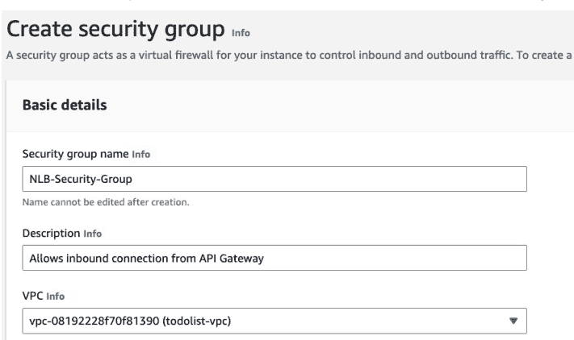

图 8.14 – 为网络负载均衡器创建安全组

- 5. 不要创建任何入站规则。确保你的出站规则设置为允许所有流量。
- 6. 点击页面底部的 Create security group 按钮。
- 7. 返回安全组列表，并确保你编辑 Name 列，使用与你的安全组关联的名称以便轻松识别该组，如以下屏幕截图所示：

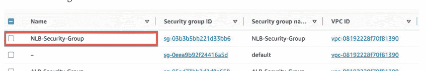

- 8. 你也可以在创建安全组时通过创建相关标签来设置名称，使用键 Name 和值为 your-security-group-name。

接下来，你必须为网络负载均衡器创建一个目标组。

## Project Task 8.2 – Create a Target Group for the Network Load Balancer

在本练习中，你将为你的网络负载均衡器创建一个目标组。目标组将是你上一章创建的应用程序负载均衡器。这确保入站流量到达网络负载均衡器：

- 1. 确保你已登录到你的 AWS 账户，并且位于 N. Virginia 区域。
- 2. 从顶部搜索栏搜索 EC2 并导航到 EC2 管理控制台。
- 3. 从左侧菜单中，在 Load Balancing 下选择 Target Groups。
- 4. 在右侧窗格中，点击 Create target group 按钮。你将被引导至目标组创建页面。
- 5. 在 Basic configuration 下，确保选择 Application Load Balancer。
- 6. 为你的目标组提供一个名称，例如 todo-list-alb-target-group。
- 7. 从 VPC 下拉列表中选择 todolist-vpc。
- 8. 保持所有其他设置默认值并点击页面底部的 Next 按钮。
- 9. 在 Register targets 下，选择你在上一章创建的应用程序负载均衡器，如以下屏幕截图所示：


## 注册应用程序负载均衡器

您可以指定一个应用程序负载均衡器作为目标。您指定的应用程序负载均衡器必须有一个与您正在创建的目标组相同端口的侦听器。

应用程序负载均衡器

从列表中选择一个应用程序负载均衡器，或创建一个新的负载均衡器并刷新列表以选择它。您可以在此处创建应用程序负载均衡器。

todo-list-alb 在端口 80 上有一个侦听器。

图 8.16 – 选择应用程序负载均衡器作为目标

- 10. 单击 **Create target group** 按钮。

现在您已经为网络负载均衡器创建了目标组。在下一个练习中，您将创建一个内部网络负载均衡器。

## 项目任务 8.3 – 创建内部网络负载均衡器

在此练习中，您将创建并部署一个网络负载均衡器：

- 1. 确保您仍以开发者账号登录，并位于 N. Virginia 区域。
- 2. 导航到 EC2 管理控制台。
- 3. 从左侧菜单中，在 **Load Balancing** 下选择 **Load Balancers**。
- 4. 在右侧窗格中，单击 **Create load balancer** 按钮。
- 5. 在 **Network Load Balancer** 下单击 **Create** 按钮。
- 6. 为负载均衡器提供一个名称，例如 `todo-list-nlb`。
- 7. 确保在 **Scheme** 下选择 **Internal**，并将 **IP address type** 设置为 **IPv4**，如下图所示：

基本配置

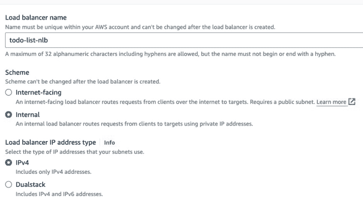

- 8. 在 **Network mapping** 部分中，确保从 **VPC** 下拉列表中选择 **todolist-vpc**。
- 9. 在 **Mappings** 下选择 **us-east-1a** 和 **us-east-1b** 可用区，并确保您选择应用子网（将承载 EC2 实例的子网），如下图所示。请注意，您可以创建额外的私有子网对来承载负载均衡器节点，但就本练习而言，这并非必需。

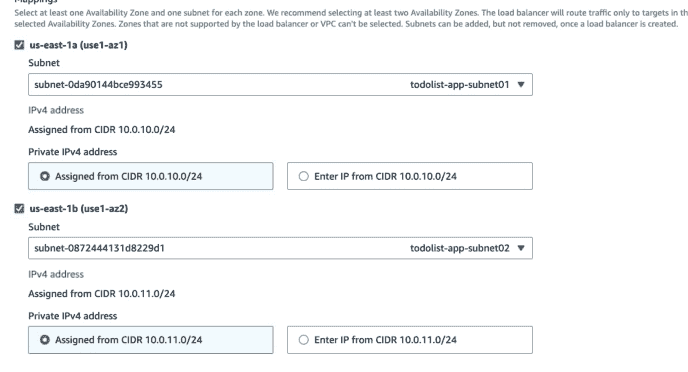

- 10. 在 **Security groups** 下，选择您之前创建的 **NLB-Security-Group**。同时，确保从选择中移除默认安全组。
- 11. 在 **Listeners and routing** 下，为 **Default action** 转发规则选择您之前创建的 **todo-list-alb-target-group**，如下图所示：

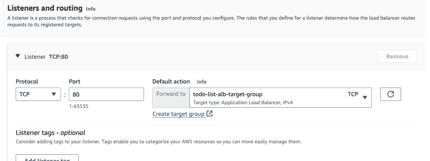

图 8.19 – 为您的网络负载均衡器配置侦听器和路由。

- 12. 单击页面底部的 **Create load balancer** 按钮。

## 附加步骤 – 重要说明

回想一下，当您在 *Project Task 8* 中为负载均衡器创建安全组时，您没有创建入站规则。这是因为无法将流量来源识别为 API Gateway 的入站流量。然而，我们需要确保只有 API Gateway 可以向负载均衡器发送流量，因此您不想在安全组上开放入站规则。仍然需要安全组，因为将引用其安全组 ID，以确保流向应用程序负载均衡器的流量仅允许来自网络负载均衡器。

为了促进 API Gateway 与网络负载均衡器之间的通信，您必须为 REST API 创建 VPC 链接（端点），该链接将通过网络负载均衡器通过 AWS PrivateLink 发送流量。但是，由于我们没有在安全组上创建任何入站规则，因此需要一种变通方法来使 VPC 链接的流量能够到达网络负载均衡器。在此附加步骤中，您将配置此变通方法。

- 13. 导航回负载均衡器列表，并选择您刚刚创建的网络负载均衡器。
- 14. 单击 **Security** 选项卡。
- 15. 单击 **Edit** 按钮。

取消选中 **Enable inbound rules on PrivateLink traffic** 复选框，如下图所示：

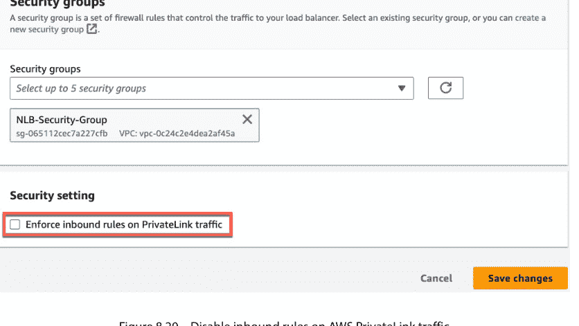

- 16. 单击 **Save changes** 按钮。

既然网络负载均衡器已就位，您可以创建 VPC 链接以启用通过 AWS PrivateLink 的流量。

## 项目任务 8.4 – 创建 VPC 链接

在此项目任务中，您将创建一个 VPC 链接，这是 API Gateway 的一项功能，可实现与 VPC 中资源的安全连接：

- 1. 确保您仍以 IAM 用户 Alice 的身份登录到 AWS 开发账号。
- 2. 从顶部搜索栏中，搜索术语 VPC links 并选择此服务。
- 3. 单击 **Create** 按钮。
- 4. 在 **Choose a VPC link version** 部分中选择 **VPC link for REST APIs** 选项。
- 5. 提供一个描述性名称，例如 `todolist-vpc-link`。
- 6. 从 **Target NLB** 搜索框中选择您之前创建的网络负载均衡器。
- 7. 单击 **Create** 按钮。

既然 VPC 链接已创建，您可以设置并配置 API Gateway。

## 项目任务 8.5 – 与 API Gateway 集成

在此练习中，您将配置 API Gateway：

- 1. 确保您以 IAM 用户 Alice 的身份登录到 AWS 开发账号，并位于 N. Virginia 区域。
- 2. 从管理控制台顶部的搜索栏中，搜索 API Gateway 并导航到其控制台页面。
- 3. 接下来，在 REST API 部分单击 **Build** 按钮。您将被引导到 Create REST API 页面。
- 4. 选择 **New API** 选项。
- 5. 接下来，为您的 API 提供一个描述性名称，例如 `todo-list-api`。
- 6. 单击 **Create API** 按钮。
- 7. 您将被引导到 API Gateway 控制台的 **Resources** 部分。
- 8. 单击 **Create Resource** 按钮。这将引导您进入 Create resource 页面。
- 9. 确保启用 **Proxy resource** 切换开关，这将确保它将来自任何路径的请求路由到网络负载均衡器。

使用代理资源时，您还需要定义一个贪心路径参数，以确保捕获该资源的所有子资源。例如，`/GET/{proxy+}` 会捕获 `/GET/` 下的所有资源。

- 10. 对于 **Resource name**，指定一个名称，例如 `proxy+`。同时，确保勾选 CORS（跨源资源共享）复选框，如下图所示：

创建资源

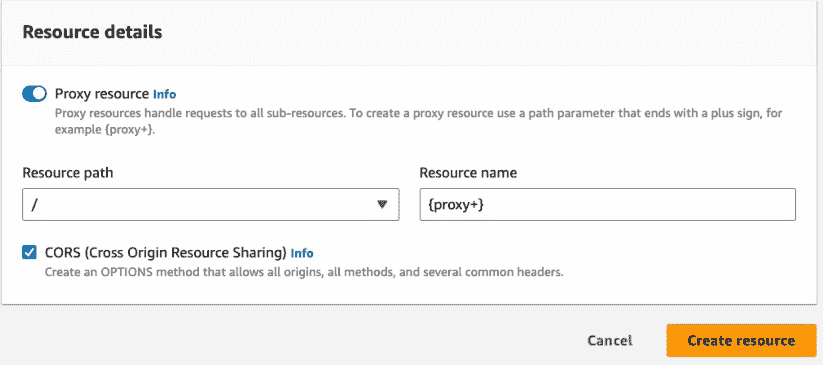

图 8.21 – 为您的 API 创建资源

- 11. 单击 **Create resource** 按钮，并单击 ANY 方法，以确保它捕获任何方法（如 GET、POST、PUT、PATCH 和 DELETE）上到达的请求。
- 12. 单击 **Edit integration** 按钮并选择 **VPC link**。
- 13. 启用 **VPC proxy integration** 切换开关。
- 14. 从 **HTTP method** 下拉框中选择 **ANY**。
- 15. 从 **VPC link** 下拉框中选择您之前创建的 VPC 链接。
- 16. 您需要提供 **Endpoint URL** 值，即您的网络负载均衡器的 URL。您可以在负载均衡器的 DNS name 列中找到此值。您可以打开另一个浏览器选项卡并导航到您的负载均衡器以方便访问，如下图所示：

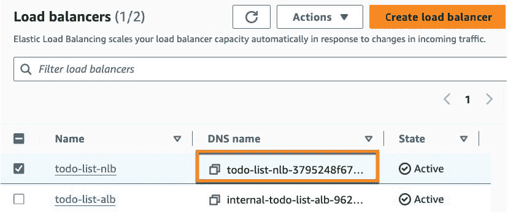

图 8.22 – 将网络负载均衡器的 DNS 名称复制到剪贴板

- 17. 确保您的端点 URL 指向网络负载均衡器的 DNS 名称。您需要构建此名称。您不能简单地粘贴 DNS 名称。例如，您必须在 DNS 名称的开头添加 `http://`，然后在末尾添加 `/{proxy}`。因此，您的端点 URL 将如下所示：

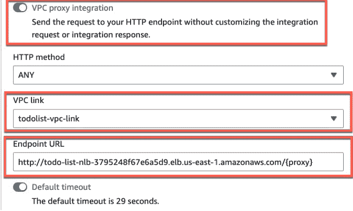

图 8.23 – 构建您的端点 URL

- 18. 单击 **Save** 按钮。接下来您需要创建方法。
- 19. 在 **Resources** 部分中，单击 `/` 符号，如下图所示：

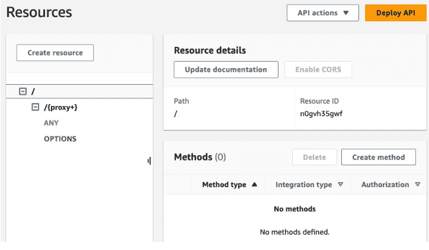

图 8.24 – 选择 `/` 符号以导航返回并创建方法

- 20. 在右侧窗格中单击 **Create method** 按钮。
- 21. 从 **Method type** 下拉列表中选择 **ANY**。
- 22. 在 **Integration type** 下选择 **VPC link** 选项。
- 23. 确保启用 **VPC proxy integration**。
- 24. 从 **HTTP method** 下拉列表中选择 **ANY**。
- 25. 对于 **VPC link**，选择您之前创建的 VPC 链接。
- 26. 对于 **Endpoint URI**，使用与您的网络负载均衡器相同的 DNS 名称。但是，这一次，要构建 DNS 名称，请在 DNS 名称的开头添加 `http://`，如下图所示：


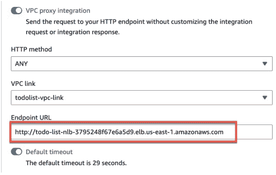

Figure 8.25 – Constructing the endpoint URL for your method

- 27. 点击 Create method 按钮。
- 28. 你现在将被重定向到 Resources 页面。
- 29. 点击右侧窗格中的 Deploy API 按钮。
- 30. 在 Deploy API 对话框中，从 Stage 下拉框中选择 New Stage。
- 31. 接下来，为你的阶段提供一个描述性的名称，例如 `development`。
- 32. 接下来，点击 Deploy 按钮。
- 33. 然后你将被引导至 Stages 页面，在那里可以看到新创建的 invoke URL，如以下截图所示：

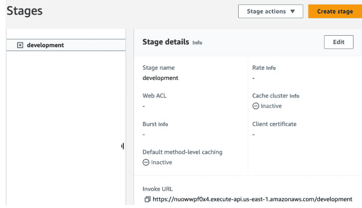

Figure 8.26 – Development stage for your API gateway with the invoke URL

- 34. 接下来，为测试它，复制该 URL 并粘贴到浏览器标签页中。你应该会得到 200 响应代码，这意味着它正常工作。

```json
{"result":{"status":"up","time":"Fri, 12 Jan 2024 19:35:16 GMT"},"statusCode":200}
```

在此时，你已成功部署了 API 网关，并且服务通过负载均衡器连接到后端应用程序。API Gateway 已被配置为现在提供对托管在部署于私有子网中的 EC2 实例上的后端 API 的访问。在下一章中，你将把所有组件整合起来，通过集成我们 Todo List 应用架构的前端和后端组件，见证一个完全功能的应用。

## Summary

本章探讨了 AWS 上的无服务器计算，重点关注 AWS Lambda 和 API Gateway 等关键组件。其设计目的是传授实践技能和深入理解，使你能够在 AWS 平台上有效地构建和管理无服务器应用程序。

本章首先概述了 AWS Lambda，介绍了该无服务器计算服务的 fundamentals。你学习了事件驱动架构以及 Lambda 函数如何由各种 AWS 服务触发。本节为理解无服务器计算范式和 AWS Lambda 的运营效率奠定了基础。

超越基础知识后，本章深入探讨了更复杂的主题，例如环境变量、用于资源管理的标签，以及在 VPC 中运行 Lambda 函数。这些高级知识使你能够优化 Lambda 函数的安全性、成本效率和更好的资源管理。

重点随后转向 API Gateway。你被引导完成创建和管理 REST 和 HTTP API 的过程。本节对于理解如何安全高效地公开后端服务至关重要，涉及 API 路由、数据转换以及防止未经授权访问的安全 API 等主题。

## Exam Readiness Drill – Chapter Review Questions

除了对关键概念的扎实理解外，在时间压力下快速思考的能力也是帮助你通过认证考试的技能。因此，在学习之旅早期就培养这些技能至关重要。

章节复习问题旨在随着你学习和复习每一章而逐步提高你的应试技能，同时检验你对本章关键概念的理解。你会在每一章的末尾找到这些问题。

**How to Access These Materials**

要了解如何访问这些资源，请前往标题为 *Chapter 17, Accessing the Online Resources* 的章节。

要打开本章的章节复习问题，请执行以下步骤：

- 1. 点击链接 – `https://packt.link/DVAC02_CH08`。
- 或者，你可以扫描以下 **QR code** (*Figure 8.27*)：


Figure 8.27 – QR code that opens Chapter Review Questions for logged-in users

- 2. 登录后，你会看到与 Figure 8.28 所示类似的页面：

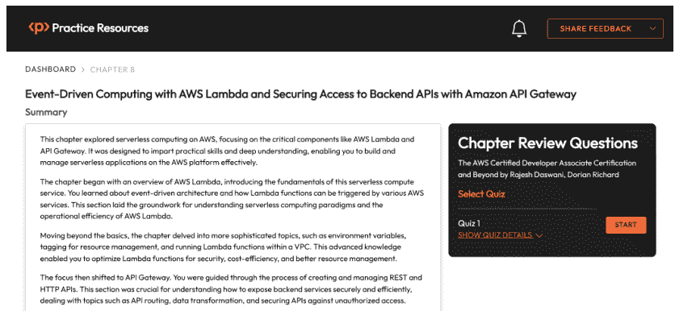

Figure 8.28 – Chapter Review Questions for Chapter 8

- 3. 准备好后，开始以下练习测验，多次重做测验。

## Exam Readiness Drill

前三次尝试时，不必担心时间限制。

### ATTEMPT 1

第一次，目标至少达到 40%。查看答错的题目并重新阅读章节中的相关部分以弥补学习差距。

### ATTEMPT 2

第二次，目标至少达到 60%。查看答错的题目并重新阅读章节中的相关部分以弥补剩余的学习差距。

### ATTEMPT 3

第三次，目标至少达到 75%。一旦得分达到 75% 或以上，你就开始练习计时。

> **Tip**
> 你可能需要超过 **三** 次尝试才能达到 75%。这没关系。只要在达到目标前继续复习章节中的相关部分即可。

### Working On Timing

**Target**：你的目标是在保持分数不变的同时，尽可能快速地回答这些问题。以下是你的下一次尝试应如何进行的示例：

| Attempt | Score | Time Taken |
|---|---|---|
| Attempt 5 | 77% | 21 mins 30 seconds |
| Attempt 6 | 78% | 18 mins 34 seconds |
| Attempt 7 | 76% | 14 mins 44 seconds |

Table 8.1 – Sample timing practice drills on the online platform

> **Note**
> 上表中显示的时间限制仅为示例。根据网站上测验的时间限制，为每次尝试设定自己的时间限制。

随着每次新的尝试，你的分数应保持在 75% 以上，而完成所需“时间”应“减少”。重复尽可能多的尝试，直到你有信心应对时间压力。
