## Incorporating Edge Network Services to Connect to Your Application with Amazon CloudFront and Route 53

在快节奏的在线服务世界中，应用程序性能不仅仅是一个功能，而是用户体验的基石。对即时访问内容和无缝应用程序性能的期望比以往任何时候都高。当你的用户群分布在全球各地时，确保对内容和应用程序的低延迟访问尤为重要。

这正是 Amazon CloudFront，AWS 的强大 **content delivery network (CDN)**，发挥作用的地方。它为高速、安全和高效的内容分发提供了骨干。

此外，你必须提供一套完整的 **Domain Name System (DNS)** 服务，以确保对应用程序和资源的无缝访问。使用自定义域名进一步增强了你的业务品牌，同时确保到资源的最佳路由，同时提供灵活性和故障转移能力。这正是 Amazon Route 53，一项完全托管的 DNS 服务，派上用场的地方。

从 AWS Certified Developer – Associate 证书考试的角度来看，CloudFront 和 Route 53 是可以帮助你解决应用程序部署策略的服务。CloudFront 是一个关键组件，因为它支持内容缓存，从而降低延迟，这是 *Task Statement 3: Optimize applications by using AWS services and features of Domain 4: Troubleshooting and Optimization* 的要求。此外，CloudFront 有助于进一步加强你的安全态势，因为它可以强制执行对源站内容的受保护访问。

本章深入探讨 Amazon CloudFront 和 Route 53 的复杂性，探讨这些服务如何增强应用程序的性能、可用性和弹性。

对于我们的虚构客户 **TodoPlus Limited** 而言，Amazon CloudFront 是一项可以为其即将推出的 **Todo List** 应用程序提供所有功能的服务。Amazon CloudFront 将为应用程序托管的任何静态内容提供安全功能和低延迟访问以及改进的性能。这些可能包括有关如何使用应用程序的培训视频，以便最终用户不会遇到延迟或缓冲问题。

此外，通过支持抵御 DDoS 攻击和应用防火墙，TodoPlus Limited 可以为应用程序提供更高级别的安全性，确保其可靠性和高可用性。在下一节中，你将更详细地了解这些功能。

## Incorporating CloudFront into Your Application Architecture

下图说明了一个使用 CloudFront 创建分发端点并提供 CDN 服务的简单架构。

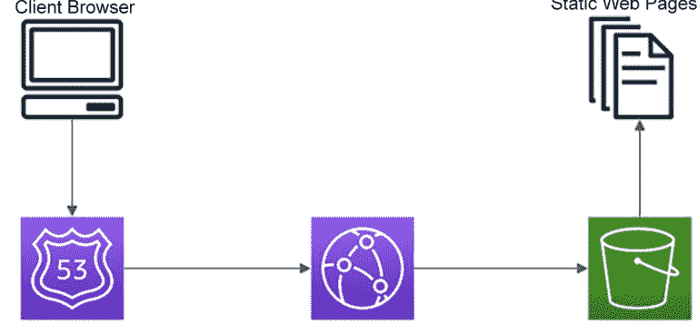

Figure 9.1: Simple architecture using CloudFront to cache static web pages

该架构的关键组件如下：

- **Client browser**：用户的网络浏览器请求查看网站或 Web 应用程序。
- **Route 53**：该服务是一个 DNS Web 服务。它将 www.example.com 等友好域名翻译成计算机用于连接的 IP 地址。Route 53 还提供流量路由服务，可将用户引导至最近的 CloudFront 分发点以实现更快的 content delivery。Amazon Route 53 将在本章后面详细讨论。


- **CloudFront**：Amazon CloudFront 是一项快速 CDN 服务，能够以低延迟和高传输速度安全地向全球客户交付数据、视频、应用程序和 API。CloudFront 的工作原理是将内容缓存到离最终用户最近的边缘站点，从而最大限度地减少数据传输距离，降低延迟并缩短加载时间。
- **Amazon S3**：Amazon S3 是一项对象存储服务，提供业界领先的可扩展性、数据可用性、安全性和性能。在此架构中，S3 存储静态网页以及需要交付到客户端浏览器的资源。S3 具有高持久性和高可用性，是托管静态内容的绝佳选择。

在此架构中，CloudFront 的优势包括更好的性能、可扩展性、成本效益、安全性、高可用性和内容缓存。

接下来，你将了解 CloudFront 的核心功能和配置模式。

## 轻松失效

存储在边缘站点或区域边缘缓存中的内容具有定义的**生存时间（TTL）**。如果内容在 TTL 内未被访问，它将被清除，以免缓存过期内容。如果需要在缓存过期之前刷新内容，CloudFront 允许在缓存过期前需要刷新内容时轻松地使缓存对象失效。例如，假设你更新了需要立即提供的内容，或者你发现内容不正确。在这种情况下，你必须确保用户能够访问准确的信息。作为使用失效功能的替代方案（该功能会产生费用），你可以使用文件版本控制来提供文件的不同版本。

> **注意**
> 在即将进行的项目中，你将部署 Todo List 应用程序的最终版本。如果你对前端代码进行了任何更改，可以使用失效功能，确保通过 CloudFront URL 访问时能立即反映你的更改。

在下一节中，你将进一步了解如何使用 CloudFront 配置缓存。

## 什么是缓存键？

**缓存键**是 CloudFront 用于缓存对象的标识符。当 CloudFront 收到请求时，它会在缓存中查找与请求的缓存键匹配的对象。如果找到，则返回该对象；否则，将请求转发到源站。缓存键通常包含所请求对象的 URL，并且根据缓存策略，还可以包含查询字符串、标头和 Cookie。

## 缓存未命中和缓存命中

当 CloudFront 在缓存中找到所请求的对象时，就会发生缓存命中，这意味着它无需回到源服务器。另一方面，当缓存中找不到该对象时，就会发生缓存未命中，促使 CloudFront 从源服务器获取该对象。如果找到了内容，则直接通过缓存提供（缓存命中）。如果没有，CloudFront 会从源站获取内容并将其存储在缓存中，以供将来请求使用（缓存未命中）。此概念如图 9.2 所示：

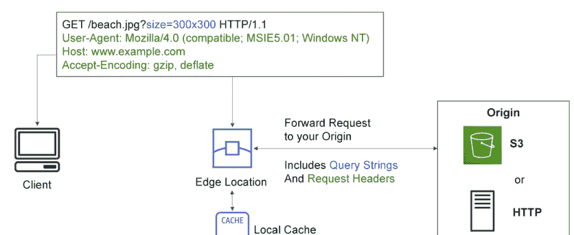

图 9.2：缓存命中与缓存未命中

该图描绘了一个 CDN 场景。图中展示了三个主要组件：

- **客户端**：这代表用户的设备、计算机或任何能够发送 HTTP 请求的设备。它发送一个 HTTP 请求，请求名为 beach.jpg 的资源，指定大小为 300 x 300。该请求包含 HTTP 标头，例如 User-Agent（用于识别浏览器类型和操作系统，此处表示旧浏览器，可能是 Windows NT 上的 Internet Explorer 5.01）、Host（从中请求资源的域）和 Accept-Encoding（表示客户端可以处理 gzip 和 deflate 编码）。
- **边缘站点**：这是 CDN 基础设施的一部分。它充当客户端和源服务器之间的中介。边缘站点接收来自客户端的 HTTP 请求，如果其本地缓存中有请求的资源，则直接将其提供给客户端，以减少延迟并减轻源服务器的负载。如果资源不在缓存中，边缘站点会将请求转发到源服务器。该图表明，边缘站点会将客户端的所有查询字符串和请求标头转发到源站。

## 将标头转发到源站

对于每个请求都需要特定标头的应用程序而言，此过程至关重要：

- **始终转发：** 如果你的应用程序要求每个请求都带有特定标头，你可以配置 CloudFront 始终将它们转发到源站。但是，这会降低缓存的有效性，因为 CloudFront 必须更频繁地访问源站。
- **最佳实践：** 只转发源站处理请求所必需的标头。

通过正确理解和配置缓存策略，你可以确保高效的内容交付，同时实现最佳性能和成本节约。

## 缓存策略与源站请求策略

这两种策略在 CloudFront 如何处理缓存和请求方面起着至关重要的作用。理解它们之间的区别是有效管理内容交付的关键：

- **缓存策略：** 这定义了 CloudFront 如何缓存内容，包括缓存 TTL、标头、Cookie 和查询字符串的设置。它本质上是一组规则，决定 CloudFront 可以缓存什么内容以及缓存多长时间。
- **源站请求策略：** 此策略控制哪些请求标头、Cookie 和查询字符串被发送到源站，无论请求方法（GET、POST 等）如何。源站请求策略确保源站能够收到生成并返回所请求内容所需的信息。

在下一节中，你将了解更多关于缓存行为的内容。

## 缓存行为

CloudFront 中的缓存行为控制如何处理不同内容或路径模式的请求。你可以为特定的 URL 路径模式定义缓存行为，并自定义内容的缓存和提供方式。

当用户从你的 CloudFront 分配请求内容时，CloudFront 会检查请求的路径是否与缓存行为中指定的任何路径模式匹配。如果匹配，CloudFront 将应用相应的缓存行为规则来处理该请求。如果没有匹配项，CloudFront 将使用默认缓存行为。

缓存行为可以配置各种选项：

- **路径模式**：定义缓存行为适用于哪些请求，例如 `/images/*` 适用于图片目录中的所有文件，或 `/videos/high-def.mp4` 适用于特定的视频文件
- **查看者请求**：根据请求标头、Cookie、查询字符串和 HTTP 方法等因素，决定是转发、重定向还是阻止用户请求
- **缓存方法**：设置内容在缓存中保留多长时间的规则（TTL 设置），以及是否根据标头、Cookie 或查询字符串进行缓存
- **内容处理**：决定 CloudFront 在内容未被缓存时应如何处理（例如，从源站获取、提供自定义错误页面）

使用缓存的好处包括：根据内容类型优化加载时间从而提高性能，对缓存内容进行细粒度控制，通过减少源站获取来节约成本，以及增强安全性。

下一节将教你如何保护和限制内容访问。

## CloudFront 安全访问和内容安全

出于多种原因，建议通过 CloudFront 访问内容。除了 CloudFront 提供的缓存服务和性能改进之外，你还可以使用 CloudFront 原生可配置的各种安全措施来保护你的内容及其访问方式。CloudFront 与其他 AWS 安全工具（如 WAF）集成。在配置资源访问和实施内容限制时，你必须了解以下关键领域。

在以下小节中，你将学习如何根据地理位置限制访问。

### CloudFront 地理限制

地理限制（也称为 Geo-blocking）可防止特定地理位置的用户访问你通过 CloudFront 分发的内容。如果你拥有的内容权限仅在特定国家/地区有效，则可以配置 CloudFront，根据请求来源国家/地区阻止或允许访问。此概念如图 9.3 所示。


图 9.4 中的流程确保只有拥有有效签名 cookie 的用户或应用程序才能访问私有存储桶中的内容，而该内容只能通过使用私钥的 RESTful 服务获取。这是在云存储服务中保护内容的典型模式，通过加密方法提供受控访问。

同时也必须理解，签名者必须创建签名 URL 或签名 cookie。这可以是创建于 CloudFront 的受信任密钥组，也可以是包含 CloudFront 密钥对的 AWS 账户。AWS 建议使用受信任密钥组配合签名 URL 和签名 cookie。做出此建议有几个原因。

使用受信任密钥组时，无需使用 AWS 账户根用户来管理公钥。AWS 建议你不要将根用户用于日常操作。此外，密钥组允许对密钥进行更灵活的管理，例如在不更改 CloudFront 分发的情况下轮换密钥。你还可以定义 IAM 权限以限制不同用户可以执行的操作；例如，允许用户上传公钥但不允许删除它们。此外，作为一项附加功能，可以将更多公钥与分发关联。

使用 CloudFront 密钥对时，它们与 AWS 账户根用户绑定，并且在管理方面灵活性较低。你按图 9.5 在根用户安全凭证环境中进行配置：

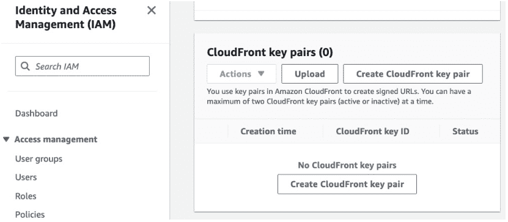

图 9.5：不建议为根用户配置 CloudFront 密钥对

重要的是，你每个 AWS 账户只能拥有两个活动的 CloudFront 密钥对。

在受信任密钥组和 CloudFront 密钥对之间进行选择通常取决于你的运营规模和管理偏好。受信任密钥组为更大、更动态的环境提供更好的控制和管理。

当通过 CloudFront 分发 URL 分发内容时，绕过此 URL 直接连接到源是可能的，具体取决于源类型。例如，如果你在 Amazon S3 存储桶上创建静态网站并且对 S3 存储桶具有完全的公共访问权限，那么任何知道 URL 地址的人都可以通过网站端点 URL 连接到它。如果你想防止此类访问，下一个部分将介绍称为源访问身份（OAI）和源访问控制（OAC）的功能，它们有助于实现这一点。

## CloudFront OAI 和 OAC

Amazon CloudFront 提供两种选项来确保查看者只能通过 CloudFront 分发点访问你的内容。

CloudFront OAI 是一项功能，可让你强制仅使用你在 CloudFront 分发中创建的 OAI 身份来访问托管在源中的内容，例如 Amazon S3 存储桶。一旦配置此功能，你必须更新存储桶策略以仅允许来自 OAI 用户的内容访问。你通过将以下内容添加到存储桶策略来实现：

```json
"Principal": {
    "AWS": "arn:aws:iam::cloudfront:user/CloudFront Origin Access Identity <origin access identity ID>"
}
```

这确保 OAI 代表用户授予对存储桶中托管内容的访问权限。存储桶策略的此更新可以在完成 CloudFront 分发时自动创建，也可手动创建策略。如果用户尝试使用 Amazon S3 端点直接访问内容，将被拒绝访问。

然而，此功能存在一些缺点，包括以下内容：

- OAI 不支持所有 AWS 区域。
- OAI 不原生支持使用 AWS KMS 的 Amazon S3 服务器端加密（SSE-KMS）。它仅支持使用 Amazon S3 管理密钥的服务器端加密（SSE-S3）。
- 不支持动态请求，例如 PUT、POST 或 DELETE。

新的 OAC 解决了这些缺点，接下来将讨论。

使用 OAC 是 AWS 推荐的方法，用于授予用户访问托管在源中的内容的方法，例如 Amazon S3 存储桶。在 CloudFront 分发中配置 OAC 之前，你必须允许 CloudFront 服务主体（cloudfront.amazonaws.com）访问你的 Amazon S3 存储桶。具体来说，你可以定义一个存储桶策略，其中仅在请求通过 CloudFront 分发到达时才授予访问权限，使用 Condition 元素。以下示例策略显示了这一点，该策略允许用户同时读取和写入存储桶中的内容：

```json
{
    "Version": "2012-10-17",
    "Statement": {
        "Sid": "AllowCloudFrontServiceReadWritePermission",
        "Effect": "Allow",
        "Principal": {
            "Service": "cloudfront.amazonaws.com"
        },
        "Action": [
            "s3:GetObject",
            "s3:PutObject"
        ],
        "Resource": "arn:aws:s3:::<S3 bucket name>/*",
        "Condition": {
            "StringEquals": {
                "AWS:SourceArn": "arn:aws:cloudfront::<AWS account ID>:distribution/<CloudFront distribution ID>"
            }
        }
    }
}
```

虽然确保用户通过 CloudFront 分发访问你的内容可以增强安全性，但你也希望保护最终用户与内容之间的网络流量。下一节讨论传输加密，以保护使用 Amazon CloudFront 时内容的连接性。这涉及在最终用户与 CloudFront 分发之间配置 HTTPS，并强制 CloudFront 与源之间的 HTTPS 连接，无论是自定义源还是 Amazon S3 源。

## 在用户与 Amazon CloudFront 之间配置 HTTPS

为确保最终用户与通过 CloudFront 访问的内容之间的流量在传输过程中得到加密，你可以使用 HTTPS。你可以同时使用 HTTPS 进行最终用户与 CloudFront 分发点之间的通信以及 CloudFront 与源之间的通信。

图 9.6 描述了此通信的高级概述：

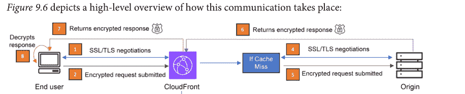

图 9.6：通过 CloudFront 分发建立到你的内容的 HTTPS 连接

以下是在前述图中描绘的流量流程中的关键步骤：

1. 最终用户尝试与 CloudFront 建立 HTTPS 连接，这会导致 SSL/TLS 协商。
2. 建立后，最终用户提交加密请求。
3. 如果发生缓存命中，即请求的 content 存在于缓存中，则将其返回给最终用户，后者然后解密内容。
4. 如果发生缓存未命中，CloudFront 将连接到源并执行 SSL/TLS 协商。
5. CloudFront 然后将加密请求转发到源。
6. 源解密请求并处理消息。然后它加密响应并发送给 CloudFront。
7. CloudFront 解密响应并重新加密，确保将其副本存储在缓存中并转发给最终用户。
8. 最终用户然后解密响应。

在配置 HTTPS 连接时，你可以为最终用户与 CloudFront 分发之间的连接以及从 CloudFront 分发到源的连接配置 HTTPS。以下部分概述了这两个配置组件。

## 配置最终用户与 CloudFront 分发之间的 HTTPS 通信

这涉及配置缓存行为以要求最终用户/查看者与分发之间的通信使用 HTTPS。你也可以将此通信配置为同时允许 HTTP 和 HTTPS，从而允许你通过 HTTP 提供某些内容但强制其他内容仅通过 HTTPS。

在这里，你有两个配置选项：

- **使用默认域名：** 如果你使用提供的分发域名，例如 `x12121212ebcdef9.cloudfront.net`，你必须将查看器协议策略配置为 **Redirect HTTP to HTTPS** 或 **HTTPS Only** 设置。HTTP GET 和 HEAD 请求将使用前一个选项重定向到 HTTPS 请求。POST、PUT、DELETE、OPTIONS 或 PATCH 请求仅在你使用 HTTP 1.1 或更高版本时重定向到 HTTPS。
- **使用自定义域名：** 如果你使用自定义域名，你将需要使用 SSL/TLS 证书，你可以使用 **AWS 证书管理器（ACM）** 配置，或购买第三方证书并将其导入 ACM。

除了在最终用户与 CloudFront 分发之间配置 HTTPS 外，你还可以配置 CloudFront 分发与其源之间的 HTTPS。这可以是自定义源或 Amazon S3 源。


## 配置 CloudFront 与自定义源之间的 HTTPS 流量

自定义源可以是 Elastic Load Balancer、EC2 实例或其他源。配置要求您将源的 **Origin Protocol Policy（源协议策略）** 设置更改为 **HTTPS Only（仅 HTTPS）** 或 **Match Viewer（匹配查看者）**。在使用 Match Viewer 时，通信取决于终端用户/查看者使用的协议。例如，如果终端用户使用 HTTPS 请求内容，CloudFront 在向源发出的请求中将使用 HTTPS。

此外，您需要将 **Secure Sockets Layer (SSL)（安全套接字层）**/**Transport Layer Security (TLS)（传输层安全协议）** 证书安装到您的自定义源上。

## 配置 CloudFront 与 Amazon S3 源之间的 HTTPS 流量

对于 Amazon S3，如果您将存储桶配置为静态网站，则只能使用 HTTP 协议在 CloudFront 和 S3 存储桶之间进行通信。请注意，在此配置中，**HTTPS** 和 **Match Viewer** 选项是灰色的，如以下截图所示：

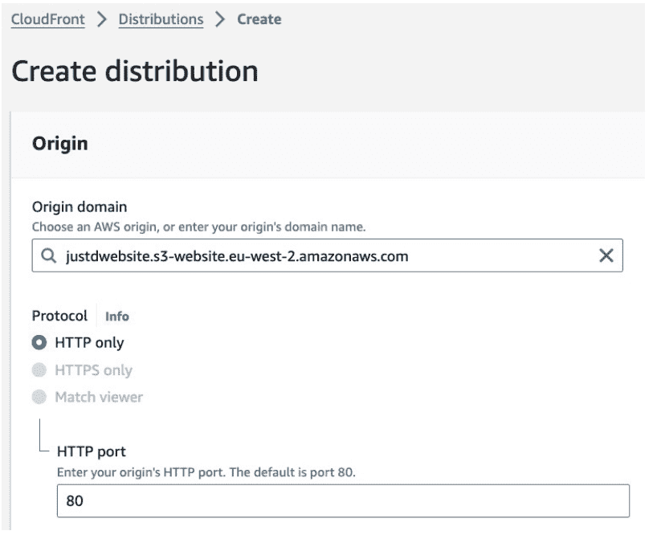

图 9.7：配置 CloudFront 分配用于 Amazon S3 源

如果您使用标准 API 端点配置 Amazon S3 存储桶（未配置静态网站托管），则可以通过 HTTPS 提供内容。在这种情况下，CloudFront 将使用 **Match Value（匹配值）** 设置将请求转发到 S3，从而确保查看者使用的协议与转发到源的协议相同。为了确保流量通过 HTTPS 发送，您必须将 Viewer Protocol Policy（查看者协议策略）设置为 **Redirect HTTP to HTTPS（将 HTTP 重定向到 HTTPS）** 或 **HTTPS Only。**

接下来，您将了解另一种称为 **field-level encryption（字段级加密）** 的加密解决方案。

## *字段级加密*

CloudFront 的字段级加密通过在提交到 CloudFront 的 HTTP 表单中启用字段级加密来增加一层安全性。它在将 POST 数据转发到源之前使用特定的加密密钥对其进行加密，确保敏感信息（如信用卡详情）得到安全传输。

在下一节中，您将学习如何使用同一分配从不同的源和服务提供不同类型的 内容。这可以帮助组织构建包含不同内容类型的复杂解决方案。

## 多个源和源组

CloudFront 允许您在同一分配中配置多个源。这对于从不同位置或服务提供不同类型的 内容非常有用。例如，静态内容可以从 S3 存储桶提供，而动态内容可以从 EC2 实例或 Elastic Load Balancer 提供。

源组允许您为分配设置多个源。您可以定义从 Amazon S3 存储桶提供静态内容，以及从处理由一组 EC2 实例处理的后台应用程序的应用负载均衡器提供动态内容。

此外，您还可以配置故障转移功能。例如，您可以创建一个包含主源和次要源的源组。如果主源失败（变得不可用），CloudFront 将自动切换到组中的次要源。这为您的应用程序提供了高可用性和容错能力。这可能适用于多种用例，例如主站点宕机或因延迟导致的超时问题。

考虑一个电子商务网站，该网站有一个存储产品图片的 S3 存储桶（主源），并配置了一个从 EC2 实例提供图片的次要源。如果 S3 服务出现故障，CloudFront 将自动将请求路由到 EC2 实例，确保用户仍可查看产品图片。

监控您的 CloudFront 分配是一项关键的操作任务，您必须执行此操作以确保应用程序的可靠性。下一节将介绍 Amazon CloudFront 的日志记录功能。

## 实时日志

CloudFront 提供实时日志，使您能够查看发送到您分配的请求。日志可以交付到 Amazon Kinesis Data Streams，在那里您可以实时分析和可视化数据。此功能允许您快速响应查看者流量的变化，排查问题，并提高内容交付的性能和安全性。

在使用这些功能时，请考虑它们与您用例的兼容性以及对价格的影响。例如，实时日志可能会生成大量数据，可能需要额外的处理和存储，从而可能产生额外成本。字段级加密提供增强的安全性，但它还需要谨慎的密钥管理，并可能增加应用程序逻辑的复杂性。源组提高了可用性和容错能力，这对于维持高质量的用户体验至关重要。

通过结合使用 CloudFront、S3 和 Route 53，该架构确保了一种健壮、安全且高效的方式，通过 CDN 的优势向终端用户提供静态内容。

在探索了 Amazon CloudFront 如何构建强大的 CDN 之后，下一节将讨论使用 Lambda@Edge 服务增强这些网络，您可以在其中执行无服务器函数来定制和优化内容交付。

## 将 Lambda@Edge 服务集成到 Amazon CloudFront

**Lambda@Edge** 是 AWS 中的一项功能，允许您响应 CloudFront 事件运行无服务器函数。它通过在 AWS 全球各位置执行函数，将计算能力拉近用户，从而降低延迟并提高动态 Web 应用程序的性能。以下部分概述了它如何增强 Amazon CloudFront 的功能。

## 边缘自定义

通过 **Lambda@Edge**，您可以执行用于自定义通过 CloudFront 提供的内容的函数。您可以运行修改 HTTP 响应的代码，基于设备、位置或语言自定义用户体验，甚至实现特定的安全协议。*图 9.8* 展示了一个示例函数：

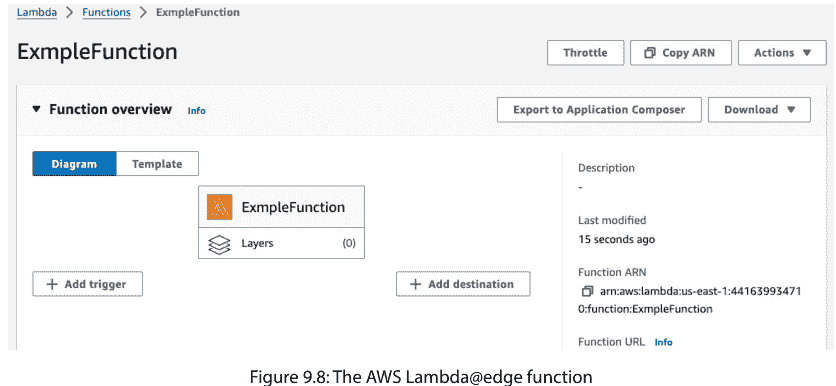

Lambda@Edge 函数是无服务器的，因此您无需管理服务器、配置计算资源或扩展它们。由于 AWS 处理基础设施，这使得扩展和维护变得容易。

您通过 CloudFront 事件触发 Lambda@Edge 函数，例如当发出查看者请求或 CloudFront 从源服务器接收到响应时。这允许在网络边缘进行实时的内容修改和决策。Lambda@Edge 减少了请求返回源服务器的需求，从而降低延迟并提高内容交付速度。

## 简化的开发和部署

Lambda@Edge 与 AWS CloudFormation 和 AWS **Serverless Application Model (SAM)（无服务器应用程序模型）** 无缝集成，简化了无服务器应用程序的创建、部署和管理。您可以在标准的 AWS Lambda 环境中开发和测试您的 Lambda 函数，并将其与 CloudFront 分配关联，如下图所示。

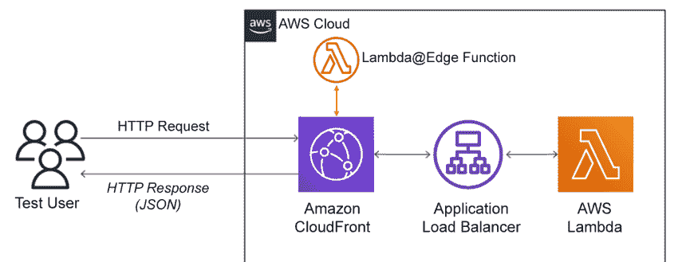

图 9.9：使用 Lambda@Edge 的架构

此处展示的 Lambda@Edge 用例涉及用户通过 CloudFront 发出请求。如果需要执行函数来修改请求或生成响应，则会触发 Lambda@Edge。请求也可以先通过应用负载均衡器路由，然后由 AWS 云中的 Lambda 函数处理。响应随后交付回给用户，可能会在经过另一个 Lambda@Edge 函数修改后交付。

此设置通常用于向全球受众提供低延迟内容的用例，并且需要在最接近最终用户的边缘进行动态内容生成或实时处理。Lambda@Edge 函数可用于各种用途，如网站自定义、安全和隐私控制、智能路由以及图像转换。由于计算发生在比源服务器更接近用户的位置，这有助于降低延迟，而源服务器在地理位置上可能距离用户较远。

下一节介绍 AWS 的 DNS 服务 Amazon Route 53。

## 使用 Amazon Route 53 为应用程序部署自定义域名

在云计算和 Web 应用程序中，如 Amazon Route 53 等 DNS 服务的作用至关重要。它不仅仅是将域名链接到 IP 地址；它是编排网络流量的交响乐，确保持久、快速、可靠地访问托管在 AWS 上的应用程序。Route 53 提供了一系列功能，远超典型的 DNS 服务，使其成为 AWS 架构师工具箱中不可或缺的工具。


## DNS 路由

从核心来看，Route 53 对于将人类可读的域名（例如 `www.example.com`）翻译成计算机用于连接的 IP 地址至关重要。Amazon Route 53 使用全球权威 DNS 服务器网络响应 DNS 查询，通过将每个查询路由到最近的 DNS 服务器来降低延迟。这种方法确保运行在 AWS 上的终端用户应用程序具有高可用性和可达性。

要有效使用 Route 53，您必须创建托管区。这是一个包含有关如何为域名（例如 `example.com`）及其子域名（例如 `www.example.com`、`shop.example.com` 等）路由流量的信息的容器。有两种类型的托管区，将在以下小节中讨论。

### 公共托管区

**公共托管区** 是您在希望域名可通过互联网访问时使用的。当您创建公共托管区时，Amazon Route 53 会将您在该区域中创建的 DNS 记录发布到其全球 DNS 服务器。这允许互联网上的任何用户找到您的域名并连接到它。

### 私有托管区

**私有托管区** 在一个或多个 **Amazon 虚拟私有云（VPCs）** 内路由流量。这种类型的区域无法从互联网访问。它对于管理内部网络资源的 DNS 非常有用。例如，您可能在 AWS 基础设施内有一个只能由同一 VPC 内的其他服务或用户访问的内部应用程序。使用私有托管区，您可以创建只能在该 VPC 内解析的 DNS 记录。

私有托管区中的记录可以有效地指向任何 IP 地址，而不仅仅是 AWS 资源的地址。这种效率使您能够为内部资源使用私有 DNS 名称，从而更轻松地在 AWS 环境中管理网络管理与资源访问。

您还可以将私有托管区与同一或不同 AWS 区域中的多个 VPC 关联。这种设置对于复杂网络场景非常有益，例如在开发、测试和生产环境中创建一致的 DNS 命名空间。

总之，公共托管区适用于需要在互联网上可访问的域名，而私有托管区用于需要在一个或多个私有网络（VPCs）内解析的域名。两种托管区都可以通过 Route 53 控制台或 API 管理，并且可以包含各种 DNS 记录，例如地址记录（A）、IPv6 地址记录（AAAA）、规范名称记录（CNAME）、邮件交换记录（MX）、指针记录（PTR）等。

下一节将更深入地探讨 Route 53 服务的应用。

## Amazon Route 53 实践应用

考虑一个实际场景：您正在 AWS 上部署一个全球电子商务平台。该平台将拥有用户，您需要确保其始终可用、安全且性能最佳。Route 53 在此场景中可以发挥重要作用，如图 9.10 所示：

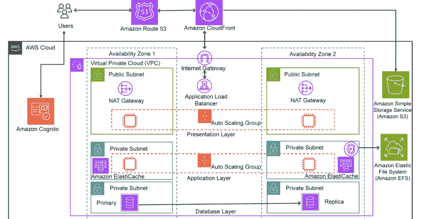

图 9.10：电子商务应用架构

在该架构图的上下文中，Route 53 将是用户请求的入口点，它随后将请求路由到 Amazon CloudFront 分发以获取边缘缓存内容，或路由到相应可用区中的 Elastic Load Balancer。Elastic Load Balancer 然后将在 VPC 内的多个目标（例如 EC2 实例、容器和 IP 地址）之间分配传入的应用流量。

Elastic Load Balancer 会自动根据传入的应用流量进行调整，将其分配到一个或多个可用区中的多个目标，从而降低了单个资源过载并可能导致服务中断的风险。

此外，Route 53 与 AWS 服务（如 CloudFront 和 Elastic Load Balancer）的集成允许实现无缝的数据流，这对于保持运营弹性并提供流畅的用户体验至关重要。通过利用 AWS 的全球网络基础设施，Route 53 有助于确保电子商务应用程序无论用户位于何处或系统承受多少需求，都保持可访问和响应。下一节将更深入地探讨使用 Route 53 进行流量管理。

## 使用 Amazon Route 53 管理全球流量

Amazon Route 53 凭借其强大的功能集，在管理此全球流量中发挥着关键作用，确保用户请求被智能路由到最合适的端点。为了管理应用程序的流量流，您可以使用 Route 53 配置以下关键路由策略：

- **基于延迟的路由：** 这允许您将流量路由到为终端用户提供最低延迟的区域。Route 53 会自动对 DNS 查询做出响应，提供响应最快的 AWS 区域的 IP 地址。这非常适合用户体验取决于响应时间的全球服务。
- **地理位置路由：** Route 53 根据用户的地理位置路由流量。此功能对于提供本地化内容、遵守法律要求或在不同区域之间平衡流量非常有用。
- **地理邻近路由（带流量流）：** 地理邻近路由让您能够根据资源地理位置路由流量，并可选择将流量从一个位置的资源转移到另一个位置的资源。使用偏差值，您可以调整发送到资源的地理区域大小。
- **加权路由：** 这允许您为不同资源分配权重并指定路由到每个资源的流量比例。它对于 A/B 测试和逐步将流量从一个端点转移到另一个端点特别有用。
- **故障转移路由：** 对于需要高可用性的应用程序，可以配置故障转移路由以在主站点失败时将流量路由到次要站点。这对于灾难恢复策略至关重要。

在下一节中，您将继续进行我们客户 Todo Plus Limited 的项目练习。您现在已达到可以整合 CloudFront 分发点以通过安全连接使应用程序可通过互联网访问的阶段。

## 项目任务 – 部署 AWS CloudFront 服务并更新网站应用程序代码以集成后端服务

在下一组项目任务中，您将完成待办事项应用程序的部署，整合 CloudFront 分发以实现对应用程序的无缝快速访问。您将更新前端网站，该网站现已整合了 Amazon Cognito 的集成，您已在第 2 章《使用 AWS 身份和访问管理保护访问》中设置。

以下图表描绘了待办事项应用程序作为完整解决方案的架构图。除了修改应用程序代码文件外，您还将配置 AWS CloudFront 分发。

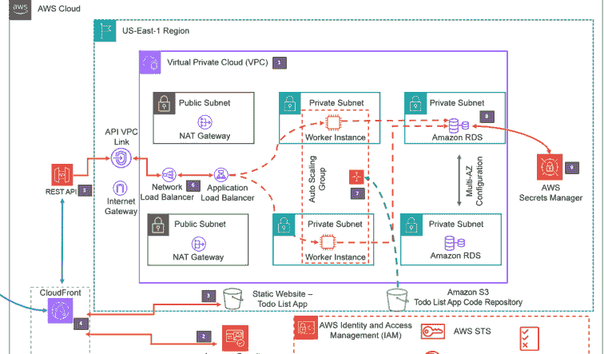

图 9.11：待办事项应用程序架构 – 整合 CloudFront 分发

在即将进行的项目练习中，将执行以下具体任务：

- **前端网站和应用程序代码更新：** 您将更新前端网站以集成 Amazon Cognito 服务以启用注册和登录功能。此外，您还将更新后端应用程序代码。
- **Rest API 授权器：** 您还将更新 API 资源以使用新创建的 Cognito 授权器，以便已登录用户可以访问应用程序。
- **创建 CloudFront 分发：** 您必须创建 Amazon CloudFront 分发以连接到您的 Amazon S3 静态网站。接下来，您将创建源和行为以连接到 API Gateway URL。这将允许所有 HTTP 方法访问并与后端应用程序数据进行交互。

### 技术要求

要完成本章的项目练习，您必须访问您创建的 AWS 开发账户，确保以 IAM 用户“Alice”登录。

您还必须下载更新后的前端网站和后端应用程序代码，因为这些代码已更新以整合您在 AWS 上创建的各种资源。例如，前端应用程序代码现在具有 Amazon Cognito 的集成组件，允许用户注册并登录应用程序。


更新后的应用程序代码位于我们的GitHub仓库中：

```
https://packt.link/OxeLU
```

请确保下载此仓库中的.zip文件，并将其存储在本地计算机上。你将在下一节详细介绍的项目任务中使用这些文件。

## 项目任务9.1 – 更新应用程序后端代码

你需要更新应用程序，以确保它能与Cognito中经过身份验证的用户进行连接。回想一下，托管应用程序API的EC2实例当前在自动扩缩组中运行，你希望确保任何更新都自动复制到EC2实例。由于应用程序代码存放在Amazon S3存储库中（如前图所示，即Amazon S3 Todo List代码存储库存储桶），你必须使用新的应用程序代码更新该存储桶。然后，你可以终止现有EC2实例，强制Auto Scaling服务部署新实例，并将应用程序复制到新创建的实例。在下一章中，你将探索旨在自动化部署新版本更新的DevOps策略：

1. 以IAM用户“Alice”身份重新登录你的AWS账户，并确保你在北弗吉尼亚区域操作。
2. 导航至Amazon S3控制台。
3. 选择`todoapprepo`存储桶，如图9.12所示：

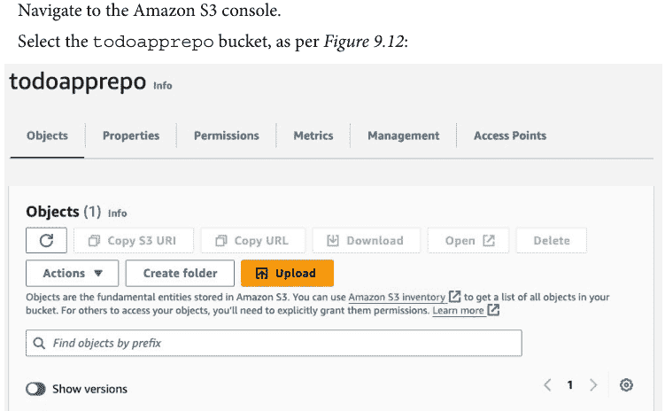

图9.12：Todo应用存储库存储桶

> **注意：** 你会注意到现有的后端应用程序采用.zip格式。该文件被下载到EC2实例，EC2实例使用脚本（回想一下用户数据脚本，它是EC2实例Auto Scaling启动配置的一部分）来配置实例的应用程序代码文件。

4. 单击Upload按钮，上传你之前从GitHub仓库下载的`todo-plus-nodejs.zip`文件，如前文“技术要求”部分所述。用此新版本替换存储桶中的现有文件，如图9.13所示：

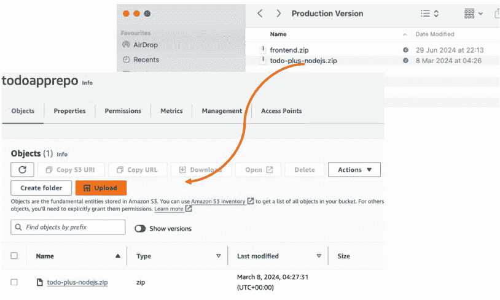

图9.13 – 将更新后的Node.js应用程序代码复制到S3存储桶

5. 接下来，通过在屏幕顶部的搜索栏中搜索，导航到EC2管理控制台。
6. 从左侧菜单中选择Instances。
7. 在右侧窗格中，你应该发现有两个正在运行并托管后端应用程序的实例。回想一下，你在第7章“构建具有高可用性、弹性和数据安全性的应用程序解决方案”中配置了一个Auto Scaling组来部署这些后端实例。

你必须通过选择这些实例，然后从Instance state下拉列表中单击Terminate instance来终止它们，如以下截图所示：

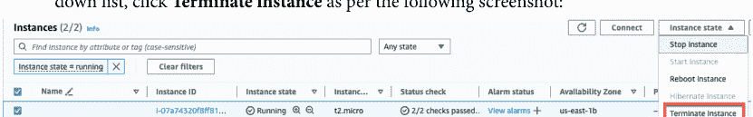

图9.14：终止现有实例以强制Auto Scaling服务部署新实例

8. 系统会提示你确认终止这些实例。在出现的对话框中，继续单击Terminate。

9. 一旦这些实例被终止，Auto Scaling服务将使用来自你的Amazon S3存储桶（作为存储库）的更新应用程序代码启动新实例。这通常需要几分钟。在Auto Scaling部分，从左侧菜单中单击Auto Scaling Groups。从右侧窗格中，选择你在第7章“构建具有高可用性、弹性和数据安全性的应用程序解决方案”中创建的`todo-list-auto-scaling-group`。在右侧窗格中，单击Activity。你将发现之前的两个实例已被删除，并替换为两个新实例，如以下截图所示：

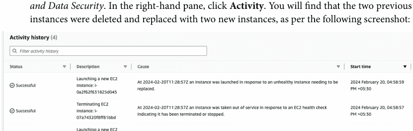

图9.15：Auto Scaling组响应上一步对现有实例的终止操作，启动两个新实例

在下一个任务中，你将更新前端网站代码。这个新版本包含与Amazon Cognito的必要集成，使用户能够注册和登录应用程序。

## 项目任务9.2 – 更新前端代码

在此项目任务中，你将更新配置为托管在Amazon S3存储桶上的静态网站的前端应用程序代码。在第3章“了解使用Amazon S3、混合存储和静态网站托管的对象存储”中，你配置了一个启用静态网站托管的Amazon S3存储桶。然后，你将前端代码部署到该存储桶。原始版本的注册和登录表单无法使用，因为当时还没有与Amazon Cognito集成。

此更新后的代码版本包含对Amazon Cognito的调用，以使用其托管UI作为注册和登录表单，该UI连接到你第2章“使用AWS身份和访问管理保护访问权限”中创建的Cognito用户池：

1. 确保你已登录到你的AWS开发账户。
2. 通过在网页顶部的搜索栏中搜索该服务，导航到Cognito控制台。确保你在北弗吉尼亚区域。
3. 从左侧菜单中选择User pools。
4. 在右侧窗格中，单击你在第2章“使用AWS身份和访问管理保护访问权限”中创建的用户池，它应该名为`todolist-userpool`。
5. 选择App integration选项卡，如以下截图所示：

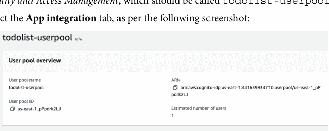

图9.16：Amazon Cognito App Integration选项卡，用于识别你的Cognito客户端ID

6. 向下滚动页面底部，直到到达App client list部分。
7. 记下Client ID。

8. 接下来，你需要修改新更新的前端网站的`index.html`文件：

   I. 解压你从我们的GitHub仓库下载的`frontend.zip`文件的内容。

   II. 在你喜欢的编辑器中打开`index.html`文件，例如Visual Studio Code。然后，滚动到文件末尾，直到到达代码中`<!-- Template Main JS File -->`部分的`window.cognitoClientId`，如图9.17所示。

   III. 使用你的Cognito客户端ID更新Client ID，替换引号中提供的占位符。图9.17展示了一个用于进行更改的占位符。请注意，如果你按照第8章“使用AWS Lambda进行事件驱动计算并通过Amazon API Gateway保护后端API访问”中的项目任务8.5（与API Gateway集成）为API Gateway创建了不同于“development”的阶段名称，则必须确保在此处更新它，如以下截图中的第二个占位符所示：

```
<!-- Vendor JS Files -->

<!-- Template Main JS File -->
<script src="main.js"></script>

<script>
  window.cognitoClientId = "Enter Your Cognito Client ID Here" // Put your client id here
  window.BASE_URL = "/development"; // Put your base path here (if different)
</script>

</body>
</html>
```

图9.17：使用你的Cognito客户端ID修改index.html页面的新版本

   IV. 保存`index.html`文件。

9. 接下来，导航到Amazon S3控制台。
10. 单击你配置用于托管前端网站的存储桶。
11. 接下来，将解压后的`frontend.zip`文件按照相同的文件夹层级结构上传到存储桶的根目录。请记住，你之前刚刚更新了`index.html`文件。你还会注意到，需要额外上传一个`main.js`文件。上传所有文件，如图9.18所示：

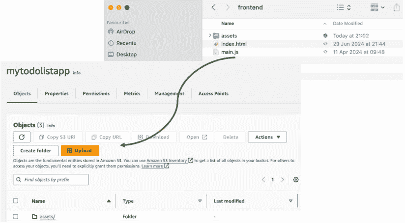

图9.18：使用更新的HTML文件和文件夹更新前端静态网站存储桶

12. 你应该会收到一条确认信息，表明你的文件已成功上传。

在下一个任务中，你将创建一个REST API授权器，实现Cognito与API Gateway之间的集成，确保授权用户可以调用API。

## 项目任务9.3 – REST API授权器

1. 确保你仍登录到AWS开发账户，并在北弗吉尼亚区域。
2. 接下来，搜索并导航到API Gateway Web控制台。
3. 从左侧菜单中，单击**APIs**。


- 4. 接下来，在右侧窗格中，单击你在 *第 8 章，使用 AWS Lambda 进行事件驱动计算以及使用 Amazon API Gateway 保护后端 API 访问* 中创建的 API，以打开其 **Resources** 网页，如下图所示：

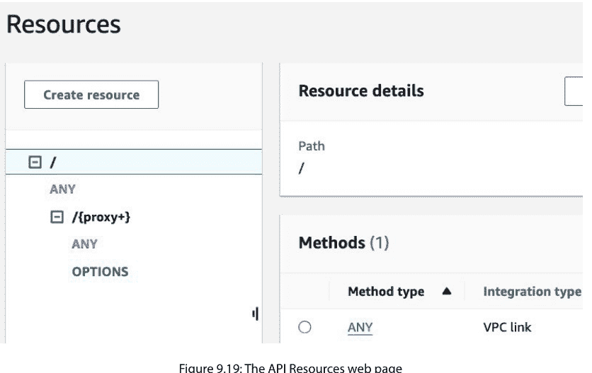

- 5. 从左侧菜单中选择 **Authorizers**。

- 6. 在右侧窗格中，单击 **Create an authorizer** 按钮。

- 7. 接下来，为你的授权器提供一个描述性名称，例如 `todolist-cognito-authorizer`。

- 8. 接下来，对于 **Authorizer type**，选择 **Cognito**。

- 9. 确保 **Cognito user pool** 选择了 `us-east-1`，然后搜索并选择你在 *第 2 章，使用 AWS Identity and Access Management 保护访问* 中创建的 `todolist-userpool`，如下图所示：

> **Create authorizer Info**
>
> **Authorizer details**
>
> **Authorizer name:** `todolist-cognito-authorizer`
>
> **Authorizer type Info:** Choose to authorize your API calls using one of your Lambda functions or a Cognito User Pool.
> - Lambda
> - Cognito
>
> **Cognito user pool:** Select the Cognito user pool that will authenticate requests to your API.
> - `us-east-1`
> - `todolist-userpool`
>
> **Token source:** Enter the header that contains the authorization token.
> - `auth-token`
>
> **Token validation - optional:** Enter a regular expression to validate tokens.
>
> Cancel | Create authorizer

图 9.20：为你的 API 创建 Cognito Authorizer

- 10. 对于 **Token source**，输入 `auth-token` 作为包含授权令牌的标头。
- 11. 单击 **Create authorizer** 按钮。
- 12. 你应该会看到一条确认信息，说明授权器已成功创建。
- 13. 接下来，你必须更新 API 资源以使用此授权器。从左侧菜单中选择 **Resources**。
- 14. 单击 **ANY** 方法，如下图所示：

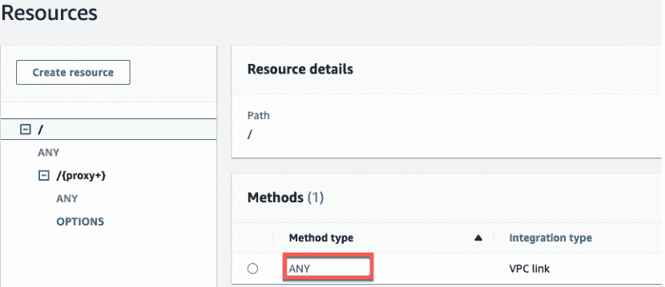

图 9.21：API 资源 – ANY 方法

- 15. 单击 **Method request** 选项卡，然后单击 **Edit** 按钮。
- 16. 从 **Authorization** 下拉菜单中，选择 `todolist-cognito-authorizer` Cognito 授权器，如下图所示：

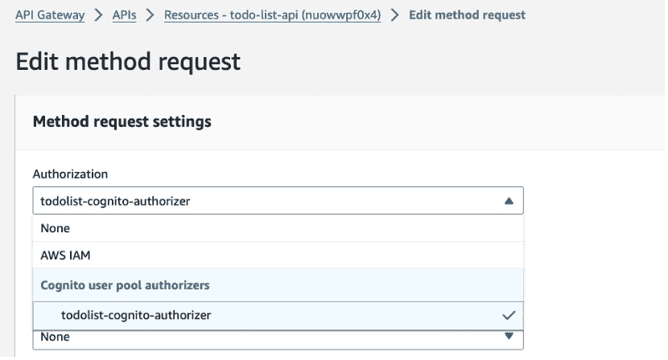

图 9.22：配置方法请求设置

- 17. 单击页面底部的 **Save** 按钮。你将被重定向回 **Resources** 网页。
- 18. 单击 `{proxy+}` 下的 **ANY** 方法。
- 19. 从右侧窗格中，确保 **Method request** 选项卡已选中，然后在 **Method request settings** 部分单击 **Edit** 按钮。
- 20. 接下来，从 **Method request settings** 中的 **Authorization** 下拉列表中选择 `todolist-cognito-authorizer`。
- 21. 单击 **Save**。
- 22. 你将被重定向到 **Resources** 网页，并会注意到 ANY 的方法请求已成功编辑的确认信息。
- 23. 接下来，在右侧窗格中单击 **Deploy API**，如下图所示：

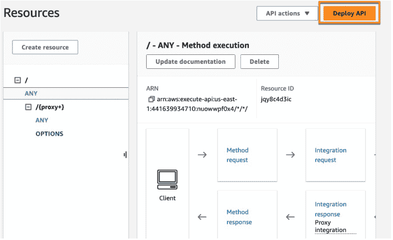

图 9.23 – 部署 API

- 24. 在出现的弹出对话框中，从 stage 下拉列表中选择 **Development**。记住，你最初创建了这个开发阶段。
- 25. 提供可选的描述并单击 **Deploy**。
- 26. 然后你应该会收到一条确认信息，说明所选阶段（即 **Development**）的部署已成功。

现在你已经更新了前端网站和后端应用程序，并将 API 配置为使用 Cognito 进行授权，是时候为你的应用程序架构添加最后一个组件了：应用程序的 CloudFront 分发，你将在下一步实现。

## 项目任务 9.4 – 创建 CloudFront 分发

在此任务中，你将创建一个 CloudFront 分发，它将用作你的网站和应用程序的入口点。Amazon CloudFront 将通过 AWS 全球分布的边缘位置和代理服务器网络，以高速网络分发你的静态和动态内容，这些服务器缓存内容并降低延迟：

- 1. 确保你已登录到你的 AWS 开发账户并在 N. Virginia 区域工作。
- 2. 使用管理控制台页面顶部的搜索栏搜索并导航到 Amazon S3 网页控制台。
- 3. 单击托管你的 **Todo List** 静态网站的存储桶。
- 4. 从 **Properties** 选项卡中，记下静态网站托管 URL。这就是你用于浏览前端网站的 URL。
- 5. 接下来，从网页顶部的搜索栏搜索 `CloudFront` 并在另一个浏览器标签页中导航到其网页控制台页面。
- 6. 从右侧窗格中单击 **Create a CloudFront distribution** 按钮。
- 7. 将 S3 存储桶的静态网站 URL 粘贴到 **Origin domain** 下的搜索框中。如果你单击搜索框，它将列出帐户中可用于配置 CloudFront 分发的所有可能端点。然而，对于 Amazon S3 静态网站托管，你必须使用网站端点而不是简单的存储桶端点。
- 8. 如果你对为你选择的默认名称不满意，请在 **Name** 文本框中提供一个名称。
- 9. 确保在 **Origin access** 下选择了 **Public**。
- 10. 接下来，滚动到 **Web Application Firewall (WAF)** 部分。在这里，选择 **Do not enable security protection** 选项。出于本次实验的目的，你没有为你的应用程序配置任何 WAF 安全。
- 11. 接下来，滚动到页面底部并单击 **Create distribution** 按钮。分发将需要几分钟才能完全部署，如下图所示：

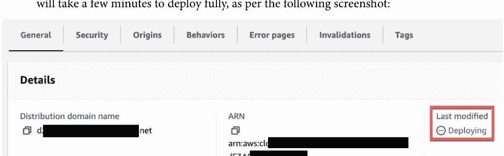

图 9.24：CloudFront 分发部署状态

- 12. 接下来，单击 **Origins** 选项卡。
- 13. 接下来，单击 **Create origin** 按钮。
- 14. 单击 **Origin domain** 下的搜索框以显示潜在源列表。在这里，在 **API Gateway** 下选择 `todo-list-api`。你会注意到在选择 API 后，名称会更改为 URL 格式，如下图所示：

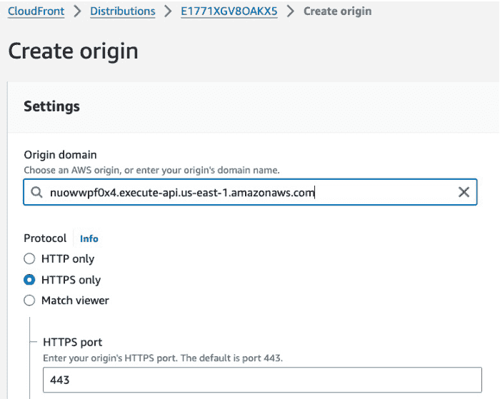

图 9.25：创建源

- 15. 单击页面底部的 **Create origin** 按钮。
- 16. 接下来，单击 **Behaviors** 选项卡。
- 17. 单击 **Create behavior** 按钮。
- 18. 在 **Path pattern** 搜索框中添加 `/development/*` 路径 – 请记住，这是 API Gateway 中的阶段名称。
- 19. 接下来，从 **Origin and origin groups** 下拉框中选择你创建的 API Gateway 源。
- 20. 对于 **Viewer protocol policy**，选择 **Redirect HTTP to HTTPS**。此配置使互联网用户与 CloudFront 分发之间的流量通过 HTTPS 进行。
- 21. 接下来，对于 **Allowed HTTP methods**，选择第三个选项：**GET, HEAD, OPTIONS, PUT, POST, PATCH, DELETE**，如下图所示：

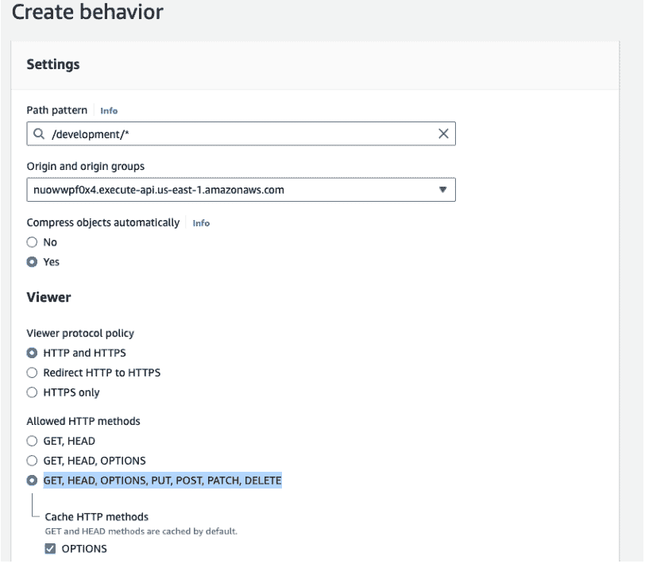

图 9.26：创建行为配置

- 22. 同时，确保已选择 **OPTIONS**，如前图所示。
- 23. 接下来，在 **Cache key and origin requests** 下选择 **Legacy cache settings**。
- 24. 接下来，在 **Object caching** 下单击 **Customize** 并将 **Maximum TTL** 和 **Default TTL** 值设置为 0，如下图所示：

> **Cache key and origin requests**
>
> We recommend using a cache policy and origin request policy to control the cache key and origin requests.
> - Cache policy and origin request policy (recommended)
> - Legacy cache settings

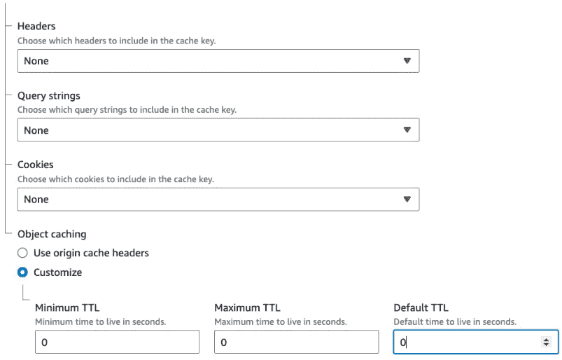

图 9.27：配置 Cache key and origin requests

- 25. 最后，单击页面底部的 **Create behavior** 按钮。

此时，你已将 CloudFront 分发配置为应用程序架构的一部分。你可以通过整合 OAI 和 WAF 服务来进一步增强其安全功能。

作为下一步，你可以测试应用程序。


## 项目任务 9.5 – 测试应用程序

在此项目任务中，你将测试应用程序的功能。你需要访问一个电子邮件账户来验证你的 Cognito 账户：

- 1. 如有需要，可使用 AWS 管理控制台顶部的搜索框导航到 Amazon CloudFront Web 控制台。
- 2. 从左侧菜单点击**分配**，然后点击你的 CloudFront 分配，以访问其配置详细信息。
- 3. 在**常规**选项卡中复制**分配域名**字段，并将其粘贴到新的浏览器标签页中。如有必要，可使用无痕窗口或另一个浏览器。
- 4. 你应该会看到你的网站能够加载，如下图所示：

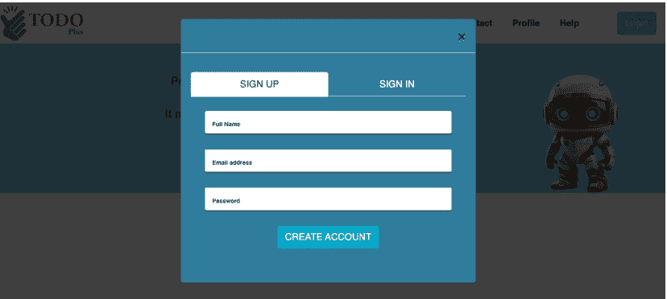

图 9.28：集成 Amazon Cognito 的 TodoList Web 应用程序

- 5. 继续进行注册，提供包含以下内容的详细信息：
  - I. **全名。**
  - II. **电子邮件地址。**
  - III. **密码：** 确保密码至少包含八个字符，同时包含大写和小写字母、数字，以及至少一个符号字符，例如 !、@、$ 或 &。

- 9. 登录后，你将看到 Todo List 应用程序，其中包含一个空表格和添加任务的选项，如下图所示：

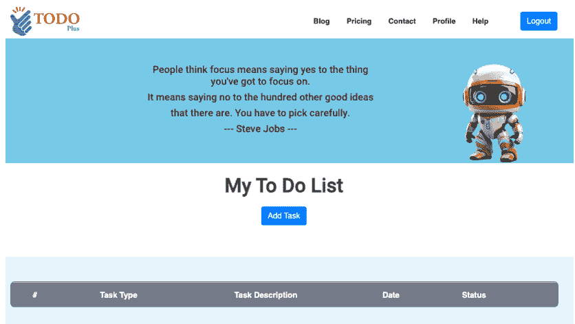

图 9.31：作为已登录用户的 Todo List 应用程序

- 10. 接下来，单击“添加任务”。

- 11. 此时会出现一个弹出对话框，你需要在其中提供任务详细信息。你需要提供以下信息：
  - I. 任务类型：从 Finance（财务）、Work（工作）、Family（家庭）、Health（健康）和 Other（其他）中选择。
  - II. 任务描述：用于描述任务的空间。
  - III. 截止日期：你可以在此处为任务选择截止日期。
  - IV. 状态：指定任务的当前状态。从 Started（已开始）、In-Progress（进行中）、Completed（已完成）、Delayed（已延迟）和 Not Started（未开始）中选择。

- 12. 填写完表单后，单击**提交**，你应该会看到你的条目反映在待办事项列表中。下面显示了一个示例待办事项列表：

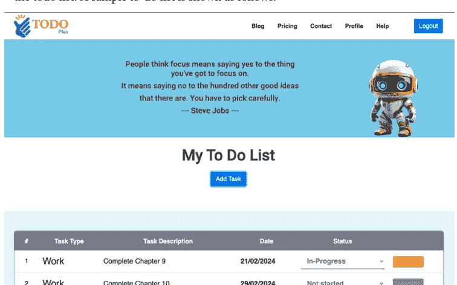

图 9.32：正常运行中的 TodoList 应用程序

至此，你已经完成了该项目。你现在拥有一个功能完备的 Web 应用程序，它可以帮助你跟踪待办事项列表，并让你掌握各项任务的最新情况，同时按类别划分以便于导航。

下一节提供本章摘要。

## 摘要

在本章中，你探索了 Amazon CloudFront 和 Route 53 在提升 AWS 上应用程序的性能、路由和可访问性方面的作用。这种探索让你深入了解了这些服务如何单独及协同工作，以优化全球 Web 应用的用户体验。

你学习了 Amazon CloudFront（AWS 的 CDN 服务），并考察了其关键特性和功能。本章讨论了 CloudFront 如何通过将 Web 内容缓存到离用户最近的边缘站点来加速内容交付，从而显著减少延迟并缩短加载时间。你还探索了 CloudFront 的安全能力，包括与 AWS Shield 集成以提供 DDoS 保护，以及与 AWS WAF 集成以提供 Web 应用程序安全。

接下来，你学习了 Amazon Route 53，探索了它在域名管理和 DNS 服务中的关键作用。重点介绍了 Route 53 在 DNS 路由、健康检查、流量路由以及与其他 AWS 服务无缝集成方面的功能。你还发现了一些高级功能，例如基于延迟的路由、地理定位路由和故障转移路由，这些功能对于管理全球流量以及确保应用程序的高可用性和弹性至关重要。

- 2. 登录后，你将看到一个与*图 9.34*类似的页面：

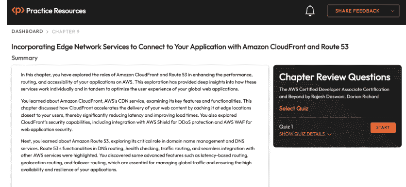

- 3. 准备好后，开始以下练习演练，多次重新尝试测验。

## 考试准备练习

对于前三次尝试，不要担心时间限制。

### 尝试 1

第一次尝试，目标至少达到 **40%**。查看你答错的题目，并重新阅读章节中的相关部分，以弥补学习上的不足。

### 尝试 2

第二次尝试，目标至少达到 **60%**。查看你答错的题目，并重新阅读章节中的相关部分，以弥补任何剩余的学习不足。

### 尝试 3

第三次尝试，目标至少达到 **75%**。一旦你的分数达到 75% 或以上，就可以开始练习答题速度。

> **提示**  
> 你可能需要超过**三次**尝试才能达到 75%。这没关系。只需复习章节中的相关部分，直到你达到目标。

### 计时训练

**目标**：你的目标是在保持相同分数的情况下，尽可能快地回答这些问题。以下是你后续尝试应达到效果的示例：

| 尝试 | 分数 | 所用时间 |
| :--- | :--- | :--- |
| 尝试 5 | 77% | 21 分 30 秒 |
| 尝试 6 | 78% | 18 分 34 秒 |
| 尝试 7 | 76% | 14 分 44 秒 |

表 9.1 – 在线平台上的计时练习演练示例

> **注意**  
> 上表中显示的时间限制只是示例。请根据网站上测验的时间限制，为每次尝试设定自己的时间限制。

随着每次新尝试，你的分数应保持在 **75%** 以上，而完成测验的“所用时间”应“减少”。你可以根据需要重复多次尝试，直到你确信自己能够应对时间压力。
