## 10. 使用 AWS Elastic Beanstalk 设计部署策略

到目前为止，你一直在将各种基础设施服务作为独立组件进行架构设计和配置，然后将它们用于托管应用程序或工作负载。这使你能够了解应用程序所需的各种基础设施组件，例如计算、网络、存储和数据库。

虽然这很有益处，但开发人员通常更关注应用程序架构设计和定义合适的部署策略，而不是专注于底层基础设施服务的繁重工作。

**平台即服务（PaaS）**解决方案旨在减轻与基础设施预置相关的复杂性，使开发人员能够更多地专注于应用程序代码、构建和部署生命周期。**Amazon Web Services（AWS）**提供了这样一种 PaaS 工具：**AWS Elastic Beanstalk**。

本章属于 AWS Certified Developer Associate 认证考试的**领域 3：部署**。除了理解 AWS Elastic Beanstalk 的基础知识外，本章还涵盖了部署策略以及使用这些策略部署应用程序版本的能力。这些策略范围从滚动更新到蓝绿部署。这在实时生产环境中尤为重要，因为重点在于确保最小干扰，并在必要时能够回滚。本章还介绍了安全概念，特别是与安全访问应用程序配置和连接后端数据库相关的安全概念。

在本章中，我们将 Amazon Elastic Beanstalk 视为一种工具，使开发人员能够快速预置必要的环境，以托管和管理其应用程序及其生命周期。

本章中的项目任务还将使您获得使用 Elastic Beanstalk 部署端到端应用程序解决方案的真实动手经验。虽然底层基础设施的大部分配置由 PaaS 服务处理，但对于其他几个组件，你可能希望预先配置，或者至少定义 Elastic Beanstalk 如何预置它们。

本章涵盖的关键主题如下：

- Amazon Elastic Beanstalk 应用程序部署简介
- 理解各种部署策略
- Beanstalk 高级功能
- 项目任务 – 使用 Elastic Beanstalk 和 AWS Secrets Manager 部署多层应用程序

### Amazon Elastic Beanstalk 应用程序部署简介

Amazon Elastic Beanstalk 是 AWS 提供的一种 PaaS 服务，通过预置必要的底层资源、托管应用程序本身并管理其生命周期，使客户能够轻松部署应用程序。

尽管与 Amazon CloudFormation（将在本学习指南后面讨论）类似，但诸如 Amazon Elastic Beanstalk 之类的 PaaS 产品专注于一个特定应用，并仅预置支持托管该应用所需的资源。另一方面，Amazon CloudFormation 是一项**基础设施即代码（IaC）**服务，用于架构和构建可用于托管多个应用程序的端到端基础设施组件。Amazon Elastic Beanstalk 使用 Amazon CloudFormation 来预置这些底层资源。

虽然 Amazon Elastic Beanstalk 负责资源创建，但它确实为客户提供了对基础设施构建方式的广泛控制——例如，如果你希望在给定区域的不同网络子网中跨多个**可用区（AZ）**部署应用程序，以支持高可用性。

如下图所示，Amazon Elastic Beanstalk 负责为应用程序构建整个环境，其中将包括任何必要的网络配置（Amazon VPC）、EC2 实例、Web 应用程序环境（例如 Apache、Tomcat、Node.js 等），以及负载均衡器、自动伸缩组甚至 **Amazon Relational Database Service（RDS）**数据库等支持性基础设施组件。


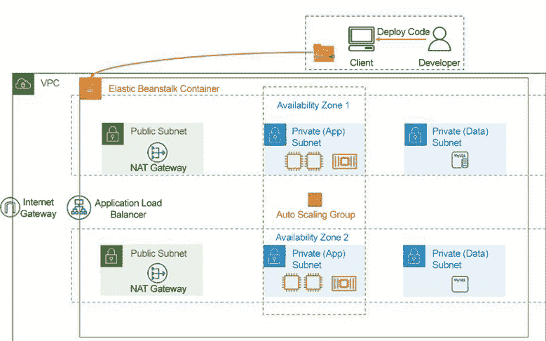

图 10.1：AWS Elastic Beanstalk 示例

该服务支持部署在 EC2 实例上的标准应用程序以及在 **Elastic Container Service (ECS)** 上的 Docker 容器。

由于 Elastic Beanstalk 将与您的代码协同工作，为您的应用程序提供必要的基础设施和平台，因此您需要确保您的代码使用受支持的语言构建，例如 Java、.NET、PHP、Ruby、Node.js、Python 和 Docker Web 应用程序。Amazon Elastic Beanstalk 支持以下开发堆栈：

- Java SE
- 用于 Java 应用程序的 Apache Tomcat
- 用于 PHP 和 Python 的 Apache HTTP Server
- 用于 Node.js 的 NGINX 或 Apache HTTP Server
- 用于 .NET 应用程序的 Microsoft IIS 7.5、8.0 和 8.5
- 用于 Ruby 应用程序的 Passenger 或 Puma
- Docker
- Go 等

接下来，让我们来看一下 Amazon Elastic Beanstalk 的核心组件。

## Amazon Elastic Beanstalk 组件

Amazon Elastic Beanstalk 会为您的应用程序配置所需的所有资源。这些是应用程序运行的环境。多个组件定义了您的 Elastic Beanstalk 应用程序架构，接下来将进行讨论。

### Application

Amazon Elastic Beanstalk 应用程序是环境、版本和配置项等组件的集合，可以将其视为应用程序堆栈的容器。

### Application Version

这是指您应用程序代码的特定迭代。Amazon Elastic Beanstalk 会将您应用程序的所有版本存储在托管的 S3 存储桶中，作为可部署的代码，例如 Java WAR 文件。版本可以根据需要应用于任何环境，并且每个应用程序版本都是唯一的。应用程序版本可用于不同的环境，其中最新迭代例如可在开发或测试环境中进行测试，而生产环境仍托管您应用程序的先前稳定版本。

### Environment

这是一组 AWS 资源（例如 EC2 实例、负载均衡器、Auto Scaling 组和 Relational Database Service (RDS) 数据库），用于托管特定应用程序版本。每个环境一次只能运行一个应用程序版本。例如，您可能有三个不同的应用程序版本——稳定的生产版本、测试版本和正在进一步开发以添加新功能或修复错误的一个版本。

除此之外，您还可以拥有两种不同的环境层：

- Web 服务器层：旨在托管前端 Web 应用程序，通过端口 80/443 提供 HTTP/HTTPS 请求。
- Worker 层：旨在从 Amazon Simple Queue Service (Amazon SQS) 中提取任务，以处理由 Web 服务器层接受的请求。

下图说明了使用 Amazon Elastic Beanstalk 如何构建 Web 服务器层和 Worker 层：

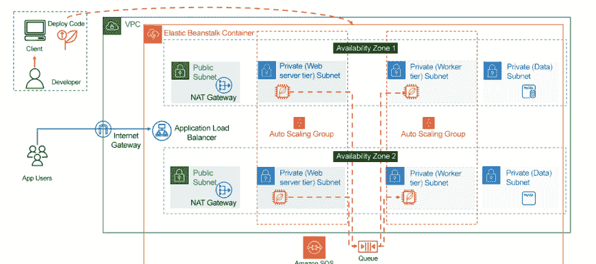

图 10.2：具有环境层和 SQS 队列的 Elastic Beanstalk 架构

上图说明了如何将您的应用程序部署到 Elastic Beanstalk，并提供支持其所需的基础设施。作为部署的一部分，您会确定需要配置的环境层；相应地，AWS 将创建必要的资源。

### Environment Configuration

此设置集合控制环境及其相关资源如何交互。如有必要，可以更新配置，这将导致 Elastic Beanstalk 对现有资源应用更改，或在必要时删除并部署新资源。

### Save Configuration

您可以将配置存储为模板，可用作创建独特环境的起点。当用于反映不同阶段（例如开发、测试和生产）的环境的标准配置时，它特别有用。

### Platform

这结合了 **操作系统 (OS)**，例如 Linux 或 Windows、运行时、Web 服务器、应用程序服务器以及其他必要的组件、库等。在下图中，平台为 Node.js，使用最新分支用于 Amazon Linux 2023，版本为 6.1.7 作为推荐版本。

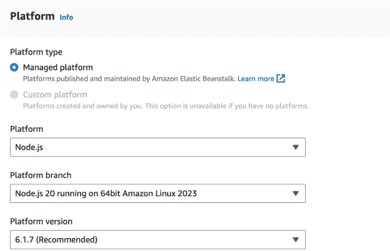

图 10.3：平台类型

在下一节中，您将了解 Elastic Beanstalk 应用程序的不同部署选项。

## 了解各种部署策略

在 Elastic Beanstalk 上部署应用程序时，通常需要使用新版本进行更新以适应功能增强或错误修复。定期发布应用程序的新版本也是推荐的做法，而不是在相当长的时间间隔后尝试发布重大升级，这可能会导致更多技术和用户体验问题。

Amazon Elastic Beanstalk 提供了多种战略选项，帮助客户推出应用程序的新版本。每个选项在工作量、成本和最小化停机时间方面各不相同。在下一节中，您将探索 Amazon Elastic Beanstalk 中可用的各种部署选项。

### All-at-Once Deployment

这是推出更新的最快选项。该策略涉及一次性将更新推送到所有应用程序节点并执行必要的升级操作。然而，这确实会在新版本应用程序安装和配置完成之前导致一定的停机时间。此部署方法不会产生额外的资源成本。

如果您定期推出更新并且不在意停机时间，尤其是停机时间很短的情况下，此选项是理想的。您可以计划在工作时间之外或预计流量非常少时进行此类推出，例如星期日午夜。为了确保客户不会感到惊慌，您可能希望就此类计划停机发送必要的通知。

### Rolling Deployment

在此部署类型中，您一次将更新推出到一部分计算节点，直到所有节点都已更新为应用程序的最新版本。这导致一次只有一部分节点被移出集群，从而可以避免对最终用户造成完全的服务中断。

根据需要更新的节点数量以及在更新推出期间可以移出服务的节点的可接受百分比，此过程需要一些时间才能使所有节点都配置为最新版本的应用程序。

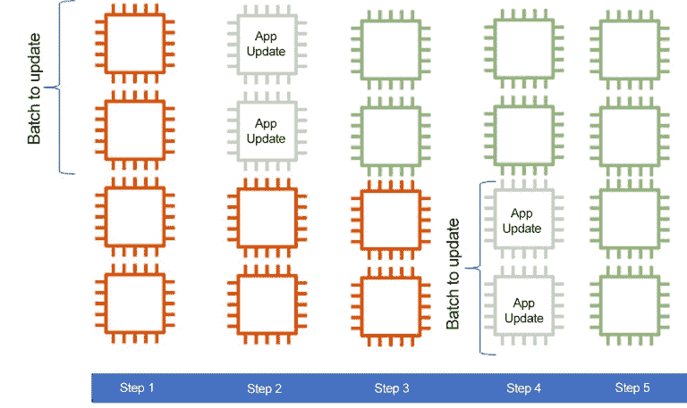

图 10.4：滚动部署策略

上图说明了滚动更新将如何完成。假设您有四个节点需要更新，您可以从两个节点开始并对这些节点执行更新（导致它们被移出服务）如步骤 2 所示。一旦这些节点已更新，其余两个节点可以按步骤 4 进行更新。在步骤 5 中，所有四个节点都已更新为最新应用程序版本。

这里需要注意的一个重要点是，在更新生命周期期间，一些用户可能会连接到提供新版本的节点，而其他用户将继续体验旧版本，直到相关节点得到更新。如果这种不一致不会造成任何问题，滚动部署是执行应用程序部署的可行选项。最后，此策略不会产生额外成本。

### Rolling with Additional Batch

通过此部署策略，您可以避免在等待某些节点完成应用程序更新过程期间可用性降低。这是通过部署额外的节点来覆盖正在进行应用程序升级过程的节点来实现的，从而使您能够为最终用户保持相同的带宽吞吐量。

让我们看一下下图以提供一些背景信息：

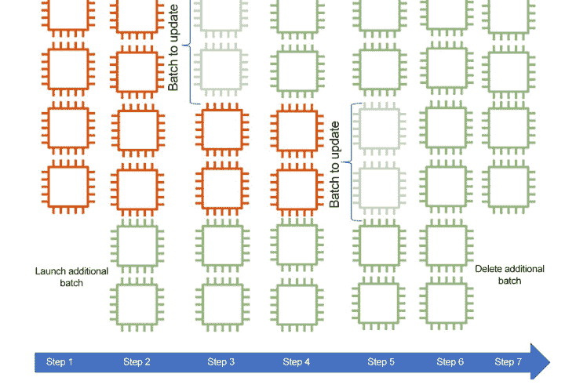

图 10.5：带额外批次的滚动部署策略


为了确保不会出现可用性降低的情况，在*步骤 2*中引入额外的一批两个节点，使节点总数达到六个。在*步骤 3*中，前两个节点进行升级，并使其离线。然而，为最终用户提供服务的节点数量仍为四个。

在*步骤 5*中，下一组两个节点进行升级。当这两个节点因升级而离线时，集群中仍有同等数量的可用节点，从而避免可用性降低。升级完成后，你将拥有六个节点（包括为部署策略额外添加的两个节点）。

最后，一旦所有现有节点都已升级到最新的应用程序版本，额外的那批节点就会被删除。

在此示例中，为支持这种部署策略而部署额外的一批节点会产生额外成本。此外，升级过程也比之前的批次更长。但是，你也会受益于最终用户不会遇到性能问题或服务可用性降低的情况。

## 不可变部署

作为滚动部署的替代方案，此策略侧重于在单独的自动扩缩组中预配置新资源，以测试新应用程序，并在必要时通过简单删除自动扩缩组来回滚。这将确保你现有的集群不受影响，并且现有实例的可用性不会降低。

采用这种部署策略时，Amazon Elastic Beanstalk 会创建第二个自动扩缩组，并预配置一个实例来测试新的配置和应用程序代码。启动成功后，Amazon Elastic Beanstalk 将预配置额外实例以匹配原始自动扩缩组。当所有实例都通过必要的健康检查后，Elastic Beanstalk 会将实例移入原始自动扩缩组，并终止临时自动扩缩组和旧实例。

关于这种部署策略，应注意以下几点：

- 在更新过程中，环境的总容量会在短时间内翻倍。此时，新的自动扩缩组会在原始自动扩缩组的实例被终止之前处理请求，从而产生额外成本。请注意，这还可能影响你的配额和限制，因此你需要确保在更新过程中不会超出任何此类限制。
- 不可变更新会为你要部署的每个新版本预配置新实例。你可能需要确保使用正确的**亚马逊机器镜像（AMI）**版本启动实例，并在推出前对你的 AMI 镜像进行任何必要的修改。

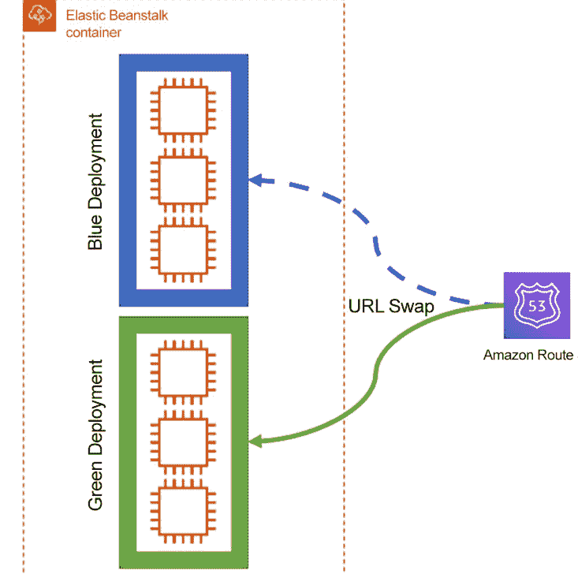

图 10.6：蓝/绿部署

你还可以使用 Route 53 执行加权路由策略作为测试的一部分，这样你可以继续使用两个环境，仅将一小部分流量发送到绿色部署以验证和测试新部署。当你准备好上线时，可以禁用加权路由策略，最后执行 URL 切换，使所有流量都指向新版本。

在本节中，我们讨论了使用 Elastic Beanstalk 时可用的各种部署选项。这些选项使你能在应用程序生命周期中执行常规更新。在下一节中，我们将介绍一些你需要在考试中注意的 Elastic Beanstalk 高级主题。

## Elastic Beanstalk 高级功能

本节介绍 Elastic Beanstalk 的各种高级功能，这些功能可以帮助你更高效地设计部署，并更好地管理环境和应用程序。

### Elastic Beanstalk 生命周期策略

在上一节中，你了解了如何将应用程序的新版本上传到 Elastic Beanstalk，并查看了可用的各种部署选项。需要记住的是，每次上传应用程序的新版本时，Elastic Beanstalk 都会创建一个新的**应用程序版本**。默认情况下，Amazon 在每个 AWS 账户的每个区域最多支持 1,000 个应用程序版本。

如果你达到此限制，就无法再部署任何应用程序版本。为帮助你管理版本，Elastic Beanstalk 允许你配置**应用程序版本生命周期策略**。生命周期策略让你可以定义 Elastic Beanstalk 何时删除应用程序版本——你可以告诉 Elastic Beanstalk 删除应用程序的旧版本，或指定要保留的版本总数，超过该数量后旧版本将被删除。

以下是一些需要注意的额外要点：

- 旧版本的应用程序会在新版本创建后被删除。新版本的创建不会增加策略定义的最大数量计数。当前正在使用的应用程序版本不会被删除。
- 应用程序版本配额适用于特定区域和所有应用程序——因此，如果你有 10 个应用程序，且应用程序版本最大配额为 1,000，那么该配额会在这 10 个应用程序之间分配。

接下来，让我们探讨如何通过编程方式为 Elastic Beanstalk 环境引入各种配置选项。

### Elastic Beanstalk 扩展

Amazon Elastic Beanstalk 使用另一个 AWS 服务——AWS CloudFormation——来预配置应用程序所需的资源。AWS CloudFormation 是一种 IaC 工具，可帮助你使用 JSON 或 YAML 脚本代码定义要部署哪些资源以及如何配置它们。这些脚本随后可用作模板，以促进可重复的部署以及以编程方式创建环境和资源。你将在后续章节中了解更多关于 AWS CloudFormation 的内容。

由于 Elastic Beanstalk 使用 CloudFormation 来预配置所需的环境和资源，因此你可以使用 Elastic Beanstalk 配置文件（称为 `.ebextensions`）来自定义资源或向部署中添加新资源。

你可能首先需要修改此配置，以确保你要么创建快照，要么最好保留数据库。此更改必须首先执行，并且与实际解耦操作分开进行。这是因为如果你在提交更改的同时尝试执行解耦操作，该更改将被忽略，并且将遵循之前在数据库删除策略中定义的任何策略。

一旦你解耦了数据库，就可以从其他环境连接到它。但是，你仍然需要执行所需的连接步骤，例如定义环境属性，以便从新的环境和应用程序连接到数据库。

### 配置 Elastic Beanstalk 使用 HTTPS

可通过互联网访问的现代 Web 应用程序应使用更高级别的安全性进行架构设计，并防范恶意攻击。一种常见的配置选项是确保最终用户与应用程序之间的流量经过加密。这被称为传输中加密，通过部署**安全套接层**（SSL）证书来实现，该证书用于在数据通过互联网传输时对其进行加密。

默认情况下，在设置 Elastic Beanstalk 时，流量通过标准 HTTP 传输，而这是不加密的。你可以使用 HTTPS 来确保流量加密，该过程涉及将 SSL 证书分配给环境的 Elastic Load Balancer。这可以在控制台中完成，也可以通过 `.ebextensions/securelistener-[alb|nlb].config` 文件来完成。

此类文件的示例配置如下：

```yaml
option_settings:
  aws.elbv2.listener:443:
    ListenerEnabled: 'true'
    Protocol: HTTPS
    SSLCertificateArns: arn:aws:acm:us-east-1:xxxxxxxxxx:certificate/##########################
```

该过程还要求你更新相关的安全组，以确保允许 HTTPS（端口 443）上的入站连接。

此外，你还可以使用自定义域名供最终用户连接，并使用 **AWS Certificate Manager**（ACM）来设置和管理证书。


## 克隆现有的 Elastic Beanstalk 环境

Elastic Beanstalk 的另一个有用功能是克隆环境的能力。当你想要部署应用程序的测试版本以使用不同的平台分支并评估应用程序的性能时，这尤其有用。克隆使你能够使用与原始环境相同的设置快速创建新环境。这样，你就避免了手动配置选项设置、环境变量和其他配置的需要。

当你执行环境克隆时，请注意 Elastic Beanstalk 将为克隆的环境复制任何 AWS 资源，例如负载均衡器、安全组和 RDS 数据库。克隆存在一些限制，如以下列表所示：

- 虽然你可以克隆 RDS 环境，但 RDS 数据不会从原始环境复制过来。
- 虽然你可以克隆环境以使用不同的平台版本，但你无法更改平台分支，因为 Elastic Beanstalk 无法保证兼容性。
- 如果你的 Elastic Beanstalk 环境之前已配置为使用经典负载均衡器，则你的新克隆环境也将配置为使用经典负载均衡器。如果需要更改负载均衡器类型，你将需要创建一个新环境并将应用程序部署到该新环境。之后，你可以使用 URL 交换将流量定向到新环境。

接下来，让我们看看如何将 Elastic Beanstalk 与 Docker 和容器一起使用。

## Elastic Beanstalk 和 Docker

除了在上述平台上部署标准应用程序外，你还可以将应用程序作为 Docker 容器部署。这进一步使你能够部署各种应用程序，因为你不受仅限于受支持平台的限制。Docker 容器是自包含的环境，包含平台、编程语言、运行时、库等多种内容。作为一种 OS 层虚拟化形式，Docker 容器比标准虚拟机提供更大的灵活性，允许你在单个主机机器上部署多个容器。你将在 *第 11 章，使用 Amazon ECS、Fargate 和 EKS 部署多层应用程序堆栈* 中更详细地探索 Docker。

就目前而言，足以说明你也可以使用 Elastic Beanstalk 部署 Docker 容器，并提供以下两种选项：

- **Single Docker：** 此选项是指在 EC2 实例上部署单个或多个容器。Docker 镜像可以通过提供 Dockerfile 或检索 Docker 镜像来构建。此外，你可以使用 Docker Compose 来指定要使用的镜像以及需要在 `docker-compose.yml` 文件中提供的其他组件和选项。
- **ECS：** 此选项使用 Amazon ECS，这是由 AWS 提供的容器编排和管理解决方案。我们将在第 11 章 *使用 Amazon ECS、Fargate 和 EKS 部署多层应用程序堆栈* 中详细介绍 Amazon ECS。使用此选项时，Amazon ECS 将执行容器部署并管理 Docker 环境。Elastic Beanstalk 执行所有 Amazon ECS 活动，例如创建集群、任务定义和任务执行。对于此选项，你必须使用 `Dockerrun.aws.json` 版本 2 文件。该文件描述了如何将 Docker 容器作为 Elastic Beanstalk 应用程序部署，并提供对多个容器的支持。

关于 ECS 选项的一个重要点是，你的 Docker 镜像必须预先构建并存储在存储库中，该存储库可以是公共的也可以是私有的。Elastic Beanstalk 不支持为 ECS 管理的 Docker 平台使用 Dockerfile，因此你无法在部署期间使用 Dockerfile 构建自定义镜像。

到目前为止，在本节中，你已经了解了 Elastic Beanstalk 的一些高级功能。使用这些功能，你最终可以配置端到端的基础设施环境，能够在 AWS 上支持最复杂的应用程序。此外，我们还讨论了使用 Elastic Beanstalk 部署时管理后端数据库的重要性，特别是围绕将 Amazon RDS 数据库与 Elastic Beanstalk 配置解耦的概念，以确保项目结束后或应用程序生命周期结束时数据库得以保留。

无论使用传统的分层架构设计还是使用 Elastic Beanstalk 等 PaaS 解决方案，一个重要的应用程序安全概念都是该应用程序如何连接到后端数据库解决方案。虽然使用 IAM 角色是一种向应用程序授予临时凭证以连接到数据库的方法，但你可能还需要使用标准的数据库用户名和密码，仅仅因为应用程序就是这样构建的。

在 *第 6 章，使用 AWS 关系型和非关系型（NoSQL）数据库管理多个数据库* 中，你发现了 AWS Secrets Manager 服务，该服务旨在存储配置数据和机密信息，例如应用程序通常需要的安全连接后端数据库的凭证。然后可以动态检索这些凭证数据并存储为环境变量，供应用程序引用。这种方法比在应用程序源代码中硬编码凭证数据要好得多。此外，AWS Secrets Manager 使你能够在计划的间隔内自动轮换数据库凭证，从而增强应用程序堆栈的安全性。

在下一节中，你将有机会使用 Elastic Beanstalk 服务部署多层应用程序。遵循本章中讨论的一些最佳实践，你将学习如何将 RDS 数据库实例部署在 Elastic Beanstalk 配置之外，并使用 AWS Secrets Manager 安全地管理你的数据库凭证。

### 项目任务 – 使用 Elastic Beanstalk 和 AWS Secrets Manager 部署多层应用程序

到目前为止，在本研究中，你一直在为我们的虚构公司 *Todo Plus Limited* 设计、构建和部署一个名为 *Todo List* 的多层应用程序。完成前几章中的所有项目任务后，你现在拥有一个功能齐全的 Web 应用程序，该应用程序使用各种 AWS 服务和资源。

> **重要说明**
>
> 请勿终止你在 `us-east-1` 区域中根据前几章的项目任务已部署的应用程序。在即将到来的章节中，你将使用同一个应用程序并更改其部分基础设施组件，以检查替代架构并帮助培养在其他技术方面的必要实践经验。

在本章中，你将使用 Amazon Elastic Beanstalk 部署同一应用程序的替代、精简版本。应用程序的功能保持不变，只是我们移除了某些功能，例如用于注册和登录的 Amazon Cognito 服务和 API Gateway 服务。之所以使用同一应用程序的精简版本，是为了让你能够专注于 Elastic Beanstalk 配置。本章中即将进行的项目任务将有助于培养在 AWS 的 PaaS 产品上工作的实践动手经验。

为避免混淆，你将在伦敦区域（`eu-west-2`）部署 *Todo List* 应用程序的此替代版本。

你将要构建的架构如以下图所示：

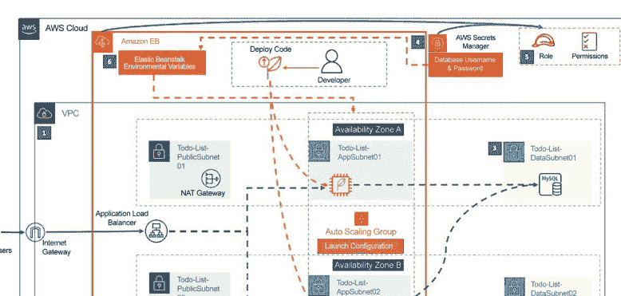

图 10.8：Todo List 应用程序的 Elastic Beanstalk 架构

作为架构的一部分，你将配置以下服务和资源：

- **VPC**：你将在伦敦区域创建一个新的 VPC，包含六个子网——两个公共子网、两个应用程序层私有子网和两个数据库层私有子网。架构设计为通过将子网分布在两个可用区中提供高可用性。此外，你还将部署一个 NAT 网关，以确保由 Elastic Beanstalk 服务部署的实例可以访问互联网。
- **安全组配置**：Amazon Elastic Beanstalk 将提供一组安全组以允许来自互联网的流量访问应用程序负载均衡器，后者进而将该入站 Web 流量分发到 EC2 实例。然而，根据本章中强调的推荐最佳实践，你将把后端数据库配置在 Elastic Beanstalk 配置之外。这意味着你还必须配置一组安全组以启用从 EC2 实例到后端数据库的流量——这在架构图中显示为 **App-Security-Group** 和 **Data-Security-Group**。此外，此外部数据库可以通过不绑定到特定的 Elastic Beanstalk 环境来帮助实现蓝绿部署。
- **数据库子网组和 RDS 数据库**：如本章前面所述，强烈建议你将 RDS 数据库部署在 Elastic Beanstalk 配置之外，以确保在关闭和终止 Elastic Beanstalk 环境时数据库得以保留。因此，你将在 VPC 中配置数据库子网组，并在数据子网中部署 MySQL RDS 数据库。对于此实验，你将只部署单个 RDS 实例。在实际场景中，请考虑为你的 RDS 部署配置多可用区和只读副本。


+   4. **AWS Secrets Manager：** 你将在 AWS Secrets Manager 中配置一个机密，以存储数据库凭据详细信息，这些详细信息将通过环境变量访问你的应用程序 Elastic Beanstalk 环境。这是一种比在应用程序中硬编码凭据更加安全的方法。
+   5. **IAM 角色和策略：** 通常，你还需要配置 IAM 角色，以启用 Elastic Beanstalk 服务接收机密并在你的 VPC 中置备 EC2 实例。作为 Elastic Beanstalk 配置的一部分，你将置备一个自动伸缩组和启动配置——同样，需要相应的 IAM 角色。
+   6. **Elastic Beanstalk 应用程序：** 在所有基础设施组件配置完成后，你可以构建你的 Elastic Beanstalk 应用程序和环境。在这里，你将提供配置详细信息，以便 Elastic Beanstalk 能够置备你的自动伸缩组和自动伸缩策略，置备负载均衡器，并部署你的应用程序。

## 技术要求

要完成本章的项目任务，你需要执行以下操作：

- 你必须以 IAM 用户“Alice”的身份登录到 AWS 开发账户。请确保你位于伦敦区域（eu-west-2）。
- 你必须下载应用程序源代码并将其保存在桌面上以便轻松访问。源代码可在 https://packt.link/pdy6D 获取。

## 项目任务 10.1 – 创建自定义 VPC

在这个项目任务中，你将构建一个自定义 VPC 来托管你的应用程序，并配置 Elastic Beanstalk 以部署它。虽然可以获取让 Elastic Beanstalk 为你构建 VPC，但请记住，你想先在你的 VPC 中部署 RDS 数据库，因此需要将 VPC 的构建作为配置 Elastic Beanstalk 应用程序的先决条件。

+   1. 以 IAM 用户“Alice”的身份登录到 AWS 开发账户。
+   2. 从主控制台网页使用页面顶部的搜索栏搜索并导航到 VPC 管理控制台。
+   3. 接下来，通过从控制台左上角的区域下拉列表中选择伦敦区域，确保你位于伦敦区域。
+   4. 从左侧菜单中，点击“Your VPCs”，然后点击控制台右上角的“Create VPC”按钮。
+   5. 在“VPC settings”下的“Resources to create”部分选择“VPC and more options”。
+   6. 取消勾选 **Auto-generate** 旁边的复选框。
+   7. 对于 **IPv4 CIDR block** 范围，提供 `10.5.0.0/16` 的 CIDR 块。
+   8. 接下来，根据以下截图确保选中 **No IPv6 CIDR block**：

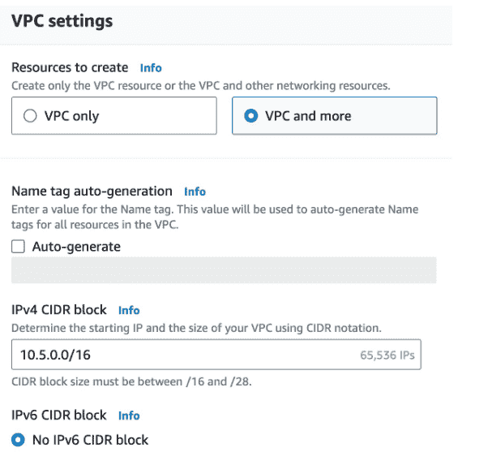

图 10.9：VPC 设置

+   9. 展开“Number of Availability Zones (AZs)”部分下的 **Customize AZs**。
+   10. 确保选中 `eu-west-2a` 和 `eu-west-2b` 作为此 VPC 使用的可用区。
+   11. 确保“Number of public subnets”选项选中 2，“Number of private subnets”选项选中 4。
+   12. 展开 **Customize subnets CIDR blocks** 子部分，并提供以下 IP CIDR 块：

+   I. `eu-west-2a` 中的公共子网 CIDR 块 - `10.5.1.0/24`。这将标记为 `PublicSubnet01`。
+   II. `eu-west-2b` 中的公共子网 CIDR 块 - `10.5.2.0/24`。这将标记为 `PublicSubnet02`。
+   III. `eu-west-2a` 中的私有子网 CIDR 块 - `10.5.10.0/24`。这将标记为 `AppSubnet01`。
+   IV. `eu-west-2b` 中的私有子网 CIDR 块 - `10.5.11.0/24`。这将标记为 `AppSubnet02`。
+   V. `eu-west-2a` 中的私有子网 CIDR 块 - `10.5.20.0/24`。这将标记为 `DataSubnet01`。
+   VI. `eu-west-2b` 中的私有子网 CIDR 块 - `10.5.21.0/24`。这将标记为 `DataSubnet02`。
+   VII. 查看以下截图，确保你已正确配置子网 CIDR 块：

# 自定义子网 CIDR 块

eu-west-2a 中的公共子网 CIDR 块

10.5.1.0/24
256 个 IP

eu-west-2b 中的公共子网 CIDR 块

10.5.2.0/24
256 个 IP

eu-west-2a 中的私有子网 CIDR 块

10.5.10.0/24
256 个 IP

eu-west-2b 中的私有子网 CIDR 块

10.5.11.0/24
256 个 IP

eu-west-2a 中的私有子网 CIDR 块

10.5.20.0/24
256 个 IP

eu-west-2b 中的私有子网 CIDR 块

10.5.21.0/24
256 个 IP

图 10.10：VPC 子网 CIDR 块

+   13. 继续向下滚动，确保你为 NAT 网关（$）配置选择了 1 AZ 中的 1 个。你将只为该项目部署单个 NAT 网关。请注意，NAT 网关是收费服务，你应该在完成并测试该项目后终止这些资源。
+   14. 确保在 VPC endpoints 下选择 None。
+   15. 滚动到页面顶部，查看右侧窗格中的 Preview 部分。为了能够轻松识别各个子网，手动编辑各个文本框，根据以下截图标记它们。

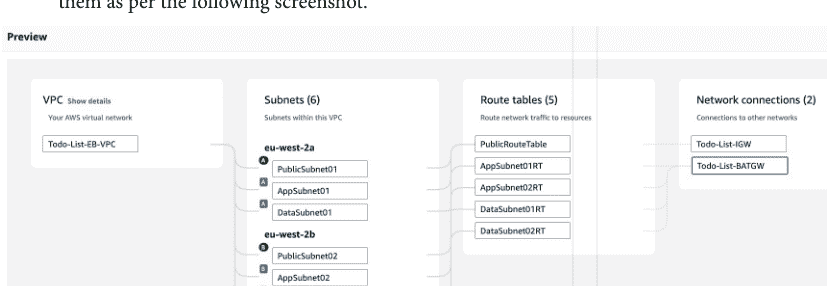

图 10.11：VPC 架构可视化预览

以下是用于你的配置的具体名称：

+   I. 如前面截图所示，在 VPC 部分下的文本框中为你的 VPC 提供一个名称。你可以使用诸如 Todo-List-EB-VPC 的名称。
+   II. 你会注意到前面截图中六个子网使用的名称如下：

+   i. eu-west-2a：

```
PublicSubnet01
AppSubnet01
DataSubnet01
```

+   ii. eu-west-2b：

```
PublicSubnet02
AppSubnet02
DataSubnet02
```

+   3. 确保根据截图为你的路由表命名，以便轻松识别。因此，在此示例中，路由表命名为：
+   1. `PublicRouteTable`：公共子网的路由表
+   2. `AppSubnet01RT`：`AppSubnet01` 的路由表
+   3. `AppSubnet02RT`：`AppSubnet02` 的路由表
+   4. `DataSubnet01RT`：`DataSubnet01` 的路由表
+   5. `DataSubnet02RT`：`DataSubnet02` 的路由表
+   4. 如果你将鼠标悬停在各个子网上，你可以识别它们连接到哪些路由表。
+   5. 为互联网网关提供名称，例如 `Todo-List-IGW`，并为 NAT 网关提供名称，例如 `Todo-List-NATGW`。

+   16. 在所有配置到位后，向下滚动到页面底部并点击 **Create VPC** 按钮。
+   17. 将显示 **Create VPC workflow** 屏幕，并使用所需的组件配置你的 VPC。
+   18. 一旦创建好 VPC，你可以导航回主 VPC 仪表板，然后点击 **Your VPCs** 来查看你新创建的 VPC。

在下一节中，你将配置 VPC 中的一些安全组，以确保流量可以路由到你的 RDS 数据库。

## 项目任务 10.2 – 创建安全组

在这个项目任务中，你将创建两个安全组，这些安全组是托管应用程序的 EC2 实例向后端数据库发送流量所必需的，这些数据库你将很快部署。Amazon Elastic Beanstalk 还将置备一组自己的安全组：一个允许来自互联网到 Application Load Balancers 的流量，另一个安全组将关联到它部署的 EC2 实例，启用 Application Load Balancer 将传入的 HTTP 请求分发到这些实例。

如下面图表所示，最终配置意味着你的 EC2 实例将附加两个安全组，一个用于端口 `80`（HTTP）的入站流量，另一个用于启用这些实例向你的 Amazon RDS 数据库发送数据库请求：

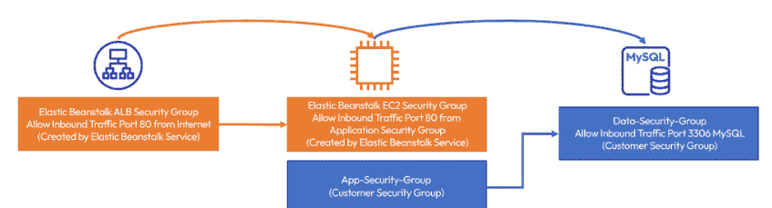

图 10.12：安全组配置

虽然 Elastic Beanstalk 将为 Application Load Balancer 和它部署的 EC2 实例创建安全组，但你必须还配置另外两个安全组 – 一个用于 EC2 实例，另一个用于你即将部署的 RDS 数据库。

+   1. 确保你仍然登录到 AWS 开发账户并位于伦敦区域。
+   2. 如有必要，导航到 VPC 仪表板。
+   3. 从左侧菜单中，点击 Security 部分下的 Security groups。
+   4. 在右侧窗格中，点击 Create security group 按钮。
+   5. 为安全组提供一个名称，例如 App-Security-Group。
+   6. 提供你选择的适当描述。
+   7. 确保从 VPC 下拉列表中选择了正确的 VPC，在这种情况下为 Todo-List-EB-VPC，除非你为你的 VPC 选择了其他名称。
+   8. 滚动到页面底部，点击 Tags – optional 部分中的 Add new tag。创建一个新标签，将 Key 设置为 Name，将 Value – optional 设置为 App-Security-Group。这将确保安全组被标记且易于识别。
+   9. 点击 Create security group 按钮。安全组现在将被创建。你在配置 Elastic Beanstalk 服务和定义 EC2 实例配置时将引用此组。请注意，你未为此安全组创建入站规则。这是完全没问题的，因为当你配置 Elastic Beanstalk 时，该服务将为你的 EC2 实例置备另一个安全组，以从 Application Load Balancer 接受端口 80（HTTP）的入站流量。记住，一个 EC2 实例可以关联多个安全组。
+   10. 你现在将为 RDS 数据库配置安全组。从左侧菜单中，再次点击 Security groups。在右侧窗格中，点击 Create security group 按钮。
+   11. 为你的安全组提供一个合适的名称，例如 Data-Security-Group，以及适当的描述。


12. 确保从VPC下拉列表中选择了正确的VPC。
13. 您必须按如下方式配置入站规则设置：
14. 单击“添加规则”，并从下拉列表中将“类型”设置为“MYSQL/Aurora”。接下来，对于“来源”，确保选择了“自定义”，然后从“来源”下拉列表中选择您刚才创建的“App-Security-Group”，如下面的屏幕截图所示。

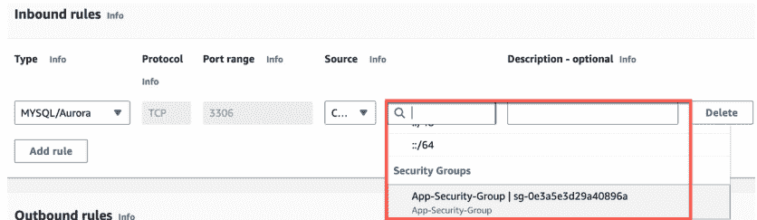

图10.13：安全组配置

15. 请注意，您正在配置此安全组，以允许来自与App-Security-Group关联的任何实例在端口3306（MYSQL/AURORA）上的入站流量，该流量将流向Elastic Beanstalk部署的EC2实例。

I. 继续向下滚动，在“标签”部分单击“添加新标签”。
II. 接下来，创建一个新标签，将“键”设置为Name，“值 - 可选”设置为Data-Security-Group。这将确保安全组带有标签且易于识别。
III. 单击“创建安全组”按钮。
IV. 您应该会收到一条消息，提示安全组已成功创建。

还需要向数据安全组添加一条入站规则。回想一下，在第6章“使用AWS关系型和非关系型（NoSQL）数据库管理多个数据集”中的项目任务6.2先决条件——配置VPC为Secrets Manager做准备中，您必须为数据库安全组添加一条额外的入站规则。之所以需要这条额外规则，是因为您将配置AWS Secrets Manager，以定期自动轮换RDS数据库凭据，从而增强安全性。Secrets Manager将在您的VPC中、与数据库实例相同的子网内部署一个Lambda函数来完成此任务。因此，需要一条安全组规则来确保该Lambda函数也能向数据库发送请求。实现此目标的最快方法是确保安全组允许来自自身的端口3306（MYSQL/AURORA）入站流量。

V. 在VPC控制台左侧菜单的“安全”部分，单击“安全组”。在右侧窗格中，选中Data-Security-Group对应的复选框。
VI. 在底部窗格中，单击**入站规则**。
VII. 单击**编辑入站规则**。
VIII. 在**编辑入站规则**页面上，单击**添加规则**。
IX. 从*类型*下拉列表中选择**MySQL/Aurora**。
X. 确保**来源**设置为**自定义**，并在搜索框中选择`Data-Security-Group`，如下面的屏幕截图所示。

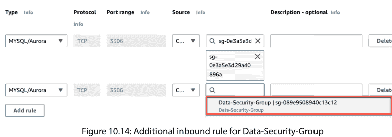

XI. 单击**保存规则**。

既然您已配置了所需的安全组，就可以继续进行下一个项目任务，该任务涉及创建数据库子网组并部署MySQL RDS数据库实例。

## 项目任务10.3 – 创建数据库子网组并启动RDS数据库

在此项目任务中，您将部署一个MySQL RDS数据库实例来存储待办事项。首先，您必须配置数据库子网组。该组用于标识将用于RDS数据库实例的子网。

1. 确保您仍以IAM用户“Alice”的身份登录AWS开发账户，并且位于伦敦区域。
2. 从顶部搜索栏中搜索并导航到Amazon RDS管理控制台。
3. 从左侧菜单中，单击**子网组**。
4. 在右侧窗格中，单击**创建数据库子网组**按钮。
5. 为您的子网组提供一个名称，例如`Todo-RDS-Subnet-Group`。
6. 提供适当的描述。
7. 从**选择VPC**下拉列表中，选择您在*项目任务10.1*中配置的VPC。
8. 在**添加子网**部分，从**可用区**下拉列表中选择`eu-west-2a`和`eu-west-2b`可用区。

9. 在**子网**下拉列表中，确保选择了您为数据库创建的子网。您可以将子网ID与VPC管理控制台进行交叉对照，因为此控制台页面不显示您为子网标记的名称。但是，如果您正确执行了上述步骤，您的数据库子网应配置为`10.5.20.0/24`和`10.5.21.0/24` CIDR块，如下面的屏幕截图所示，因此它们很容易识别。

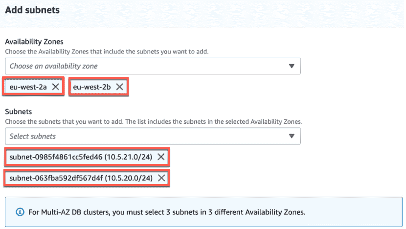

图10.15：选择用于创建子网组的数据库子网

10. 单击页面底部的**创建**按钮。
11. 您的Todo-RDS子网组现在应该已成功创建。接下来，您将部署MySQL RDS数据库。
12. 在Amazon RDS控制台的左侧菜单中，单击**数据库**。
13. 在右侧窗格中，单击**创建数据库**按钮。
14. 您将看到**创建数据库**配置网页。确保在**选择数据库创建方式**部分选择**标准创建**。
15. 在**引擎**选项中，选择**MySQL**。
16. 在**模板**部分，选择**免费套餐**。
17. 继续向下滚动，在**设置**部分，将**数据库实例标识符**设置为`tododb`之类的名称。
18. 在**凭据设置**部分，确保**主用户名**设置为`admin`。

19. 对于**凭据管理**，选择**自行管理**，如下面的屏幕截图所示。

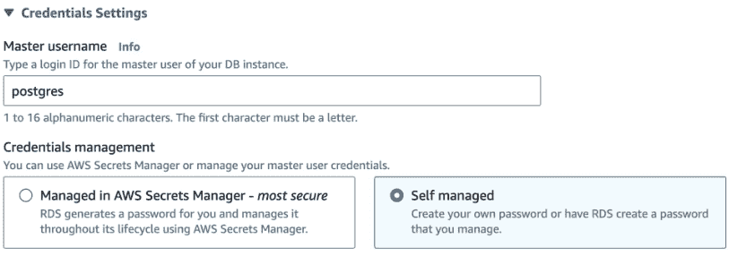

图10.16：Amazon RDS凭据管理

20. 目前，您将使用一组自行管理的凭据来配置数据库。稍后，您将配置AWS Secrets Manager来管理凭据。
21. 为您的数据库提供密码。记下此密码以备后用。然后，在**确认主密码**文本框中输入相同的密码。
22. 再向下滚动一点，进入**存储**部分。在这里，确保**分配的存储空间**设置为**20GiB**。
23. 展开**存储自动扩展**子部分，并取消选中**启用存储自动扩展**复选框。
24. 再向下滚动一点，进入**连接**部分。确保在**计算资源**下选择了**不连接到EC2计算资源**。
25. 从**虚拟私有云（VPC）**下拉列表中，选择您在*项目任务10.1*中创建的VPC。
26. 继续向下滚动，确认已选择正确的数据库子网组，该组应为您在此项目任务前面创建的子网组。
27. 对于**公开访问**，选择**否**。
28. 在VPC安全组（防火墙）部分，确保选择了“选择现有”，并从“现有VPC安全组”下拉列表中选择您在项目任务10.2中为数据库创建的安全组，应为Data-Security-Group。同时，确保从列表中取消选择默认安全组，如下面的屏幕截图所示：

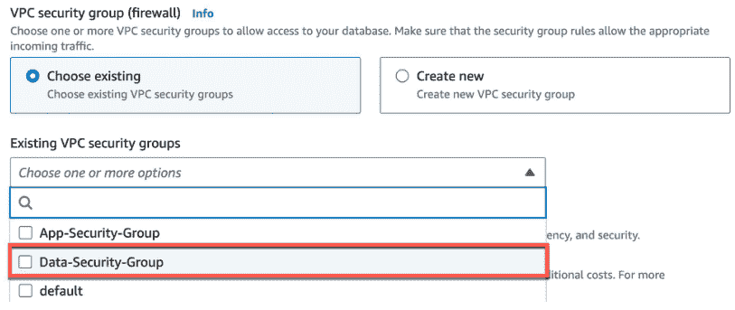

图10.17：RDS数据库的VPC安全组（防火墙）配置

29. 从“可用区”下拉列表中选择eu-west-2a可用区。
30. 继续向下滚动，确保在“数据库身份验证”部分选择了“密码身份验证”。
31. 向下滚动并展开“其他配置”部分。将“初始数据库名称”设置为tododb。
32. 在“备份”下，选中“启用自动备份”旁边的复选框，并将“备份保留期”设置为1天。
33. 将所有其余设置保留为默认值，然后滚动到页面底部。单击“创建数据库”按钮。您的MySQL数据库现在将进行预配置。这可能需要几分钟才能完成。完成后，您应该会看到数据库现在可用，如下面的屏幕截图所示：

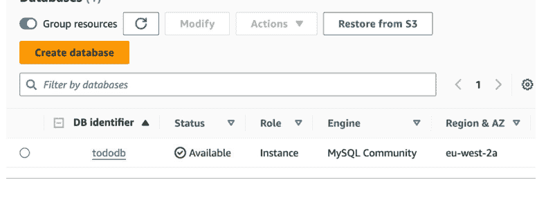

在下一个项目任务中，您将在AWS Secrets Manager中配置一个密钥来管理RDS数据库凭据。

## 项目任务10.4 – 在AWS Secrets Manager中配置RDS密钥

在此项目任务中，您将在AWS Secrets Manager中为MySQL数据库创建一个数据库凭据密钥，然后配置自动轮换以增强数据库的凭据安全性。

1. 确保您仍以IAM用户“Alice”的身份登录AWS开发账户，并且位于伦敦区域。
2. 从AWS管理控制台顶部的搜索栏中搜索并导航到**Secrets Manager**。
3. 从左侧菜单中，单击**密钥**。
4. 在右侧窗格中，单击**存储新密钥**。
5. 在**密钥类型**部分，选择**Amazon RDS数据库的凭据**选项。
6. 提供您在*项目任务10.3*中创建的数据库的当前用户名和密码。


7. 在**数据库**部分，按照以下截图选择您创建的 MySQL 数据库，例如 `tododb`：

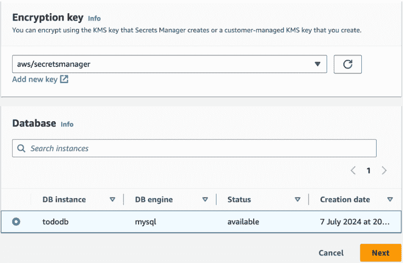

图 10.19：在 AWS Secrets Manager 中为 MySQL 数据库配置密钥

8. 点击页面底部的 **Next**。

9. 在 **Configure secret** 页面，为您的密钥提供一个名称，例如 `tododbsecret`。

10. 提供一个可选的描述（由您决定），然后点击 **Next**。

11. 在 **Configure rotation – optional** 部分，启用 **Automatic rotation** 切换开关。

12. 将 **Time unit** 设置为 **Days**，并将 **Days** 设置为 7。

13. 在 **Rotation function** 部分，确保已选择 **Create a rotation function**，然后为您的 Lambda 轮换函数提供一个名称。请注意，AWS Secrets Manager 会在您选择的名称前添加 `SecretsManager` 作为前缀，参见以下截图：

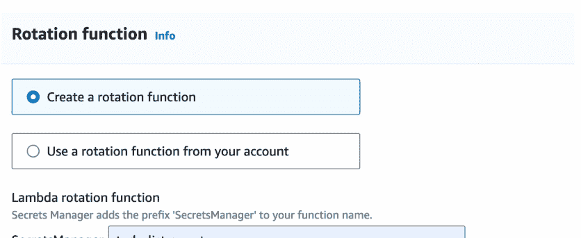

图 10.20：配置密钥轮换并创建轮换函数

14. 对于 **Rotation strategy**，确保已选择 **Single user**。点击 **Next**。

15. 查看配置，然后点击页面底部的 **Store** 按钮。

您现在已在 AWS Secrets Manager 中创建了一个名为 `tododbsecret` 的密钥。Lambda 轮换函数的创建需要几分钟时间，由 AWS CloudFormation 完成。Secrets Manager 现在正在管理您的数据库凭据，每隔七天轮换一次，以确保定期生成新的凭据集以增强安全性。

在下一节中，您将创建一个具有必要策略的 IAM 角色，以允许 Elastic Beanstalk 服务与您的环境（例如 EC2 实例）进行交互，并查询 Secrets Manager 以动态检索凭据数据并将其存储在环境变量中。

## 项目任务 10.5 – 为您的 Elastic Beanstalk 应用配置 IAM 角色

在此项目任务中，您需要创建一个 IAM 角色，该角色需包含以下由 AWS 管理的策略：

- `AWSElasticBeanstalkWebTier`
- `AWSElasticBeanstalkMulticontainerDocker`
- `AWSElasticBeanstalkWorkerTier`

此外，您还需要一个内联策略，该策略授予访问 AWS Secrets Manager 中密钥的权限。然后，该角色将被配置为由 Elastic Beanstalk 服务部署的 EC2 实例假定（assumed）。

1. 在 AWS 管理控制台中，搜索并导航至 **AWS Identity and Access Management (IAM)** 服务。
2. 从左侧菜单中，点击 **Roles**。
3. 在右侧窗格中，点击 **Create role** 按钮。
4. 对于 **Trusted entity type**，选择 **AWS service**。
5. 接下来，从 **Service or use case** 下拉列表中选择 **EC2**，然后选择 **EC2** 作为 **Use case**。点击 **Next**。
6. 在 **Add Permissions** 页面，搜索并选择前面提到的三个 AWS Elastic Beanstalk 策略，然后点击 **Next**。
7. 为角色提供一个名称，例如 `Todo-EB-SM-IAM-Role`。
8. 滚动到页面底部并点击 **Create role**。
9. 您的角色将被创建。接下来，在可用的角色列表中的搜索框中搜索该角色，参见以下截图（*图 10.21*）：

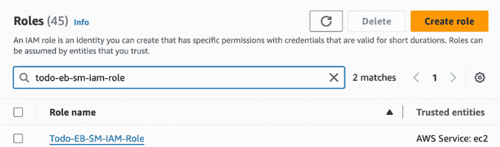

图 10.21：用于 Elastic Beanstalk 和 Secrets Manager 的 IAM 角色

10. 点击该角色以选中它。
11. 在 Permissions 选项卡中，点击 Add permissions 下拉列表并选择 Create inline policy。
12. 在 Specify permissions 页面中，在 Service 部分的下拉列表中选择 **Secrets Manager**（从 Choose a service 下拉列表中选择）。
13. 展开 **Read** 访问级别选项，并选择 **GetSecretValue** 操作。
14. 点击 Resources 下方的 **Add ARNs** 链接。在出现的对话框中，您需要提供您在 Secrets Manager 中创建的密钥的 Amazon Resource Name (ARN)。要获取 ARN，请执行以下操作：
    1. 在单独的浏览器标签页中打开 Secrets Manager。
    2. 从左侧菜单中点击 **Secrets**，然后在右侧窗格中点击您创建的密钥。
    3. 从 Secret details 部分中，将密钥的 ARN 复制到您的剪贴板。
    4. 在您的 IAM 浏览器标签页对话框中的 **Specify ARN(s)** 部分，将您从 Secrets Manager 控制台中复制的 ARN 粘贴到 Resource ARN 旁边的文本框中。对话框中的其他字段将自动填充。
    5. 点击 **Add ARNs**。

15. 您将被带回 Specify permissions 页面，该页面应与图 10.22 类似：

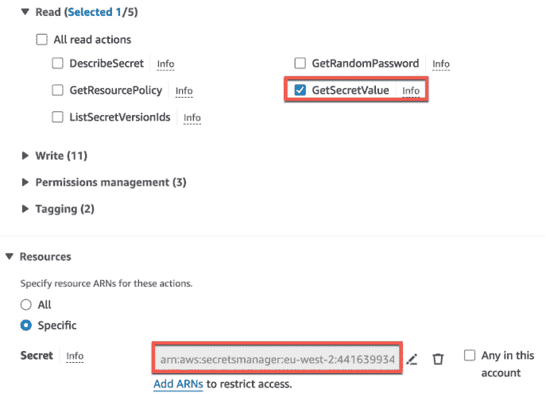

图 10.22：配置内联策略以访问 AWS Secrets Manager 中的密钥

16. 滚动到页面底部并点击 **Next**。
17. 提供一个策略名称，例如 `Todo-EB-Secret-IAM-Policy`。
18. 点击页面底部的 **Create policy**。
19. 您的内联策略已创建并添加到您刚才定义的 IAM 角色中。

既然 IAM 角色和策略现已定义，您可以继续创建您的 Elastic Beanstalk 应用和环境。

## 项目任务 10.6 – 创建 Elastic Beanstalk 应用

在此项目任务中，您将创建一个 Elastic Beanstalk 应用和环境。然后，您将从 GitHub 仓库下载的应用代码进行上传，并将该应用程序部署到一组 EC2 实例中。Amazon Elastic Beanstalk 将在自动扩展组中预置 EC2 实例，部署应用程序负载均衡器，并通过您定义的环境变量配置到后端数据库的连接。

1. 使用 AWS 管理控制台顶部的搜索栏搜索并导航至 Elastic Beanstalk 服务。
2. 确保您仍处于 London 区域。
3. 从左侧菜单中点击 **Applications**，然后在右侧窗格中点击 **Create application** 按钮。
4. 为您的应用程序提供一个名称，例如 `Todo-List-EB-App`。
5. 提供您的应用程序描述。
6. 点击 **Create** 按钮。
7. 在 **Application Todo-List-EB-App environments** 页面上，点击右侧窗格中的 **Create new environment** 按钮。
8. 您将被带到 Configure environment 页面。确保从 Environment tier 中选择了 **Web server environment**。
9. 您将注意到，**Environment name** 已预填为您的应用程序名称后跟 `-env`。例如，`Todo-List-EB-App-env`。您可以保持原样。
10. 向下滚动到页面的 **Platform** 部分。从 **Platform** 下拉列表中选择 **PHP**。接受默认的平台分支，应该是运行在 64 位 Amazon Linux 2023 上的 PHP 8.3。
11. 在 **Application code** 部分中，点击 **Upload your code** 单选按钮。
12. 提供一个版本标签，例如 `v1`。
13. 在 Source code origin 下选择 **Local file**。最大大小 500 MB。
14. 点击 **Choose file** 按钮，导航到您保存从我们的 GitHub 仓库下载的应用程序源代码的位置。选择要上传的 `.zip` 文件，参见以下截图：

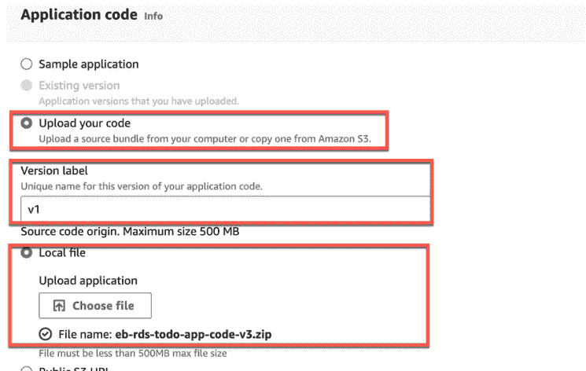

图 10.23：将您的源代码上传到 Elastic Beanstalk

15. 在 **Presets** 下，选择 **High availability**。
16. 点击 **Next**。
17. 在 **Configure service access** 部分中，在 Service role 下选择 **Create and use new service role** 选项。
18. 从 **EC2 instance profile** 下拉列表中选择您在项目任务 10.5 中创建的 IAM 角色。点击 **Next**。
19. 在 **Set up networking, databases, and tags** 部分中，从 **VPC** 下拉列表中选择您在项目任务 10.1 中创建的 VPC。
20. 接下来，选择您希望部署 EC2 实例的可用区（AZs）和子网。这些将是应用子网（app subnets）。具体来说，这些将是 `AppSubnet01` 和 `AppSubnet02`，参见以下截图：

### 实例子网

筛选实例子网

|  | 可用区 | 子网 | CIDR | 名称 |
|---|---|---|---|---|
| ☑ | eu-west-2a | subnet-00c162... | 10.5.10.0/24 | AppSubnet01 |
| ☐ | eu-west-2a | subnet-0107e5... | 10.5.1.0/24 | PublicSubnet01 |
| ☐ | eu-west-2a | subnet-063fba... | 10.5.20.0/24 | DataSubnet01 |
| ☐ | eu-west-2b | subnet-0985f4... | 10.5.21.0/24 | DataSubnet02 |
| ☐ | eu-west-2b | subnet-0a577b... | 10.5.2.0/24 | PublicSubnet02 |
| ☑ | eu-west-2b | subnet-0ed45b... | 10.5.11.0/24 | AppSubnet02 |

图 10.24：选择您的 EC2 实例的子网

21. 保持 **Database** 部分不变，因为您的数据库解决方案是在 Elastic Beanstalk 配置之外构建的。
22. 继续向下滚动并点击 **Next**。
23. 在 **Configure instance traffic and scaling – optional** 部分中，再向下滚动一点，并从 **EC2 security groups** 列表中选择 `App-Security-Group`。
24. 在 **Capacity** 子部分中，确保从 **Environment type** 下拉列表中选择了 **Load Balanced**。在 **Instances** 下，将最小实例大小设置为 1，最大实例大小设置为 2。
25. 再向下滚动一点，确保在 **Instance types** 下拉列表中仅选择了 `t3.micro`。
26. 在 **Load balancer network settings** 部分中，确保 **Visibility** 设置为 **Public**。


27. 根据以下说明，从负载均衡器子网中选择 PublicSubnet01 和 PublicSubnet02。

## 负载均衡器子网

图 10.25：负载均衡器子网

28. 确保在负载均衡器类型部分选中了应用程序负载均衡器。

29. 接下来，在进程部分，选择默认进程，然后从操作下拉列表中选择编辑，如下截图所示：

## 进程

对于每个环境进程，你可以指定负载均衡器用于将请求路由到该进程的协议和端口。你还可以指定负载均衡器如何执行进程健康检查。

图 10.26：进程

30. 在出现的对话框中，展开健康检查子部分，并将路径更改为 /health.html，如下截图所示：

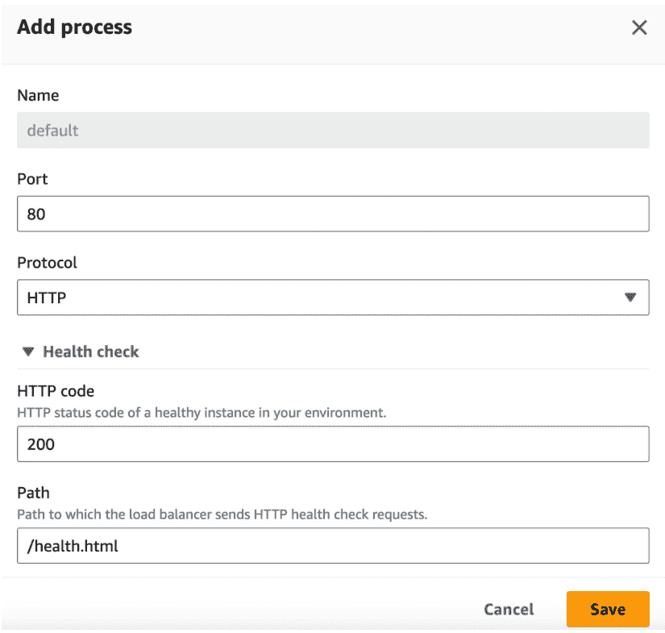

图 10.27：修改 HTTP 健康检查请求路径

31. 点击保存按钮。

32. 滚动到页面底部并点击下一步。

33. 在配置更新、监控和日志 – 可选页面上，选择系统部分下的基本作为健康报告。

34. 取消选中受管更新下的已激活复选框。

35. 继续向下滚动至**环境属性**，并使用**添加环境属性**按钮创建以下环境变量：

-   I. 对于**Secrets Manager 的秘密属性**，通过设置名称为 SECRET_NAME 并将**值**选项设置为 AWS Secrets Manager 中实际秘密的名称，创建一个环境变量。在单独的浏览器选项卡中访问 Secrets Manager Web 控制台以确认名称。在 *项目任务 10.4* 的示例中，秘密名称是 **tododbssecret**。
-   II. 对于**数据库属性**，首先为数据库端点创建一个环境变量。将**名称**选项设置为 DB_ENDPOINT，并将**值**设置为你 RDS 数据库的端点 DNS 名称。如有必要，在单独的选项卡中导航到 RDS Web 控制台，并点击数据库名称访问其摘要页面。在**连接性和安全性**选项卡中，你可以看到**端点** DNS 名称。将该名称复制到你的剪贴板并粘贴到**值**字段中。接下来，为数据库名称创建一个环境变量。将**名称**选项设置为 DB_NAME，并将**值**设置为数据库的名称。在 *项目任务 10.3* 的示例中，数据库名称被设置为 tododb。

36. 参考以下截图以审查**环境属性**应有的外观。

## 环境属性

以下属性作为环境属性传递给应用程序。了解更多

| 名称 | 值 |
| SECRET_NAME | tododbssecret |
| DB_ENDPOINT | tododb.cni6y4s24who.eu-west-2.rds.amazonaws |
| DB_NAME | tododb |

图 10.28：Elastic Beanstalk 配置的环境属性

37. 点击页面底部的**下一步**。

38. 审查所有配置设置，并点击页面底部的**提交**按钮。

你的 Elastic Beanstalk 环境现在将开始预配，这需要几分钟时间。你可以在**环境概览**页面的**事件**选项卡中查看进度详情，如下截图所示：

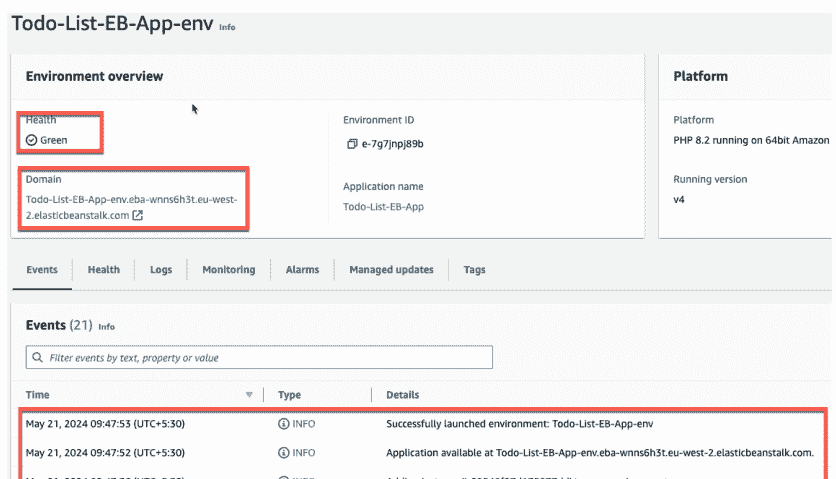

图 10.29：Todo-List-EB-App Elastic Beanstalk 部署事件

既然你的应用程序已部署完成，你只需点击图 10.29 中域名下的链接即可连接到你的应用程序。然后，你应该能够创建新的待办事项列表项，如图 10.30 中所示的截图：


图 10.30：使用 Amazon Elastic Beanstalk 部署的待办事项列表 Web 应用程序

恭喜，你现在已成功使用 Amazon Elastic Beanstalk 部署了你的多层应用程序堆栈。此 PaaS 可以配置你所需的基础架构，管理应用程序部署、版本更新和升级，并支持各种部署策略。

# 摘要

AWS Elastic Beanstalk 是一种 PaaS 解决方案，旨在帮助你快速轻松地部署应用程序，而无需过多关注底层基础设施。AWS Elastic Beanstalk 可以设置和配置支持你的应用程序及其各种环境（阶段）所需的所有必要基础设施。你完全控制底层基础设施的构建方式，无论是部署为单个测试服务器，还是支持高可用性和扩展能力的多层架构。

该服务支持广泛的发展环境和编程语言，包括用于 Java 应用的 Apache Tomcat、用于 PHP 和 Python 的 Apache HTTPS Server，以及用于 .NET 应用的 Microsoft IIS 7.5、8.0 和 8.5。

AWS Elastic Beanstalk 使用 Amazon CloudFormation 来构建你的应用程序所需的底层基础设施。虽然你可以将标准配置项定义为架构的一部分，但也可以使用存储在名为 `.ebextensions` 文件夹中的 Elastic Beanstalk 配置文件来进一步自定义环境中资源的预配方式。配置文件应使用 YAML 或 JSON 编写，扩展名为 `.config`，与应用源代码包放在一起并部署到你的 Elastic Beanstalk 环境中。你可以使用此文件进行各种配置更改和自定义 – 例如，你可以安装 Linux 实例上应用程序可能依赖的软件包。

Elastic Beanstalk 的一个重要功能是通过各种部署选项管理应用程序的生命周期。这些选项包括一次性部署、滚动部署、带有附加批次的滚动部署、不可变部署、流量分割和蓝绿部署。

需要了解的另一个重要概念是，虽然你可以将后端数据库（如 Amazon RDS）作为整体 Elastic Beanstalk 配置和环境设置的一部分来整合，但你可能希望将数据库部署在配置之外，以确保其与应用程序生命周期分开。这种方法也有助于蓝绿部署能力。

最后，在本章中，你学习了如何使用 AWS Secrets Manager 存储和管理敏感数据（如数据库凭据和 API 密钥）来改善你的应用程序安全态势并保护你的数据库。你需要确保你的应用程序被设计为在运行时从 Secrets Manager 检索任何必要的数据，但这额外的设计努力将保护你的环境免受恶意攻击。

在下一章中，我们将通过研究 DevOps 概念和原则来扩展我们对软件开发生命周期的知识。你将学习**持续集成和持续开发/部署**（CI/CD）工具以及 AWS 在管理应用程序开发、发布和更新过程中涉及的流程。DevOps 在帮助组织简化其应用程序开发、测试和部署生命周期方面发挥着基本作用，将其核心框架纳入你的应用程序设计和管理中是在敏捷环境中工作的基础。

# 备考演练 – 章节复习题

除了对关键概念有扎实的理解外，在时间压力下快速思考的能力也是帮助你通过认证考试的技能。这就是为什么在学习初期磨练这些技能至关重要。

章节复习题旨在随着你学习和复习每个章节，逐步提高你的应试技能，同时复习你对章节中关键概念的理解。你会在每章末尾找到这些题目。

## 如何访问这些材料

要了解如何访问这些资源，请前往标题为 *第 17 章，访问在线资源* 的章节。

要打开本章的章节复习题，请执行以下步骤：

-   1. 点击链接 – `https://packt.link/DVAC02_CH10.`
-   或者，你可以扫描以下**二维码**（*图 10.31*）：


图 10.31 – 为已登录用户打开章节复习题的二维码


2. 登录后，您将看到一个与图10.32相似的页面。

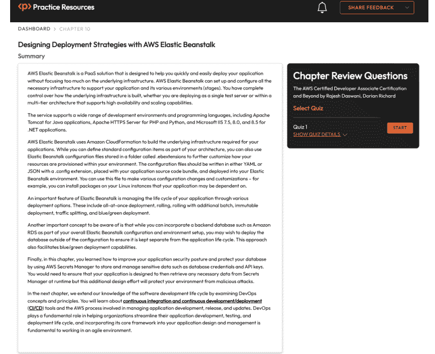

图10.32 – 第10章章节复习题

3. 准备就绪后，开始以下练习，多次重新尝试测验。

## 考试准备练习

前三次尝试时，不必担心时间限制。

### 第1次尝试

第一次，目标至少达到40%。查看答错的题目，并重新阅读章节中的相关部分，以弥补学习中的不足。

### 第2次尝试

第二次，目标至少达到**60%**。查看答错的题目，并重新阅读章节中的相关部分，以弥补任何仍然存在的学习不足。

### 第3次尝试

第三次，目标至少达到75%。一旦你得分达到75%或以上，就可以开始时间把控练习。

> **提示**
> 你可能需要超过**三次**尝试才能达到75%。这没关系。只要复习章节中的相关部分，直到达到目标即可。

## 计时训练

**目标**：你的目标是在尽可能快地回答这些问题的同时，保持分数不变。以下是你后续几次尝试的示例：

| 尝试次数 | 分数 | 所用时间 |
|---|---|---|
| 第5次尝试 | 77% | 21分30秒 |
| 第6次尝试 | 78% | 18分34秒 |
| 第7次尝试 | 76% | 14分44秒 |

表10.1 – 在线平台上的计时练习示例

> **注意**
> 上表中显示的时间限制仅为示例。请根据网站上测验的时间限制，为每次尝试设定你自己的时间限制。

每次新的尝试中，你的分数应保持在75%以上，同时完成所用的“时间”应“减少”。你可以根据需要重复多次尝试，直到你对自己应对时间压力的能力感到自信为止。
