## 11 使用Amazon ECS、Fargate和EKS部署多层应用堆栈

容器化彻底改变了开发者打包和部署应用程序的方式。通过将应用程序及其依赖项封装到容器中，开发者可以确保从开发到生产的不同环境中保持一致。这种变革性的方法消除了开发者针对特定主机环境定制应用程序代码的需求。

你不再需要为特定的主机环境构建应用程序代码，并且可以轻松地将应用程序从台式计算机迁移到虚拟服务器，或从Linux迁移到Windows操作系统。

传统的虚拟机（VM）架构有其局限性。每台虚拟机都托管一个客户操作系统，导致系统臃肿、敏捷性降低，并因重复而造成浪费。相比之下，容器共享宿主机的操作系统内核。这使得容器轻量且启动迅速，与虚拟机相比，同一物理硬件上可以托管显著更多的容器。

本章将帮助你全面了解AWS生态系统中的容器编排！通过详细讲解、动手示例和最佳实践，你将学习如何有效利用Amazon Elastic Container Service（Amazon ECS）和Amazon Elastic Kubernetes Service（Amazon EKS）来编排你的容器化应用程序。

无论你是想部署微服务架构、管理批处理作业，还是在多个环境中扩展应用程序，ECS和EKS都能提供实现目标所需的工具和功能。

AWS认证开发者-助理级认证要求你理解Elastic Container Service的核心概念，以便使用容器化技术部署应用程序。该主题也与考试指南中的领域3：部署相契合。

本章还将探讨**TodoPlus Limited**如何利用容器化和编排服务来增强其任务管理应用程序的开发、部署和管理。利用AWS强大的容器服务（例如用于基于Docker的容器管理的Amazon ECS），TodoPlus可以显著简化和自动化其应用程序工作流，实现可扩展性、可靠性和效率。

本章涵盖以下主题：

- 容器和Docker简介
- 使用Amazon ECS大规模运行和管理容器
- 使用Amazon EKS大规模运行和管理容器
- 项目任务 – 重新设计Todo List Node.js应用程序，使用容器化替代虚拟机

### 容器和Docker简介

在软件开发和部署中，容器化已成为一种革命性的方法，为传统虚拟机提供了高效的替代方案。这场革命的核心是Docker，一个标准化的容器创建和管理平台，使开发者能够更简单地在各种环境中一致地打包和部署应用程序。

### 理解容器化

容器化涉及将应用程序及其依赖项封装到一个轻量级、独立的可执行包中。容器包含运行应用程序所需的一切：代码、运行时、系统工具、库和设置。虽然容器彼此隔离并与主机系统隔离，但它们按需共享主机操作系统内核、库和资源。这种隔离确保了应用程序无论部署在哪里都能统一、安全地运行。

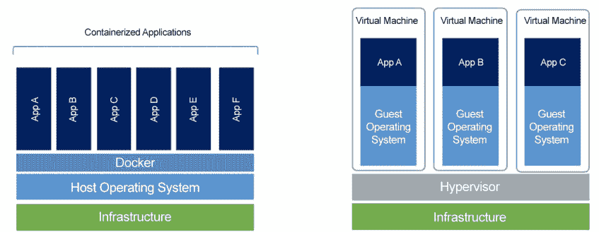

图11.1：容器化与虚拟机系统架构对比

图11.1所示的架构清晰地展示了容器化。在图的左侧，你可以看到多个标记为App A到App F的容器，每个容器代表一个带有其依赖项的隔离应用程序（进程）。这些容器都位于一个Docker层之上，表示Docker Engine在管理容器生命周期中的作用。Docker层下面是主机操作系统，它提供共享的内核和操作系统功能。整个堆栈建立在基础设施之上，该基础设施可以是物理服务器或基于云的虚拟机。

右侧的插图展示了典型的虚拟机架构。每台虚拟机都必须托管其客户操作系统，这会导致重复和臃肿。与容器化方案相比，托管相同数量的应用程序还需要更多的硬件资源。另一个关键事实是，容器旨在执行特定任务，精简高效，不会承载通常捆绑在客户操作系统中的不必要的工具和实用程序。

容器被视为一大福音的另一个领域是现代应用程序设计模式中从单体架构向微服务架构的转变。微服务是一种软件开发方法，鼓励你将应用程序组件构建为独立的服务，这些服务通过标准协议（如HTTP）或基于定义良好的API的轻量级异步消息传递进行通信。每个组件由小型独立团队设计、构建和管理，这些团队可以专注于其核心专业领域，并确保应用程序具有可扩展性，且开发快速、迭代迅速。使用容器构建微服务架构意味着你可以实现快速扩展，具备跨环境迁移的能力，并能轻松避免单点故障。

### Docker的作用

Docker在普及容器技术方面发挥了关键作用。通过提供一个轻量级的容器管理平台，Docker使开发者能够高效地以容器形式构建、共享和运行应用程序。这种简单性极大地促进了Docker的广泛采用，使其成为容器化的事实标准。

Docker采用客户端-服务器架构，Docker客户端与Docker守护进程通信，后者负责构建、运行和分发Docker容器的繁重工作。Docker容器可以在任何安装了Docker守护进程的机器上运行，从而确保开发、测试和生产环境之间的一致性。

### 使用Docker的优势

- **跨环境一致性：** 通过容器化应用程序，开发者可以消除“在我机器上能运行”的问题。打包为Docker容器的应用程序无论部署在哪里，运行方式都相同。
- **快速部署和扩展：** 容器可以在几秒内启动和停止，便于动态横向扩展应用程序。
- **资源效率：** 容器比传统或虚拟机环境需要更少的系统资源，因为它们共享主机系统的内核，而无需自己的操作系统。

在Docker的引领下，容器化代表了应用程序开发、交付和运行方式的重大转变。这种方法简化了开发流程，并提高了部署和扩展方面的运营效率。所提供的示意图直观地展示了容器化的本质，并与传统的虚拟机方法形成对比，强调了通过容器化应用程序部署获得的优势和效率。

虽然容器将你的应用程序堆栈作为隔离且独立的单元进行托管，但你仍然需要一种机制来管理容器的创建、部署和编排。这正是Amazon Elastic Container Service（Amazon ECS）发挥作用的地方，下一节将对其进行讨论。

### 使用Amazon ECS大规模运行和管理容器

Amazon ECS是一项完全托管的容器编排服务，使你能够在由你管理的Amazon EC2实例集群上，或在AWS Fargate（AWS管理所有底层基础设施的无服务器替代方案）上运行和管理Docker容器。借助ECS，你可以通过简单的API调用来启动和停止基于容器的应用程序，查询集群的完整状态，并访问许多熟悉的特性，例如安全组、弹性负载均衡、EBS卷和IAM角色。


Amazon ECS的架构旨在为应用程序的运行方式提供灵活性和控制能力。它由多个组件组成，使您能够创建和管理容器，包括存储和网络功能以及通过负载均衡器进行流量分发。这些组件如图11.2所示，接下来将进行讨论。

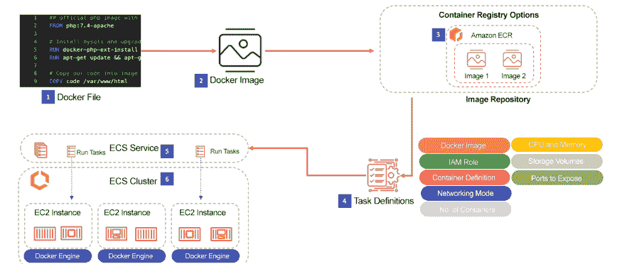

图11.2 – Amazon ECS组件

以下是Amazon ECS的核心组件：

- **Dockerfile**：这是一个文本文件，包含如何构建Docker镜像的说明。通常包含一个基础镜像（如某个版本的Node.js或基础操作系统应用层），该文件将包含构建可部署到容器的镜像的命令。命令包括要运行的运行时环境、应用程序的构建指令、要使用的工作目录等。
- **Docker（容器）镜像**：该镜像包含所有必要的组件，例如库、运行时、要暴露的端口以及处于构建状态的应用程序，这些均基于Dockerfile的指令。
- **容器注册中心 – Amazon Elastic Container Registry (ECR)**：构建好Docker（容器）镜像后，必须将其存储在仓库中。Amazon ECR是一项完全托管的容器注册中心服务，可与IAM和KMS等其他服务良好集成，确保容器镜像的安全托管。它提供公有和私有仓库。
- **任务定义**：这些是应用程序的蓝图，定义容器应如何在集群上部署。它们包括使用哪些Docker（容器）镜像、CPU和内存分配、网络设置等详细信息。
- **ECS服务**：ECS服务允许您在ECS集群中同时运行和维护指定数量的任务定义实例。这些类似于为EC2实例提供的自动扩展服务。您可以定义容量、要使用的扩展策略以及要配置的触发器。失败的任务会被ECS服务自动替换，确保连续性和可用性。
- **任务**：任务定义在容器实例上运行的一个实例。任务可以手动运行，也可以由服务管理。
- **ECS集群**：服务或任务的逻辑分组。在ECS集群中，您可以定义可用的基础设施容量以及运行任务的网络环境，例如VPC和相关子网、监控选项等。

## ECS启动类型：EC2与Fargate

Amazon ECS使您能够使用两种主要启动类型来编排和部署容器：**EC2启动类型**和**Fargate启动类型**。您还可以使用**外部启动类型**部署ECS集群，该类型指在本地环境中部署容器化应用程序。

了解这些启动类型之间的差异，对于高效且经济地架构容器化应用程序至关重要。本节将探讨这两种启动类型并提供详细比较。*图11.3*展示了这些选项：

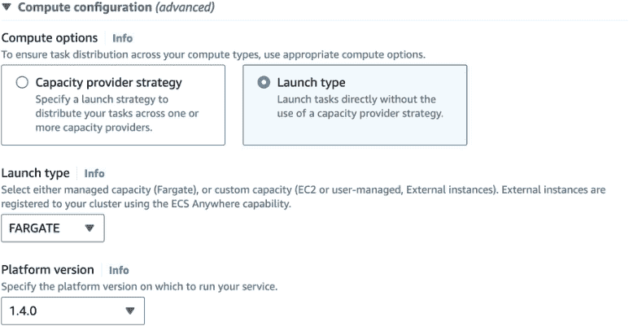

图11.3：在EC2和Fargate启动类型之间选择

## EC2启动类型

EC2启动类型允许您在所管理的Amazon EC2实例集群上运行容器。这种启动类型对底层基础设施提供了最大的控制力，使您能够针对特定的计算、内存和网络配置进行优化。主要特性如下：

- **控制**：完全控制实例类型、操作系统和集群的生命周期。但是，您需要管理实例以及任何实例级别的扩展需求。请注意，任务启动时间取决于实例启动和性能水平。
- **定制化**：能够根据应用的具体需求优化集群配置。
- **成本效益**：通过预留实例、竞价实例或专用实例节省成本。

## Fargate启动类型

Fargate是适用于容器的无服务器计算引擎，无需管理服务器或集群。使用Fargate，您只需指定容器的CPU和内存需求，其余由ECS处理。主要特性包括：

- **简单性**：无需预置、配置或扩展虚拟机集群即可运行容器。任务在由AWS管理的共享环境中运行，并可通过注入到您指定的VPC子网中的弹性网络接口进行访问。Fargate启动类型最适合将简单性和可扩展性优先于对托管环境的直接控制的应用程序。
- **可扩展性**：自动扩展计算资源以匹配应用程序的具体需求。
- **安全性**：每个任务都在其隔离环境中运行，降低了安全风险。

EC2启动类型非常适合大型工作负载以及价格是决定因素的情况。在考虑大型工作负载时，通常需要为工作负载的不同组件（如前端和后端服务）创建不同的任务。此时，可以使用EC2启动类型来确定每种类型所需的计算资源。此外，使用EC2启动类型，您还可以使用预留实例并享受其提供的折扣，尤其是针对长期资源。如果您需要更多控制及其提供的高级功能，也建议使用EC2启动类型。

Fargate启动类型非常适合刚开始使用容器、可能没有专业知识或能力管理底层基础设施的公司。如果您运行的是轻量级或批处理型工作负载，它也非常理想。使用Fargate，您无法指定实例类型，也无法运行DaemonSet或特权Pod，这会导致集群上的某些服务不可用。

编排容器并让容器化应用程序与其他AWS服务集成的另一个关键组件，是了解ECS如何与IAM配合使用。通过使用策略和角色，您必须按照最小权限访问原则，为容器实例及其内部运行的任务授予必要的权限。虽然这适用于所有AWS服务，但了解ECS中必须定义适当角色和权限的关键要素，对于确保安全性并授予正常运作所需的访问级别是必要的。IAM角色将在下一节讨论。

## 为ECS定义IAM角色

根据您使用的启动类型、任务和应用程序的要求以及所需的特定AWS服务集成，您可以为ECS环境定义各种IAM角色。

您可能配置的三种典型IAM角色如下：

- Amazon ECS容器实例角色
- Amazon ECS任务执行角色
- 任务IAM角色

### Amazon ECS容器实例角色

如果您计划使用EC2启动类型托管容器，则必须配置一个IAM角色，使实例上安装的容器代理能够代表您调用AWS API。您可以将AWS提供的托管策略AmazonEC2ContainerServiceforEC2Role附加到该角色，授予使用整个ECS功能集的权限。该策略授予多项权限，例如注册容器实例、向CloudWatch发送日志事件、访问Amazon ECR仓库等。

### Amazon ECS任务执行角色

任务执行角色授予ECS容器代理和Fargate代理进行API调用的权限。权限包括从与容器相同账户或另一个账户中的ECR私有仓库拉取容器镜像，以及使用awslogs日志驱动发送CloudWatch日志。还可以授予其他权限，例如使任务定义能够调用Secrets Manager机密或AWS Systems Manager Parameter Store中的参数。您可以使用提供的托管策略AmazonECSTaskExecutionRolePolicy，该策略授予日常使用场景所需的权限。


## Task IAM Roles

除了定义任务执行角色之外，您还可以为任务中运行的容器定义角色。如果您的应用程序（容器）需要进行 API 调用，例如访问数据库或存储服务，任务 IAM 角色可以帮助您定义必要的权限并在需要时授予临时凭证。任务 IAM 角色作为任务定义的一部分定义，或使用 RunTask API 操作定义。任务 IAM 角色还使您能够为不同的任务定义不同的权限。这确保了最小权限原则的应用。

除了确保您的任务具有访问各种 AWS 服务的正确权限之外，您还必须了解这些任务在您的 AWS 账户中是如何部署的。任务放置策略允许您定义任务的部署方式——例如，您希望任务在多个可用区运行还是在单个可用区运行。在下一节中，您将了解有关任务放置策略的更多信息。

## Task Placements

当您使用 EC2 启动类型启动任务时，必须定义这些任务运行的位置以及使用哪些实例。任务放置的参数基于 CPU、内存和端口等要求。您还可以定义在缩容时终止任务的策略，从而允许 ECS 确定首先终止哪些任务。

除了基于 CPU、内存和端口放置任务之外，您还可以基于任务放置约束定义任务放置的位置，并按如下方式定义任务放置策略。

### Task Placement Constraints

任务放置约束是管理任务放置方式的规则。它们可以在创建新的 ECS 服务或更新现有服务时设置，或者您可以为独立任务指定它们。

约束由类型组成，该类型定义规则，以及表达式，该表达式指定实例属性。Amazon ECS 支持以下类型的约束：

- **distinctInstance**：任务放置在不同的容器实例上。
- **memberOf**：将任务放置在满足表达式的容器实例上。您可以在运行任务、创建新服务、新任务定义或现有任务定义的新修订版时指定 memberOf 约束。

您可以拥有自定义或内置属性，例如 ecs.ami-id、ecs.os-type 和 ecs.instance-type。例如，您可以定义一个约束来将实例类型限制为仅 t2.micro。

您还可以使用集群查询语言对容器实例进行分组。例如，您可以使用可用区、实例类型或其他自定义属性等属性对容器实例进行分组。然后，您可以根据此组自定义 ECS 如何放置任务。

表达式具有以下语法：subject operator [argument]。例如，以下表达式使用位于 eu-west-2a 或 eu-west-2b 可用区的实例：

```
attribute:ecs.availability-zone in [eu-west-2a, eu-west-2b]
```

另一个示例是任务亲和性，您可以在其中选择托管 service:development 组中任务的实例：

```
task:group == service:development
```

接下来，您可以定义任务放置策略。

### Task Placement Strategies

Amazon ECS 支持以下放置策略：

- **Binpack Strategy**：在 binpack 策略中，任务放置在实例上，以使未使用的 CPU 或内存量最少。这种放置策略可让您最大限度地减少分配给任务的容器实例数量。

  此策略的示例如下：

  ```
  "placementStrategy": [
    {
      "field": "memory",
      "type": "binpack"
    }
  ]
  ```

  在这里，策略是 binpack，任务的放置基于内存。

- **Random Strategy**：在随机策略中，任务随机放置。以下是此策略的示例：

  ```
  "placementStrategy": [
    {
      "type": "random"
    }
  ]
  ```

- **Spread Strategy**：spread 策略是根据定义的值将任务均匀放置。可接受的值可以是 instanceId、host 或应用于容器实例的另一个自定义属性，例如 attribute:ecs:availability-zone，这使您可以将任务均匀地分布在可用区中。

  以下是 spread 策略的示例：

  ```
  "placementStrategy": [
      {
          "field": "attribute:ecs.availability-zone",
          "type": "spread"
      }
  ]
  ```

您还可以使用各种策略按您希望执行的顺序定义多个任务放置策略。例如，您可以拥有一个任务放置策略，该策略将任务均匀地分布在可用区中，然后再根据内存对这些任务进行 binpack。以下是示例：

```
"placementStrategy": [
    {
        "field": "attribute:ecs.availability-zone",
        "type": "spread"
    },
    {
        "field": "memory",
        "type": "binpack"
    }
]
```

任务放置策略也可以使用 CLI 以及控制台定义，如图 11.4 所示：

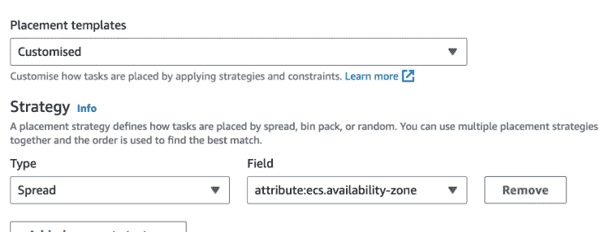

请注意，这些任务放置策略仅在使用 EC2 启动类型时使用，而不是 Fargate。虽然任务放置约束和策略使您可以配置任务的放置方式和位置，但您还必须考虑应用程序的可扩展性要求。Amazon ECS 提供任务层和容器层可扩展性选项，将在下一节中讨论。

## Amazon ECS Scaling Options

Amazon ECS 提供两种不同的扩展选项。第一个是服务自动扩展功能，可增加或减少集群中任务的数量。第二个是集群扩展选项，可处理托管任务的 EC2 实例的扩展和缩减。

### Service Auto-Scaling

ECS 服务自动扩展会自动扩展和缩减在集群中运行的任务数量，并使用 Application Auto Scaling 服务。这适用于 EC2 启动类型和 Fargate。Amazon ECS 将发布 CloudWatch 指标，指定平均 CPU 和内存利用率，然后用于确定何时扩展和缩减。

图 11.5 描述了自动扩展过程：

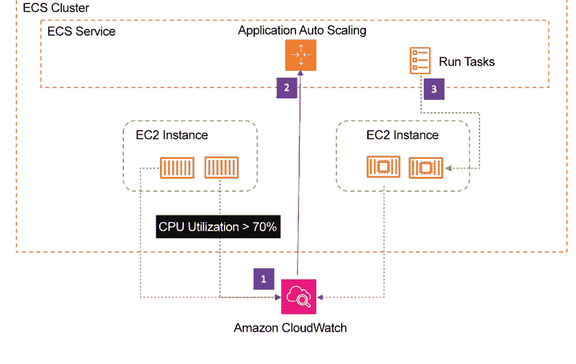

前图中自动扩展工作流程如下：

- 缩放策略设置为在平均 CPU 利用率达到 70% 时触发。
- CloudWatch 生成警报并通知 Application Auto Scaling 服务。
- Amazon ECS 服务启动另一个任务以进行补偿。

以下缩放策略可与 Amazon ECS 配合使用：

- **Target tracking scaling policies**：Amazon ECS 将根据特定指标的预定义目标值启动或终止任务。例如，如果您将平均 CPU 利用率目标值设置为 50%，ECS 将仅启动足够多的任务以确保满足此目标值。它不会启动额外的任务来使平均 CPU 利用率低于此值。

- **Step scaling**：Amazon ECS 将根据警报违规启动或终止任务，并且警报违规的大小用于定义要启动的任务数量。

- **Schedule scaling**：Amazon ECS 将根据您指定的日期和时间启动或终止任务。

### Cluster Auto Scaling

集群自动扩展是指扩展底层 EC2 实例以确保为集群中运行的任务提供足够的资源。

为了确定实例是否需要扩展，ECS 使用启用了托管扩展的 **Auto Scaling group capacity provider**。Amazon ECS 创建两个自定义 CloudWatch 指标——一个用于低 CloudWatch 指标警报，另一个用于高 CloudWatch 指标警报。然后它使用附加到自动扩展组的 **target tracking** 缩放策略。ECS 然后根据任务的资源利用率管理缩减和扩展操作。

CapacityProviderReservation 是用于确定自动扩展组中剩余容量的指标。如果此指标大于 targetCapacity，则表示正在运行更多任务并消耗更高比例的容量。作为响应，自动扩展组启动注册到集群的额外 EC2 实例。相反，如果此指标小于 targetCapacity，自动扩展组将缩减。

为了确保您仅终止没有运行 Amazon ECS 任务的实例，您还必须打开 **managed termination protection** 功能。

接下来，我们将讨论为什么在 Amazon ECS 上部署应用程序时网络至关重要。它决定了容器如何相互通信以及与外部世界的通信。ECS 提供多种网络模式，每种模式都适用于不同的用例。


## Amazon ECS 上的网络

Amazon ECS 上的网络使您能够定义应用程序如何从 VPC 内部以及外部流量访问。以下网络模式在 Amazon ECS 上可用：

- **awsvpc 网络模式：** 此模式为每个运行的 ECS 任务分配一个弹性网络接口（ENI），为其在 VPC 中提供 IP 地址。此设置非常适合需要高网络隔离以及直接访问 VPC 中其他 AWS 服务或资源的任务。它通过允许任务直接通过 AWS 网络与数据库、缓存和其他服务交互，从而简化了网络架构。

- **bridge 网络模式：** 在此模式下，同一 EC2 实例上的容器共享网络桥，促进它们之间的通信。此模式适用于需要简单容器间通信且不需要 awsvpc 模式提供的高级功能或隔离的应用。端口映射将容器端口暴露给主机，允许外部流量到达容器。

- **host 网络模式：** 此模式通过消除容器与主机之间的网络隔离，为容器提供最高性能的网络。它最有利于不需要其他模式提供的网络隔离的高吞吐量应用。容器使用 EC2 实例的网络栈；开发人员或架构师必须管理端口冲突。

在下一节中，您还将学习如何使用负载均衡来分发到您的 Amazon ECS 部署的传入流量。

## Amazon ECS 的负载均衡

Amazon ECS 可以配置为使用 Elastic Load Balancing 在任务之间分发流量。您可以使用 Application Load Balancer 处理 HTTP/HTTPS 流量，并使用 Network Load Balancer 处理 TCP/UDP 流量。

Amazon Elastic Load Balancers 是容器感知的，这意味着您可以从单个 ECS 服务在同一容器实例上运行多个任务。这是通过一种称为动态主机端口映射的概念实现的。让我们从架构角度结合 *Figure 11.6:* 中的图表来审视这一点：

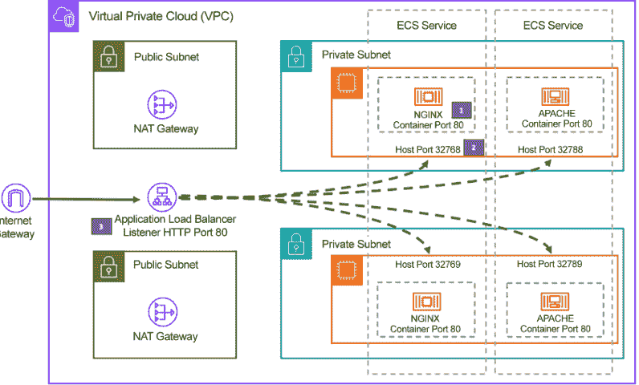

需要注意的要点如下：

- Application Load Balancer 在端口 80 上监听传入请求。
- 运行 Web 服务应用的容器将通过 HTTP（80）提供内容。
- 主机端口从 32768 到 61000 之间的临时端口范围内动态分配。

当容器（任务）启动时，它会作为实例 ID 和端口组合注册到 Application Load Balancer。这种对主机端口的感知可确保流量被路由到该实例 ID 以及对应容器的端口。

这种动态主机端口映射使您能够使用单个 ECS 服务运行多个容器，同时确保根据前述图表，正确的应用程序可从互联网访问。

在 awsvpc 网络模式下配置目标组时，您必须将目标类型定义为 **IP** 而不是 **Instance**。这是因为您的任务与弹性网络接口相关联，而不是 EC2 实例。

另请注意，如果您的容器托管在 VPC 的私有子网中，您必须配置 NAT 网关以启用出站互联网访问，如 *Figure 11.6* 所示。

在下一节中，您将获得 Amazon ECS Copilot 服务的快速概述。

## Amazon ECS Copilot 简介

Amazon ECS Copilot 是一种命令行工具，使您能够快速构建和部署生产就绪的容器化应用程序。Copilot 不仅仅是一个 CLI 工具。该服务遵循 AWS Well-Architected Framework 和最佳实践，为您的应用程序栈构建必要的<|message|> 基础设施组件 – VPC、子网、负载均衡器和存储服务。

Amazon ECS Copilot 还与持续集成和持续部署（CI/CD）工具集成，使您能够自动将更新和新版本部署到您的应用程序栈。

要使用 Copilot，您需要执行以下操作：

- 1. 安装 AWS Copilot CLI。目前为 Linux 和 macOS 操作系统提供支持。
- 2. 安装并配置 AWS CLI。
- 3. 运行 AWS configure 实用程序以访问凭据。
- 4. 安装并运行 Docker。

Amazon ECS 彻底改变了开发人员如何在 AWS 上设计、打包和部署应用程序的方式。使用共享操作系统内核以及将应用程序代码与运行所需的所有文件和库一起打包的能力，具有超出传统虚拟化基础设施的诸多优势。

Amazon ECS 也有一个替代方案：一个名为 Kubernetes 的厂商无关产品。Kubernetes 是一种开源容器编排解决方案，用于 AWS、Azure 和 Google Cloud 等各种云提供商。这使得在多云平台架构中更轻松地管理容器。

为了确保兼容性并占领市场份额，AWS 提供了 Amazon Elastic Kubernetes Service（Amazon EKS），这是一种托管的 Kubernetes 解决方案，与其他 AWS 服务和工具紧密集成。在后续章节中，您将获得 Amazon EKS 的概述。

## 使用 Amazon EKS 大规模运行和管理容器

在云计算的动态世界中，采用容器化技术已成为部署可扩展且高效应用程序的重要策略。在这些技术中，Kubernetes 已成为编排容器化应用程序的事实标准，提供强大的功能来大规模管理复杂部署。Amazon Elastic Kubernetes Service（EKS）是 AWS 的完全托管解决方案，将 Kubernetes 的敏捷性、可扩展性和可靠性带到云中，使开发人员和运维团队能够专注于构建软件，而无需管理底层基础设施的开销。

## 了解 Amazon EKS

Amazon EKS 通过管理 Kubernetes 控制平面来简化在 AWS 上运行 Kubernetes，该控制平面是负责编排容器的核心组件。此托管服务自动化诸如版本升级、修补和扩展控制平面等任务，确保您的 Kubernetes 环境始终保持最新、安全且高度可用。

## Amazon EKS 的关键特性

Amazon EKS 提供了一系列功能，使其成为在 AWS 上运行 Kubernetes 的强大而灵活的选择。以下是其中的一些功能：

- **完全托管的 Kubernetes 控制平面**：EKS 免除了您管理控制平面的运营负担，在多个 AWS 可用区提供高可用性。
- **与 AWS 服务集成**：EKS 与 AWS 服务提供无缝集成，包括用于分发应用程序流量的 Elastic Load Balancing、用于身份验证的 IAM、用于网络的 Amazon VPC、用于日志记录和监控的 Amazon CloudWatch，以及用于镜像管理的 Amazon ECR。
- **灵活性和可移植性**：使用 EKS，您可以使用 Amazon EC2 实例或 AWS Fargate 实现无服务器体验，在 AWS 上运行 Kubernetes 应用程序。与标准 Kubernetes 的兼容性可确保您的应用程序在不同环境中保持可移植性。

## 控制平面

控制平面是任何 Kubernetes 集群的核心，负责管理集群状态、调度部署以及处理扩展和自愈操作。在 Amazon EKS 中，控制平面具有以下几个关键特性：

- **完全托管**：Amazon EKS 自动化 Kubernetes 控制平面的配置、扩展和维护，确保其始终可用并与最新 Kubernetes 版本保持同步。
- **高可用性**：控制平面在区域内的多个 AWS 可用区运行，降低了单点故障的风险，确保您的应用程序保持可访问。
- **安全性**：工作节点与控制平面之间的通信使用 AWS Identity and Access Management（IAM）和 Kubernetes 基于角色的访问控制（RBAC）进行保护，提供细粒度的访问控制。


图 11.7 说明了你现在构建的架构，并且希望你对如何在 AWS 上构建和设计应用程序解决方案有了扎实的理解：

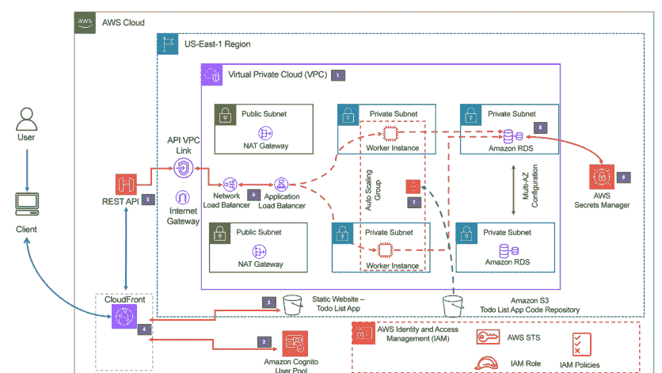

## 图 11.7 – 使用 EC2 实例作为后端服务的应用程序架构

在即将到来的项目任务中，你将通过用在 Elastic Container Service（Fargate）上运行的容器替换托管后端功能的 EC2 实例来修改架构。

TodoPlus Limited 将从本章讨论的各种原因中受益于这种架构变更。其中包括删除与运行自己的 EC2 实例相关的管理和维护开销。使用 Fargate，你无法访问底层计算基础设施，因此无需负责修补和更新运行容器的操作系统或核心服务器组件。这种共享责任模型的转变是公司始终追求的目标，因为它带来了巨大的成本节约。此外，通过使用无服务器架构和 AWS 的托管服务，你将更好地与 Well-Architected Framework 对齐，包括可持续性支柱，通过为环境尽一份力。

此外，应用程序将更加轻量、可在不同服务器之间移植，并且效率更高。

虽然从技术上讲，从虚拟机转向容器的转变是显而易见的，但在任何生产环境中，你必须考虑变更的影响。在以下项目练习中，你将首先部署和配置 ECS 服务并将流量转移到该服务，然后终止之前的 Auto Scaling Group 配置，该配置部署了本章之前记录的架构中的 EC2 版本。

虽然本章未讨论部署策略，但在现实场景中你必须考虑此类策略，其中一些已在 *第 10 章，使用 AWS Elastic Beanstalk 设计部署策略* 中进行了探讨。

*图 11.8* 说明了使用 ECS Fargate 服务更新的修改后架构。

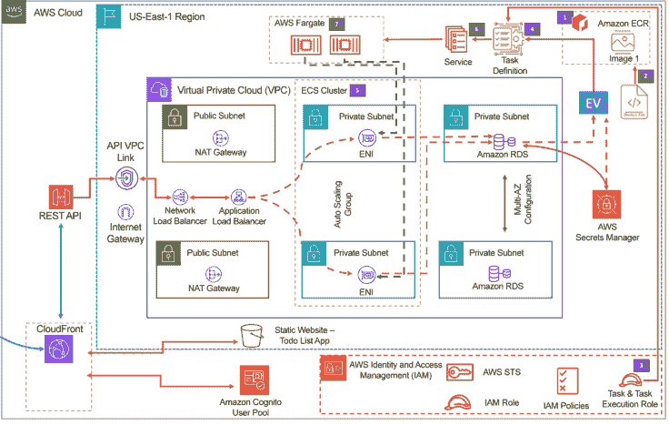

图 11.8：使用 ECS（Fargate）的应用程序架构

在前面的图中，你会注意到所做的更改，已编号以帮助识别纳入设计中的组件。以下是构成架构更改的关键服务和资源的分解：

- **Amazon Elastic Container Registry (ECR)：** Amazon ECR 服务取代了以前用于托管应用程序源文件 ZIP 格式的 S3 存储桶。回想一下，之前当 Auto Scaling 组启动 EC2 实例以提供后端操作时，用户数据脚本会运行，将此 ZIP 文件从存储桶复制到 EC2 实例并执行各种配置任务。在此更改中，你将创建一个 ECR 仓库来托管 Docker 镜像，该镜像将用于部署你的 Fargate 容器。
- **Dockerfile**：Dockerfile 包含构建 Docker（容器）镜像的指令。
- **Task and Task Execution Roles**：作为构建的一部分，你需要一个任务角色和一个任务执行角色。任务角色使任务中的容器能够访问其他 AWS 服务，例如 Secrets Manager，以检索应用程序连接所需的数据库端点和主机详细信息，或 Amazon S3 以上传或下载内容。任务执行角色授予你的 ECS 容器或 Fargate 代理权限以执行特定操作，例如访问 ECR 注册表以提取容器镜像或将日志数据发送到 Amazon CloudWatch。
- **Task Definition**：你的任务定义将包含部署容器所需的所有参数，例如使用哪个容器镜像、网络模式、CPU 和内存分配、映射端口、操作系统以及任何环境变量。
- **ECS Cluster**：你必须部署一个 ECS 集群，在其中定义用于容器的 VPC 和子网等参数。
- **ECS Service**：在 ECS 中，你将定义创建的任务定义、部署容器的子网、安全组、将流量分发到这些容器的负载均衡器和目标组，以及任何服务自动扩展参数。
- **AWS Fargate**：一旦你部署了 ECS 服务，这将触发在 AWS Fargate 中启动你的容器。对这些容器的访问将通过在你的 VPC 中指定的子网中部署的 ENI 提供。

现在你已经对架构设计变更有了高层次的概述，是时候继续进行项目任务以执行配置更改了。

## 技术要求

在即将到来的项目任务中，你必须登录到 AWS 开发账户，在该账户中你一直在设计和部署 Todo List 应用程序。确保你以 IAM 用户 Alice 的身份登录。

你还需要安装和配置 Docker 引擎，该引擎将用于创建你的容器镜像。由于并非每个人都能在其本地机器上安装此类工具（例如，如果你使用的是具有某些限制的工作笔记本电脑），因此提供了逐步指南，说明如何启动账户中的额外 EC2 实例以构建 Docker 镜像。你可以在创建 Docker 镜像并将其上传到 Amazon ECR 仓库后关闭该实例。

本章的代码可以在此 GitHub 仓库链接中找到：`https://packt.link/m5DnU`

## 项目任务 11.1 – 创建 Amazon Elastic Container Registry（ECR）仓库

在此任务中，你将在 Amazon ECR 中创建一个新仓库来托管你的 Docker（容器）镜像：

- 1. 以 IAM 用户 Alice 的身份登录到 AWS 开发账户。
- 2. 通过在 AWS 管理控制台主页顶部搜索栏中搜索该服务，导航到 ECR 控制台。
- 3. 检查页面右上角选择的区域，以确保你位于 N.Virginia 区域。
- 4. 从左侧菜单中选择 **Repositories**。
- 5. 在右侧窗格中，单击 *Create repository* 按钮。
- 6. 在 **Visibility settings** 下，选择 **Private**。
- 7. 在默认仓库名称后添加后缀以唯一标识你的仓库。例如，你可以添加名称 **todo-plus**，如图 11.9 所示。

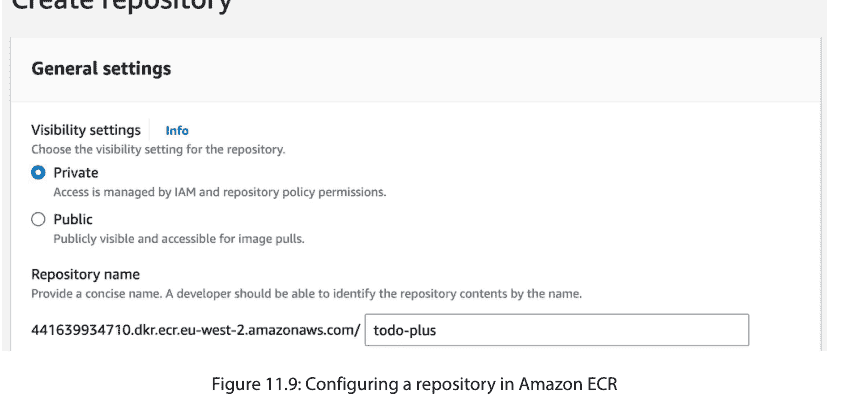

- 8. 滚动到页面底部并单击 *Create repository* 按钮。
- 9. 你将被重定向回仓库列表，你应该会找到为你创建的仓库。确保记下此仓库的 URL，因为你将在下一个项目任务中使用它。

接下来，你将构建更新后的 Node.js 应用程序的 Docker 镜像，该镜像将用于构建你的容器。

## 项目任务 11.2 – 启动用于创建 Docker 镜像的实例

如本章技术要求部分所述，为了便于创建你的容器镜像，你需要部署一个额外的 EC2 实例并使用它来构建你的镜像。

作为部署此额外 EC2 实例的前奏，你必须创建一个 IAM 角色，该角色授予 EC2 权限以将 Docker 镜像推送到 ECR 仓库。你还需要权限通过 Systems Manager 和 Session Manager 远程访问该实例。这种对实例的远程连接更加安全，因为你无需打开端口或配置防火墙规则：

- 1. 确保你仍登录到 AWS 开发账户。还确保你正在 N.Virginia（us-east-1）区域中操作。
- 2. 通过在控制台主页的搜索栏中搜索该服务，导航到 IAM 管理控制台。
- 3. 从左侧菜单中单击 Roles，然后在右侧窗格中单击 Create role 按钮。
- 4. 选择 AWS service 作为受信任实体类型，然后在 Use case 下选择 EC2。单击 Next。
- 5. 在 Permissions policies 部分的搜索框中，搜索并选择 AmazonSSMManagedInstanceCore 和 EC2InstanceProfileForImageBuilderECRContainerBuilds 策略。
- 6. 确保两个策略都已正确选择，如图 11.10 所示：

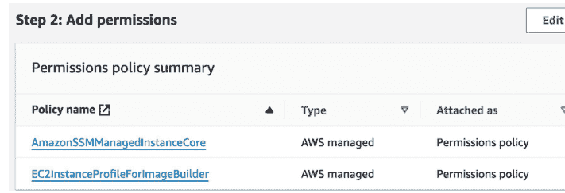

图 11.10：授予 EC2 实例访问 ECR 并通过 Session Manager 启用远程连接的策略

- 7. 单击 Next。
- 8. 为你的 IAM 角色提供一个名称，例如 iam-role-grant-ec2-access-to-ecr。
- 9. 单击屏幕底部的 Create role 按钮。


+   10. 在 Web 控制台顶部的搜索栏中搜索 EC2 服务，导航到 EC2 管理控制台。
+   11. 从左侧菜单中，点击 **实例**，然后在右侧窗格中，点击 **启动实例**。
+   12. 为您的实例提供一个名称，例如 **DockerImage-Server-01**。
+   13. 确保已选择 **Amazon Linux 2003 AMI**。
+   14. 对于实例类型，请确保选择 **t2.micro**。
+   15. 对于 **密钥对（登录）**，选择 **继续而不使用密钥对（不推荐）**。您不需要密钥对，因为您将向此实例附加一个 IAM 角色，以便可以使用 AWS Systems Manager Session Manager 连接到它。
+   16. 点击 **网络设置** 部分中的 **编辑** 按钮。接下来，从 **VPC – 必选** 下拉列表中选择 **todolist-vpc**，如图 11.11 所示：
+   17. 确保您也选择了 **todolist-app-subnet01** 子网。由于您将使用 Session Manager 连接到实例，因此不需要它拥有公有 IP 地址——这是一项额外的安全措施。
+   18. 接下来，点击 **选择现有安全组** 选项，并从 **常用安全组** 下拉列表中选择 **default** 安全组。
+   19. 进一步向下滚动页面，展开 **高级详细信息** 部分。
+   20. 接下来，从 IAM 实例配置文件下拉列表中选择 **iam-role-grant-ec2-access-to-ecr**。
+   21. 最后，滚动到页面底部，点击 **启动实例** 按钮。

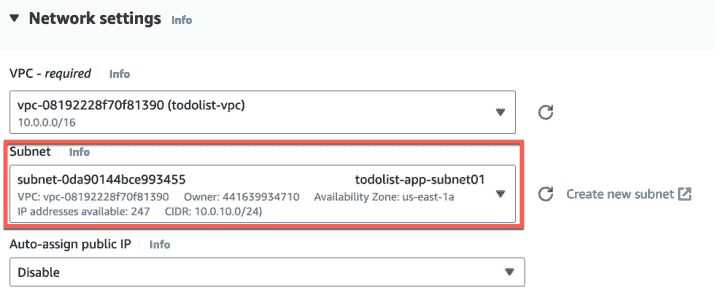

图 11.11：DockerImage-Server-01 的 VPC 和子网选择

22. 您的 EC2 实例需要几分钟才能启动，理想情况下，您必须等待它通过所有检查后再连接到它。从左侧菜单点击实例链接，您应该会在右侧窗格中看到您的实例。检查以确保实例已通过两项检查，如图 11.12 所示：

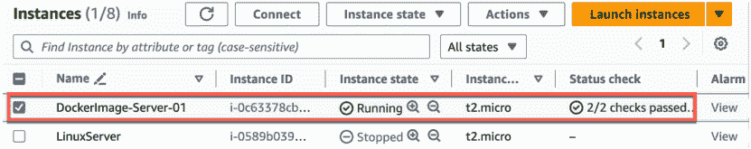

图 11.12：DockerImage-Server 状态检查

## 项目任务 11.3 – 构建 Docker 镜像

+   1. 既然您的实例正在运行，现在该连接到它了。确保您已登录到您的 AWS 开发账户和 EC2 管理控制台。
+   2. 从左侧菜单中，点击实例并选择 DockerImage-Server-01 实例。
+   3. 点击屏幕右上角的连接按钮。
+   4. 您将被重定向到“连接到实例”网页。
+   5. 选择 Session Manager 选项卡，然后点击连接按钮，如图 11.13 所示：

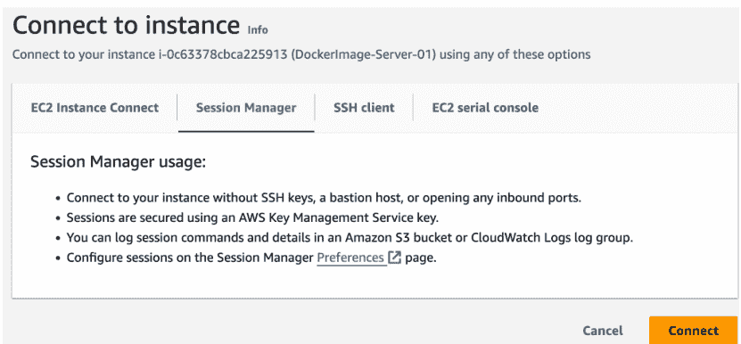

图 11.13：使用 Session Manager 连接到实例

6. 当您连接到实例时，您应该会看到以下屏幕：

会话 ID：root-7rtyphzgodxtqmx67gsdvppjce 实例 ID：i-0ff02a553fb1b10af


图 11.14：使用 Session Manager 连接到您的实例

7. 接下来，您必须在此服务器上安装 Docker 引擎：

+   I. 输入 `sudo yum update -y` 命令并按 Enter 键。这将执行操作系统上的任何待处理更新。在大多数情况下，不需要进行更新。使用 sudo 将提升您的权限以运行这些命令。

+   II. 接下来，输入 `sudo yum install docker` 命令并按 Enter 键。这将显示 Docker 软件包的安装状态。系统将要求您确认是否要下载并安装这些软件包。继续输入 y 并按 Enter 键。

+   III. 下载和安装成功后，您将看到 Complete! 消息，如图 11.15 所示：

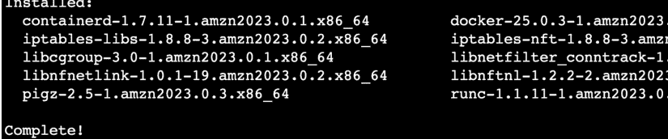

图 11.15：成功安装 Docker

+   IV. 接下来，输入 `clear` 命令并按 Enter 键。这将清除屏幕，使其不会过于杂乱，便于阅读。

V. 接下来，您需要启动 Docker 服务。输入 `sudo service docker start` 命令并按 Enter 键。您应该会收到以下确认信息：

```
sh-5.2$ sudo service docker start
Redirecting to /bin/systemctl start docker.service
sh-5.2$
```

图 11.16：启动 Docker 服务

VI. 接下来，您需要为实例上的内置账户 ec2-user 分配与 Docker 服务交互和工作的能力。目前，该账户没有权限，需要通过将 ec2-user 添加到 Docker 组来分配这些权限。输入 `sudo usermod -a -G docker ec2-user` 命令并按 Enter 键。该命令将被接受，并会出现一个新的光标行。

VII. 接下来，为了确保新权限可用，您必须退出会话并重新登录。输入 `exit` 并按 Enter 键。这将断开您与会话的连接，您必须重新登录。

VIII. 导航回 EC2 管理控制台，点击左侧菜单中的实例，然后在右侧选择 DockerImage-Server-01 实例。按照项目任务 11.2 中步骤 16 到 19 所述的过程连接到实例。

8. 既然您已使用 Session Manager 重新登录到您的实例，请将用户切换到 ec2-user 账户。为此，输入 `sudo su ec2-user` 命令并按 Enter 键。您应该会看到以下输出：

会话 ID：root-b4lr55s6jdn dfxpsv27s2ntbti 实例 ID：

```
sh-5.2$ sudo su ec2-user
[ec2-user@ip-10-0-1-28 bin]$
```

图 11.17：连接到实例并将用户切换为 ec2-user

9. 您现在可以使用以下说明构建您的 Docker 镜像：

+   I. 输入 `cd /` 并按 Enter 键。

+   II. 接下来，输入 `cd home` 并按 Enter 键，导航到 home 文件夹。您应该会看到类似于以下屏幕截图的输出，显示 home 文件夹的内容：

```
```
[ec2-user@ip-10-0-1-141 bin]$ cd /
[ec2-user@ip-10-0-1-141 /]$ ls
bin boot dev etc home lib lib64 local media mnt opt proc
[ec2-user@ip-10-0-1-141 /]$ cd home
[ec2-user@ip-10-0-1-141 home]$ ls
ec2-user ssm-user
[ec2-user@ip-10-0-1-141 home]$ 
```
```

图 11.18：在服务器上导航到主目录

+   III. 接下来，输入 `cd ec2-user` 命令并按 Enter 键。您将进入 `ec2-user` 目录。

+   IV. 接下来，您需要下载更新的 Todo List 后端应用程序，其中包含执行所有后端操作所需的所有 API。此下载还将包含您将用来构建 Docker 镜像的 Docker 文件。仍在 `ec2-user` 目录中时，输入 `wget` 命令并按 Enter 键。

+   V. 此 `wget` 命令将 ZIP 文件从 GitHub 存储库直接下载到您的 `ec2-user` 目录。

+   VI. 接下来，输入 `ls` 命令并按 Enter 键。您将看到 `todo-plus-nodejs-updated.zip` 文件已下载。

+   VII. 输入 `unzip todo-plus-nodejs-updated.zip` 命令以解压缩文件内容。这将创建一个名为 `todo-plus-nodejs` 的目录，其中包含您构建 Docker 镜像所需的所有文件。输入 `cd todo-plus-nodejs` 并按 Enter 键，导航到该文件夹中。

+   VIII. 接下来，输入 `ls` 并按 Enter 键，您应该会看到此文件夹的内容，如图 11.19 所示：

```
```
[ec2-user@ip-10-0-1-141 ~]$ ls
todo-plus-nodejs  todo-plus-nodejs-updated.zip
[ec2-user@ip-10-0-1-141 ~]$ cd todo-plus-nodejs/
[ec2-user@ip-10-0-1-141 todo-plus-nodejs]$ ls
Dockerfile docker-compose-mysql.yml package-lock.json prisma test tsconfig.json
README.md nest-cli.json package.json src tsconfig.build.json user-data.sh
[ec2-user@ip-10-0-1-141 todo-plus-nodejs]$
```
```

图 11.19：解压缩 todo-plus-nodejs-updated.zip 文件夹

+   IX. 解压缩后的文件夹包含一个 Dockerfile。在您喜欢的编辑器中打开该文件以进行查看。

10. 使用提供的 Dockerfile 创建一个 Docker（容器）镜像：

+   I. 仍通过 Session Manager 连接到实例，并且与 Dockerfile 位于同一文件夹中时，输入 `docker build -t <镜像 URI>` 命令（注意镜像 URI 后面的句点）。使用您在项目任务 1 末尾记下的镜像 URI。例如，命令如下所示：`docker build -t 441639934710.dkr.ecr.us-east-1.amazonaws.com/todo-plus`。

+   II. 接下来，系统将使用 Docker 文件中的命令创建各种镜像层，从而构建您的 Docker 镜像。这可能需要几分钟才能完成。您应该会得到类似于以下屏幕截图的输出：

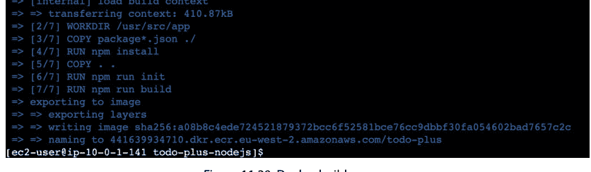

+   III. 要检查您的镜像，输入 `docker images` 命令并按 Enter 键，您应该会得到类似于以下屏幕截图的输出：

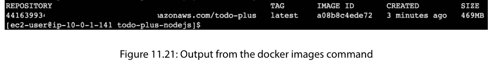

在下一个项目任务中，您将把镜像推送到您在项目任务 1 中创建的 ECR 存储库。

## 项目任务 11.4 – 将 Docker 镜像推送到 ECR

在此任务中，您将把创建的 Docker 镜像推送到 ECR 存储库：

+   1. 确保您仍以 IAM 用户 Alice 的身份登录到 AWS 开发账户。

+   2. 确保您仍远程连接到实例，并且位于完成项目任务 3 的准确位置。


3. 导航返回 Amazon ECR 控制台，最好在新的浏览器标签页中，以便在标签页之间复制和粘贴特定命令。

4. 在 ECR 控制台的左侧菜单中，单击 **Repositories**。

5. 在右侧窗格中，选择 **todo-plus** 仓库。

6. 单击 **View Push Commands** 按钮。这将列出你需要从 EC2 实例运行以将镜像推送到仓库的命令，如 *Figure 11.22* 所示。

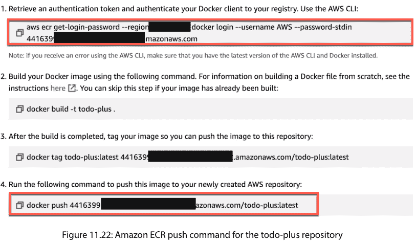

7. 你有两个命令集：一个用于 macOS 和 Linux，另一个用于 Windows 环境。由于使用的是 Linux EC2 实例，请确保使用 macOS/Linux 下提供的命令。你无需运行所有命令，因为你已经构建了 Docker 镜像。

8. 复制 **Retrieve an authentication token and authenticate your Docker client to your registry** 标签下提供的第一个命令到剪贴板。接下来，在使用 Session Manager 登录到你的 EC2 实例时，在另一个浏览器标签页中粘贴你刚刚复制的命令。它应类似于以下内容：

```bash
aws ecr get-login-password --region us-east-1 | docker login --username AWS --password-stdin 441639934710.dkr.ecr.us-east-1.amazonaws.com
```

9. 如果命令运行成功，你应该会看到类似于 Figure 11.23 的输出，表明登录已成功：

```bash
[ec2-user@ip-172-31-36-126 todo-plus-nodejs]$ docker images
REPOSITORY                                            TAG         IMAGE ID       CREATED
441639934710.dkr.ecr.eu-west-2.amazonaws.com/todo-plus latest    d738e4d999a4   48 seconds ago
[ec2-user@ip-172-31-36-126 todo-plus-nodejs]$ aws ecr get-login-password --region eu-west-2
word-a@din 441639934710.dkr.ecr.eu-west-2.amazonaws.com
WARNING! Your password will be stored unencrypted in /home/ec2-user/.docker/config.json.
Configure a credential helper to remove this warning. See
https://docs.docker.com/engine/reference/commandline/login/#credentials-store
Login Succeeded
[ec2-user@ip-172-31-36-126 todo-plus-nodejs]$
```

Figure 11.23: Successful login to ECR

10. 复制 **Run the following command to push this image to your newly created AWS repository** 标签下第四个命令到剪贴板。它应类似于以下命令，但会有所不同，因为你的 AWS 账户 ID 会不同：`docker push 441639934710.dkr.ecr.us-east-1.amazonaws.com/todo-plus:latest`。在远程连接到服务器的浏览器标签页中粘贴此命令并按 `Enter`。

11. 此命令会将 Docker 镜像推送到你的 ECR 仓库，你应该会看到类似于 Figure 11.24 的输出：

```bash
[ec2-user@ip-172-31-36-126 todo-plus-nodejs]$ docker push 441639934710.dkr.ecr.eu-west-2.amazonaws.com/todo-plus
The push refers to repository [44163]
4e0aaec5ef6c:  Pushed
829996855214:  Pushed
3b2a5cf4d1b0:  Pushed
9658d9a6d0e7:  Pushed
a75abb530afa:  Pushed
aad81dadf998:  Pushed
28576ee1ff32:  Pushed
daa7322f8271:  Pushed
7c0ef36b3577:  Pushed
78561ce0f761:  Pushed
latest: digest: sha256:1124572859015b677979a74c836143c7485effe2d46e332c62b5b3dfda24d7ac size: 3133
[ec2-user@ip-172-31-36-126 todo-plus-nodejs]$
```

Figure 11.24: Docker image pushed to the ECR repository

12. 现在你可以在管理控制台中检查你的 ECR 仓库。在 ECR 浏览器标签页中，单击 todo-plus 仓库以查看已上传的镜像。你应该能找到刚刚上传的最新镜像，如 Figure 11.25 所示：

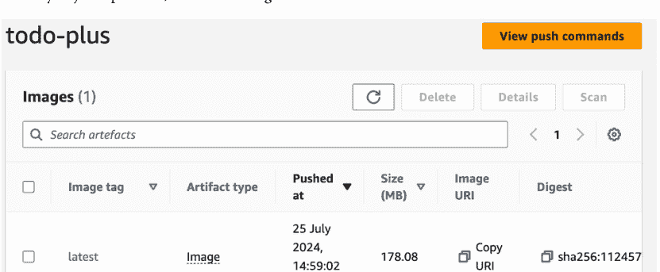

Figure 11.25: Confirmation of the Docker image uploaded to todo-plus repository

现在你已将镜像推送到 ECR 仓库，可以继续下一步，即为你的 ECS 任务创建 IAM 角色。

## Project Task 11.5 – Create an IAM Role for Your ECS Tasks

1. 通过在 AWS 管理控制台页面顶部搜索栏中搜索 IAM 服务，导航到 IAM 管理控制台，最好在另一个浏览器标签页中。

2. 接下来，从左侧菜单中选择 Roles。

3. 在右侧窗格中，单击 Create role 按钮。

4. 接下来，在 Select trusted entity 部分中选择 AWS service。

5. 接下来，从 Service or use case 下拉列表中选择 Elastic Container Service。

6. 选择后，你将在 **Use case** 下有额外的选项可供选择。在这里，你必须选择 **Elastic Container Service Task**，如 *Figure 11.26* 所示，然后单击 **Next**：

### Use case

Allow an AWS service like EC2, Lambda, or others to perform actions in this account.

**Service or use case**

Elastic Container Service

Choose a use case for the specified service.

**Use case**

- Elastic Container Service
  Allows ECS to create and manage AWS resources on your behalf.
- Elastic Container Service Autoscale
  Allows Auto Scaling to access and update ECS services.
- Elastic Container Service Task
  Allows ECS tasks to call AWS services on your behalf.
- EC2 Role for Elastic Container Service
  Allows EC2 instances in an ECS cluster to access ECS.

Figure 11.26: Create an IAM role for ECS tasks

7. 在 **Permissions policies** 列表中，搜索并选择以下两个策略：

- I. AmazonECSTaskExecutionRolePolicy
- II. todo-list-secret-access-policy
- III. Note: todo-list-secret-access-policy is a custom policy you created in *Chapter 7, Building Application Solutions with High Availability, Elasticity, and Data Security.*

8. 单击 **Next**。

9. 为你的 IAM 角色提供一个名称，例如 `todo-plus-ecs-task-role`。

10. 向下滚动并确保此角色关联了正确的权限，如 Figure 11.27 所示：

### Step 2: Add permissions

**Permissions policy summary**

| Policy name | Type | Attached as |
|---|---|---|
| AmazonECSTaskExecutionRolePolicy | AWS managed | Permissions policy |
| todo-list-secret-access-policy | Customer managed | Permissions policy |

Figure 11.27: Permissions attached to IAM role for ECS tasks

11. 单击屏幕底部的 Create role 按钮。

现在你已为 ECS 任务创建了 IAM 角色，是时候创建任务定义了，这将在以下项目任务练习中演示。

## Project Task 11.6 – Create a Task Definition

任务定义是 Amazon ECS 架构的关键组件。它定义了用于构建 ECS 容器并使其可供最终用户访问的多个参数。这些参数包括你希望使用的启动类型、CPU 和内存、IAM 角色、监听端口、任何环境变量以及使用的 Docker 镜像。在此项目任务中，你将构建任务定义：

1. 确保你仍以 IAM 用户 Alice 的身份登录到你的 AWS 开发账户。

2. 从 AWS 管理控制台网页顶部搜索栏搜索 ECS 并导航到 Elastic Container Service。

3. 在左侧菜单中，单击 Task definitions。

4. 接下来，在右侧窗格中，单击 Create new task definition 按钮。

5. 接下来，为你的任务定义族提供一个合适的名称，例如 `todo-plus-task-definition`。

6. 选择 AWS Fargate 作为 Launch type。

7. 接下来，确保从 Operating system/Architecture 下拉列表中选择了 Linux/X86_64。

8. 对于 Task size，将 CPU 设置为 .5 vCPU，Memory 设置为 1 GB，如 Figure 11.28 所示：

**Launch type**

Info: Selection of the launch type will change task definition parameters.

- ☑ AWS Fargate
  Serverless compute for containers.
- ☐ Amazon EC2 instances
  Self-managed infrastructure using Amazon EC2 instances.

**OS, Architecture, Network mode**

Info: Network mode is used for tasks and is dependent on the compute type selected.

**Operating system/Architecture**

Linux/X86_64

**Network mode**

awsvpc

**Task size**

Info: Specify the amount of CPU and memory to reserve for your task.

**CPU**

.5 vCPU

**Memory**

1 GB

Figure 11.28: Configuring the infrastructure requirements for your task definition

9. 为 Task role 和 Task execution role 都选择 todo-plus-ecs-task-role。

10. 在 Container – 1 部分中，为你的容器提供一个名称以及 Docker 镜像的 ECR 镜像 URI。你之前已在 Project Task 1 中记下了此信息。如有必要，导航到单独浏览器标签页中的 ECR 控制台，将 URI 复制到剪贴板并粘贴到 Image URI 文本框中，如 Figure 11.29 所示：


# ▼ 容器 – 1 信息


### 容器详细信息
指定名称、容器镜像，以及是否应将容器标记为基本容器。每个任务定义至少需要一个基本容器。

+   * **名称**：todo-list-app
+       * 最多允许 255 个字母（大小写）、数字、连字符和下划线。
+   * **镜像 URI**：441639934710.dkr.ecr.us-east-1.amazonaws.com/to...
+       * 最多允许 255 个字母（大小写）、数字、连字符、下划线、冒号、句点、正斜线和井号。
+   * **基本容器**：是

### 私有注册表信息
将凭证存储在 Secrets Manager 中，然后使用这些凭证引用私有注册表中的镜像。


### 端口映射信息
添加端口映射，使容器能够访问主机上的端口以发送或接收流量。对于端口名称，如果留空，将分配一个默认名称。

+   * **容器端口**：80
+   * **协议**：TCP
+   * **端口名称**：container-port-1
+   * **应用协议**：HTTP
+   * **删除**

图 11.29：配置了名称和 ECR 镜像 URI 的 Container – 1

+   11. 接下来，确保**容器端口**设置为**80**。
+   12. 接下来，你需要创建一些环境变量。请确保在单独的标签页中打开 Amazon RDS 和 Secrets Manager 控制台，以便轻松访问相关详细信息。你需要创建四个环境变量，如下所示：

+       I. `Key = AWS_REGION, Value type = Value, Value = us-east-1`
+       II. `Key = SECRET_NAME, Value type = Value, Value = <the name of your secret from Secrets Manager you created in Chapter 5>`
+       III. `Key = DB_HOST, Value type = Value, Value = <the endpoint name of your RDS database you created in Chapter 6>`
+       IV. `Key = DB_PORT, Value type = Value, Value = 3306`

13. 参考图 11.30 的示例：

# 环境变量 - 可选

环境变量   信息

逐个添加

添加键值对以指定环境变量。

| 键 | 值类型 | 值 |  |
|---|---|---|---|
| AWS_REGION | 值 | us-east-1 | 删除 |
| SECRET_NAME | 值 | dev/todolist/msq | 删除 |
| DB_HOST | 值 | tododb.cni6y4s24who. | 删除 |
| DB_PORT | 值 | 3306 | 删除 |

添加环境变量

图 11.30：任务定义的环境变量

# 注意

如果需要将环境变量批量传递给 Docker 容器，可以使用容器定义中的 environment files 参数。该参数允许你指定包含环境变量的文件。这些文件必须托管在 Amazon S3 上。这种方法类似于在 `docker run` 命令中使用 `-env-file` 选项。

14. 将其他所有参数保留为默认值，然后点击页面底部的“创建”按钮。

现在，你已成功为 Todo List 应用程序创建了任务定义。接下来，你必须创建 ECS 集群。

# 项目任务 11.7 – 创建 ECS 集群

Amazon ECS 集群是任务或服务的逻辑分组。集群使你可以定义任务运行的 VPC 和子网，以及基础设施容量；对于我们的 Todo List 应用程序，该容量将是 AWS Fargate：

+   1. 在 Amazon Elastic Container Service Web 控制台中，点击左侧菜单中的**集群**。在右侧窗格中，点击**创建集群**按钮。
+   2. 接下来，为你的集群提供一个名称，例如 `todo-plus-cluster`。
+   3. 确保在**基础设施**下选择 **AWS Fargate（无服务器）**，如图 11.31 所示：

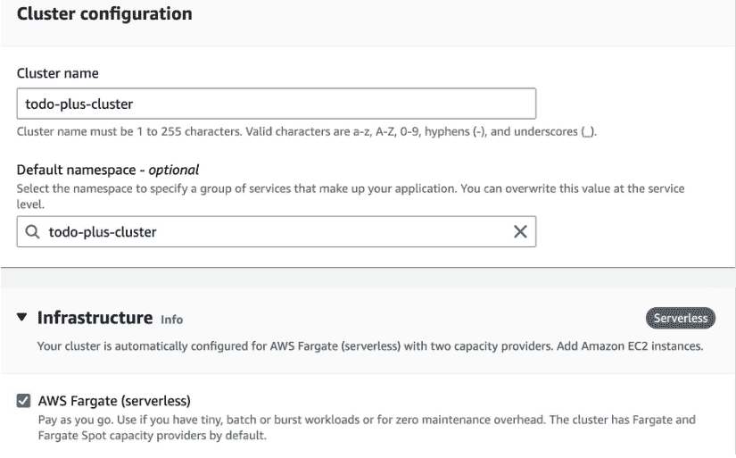

图 11.31：创建 ECS 集群

+   4. 点击页面底部的**创建**按钮。

你的 ECS 集群将需要几秒钟来创建。在下一个项目任务中，你将使用任务定义中的配置来配置 ECS 服务，以便在 AWS Fargate 中构建和部署容器。

# 项目任务 11.8 – 创建 ECS 服务

在此项目任务中，你将创建一个负责部署 ECS 任务的 ECS 服务。该服务将确保你按照扩展策略运行所需数量的任务，并监控你的任务。除了定义容量提供方（对于本项目为 Fargate）外，该服务还将使你能够配置负载均衡和服务自动扩展：

+   1. 确保你仍以 IAM 用户 Alice 的身份登录 AWS 开发账户。
+   2. 如有必要，导航回到 Elastic Container Service。
+   3. 在左侧菜单中，选择“集群”。
+   4. 在右侧窗格中，点击 todo-plus-cluster 集群以查看其详细信息。
+   5. 确保你位于右侧窗格中的“服务”选项卡。
+   6. 接下来，点击“创建”按钮，如图 11.32 所示：

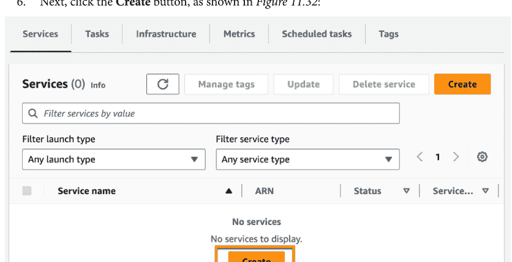

图 11.32：创建 ECS 服务

7. 你会注意到，“现有集群”下的文本框中会自动设置为 todo-plus-cluster。

8. 接下来，确保在**计算选项**下为**启动类型**选择 **FARGATE**。最后，确保在**平台版本**下拉列表中选择 **LATEST**，如图 11.33 所示：

▼ 计算配置（高级）

计算选项 | 信息
为了确保任务在计算类型之间分布，请使用适当的计算选项。

容量提供方策略
指定启动策略，以将任务分布到一个或多个容量提供方。

启动类型
直接启动任务，而不使用容量提供方策略。

启动类型 | 信息
选择托管容量（Fargate）或自定义容量（EC2 或用户管理的外部实例）。外部实例通过 ECS Anywhere 功能注册到你的集群。

FARGATE

平台版本 | 信息
指定运行服务的平台版本。

LATEST

图 11.33：为 ECS 服务设置计算配置

9. 在**部署配置**下，确保选择**服务**作为应用程序类型。

10. 接下来，对于**任务定义**，确保从**系列**下拉框中选择 **todo-plus-task-definition**，并将**修订版**设置为 **1 (LATEST)**。

11. 为你的服务提供一个名称，例如 `todo-plus-ecs-service`，如图 11.34 所示：

# 部署配置

应用程序类型 | 信息
指定要运行的应用程序类型。

服务
启动一组处理长时间运行计算工作的任务，这些任务可以停止并重新启动。例如，Web 应用程序。

任务
启动一个独立运行并终止的任务。例如，批处理作业。

任务定义
选择现有的任务定义。要创建新的任务定义，请转到“任务定义”

手动指定修订版
手动输入修订版，而不是从所选任务定义系列最近的 100 个修订版中选择。

系列
todo-plus-task-definition

修订版
1 (LATEST)

服务名称
为此服务指定唯一名称。
todo-plus-ecs-service

图 11.34：ECS 服务的部署配置

12. 进一步向下滚动网页并展开“网络”部分。

13. 从 VPC 下拉列表中选择 todolist-vpc。

14. 接下来，确保在“子网”下仅选择 app 子网。

15. 选择“使用现有安全组”选项，并确保在现有列表中选择 App-Security-Group。

16. 最后，将“公有 IP”选项切换为关闭状态，如图 11.35 所示：

# 子网

选择任务调度器在放置任务时应考虑的 VPC 内的子网。

# 安全组 | 信息

选择现有安全组或创建新安全组。

使用现有安全组

创建新安全组

# 安全组名称

选择现有安全组。

# 公有 IP | 信息

选择是否自动为任务的弹性网络接口（ENI）分配公有 IP。

已关闭

图 11.35：ECS 服务的网络配置

17. 展开“负载均衡 - 可选”部分。

18. 从“负载均衡器类型”下拉框中选择 Application Load Balancer。

19. “容器”下拉框应自动填充你已设置的唯一容器和端口，即 todo-list-app 80:80。

20. 接下来，确保在 Application Load Balancer 下选择“使用现有负载均衡器”选项。

21. 对于“负载均衡器”，从下拉列表中选择你在第 7 章“构建具有高可用性、弹性和数据安全性的应用程序解决方案”中创建的负载均衡器，即 todo-list-alb。


22. 接下来，为**监听器**选项选择**使用现有监听器**，如图11.36所示：

| 字段 | 值 |
| --- | --- |
| 负载均衡器 | 选择你希望用于在服务中运行的任务之间分配传入流量的负载均衡器。`todo-list-alb` |
| 健康检查宽限期 | `0 seconds` |
| 监听器 | 指定负载均衡器将侦听连接请求的端口和协议。`创建新监听器` / `使用现有监听器`。监听器：`80:HTTP` |

图11.36：为你的ECS服务配置负载均衡器

23. 接下来，点击**创建新目标组**选项，并提供一个描述性名称，例如`todo-list-ecs-target-group`。

24. 将评估顺序设置为1，如图11.37所示：

| 字段 | 值 |
| --- | --- |
| 目标组 | 指定是创建新目标组还是选择现有目标组，负载均衡器将使用该目标组将请求路由到服务中的任务。`创建新目标组` / `使用现有目标组` |
| 目标组名称 | `todo-list-ecs-target-group` |
| 协议 | `HTTP` |
| 取消注册延迟 | 在注销目标的状态从排空变为未使用之前等待的时间量。`300 seconds` |
| 路径模式 | `/`（最大大小：128个字符。） |
| 评估顺序 | `1`（`1 - 50000`） |
| 健康检查协议 | `HTTP` |

图11.37：为你的ECS服务配置目标组

25. 展开**服务自动缩放** - 可选部分。

26. 点击**使用服务自动缩放**选项。

27. 将**最小任务数**设置为1，将**最大任务数**设置为2。

28. 接下来，在**缩放策略类型**下选择**目标跟踪**。

29. 为你的策略提供一个描述性名称，例如`todo-list-autoscale-cpu-70`。

30. 从**ECS服务指标**下拉列表中选择**ECSServiceAverageCPUUtilization**。

31. 将**目标值**设置为70，如图11.38所示：

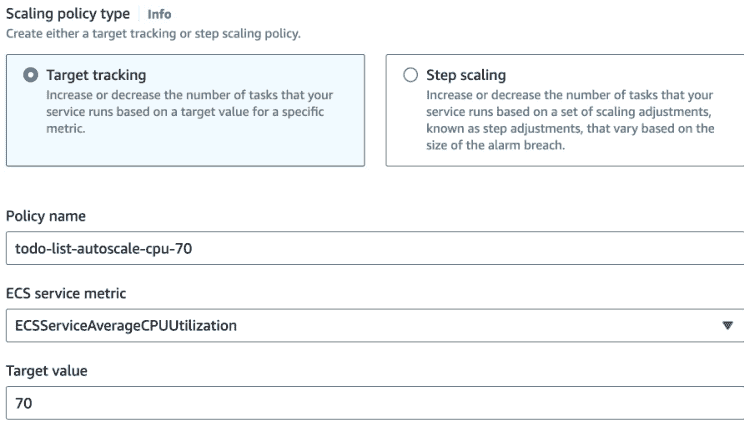

图11.38：为你的ECS服务配置服务自动缩放

32. 最后，点击页面底部的**创建**按钮。几分钟后，你的任务应该成功启动，你应该能够看到**已完成**状态，如图11.39所示：

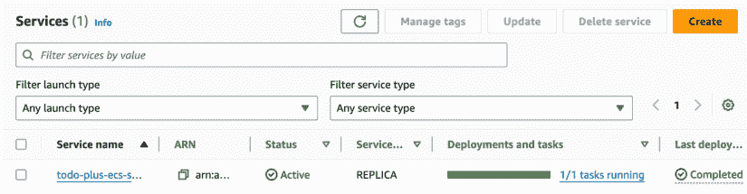

图11.39：ECS服务部署成功

现在你的服务已经部署完成，你必须配置负载均衡器以将流量发送到该服务。回想一下，负载均衡器仍然将流量发送到你在第7章“构建具有高可用性、弹性和数据安全性的应用程序解决方案”中作为自动缩放组一部分部署的EC2实例。

## 项目任务 11.9 – 将入站流量重定向到 ECS

在此任务中，你将把来自互联网用户的入站流量引导到新的ECS部署：

1. 确保你以IAM用户Alice身份登录到你的AWS开发账户。

2. 接下来，在单独的浏览器标签页中导航到EC2管理控制台。

3. 从左侧菜单中，在**负载均衡**下选择**目标组**。

4. 在右侧窗格中，点击ECS目标组，你应该已将其标记为`todo-list-ecs-target-group`。

5. 然后你将被引导到该目标组的详细信息页面。如果你正确执行了所有先前的配置，你应该会发现目标组有一个**健康**目标，如图11.40所示：

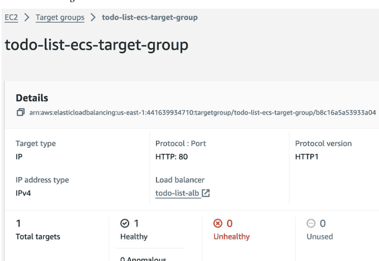

图11.40：查看ECS目标组以确认健康目标

6. 接下来，从左侧菜单中，在**负载均衡**下点击**负载均衡器**。

7. 在右侧窗格中，点击应用程序负载均衡器，其名称应为`todo-list-alb`。

8. 在右侧窗格中，在**监听器和规则**选项卡下，选择**HTTP:80**监听器。接下来，从窗格右侧的**管理监听器**下拉框中，点击**编辑监听器**选项，如图11.41所示：

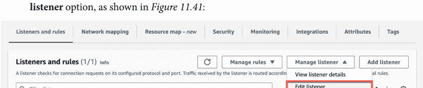

图11.41：编辑应用程序负载均衡器的监听器以指向新目标组

9. 在出现的对话框中，将**默认操作**下的**目标组**更改为指向新的ECS目标组，该目标组应为`todo-list-ecs-target-group`，如图11.42所示：

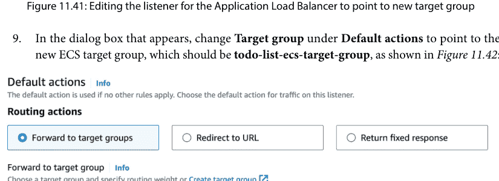

图11.42：将目标组更改为指向ECS目标组

10. 接下来，点击**保存更改**按钮。

接下来，你可以测试应用程序是否仍然可以访问，并尝试登录应用程序。回想一下，可以通过CloudFront URL访问应用程序，如图11.43所示：

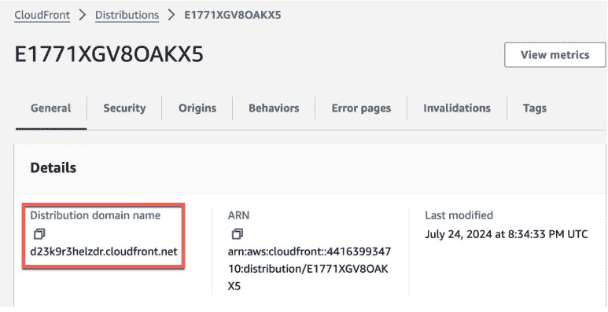

图11.43：用于访问应用程序的CloudFront URL

你应该会发现你添加到待办事项列表中的任何条目仍然可以访问，如图11.44所示：

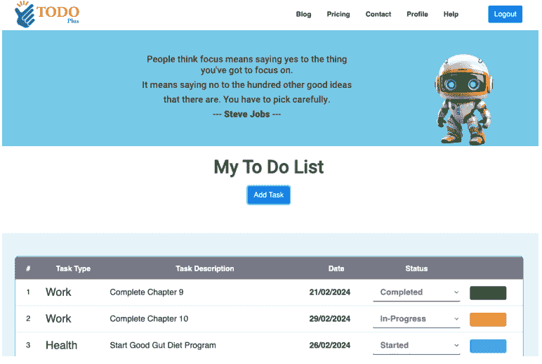

图11.44：测试应用程序

现在你已在Amazon ECS上部署了后端应用程序组件，你可以继续停用第7章“构建具有高可用性、弹性和数据安全性的应用程序解决方案”中用于同一服务的现有EC2实例。回想一下，这些EC2实例由自动缩放组管理，并且由于它们是你在之前创建的目标组的一部分，因此会从负载均衡器接收流量。

在下一个项目任务中，你可以将自动缩放组缩减到0，测试应用程序是否仍然正常运行，然后继续终止自动缩放组和相关的目标组。

## 项目任务 11.10 – 缩减自动缩放组

在本章的最后一个项目任务中，你将缩减自动缩放组，以便从之前用于应用程序所有后端操作的环境中终止EC2实例。然后，考虑到负载均衡器将所有入站流量引导到Fargate容器，你可以测试应用程序是否仍然按预期运行。这是一个很好的测试，可确保在删除自动缩放组、其关联的启动模板以及相关目标组之前转换成功：

1. 使用单独的浏览器标签页导航到EC2管理控制台。

2. 从左侧菜单中，在**自动缩放**下点击**自动缩放组**链接。

3. 接下来，在右侧窗格中，点击你在第7章“构建具有高可用性、弹性和数据安全性的应用程序解决方案”中创建的自动缩放组，其名称为`todo-list-auto-scaling-group`。

4. 在**组详细信息**部分，点击窗格右侧的**编辑**按钮。

5. 将**期望容量**、**最小期望容量**和**最大期望容量**设置为**0**。点击**更新**按钮。

6. 接下来，点击**活动**选项卡。几分钟内，你应该会看到自动缩放组已终止了运行后端Node.js应用程序的两个实例，如图11.45所示：

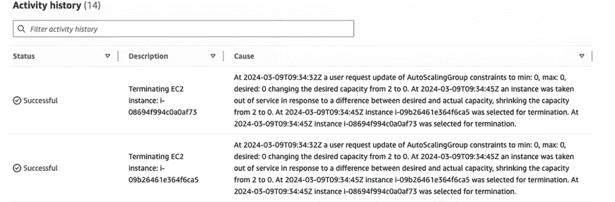

图11.45：自动缩放组活动历史记录，显示实例已被终止

7. 尝试访问应用程序，你应该会发现它仍然完美运行。

8. 如果你愿意，可以删除自动缩放组、启动模板和目标组。这些资源不收费，因此只要容量规格设置为0，你可以根据需要保持它们运行。

现在，你已成功从需要管理实例的EC2架构迁移到无服务器的Fargate架构，从而减少了你的管理开销。此外，你将受益于一个更加敏捷、轻量级的容器环境来运行你的应用程序栈。

## 总结

本章探讨了使用Amazon ECS和EKS编排系统的复杂性，强调了软件开发中容器化在提高效率、可扩展性和可靠性方面的关键转变。首先介绍了容器化，强调了Docker在革新应用程序打包和部署方面的重要作用。然后我们探讨了Amazon Elastic Container Service（ECS）和Amazon Elastic Kubernetes Service（EKS），它们是AWS用于容器编排的顶级解决方案。

容器化通过将应用程序及其依赖项封装到容器中，确保了跨各种环境的一致部署。Docker作为领先工具的出现，简化了构建、共享和运行容器化应用程序的过程。然而，现代应用程序的复杂性和规模需要先进的编排工具，而Amazon ECS和EKS满足了这一需求。这些服务促进了容器化应用程序的高效管理和扩展，提供了灵活性、可扩展性和可靠性。

Amazon ECS简化了容器管理，支持在Amazon EC2实例集群或使用AWS Fargate上部署、管理和扩展Docker容器，从而消除了管理容器编排平台的开销。Amazon EKS将Kubernetes的强大功能引入AWS云，自动化部署、扩展和管理容器化应用程序。ECS和EKS共同创建了一个全面的生态系统，用于大规模管理容器化应用程序。

本章使你对AWS中的容器编排有了全面的了解。它涵盖了详细的解释、动手示例以及利用ECS和EKS有效编排容器化应用程序的最佳实践。这些知识对于部署微服务架构、管理批处理作业以及跨多个环境扩展应用程序至关重要。

总之，本章使你掌握了应对AWS上容器编排复杂性的知识。它侧重于管理容器的技术方面，以及对现代应用程序开发和部署中创新、效率和弹性的更广泛影响。


## 考试准备练习 – 章节复习题

除了扎实掌握关键概念之外，在时间压力下快速思考的能力也是帮助你在认证考试中取得佳绩的一项技能。因此，在学习之旅的早期就培养这些技能至关重要。

章节复习题旨在随着你学习的每个章节逐步提升你的应试技巧，同时复习你对本章关键概念的理解。你可以在每章的末尾找到它们。

### 如何访问这些材料

要了解如何访问这些资源，请前往标题为*第17章：访问在线资源。*的章节。

要打开本章的章节复习题，请执行以下步骤：

1. 点击链接 – https://packt.link/DVAC02_CH11。
   或者，你可以扫描以下二维码（图11.46）：

   

   图11.46 – 供已登录用户打开章节复习题的二维码

2. 登录后，你会看到一个与*图11.47*类似的页面：

   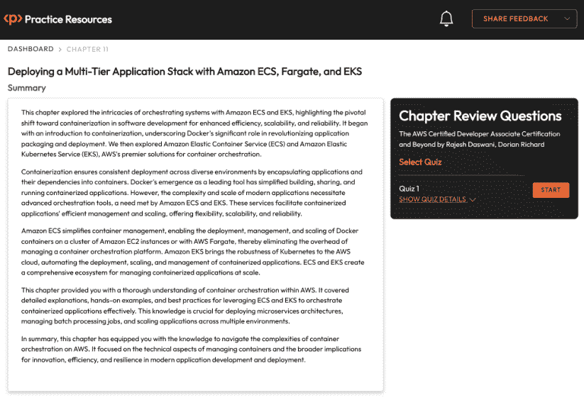

   图11.47 – 第11章的章节复习题

3. 准备就绪后，开始以下练习，多次重新尝试测验。

### 考试准备练习

前三次尝试时，不必担心时间限制。

**第一次尝试**

第一次，目标至少达到40%。查看你答错的题目，并重新阅读本章中的相关部分，以弥补学习缺口。

**第二次尝试**

第二次，目标至少达到60%。查看你答错的题目，并重新阅读本章中的相关部分，以弥补剩余的学习缺口。

**第三次尝试**

第三次，目标至少达到75%。一旦你的得分达到75%或以上，就可以开始练习时间把控了。

> **提示**
> 你可能需要超过三次尝试才能达到75%。没关系。只需复习本章的相关部分，直到你达到目标为止。

### 练习时间把控

目标：你的目标是在尽可能快速回答这些问题的同时，保持得分不变。以下是你后续尝试的示例：

| 尝试次数 | 得分 | 所用时间 |
| --- | --- | --- |
| 第5次尝试 | 77% | 21分30秒 |
| 第6次尝试 | 78% | 18分34秒 |
| 第7次尝试 | 76% | 14分44秒 |

表11.1 – 在线平台上的时间练习示例

> **注意**
> 上表中显示的时间限制仅为示例。请根据网站上测验的时间限制，为每次尝试设定自己的时间限制。

在每次新的尝试中，你的得分应保持在75%以上，而完成测试的“所用时间”应“减少”。请根据需要重复多次尝试，直到你有信心应对时间压力为止。
