## 使用AWS CI/CD工具掌握DevOps

近年来，DevOps已成为软件开发中不可或缺的一部分。它通过促进开发团队与运维团队之间的协作与沟通，使团队能够更快、更高效地交付高质量软件。DevOps的一个关键组成部分是**持续集成和持续部署/持续交付（CI/CD）**，它帮助团队自动化软件开发流程。

AWS提供了一系列CI/CD工具，包括AWS CodeCommit、AWS CodeBuild、AWS CodePipeline和AWS CodeDeploy。这些工具帮助团队自动化软件开发工作流，涵盖从编写代码、构建应用程序，到测试、部署以及向最终用户交付软件的各个环节。

本章探讨如何利用AWS CI/CD工具开启DevOps之旅。你将学习CI/CD的基础知识，以及它如何融入DevOps体系。本章将详细讲解每种CI/CD工具，探讨其特性、优势，以及它们如何帮助团队简化软件开发流程。

无论你是DevOps新手还是经验丰富的从业者，本章都将全面介绍如何开始使用AWS CI/CD工具，以及它们如何帮助你更快、更高效地交付高质量软件。学完本章后，你将扎实掌握如何使用AWS CI/CD工具在云端构建、测试、部署和管理应用程序。

DevOps和CI/CD属于*AWS认证开发者助理（AWS Certified Developer Associate）考试大纲中的领域3：部署*的范畴。你必须理解版本控制、如何准备部署工件，以及AWS CodePipeline和CI/CD工作流中的手动与自动审批。

在虚构公司TodoPlus Limited的需求基础上，你将获得实施DevOps原则的实践经验，使用AWS的CI/CD工具套件改进**Todo List**任务管理应用程序的开发与部署。例如，每当有变更提交到AWS CodeCommit中的应用程序代码库时，它就会自动触发AWS CodeBuild编译代码并运行测试。如果测试通过，AWS CodeDeploy可以自动将变更部署到生产环境。AWS CodePipeline可以编排整个工作流，确保每次变更都能自动、高效、可靠地交付给用户。

实施这些CI/CD实践可以显著提高其应用程序开发和部署流程的速度、效率与可靠性。接下来的章节将帮助你更深入地理解这些原则和工具，并展示TodoPlus如何将其整合到运营中。

### 什么是DevOps？

DevOps是一场彻底改变了软件开发行业的文化与技术运动。它代表着软件开发从传统的孤岛式模式——开发与运维团队分属不同部门——向更加集成和敏捷的模式转变。DevOps文化强调开发团队与运维团队之间的协作与沟通，从而实现更快、更高效的软件交付。

图12.1中的图示说明了DevOps生命周期：

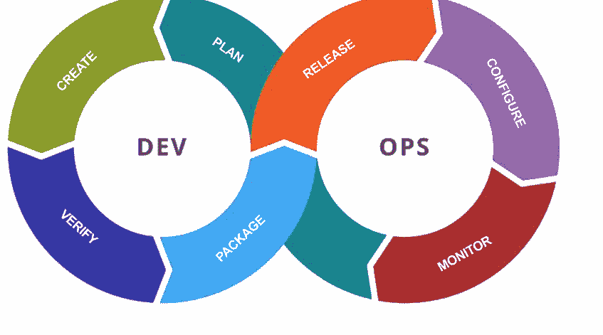

图12.1 – DevOps生命周期

在讨论DevOps时，理解这一图示至关重要。DevOps生命周期通常以循环形式描绘，以强调该过程的持续性。以下是对循环中每个阶段的详细说明：

- **规划：** 这是确定项目行动方案的阶段，涉及需求收集、进度安排，以及在开始实际开发之前的所有准备工作。
- **创建：** 软件开发在此阶段进行。编写代码以创建新功能、修复缺陷或更新软件。
- **验证：** 软件开发完成后需要进行测试。此阶段包括质量保证测试、单元测试、集成测试及其他测试，以验证代码是否符合质量标准。
- **打包：** 此阶段涉及打包代码以便部署，通常包括对软件进行版本管理，并将其准备为可部署的格式，如容器或虚拟机镜像。
- **发布：** 此阶段是软件准备就绪以待部署的阶段。最终检查确保软件已准备妥当并获得发布审批。持续交付和持续部署实践即属于此阶段。
- **配置：** 在生产环境中对软件进行配置，包括搭建必要的基础设施，并可通过基础设施即代码实践实现自动化。
- **监控：** 软件部署后需要对其进行监控，以确保其按预期运行。此阶段包括使用日志记录、性能指标和实时监控来快速发现并解决问题。

圆环的两半，即Dev和Ops，分别代表循环中的开发与运维部分，凸显了**软件开发（Dev）**与**IT运维（Ops）**之间的集成与协作。这种集成是DevOps的核心概念，旨在缩短开发生命周期，并以高软件质量实现持续交付。循环图表明，在监控之后，我们利用洞察和反馈来规划新的变更，循环由此周而复始——因此才有了“持续集成”和“持续交付/持续部署”这两个术语。

### 通过CI/CD实施DevOps

要在组织中实施DevOps文化，你必须建立持续集成和持续交付/持续部署的原则。


## 持续集成

DevOps 实践是指将由开发者进行的软件代码更改合并到中央存储库的发布分支中。应鼓励开发者定期提交代码。由于较小的代码提交在解决错误和冲突时更直接，这样可以确保更少的集成问题。代码更改在推送到中央存储库之前，还必须进行单元测试。

存储库的示例包括 AWS CodeCommit、GitHub 或 Bitbucket。一旦开发者提交了应用程序代码的更改，并将其推送到中央存储库中的某个分支，就应该启动自动化的构建和测试过程。这个过程会生成一个或多个二进制文件及相关工件。根据图 12.2 中的示意图，任何必要的单元测试也可以在此阶段纳入：

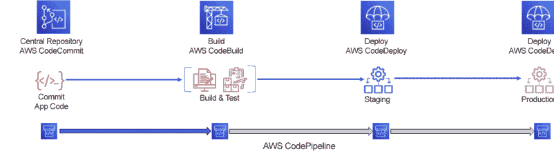

图 12.2 – 使用 AWS CodeCommit 和 CodeBuild 进行 CI

作为 CI 工作流的一部分，开发者将获得关于测试通过或失败的反馈。这使开发者能够修复问题和错误，并更快地部署代码。

## 持续交付

这是 CI 的后续环节。假设应用程序代码成功构建并通过所有测试。在这种情况下，理想情况下下一步是将代码部署到暂存环境（通常是生产环境的副本）。根据图 12.3 中的示意图，可以执行额外的测试，例如集成测试和负载测试：

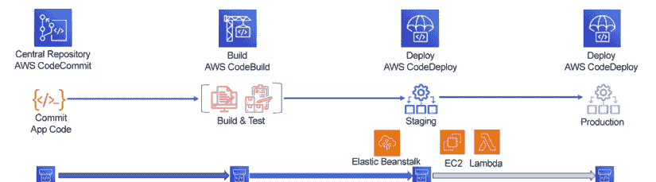

图 12.3 – 使用 AWS CodeDeploy 将构建部署到暂存环境

CodeDeploy 阶段还可能包括使用基础设施即代码（IaC）对必要基础设施进行动态设置和配置。您也可以使用 Elastic Beanstalk 来预置环境，或将其部署到 EC2、Lambda、ECS 等计算资源，甚至部署到本地服务器。

根据您的方法，您也可以在此阶段集成一个手动审批流程，以确保应用程序按预期运行后再部署到生产环境，如图 12.4 所示：

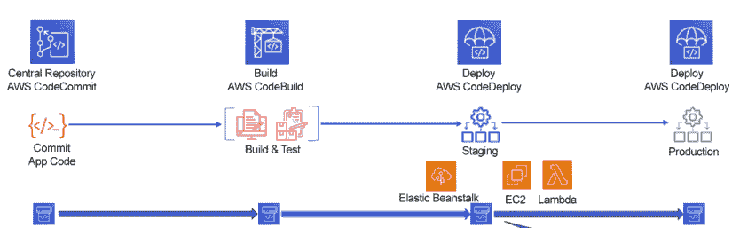

图 12.4 – 使用 AWS CodeDeploy 将构建部署到生产环境。

一旦您遵循了审批流程，就可以发布您的生产应用程序了。

## 持续部署

有了持续交付，您的更改不一定会立即部署到生产环境。您可能希望集成一个决策流程，以确保所部署的输出已完全获得授权。从本质上讲，这个阶段是推出任何更改的业务决策，由于所有测试和审计都已完成，因此不应造成任何中断。

持续交付确保软件在手动批准后即可发布，而持续部署是 CI/CD 流水线的最后阶段。它可能包括将软件版本完全自动化地部署到生产环境的过程，如图 12.5 中的示意图所示：

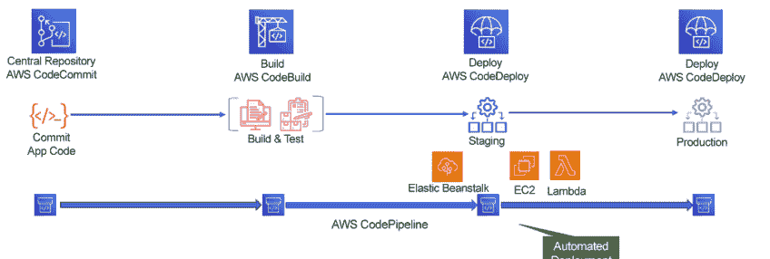

图 12.5 – 持续部署到生产环境并正式发布

下一节将教您更多关于使用核心 AWS DevOps 工具来构建 CI/CD 流水线的知识。

## DevOps 团队使用的工具和流程

DevOps 团队工具箱的核心是 CI/CD 工具，例如 AWS CodeCommit、CodeBuild、CodeDeploy 和 CodePipeline，它们可以实现软件交付流程的自动化。AWS CodeBuild 是一项编译源代码、运行测试并生成可立即部署的软件包的服务。CodeDeploy 可将应用程序自动部署到各种 AWS 服务，例如 Amazon EC2、AWS Fargate 和 AWS Lambda。CodePipeline 是一项持续交付服务，可实现发布流水线的自动化，从而快速可靠地更新应用程序。

容器服务（如 Amazon Elastic Container Service（ECS）和 Amazon Elastic Kubernetes Service（EKS））也至关重要，它们使用 Docker 和 Kubernetes 为应用程序部署提供可扩展且安全的环境。它们支持微服务架构（DevOps 理念的一个关键原则），使团队能够构建、部署和管理由小型、独立、松散耦合的服务组成的应用程序。

此外，团队通常利用 IaC 工具（如 AWS CloudFormation、AWS Cloud Development Kit（CDK）或 Terraform）使用代码来定义和预置 AWS 基础设施。这种做法允许建立和维护可重复、受版本控制和自动化的环境。

DevOps 团队旨在创造一种文化与环境，使软件的构建、测试和发布能够快速、频繁且可靠地进行。他们利用 AWS 工具来提高效率、增强安全性并保持可扩展性。

接下来，您将了解 AWS 提供的核心 DevOps 工具。

## AWS CodeCommit

AWS CodeCommit 是一个版本控制系统，使开发人员能够就共享的应用程序资产（如文档、源代码和二进制文件）进行协作。它遵循 Git 的原则来创建和管理源代码。

> **注意**
> 
> Git 是一个分布式**版本控制系统（VCS）**，用于跟踪软件开发过程中源代码的更改。它被设计用于快速高效地处理从小型到超大型的项目。Linus Torvalds 于 2005 年创建了 Git，用于 Linux 内核的开发，此后它已成为世界上使用最广泛的 VCS 之一。

AWS CodeCommit 提供了多项与 Git 一致的好处。用户可以轻松创建和管理存储库及分支，将存储库克隆到本地开发环境，根据需要进行更改，然后将其推送回 CodeCommit 存储库。

AWS CodeCommit 提供了多种特性和好处，包括与其他 DevOps 工具（如 AWS CodeBuild 和 AWS CodeDeploy）的紧密集成。这使您能够轻松定义和构建软件发布流水线。

AWS CodeCommit 的主要好处包括以下内容：

- 能够与其他开发人员协作：每位开发人员都可以执行拉取请求，处理其他开发人员的代码，并在准备好后将更改合并回主分支。
- 安全存储您的代码：使用 Amazon KMS 进行静态加密和传输加密。
- 扩展版本控制项目：可以处理包含大量文件或分支、大文件大小以及庞大修订历史的存储库。
- 访问控制：支持使用 IAM 角色授予访问权限，并促进跨账户访问能力。
- 使用开发人员熟悉的 Git 工具，使用与 Git 相同的命令，例如 `git clone`、`git add`、`git pull` 和 `git push` 等。

## AWS CodeBuild

AWS CodeBuild 是一项完全托管的构建服务，让您无需费力即可构建、测试和部署软件。借助 AWS CodeBuild，您可以以安全、可扩展且经济高效的方式创建、测试和部署代码。

首先，您必须设置 AWS CodeBuild 项目。构建项目详细说明了如何运行构建、从哪里获取源代码、使用哪个构建环境、运行哪些构建命令以及将构建输出存储在哪里。

AWS CodeBuild 可以自动检测代码更改并启动构建过程。每次更改代码时，AWS CodeBuild 都会自动启动构建过程来编译、测试和打包代码。构建过程涉及多个步骤，包括编译代码、运行单元测试以及创建可部署的软件包。

要向 CodeBuild 提供一组用于执行构建的构建命令和设置，您必须在名为 `buildspec.yml` 的文件中提供一些信息。

### 关于 buildspec.yml 的更多信息

该文件必须以 YAML 格式编写，并存储在源代码目录的根目录中。但是，您可以覆盖文件名及其位置。您可以在同一存储库中为不同的构建重命名该文件，例如，一个用于暂存环境，另一个用于生产环境。如果您重命名该文件或希望将其存储在其他位置，则在创建或更新项目时，必须指示 AWS CodeBuild 指定相对于内置环境变量 `CODEBUILD_SRC_DIR` 值的文件路径。

在 `buildspec.yml` 文件中，您可以将环境变量定义为标准明文变量，或者从 AWS Systems Manager Parameter Store 或 AWS Secrets Manager 动态访问变量。

此外，您可以定义构建的各个阶段，包括以下内容：

- `Install` - 安装构建所需的依赖项
- `Pre_build` - 在构建之前执行的命令
- `Build` - 用于构建应用程序的命令
- `Post_build` - 任何构建后操作，例如创建 `.zip` 文件输出

图 12.6 中的截图是 `buildspec.yml` 文件的一个示例，您将使用它来更新 Todo List 前端网站应用程序：


```yaml
version: 0.2
phases:
  build:
    commands:
      - npm i && npm run build
      # Please change the s3 bucket URI
      - aws s3 cp --recursive dist/ s3://todo-plus-frontend/
      # Please change the distribution id
      - aws cloudfront create-invalidation --distribution-id E2A4WHGXZQDJJ8 --paths "/*"
```

图 12.6 – buildspec.yml 文件示例

你会注意到，buildspec.yml 文件中并非所有阶段都需要包含。在图 12.6 的示例文件中，这些命令指示 AWS CodeBuild 使用可用源代码运行构建任务，将构建产物复制到托管应用程序前端组件的 Amazon S3 存储桶，并使现有 CloudFront 分发失效，以确保新应用程序上线并可通过 CloudFront 访问。

如果构建过程成功，AWS CodeBuild 会将你的代码部署到目标环境。此过程确保你的代码以一致且可靠的方式部署。

在整个构建和部署过程中，你可以按照图 12.7 在 AWS CodeBuild 控制台中监控进度并查看构建日志。这样你可以随时了解代码的状态，并快速处理构建过程中出现的任何问题。

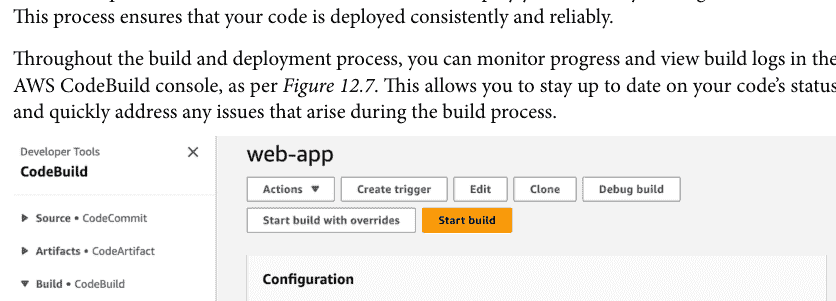

图 12.7 – AWS CodeBuild 的界面

- `CodeDeployDefault.HalfAtATime`：AWS CodeDeploy 一次将应用程序修订版部署到一半的实例。如果实例数为奇数，则部署将覆盖一半的实例，小数部分向下取整。例如，如果你有九个实例，它将首先部署到四个实例。如果应用程序修订版已部署到至少一半的实例（小数部分向上取整），则认为部署成功。这意味着当你的实例组中有九个实例时，至少要有五个实例成功部署，部署才算成功。

- `CodeDeployDefault.OneAtATime`：AWS CodeDeploy 一次只将应用程序修订版部署到一个实例。在这里，只有当应用程序成功部署到所有实例时，部署才算成功。但有一个例外：如果你将应用程序部署到一组实例，那么只要除最后一个实例外的所有实例都成功部署，部署仍被视为成功。如果任何实例（除最后一个实例外）部署失败，则整个部署失败。对于包含九个实例的部署组，如果前八个实例部署成功，但最后一个实例部署失败，则整个部署仍被视为成功。

请注意，如果你未指定部署配置选项，CodeDeploy 将使用 `CodeDeployDefault.OneAtATime`。就地部署的缺点是，你的实例组中至少有一个实例将处于离线状态（如 `OneAtATime` 配置的情况）。

## 蓝/绿部署

蓝/绿部署的优势在于，在环境就绪之前保持现有环境不变，然后将流量转移到新环境。你可以使用蓝/绿部署类型将应用程序部署到 EC2 实例、Lambda 函数或 ECS 容器。

对于 **EC2 计算平台**部署，实例在替换环境中预置，并安装应用程序修订版。如果需要，可以设置可选的等待时间，以便进行测试和验证。然后，替换环境中的实例将注册到负载均衡器，负载均衡器将流量从旧环境转移到新环境。部署选项采用 `CodeDeployDefault.OneAtATime` 方法。流量也一次路由到一个替换实例。如果流量路由到所有替换实例，则部署成功。只要第一次重新路由失败，即视为部署失败。但同样，如果部署中最后一个实例失败，仍然视为成功。

对于 **ECS 计算平台**部署，AWS CodeDeploy 会创建一个新的任务集，并在同一 ECS 服务中将流量从当前任务集转移到更新后的替换任务集。对于 **AWS Lambda**，AWS CodeDeploy 会部署新版本的 Lambda 函数，然后将流量从旧版本转移到新版本。

在将蓝/绿部署用于 AWS Lambda 或 Amazon ECS 部署时，你必须指定如何将流量从应用程序的旧版本转移到新版本。以下部署配置可用于定义流量转移方式：

- **Canary（金丝雀）**：使用金丝雀部署时，流量分两次转移。你可以选择预定义的金丝雀选项，该选项指定第一次转移的流量百分比。然后，在指定的时间间隔后，转移剩余流量。
- **Linear（线性）**：使用此选项时，流量以相等的增量转移，每个增量之间定义相等的分钟时间间隔。这确保了流量从旧资源逐渐转移到新版本。
- **All-at-once（一次性全部转移）**：所有流量在一次转移中从 Lambda 函数或 ECS 任务的旧版本转移到新版本。

下面的截图（*图 12.8*）展示了可用于 Amazon ECS 部署的预定义部署配置。选中的是 `CodeDeployDefault.ECSAllAtOnce`，它一次性将所有流量转移到更新后的 Amazon ECS 容器。

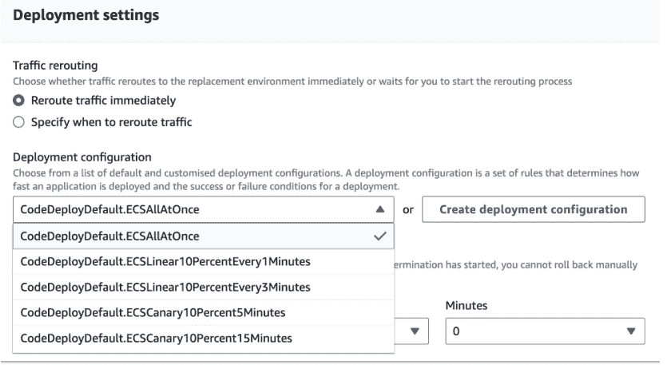

图 12.8 — Amazon ECS/CodeDeploy 部署配置选项

除了选择部署选项和定义所需的部署配置外，你还需要向 AWS CodeDeploy 提供如何管理实际部署过程的详细信息。这通过一个名为 **Application-Specific (appspec) 文件**的配置文件完成。

## 应用程序特定文件

appspec 文件是一个 YAML 或 JSON 文件（EC2/本地实例仅使用 YAML 格式版本），通过一系列**生命周期事件挂钩**提供有关执行部署的配置信息。每个挂钩表示部署过程中的一个事件。

根据你部署到的计算平台，appspec 文件结构会有所不同。对于 EC2/本地部署，你会看到一个高层级结构，如图 12.9 所示：

```yaml
1  version: 0.0
2  os: operating-system-name
3  files:
4    source-destination-files-mappings
5  permissions:
6    permissions-specifications
7  hooks:
8    deployment-lifecycle-event-mappings
```

图 12.9 – 适用于 EC2/本地计算平台的 appspec 文件格式

对于 EC2/本地计算平台，你有一个 files 部分，用于指定在安装过程中应复制并安装到实例上的文件名称。你还有一个 permissions 部分，详细说明应应用于被复制的文件和文件夹的特定权限。

对于 ECS 和 Lambda 部署，结构略有不同，如下所示：

- 对于 Lambda，你有一个 resources 部分，用于定义要部署的 Lambda 函数的名称、别名、当前版本以及要将流量转移到的 Lambda 函数目标版本，如图 12.10 所示：

```yaml
1 resources:
2   - name-of-function-to-deploy:
3     type: "AWS::Lambda::Function"
4     properties:
5       name: name-of-lambda-function-to-deploy
6       alias: alias-of-lambda-function-to-deploy
7       currentversion: version-of-the-lambda-function-currently-points-to
8       targetversion: version-of-the-lambda-function-to-shift-traffic-to
```

图 12.10 – Lambda appspec 文件示例

- 对于 **ECS 部署**，`resources` 部分包含任务定义、容器和端口的详细信息，如图 12.11 所示：

```yaml
1  Resources:
2    - TargetService:
3      Type: AWS::ECS::Service
4      Properties:
5        TaskDefinition: "task-definition-arn"
6        LoadBalancerInfo:
7          ContainerName: "ecs-container-name"
8          ContainerPort: "ecs-application-port"
```

图 12.11 – ECS appspec 文件示例

生命周期事件挂钩使你能够定义部署期间执行的任务流程。同样，事件挂钩根据你部署到的计算平台而有所不同。图 12.12 展示了 EC2/本地部署的主要事件挂钩：

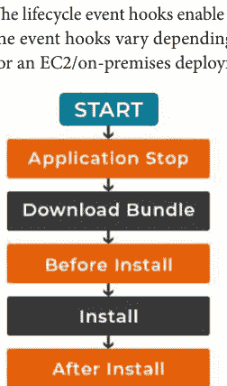

```yaml
1  version: 0.0
2  os: linux
3  files:
4    - source: Config/config.txt
5      destination: /webapps/Config
6    - source:
7      destination: /webapps/myApp
8  hooks:
9    BeforeInstall:
10   - location: Scripts/UnzipResourceBundle.sh
11   - location: Scripts/UnzipDataBundle.sh
12  AfterInstall:
13   - location: Scripts/RunResourceTests.sh
14   timeout: 180
15  ApplicationStart:
16   - location: Scripts/RunFunctionalTests.sh
17   timeout: 3600
18  ValidateService:
19   - location: Scripts/MonitorService.sh
20   timeout: 3600
21  runas: codedeployuser
```

示例 appspec.yml

图 12.12 – appspec 生命周期事件挂钩示例


此处列出了应用配置（appspec）生命周期中的部分事件钩子：

-   **ApplicationStop**：运行脚本以优雅地关闭应用程序，或者移除当前已安装的软件包并为新安装做准备。如果您之前已经部署过应用程序的修订版本，这一点尤为重要。
-   **DownloadBundle**：CodeDeploy 会将应用程序修订版本的文件复制到一个临时位置。
-   **BeforeInstall**：执行任何预安装任务，例如创建当前应用程序修订版本的备份。
-   **Install**：执行实际安装，并将文件从临时位置复制到最终目标位置。
-   **AfterInstall**：执行任何安装后配置，例如更改文件权限。
-   **ApplicationStart**：重启应用程序服务。
-   **ValidateService**：这是最后一个部署生命周期，也是确保部署成功的关键组件。

理解这些步骤以及这些钩子的处理顺序至关重要。此外，请注意，如果缺少某个事件钩子，则不会对该事件执行任何操作。

## AWS CodePipeline

AWS CodePipeline 是一个集成式的、完全托管的持续交付服务，旨在自动化您的发布流程。它通过与其他 AWS 服务（如 AWS CodeCommit、AWS CodeBuild 和 AWS CodeDeploy）集成，使您可以快速构建、测试和部署应用程序。AWS CodePipeline 的核心理念是流水线（Pipeline）。每个流水线由多个阶段组成，代表发布流程中的不同步骤，例如构建代码、运行测试或部署到生产环境。

图 12.13 展示了涉及 AWS CodeCommit、AWS CodeBuild 和 AWS CodeDeploy 的 AWS CodePipeline 中所有可用步骤的示意图：

AWS CodePipeline 还提供了一套全面的工具和特性来管理您的发布流程。您可以监控流水线的状态，设置通知，并查看详细日志。与其他 AWS 服务（如 AWS CloudWatch 和 AWS SNS）集成可以为您提供对发布流程的额外控制和可见性。

除了自动化，AWS CodePipeline 还为管理您的发布流程提供了灵活且可扩展的解决方案。它可以快速适应发布流程的变化，其服务也能扩展以满足您不断增长的应用程序的需求。

图 12.14 展示了一个 AWS CI/CD 流水线，但它主要关注部署过程，主要使用 AWS 服务来处理容器化应用程序。

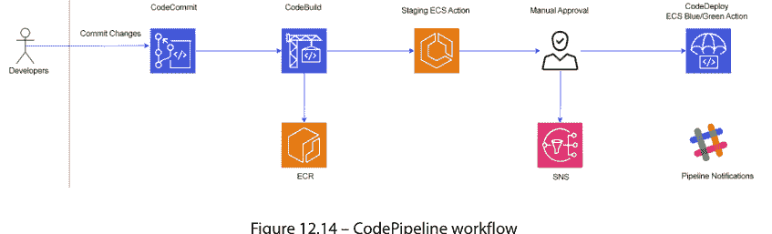

以下是逐步说明：

-   **开发人员**：开发人员向源代码提交变更。
-   **AWS CodePipeline**：该服务编排由流水线描述的工作流。
-   **Amazon CodeCommit**：AWS CodeCommit 用作源代码控制服务，开发人员的代码存储在此处。
-   **AWS CodeBuild**：AWS CodeBuild 是编译源代码、运行测试并生成可部署的应用程序版本的服务。
-   **弹性容器注册表 (ECR)**：构建过程完成后，生成的 Docker 镜像（如果应用程序是容器化的）将存储在 ECR 中，ECR 是一个 Docker 容器注册表，方便开发人员存储、管理和部署 Docker 容器镜像。
-   **暂存环境 ECS 操作**：在应用程序部署到生产环境之前，它会先使用 Amazon ECS 部署到暂存环境，ECS 是一个支持 Docker 容器的容器管理服务。
-   **手动审批**：这是工作流中的一个检查点，需要人工手动批准流水线的继续，通常是在验证暂存环境按预期运行之后。
-   **简单通知服务 (SNS)**：AWS SNS 是一个灵活、完全托管的发布/订阅消息和移动通知服务，用于协调向订阅端点和客户端传递消息。在此处，它用于通知相关人员审查并批准暂存环境中的变更。
-   **CodeDeploy ECS 蓝/绿操作**：一旦变更获得批准，将使用 AWS CodeDeploy 将应用程序部署到生产环境。具体来说，ECS 蓝/绿部署模式涉及流量切换，使得新版本（绿）在最小停机时间和风险的情况下与旧版本（蓝）并行部署。
-   **流水线通知**：这些可能是流水线各个阶段发送的通知，例如构建完成、等待手动审批或部署成功时。它们可以与各种通知渠道集成，如电子邮件、短信或聊天应用程序。

该图说明了一个自动化流水线，允许安全地部署应用程序。它确保代码自动构建和测试，并且变更在部署到生产环境之前会在暂存环境中进行审查，并使用蓝/绿部署策略实现最小停机时间。

总之，AWS CodePipeline 是一个通用的持续交付服务，为构建、测试和部署应用程序提供了一站式解决方案。其自动化功能、灵活性、可扩展性以及与其他 AWS 服务的集成使其成为管理发布流程的绝佳选择。

## 在多账户环境中使用 AWS CodePipeline

AWS CodePipeline 是 AWS 提供的一项持续交付服务，用于自动化软件应用程序的构建、测试和部署。在多账户环境中，CodePipeline 可用于管理跨越多个 AWS 账户的交付流水线。

在多账户环境中使用 CodePipeline 的一个主要好处是，它允许组织将开发、测试和生产环境分离到不同的账户中。这有助于通过防止开发人员修改生产环境来确保安全和合规性，并降低不同环境之间交叉污染的风险。

该图表示了一个使用各种 AWS 服务阐述 CI/CD 流水线的 AWS 架构示意图。以下是各组件及其交互的分解：

-   **用户和当地工作站**：
  -   用户在当地工作站将代码提交到 Git 仓库。
-   **DevOps AWS 账户**：
  -   **CodeCommit 仓库**：这是托管仓库的 AWS 源代码控制服务（如 GitHub）。
  -   **EventBridge**：此 AWS 服务用于构建事件驱动的应用程序。它可以检测 CodeCommit 仓库中的更改并触发响应。
  -   **用于跨账户访问的 IAM 角色**：这里的 IAM 角色用于授予一个账户中的 AWS 服务访问另一个账户中资源的权限。
  -   **用于 CodePipeline 产物的密钥管理服务 (KMS) 密钥**：AWS KMS 用于创建和控制加密密钥。在此处，它用于保护 CodePipeline 过程中生成的产物。
-   **开发人员、暂存或生产 AWS 账户**：
  -   **AWS CodePipeline**：该服务在您每次进行代码更改时自动执行发布流程的构建、测试和部署阶段。
  -   **Amazon CodeCommit 阶段**：这是流水线中从 AWS CodeCommit 仓库获取源代码的阶段。
  -   **AWS CodeBuild 阶段**：在此阶段，AWS CodeBuild 编译源代码，运行测试，并生成准备部署的软件包。
  -   **Amazon EventBridge**：与 DevOps 账户中一样，这里的 EventBridge 可能用于在特定事件上触发流水线或将事件传递给其他 AWS 服务。
  -   **AWS CodePipeline 服务角色**：一个允许 CodePipeline 代表用户与其他 AWS 服务交互的 IAM 角色。
  -   **S3 存储桶上的产物存储**：Amazon S3 用于存储构建和部署产物，这些产物是 CodeBuild 阶段的结果，用于后续阶段或部署。
  -   **CodeBuild 服务角色**：一个允许 CodeBuild 访问 AWS 资源（例如从 CodeCommit 拉取源代码或将构建产物存储在 S3 存储桶中）的 IAM 角色。


该过程通常遵循以下步骤：

1. 用户在其本地工作站将代码提交到 CodeCommit 存储库。
2. DevOps AWS 账户中的 EventBridge 检测到更改并触发操作（通常会启动 CodePipeline 流水线）。
3. CodePipeline 从 CodeCommit 存储库获取最新代码，并使用 CodeBuild 开始构建过程。
4. CodeBuild 编译代码、运行测试并生成构建产物，然后将其存储在 S3 存储桶中。
5. 流水线随后可以将构建产物部署到开发、预发布或生产等各种环境。

这种架构实现了关注点分离。CI/CD 过程由 DevOps 账户管理，该账户与开发环境和生产环境分离。这确保了更好的安全性和访问控制，从而实现稳健的部署流程。

现在您已经了解了 AWS 平台上 CI/CD 工具的相关理论概念，接下来可以将其优势应用到我们的客户 TodoPlus Limited 中。TodoPlus 经常需要发布更新和功能增强，甚至修复 bug。在接下来的项目任务中，我们将研究如何让 Todo List 应用程序借助前端网站元素和后端应用层（包含业务逻辑和 API）的后续修订版自动更新。具体来说，即将进行的修订更新涉及为应用程序添加一些额外功能的需求。

客户一直在提供反馈，要求添加一些功能，例如在错误输入待办事项时提供删除按钮，以及在出现简单拼写错误时编辑现有任务。此外，当前版本的应用不允许按任务类型或状态进行筛选，而这些都是公司希望在下一迭代中推出的实用功能。

使用 CI/CD 流水线将帮助您实现此类更新的自动化流程。虽然具体项目任务并未涵盖 AWS 提供的所有 CI/CD 工具集，但这些任务有望让您在应用程序设计中融入 DevOps 流程，获得良好的动手实践机会。

## 项目任务 – 为 Todo List 应用程序设计 CI/CD 流水线

在接下来的项目练习中，您将设计并实现一个用于 Todo List 应用程序的 CI/CD 流水线。这将使您在管理应用程序生命周期时受益于 DevOps 原则和方法论。使用 CI/CD，您可以安全地存储并实现对应用程序源代码的版本控制。您可以确保对应用程序所做的更改和增强进行自动化构建和测试，快速部署 bug 修复，并解决应用程序问题，无论这些问题与用户体验还是性能相关。通过将 CI/CD 作为应用程序设计不可或缺的一部分，您可以确保快速响应市场变化，解决安全问题，提高客户满意度并降低成本。

Todo List 应用程序包含两个关键组件：前端用户界面和负责用户体验的后端组件。该应用程序旨在为最终用户提供直观且吸引人的体验。在接下来的项目任务中，您将构建两个 CI/CD 流水线（而不是一个），从而能够独立发布前端和后端层的更新代码。

以下内容总结了应通过 CI/CD 流水线实现的更新后的应用程序功能：

- 前端网站 – 为最终用户体验提出的更改：
  - 能够根据类别（任务类型）和状态筛选数据
  - 每个条目都有 **编辑** 和 **删除** 按钮。最终用户很可能在任务描述中出现简单的拼写错误。**编辑** 按钮能让用户解决此类问题。同样，如果条目是误创建的，最终用户也应该能够删除它。
- 后端应用程序 – 为应用程序提出的更改：
  - 提供用于编辑和删除待办事项的 API。

*图 12.16* 展示了两个流水线的创建方式：

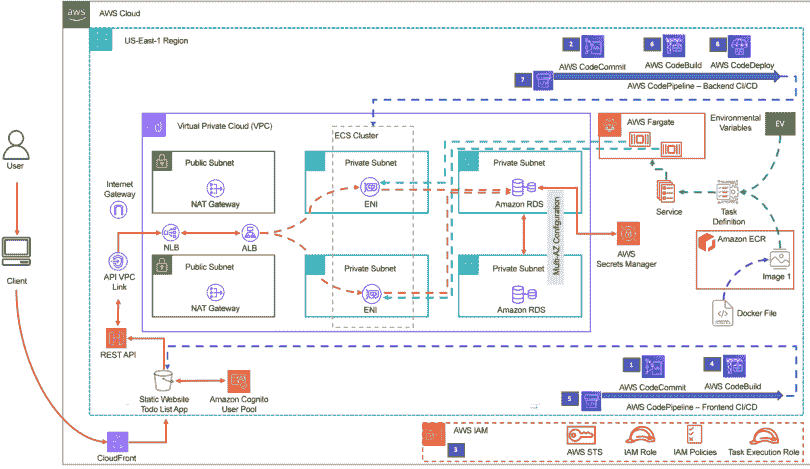

图 12.16 – Todo List 应用程序 CI/CD 架构

根据架构图，以下是您将在接下来的项目任务中构建的高级组件：

1. 为 Todo List 应用程序前端代码创建一个 AWS CodeCommit 存储库。
2. 为 Todo List 应用程序后端代码创建一个 AWS CodeCommit 存储库。
3. 从本地开发机器创建并上传 SSH 密钥以连接到您的存储库。这将使您能够将代码上传到存储库。
4. 对于 CI/CD 流水线，您将在 AWS CodeBuild 中创建构建项目。这将构建前端应用程序的新版本。
5. 对于 CI/CD 流水线，您将使用 AWS CodePipeline 创建新流水线。
6. 然后，您将使用 AWS CodeBuild 为后端应用程序组件创建构建项目。
7. 然后，您将为应用程序的后端组件配置新流水线。
8. 作为流水线配置的一部分，您将部署提供程序定义为 Amazon ECS，并将其配置为流水线部署阶段的一部分。

## 技术要求

在接下来的项目任务中，您必须登录到您一直在其中架构和部署 Todo List 应用程序的 AWS 开发账户。确保您以 IAM 用户 Alice 的身份登录。确保您已完成所有之前的项目任务。

您还必须在计算机系统上安装 Git，相关说明见 *项目任务 2.1*。

您必须从我们的 GitHub 存储库下载更新后的前端和后端应用程序文件的最新副本。

这些文件可在以下路径找到：https://packt.link/cy85c。

将前端和后端代码文件放在不同的目录中，以免混淆，并将它们解压到相应的文件夹中。示例截图如图 12.17 所示，供参考：

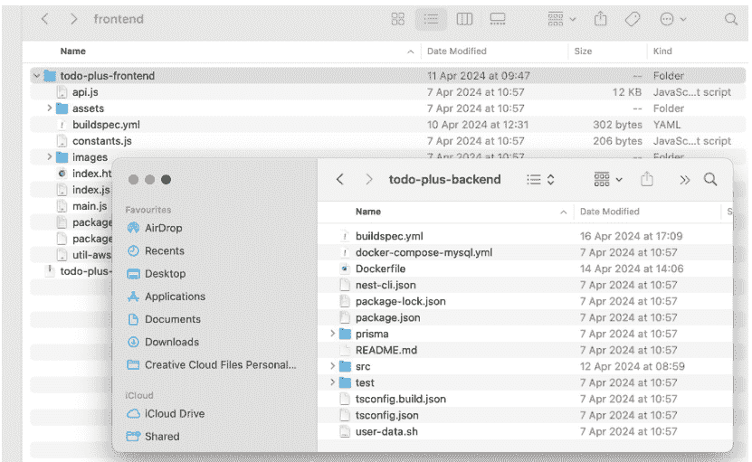

图 12.17 – 将前端和后端代码解压到各自的相关文件夹中

## 项目任务 12.1 – 前提条件：在您的系统上安装 Git

在本项目任务中，您将在计算机上安装 Git 以管理您的源代码存储库。

### 对于基于 Windows 的计算机

1. 导航到 https://git-scm.com/download/win。
2. 确保您下载适合您操作系统架构的独立安装程序。例如，对于 Windows 11，您主要需要 64 位版本。
3. 下载到计算机后，运行安装程序并接受默认设置，但以下步骤除外（如图 12.18 所示），您可以在其中选择“为新建存储库覆盖默认分支名”选项，并将初始分支设置为 main：

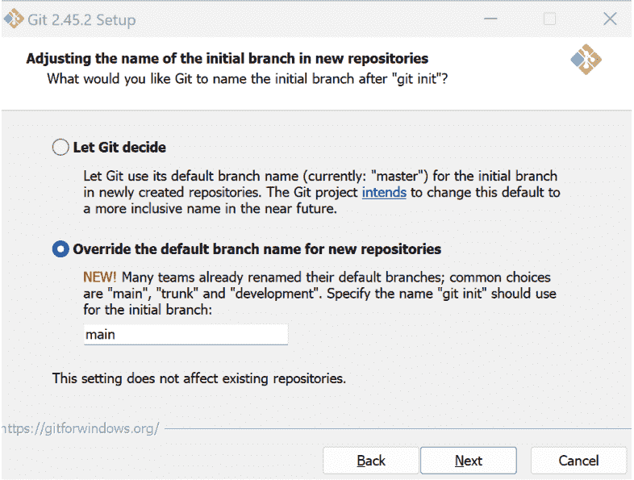

图 12.18 – 在 Windows 操作系统上安装 Git

4. 按照其余提示使用默认设置安装 Git。
5. 完成后，您可以在 Windows 命令提示符中运行 `git -version` 命令来验证安装。

### 对于基于 macOS 的计算机

6. 使用 Homebrew 通过 `brew install git` 命令下载并安装 Git。
7. 在终端窗口中运行 `git -version` 命令来验证安装，如图 12.19 所示：

```
iaasacademycreator — -zsh — 75×14
iaasacademycreator@IaaSs-MacBook-Air ~ % git --version
git version 2.39.0
iaasacademycreator@IaaSs-MacBook-Air ~ %
```

图 12.19 – 验证 Git 安装

在下一个项目任务中，您将在 AWS CodeCommit 上为前端和后端代码创建存储库。

## 项目任务 12.2 – 创建 AWS CodeCommit 存储库

在本项目任务中，您将创建两个存储库来承载前端代码和后端应用程序。这些存储库将根据前面讨论的新原型设计，使用最新迭代的代码进行更新，使您能够理解，借助 CI/CD 流水线，更新、发布和 bug 修复可以轻松部署和有效管理：

1. 在 AWS 管理控制台中，通过屏幕顶部的搜索栏搜索服务，导航到 AWS CodeCommit。同时，确保您位于 N. Virginia（`us-east-1`）区域。
2. 接下来，在左侧菜单的 **Source** 标题下选择 **Repositories**。
3. 在右侧窗格中，单击 **Create repository**。
4. 接下来，为应用程序前端网站的存储库提供名称；例如，您可以选择诸如 `todolist-frontend` 之类的名称。


- 5. 提供可选描述，然后点击**创建**按钮。
- 6. 您将收到一条确认信息，表明仓库已成功创建。系统将为您提供从本地计算机连接到该仓库的步骤。请确保选择**SSH**选项卡，因为这是一个推荐的连接选项。

## 步骤3：编辑本地SSH配置

编辑本地`~/.ssh`目录中名为`config`的SSH配置文件。将以下行添加到文件中，其中User的值是您在步骤2中复制的SSH密钥ID。

```
Host git-codecommit.*.amazonaws.com
User Your-IAM-SSH-Key-ID-Here
IdentityFile ~/.ssh/Your-Private-Key-File-Name-Here
```

保存文件后，通过在`~/.ssh`目录中运行以下命令，确保文件具有正确的权限。

```
chmod 600 config
```

## 步骤4：克隆仓库

将您的仓库克隆到本地计算机并开始处理代码。运行以下命令：

```
git clone ssh://git-codecommit.eu-west-2.amazonaws.com/v1/repos/todolist-f
```

## 其他详细信息

您可以在文档中找到更详细的说明。查看文档。

图12.20 – 在macOS上安装Git的步骤

> **注意**
>
> 关于连接选项，请注意*步骤4*中的命令，如*图12.20*所示。根据您本地计算机的操作系统提供了相应说明。请确保您熟悉这些说明。

- 7. 重复*步骤2–5*为Todo List后端应用程序创建一个仓库。确保选择一个合适的名称，并记下克隆仓库的命令，如本项目任务*步骤5*所述。

## 项目任务12.3 – 创建并上传SSH公钥

要访问AWS CodeCommit并从本地计算机上传应用程序代码，您将使用安全外壳（SSH）协议来配置加密连接，以便远程登录AWS CodeCommit并执行文件传输。

### 适用于Windows计算机

- 1. 请为Windows 10和11生成SSH密钥对。
- 2. 确保您的Windows计算机上已安装OpenSSH。例如，在我们的案例中，该服务已预装在Windows 11机器上，如图12.21所示。

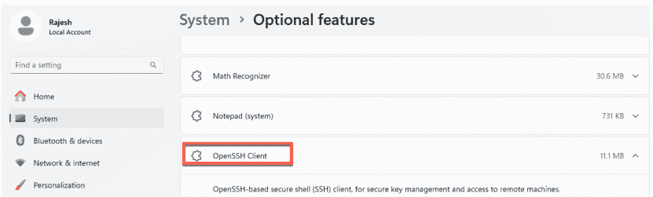

图12.21 – Windows 11计算机上安装的OpenSSH客户端

- 3. 如果您需要安装客户端，请在Windows搜索栏中搜索“设置”，导航到“系统”，然后点击“添加可选功能”，如图12.22所示。

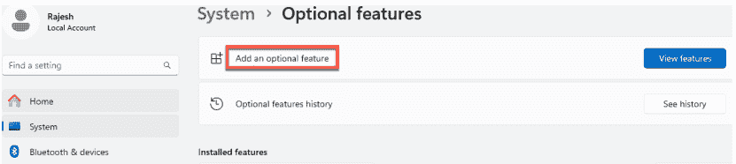

图12.22 – 可选 – 添加OpenSSH客户端功能

- 4. 确认OpenSSH客户端已安装后，即可生成您的公钥-私钥对。
- 5. 通过在Windows桌面上的搜索栏中搜索cmd来打开命令提示符。
- 6. 在命令提示符中，输入ssh-keygen命令并按回车键。您将看到以下提示，如图12.23所示：

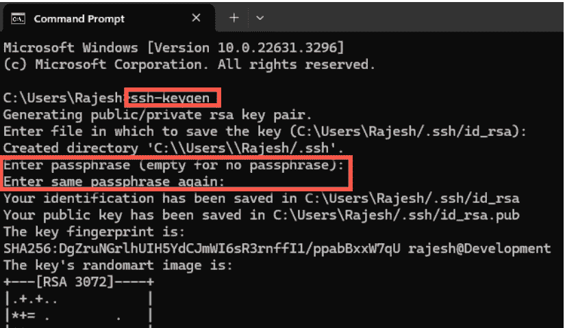

图12.23 – 生成SSH密钥对

- 7. 确保使用默认文件位置，以便密钥存储在c:\users\[userid]/.ssh中。
- 8. 提供密码短语并确认密码短语以保护您的密钥，如图12.23所示。
- 9. 您的公钥将存储在id_rsa.pub文件中。

### 适用于macOS计算机

- 10. 为macOS创建SSH密钥对（如果您使用的是Mac计算机）
- 11. 在Mac计算机上启动终端窗口。
- 12. 使用`cd ~/.ssh`命令导航到`ssh`目录，如图12.24所示：

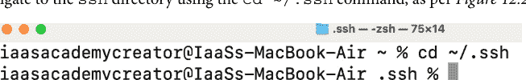

- 13. 接下来，输入`ssh-keygen`命令并按回车键。
- 14. 接受SSH密钥对的默认文件名并按回车键。
- 15. 为您的密钥提供密码短语，并在提示时再次确认密码短语。
- 16. 然后您将看到密钥已保存的确认信息，如图12.25所示：

```
iaasacademycreator@IaaSs-MacBook-Air ~/.ssh % ssh-keygen
Generating public/private ed25519 key pair.
Enter file in which to save the key (/Users/iaasacademycreator/.ssh
/id_ed25519): id_rsa1
Enter passphrase (empty for no passphrase):
Enter same passphrase again:
Your identification has been saved in id_rsa1
Your public key has been saved in id_rsa1.pub
The key fingerprint is:
SHA256:N1E29C5IYN7Qt19pLw5SXxiTsMZETAjoAVp0v3XwPuU iaasacademycreator@IaaSs-MacBook-Air.local
The key's randomart image is:
+--[ED25519 256]--+
|  .+.*+.oB+=. . |
|  o +o=.o.O..+ |
```

图12.25 – macOS上的ssh-keygen

- 17. 接下来，您必须将公钥文件的内容复制到您的AWS CodeCommit凭据文件中。
- 18. 如果您使用Windows，应该可以用记事本打开公钥文件（例如`id_rsa.pub`）。
- 19. 在Mac计算机上，您可以对文件运行`cat id_rsa.pub`命令来查看公钥，如*图12.26*所示。

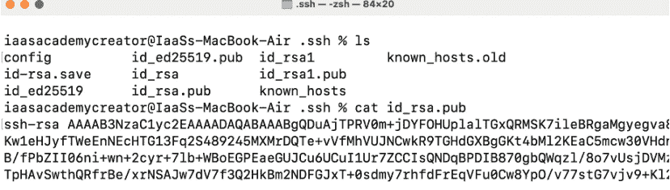

图12.26 – id_rsa.pub的内容

- 20. 将此文件的内容复制到剪贴板。
- 21. 在Web浏览器中，导航回您的AWS开发账户。
- 22. 在右上角窗格中，点击下拉箭头并选择**安全凭据**。
- 23. 接下来，点击**AWS CodeCommit凭据**选项卡。
- 24. 点击**上传SSH公钥**按钮，如*图12.27*所示。

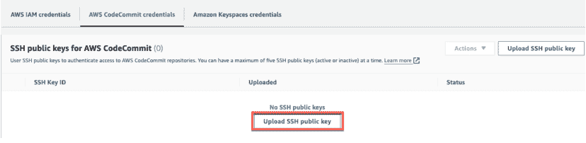

图12.27 – 上传SSH公钥

- 25. 在出现的**上传SSH公钥**文本框中，粘贴您的公钥内容，确保包含从`ssh-rsa`到字符串末尾ID的所有内容，如*图12.28*所示。

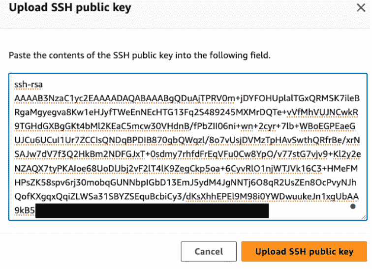

图12.28 – 上传SSH公钥

- 26. 您应该会收到一条确认信息，表明您的SSH公钥已上传。记下**SSH密钥ID**值，如*图12.29*所示：

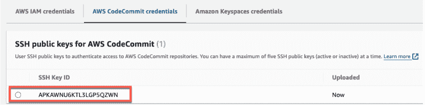

图12.29 – SSH密钥ID

- 27. 您需要将以下代码添加到.ssh目录中的config文件中（如果文件不存在，请创建它）：

```
Host git-codecommit.*.amazonaws.com
User [ADD YOUR SSH KEY ID HERE]
IdentityFile ~/.ssh/[ADD YOUR ID FILE NAME HERE, EXAMPLE id_rsa]
```

- 28. 保存config文件。
- 29. 接下来，使用以下命令测试您是否可以连接到CodeCommit环境：在Windows的命令提示符或Mac的终端中运行：ssh -T git-codecommit.us-east-1.amazonaws.com
- 30. 您需要输入yes并按回车键，以确认接受主机的真实性。
- 31. 如果您之前定义了密码短语，现在系统会提示您输入该密码短语。
- 32. 您应该会收到类似图12.30所示的响应：

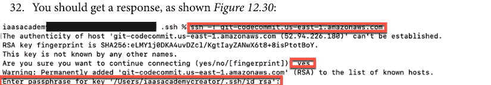

图12.30 – 在Mac计算机上测试与AWS CodeCommit的连接

连接建立后，您可以将前端项目代码上传到仓库。

## 项目任务12.4 – 将前端和后端代码上传到AWS CodeCommit

在此项目任务中，您将把前端项目代码文件上传到您的todolist-frontend CodeCommit仓库。

访问您的终端（Windows中的命令提示符），并导航到您应已创建的前端代码文件夹的根目录，如本系列项目任务前面的“技术要求”部分所述。以下截图（图12.31）显示了Mac计算机上的示例。您的文件夹层次结构可能有所不同：

图12.31 – 导航到前端代码文件夹的根目录

## 重要说明

在上传此更新版本的前端代码之前，您必须修改index.html文件的内容。在您喜欢的编辑器中打开HTML代码，例如Visual Studio Code，并导航到文件末尾附近。在我的Visual Studio Code中，这些是第906和907行，如图12.32所示。

```
iaasacademycreator@IaaSs-MacBook-Air codecommit % ls
backend        frontend
iaasacademycreator@IaaSs-MacBook-Air codecommit % cd frontend
iaasacademycreator@IaaSs-MacBook-Air frontend % ls
todo-plus-frontend  todo-plus-frontend.zip
iaasacademycreator@IaaSs-MacBook-Air frontend % cd todo-plus-frontend
iaasacademycreator@IaaSs-MacBook-Air todo-plus-frontend % ls
api.js         images          package-lock.json
assets         index.html      package.json
buildspec.yml  index.js        util-aws-sdk.js
constants.js   main.js
iaasacademycreator@IaaSs-MacBook-Air todo-plus-frontend %
```

```
Users > iaasacademycreator > Desktop > codecommit > frontend > todo-plus-frontend > <> index.html > body
313   <body>
899   <!-- Vendor JS Files -->
900
901
902   <!-- Template Main JS File -->
903   <script src="main.js"></script>
904
905   <script>
906     window.cognitoClientId = "2ip6ded8t1buteqdtu8isf7120" // Put your client id here
907     window.BASE_URL = "/development"; // Put your base path here (if different)
908   </script>
909
910   <script type="module" src="index.js"></script>
911
912   </body>
913
914   </html>
```

图12.32 – 前端index.html文件

您必须将引号中提供的现有Cognito示例ID替换为您在第二章“使用AWS身份与访问管理保护访问”中创建的Cognito客户端ID。


您还必须确保提供与您在 CloudFront **行为（Behaviors）** 选项卡中显示的正确基础路径，该选项卡是在 *第 9 章第 9.4 个项目任务“将边缘网络服务整合以通过 Amazon CloudFront 和 Route 53 连接应用程序”中的第 18 步* 中创建的。示例如图 12.33 所示：

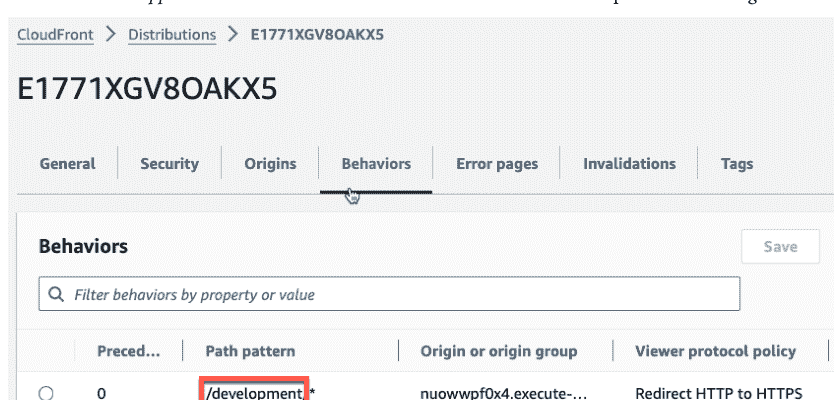

图 12.33 – CloudFront 分发 | 行为 | 路径模式

保存 index.html 文件后，您可以继续执行此项目任务的步骤：

- 1. 按照图 12.34 中的截图，导航至 AWS CodeCommit **存储库（Repositories）**：

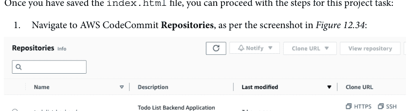

图 12.34 – AWS CodeCommit 环境中的存储库列表

- 2. 按照图 12.34，点击 SSH 旁边的复制图标，将 SSH URL 复制到剪贴板。

- 3. 在终端窗口（Windows 中为命令提示符）中输入 `git init` 命令并按 Enter 键以初始化 Git。

- 4. 输入 `git remote add origin <粘贴您的前端存储库的 URL>` 命令并按 `Enter`。

- 5. 输入 `git add .` 命令并按 `Enter`。这将添加文件夹中的所有文件，准备进行上传。

- 6. 接下来，输入 `git commit -m "initial commit"` 命令并按 `Enter`。

- 7. 接下来，输入 `git push -u origin main` 命令并按 `Enter`，将代码推送到 AWS CodeCommit 存储库。您应该在终端（CMD）窗口中看到如图 12.35 所示的结果：

```
iaaacademycreator@IaaS-MacBook-Air todo-plus-frontend % git push -u origin main
Enter passphrase for key '/Users/iaaacademycreator/.ssh/id_rsa':
Enumerating objects: 30, done.
Counting objects: 100% (30/30), done.
Delta compression using up to 8 threads
Compressing objects: 100% (29/29), done.
Writing objects: 100% (30/30), 3.11 MiB | 1.54 MiB/s, done.
Total 30 (delta 0), reused 0 (delta 0), pack-reused 0
remote: Validating objects: 100%
To ssh://git-codecommit.us-east-1.amazonaws.com/v1/repos/todolist-frontend
* [new branch]      main -> main
branch 'main' set up to track 'origin/main'.
```

图 12.35 – git push 命令

- 8. 一旦您的所有文件都上传完毕，您应该能够在 AWS CodeCommit 的 `todolist-frontend` 存储库中看到它们，如图 12.36 所示：

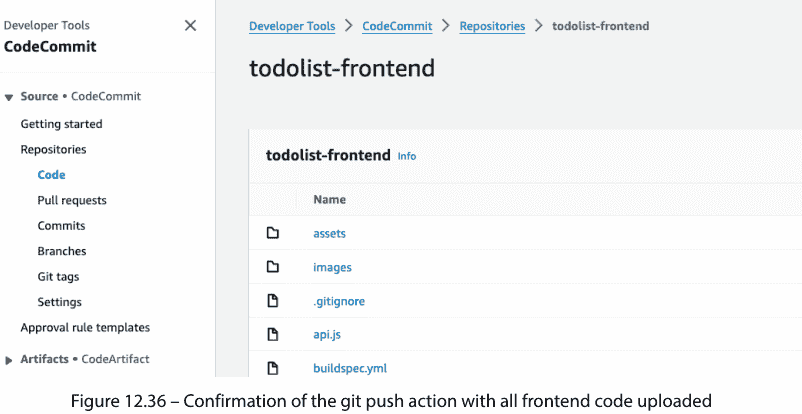

- 9. 接下来，您将把后端代码推送到 CodeCommit 中的 todolist-backend 存储库。然而，在此之前，您必须更新之前在“技术需求”部分创建的本地后端存储库中的 buildspec.yml 文件：

- 10. 在您最喜欢的文本编辑器中打开位于之前下载的 todo-plus-backend 文件夹根目录下的 buildspec.yml 文件。

- 11. 从 AWS 管理控制台，导航至您的 Amazon ECS 控制台。从左侧菜单中，点击 任务定义（Task Definition）。

- 12. 在右侧窗格中，点击您的任务定义的最新修订版本。

- 13. 向下滚动并注意 容器名称（Container name）值，如图 12.37 所示：

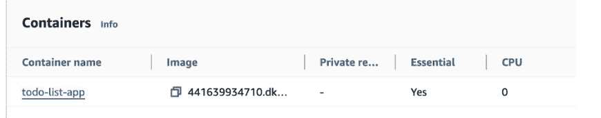

图 12.37 – 容器名称

- 14. 在您的 buildspec.yml 文件中，您会注意到第 9 行有一个占位符，您需要在此提供您的容器名称，如图 12.38 所示：

```
1  version: 0.2
2
3  phases:
4    build:
5      commands:
6        - docker build -t $REPOSITORY_URI:$CODEBUILD_RESOLVED_SOURCE_VERSION
7        - aws ecr get-login-password --region us-east-1 | docker login --username AWS --password-stdin $REPOSITORY_URI
8        - docker push $REPOSITORY_URI:$CODEBUILD_RESOLVED_SOURCE_VERSION
9        - printf '[{"name":"CONTAINER NAME","imageUri":"%s"}]' $REPOSITORY_URI
10 artifacts:
11   files: taskdef.json
12
```

图 12.38 – 后端 buildspec.yml 文件

- 15. 更改后保存该文件。

- 16. 接下来，针对后端应用程序代码遵循 *步骤 1 至 7*，并将后端文件上传到 `todolist-backend` 存储库。确保您将 SSH URL 更改为您的后端存储库。按照 *图 12.39* 将您的后端代码推送到 `todolist-backend` 存储库：

```
iaaacademycreator@IaaS-MacBook-Air todo-plus-backend % git push -u origin main
Enter passphrase for key '/Users/iaaacademycreator/.ssh/id_rsa':
Enumerating objects: 4, done.
Counting objects: 100% (4/4), done.
Delta compression using up to 8 threads
Compressing objects: 100% (2/2), done.
Writing objects: 100% (3/3), 286 bytes | 286.00 KiB/s, done.
Total 3 (delta 1), reused 0 (delta 0), pack-reused 0
remote: Validating objects: 100%
To ssh://git-codecommit.us-east-1.amazonaws.com/v1/repos/todolist-backend
144d7df..7482fa3  main -> main
branch 'main' set up to track 'origin/main'.
iaaacademycreator@IaaS-MacBook-Air todo-plus-backend %
```

图 12.39 – 用于将应用程序代码上传到 todolist-backend 存储库的 git push 命令

## 项目任务 12.5 – 为前端应用程序创建 CI/CD 流水线

在本项目任务中，您将开始从 Web 应用程序的前端组件配置您的 CI/CD 流水线。这将更新前面讨论过的前端 **用户界面 (UI)**。

按照以下步骤编辑前端源代码包中的 `buildspec.yml` 文件：

- 1. 导航至您已解压到本地计算机 `frontend` 目录的 `todoplus_frontend` 文件夹。在您最喜欢的代码编辑器（如 Notepad++ 或 Visual Studio Code）中打开 `buildspec.yml` 文件，如图 12.40 所示：

```
version: 0.2

phases:
  build:
    commands:
      - npm i && npm run build
      # Please change the s3 bucket URI
      - aws s3 cp --recursive dist/ s3://mytodolistapp
      # Please change the distribution id
      - aws cloudfront create-invalidation --distribution-id E1771XGVB0AXK5 --paths "/*"
```

图 12.40 – 编辑 buildspec.yml 文件

- 2. 您需要将高亮显示的 s3 端点地址编辑为您 Amazon S3 存储库的地址。这是您的存储库名称。

- 3. 接下来，您必须将您的 CloudFront 分发 ID 编辑为您的分发 ID。您可以在 Amazon CloudFront 控制台中找到该 ID，如图 12.41 所示：

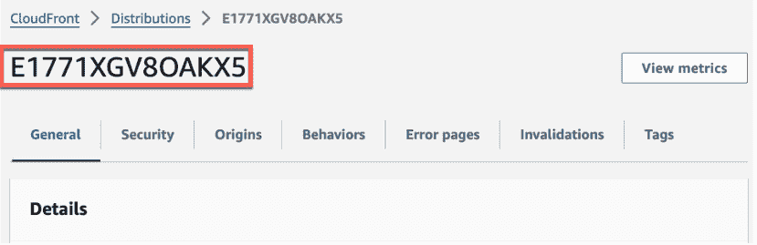

图 12.41 – 识别您的 CloudFront 分发 ID

- 4. 接下来，确保保存该文件。

- 5. 打开您的终端窗口（如果使用 Mac）或命令提示符（如果使用 Windows），并导航至前端代码文件夹。列出目录和文件，以确保您位于包含刚刚更新的 `buildspec.yml` 文件的正确文件夹中。

- 6. 接下来，输入 `git add .` 命令并按 *Enter*。

- 7. 接下来，输入 `git commit -m "buildspec file updated"` 命令并按 *Enter*。这里，您正在提交对 buildspec 文件所做的更改。您应该会收到更改的确认。

- 8. 接下来，输入 `git push` 命令并按 *Enter* 以将代码推送到 AWS CodeCommit。如果您之前创建了密码短语，系统可能会提示您输入密码短语。然后您应该会看到 `git push` 操作的确认，如图 12.42 所示：

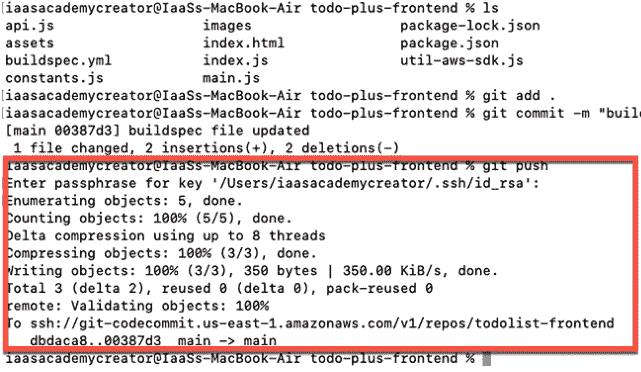

图 12.42 – Git 推送已更新的代码文件

### 创建 CodeBuild 项目

- 1. 接下来，您需要创建一个 CodeBuild 项目文件。确保您仍以 IAM 用户 Alice 的身份登录到 AWS 开发账户。

- 2. 从顶部搜索栏中，搜索 AWS CodeBuild 并导航至 CodeBuild Web 控制台。

- 3. 从左侧菜单中，点击 **入门（Getting Started）**，然后在右侧窗格中点击 **创建项目（Create project）** 按钮。

- 4. 接下来，为您的项目提供一个名称，例如 `todolist-frontend-build`。

- 5. 接下来，将源代码提供商设置为 **AWS CodeCommit**。

- 6. 对于 **存储库（Repository）**，确保您选择了 `todolist-frontend`（如果您给前端源代码存储库起了不同的名称，请确保选择正确的那个）。

- 7. 在 **分支（Branch）** 下的下拉列表中，选择 **main**。

- 8. 在环境部分，记下自动为您创建的 IAM 角色的 **角色名称（Role name）**。

- 9. 接下来，向下滚动至 **Buildspec** 部分，并选择 **使用 buildspec 文件（Use a buildspec file）**。

- 10. 最后，点击屏幕底部的 **创建构建项目（Create build project）**。

- 11. 然后您应该会收到项目已创建的确认，如图 12.43 所示：

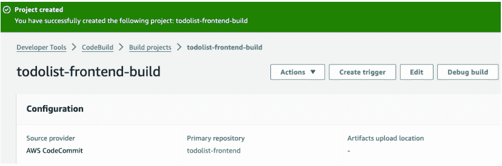

*图 12.43 – 构建项目已创建*

请注意，系统会自动为您创建一个 IAM 角色，接下来您需要对其进行编辑。此更新确保为您的项目提供必要的权限，以更新托管在 Amazon S3 存储库中的前端代码，并对您的 CloudFront 分发执行失效请求（invalidation request）。角色名称取决于您的构建项目名称，因此您应该能够快速在 IAM 中识别出它。


## 更新您的 IAM 角色

- 1. 在单独的浏览器标签页中导航到 AWS IAM 管理控制台。
- 2. 在 IAM 控制台中，从左侧菜单点击 **Roles**，然后在右侧窗格中搜索您在 *Step 16* 中记下的 IAM 角色名称。
- 3. 点击该角色，然后从 **Add Permissions** 下拉箭头中点击 **Create inline policy**。对于此内联策略，您可以使用可视化编辑器或 **JSON** 选项卡并粘贴以下 JSON 代码，确保为粗体突出显示的占位符提供正确的值：

```json
{
    "Version": "2012-10-17",
    "Statement": [
        {
            "Sid": "VisualEditor0",
            "Effect": "Allow",
            "Action": [
                "s3:PutObject",
                "s3:GetObject",
                "cloudfront:CreateInvalidation"
            ],
            "Resource": [
                "arn:aws:cloudfront::[Account ID]:distribution/[CLOUDFRONT DISTRIBUTION ID]",
                "arn:aws:s3:::[AMAZON S3 BUCKET NAME]/*"
            ]
        }
    ]
}
```

> **Note:**
> 
> 您可以从我们在技术要求部分提到的 GitHub 仓库下载此策略示例

- 4. 点击 **Next**。
- 5. 在标记为 **Policy name** 的文本框中为您的策略提供一个名称，然后点击 **Create policy**。
- 6. 您应该为此角色有两个策略，如 *Figure 12.44* 所示。

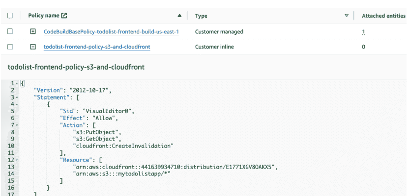

Figure 12.44 – Additional inline policy to grant access to S3 and CloudFront

接下来，您将为您的 CI/CD 部署创建管道。

## 创建您的 CI/CD 管道

在本任务的这一部分中，您将创建 CI/CD 管道，该管道将用于触发更新的前端代码的部署：

- 1. 在 AWS 管理控制台的顶部搜索栏中搜索并导航到单独浏览器标签页中的 AWS CodePipeline 控制台。
- 2. 从左侧菜单选择 Pipelines under CodePipeline。
- 3. 在右侧窗格中，点击 Create pipeline 按钮。
- 4. 为您的管道提供一个描述性名称，例如 todolist-frontend-pipeline。
- 5. 确保在 Execution mode 下选择了 Queued（Pipeline type V2 required），然后点击页面底部的 Next。注意，此过程还将自动创建一个 IAM 角色。
- 6. 在页面的 Source 部分中选择 AWS CodeCommit 作为 Source provider。
- 7. 接下来，确保为 Repository name 选择 todolist-frontend 仓库。
- 8. 接下来，确保在 Branch name 下选择 main。

9. 点击 Next，如 Figure 12.45 所示：

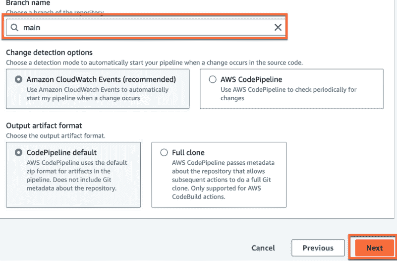

Figure 12.45 – Configuring the source of your pipeline

10. 对于 Build provider，确保选择 AWS CodeBuild。

11. 接下来，确保区域设置为 US East（N. Virginia）。

12. 接下来，确保选择您在 Step 12 中创建的构建的正确项目名称。

13. 点击 Next。

14. 您现在将被提示 Add deploy stage。对于此阶段，点击 Skip deploy stage 按钮。系统会提示您确认您的选择。请继续点击 Skip 按钮。

15. 接下来，您会看到 Review 部分。确保所有设置都已正确定义，如前面的步骤所述，然后点击 Create pipeline 按钮。

您的 AWS CodePipeline 现在将初始化并继续构建您的 CI/CD 管道，接收仓库中的更新代码并更新 Web 应用程序的前端组件。片刻之后，您应该会看到管道已成功创建，并且您的源和构建过程也已成功完成，如 Figure 12.46 所示：

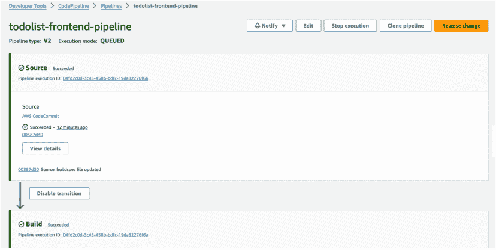

如果您导航到托管前端网站代码的 Amazon S3 存储桶的内容，您会注意到文件已使用时间戳更新，如 Figure 12.47 所示：

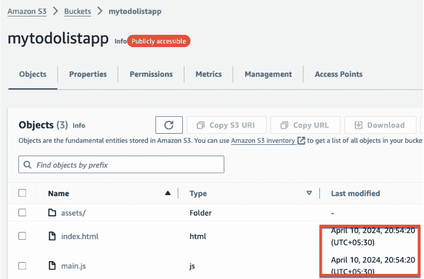

接下来，您必须为后端应用程序代码构建 CI/CD 管道。

## Project Task 12.6 – 为您的后端应用程序创建 CI/CD 管道

现在您的前端代码已通过 AWS CodePipeline 更新，您可以为后端代码创建管道。

在设置 CI/CD 管道之前，请注意用于构建该后端 Fargate 容器的 Docker 镜像的 URI。在单独的浏览器标签页中导航到您的 Amazon ECR 管理控制台。记下您的后端 Docker 镜像的镜像 URI，如 *Figure 12.48* 所示。您将在即将到来的步骤中需要它。

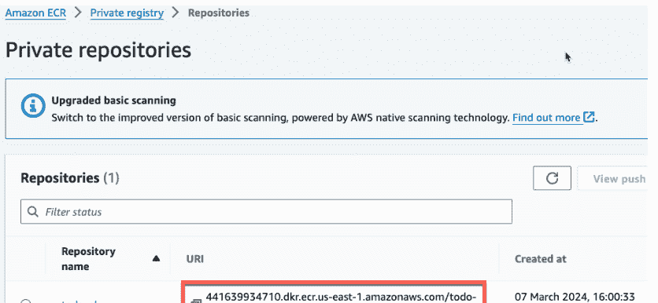

Figure 12.48 – Image URI of your Docker image

### 创建 CodeBuild 项目

- 1. 在单独的浏览器标签页中导航到 AWS CodeBuild 管理控制台。
- 2. 在右侧窗格中，点击 **Create project** 按钮。
- 3. 为您的项目提供一个名称，例如 `todolist-backend-build`。
- 4. 接下来，在 **Source** 部分选择 **AWS CodeCommit as Source provider**。
- 5. 从 **Repository** 搜索框中选择 `todolist-backend` 仓库。
- 6. 接下来，从 **Branch** 下拉列表中选择 **main**。
- 7. 接下来，在 **Environment** 部分，注意将创建为新服务角色的 **Role name** 值。
- 8. 向下滚动并展开 **Additional configuration** 子部分。
- 9. 在 **Environmental variables** 部分，创建一个名为 `REPOSITORY_URI` 的新环境变量，并将您在此项目任务开始时记下的 Docker 镜像 URI 粘贴为值，如 *Figure 12.49* 所示。`buildspec.yml` 文件中的 docker build 命令引用此环境变量以知道要构建哪个容器镜像。

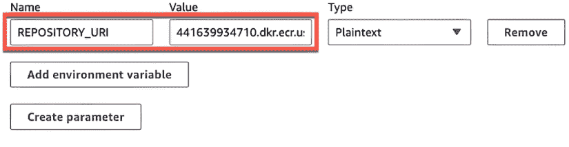

Figure 12.49 – Environmental variables used in your CodeBuild project

- 10. 接下来，滚动到 **Buildspec** 部分。在这里，选择 **Use a buildspec file** 选项。
- 11. 最后，点击屏幕底部的 **Create build project** 按钮。您应该会收到一条消息，说明您已成功创建项目。

## 更新您的 IAM 角色

- 1. 在单独的浏览器标签页中导航到 IAM 管理控制台。
- 2. 从左侧菜单点击 **Roles**。
- 3. 在右侧窗格中搜索并点击访问您在 *Step 7* 中记下的角色，CodeBuild 自动创建了该角色。
- 4. 点击 **Add permissions** 上的下拉箭头并选择 **Create inline policy**。
- 5. 在 **Policy editor** 中选择 **JSON** 选项并粘贴以下策略，确保将区域名称和 ECR 镜像名称替换为与您的 Amazon ECR 仓库中 ARN 匹配的名称：

```
{
"Version": "2012-10-17",
"Statement": [
{
"Sid": "VisualEditor0",
"Effect": "Allow",
"Action": [
```

```
"ecr:CompleteLayerUpload",
"ecr:UploadLayerPart",
"ecr:InitiateLayerUpload",
"ecr:BatchCheckLayerAvailability",
"ecr:PutImage"
],
"Resource": "arn:aws:ecr:[REGION NAME]:[Account ID]:repository/[ECR IMAGE NAME]"
},
{
"Sid": "VisualEditor1",
"Effect": "Allow",
"Action": "ecr:GetAuthorizationToken",
"Resource": "*"
}
]
}
```

> **Note:**
> 您可以从我们在技术要求部分提到的 GitHub 仓库下载此策略示例

- 6. 点击 **Next**。
- 7. 为您的策略提供一个名称，例如 todolist-backend-policy-ecr。
- 8. 点击 **Create policy** 按钮。
- 9. 接下来，返回 AWS CodeBuild 控制台。点击 **Start build** 按钮，如 Figure 12.50 所示：

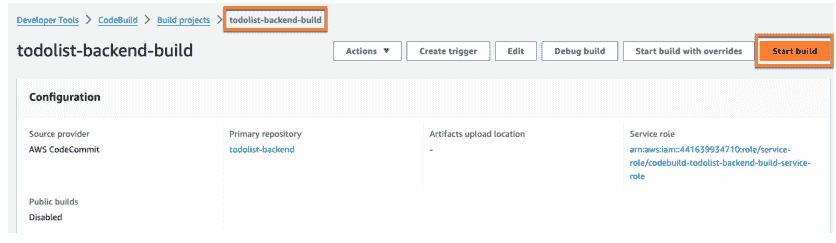

Figure 12.50 – Start build to test the build

10. 如果构建成功，您将在构建项目的 **Build logs** 部分注意到详细信息。如果您导航到 ECR 管理控制台，您还将注意到带有最新提交哈希的新容器镜像版本，如 Figure 12.51 所示：

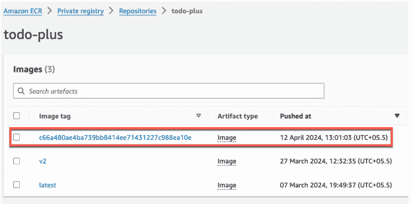

Figure 12.51 – New image version in Amazon ECR

接下来，您可以继续构建 CI/CD 管道。

## 创建您的 CI/CD 管道

- 1. 在单独的浏览器标签页中导航到 AWS CodePipeline 管理控制台。
- 2. 在右侧窗格中，点击 **Create pipeline** 按钮。
- 3. 为您的管道提供一个名称，例如 `todolist-backend-pipeline`。
- 4. 接下来，接受默认值并点击 **Next** 按钮。
- 5. 对于 **Source provider**，选择 **AWS CodeCommit**。
- 6. 接下来，从 **Repository name** 搜索框中选择您的后端仓库。
- 7. 确保将 **main** 设置为 **Branch name**。
- 8. 点击 **Next**。
- 9. 选择 **AWS CodeBuild** 作为 **Build provider**。
- 10. 确保为 **Region** 选择 **US East (N.Virginia)**。


11. 接下来，请根据图 12.52 从项目名称搜索框中选择正确的构建项目：

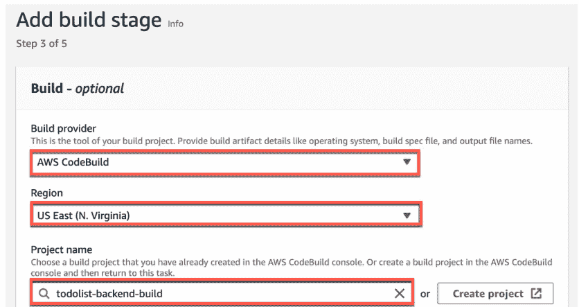

图 12.52 – 向您的流水线添加构建阶段

- 12. 单击下一步。
- 13. 选择 Amazon ECS 作为部署提供商。
- 14. 接下来，在集群名称搜索框中选择您的 ECS 集群，例如，todo-plus-cluster。
- 15. 接下来，在服务名称中选择您在第 11 章《使用 Amazon ECS、Fargate 和 EKS 部署多层应用程序堆栈》中创建的正确的 ECS 服务名称，例如，todo-plus-ecs-service。
- 16. 接下来，在图像定义文件 – 可选 下方的文本框中提供名称 taskdef.json。此图像文件名引用自后端 buildspec 文件。

- 17. 单击 **下一步**。
- 18. 查看您的配置并单击屏幕底部的 **创建流水线** 按钮。

您的后端流水线现在将处理您的请求并经过应用程序的源、构建和部署阶段，您应该会得到成功完成，如 *图 12.53* 所示：

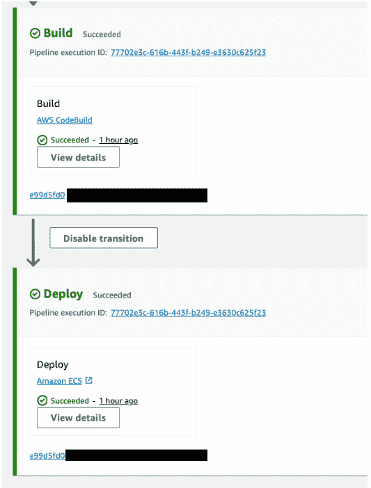

图 12.53 – CI/CD 流水线成功

接下来，您现在可以测试您的应用程序。如有必要，导航到 CloudFront Web 管理控制台，将分发域名复制到剪贴板，然后将其粘贴到浏览器标签的地址栏中。

您的 Todo List 应用程序网站应该打开，您应该能够使用上一章中使用的相同凭据登录。如果您添加了任何待办条目，它们应该会反映在您的待办列表中。

更重要的是，您应该注意到用户界面更改和功能，如本项目任务开始时讨论的那样。您现在可以编辑现有任务、删除可能错误输入的任务，甚至可以根据 **任务类型** 和 **状态** 过滤任务。图 12.54 说明了应用程序用户界面：

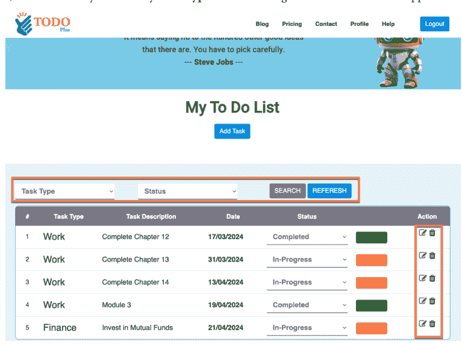

图 12.54 – 最终应用程序用户界面和用户体验

## 摘要

本章致力于帮助组织利用 AWS CI/CD 工具实施软件开发和部署的 DevOps 方法。本章强调了 DevOps 的重要性，这是一种促进开发人员和运维团队之间协作和沟通以加快高质量软件交付的理念。它还介绍了各种 AWS CI/CD 工具，如 AWS CodeBuild、AWS CodeDeploy 和 AWS CodePipeline。它演示了如何使用这些工具自动执行软件应用程序的构建、测试和部署。

此外，本章提供了利用 AWS CI/CD 工具的最佳实践，包括使用 AWS IAM 策略控制对资源的访问以及使用 AWS 资源级权限在每个账户内调节对资源的访问。本章以强调持续改进的重要性以及随着项目不断发展需要监控和增强流水线而结束。

## 考试准备演练 – 章节复习问题

除了对关键概念有扎实的理解之外，在时间压力下快速思考的能力将帮助您顺利通过认证考试。这就是为什么在学习之旅早期就练习这些技能很关键。

章节复习问题旨在随着您学习和复习每一章而逐步提高您的应试技巧，同时检查您对本章关键概念的理解。您会在每一章的末尾找到这些问题。

如何访问这些材料

要了解如何访问这些资源，请前往标题为 *第 17 章，访问在线资源* 的章节。

要打开本章的章节复习问题，请执行以下步骤：

- 1. 单击链接 – https://packt.link/DVAC02_CH12。
- 

      或者，您可以扫描以下二维码（图 12.55）：


图 12.55 – 打开已登录用户的章节复习问题的二维码

2. 登录后，您会看到与图 12.56 所示类似的页面：

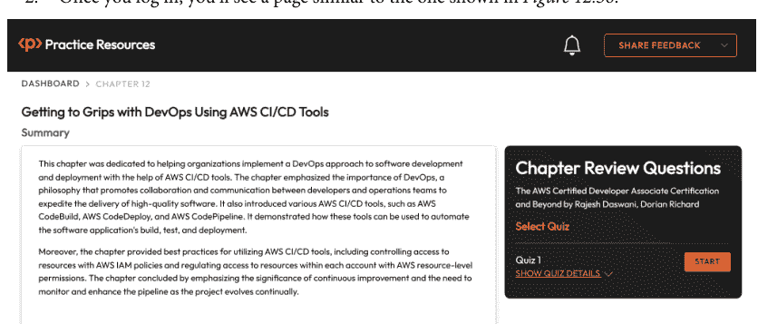

图 12.56 – 第 12 章章节复习问题

3. 准备好后，开始以下练习测验，多次重做测验。

## 考试准备演练

前三次尝试不必担心时间限制。

## 第一次尝试

第一次，至少达到 40%。查看答错的答案并再次阅读章节中的相关部分以弥补学习差距。

## 第二次尝试

第二次，至少达到 60%。查看答错的答案并再次阅读章节中的相关部分以弥补剩余的学习差距。

## 第三次尝试

第三次，至少达到 **75%**。一旦得分达到 75% 或以上，您就开始练习时间。

> **提示**
> 您可能需要超过 **三次** 尝试才能达到 75%。这没关系。只要一直复习章节中的相关部分，直到达到目标为止。

## 练习时间

**目标：** 您的目标是在尽可能快地回答这些问题的同时保持相同的分数。以下是您下一次尝试应如何进行的示例：

| 尝试 | 分数 | 用时 |
| --- | --- | --- |
| 第 5 次尝试 | 77% | 21 分 30 秒 |
| 第 6 次尝试 | 78% | 18 分 34 秒 |
| 第 7 次尝试 | 76% | 14 分 44 秒 |

表 12.1 – 在线平台上的示例计时练习测验

> **注意**
> 上表中显示的时间限制只是示例。根据网站上测验的时间限制，为每次尝试设定自己的时间限制。

随着每次新的尝试，您的分数应保持在 **75%** 以上，而完成所需“用时”应“减少”。重复尽可能多的尝试，直到您对时间压力感到有信心为止。
