## 使用 CloudFormation 和云开发工具包（CDK）通过代码构建基础设施

在当今快节奏的数字世界中，构建和管理基础设施变得越来越复杂和耗时。随着云计算的快速增长，组织不断寻找自动化其基础设施部署和管理的方法。这就是 CloudFormation 和 **云开发工具包（CDK）** 发挥作用的地方。

AWS CloudFormation 是一项 AWS 服务，允许您以 **基础设施即代码（IaC）** 的方式建模和设置基础设施。它提供了一种自动化创建、更新和删除 AWS 资源的方式，使其井然有序、可预测。这减少了人为错误的可能性，并使部署和维护基础设施更高效。

在此基础上，AWS 提供了另一项服务，称为 **AWS 云开发工具包（AWS CDK）**。该服务为使用 Python、JavaScript、TypeScript、C#、Go 或 Java 等流行编程语言开发云应用程序提供了高级库。CDK 为 AWS 提供更高级别的编程接口，使开发人员能够使用更熟悉的语法以代码形式定义其基础设施。CDK 使用 CloudFormation 模板和堆栈部署您的代码，但还提供多个内置构造，使创建、部署和管理云基础设施变得更容易。

AWS CloudFormation 和 CDK 属于 AWS 认证开发者助理认证的 **第 3 域：部署** 范围，您明确期望了解如何使用 IaC 部署基础设施和应用程序。

## AWS CloudFormation 概述

当您在 AWS 上设计、构建和部署基础设施和应用程序时，通常会执行重复性任务。使用 AWS 管理控制台甚至 CLI 执行这些任务需要大量手动操作。对于多个环境，想象一下反复部署具有相同配置项（IP地址范围、子网、路由表、NAT 网关和安全工具）的复杂 VPC。您可能希望在这些环境中保持相同的配置。然而，如果您手动使用鼠标点击或 CLI 命令执行所有必要的配置任务，您很可能会在环境之间出现配置漂移。AWS CloudFormation 是一项服务，可实现以代码形式创建、部署和管理云基础设施。它允许组织以可预测、有序的方式建模和自动化创建、更新和删除 AWS 资源的过程。使用代码构建所需的基础设施，CloudFormation 提供了一种简单的方法来定义所需状态，该状态可根据需要轻松创建、更新和删除。

使用 CloudFormation，基础设施可以以编程方式管理，使自动化重复性任务变得更容易，并减少人为错误的可能性。此外，CloudFormation 与其他 AWS 服务（如 EC2、S3 和 VPC）集成，使部署和管理复杂云基础设施变得容易。通过使用 CloudFormation，组织可以受益于改进的基础设施效率、可靠性和可扩展性。

AWS CloudFormation 允许您使用两种 **声明式语言** 中的一种来定义基础设施 – **JavaScript 对象表示法（JSON）** 或 **另一种标记语言（YAML）**。使用这些标记语言，您构建 **CloudFormation 模板**，以指定要创建的资源，以及这些资源之间的属性和关系。您希望构建的基础设施因此可以重现，这要归功于名为 AWS CloudFormation 的 IaC 服务。

以下高级图表说明了使用 YAML 定义的模板部署 CloudFormation 堆栈以构建 VPC。


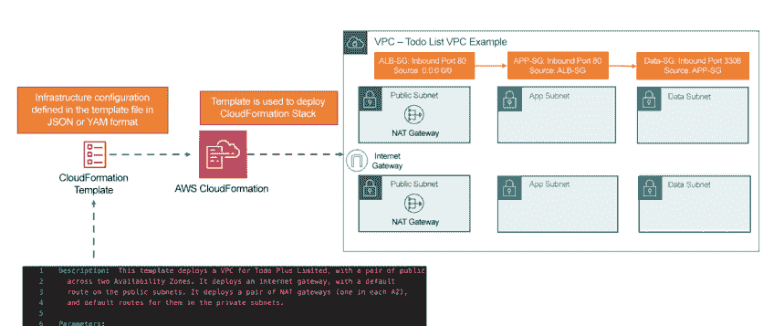

## 图 13.1：CloudFormation 堆栈

图 13.1 中的示例模板定义了与典型 VPC 关联的配置项。在模板中，你将定义子网、路由表、安全组以及 NAT 网关等组件。CloudFormation 服务随后将使用模板中的信息构建一个堆栈，即作为单个单元管理的资源集合。由 CloudFormation 模板定义的堆栈可使用 AWS 管理控制台、AWS CLI 或 CloudFormation API 进行创建、更新和删除。

当你将模板上传到 CloudFormation 时，服务会在 AWS 管理的 S3 存储桶中创建并存储该模板。如果你愿意，也可以使用自己的 S3 存储桶。此 AWS CloudFormation 模板可以从部署少量资源的简单配置定义到更复杂的架构不等。在下一节中，你将了解有关 CloudFormation 模板结构方面的更多信息。

## CloudFormation 模板的结构

AWS CloudFormation 模板由多个组件组成。示例片段如下所示：

```
Resources:
  VPC:
    Type: AWS::EC2::VPC
    Properties:
      CidrBlock: !Ref VpcCIDR
      EnableDnsSupport: true
```

```
EnableDnsHostnames: true
Tags:
- Key: Name
  Value: !Ref EnvironmentName
InternetGateway:
Type: AWS::EC2::InternetGateway
Properties:
Tags:
- Key: Name
  Value: !Ref EnvironmentName
InternetGatewayAttachment:
Type: AWS::EC2::VPCGatewayAttachment
Properties:
InternetGatewayId: !Ref InternetGateway
VpcId: !Ref VPC
```

CloudFormation 模板的组件解释如下：

### 格式版本

模板的这一部分是可选的，用于标识模板的功能。AWS CloudFormation 要求你使用当前模板版本 2010-09-09。这在模板中按以下代码片段指定：

```
AWSTemplateFormatVersion: "2010-09-09"
```

### 描述

此部分是可选的。它使你能够提供有关模板的一些信息，这对于需要审阅和使用它的人来说非常有帮助：

```
Description: This template deploys a VPC for Todo Plus Limited, with a pair of public and four private subnets spread across two Availability Zones. It deploys an internet gateway, with a default route on the public subnets. It deploys a pair of NAT gateways (one in each AZ), and default routes for them in the private subnets.
```

### 参数

AWS CloudFormation 允许你在模板中定义参数。虽然是一个可选部分，但参数非常有价值，因为它们会在部署 CloudFormation 堆栈时使你能够提供额外的配置信息，特别是当你无法在部署前提供这些配置细节时。

由于一个堆栈的配置可能与另一个堆栈不同，参数使你能够在不同堆栈之间重用模板，从而提供灵活性和延长模板的生命周期。

参数的示例在以下片段中显示：

```
Parameters:
  InstanceType:
    Description: Webserver EC2 instance type
    Type: String
    AllowedValues:
      - t2.nano
      - t2.micro
      - t2.small
    Default: t2.micro
    ConstraintDescription: must be a valid EC2 instance type
```

如上代码所示，当使用 CloudFormation 部署此模板时，用户会被提示接受 *default* 实例类型（在本例中为 `t2.micro`）来启动 EC2 实例，或从允许值的 *array* 中选择另一个实例类型。在本例中，允许的值为 `t2.nano`、`t2.micro` 和 `t2.small`。

每个参数都将有一个逻辑名称（逻辑 ID），该名称必须在模板中的所有其他逻辑名称中唯一。在本例中，参数的逻辑名称为 `InstanceType`。

所选值随后作为变量存储在参数中，你可以使用 `Fn::Ref` 内在函数从模板的 **Resources** 和 **Outputs** 部分引用它。当创建 YAML 格式的模板时，你可以使用 **!Ref** 函数，如以下片段所示：

```
Parameters:
  **InstanceType:**
    Description: Webserver EC2 instance type
    Type: String
    AllowedValues:
      - t2.nano
      - t2.micro
      - t2.small
    Default: t2.micro
    ConstraintDescription: must be a valid EC2 instance type
Resources:
  EC2Instance:
    Type: AWS::EC2::Instance
    Properties:
      InstanceType: **!Ref InstanceType**
```

如前述代码块所示，实例类型在启动 EC2 实例时是必需的细节，但它并未硬编码在模板中。相反，它是通过使用 !Ref 内在函数获取存储在参数中的值获得的。这在部署 CloudFormation 堆栈时提供了额外的灵活性。你可以在模板的任何位置使用 !Ref 内在函数引用参数和资源。

在定义参数时，你必须指定数据类型，如前一代码块第 4 行所示。数据类型可以是以下任何类型：

- **String**：字母数字字符 – 例如，MyVPCName。
- **Number**：可以是整数或浮点数。请注意，虽然 CloudFormation 会将参数值验证为数字，但当使用 `!Ref` 内在函数在模板中引用时，该值将作为字符串传递。
- **List\<Number\>**：可以是整数或浮点数的数组。
- **CommaDelimitedLists**：以逗号分隔的字符串列表 – 例如，`test,dev,prod`。
- **AWS-specific parameter types**：AWS 定义这些类型，有助于捕获用户可能输入的无效值。AWS 会将用户的输入与 AWS 账户中现有值进行验证。例如，`AWS::EC2::VPC::Id` 参数类型必须与 AWS 账户中现有的 VPC ID 匹配。
- **SSM parameter**：这使你能够从 SSM 参数存储中获取参数值。如果 SSM 参数来自外部账户共享，则必须提供该参数的完整 ARN。

还可以使用 `Parameters` 部分定义多个附加属性。其中一些属性如下：

- **AllowedPattern**：这使你能够在文本中定义正则表达式（regex），以确保其符合特定模式。这允许你快速验证条目并避免错误。
- **AllowedValues**：这是可用于定义参数值的允许值数组。
- **MaxLength**：这是定义 `string` 类型最大字符数的整数值。`MinLength` 相反，定义最小字符数。
- **MaxValue**：这是定义 `number` 类型最大数值的数值。`MinValue` 相反，定义允许的最小数值。
- **NoEcho**：当你需要防止值在控制台中显示时使用，例如数据库密码。

此外，你还可以使用 AWS CloudFormation 定义的几个伪参数。这些参数是预定义的；你无需在模板中声明它们。这些伪参数包括以下内容：

- **AWS::AccountId**：返回正在创建 CloudFormation 堆栈的 AWS 账户 ID。
- **AWS::Region**：返回资源正在创建的区域 – 例如，`us-east-1`。
- **AWS::StackId**：返回 CloudFormation 堆栈 ID。
- **AWS::NoValue**：在使用 `Fn::If` 内在函数时，如果条件评估为 false，则用于删除相应的资源属性。

### 资源

Resources 部分是任何 CloudFormation 模板中唯一的 **mandatory section**。这很有意义，因为 CloudFormation 模板定义了必须部署的资源。构成堆栈的资源示例包括 VPC、EC2 实例和 S3 存储桶。

Resources 部分的格式在以下片段中显示：

```
Resources:
  LogicalID:
    Type: Resource type
    Properties:
      Set of Properties
```

资源部分包含以下几个组件：

- **Logical ID**：这是你在 CloudFormation 模板中分配给资源的逻辑名称。逻辑名称（ID）必须在整个模板中唯一，以便在必要时引用它们。例如，对于 Todo List 应用程序，将托管后端应用程序的 EC2 实例的逻辑 ID 可能是 **TodoAppEC2Instance**。某些资源还将被分配物理 ID。例如，CloudFormation 为后端应用程序部署的 EC2 实例也将具有物理 ID，例如 `i-29f8bg54`。此物理 ID 在 EC2 实例创建后定义，允许你在 CloudFormation 模板之外引用该资源。
- **Resource type**：这定义了你希望 CloudFormation 创建的资源类型。例如，对于 Todo List 应用程序，**TodoAppEC2Instance** 的资源类型将为 **AWS::EC2::Instance。**


- **资源属性**：这些是你为资源指定的附加选项。对于 **TodoListAppInstance** 资源，你必须指定以下代码片段中所示的 **Amazon Machine Image (AMI) ID**：

```yaml
Resources:
  TodoListAppInstance:
    Type: "AWS::EC2::Instance"
    Properties:
      ImageId: "ami-0ff8a91507f77f867"
```

- 请注意，这有一个逻辑名称，后面跟着一个资源类型，将其指定为 EC2 实例。此外，可能需要一个或多个属性来配置资源。在此示例中，AMI ID 是 CloudFormation 启动实例所需的一个强制属性。
- 属性值可以是字面字符串、布尔值、参数、伪引用，甚至是函数返回的值。

## Mappings

通常，你可能需要根据资源部署的方式和位置来定义其属性。这时映射就派上用场了。例如，在启动 EC2 实例时，你必须指定要部署的镜像的 AMI ID。AMI 是区域特定的，这意味着你必须根据部署实例的区域选择正确的 AMI ID。

**Mappings** 部分使你能够将一个键映射到对应的名称-值对集合。例如，假设你希望根据实例部署的区域以及 EC2 实例使用的计算架构来选择 AMI ID。在这种情况下，你可以创建一个映射，使用区域名称作为键来定义一组值（在此情况下为 AMI ID），其中包含名称-值对组合。

在下面的代码片段中，请注意基于区域键标识区域名称的 AMI ID 列表：

```yaml
Mappings:
  RegionMap:
    us-east-1:
      HVM64: ami-0ff8a91507f77f867
      HVMG2: ami-0a584ac55a7631c0c
    us-west-1:
      HVM64: ami-0bdb828fd58c52235
      HVMG2: ami-066ee5fd4a9ef77f1
    eu-west-1:
      HVM64: ami-047bb4163c506cd98
      HVMG2: ami-0a7c483d527806435
    ap-northeast-1:
      HVM64: ami-06cd52961ce9f0d85
      HVMG2: ami-053cdd503598e4a9d
    ap-southeast-1:
      HVM64: ami-08569b978cc4dfa10
      HVMG2: ami-0be9df32ae9f92309
```

你可以有多个映射，每个映射都需要自己的逻辑名称，如本示例中映射名称为 **RegionMap**。

你可以在映射键中包含包含多个字符串值的名称-值对（us-east-1、us-west-1……等）。例如，在前面的代码片段中，你有键映射到两组名称-值对：一组名为 HVM64，另一组名为 HVMG2。

一旦你定义了映射，你就可以使用 `Fn::FindInMap` 内在函数根据特定键调用一个值。你也可以引用 **伪参数** 来识别详细信息，例如你所在的区域或你部署 CloudFormation 堆栈的 AWS 账户 ID。这可以动态识别信息并根据 **Mappings** 部分中定义的名称-值对自定义你的部署。

在下面的代码片段中，请注意 AMI 的选择基于使用 CloudFormation 模板部署堆栈的区域：

```yaml
AWSTemplateFormatVersion: "2010-09-09"
Mappings:
  RegionMap:
    us-east-1:
      HVM64: ami-0ff8a91507f77f867
      HVMG2: ami-0a584ac55a7631c0c
    us-west-1:
      HVM64: ami-0bdb828fd58c52235
      HVMG2: ami-066ee5fd4a9ef77f1
    eu-west-1:
      HVM64: ami-047bb4163c506cd98
      HVMG2: ami-0a7c483d527806435
Resources:
  myEC2Instance:
    Type: "AWS::EC2::Instance"
    Properties:
      ImageId: !FindInMap [RegionMap, !Ref "AWS::Region", HVM64]
      InstanceType: m1.small
```

你可以使用 `!FindInMap`（YAML 格式）函数来识别名为 `RegionMap` 的映射，并提取对应于堆栈部署所在区域的 AMI ID 的值。这是因为你使用 `!Ref AWS::Region` 内在函数获取区域信息，然后选择该区域中对应 HVM64 架构的 AMI。

## Conditions

条件允许你在堆栈部署中获得更大的灵活性。你可以根据条件验证为真或假来定义部署中的变化。你可能希望在部署位于开发环境与生产环境时以特定方式配置堆栈。

例如，你可以定义一个 **EnvType** 输入参数，它具有默认值，但也允许你从 dev、test 或 prod 中选择。你也可以使用伪参数来定义预定义条件。

接下来，你可以在模板中定义一个 Conditions 部分，使用内在条件函数来确定关联资源是否创建。最后，你可以将条件与你希望根据条件为真而创建的资源或输出关联。如果条件验证为假，则不会创建资源或输出。

在定义条件时，你必须使用以下条件内在函数之一来验证它：

- `Fn::And`
- `Fn::Equals`
- `Fn::ForEach`
- `Fn::If`
- `Fn::Not`
- `Fn::Or`

> **注意**
> 使用 YAML 格式的模板时，内在函数的语法略有不同。例如，JSON 中的 Fn::Equals 在 YAML 中写为 !Equals。

在下面的代码片段中，请注意已设置一个条件，如果 EC2 实例部署在 prod 环境中，它将被配置为具有 EBS 卷：

```yaml
AWSTemplateFormatVersion: "2010-09-09"
Parameters:
  EnvType:
    Description: Environment type.
    Default: test
    Type: String
    AllowedValues: [prod, dev, test]
    ConstraintDescription: must specify prod, dev, or test.
Conditions:
  CreateProdResources: !Equals [!Ref EnvType, "prod"]
  CreateDevResources: !Equals [!Ref EnvType, "dev"]
Resources:
  EC2Instance:
    Type: "AWS::EC2::Instance"
    Properties:
      ImageId: !FindInMap [RegionMap, !Ref "AWS::Region", AMI]
      InstanceType: !If [CreateProdResources, c1.xlarge, !If [CreateDevResources, m1.large, m1.small]]
  MountPoint:
    Type: "AWS::EC2::VolumeAttachment"
    Condition: CreateProdResources
    Properties:
      InstanceId: !Ref EC2Instance
      VolumeId: !Ref NewVolume
      Device: /dev/sdh
  NewVolume:
    Type: "AWS::EC2::Volume"
    Condition: CreateProdResources
    Properties:
      Size: 100
      AvailabilityZone: !GetAtt EC2Instance.AvailabilityZone
```

在前面的代码片段中，请注意已定义了一个名为 EnvType 的输入参数。此参数允许用户指示此堆栈将部署在开发、测试或生产环境中。

接下来，对于 EC2 实例资源，将部署的实例类型为 `c1.xlarge`，如果 `CreateProdResources` 条件使用 `!Equals` 内在函数设置为 true。或者，如果 `CreateDevResources` 条件为 true，则只有 `m1.large` 或 `m1.small` 实例类型可用。

*MountPoint* 和 *NewVolume* 资源与 `CreateProdResources` 条件语句相关联，仅在 `EnvType` 参数设置为 `prod` 时创建。

## Transforms

`Transform` 部分是另一个可选部分，指定 CloudFormation 可用于处理模板的一个或多个宏。宏按定义的顺序执行。

这些宏可以执行简单任务或对模板进行更广泛的转换。你也可以引用存储在其他地方的代码，例如 Amazon S3 存储桶或 Lambda 函数中。

你可以使用 AWS 提供和托管的宏，例如以下内容：

- `AWS::Serverless`：此转换将使用 **AWS Serverless Application Model (AWS SAM)** 语法构建的模板转换为兼容的 CloudFormation 模板。
- `AWS::Include`：此转换可与与主 CloudFormation 模板分开存储的模板片段一起使用。

## Outputs

Outputs 部分也是另一个可选部分。此部分允许你在创建和配置 CloudFormation 根据模板构建的资源时声明输出值。这在你需要识别已创建的资源时通常很有用。

在下面的示例代码片段中，输出名为 LoadBalancerDNSName 返回具有逻辑 ID 的资源的 DNS 名称：

```yaml
Outputs:
  LoadBalancerDNSName:
    Description: The DNS Name of the backup load balancer
    Value: !GetAtt LoadBalancer.DNSName
```

请注意使用了另一个内在函数 `Fn::GetAtt`（YAML 中为 `!GetAtt`）。此内在函数返回模板中资源的属性值。该函数有两个组成部分，如下所示：

`!GetAtt logicalNameOfResource.attributeName`

- `logicalNameOfResource`：这是包含你需要引用的属性的资源的逻辑 ID。
- `attributeName`：这是你想要值的资源特定属性。

 resulting 输出值也可以用作其他堆栈的输入值（如果先导出它们）。这也允许你创建 **跨堆栈** 引用。跨堆栈引用带来诸多好处，使你能够轻松定义可被其他堆栈引用的 **共享资源**。这允许你以服务导向的方式构建堆栈组件并创建可轻松重用的资源。

在编写 Outputs 部分时，你需要导出资源值，然后其他堆栈可以导入它，如以下代码片段所示：

```yaml
Outputs:
  LogicalID:
    Description: Information about the Value
    Value: Value to return
    Export:
      Name: Name of resource to Export
```


例如，你可以创建一个堆栈（Stack），用于构建共享的 VPC 并创建诸如公有子网和安全组等资源。然后，可以将子网 ID 和安全组 ID 作为该堆栈的输出进行导出。接下来，你可以构建另一个堆栈，用于在同一 VPC 中部署 EC2 实例，以托管你的应用程序。在第二个堆栈中，你需要导入确保 EC2 实例部署在正确的子网中并附加到相关安全组所需的 VPC ID、子网 ID 和安全组 ID。下图说明了这一概念。

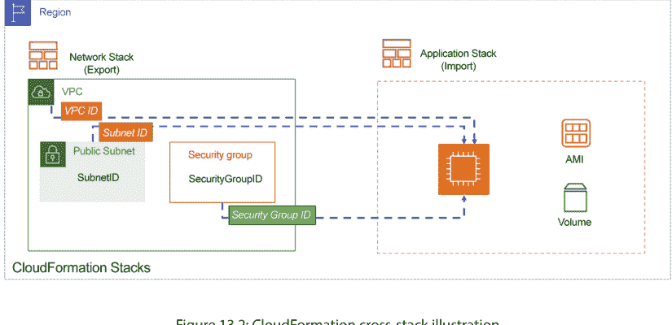

在使用跨堆栈模板时，你需要使用 `Fn::ImportValue` 将所需的值导入正在构建的第二个堆栈中。

最终，`Outputs` 部分使你能够轻松获取已创建的资源详情，这在跨堆栈 CloudFormation 配置中经常用到。

在下一节中，你将了解一种名为 CloudFormation 能力（Capabilities）的安全特性。当你使用 CloudFormation 创建特定资源时，这一特性会发挥作用，你需要确认某些类型的资源将被创建，作为一种安全措施。

## CloudFormation 能力（Capabilities）

通常，你可能需要创建特定资源，但即使你有权限这样做，你仍然必须向 CloudFormation *确认* 你正在创建此类资源。这更多的是出于安全和确保你知晓模板正在创建的资源类型的目的。

以下截图演示了 AWS 要求此类确认的过程。

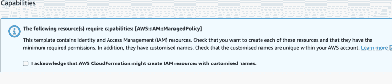

图 13.3：AWS CloudFormation 能力（Capabilities）

在这里，你会注意到资源需要 `AWS::IAM::ManagedPolicy` 能力，且用户被提示确认此能力。

在使用 CLI 部署 CloudFormation 模板时，你可以使用 `--capabilities` 选项来确认堆栈将创建影响你的 AWS 账户权限的资源，例如创建 **AWS 身份和访问管理（IAM）** 用户或角色。

有三个你可以指定的能力选项：

- `CAPABILITY_IAM`：如果你的堆栈将影响 IAM 资源，例如创建 IAM 用户，则需要此选项。
- `CAPABILITY_NAMED_IAM`：如果你为要创建的 IAM 资源提供了自定义名称，则需要此选项。
- `CAPABILITY_AUTO_EXPAND`：如果你使用模板宏，例如 `AWS::Serverless` 转换宏（它将**无服务器应用程序模型（SAM）** 模板转换为 CloudFormation 模板），则需要此选项。

在下一节中，你将了解 CloudFormation 的一个称为变更集（Change Sets）的功能。通常，你可能需要更新或修改现有堆栈中的资源。此功能使你在实施更改之前可以直观地查看变更，并可作为你整体变更管理流程的一部分。

## CloudFormation 变更集（Change Sets）

通常，你可能需要更新和修改之前使用 CloudFormation 模板部署的基础架构。你可以创建**变更集**并要求 CloudFormation 更新堆栈。你可以提供修改后的模板或输入参数值，以向堆栈提交变更。

在执行任何更新之前，CloudFormation 会通知你更新模板中提议的变更。一些变更将终止并替换现有资源，例如，如果你更改了 EC2 实例的可用区。其他变更可能只需要修改现有资源。一些修改可以在不中断资源的情况下进行，而另一些则可能导致中断。使用变更集，你可以查看变更将如何影响你的资源，并确认你是否仍想继续实施变更，或在推出更新前对模板进行进一步修改。

以下代码块中的 CloudFormation 模板允许你部署单个 EC2 实例。由于我们没有指定其他参数值，EC2 实例将部署在默认 VPC、默认子网以及 us-east-1a 可用区中：

```
Resources:
  MyInstances:
    Type: AWS::EC2::Instance
    Properties:
      AvailabilityZone: us-east-1a
      ImageId: ami-07caf09b362be10b8
      InstanceType: t2.micro
```

注意，正在创建的资源是一个 EC2 实例。Properties 部分详细说明了实例将部署的可用区、将使用的 AMI ID 以及实例类型。

部署此模板并创建 CloudFormation 堆栈将产生如以下截图所示的事件。

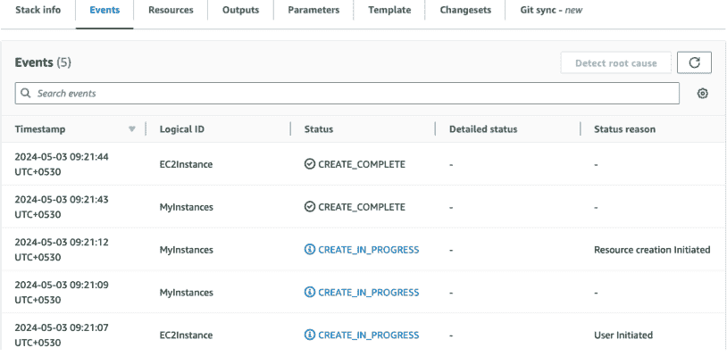

图 13.4：CloudFormation 堆栈创建事件

假设你现在意识到应该将此实例部署在 us-east-1b 可用区中。你可以创建一个具有修改后模板的变更集。根据你请求的变更，CloudFormation 要么添加新资源，要么修改现有资源，这可能要求删除并替换现有资源。

在以下 CloudFormation 模板片段中，注意可用区从 us-east-1a 更改为 us-east-1b：

```
Resources:
  MyInstances:
    Type: AWS::EC2::Instance
    Properties:
      AvailabilityZone: us-east-1b
      ImageId: ami-07caf09b362be10b8
      InstanceType: t2.micro
```

上传此修改后的模板并请求变更集，将允许你查看变更将如何影响资源，如以下截图所示。

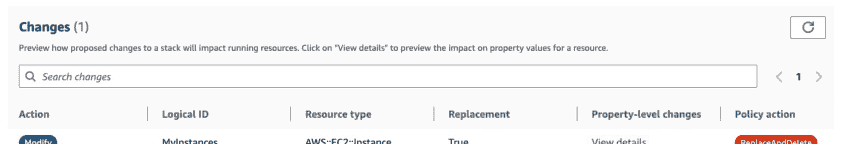

图 13.5 – CloudFormation 变更选项卡，详细说明了执行变更的结果动作

在接受并执行变更集后，AWS CloudFormation 将在 us-east-1b 中部署新实例，并终止 us-east-1a 中的现有 EC2 实例。以下截图说明了执行此变更集后发生的事件：

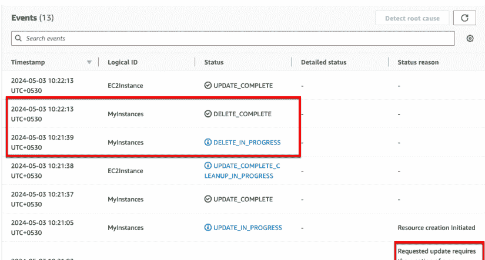

图 13.6 – 由变更集执行产生的 CloudFormation 事件

注意，CloudFormation 模板作为更新过程的一部分创建新实例，然后作为清理过程的一部分删除 us-east-1a 中的现有实例。

在下一节中，你将了解 CloudFormation 的一个称为回滚（Rollbacks）的功能。

## CloudFormation 回滚（Rollbacks）

你的 CloudFormation 部署可能因模板错误、缺失或配置详情不正确，或简单如引用了不正确的资源（如错误的 AMI ID）而失败。在这些情况下，你需要一种机制来回滚你的部署，以便返回到干净的状态。

AWS CloudFormation 提供了一套复杂的回滚功能，允许你选择在堆栈部署失败时采取何种行动，如以下截图所示。

堆栈故障选项

配置失败时的行为
指定堆栈故障的回滚行为。了解更多

- [x] 回滚所有堆栈资源
  将堆栈回滚到最后已知的稳定状态。
- [ ] 保留成功配置的资源
  保留成功配置的资源状态，同时将失败的资源回滚到最后已知的稳定状态。没有最后已知稳定状态的资源将在下一次堆栈操作中删除。

在回滚期间删除新创建的资源
指定在失败操作期间创建的资源是否应删除，而不管其删除策略如何。了解更多

- [x] 使用删除策略
  根据附加的删除策略保留或删除已创建的资源。
- [ ] 删除所有新创建的资源
  在回滚期间删除创建的资源，而不管其附加的删除策略如何。

图 13.7：堆栈故障选项

根据图 13.7，你可以让堆栈回滚到最后已知的稳定状态，这将导致删除任何新创建的资源。或者，你可以保留任何成功配置的资源，同时将失败的资源回滚到其之前的状态。

有时，在执行更新时，堆栈可能进入 UPDATE_ROLLBACK_FAILED 状态，因为 CloudFormation 无法在完成失败的更新时回滚所有变更。一个例子是，当你试图回滚到旧的数据库实例，但该实例之前已在 CloudFormation 管理流程之外被手动删除。由于 CloudFormation 无法回滚到它预期的前一个数据库实例，这可能导致回滚尝试失败。在大多数情况下，你需要修复导致更新回滚失败的错误，然后才能继续回滚操作。

通常，当你删除 CloudFormation 堆栈时，该过程会删除所有已创建的资源。有时，即使项目结束，你可能需要保留某些资源，例如后端数据库。在这种情况下，你可以配置删除策略，这在下一节中讨论。

## CloudFormation 删除策略属性（Deletion Policy Attribute）

在删除 CloudFormation 堆栈时，默认行为是删除其所有资源。由于此行为是默认设置，因此没有必要定义此删除策略。


不过，即使删除了堆栈，您可能仍希望保留某些资源，因为根据合规性或备份要求，您需要存储作为项目一部分生成或收集的数据。例如，即使删除了创建该存储桶的堆栈，您可能仍希望保留用于存储已上传数据的 S3 存储桶。在这种情况下，您可以配置删除策略以在删除堆栈后保留 S3 存储桶。下面的代码片段展示了一个云formation 代码示例来说明此配置：

```
AWSTemplateFormatVersion: '2010-09-09'
  Resources:
    myS3Bucket:
      Type: AWS::S3::Bucket
      DeletionPolicy: Retain
```

以下是您可以配置的四种删除策略选项：

- **Delete**：这是删除堆栈时的默认配置，您无需指定 DeletionPolicy。不过，您应注意，对于某些资源，默认策略设置为 Snapshot，例如 AWS::RDS::DBCluster 和 AWS::RDS::DBInstance。
- **Retain**：当堆栈被删除时，CloudFormation 将保留资源而不是删除它们。您需要在该模板的资源类型中添加删除策略。
- **RetainExceptOnCreate**：这与 Retain 类似，但如果堆栈操作创建了该资源然后需要回滚，CloudFormation 将删除该资源。在堆栈删除操作中，CloudFormation 将保留该资源。
- **Snapshot**：这适用于支持快照的资源。CloudFormation 将在删除资源之前创建快照。RDS DB 实例和 RDS DB 集群就是此类资源的示例。

> **重要提示**
> 对于 Amazon S3 存储桶，只有当存储桶为空时，设置为 delete 的删除策略才有效。通常，您可能会发现堆栈因 S3 存储桶非空而删除失败，因此，您必须手动清空存储桶或配置自定义资源，这将在本章后续部分讨论。

有时，当 CloudFormation 没有您所需的资源类型时，您可能需要创建自定义资源。这也可以包括在 CloudFormation 模板中配置自定义逻辑。在下一节中，您将了解有关自定义资源的更多信息。

# CloudFormation 自定义资源

当您需要定义目前 CloudFormation 中不可用的资源类型时，可以使用自定义资源。当您需要为 CloudFormation 堆栈的创建、更新或删除定义自定义逻辑时，也可以使用自定义资源。

要定义自定义资源，您需要使用模板中的 AWS::CloudFormation::CustomResource 或 Custom::MyCustomResourceTypeName 资源类型。

例如，如果您需要在堆栈删除请求的一部分中删除 Amazon S3 存储桶，您必须首先确保 S3 存储桶是空的。如果 S3 存储桶包含任何对象，删除请求将失败。在这种情况下，您可以定义一个自定义资源，首先调用一个 Lambda 函数来清空 S3 存储桶，以便您可以执行存储桶删除操作。

在构建自定义资源时，您将定义一个属性，即服务令牌（service token），指定 CloudFormation 应发送请求的位置，例如 Lambda 函数的 ARN。请注意，服务令牌必须位于您创建堆栈的同一区域中。下面的代码片段展示了这一点。

```
Resources:
  MyCustomResources:
    Type: AWS::CloudFormation::CustomResource
    Properties:
      ServiceToken: String
```

通常，您可能需要模板中的逻辑来确保某些资源在其他资源之前创建。在此示例中，您必须确保在删除 S3 存储桶之前先将其清空。在这里，您可以使用 DependsOn 属性。当您向资源添加 DependsOn 属性时，该资源仅在 DependsOn 属性中指定的资源创建之后才会创建。因此，在我们的示例中，S3 存储桶的删除将依赖于先调用 Lambda 函数以清空 S3 存储桶的自定义资源。

在下一节中，您将了解 CloudFormation 的另一个功能，称为嵌套堆栈。

# CloudFormation 嵌套堆栈

嵌套堆栈对于跨多个账户和区域快速部署基础设施和应用程序组件非常有用。此外，它们允许您确保使用集中定义的模板集来描述和配置其他位置的资源。

在 AWS 上构建基础设施资源时，您可能会重复使用作为整体架构一部分的通用组件。例如，在部署应用程序解决方案的 EC2 实例时，您首先需要配置 VPC、一些子网以及与实例关联的安全组。

这里的一个重要说明是，对于您创建的每个 CloudFormation 堆栈，每个堆栈最多限制为 500 个资源。在高度复杂的堆栈中，您可能会发现这一限制是个问题。此外，由一个堆栈创建的资源可能无法在另一个堆栈中使用。例如，在以 Todo Plus Limited 为现实世界的示例中，您会为开发、测试和生产等各个环境希望拥有不同的 CloudFormation 堆栈。您不希望将开发环境中创建的 VPC 组件用于生产工作负载。最终，每个堆栈的生命周期会有所不同，您绝对希望隔离各个环境。

与其重复添加通用组件（如 VPC、子网和安全组）的配置，您可以为这些组件创建专用模板，并从主 CloudFormation 模板中引用这些模板。例如，您可以创建定义 VPC 配置的单独模板，并从主应用程序堆栈中引用它，而不是在主应用程序堆栈模板中包含 VPC 配置。这允许您在为任意数量的解决方案创建的多个堆栈中重用相同的 VPC 模板。这些被称为嵌套堆栈。嵌套堆栈还可以包含其他嵌套堆栈，这意味着您可以构建堆栈层次结构。下面的图说明了嵌套堆栈的概念。

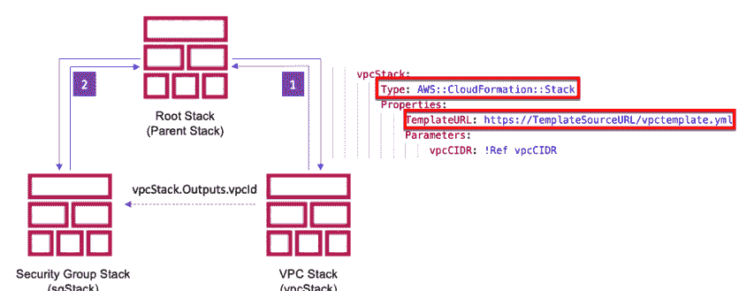

图 13.8：嵌套堆栈示例

嵌套堆栈可以使用 AWS::CloudFormation::Stack 资源创建。此资源所需的唯一属性是 TemplateURL，这是 CloudFormation 知道如何查找资源模板的方式。

在构建嵌套堆栈时，根堆栈是包含所有嵌套堆栈的顶层堆栈。此根堆栈也称为父堆栈。子堆栈可以具有进一步的嵌套堆栈，对于这些堆栈，子堆栈将成为父堆栈，依此类推。

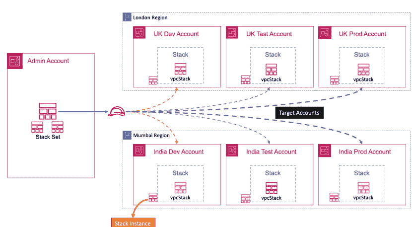

促进使用 StackSets 的一个关键组件是使用 IAM 角色，以确保在目标账户和区域中部署堆栈所必需的权限存在。您可以使用自管理权限或服务管理权限创建 StackSets：

- 自管理权限：您创建并配置必要的 IAM 角色，以在管理账户和目标账户之间建立信任关系。
- 服务管理权限：您将堆栈实例部署到由 AWS Organizations 管理的账户中。这阻止您手动创建和管理自己的 IAM 角色，并简化了在未来创建的账户中部署堆栈的过程。

StackSets 的一个基本组件是堆栈实例。这指的是目标账户中的堆栈，允许 StackSets 在目标账户中部署堆栈。堆栈实例包含有关目标账户中堆栈的信息。如果目标账户中无法创建堆栈，堆栈实例可以在没有堆栈的情况下存在。在这种情况下，堆栈实例将显示失败的原因。

在下一节中，您将了解有关 CloudFormation 堆栈角色的更多信息。请记住，在 AWS 上，除非您明确授予权限，否则不允许执行任何操作，CloudFormation 也不例外。


## CloudFormation 堆栈角色

在部署 CloudFormation 堆栈时，该服务使用登录到 AWS 账户的 IAM 主体的身份来执行必要的堆栈操作，例如创建、更新或删除。因此，IAM 主体必须通过附加到其上的策略（或用户所属的组）拥有所需的权限，或通过承担角色获得。

通常，在大型组织中，您可能需要将创建和更新堆栈的能力分配给团队成员，而这些成员不应拥有创建和管理构成堆栈的各个资源的完全访问权限。例如，您可能有一个帮助台团队，可以授予其部署 CloudFormation 堆栈的能力，但他们不得在 CloudFormation 之外单独部署堆栈的资源。在此场景中，您可以为 CloudFormation 配置服务角色。使用服务角色，您可以确保遵循最小权限原则。流程如下：

- 管理员创建一个 IAM 角色，该角色授予创建 CloudFormation 堆栈所需的资源所需的权限。管理员必须创建信任策略，其中受信任实体为 CloudFormation 服务，如以下策略代码所示：

  ```
  {
    "Version": "2012-10-17",
    "Statement": {
      "Effect": "Allow",
      "Principal": {"Service": "cloudformation.amazonaws.com"},
      "Action": "sts:AssumeRole"
    }
  }
  ```

- 然后必须授予帮助台员工使用 CloudFormation 创建、更新或删除堆栈的权限，并确保 CloudFormation 拥有配置资源的权限。帮助台团队应被分配使用 `iam:PassRole` 操作将 IAM 角色传递给 CloudFormation 的权限，如以下代码片段所示：

  ```
  {
    "Sid": "AllowPassingAppRoles",
    "Effect": "Allow",
    "Action": "iam:PassRole",
    "Resource": "arn:aws:iam::<account ID>:role/cfnroles/*"
  }
  ```

使用 CloudFormation 堆栈角色，您可以增加一层安全性，以确保只有授权人员可以直接操作资源。其他可能需要部署基础设施组件的用户只能通过 AWS CloudFormation 进行部署。

到目前为止，我们已详细介绍了 AWS CloudFormation，探讨了在构建和设计云基础设施时如何采用强大的 IaC 解决方案，使用可重复和可再现的方法来提高效率、安全、速度和敏捷性。

在下一节中，我们将转向 AWS CDK。该服务允许您使用高级库在流行的编程语言中开发云应用程序及其相关基础设施。

## AWS CDK 概述

AWS Cloud Development Kit（CDK）是一个软件开发框架，用于以代码形式定义云基础设施并通过 AWS CloudFormation 进行配置。借助 CDK，开发人员可以使用熟悉的编程语言，包括 TypeScript、Python、Java 和 C#，来定义其基础设施。CDK 使用熟悉的编程结构，例如类和对象，来定义云资源，使开发人员更容易使用和理解。

CDK 为 AWS 服务提供了一个高级、面向对象的接口，使开发人员能够以比传统 CloudFormation 模板更抽象、更简洁的方式定义其基础设施。例如，而不是在 JSON 或 YAML 文件中指定 EC2 实例的属性，开发人员可以使用其首选编程语言中的类和对象来定义实例。

CDK 还提供了一组构造，它们是用于定义基础设施的预写、可重用的构建块。构造包括从 EC2 实例和 RDS 数据库等基本组件到 Auto Scaling 组和负载均衡器等更复杂组件的一切。使用构造可以更轻松、更快地定义基础设施，并减少需要编写的代码量。

CDK 的另一个好处是与 AWS CLI 和其他 AWS 工具的集成，包括 AWS CloudFormation、AWS CloudWatch 和 AWS CodeDeploy。这种集成允许开发人员使用其首选工具和工作流程来管理其基础设施，并有助于确保其开发和生产环境之间的一致性和稳定性。

AWS CDK 的主要组件如下：

- **构造**：构造是应用程序的组件，表示由 CloudFormation 创建的一个或多个资源。例如，构造可以表示您的 EC2 实例或 RDS 数据库实例。您将构造定义为导入到 CDK 应用程序中的类。您可以从 AWS Constructs 库访问预定义的构造，创建自己的构造或使用第三方构建的构造。
- **堆栈**：堆栈是 CDK 中作为单个单元创建和管理的 AWS 资源集合。它们可以包含一个或多个构造，并用于定义和管理云中特定的一组资源。

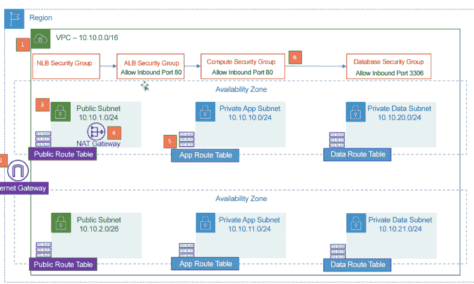

图 13.10 – 生产 VPC 的架构参考

您的 CloudFormation 堆栈的关键组件如下：

- VPC 使用 10.10.0.0/16 的 CIDR 范围进行配置。请记住，您在开发账户中为 VPC 使用的 CIDR 范围是 10.0.0.0/16。建议您的 VPC 不要使用重叠的 IP 地址，以确保在需要时可以建立 VPC 对等连接。
- CloudFormation 模板定义了一个互联网网关，然后将其附加到 VPC。
- 配置包括六个子网——跨两个可用区的两个公有子网和四个私有子网（两个用于计算资源，如 EC2、ECS 等，两个用于数据库资源）。
- 模板中声明了一个 NAT 网关，以实现私有子网中计算资源对互联网的安全访问。请注意，在本实验项目中，您只会部署单个 NAT 网关以尽量减少成本，因为这是收费服务。AWS 建议您每个 AZ 部署一个 NAT 网关。
- 路由表用于确保流量在 VPC 中路由到正确的端点，并与其相关子网关联。虽然不是绝对必要，但模板为每个子网定义了一个路由表。
- 然后在模板中声明安全组，以确保对内部资源的流量按端口/协议和源进行限制。

此处的意图是展示您如何使用 CloudFormation 模板快速部署基础设施，并让您了解如何快速准确地跨多个账户为不同环境部署解决方案。

## 技术要求

请记住，您在创建 Todo Plus 生产账户时并未使用 AWS Organizations 服务登录该账户，因此您需要导航到 AWS 管理控制台的主登录页面，并为生产账户的根用户请求密码重置，如图 13.11 所示。具体来说，您必须提供与 AWS 账户根用户关联的电子邮件地址。

另外，请确保从以下链接的 GitHub 仓库下载 CloudFormation 模板并将其保存在桌面本地：https://packt.link/xM0tt

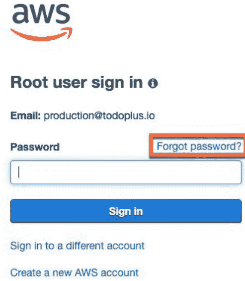

图 13.11 – 请求重置您的生产账户密码

重置根用户密码后，您可以登录并为生产账户创建一个具有完全管理权限的新 IAM 用户。建议您首先创建一个名为 **ProdAdmins** 的 IAM 组，将 **AdministratorAccess** IAM 策略分配给该组，然后创建一个属于该组 IAM 用户的 IAM 用户。为清晰起见，您可以将此 IAM 用户称为 **Bob**，因为 *Alice* 是开发账户的高级管理员。

要创建名为 Bob 的 IAM 用户，请按照 *第 2 章《使用 AWS Identity and Access Management 安全访问》中的练习 2.1* 中的说明进行操作，确保 IAM 用户的名称设置为 **Bob**。

创建 Bob IAM 用户后，请以根用户身份退出生产账户，然后以 Bob IAM 用户身份再次登录，然后再继续项目任务。

## 项目任务 13.1：为 VPC 堆栈创建 CloudFormation 模板

现在您可以按照以下步骤为 VPC 堆栈创建 CloudFormation 模板：

1. 以 Bob IAM 用户身份登录您的 Todo Plus 生产账户（按照 *技术要求* 部分中的说明进行操作）。
2. 在顶部搜索栏中搜索并导航到 CloudFormation 控制台。
3. 单击 **Create stack** 按钮。
4. 在 **Prerequisite – Prepare template** 部分，确保选择 **Choose an existing template**。
5. 在 **Specify template** 部分选择 **Update a template file** 选项。
6. 单击 **Choose file** 按钮下的 **Upload a template file**，如下图所示。

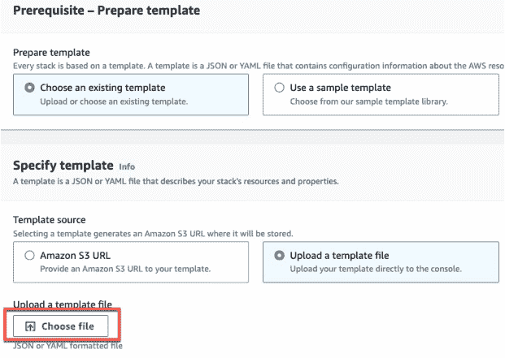

图 13.12 – 选择 Choose file 按钮以上传您从 GitHub 仓库下载的模板


7. 在出现的对话框中，导航到您从 GitHub 仓库下载模板的位置，然后选择 `todo-plus-final.yaml` 文件。AWS CloudFormation 服务将自动预置一个 S3 存储桶并将文件上传到该存储桶。
8. 单击**下一步**。
9. 为您的堆栈提供一个描述性名称。
10. 请注意，默认的 **EnvironmentName** 值为 **todo-plus-production**，您可以更改。您也可以更改默认的 CIDR 范围，但请确保您的子网正确定义为 VPC CIDR 范围的子集。单击**下一步**。
11. 将所有其他设置保留为默认值，然后点击**下一步**。
12. 在**审核并创建**步骤中查看配置，然后点击页面底部的**提交**。
13. CloudFormation 现在将按照模板中的说明预置您的堆栈，您的堆栈将进入 **CREATE_IN_PROGRESS** 阶段，如下图所示。

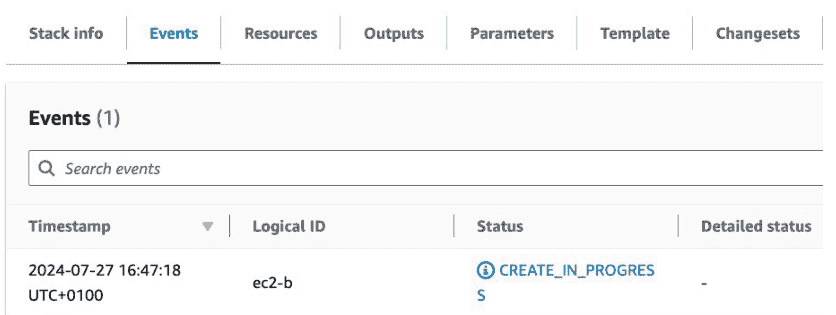

图 13.13：CloudFormation CREATE_IN_PROGRESS 事件

14. 几分钟之内，CloudFormation 将预置您的 VPC 及其所有组件。您可以在堆栈的**事件**选项卡中监控进度。完成后，您将看到 VPC 的 **CREATE_COMPLETE** 状态，如下图所示。

| 时间戳 | 逻辑 ID | 状态 | 详细状态 |
|---|---|---|---|
| 2024-05-07 12:40:07 UTC+0530 | Todo-List-App-Prod | CREATE_COMPLETE | |
| 2024-05-07 12:40:06 UTC+0530 | DefaultPrivateRoute1 | CREATE_COMPLETE | |
| 2024-05-07 12:40:06 UTC+0530 | DefaultPrivateRoute4 | CREATE_COMPLETE | |

图 13.14：CREATE_COMPLETE 状态

15. 单击**输出**选项卡查看已创建的各种 VPC 组件的输出信息。您也可以在 VPC 控制台中查看这些组件，如下图所示。

| 名称 | 子网 ID | 状态 |
|---|---|---|
| todo-plus-production Private Subnet (for compute EC2/ECS etc) (AZ1) | subnet-020488e715af36... | 可用 |
| todo-plus-production Private Subnet (for compute EC2/ECS etc) (AZ2) | subnet-00a896326dcd... | 可用 |
| todo-plus-production Private Subnet (for database) (AZ1) | subnet-0b4d7b613b6be... | 可用 |
| todo-plus-production Private Subnet (for database) (AZ2) | subnet-09ffc27897e21d... | 可用 |
| todo-plus-production Public Subnet (AZ1) | subnet-0b4a8f94d5a5c0... | 可用 |
| todo-plus-production Public Subnet (AZ2) | subnet-0639973a767fb... | 可用 |

图 13.15：Todo Plus Production VPC 的子网

16. 在您查看完 VPC 及其各种组件后，建议删除堆栈以删除 VPC，避免产生不必要的费用。

## 项目任务 13.2：删除 CloudFormation 堆栈

以下步骤将帮助您删除 CloudFormation 堆栈：

- 1. 在仍以 Bob 身份登录 AWS 生产账户的情况下，导航到 CloudFormation 控制台。
- 2. 在左侧菜单中，单击**堆栈**。
- 3. 在右侧窗格中，选择您刚刚创建的堆栈。
- 4. 单击**堆栈**窗格右上角的**删除**按钮。
- 5. 在出现的对话框中，单击**删除**按钮进行确认。
- 6. 您的 CloudFormation 堆栈现在将被删除，同时会移除 VPC 及其各种资源。您可以通过导航到**事件**选项卡并查看删除事件来审查删除过程。
- 7. 在下一节中，您将找到本章关键点的总结。

## 总结

本章涵盖了两个用于以基础设施即代码方式管理基础设施的关键 AWS 服务。CloudFormation 允许您使用 YAML 或 JSON 模板定义和部署 AWS 资源。AWS CDK 是一个软件开发框架，用于以代码定义云基础设施，并通过 AWS CloudFormation 进行预置。

本章解释了 CloudFormation 和 AWS CDK 的主要组件，并提供了一个示例 CloudFormation 模板，该模板创建了一个包含子网、网关、路由表和安全组的 VPC。

本章还重点介绍了使用 CloudFormation 的一些最佳实践，例如在部署前定义和测试模板、创建更改集，以及针对不同配置选项的策略（如 StackSets 和嵌套堆栈），并详细讨论了 CloudFormation 模板的结构。

CloudFormation 和 CDK 可以帮助您在几分钟内创建可重复、可复现的应用程序和基础设施解决方案。您可以避免配置漂移，并确保您的环境按预期构建。此外，您还可以在部署中实施治理和安全。

2. 登录后，您将看到一个类似于图 13.17 所示的页面：

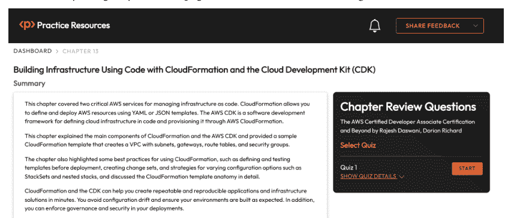

图 13.17 – 第 13 章章节复习题

3. 准备好后，开始以下练习，多次重新尝试测验。

## 考试准备练习

前三次尝试，不用担心中间的时间限制。

### 尝试 1

第一次，目标至少达到 40%。查看您答错的题目，并再次阅读章节中的相关部分以弥补学习差距。

### 尝试 2

第二次，目标至少达到 60%。查看您答错的题目，并再次阅读章节中的相关部分以弥补剩余的学习差距。

### 尝试 3

第三次，目标至少达到 75%。一旦您得分达到 75% 或以上，就可以开始练习答题速度。

> 提示
> 您可能需要超过**三次**尝试才能达到 75%。这没关系。只需回顾章节中的相关部分，直到您达到目标。

### 提高答题速度

**目标**：您的目标是在尽可能快地回答这些问题的同时保持分数不变。以下是一个示例，展示您接下来的尝试应该是什么样子：

| 尝试 | 分数 | 所用时间 |
|---|---|---|
| 尝试 5 | 77% | 21 分 30 秒 |
| 尝试 6 | 78% | 18 分 34 秒 |
| 尝试 7 | 76% | 14 分 44 秒 |

表 13.1 – 在线平台上的计时练习示例

> 注意
> 上表中显示的时间限制仅为示例。请根据网站上测验的时间限制，为每次尝试设置自己的时间限制。

每次新尝试，您的分数应保持在 75% 以上，而完成测验所用的“时间”应“减少”。您可以随心所欲地重复多次尝试，直到您有信心应对时间压力。
