## 使用 AWS Serverless Application Model (SAM) 和 AWS AppSync 设计无服务器应用程序

在现代应用程序开发领域，高效且有效地管理数据是一项核心挑战。当我们深入研究无服务器架构时，重点转向利用能够自动扩展、减少运营开销并简化部署流程的服务。AWS 提供了一套强大的无服务器技术，无需传统的服务器管理即可简化动态数据集的处理。

本章重点介绍一个包含 AWS Serverless Application Model (SAM)、AWS Lambda、Amazon API Gateway 和 Amazon DynamoDB 的无服务器应用程序栈。这些服务构成了可扩展、高效且高可用的无服务器应用程序的骨干。我们将通过为虚构客户 Todo Plus Limited 开展的实际项目练习来学习这些技术，使您能够将所学概念应用到实际场景中。

AWS Lambda 支持在无需预置或管理服务器的情况下响应事件执行代码，非常适合不可预测的工作负载。Amazon API Gateway 充当 Lambda 的前门，管理并保护对函数的访问。Amazon DynamoDB 提供快速、灵活的 NoSQL 数据库服务，具有无缝可扩展性，非常适合管理无服务器应用程序所需的各种数据结构。

本章介绍的技术配置和部署实践旨在帮助您充分准备 AWS Certified Developer Associate 考试，并深入理解这些无服务器组件如何交互和扩展。


本章涵盖的关键主题如下：

- 使用 AWS Serverless Application Model (SAM) 开发和部署无服务器应用程序
- AWS AppSync 概述
- 项目任务 – 使用 SAM 部署待办事项应用程序的“即将推出”页面

在本章结束时，你不仅将掌握这些无服务器技术的核心概念和高级功能，还将了解它们在构建和扩展应用程序方面的实际应用，而无需管理底层基础设施。这种方法增强了敏捷性，并专注于成本效率和性能，这对于当今快节奏的软件环境至关重要。

## 使用 AWS Serverless Application Model (SAM) 开发和部署无服务器应用程序

### AWS SAM 概述

AWS SAM 是一个专为在 AWS 上构建无服务器应用程序而设计的开源框架。它以 AWS CloudFormation 语法提供了对无服务器基础设施的简化定义。AWS SAM 是 CloudFormation 的扩展，并提供简写语法来表达函数、API、数据库和事件源映射。使用 SAM，你只需在 YAML 配置文件中用几行代码即可定义你的无服务器应用程序。

### AWS SAM 的关键组件

AWS SAM 主要由三个主要组件组成：

- **SAM 模板：** 一个遵循 YAML 格式的配置文件。该文件使用 SAM 语法定义无服务器应用程序中的资源。你使用模板来声明要为无服务器应用程序配置的资源。你可以在 CloudFormation 模板中声明的资源也可以在 SAM 模板中声明。
- **SAM CLI：** 一个提供构建、测试和部署 AWS SAM 应用程序工具的 CLI。
- **部署方法：** AWS SAM 与 AWS CloudFormation 集成，利用其功能将无服务器应用程序作为堆栈部署并在其生命周期内管理它们。

接下来提供了使用 SAM 开发应用程序的概述。

## 使用 AWS SAM 开发

### 创建新的 SAM 应用程序

要使用 AWS SAM 初始化新的无服务器应用程序，你必须使用 SAM CLI，你需要先安装它。本章后面的项目任务部分将以详细的分步方式指导你完成此过程。然后你可以使用 sam init 代码命令，使用预定义的模板和目录结构创建新的 SAM 项目，帮助你快速开始，如以下示例命令所示：

```
sam init --runtime python3.9 --name todo-list-application
```

### 在 SAM 模板中定义资源

要使用 SAM 服务，你需要创建一个 SAM 模板，在其中定义你的 AWS 资源，例如 Lambda 函数、API Gateway API 和 DynamoDB 表。SAM 模板的格式与你在第 13 章《使用 CloudFormation 和 Cloud Development Kit (CDK) 通过代码构建基础设施》中学到的 CloudFormation 模板非常相似。

Transform 和 Resources 部分是 SAM 模板中唯一的必需组件。以下是描述 SAM 模板结构的骨架模板：

```
Transform: AWS::Serverless-2016-10-31
Globals:
  set of globals
Description:
  string
Metadata:
  template metadata
Parameters:
  set of parameters
Mappings:
  set of mappings
Conditions:
  set of conditions
Resources:
  set of resources
Outputs:
  set of outputs
```

作为 SAM 模板的一部分，你必须将 Transform 部分声明为 Transform: AWS::Serverless-2016-10-31，因为这标识该模板为 SAM 模板文件。

AWS::Serverless transform 是由 CloudFormation 主持的一个宏，它转换 SAM 语法并将其扩展为符合规范的 CloudFormation 模板，使 CloudFormation 能够构建你的无服务器架构。它指定 AWS CloudFormation 用于处理模板的一个或多个宏。你可以在模板中声明一个或多个宏。AWS CloudFormation 按指定的顺序执行宏。

模板的一些关键组件如下：

- **Globals (可选)：** Globals 部分允许你声明具有通用配置的资源。例如，你可能有必须在 AWS::Serverless::Function 资源中声明的相同 Runtime、Environment 或 VPCConfig 配置。 rather than 在各个资源中重复这些变量，你可以在 Globals 部分中声明它们，并使你的资源继承它们。
- **Resources (必需)：** 在你的 SAM 模板中，你可以创建多种资源类型。包括以下内容：
  - `AWS::Serverless::Api`：使你能够创建一组 API Gateway 资源和方法，你可以通过 HTTPS 端点使用它们。
  - `AWS::Serverless::Application`：允许你从 AWS Serverless Application Repository 或 S3 存储桶嵌入一个无服务器应用程序作为嵌套应用程序。这对于具有通用应用程序组件的多个应用程序非常有用。通过嵌套这些组件，你可以专注于应用程序特有的业务逻辑。
  - `AWS::Serverless::HttpApi`：使你能够创建 HTTP API 而不是 REST API，它更便宜且延迟更低。REST API 和 HTTP API 都是 API Gateway 支持的 RESTful API 产品。然而，REST API 提供更多功能，例如 API 密钥、按客户端限流、请求验证、与 AWS WAF（Web Application Firewall）的集成或私有 API 端点。
  - `AWS::Serverless::Function`：使你能够使用 Lambda 执行角色创建 Lambda 函数，以及触发函数的任何事件源映射。事件源映射的示例可以是 SQS 队列或 SNS 主题。
  - `AWS::Serverless::LayerVersion`：使你能够创建包含 Lambda 函数所需的任何运行时代码或库的 Lambda LayerVersion 资源。
  - `AWS::Serverless::SimpleTable`：创建 DynamoDB 表。
- **Parameters (可选)：** 你可以声明 Parameters，这将允许 sam deploy --guided 提示用户输入额外的值。sam deploy 命令将在稍后进行解释。

SAM template.yaml 文件的示例片段如下所示。应用程序有一个由 API Gateway 的 API 调用触发的 Lambda 函数：

```
AWS::TemplateFormatVersion: '2010-09-09'
Transform: AWS::Serverless-2016-10-31

Description: Todo List Application

Resources:
  TodoFunction:
    Type: AWS::Serverless::Function
    Properties:
      CodeUri: src/
      Handler: app.handler
      Runtime: python3.9
      Events:
        Type: Api
        Properties:
          Path: /todos
          Method: get
```

你会注意到模板中的 Transform 部分，它表明这是一个 SAM 模板。你还会注意到资源类型是一个 Lambda 函数。

接下来，你将了解更多关于如何在部署前在本地调用和测试应用程序的信息。

### 本地测试和调试

你可以使用 SAM CLI 在本地测试你的应用程序。你可以直接调用函数或启动本地 API 网关来测试 HTTP 端点。这对于调试特别有用。sam local invoke 可以与事件文件一起使用，甚至可以使用 stdin 命令作为事件使用标准输入。命令在以下代码片段中说明：

```
sam local invoke TodoFunction --event events/event.json
sam local start-api
```

在下一节中，你将了解更多关于使用 SAM CLI 命令部署应用程序的信息。

### 部署你的应用程序

要部署你的无服务器应用程序，SAM 在幕后使用 CloudFormation 来创建和管理资源。你可以使用 SAM CLI 命令来打包和部署你的应用程序，如上一节中提到的命令。sam deploy 命令会创建你的代码和依赖项的 .zip 文件并将其上传到 Amazon S3。


它还提供了一个 AWS SAM 模板的副本，将对本地制品的引用替换为命令上传制品的 Amazon S3 位置。此模板副本名为 packaged.yaml，并且是 `sam deploy` 命令用于使用 CloudFormation 将应用程序部署到 AWS 云的该文件。请注意，您必须在运行以下命令之前创建存储桶：

```
```bash
sam package --output-template-file packaged.yaml --s3-bucket [Your-Bucket-Name]
sam deploy --template-file packaged.yaml --stack-name [Your-Stack-Name] --capabilities CAPABILITY_IAM
```
```

您可能还注意到 CLI 命令使用了名为 `--capabilities` 的选项。与 CloudFormation 能力类似，您需要确认使用某些功能。此确认允许 SAM 生成可能潜在更改您 AWS 账户中权限的特定堆栈资源，例如创建 IAM 角色或用户。对于需要自定义名称的 IAM 资源创建，必须指定 `CAPABILITY_NAMED_IAM` 选项。

在部署应用程序时，AWS 提供了一些最佳实践建议。其中包括以下内容：

- **安全管理应用程序密钥：** 对敏感数据使用 AWS Secrets Manager 或环境变量。
- **监控和调试：** 利用 Amazon CloudWatch 记录和监控无服务器应用程序的行为。
- **优化性能：** 查看并调整 Lambda 函数的内存和超时设置，以平衡性能和成本。您还可以使用 AWS Compute Optimizer，它可以分析 AWS 资源配置和利用率指标，并提供优化建议，重点是降低成本和提高应用程序性能。该服务可以为各种计算服务提供此类建议，包括 AWS Lambda。

AWS SAM 简化了在 AWS 上开发、部署和管理无服务器应用程序的体验。通过抽象掉大部分样板代码并提供强大的本地测试工具，AWS SAM 让开发人员更专注于编写业务逻辑，而减少配置基础设施的工作。随着无服务器技术的不断发展，像 AWS SAM 这样的工具对于希望充分发挥云潜力的开发人员来说非常宝贵。

使用 SAM 管理任何更新的代码更改也并不复杂，这将在下一节中进一步讨论。

AWS SAM CLI 使开发人员能够快速构建并将无服务器应用程序部署到 AWS 云，并提供支持其应用程序所需的所有底层基础设施。AWS SAM 使用 CloudFormation 进行所有基础设施部署，并使用更少的代码。它使您能够高效地管理无服务器应用程序生命周期，并使用 SAM 连接器快速在资源之间设置权限。此外，您可以在开发应用程序时将本地更改同步到云中。

在下一节中，您将了解另一项托管服务，称为 AWS AppSync。该服务使用 GraphQL 使您的应用程序能够检索所需的数据。GraphQL 可以将来自一个以上数据源的数据组合成单个图。

## AWS AppSync 概述

AWS AppSync 是一种托管的无服务器 GraphQL 服务，可促进在各种 AWS 服务上构建可扩展的应用程序，例如 Amazon DynamoDB、AWS Lambda 和 Amazon OpenSearch。它允许开发人员通过单个 API 调用安全地访问、操作和组合来自一个或多个数据源的数据，从而创建灵活的交互式应用程序。AppSync 使用 GraphQL，这是一种开放标准的查询语言，使开发人员能够请求所需的数据，而不会收到无关信息。

## AWS AppSync 的核心功能

AWS AppSync 提供了一系列功能，旨在增强用户体验、提高数据一致性并简化后端操作。AWS AppSync 的核心功能如下所述：

- **实时数据同步：** AppSync 通过 GraphQL 订阅提供数据的实时更新，确保应用程序数据在所有客户端和设备之间保持一致，而无需手动轮询或额外代码。
- **离线数据访问：** 它支持设备离线时的本地数据访问。更改会缓存在本地，并在设备重新连接后与服务器同步，从而在连接不稳定的环境中增强用户体验。
- **细粒度访问控制：** AppSync 与 **AWS Identity and Access Management (IAM)** 和 Amazon Cognito 集成，用于用户身份验证和细粒度访问控制，允许您在 GraphQL 查询中指定谁可以在字段级别访问什么数据。AWS 建议使用 AppSync 在设备之间同步应用程序数据，例如用户应用偏好设置或游戏状态数据。

## AWS AppSync 如何工作

以下步骤提供了如何为您的应用程序配置和使用 AWS AppSync 的概述。

### 第 1 步：定义架构

您首先定义一个 GraphQL 架构。此架构是 GraphQL API 的骨干，描述了应用程序支持的类型、查询、变更和订阅。以下是使用 AWS AppSync 的简单“待办事项列表”应用程序的 GraphQL 架构示例。此架构包括根据以下代码片段查询和操作待办事项的定义：

```
type Todo {
    id: ID!
    completed: Boolean!
    description: String
    title: String!
}

type Query {
    getTodo(id: ID!): Todo
    listTodos: [Todo]
}

type Mutation {
    addTodo(title: String!, description: String, complete: Boolean): Todo
    updateTodo(id: ID!, title: String, description: String, completed: Boolean): Todo
    deleteTodo(id: ID!): Todo
}

schema {
    query: Query
    mutation: Mutation
}
```

在代码片段中，您会注意到某些字段的值以感叹号 (!) 结尾。在 GraphQL 架构中，这些表示某个字段为非空。字段必须始终具有不能为 null 的值。

以下详细说明了前面代码片段中提到的 GraphQL 定义的不同组件：

### 类型定义

- Todo：表示待办事项，其字段包括：
  - id：每个待办事项的唯一标识符
  - title：待办事项的标题
  - completed：指示待办事项是否已完成的布尔值
  - description：提供有关待办事项更多细节的可选字段

### 查询类型

- getTodo：通过其 ID 获取单个待办事项
- listTodos：返回所有待办事项的列表

### 变更类型

- addTodo：创建新的待办事项。需要 title，并可选择接受 description 和 completed 状态。
- updateTodo：更新由 id 标识的现有待办事项。除 id 外的所有字段都是可选的，将根据提供的内容进行更新。
- deleteTodo：通过其 ID 删除待办事项。

您还可以实现待办事项添加、更新或删除时的实时更新；您可以将此架构扩展为 GraphQL 订阅，允许客户端订阅更改并立即接收更新。以下是您可能如何为待办事项列表定义订阅的示例代码片段：

```
type Subscription {
    onTodoAdded: Todo
        @aws_subscribe(mutations: ["addTodo"])
    onTodoUpdated: Todo
        @aws_subscribe(mutations: ["updateTodo"])
    onTodoDeleted: Todo
        @aws_subscribe(mutation: ["deleteTodo"])
}
```

### 第 2 步：连接数据源

架构定义后，您可以将其连接到一个或多个数据源。AppSync 支持多种数据源，包括 AWS Lambda、Amazon DynamoDB、Amazon Elasticsearch 和 HTTP API。

### 第 3 步：配置解析器

您为架构中的每个字段配置解析器，以规定如何获取或写入数据。这些解析器可以直接连接到您的数据源，或执行您在 AWS Lambda 函数中定义业务逻辑。

### 第 4 步：部署和查询

配置 GraphQL API 后，AppSync 会自动部署它。然后，您的客户端应用程序可以使用标准 GraphQL 操作对其进行查询。

在下一节中，您将了解 AWS AppSync 的更多用例。

## 将 AWS AppSync 与 Amazon DynamoDB 集成

AWS AppSync 和 Amazon DynamoDB 对于构建可扩展的无服务器实时应用程序非常强大。AWS AppSync 是一种托管的 GraphQL 服务，通过使开发人员能够创建灵活的 API 来安全地访问、操作和组合来自一个或多个数据源的数据，从而简化应用程序开发。与 Amazon DynamoDB 这种快速灵活的 NoSQL 数据库服务配对时，它允许以最少的设置实现无缝的数据同步和管理。

下一节提供了 AppSync 数据管理和流配置的概述。

## 数据管理与流

- **架构定义：** 在 AWS AppSync 中，您定义一个 GraphQL 架构，指定客户端如何与数据交互。架构包括类型、查询、变更和订阅。
- **解析器配置：** 对于架构中定义的每个操作（查询、变更和订阅），您配置解析器。解析器确定 GraphQL 查询或变更如何转换为 DynamoDB 中的数据操作。
- **直接数据源集成：** AppSync 允许您使用 **Velocity Template Language (VTL)** 模板或 AWS Lambda 函数将 GraphQL 字段直接链接到 DynamoDB 项。这种直接集成抽象了数据库操作，让您无需中间件即可直接在 DynamoDB 表上执行 CRUD 操作。

接下来，您将了解有关查询和变更的更多信息。


## 查询和变更示例

- **查询**：GraphQL 查询可以通过 DynamoDB 主键或任何二级索引，从 DynamoDB 表中拉取记录。在 AWS AppSync 控制台中，你可以将此查询连接到 DynamoDB 数据源，并配置解析器通过 `id` 检索数据。
- **变更**：类似地，更新或插入数据到 DynamoDB 的变更会在 GraphQL schema 中定义。例如，以下代码片段展示了如何添加一个新的待办事项：

  ```
  type Mutation {
    addTodo(title: String!, description: String): Todo
  }
  ```

  此变更的解析器将指定 GraphQL 请求中的数据如何映射到 DynamoDB 表属性，通常使用 Apache VTL 模板来格式化请求并处理响应。AWS AppSync 使用 VTL 将 GraphQL 中的客户端请求转换为你的数据源能够理解的请求，同时也会将数据源的响应转换回 GraphQL。这使你可以处理应用程序的标准请求和响应，并处理输入验证和格式化、遍历列表、映射和数组以提取所需信息、执行复杂的授权检查等更多操作。

下一节将讨论如何使用订阅处理实时数据。

## 使用订阅实现实时数据

AppSync 中的订阅用于实时数据操作。当一次变更修改 DynamoDB 中的数据时，AppSync 可以自动将新数据通知给所有已订阅的客户端，这要归功于与 GraphQL 集成的订阅机制。

设想一个待办事项列表应用，用户可以添加、更新和跟踪任务。通过将 AppSync 与 DynamoDB 集成，你可以创建一个健壮的后端，其中：

- 1. 用户从客户端应用提交 GraphQL 查询和变更。
- 2. AppSync 根据配置的解析器处理这些请求。
- 3. DynamoDB 处理数据存储，确保高性能和可扩展性。
- 4. 任务的更改通过 GraphQL 订阅实时推送给所有在线用户，从而增强协作体验。

将 AWS AppSync 与 Amazon DynamoDB 集成，可以通过简化高效的数据操作、实时更新和可扩展解决方案，以极低的后端复杂性释放无服务器架构的全部潜力。这种集成非常适合构建需要可靠、安全且即时数据交互的动态 Web 和移动应用程序。

AWS AppSync 通过管理繁重的数据管理任务并提供强大的平台来构建复杂的数据驱动应用程序，从而简化了应用程序开发。凭借实时同步、离线数据访问以及与 AWS 服务的无缝集成等强大功能，AppSync 使开发人员能够专注于创造独特的用户体验，同时不损害性能和可扩展性。无论是构建移动应用还是 Web 应用，AWS AppSync 都是现代开发人员的不二之选。

下一节将提供有关使用 AWS SAM 和创建无服务器架构来部署**待办事项列表即将推出**网页的分步教程。

## 项目任务：使用 SAM 部署待办事项列表应用的“即将推出”页面

到目前为止，你一直在开发账户中构建和部署待办事项列表应用。你已经通过使用各种 AWS 技术构建和部署应用及其各个组件，获得了宝贵的经验。

Todo Plus 一直在审查你的进度，并对这个新应用感到兴奋。当你继续使用各种技术在开发账户中托管应用并不断磨练技能时，现在也是时候开始同步向世界推广即将推出的应用了。在本项目中，你将部署托管在 Amazon S3 存储桶中并带有**即将推出**横幅的前端网站。这将在 AWS 生产账户中完成，并且为了运用本章学到的知识，你将使用 SAM 部署前端代码。这将是一个简单的静态网站，用于宣传待办事项列表应用的即将发布。

按照最佳实践，你还将在 S3 静态网站之前部署 CloudFront 分配。这是为了确保所有流量都通过 CloudFront 分配路由到 S3 存储桶。下图提供了该解决方案的高级架构概览：

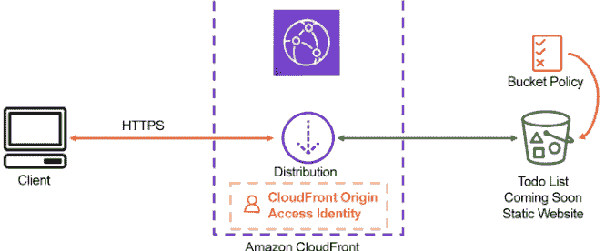

### 项目任务 14.1：安装 AWS CLI 和 SAM CLI

要使用 SAM，你必须在计算机上安装 AWS CLI 和 SAM CLI：

- 1. 要安装 AWS CLI 工具，请导航到 AWS CLI 网页：https://aws.amazon.com/cli/。
- 2. 从右侧菜单中，下载适合你操作系统的安装程序。
- 3. 下载完成后，启动安装程序并按照说明完成 CLI 在计算机上的安装。请注意，对于基于 Linux 的计算机，你需要按照此页面上的说明进行操作：https://docs.aws.amazon.com/cli/latest/userguide/getting-started-install.html#cliv2-linux-install。
- 4. 要测试安装是否成功完成，请在 Windows 中启动命令提示符，或在 macOS/Linux 中启动终端，然后运行 `aws --version` 命令。你应该会得到类似于以下截图的输出：

  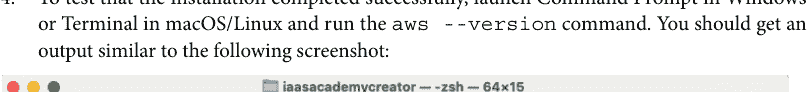

  图 14.3 – AWS CLI 版本

- 5. 接下来，你必须安装 SAM CLI。请导航到以下网页：https://docs.aws.amazon.com/serverless-application-model/latest/developerguide/install-sam-cli.html。
- 6. 你将找到有关如何为你的操作系统安装 SAM CLI 的详细信息。你也可以选择适用于 Windows 和 Mac 的 GUI 安装程序。对于 Mac 计算机，请根据你的计算机架构选择正确的安装程序，即 x86_64 或 ARM64 架构。对于基于 Linux 的计算机，由于没有 GUI 选项，你需要执行命令行安装。同样，请确保按照适用于你计算机架构的说明进行操作。
- 7. 安装完成后，如果在 Windows 上，请启动命令提示符；如果在 Mac 或 Linux 计算机上，请启动终端，然后运行 `sam --version` 命令。
- 8. 你应该会得到类似于以下截图的输出，这意味着安装成功：

  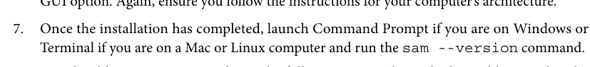

  图 14.4 – AWS SAM 版本

在下一节中，你将使用 Bob 的凭证（你在 AWS 生产账户中创建的 IAM 用户）配置 CLI，以便你可以使用 Bob 的凭证部署 SAM 解决方案。

### 项目任务 14.2：使用 Bob 的访问密钥配置 AWS CLI

在此项目任务中，你将使用 Bob 的访问密钥配置 CLI，以便你可以与 AWS 生产账户交互、访问服务并预置此项目所需的资源：

- 1. 以 IAM 用户 Bob 的身份登录你的 AWS 生产账户。
- 2. 导航到 IAM 管理控制台。
- 3. 从左侧菜单中，单击**用户**。
- 4. 在右侧窗格中，选择 IAM 用户 **Bob**。
- 5. 选择**安全凭证**选项卡。
- 6. 向下滚动，直到到达**访问密钥**部分。
- 7. 单击**创建访问密钥**按钮。
- 8. 对于**用例**，选择**命令行界面 (CLI)**选项。
- 9. 确保勾选**确认**复选框，以确认你希望继续创建访问密钥。
- 10. 单击**下一步**。
- 11. 为你的访问密钥提供一个**描述性标签**值。这用于帮助你识别访问密钥的用途，例如 `Access Key For Bob to use SAM`。
- 12. 单击**创建访问密钥**按钮。
- 13. 你应该会收到访问密钥已创建的确认。你还会找到一个用于下载 `.csv` 文件的选项，该文件将允许你下载访问密钥。单击**下载 .csv 文件**按钮下载此文件，并将其保存到桌面以便访问。请注意，此文件包含你的访问密钥 ID 和秘密访问密钥。理想情况下，你应将此文件存储在安全的地方，并确保没有其他人可以访问它。如果你在完成项目后不再需要这些访问密钥，请删除该文件。
- 14. 接下来，你必须使用此访问密钥配置 CLI。如果你使用 Windows，请启动命令提示符；如果你使用 Mac 或 Linux，请启动终端。
- 15. 输入 `aws configure` 命令并按 *Enter*。
- 16. 系统会提示你输入 AWS 访问密钥 ID。从你在*步骤 13*中下载的 CSV 文件中复制访问密钥 ID，粘贴到终端/命令提示符中，然后按 *Enter*。
- 17. 接下来，系统会提示你输入 AWS 秘密访问密钥。从 CSV 文件中复制此密钥，粘贴到终端/命令提示符中，然后按 *Enter*。


18. 接下来，系统会提示你输入默认的 Region 名称。输入 `us-east-1` 并按 Enter。

19. 最后，系统会提示你输入默认的输出格式。默认情况下设置为 JSON，因此再次按 Enter 即可。以下截图说明了运行 `aws configure` 命令的示例：

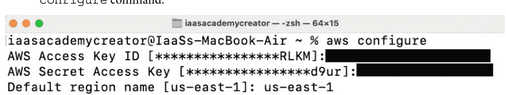

Figure 14.5 – Running the `aws configure` command

20. 你的 CLI 现在已使用 Bob 的凭证进行配置，你可以使用 Bob 的 IAM 用户账户访问你的 AWS 生产账户。

在下一个项目任务中，你将在本地计算机上配置 AWS SAM，以便将你的网站部署到 S3 存储桶并配置 CloudFront 分发。

## Project Task 14.3: Configuring SAM and Performing the Necessary Prerequisites to Deploy Your Application

你将在本项目任务中使用示例模板来构建你的 SAM 部署。你还将使用提供的网站代码将待办事项清单即将推出网站部署到你的 Amazon S3 存储桶。请注意，所有任务都必须在 `us-east-1` 区域中执行：

- 1. 为了准备 SAM 部署，请选择一个唯一的 Amazon S3 存储桶名称来托管网站。例如，在本操作指南中，存储桶的名称将为 `todolistapp.com`。由于 Amazon S3 存储桶名称必须唯一，因此你必须想出一个不同的名称，最好采用域名格式，例如 `.com` 或 `.co.uk`。
- 2. 在你喜欢的代码编辑器中打开从 GitHub 仓库下载的 `template.yaml` 文件（理想情况下，你应使用集成开发环境，例如可以从 https://code.visualstudio.com/ 下载的 Visual Studio Code）。
- 3. 导航到第 46 行，并将 `<YOURWEBSITEBUCKETNAME.COM>` 占位符更新为你选择的存储桶名称，如 Figure 14.6 中的示例所示。记住，存储桶名称必须为小写，并且不应包含任何特殊字符。在本操作指南中，占位符将被替换为 `todolistapp.com`。

```yaml
TargetOriginId: s3-todo-website
# Requiring HTTPS for communication between viewers and CloudFront
ViewerProtocolPolicy : redirect-to-https

S3Bucket:
  Type: AWS::S3::Bucket
  Properties:
    # Change the bucket name below to the name of your website. When creating the
    BucketName: <YOURWEBSITEBUCKETNAME.COM>

S3BucketPolicy:
  Type: AWS::S3::BucketPolicy
  Properties:
    Bucket: !Ref S3Bucket
```

Figure 14.6 – Replace the placeholder value with the name that you will use to create your S3 bucket

- 4. 更新此值后保存文件。
- 5. 在 Windows 计算机上启动命令提示符，或在 Mac/Linux 计算机上启动终端。
- 6. 使用命令提示符/终端导航到你的桌面。例如，在 Mac 上，你可以输入 `cd ~/Desktop` 并按 Enter，或在 Windows 上，你可以输入 `cd /users/<your-windows-username>/desktop`。确保将 `<your-windows-username>` 占位符替换为你当前登录的 Windows 账户名称。你应获得与以下截图类似的输出：

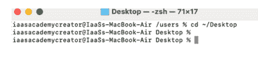

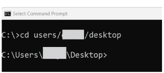

MacOS

Windows

Figure 14.7 – Navigate to your desktop using Command Prompt or Terminal

- 7. 接下来，在终端/命令提示符窗口中，在桌面上创建一个新文件夹。输入 `mkdir todolistprod` 命令并按 Enter。
- 8. 通过输入 `cd todolistprod` 命令然后按 Enter 进入此文件夹。这将带你进入你在 *步骤 7* 中创建的 `todolistprod` 文件夹。
- 9. 接下来，输入 `sam init` 命令然后按 Enter。
- 10. 你将收到提示，要求你选择要使用的模板源，如以下截图所示：

```text
todolistamsam — sam init — 80x24
iiaasademycreator@Iiass-MacBook-Air todolistamsam % sam init

You can preselect a particular runtime or package type when using the `sam init`
experience.
Call `sam init --help` to learn more.

Which template source would you like to use?
[1 - AWS Quick Start Templates]
[2 - Custom Template Location]
Choice:
```

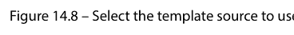

- 11. 输入 **1** 作为你的选择然后按 *Enter*。
- 12. 为了帮助你快速入门，你将使用快速入门模板。从提供的列表中，输入 **1** 选择 **Hello World Example** 启动模板然后按 *Enter*。
- 13. 接下来，你将被提示回答一系列问题。按如下方式回答：
  - I. 对于运行时和包类型，输入 **Y** 然后按 *Enter*。
  - II. 对于启用 X-Ray 跟踪的选项，只需按 *Enter* 选择 **N**。
  - III. 对于使用 **CloudWatch Application Insights** 进行监控的选项，按 *Enter* 接受默认值 **N**。
  - IV. 对于以 **JSON** 格式设置结构化日志的选项，按 *Enter* 接受默认值 **N**。
  - V. 对于项目名称，接受默认名称 `sam-app` 或提供你选择的另一个名称然后按 *Enter*。例如，在本操作指南中，项目名称已设置为 `todolist`。
- 14. `sam init` 命令将完成初始化并使用你提供的项目名称创建一个文件夹。这将是你在 *步骤 7* 中创建的文件夹中的子文件夹。
- 15. 进入此文件夹以查看 `sam init` 命令创建的各种文件，如以下截图所示：

```text
sam-app --zsh - 80x24
iiaasademycreator@Iiass-MacBook-Air todolistamsam % ls
sam-app
iiaasademycreator@Iiass-MacBook-Air todolistamsam % cd sam-app
iiaasademycreator@Iiass-MacBook-Air sam-app % ls
README.md events samconfig.toml tests
__init__.py hello_world template.yaml
iiaasademycreator@Iiass-MacBook-Air sam-app %
```


- 16. 接下来，你需要在 `todolistamsam` 文件夹中创建另一个名为 `website` 的文件夹。此文件夹将用于托管 SAM 与之交互的网站应用程序代码。
- 17. 输入 `mkdir website` 命令并按 *Enter*。
- 18. 接下来，使用文件资源管理器（Windows）或 Finder（Mac）导航到桌面并 *解压缩* 你从 GitHub 仓库下载的 `index-01-06-224.zip` 文件。（在 Mac 计算机上，你只需双击文件进行提取，在 Windows 上，你右键单击文件并选择 **提取全部**。）这将解压缩文件到包含所有网站应用程序代码的文件夹。将此文件夹的内容复制到你在 *步骤 17* 中创建的 `website` 文件夹中。以下截图显示了 Mac 上 Finder 中文件夹的内容：

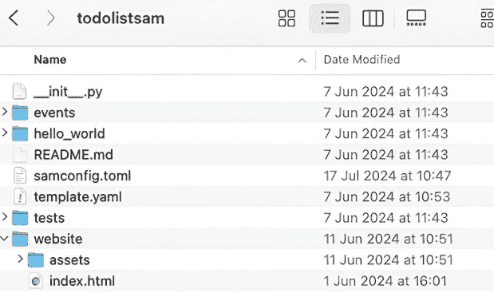


注意：你还将在 *Figure 14.10* 中注意到 `sam init` 命令创建了两个重要文件。`template.yaml` 文件包含快速入门 **Hello world application** 的模板。你需要用你在 *步骤 3* 中更新的从 GitHub 仓库下载的模板替换此模板。你还需要更新 `samconfig.toml` 文件，这将在稍后讨论。

- 19. 使用 Windows 上的文件资源管理器或 Mac 上的 Finder，复制你从 GitHub 仓库下载的 `template.yaml` 文件并将其粘贴到 `todolistSam` 文件夹中。确认是否要替换文件夹中的现有文件。你也可以使用命令提示符（Windows）或终端复制文件。
- 20. SAM 将使用 CloudFormation 创建托管待办事项清单网站的 Amazon S3 存储桶。然而，你还需要创建一个另一个 S3 存储桶，用于存储包含基础设施所有不同输入的部署包。此存储桶将由 CloudFormation 使用。从命令提示符或终端窗口输入 `aws s3 mb s3://<YOURWEBSITEBUCKETNAME.SAM> --region=us-east-1` 命令。用你选择的存储桶名称替换占位符值。存储桶名称末尾的 `.SAM` 部分是为了将网站存储桶与此用于存储部署包的存储桶区分开来。以下截图确认了存储桶的创建：

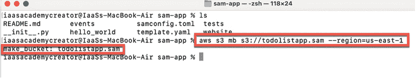

Figure 14.11 – Creation of an S3 bucket for the deployment package

- 21. 接下来，你需要更新 `samconfig.toml` 文件，其中存储你的部署配置。在代码编辑器中打开你从 GitHub 仓库下载的 `samconfig.toml` 文件。将第 8 行的 `[YOURSTACKNAME]` 占位符替换为你为堆栈选择的名称。

此外，将第 12 行的 `[YOURWEBSITEBUCKETNAME.SAM]` 占位符替换为你在步骤 20 中创建的存储桶名称。**确保它在双引号内，然后保存文件。** 以下为参考截图：

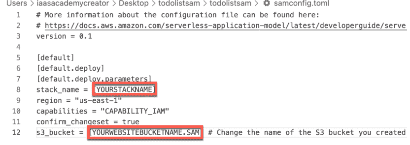

Figure 14.12 – The samconfig.toml file


在 `samconfig.toml` 文件中，你会注意到第 11 行将 `confirm_changeset` 设置为 `true`。这意味着当你部署包时，CloudFormation 会高亮显示将对你的堆栈所做的一系列更改，并且你将有机会确认这些更改。接下来，使用 Windows 上的文件资源管理器或 Mac 上的访达，将桌面上的 `samconfig.toml` 文件复制并粘贴到 `todolistsam` 文件夹中。系统会提示你是否要替换现有文件，请直接替换。

至此，你已经完成了所有前置条件，并为部署配置好了 SAM。

## 项目任务 14.4：构建并部署你的应用程序

请确保你仍处于 Windows 的命令提示符或 Mac/Linux 的终端中，且仍位于 `todolistsam` 文件夹内。

- 1. 输入 `sam build` 命令，然后按回车键。你应看到 `Build Succeeded` 的提示。
- 2. 接下来，你需要打包应用程序。输入以下命令：
```
sam package --output-template-file packaged.yaml --s3-bucket [YOURBUCKETNAME.SAM]
```
将占位符替换为你在项目任务 14.3 的第 20 步中创建的存储桶名称。按回车键。你应收到确认信息，表明 SAM 已成功打包构件，并将输出模板写入名为 `packaged.yaml` 的文件，如下面截图所示。你会在此文件与其他 SAM 配置文件所在的同一文件夹中找到它。

```
iaasacademycreator@IaaSs-MacBook-Air sam-app % ls
README.md    events    samconfig.toml    tests
__init__.py  hello_world    template.yaml    website
iaasacademycreator@IaaSs-MacBook-Air sam-app % sam build

Build Succeeded

Built Artifacts  : .aws-sam/build
Built Template   : .aws-sam/build/template.yaml

Commands you can use next
==========================
[*] Validate SAM template: sam validate
[*] Invoke Function: sam local invoke
[*] Test Function in the Cloud: sam sync --stack-name {{stack-name}} --watch
[*] Deploy: sam deploy --guided
iaasacademycreator@IaaSs-MacBook-Air sam-app % sam package --output-template-file packaged.yaml --s3-bucket todolistapp.sam
Successfully packaged artifacts and wrote output template to file packaged.yaml.
Execute the following command to deploy the packaged template
sam deploy --template-file /Users/iaasacademycreator/Desktop/todoimagesam/sam-app/packaged.yaml --stack-name <YOUR STACK NAME>

iaasacademycreator@IaaSs-MacBook-Air sam-app %
```

图 14.13 – SAM 打包命令输出

3. 接下来，你需要部署应用程序。输入以下命令，确保将 `[YOURSTACKNAME]` 占位符替换为你在之前的 `samconfig.toml` 文件中定义的名称，然后按回车键：

```
sam deploy --template-file packaged.yaml --stack-name [YOURSTACKNAME] --capabilities CAPABILITY_IAM
```

请注意，`CAPABILITY_IAM` 必须使用大写字母。

4. CloudFormation 将提供一份它将执行的更改列表，并询问你是否确认部署此更改集，如下面截图所示：

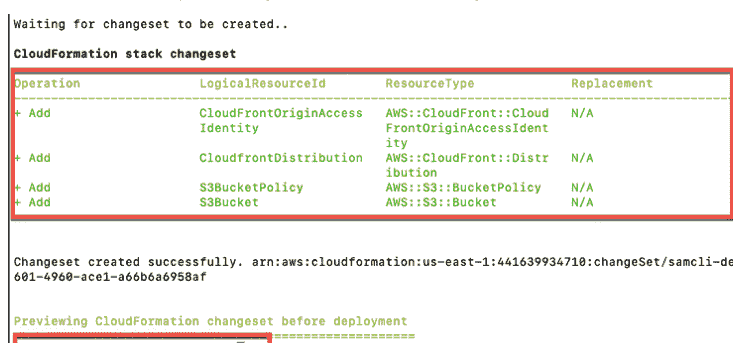

图 14.14 – 更改集确认请求

5. 输入 `y` 并按回车键。CloudFormation 现在将部署你的堆栈；这可能需要几分钟时间。完成后，你应该会看到类似下面截图的输出界面：

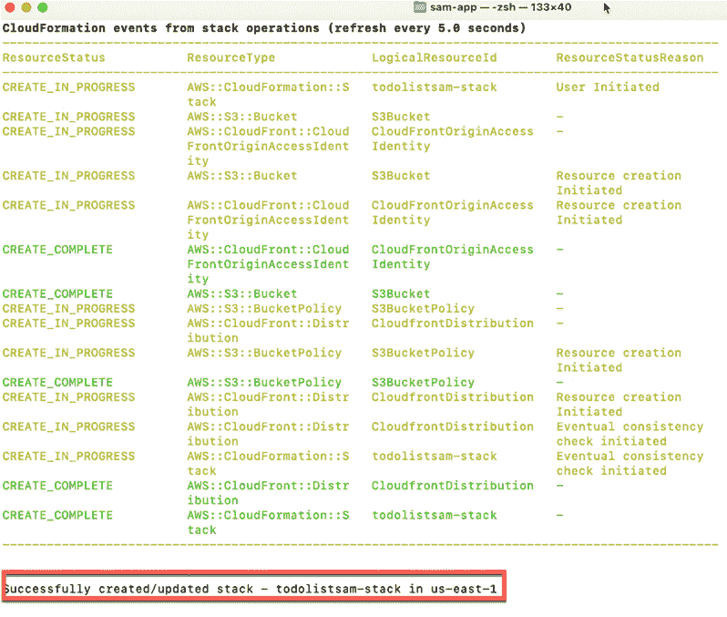

*图 14.15 – CloudFormation 部署操作*

- 6. 现在 CloudFormation 已配置好你的堆栈，你可以通过导航到 AWS 管理控制台中的各个资源来交叉验证堆栈组件：

  I. 在 AWS 管理控制台中，导航到 Amazon S3 管理控制台。你应该会找到用于托管前端网站的存储桶，如下面截图所示：

|  | 存储桶 | 区域 |
|---|---|---|
| ○ | [todolistapp.com](#) | 美国东部（弗吉尼亚北部）us-east-1 |
| ○ | [todolistapp.sam](#) | 美国东部（弗吉尼亚北部）us-east-1 |

*图 14.16 – Amazon S3 todolistapp.com 存储桶*

II. 接下来，导航到 CloudFront 管理控制台，你应该会找到已创建的分配：

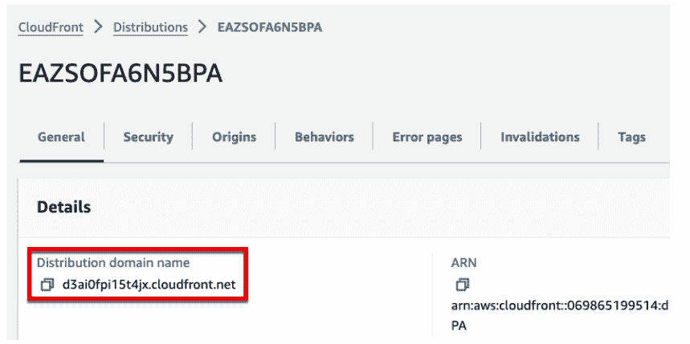

图 14.17 – CloudFront 分配

7. 现在你已经确认堆栈已正确部署，需要将网站文件复制到 CloudFormation 创建的 S3 存储桶中。

8. 回到 Windows 的命令提示符或 Mac/Linux 的终端，在 `todolistsam` 文件夹内运行以下命令：

```
aws s3 sync website/ s3://<YOURWEBSITEBUCKETNAME.COM>.
```

将占位符值替换为你使用 SAM 和 CloudFormation 创建的存储桶名称。在本操作指南中，存储桶名称为 `todolistapp.com`。此命令会将网站文件从本地计算机上传到 Amazon S3 存储桶，你将看到命令提示符/终端窗口中显示的相应输出，如下面截图所示：

```
iaasacademycreator@IaasS-MacBook-Air sam-app % aws s3 sync website/ s3://todolistapp.com
upload: website/.DS_Store to s3://todolistapp.com/.DS_Store
upload: website/assets/img/logo.png to s3://todolistapp.com/assets/img/logo.png
upload: website/assets/.DS_Store to s3://todolistapp.com/assets/.DS_Store
upload: website/assets/img/stay2.jpg to s3://todolistapp.com/assets/img/stay2.jpg
upload: website/index.html to s3://todolistapp.com/index.html
upload: website/assets/img/fav.png to s3://todolistapp.com/assets/img/fav.png
upload: website/assets/js/main.js to s3://todolistapp.com/assets/js/main.js
upload: website/assets/css/style.css to s3://todolistapp.com/assets/css/style.css
upload: website/assets/img/steve-jobs.png to s3://todolistapp.com/assets/img/steve-jobs.png
upload: website/assets/img/bg.jpg to s3://todolistapp.com/assets/img/bg.jpg
upload: website/assets/img/head-1.png to s3://todolistapp.com/assets/img/head-1.png
upload: website/assets/img/banner-bg.png to s3://todolistapp.com/assets/img/banner-bg.png
iaasacademycreator@IaasS-MacBook-Air sam-app %
```

图 14.18 – 使用 `aws s3 sync` 命令将网站内容上传到 S3 存储桶

- 9. 网站文件上传完成后，在 AWS 账户中导航到 CloudFront 管理控制台。单击 CloudFormation 创建的分配 ID。
- 10. 记下分配域名，并将该 URL 粘贴到另一个浏览器标签页中。
- 11. 你应该会看到新的待办事项应用“即将上线”网站正在运行，如下面截图所示：

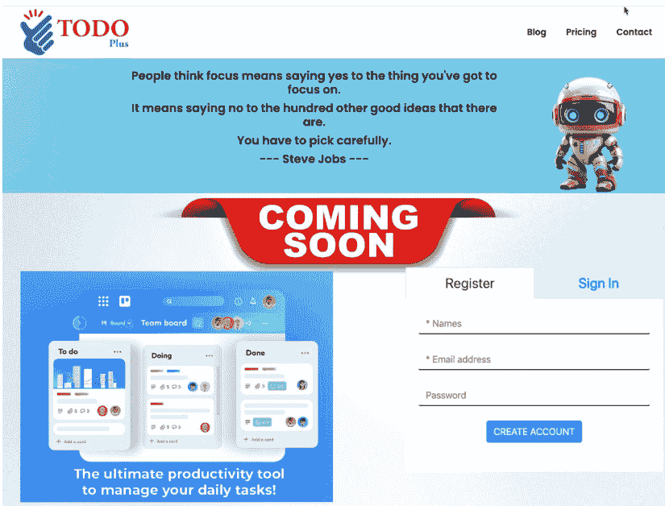

图 14.19 – 待办事项前端静态网站——即将上线页面

AWS CloudFormation 是一个通用的**基础设施即代码（IaC）**工具，可让你以声明方式定义并配置广泛的 AWS 基础设施资源。AWS SAM 是一个专门用于构建无服务器应用程序的 IaC 工具。虽然 CloudFormation 支持广泛的 AWS 服务，但 SAM 通过提供更高级别的抽象和 SAM 专用语法，简化了 Lambda 函数、API Gateway 和 DynamoDB 等无服务器资源的定义、部署和管理。SAM 模板会扩展为完整的 CloudFormation 模板，但使用 SAM 编写的代码更少。

在下一个项目任务中，你将删除由 SAM 创建的 CloudFormation 堆栈，以避免不必要的费用。

## 项目任务 14.5：删除 CloudFormation 堆栈

你可以使用 `sam delete` 命令删除 CloudFormation 堆栈。但这里有一点需要注意：由于你的网站存储桶中包含对象，堆栈删除过程将会失败。这是因为 CloudFormation 无法删除包含对象的 S3 存储桶。要快速解决此问题，你必须先删除存储桶中的内容，然后才能执行 `sam delete` 命令来删除堆栈：

- 1. 导航到 Amazon S3 管理控制台，单击由 SAM 创建的网站存储桶——即你在*项目任务 14.3* 的*第 3 步*中于 `template.yaml` 文件第 46 行定义的存储桶。
- 2. 选中存储桶中的全部内容，然后点击**删除**按钮，如*图 14.20* 所示。

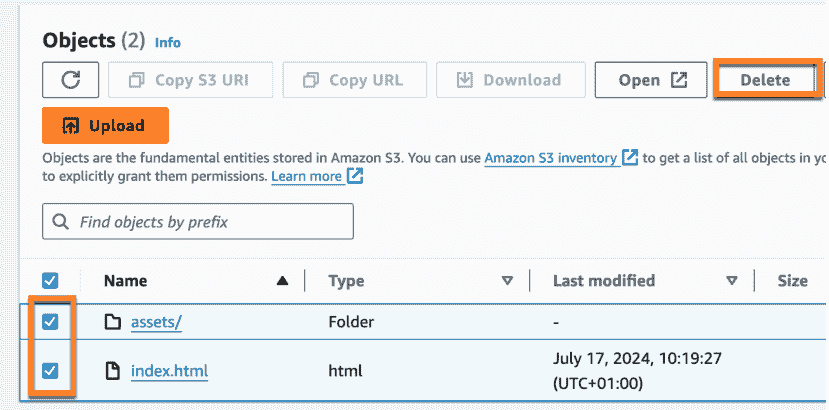


+   3. 接下来，系统会提示你在**永久删除对象？**部分的文本框中输入`permanently delete`以确认删除操作。
+   4. 接下来，点击**删除对象**按钮。
+   5. 对象删除完成后，返回到你运行`sam deploy`命令的终端/命令提示符窗口。请确保你仍在同一个文件夹中。
+   6. 运行`sam delete --no-prompts`命令。
+   7. SAM 现在将执行堆栈删除操作。这可能需要几分钟才能完成。
+   8. 如果你返回 CloudFront 和 Amazon S3，应该会发现资源已被删除。

## 摘要

在本章中，你学习了 AWS SAM，这是一个开源框架，它简化了在 AWS 上开发、测试和部署无服务器应用程序的过程。SAM 使用 AWS CloudFormation 来帮助构建支持无服务器应用程序的底层基础设施。它提供了一种语法来表达函数、API 和数据库，允许你定义和管理你的 IaC（基础设施即代码）。

你还发现了 AWS AppSync 与 Amazon DynamoDB 的集成，展示了这些服务在构建可扩展、无服务器和实时应用程序方面提供的强大组合。通过定义 GraphQL 模式，并配置解析器将 GraphQL 操作直接映射到 DynamoDB 中的数据操作，你了解了这种无需中间层的高效数据同步和管理的无缝交互，使其成为开发现代应用程序的高效解决方案。

使用 AppSync，你可以运行查询和变更来与 DynamoDB 交互，利用直接数据映射，并在需要更复杂逻辑时使用 AWS Lambda。通过由 GraphQL 订阅促进的实时功能，你发现了 AppSync 如何随着数据库中数据的变化向客户端应用程序提供实时更新。

这种集成简化了后端基础设施并加速了开发过程，使你能够更多地专注于创建引人入胜的用户体验，而不是管理数据库操作和数据流。无论你是构建移动应用、Web 应用程序还是具有多个数据源的复杂系统，AppSync 和 DynamoDB 的组合都提供了解决现代应用程序需求的可扩展且高效的解决方案。

## 备考演练 – 章节复习题

除了对关键概念有扎实的理解外，能在时间压力下快速思考也是一项技能，这将帮助你顺利通过认证考试。这就是为什么在学习初期磨练这些技能至关重要。

章节复习题旨在随着你学习和复习每个章节而逐步提高你的应试技巧，同时也复习你对章节中关键概念的理解。你会在每章末尾找到这些内容。

如何访问这些资料
要了解如何访问这些资源，请前往标题为“第 17 章：访问在线资源”的章节。

要打开本章的章节复习题，请执行以下步骤：

+   1. 点击链接 – https://packt.link/DVAC02_CH14。
+      或者，你可以扫描以下二维码（图 14.21）：


图 14.21 – 打开章节复习题的二维码（仅限已登录用户）

2. 登录成功后，你会看到与*图 14.22*所示类似的页面：

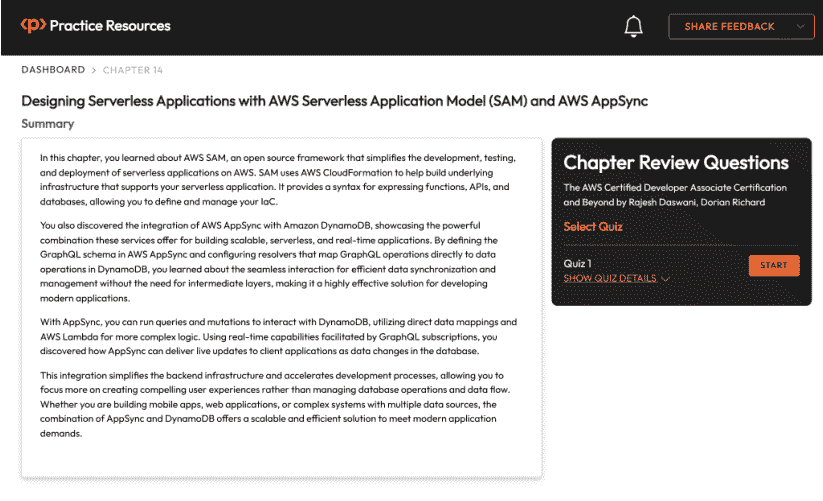

*图 14.22 – 第 14 章的章节复习题*

3. 准备就绪后，开始进行以下练习演练，多次重新尝试测验。

## 备考演练

前三次尝试时，不要担心时间限制。

# ***尝试 1***

第一次，目标至少达到**40%**。检查你答错的题目，并再次阅读章节中的相关部分，以弥补你的学习差距。

# ***尝试 2***

第二次，目标至少达到**60%**。检查你答错的题目，并再次阅读章节中的相关部分，以弥补任何剩余的学习差距。
