## 15

### 解耦应用程序堆栈和管理数据摄入

在当前的应用程序开发时代，从单体架构向由松耦合组件和微服务组成的架构转型是一个关键的转变。这种演变旨在满足对可扩展、可维护、具有韧性且能够适应变化的系统的需求。本章探讨了将单体应用程序分解为微服务的过程，以及在 AWS 上采用分布式设计模式和使用复杂的数据摄入工具。

这些高级架构策略使组织能够增强敏捷性，提高容错能力，并更好地管理软件环境中的复杂交互。通过 AWS 强大的服务套件，开发人员可以有效地管理数据流和应用程序组件，从而远离传统的僵化架构。

本章将帮助你为 AWS 认证开发者助理考试做准备。通过学习 AWS 应用程序集成工具，你将能够更好地设计松耦合的应用程序，并放弃单体结构而转向微服务和事件驱动架构。这一要求属于*域 1：使用 AWS 服务进行开发下的任务声明 1：为托管在 AWS 上的应用程序编写代码*。本章还与*域 4：故障排除和优化下的任务声明 3：使用 AWS 服务和功能优化应用程序*保持一致。

最后，本章还介绍了名为 Amazon Kinesis 的流式服务。其产品套件使开发人员能够构建需要大规模处理和实时流式数据的应用程序。

本章涵盖的主题如下：

-   - 单体与微服务设计概述
-   - 使用 Amazon SQS 解耦
-   - 使用 Amazon SNS 进行基于推送的通知
-   - 使用 Amazon Step Functions 设计应用程序工作流
-   - 使用 Amazon Kinesis 摄入和消费流式数据

## 单体与微服务设计概述

单体架构以相互关联和相互依赖的方式，将应用程序的组件封装在单个程序中。在这种设置中，应用程序要执行或编译，每个组件及其相关组件都必须存在。这种传统的统一模型简化了初始的开发、测试、部署和扩展过程，因为所有内容都作为一个整体进行管理。然而，这意味着任何更改都会影响整个系统，使更新变得风险较高，部署变得繁重。随着应用程序规模和复杂性的增加，这种模型可能会阻碍快速开发和灵活性。相反，强烈建议将架构重新工程化为微服务架构。图 15.1 说明了这一概念，其中不同的组件独立工作但集成在一起以提供最终的应用程序堆栈：

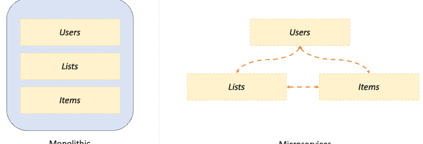

图 15.1 – 单体与微服务架构

微服务可以使用多种方式进行通信，例如使用基于 REST 的方法（如 HTTP/S）进行同步通信，或通过消息队列系统（如 RabbitMQ 或 Amazon SQS）进行异步通信。使用消息队列方法，你可以将消息发布到队列中，其他服务可以消费这些消息，从而解耦你的应用程序组件，同时确保这些组件在有容量时可以处理请求。

## 向微服务架构转型

与单体架构中所有内容紧密耦合不同，微服务架构将应用程序分解为一组小的相互关联的服务。微服务架构中的每个服务都运行其独特的进程，并且需要管理自己的依赖项（如 SDK 和库），并通过使用轻量级 API 的明确定义的接口与其他服务通信。这种设计提供了强大的故障隔离：如果一个微服务失败，它不会导致整个系统崩溃。此外，微服务允许我们根据每个服务使用不同的技术堆栈，促进创新并降低技术或供应商锁定风险。

## 比较单体与微服务

在本节中，你将比较单体与微服务，考察它们的可扩展性、开发复杂性和运营开销。你还将了解影响在这两种架构风格之间选择以及从单体架构向微服务架构转型受益的因素：

-   - **可扩展性**
-   - 单体应用程序可以通过在多台机器上复制服务器来进行扩展，但这可能导致资源利用率不足
-   - 微服务可以根据功能需求单独扩展，因此随着规模增长，它们是一种更高效的模型
-   - **开发复杂性**
-   - 单体应用程序初期开发简单，但随着规模增长，可能会变得笨重且难以管理
-   - 微服务增加了管理多个服务的复杂性，但允许独立的开发和部署，显著加快了大型团队的开发过程
-   - **运营开销**
-   - 由于只需要管理一个系统，单体架构的运营复杂性较低


+   微服务需要精细的编排和监控工具来管理多个服务及其交互，这可能会增加运维开销，但能提供更好的弹性和故障隔离能力。

单体架构与微服务架构的选择通常取决于项目的具体需求和约束条件。由于简单性和低开销，单体架构对于初创公司和小型应用程序更为合适。而对于更大、更复杂的应用程序，或者预期将显著扩展的应用程序，尽管初期复杂性和管理开销较高，但仍可能选择微服务架构，以利用其可扩展性和弹性优势。

理解单体架构和微服务架构的优势与劣势，有助于开发人员和架构师做出明智的决策，从而最好地满足应用程序的需求。随着组织的发展和演变，它们可能会考虑从单体架构过渡到微服务架构，以更好地满足其对可扩展性和灵活性的需求。这一决策应与组织的战略目标及其应用程序环境所面临的具体挑战保持一致。

在理解单体架构和微服务架构的概念差异之后，探索促进松耦合应用程序开发的实用工具至关重要。AWS 提供了支持此架构风格的多种服务，尤其是 Amazon **Simple Queue Service** (SQS) 和 Amazon **Simple Notification Service** (SNS)。这些服务对于构建不仅松耦合，而且具备可扩展性和故障弹性能力的applications至关重要，这也是下一节的主题。

## 使用 Amazon SQS 和 SNS 构建松耦合应用程序

在云基础设施领域，构建具备弹性和可扩展性的应用程序至关重要。AWS 提供了两种支持松耦合系统架构的关键服务：Amazon SQS 和 Amazon SNS。对于实现稳健的分布式系统的开发人员来说，这些服务通过促进解耦组件之间的异步通信，发挥着不可或缺的作用，这也是 AWS Certified Developer Associate 考试的核心主题。

AWS 服务，例如 **Application load balancers**（应用程序负载均衡器），也支持使用同步复制来构建松耦合架构。异步架构的额外好处在于，消息可以暂时存储在队列中，允许下游组件在准备好处理时再检索这些消息。

下一小节将对 Amazon SQS 服务进行深入介绍。

## 使用 Amazon SQS 实现解耦

Amazon SQS 是一种全托管的消息队列服务，有助于解耦应用程序组件。通过启用异步消息队列，SQS 允许分布式系统的组件在没有直接连接的情况下进行通信，从而增强了容错性和可扩展性。

图 15.2 展示了一个高层示例，该应用程序允许最终用户将照片上传到中央 S3 存储桶。当图像上传时，可以配置事件通知来触发 Lambda 函数。

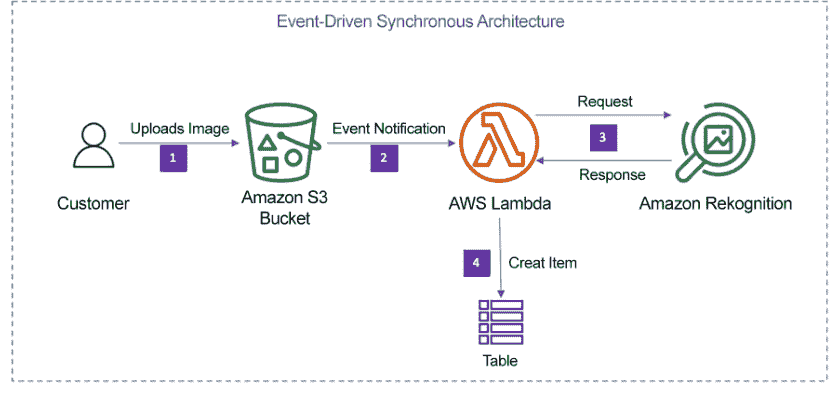

图 15.2 – 事件驱动的同步架构

后端的 Lambda 函数处理客户的图像，并利用 Amazon Rekognition 通过其人工智能和机器学习能力检测图像中的对象。处理结果可以存储在 Amazon DynamoDB 表中。

虽然这种架构设计模式运行良好，但同步设计模式确实存在一些风险。例如，想象一个数百名客户同时上传图像的场景。同时到达 S3 存储桶的图像很可能会触发过多的 Lambda 函数请求，导致积压，并可能导致部分图像处理失败。缺乏容错性可能导致糟糕的客户体验。为了解决这一问题，将架构解耦，使前端请求和后端处理能够异步进行，将产生更好的设计模式，如图 15.3 所示。需要注意的是，必须确保为 DynamoDB 表预配足够的写入容量单元（或选择按需预配），以处理即将到来的写入请求。

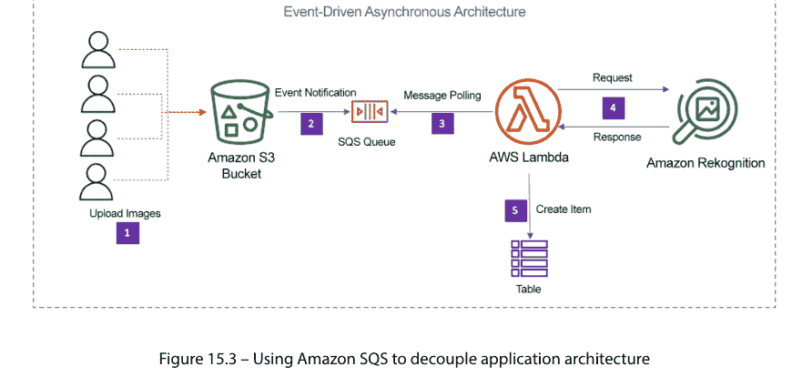

图 15.3 – 使用 Amazon SQS 解耦应用程序架构

当多个用户上传图像到 S3 存储桶时，会触发事件通知并发送到 SQS 队列，消息将在队列中保留一段时间。保留期限可以是 1 分钟到 14 天，默认期限为 4 天。然后配置 Lambda 函数轮询队列以获取新消息，并按自己的节奏检索它们，确保没有图像未被处理。请注意，默认情况下，SQS 消息大小限制为 256 KiB。对于更大的消息，必须使用 Amazon SQS 扩展客户端库（适用于 Java 或 Python），此时消息负载托管在 Amazon S3 存储桶中，而 SQS 队列则用于托管指向该负载的引用。

在这种设计架构中，S3 存储桶是消息生产者，Lambda 函数是消费者。

在接下来的部分中，您将了解 Amazon SQS 服务的一些核心功能。

## Amazon SQS 队列类型

Amazon SQS 提供两种类型的队列以支持不同的使用场景：标准队列和先进先出（FIFO）队列。

### 标准队列

标准队列是默认的队列类型。它们为每个 API 操作提供近乎无限的每秒事务数（TPS）。这些 API 操作包括 SendMessage、ReceiveMessage 和 DeleteMessage。

SQS 队列也是区域特定的，并且跨多个可用区冗余存储您的消息以便处理。这确保了没有单点故障。标准队列的主要特性和限制如下。

### 消息排序

标准队列仅提供尽力而为的排序。这意味着有时您的消息到达的顺序可能与其发送顺序不同。

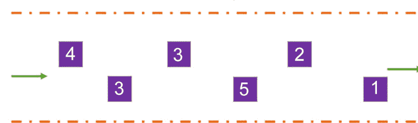

图 15.4 – 标准队列

如果您的应用程序需要保持消息的顺序，AWS 建议您选择后文介绍的 FIFO 队列。

### 至少一次投递

消息存储在构成 SQS 服务一部分的服务器上。偶尔，当消费者从队列接收并删除消息时，托管消息副本的服务器可能不可用。当该服务器重新上线时，当您执行接收消息操作时，消息可能会再次被投递。这可能导致重复消息被投递到您的消费者。鉴于标准队列的特性，建议设计应用程序具有幂等性，这意味着在处理重复消息时不会受到不利影响。

### FIFO 队列

FIFO 队列旨在克服标准队列的某些局限性，如下所述。

### 消息排序

消息发送到队列的顺序即其接收的顺序（即先进先出）。

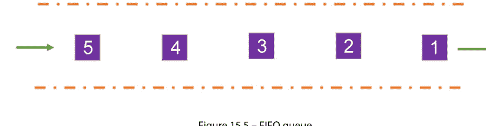

当您的应用程序必须按照发送顺序接收消息时，FIFO 队列特别有用。用例示例包括：

- 确保只有在注册完成后，学生才能注册课程
- 确保输入的命令按正确的顺序执行
- 在线票务系统必须确保票务按照创建顺序发行

### 精确一次处理

使用 FIFO 队列，您不会收到重复消息。消息将保持可用，直到消费者处理它们并将它们从队列中删除。

在决定使用标准队列还是 FIFO 队列时，也很重要要考虑您的应用程序需要处理每秒多少条消息。下一节将概述 SQS 队列吞吐量考虑因素。

### 吞吐量考虑

在决定应用程序使用哪种队列类型时，理解吞吐量至关重要：

- 标准队列支持每个操作（如发送、接收或删除消息）近乎无限的 TPS。
- FIFO 队列限制更多，支持每秒最多 300 条消息（使用批处理）或每秒最多 3,000 条消息（不使用批处理）。这对于需要严格顺序和消息处理唯一性的应用程序至关重要。


另一个需要理解的重要概念是在设计解耦架构时定义访问队列所需的权限。你可以使用 IAM 策略和 SQS 队列访问策略。下一节将讨论此内容。

## SQS 队列访问策略

作为设计架构的一部分，你将拥有需要以生产者或消费者身份访问队列的资源。为了确保权限正确定义，你可以使用 IAM 策略或 SQS 队列访问策略（一种基于资源的策略）。

一个典型的用例是你可能希望访问另一个账户中的 SQS 队列。这被称为跨账户访问。该场景如图 15.6 所示。

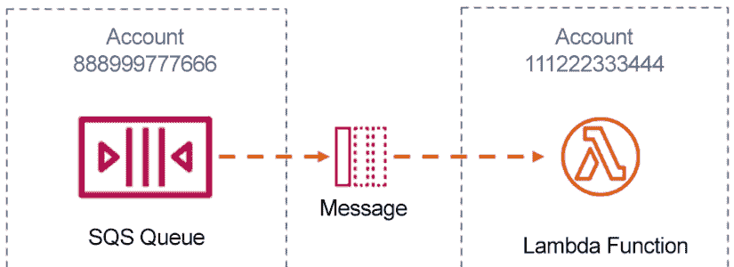

图 15.6 – SQS 队列的跨账户访问

在此场景中，一个 Lambda 函数必须轮询另一个 AWS 账户中的 SQS 队列。这需要一个 SQS 访问策略，使账户 111222333444 中的 Lambda 函数能够轮询并从账户 888999777666 中的 SQS 队列接收消息。以下代码显示了典型策略的片段：

```
{
  "Version":"2012-10-17",
  "Statement":[{
    "Effect":"Allow",
    "Principal":{"AWS": ["111222333444"]},
    "Action":["sqs:ReceiveMessage"],
    "Resource":"arn:aws:sqs:us-east-1:888999777666"
  }]
}
```

*Principal* 代表前述代码片段中的受信任账户，而 *Resource* 定义了 SQS 队列。

在另一个示例中，如果你为 S3 存储桶配置 Amazon S3 事件通知，使得事件触发的通知需要发送到 SQS 队列，你将需要创建一个访问策略，允许 Amazon SQS 允许 S3 存储桶将通知发送到队列。以下代码片段和 *图 15.7* 说明了该架构：

```
{
    "Version": "2012-10-17",
    "Id": "example-ID",
    "Statement": [
        {
            "Sid": "example-statement-ID",
            "Effect": "Allow",
            "Principal": {
                "Service": "s3.amazonaws.com"
            },
            "Action": [
                "SQS:SendMessage"
            ],
            "Resource": "arn:aws:sqs:Region:account-id:queue-name",
            "Condition": {
                "ArnLike": {
                    "aws:SourceArn":
                        "arn:aws:s3:::*:awsexamplebucket1"
                },
                "StringEquals": {
                    "aws:SourceAccount": "bucket-owner-account-id"
                }
            }
        }
    ]
}
```

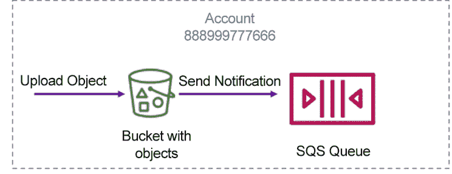

图 15.7 – 使用 SQS 队列的 Amazon S3 事件通知

作为 SQS 访问策略的一部分，Principal 已设置为 Amazon S3 服务，并且定义了一个条件语句，确保只有特定的 S3 存储桶才能向队列发送通知消息。

在下一节中，你将了解有关 Amazon SQS 如何通过消息可见性超时功能管理你的消息，以防止因其分布式特性而导致重复消息被传递。

## 消息可见性超时

你的 SQS 队列的消费者必须轮询队列以获取新消息，然后接收消息以进行处理。 along with the message, you receive a receipt handle related to the action of receiving the message. 处理完成后，消费者必须通过调用 DeleteMessage 操作并提供此收据句柄（而不是消息 ID）将其从队列中删除。

如果你多次接收到消息且其被重复，每个消息将具有不同的收据句柄。在处理后删除消息时，你必须提供最新的收据句柄。

为了确保消息不会被其他消费者处理，Amazon SQS 设置了可见性超时时间。默认超时时间为 30 秒；其他消费者无法访问该特定消息。这允许接收到消息的消费者对其进行处理，然后将其从队列中删除。

## 死信队列

偶尔，消费者可能无法处理特定消息。这可能是由于多种因素造成的，例如格式错误的<|message|> 消息或与消费者没有足够时间处理消息相关的问题。作为应用程序设计的一部分，你也可能重试处理给定消息，以防处理失败是一次性问题。

然而，如果你的消费者持续无法处理给定消息，你必须将该消息隔离以供进一步分析和调试。这是通过使用 **死信队列** 实现的。你可以通过设置 *重定向策略* 来配置你的 SQS 队列，以设置 `maxReceiveCount` 阈值。此值定义了消息在被发送到死信队列之前可以失败处理的次数，如 *图 15.9* 所示。为了确保弹性并防止误报，请将 `maxReceiveCount` 设置为较高值，以允许在将消息发送到死信队列之前进行足够的重试。

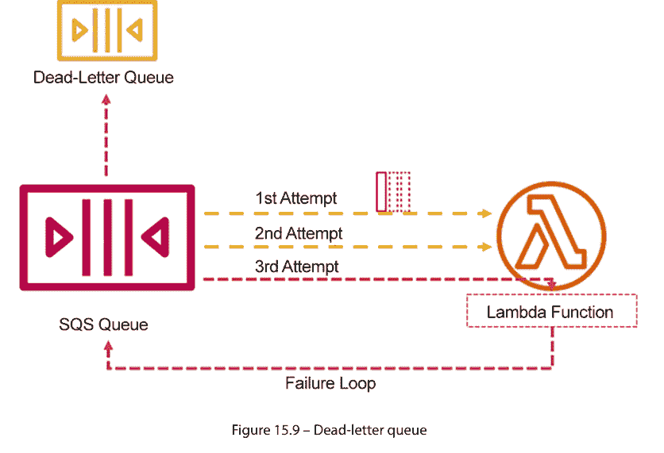

在前面的示例中，如果消息在第三次尝试时仍未成功处理，它将被重定向到死信队列。通过将未消费的消息隔离到单独的死信队列中，你可以分析日志文件以查找与消息相关的异常，识别与消息内容相关的问题，或确定消费者是否需要更多时间来处理消息，可能需要增加可见性超时时间。

需要注意的另外重要点如下：

- FIFO 队列的死信队列也必须是 FIFO 队列
- 标准队列的死信队列也必须是标准队列

此外，保留期取决于你正在使用的队列。对于标准队列，消息的过期时间基于其入队时间戳，即使消息被移入死信队列，该时间戳也不会改变。这意味着 ApproximateAgeofOldestMessage 指标指示消息何时移入死信队列。假设一条消息进入标准队列，并在其中停留 1 天后因无法处理而移入死信队列。如果死信队列的保留期设置为 3 天，则该消息将在 2 天后被删除，且 ApproximateAgeofOldestMessage 为 2 天。强烈建议死信队列的保留期长于原始队列的保留期。

对于 FIFO 队列，如果消息被发送到死信队列，则入队时间会被重置。这意味着如果你将 FIFO 死信队列的保留期设置为 3 天，ApproximateAgeOfOldestMessage 也将设置为 3 天。

在下一节中，你将了解延迟队列。

## SQS 延迟队列

默认情况下，消息在进入队列时立即可见。但是，如果你需要延迟消息的处理，可以设置延迟队列。在此，消息对消费者不可见，最长可达 15 分钟（默认设置为 0 秒）。这在消费者需要更多时间处理传入的新消息时很有用。你可以在队列级别设置延迟，也可以在发送消息到队列时使用 DelaySeconds 参数覆盖默认值。

Amazon SQS 是一种基于轮询的消息队列解决方案，旨在帮助你构建解耦和微服务架构。在下一节中，你将了解另一项 AWS 服务，该服务旨在帮助为你的应用程序架构集成基于推送的通知解决方案。

## 基于推送的通知与 Amazon SNS

想象一个场景，你有一个购物服务，接受终端客户对特定产品范围的请求。一旦订单下达，应用程序可能需要向多个应用程序组件发送某种形式的通知，例如发货服务、库存管理、客户，甚至可能是用于额外处理的 SQS 队列。如图 15.10 所示，这也意味着需要在应用程序中为这些流程编写代码，以便它可以调用这些服务的必要 API。


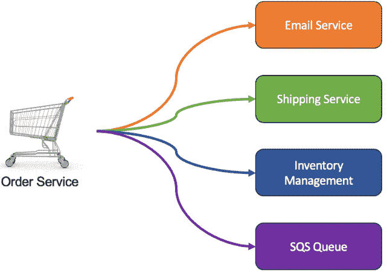

图 15.10 – 客户订购服务

Amazon SNS 是一款完全托管的 **发布者/订阅者 (pub/sub)** 通知服务，可让您轻松构建微服务架构。它使用一种消息框架，使应用程序能够通过一个称为 **主题** 的单一通道将通知推送给多个订阅者，该主题可以有一个或多个订阅者。订阅主题的订阅者随后会接收这些通知，然后对消息采取适当的行动。受支持的订阅者端点包括 Amazon SQS、AWS Lambda、HTTP 端点、Amazon Data Firehose、电子邮件订阅者、移动推送通知和短信 (SMS)。

这有助于您快速构建应用程序架构，而无需自行设计 pub/sub 服务。根据 *图 15.11*，订购服务会向 SNS 主题发送订单通知。跨多个 AWS 服务运行的其他服务订阅该主题并接收这些通知，然后用于完成各自的任务。

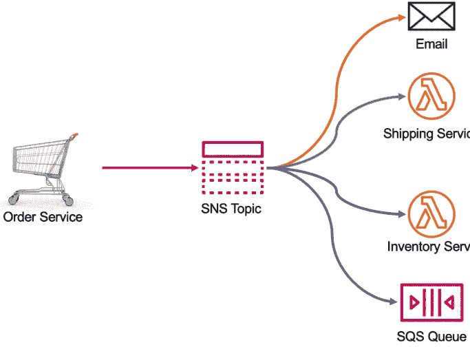

图 15.11 – Amazon SNS pub/sub 模型

使用 Amazon SNS，您可以配置两种类型的订阅者 – **应用程序对应用程序 (A2A)** 或 **应用程序对个人 (A2P)**：

- **A2A** – 此类订阅者是另一个应用程序或您主要应用程序的组件。例如，*图 15.11* 中订阅 Order Service SNS 主题的 Lambda 函数使用通知来处理应用程序的发货组件，以确保订单正确派送给客户。
- **A2P** – 此类订阅者通常是需要被提醒的人类订阅者，例如管理员，或 *图 15.11* 中示例中的客户，他们会收到一封确认订单已下的电子邮件。

最终，Amazon SNS pub/sub 模型对于向各种类型的消费者广播通知非常有效，包括电子邮件地址、SQS 队列和 AWS Lambda 函数。

SNS 服务的一个重要功能是 SNS 和 SQS Fanout 模式，这将在下一节中讨论。

## Amazon SNS 和 SQS Fanout 模式

使用 Amazon SNS，您可以设计一种解决方案，其中单个主题可用于将消息分发到多个 SQS 队列，有效地实现信息分发的一对多通信模型。此模式不仅可扩展，而且还能增强消息传递的可靠性。例如，在图 15.11 中，我们讨论了一种架构模式，其中订购服务会通知多个 Lambda 函数以处理电子商务应用程序中的订单。随着订单的到来，会向主题发送通知，运送和库存服务（Lambda 函数）已订阅该主题。

使用 Amazon SNS，消息不会存储在主题中；随着消息的到来，订阅者会立即收到通知并必须对消息采取行动。这是因为 Amazon SNS 是一种基于推送的消息服务。但是，需要注意的是，使用 Amazon SNS，您可以配置交付策略，其中包括在订阅端点因任何原因不可用时重试交付消息的选项。AWS 管理的端点（如 Amazon Data Firehose、Lambda 或 SQS）的默认重试策略是三次且无延迟。交付策略有四个阶段，分别如下：

立即重试阶段（无延迟）是指初始交付尝试后的重试。

预退避阶段是指在对重试应用退避函数以在这些重试之间添加延迟之前尝试一组重试。

退避阶段通过设置最小和最大延迟以及重试退避函数来控制重试之间的延迟，以定义从最小延迟到最大延迟的延迟增加。

后退避阶段指定重试次数和重试之间的延迟。

如果交付策略已耗尽，Amazon SNS 将停止重试尝试并丢弃消息，除非您配置死信队列来传递消息。

假设有多个订单正在处理，并且向主题发送了多个通知，这会导致消息被推送到 Lambda 函数。在这种情况下，可能有必要加入一个 SQS 队列来保存消息，以便 Lambda 函数在有容量时检索并处理它们。将消息发送到 SNS 主题，然后将其分发到多个 SQS 队列的过程称为 Fanout 模式。

在图 15.12 中，一旦订单下达，就会向 SNS 主题发送通知，该主题将消息分发到多个 SQS 队列以供不同的应用程序组件处理。每个订单都会生成一条通知，但 Fanout 过程意味着属于应用程序不同组件的不同队列可以收到通知。

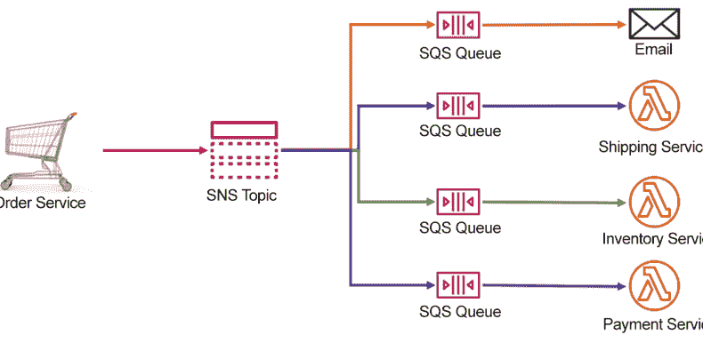

如图所示，运送、库存和支付服务的 Lambda 函数可以在有空闲时轮询其各自的队列以获取相应任务。这确保了可扩展性并防止在高吞吐量期间处理任何消息。

Amazon SNS 的另一个功能是可以配置保留通知顺序并确保通知仅交付一次的主题。下一节讨论 SNS FIFO 主题功能。

### 使用 FIFO 主题进行消息排序和去重

Amazon SNS FIFO 主题专门设计用于按消息发布到该主题的顺序将消息传递到 SQS 队列。此外，您的应用程序功能可能要求不惜一切代价避免重复消息。在这种情况下，您可以配置 SNS FIFO 主题并以 SQS FIFO 队列作为订阅者。

SNS FIFO 主题的订阅者可以同时是 SQS FIFO 队列和 SQS 标准队列。由于在 Fanout 模式中，并非所有消费者都需要严格的消息排序，因此使用 SQS FIFO 和标准队列的组合意味着您也可以更具成本效益并具有更大的灵活性。

在图 15.13 中，客户订单必须严格按照先到先服务的顺序履行。这意味着您的库存服务必须按照成功交易收到的顺序更新库存。库存服务因此可以从订阅 SNS FIFO 主题的 SQS FIFO 队列中受益。运送服务可能不需要严格的消息排序，因为它可能还需要考虑客户的位置来确定派送方式和交付时间。

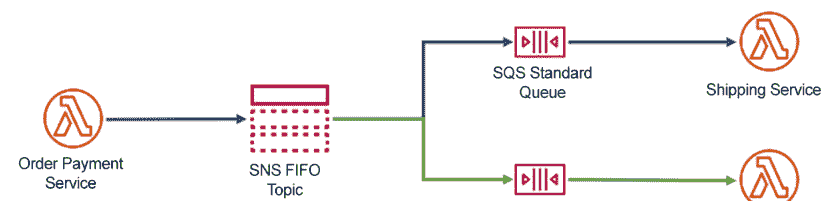

图 15.13 – SNS FIFO 主题

SNS FIFO 主题使用去重 ID 或基于内容的去重来确保通知的去重。此外，在向 SNS FIFO 主题发布消息时，您会设置消息组 ID，该 ID 定义了消息所属的组。此组 ID 会传递给 SQS FIFO 队列，这最终确保特定组的消息严格有序。

图 15.14 说明了这一概念：

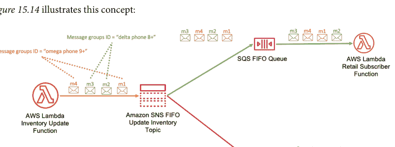

图 15.14 – 使用组 ID 的 Amazon SNS FIFO 主题

在前面的图中，您可以看到工作流左侧的 **AWS Lambda 库存更新函数** 设计用于在产品售出和补货时更新产品库存系统。

每个产品都有其消息组 ID，并且使用相同的 SNS FIFO 主题将这些更新推送到 SQS 队列。每个消息组 ID 的库存更新序列得以保留。这意味着，例如，*delta phone 8+* 产品消息的排序严格保留，其中 m2 更新在 m3 更新之前进行。由于工作流使用 SQS FIFO 队列，因此在消息最终到达 *AWS Lambda 零售订阅者函数* 时，在消息组 ID 的上下文中仍保留这种消息排序。更新 m2 仍在 m3 之前接收。

工作流右下角使用 SQS 标准队列。即使消息排序保留到到达此队列，也无法保证这种排序会在到达最终目的地 *AWS Lambda 分析订阅者函数* 时得以保留。

下一节将探讨使用 SNS 主题时的消息过滤。

## SNS 订阅和消息过滤

订阅 SNS 主题的订阅者将接收发送到该主题的每条消息。然而，一些消费者仅设计为处理这些消息的子集。例如，在前面讨论的订购服务中，您可能只想在订单成功下达且交易完成后才将消息过滤到库存服务。一个示例在 *图 15.15* 中说明：

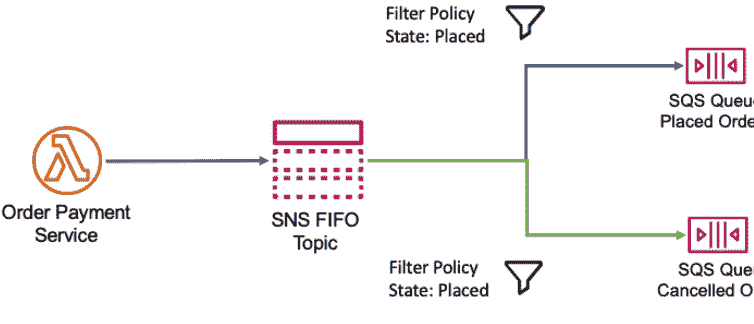


在配置过滤时，您可以使用`FilterPolicyScope`属性定义过滤策略的作用范围。您可以通过为`MessageAttributes`（策略应用于消息属性）或`MessageBody`（策略应用于消息正文）设置值来设定过滤范围。默认值为`MessageAttributes`，如果您未为现有过滤策略设置策略作用范围，其同样默认为`MessageAttributes`。

通过配置订阅并利用SNS的消息过滤功能，订阅者可以根据在主题级别定义的属性有选择性地接收消息，从而优化对传入信息的处理和操作。

Amazon SNS使您能够构建分布式应用并实现微服务架构模式。与Amazon SQS结合使用时，它有助于构建一种具备弹性且提供可靠消息队列服务的解耦架构方案。

在下一节中，您将了解AWS Step Functions。该服务提供可视化工作流，帮助您轻松构建分布式应用并为微服务设计架构。

## 使用AWS Step Functions设计应用工作流

Step Functions是一种无服务器编排服务，可轻松将AWS Lambda函数和多个AWS服务编排成业务关键型应用。通过工作流，您可以将多步应用设计并运行为一系列步骤，确保它们按顺序且按预期执行，处理错误，并提供一致且可靠的结果。

让我们通过一个示例来了解Step Functions的使用场景。当您在电商网站上完成购买时，在商品送达您手中之前，必须执行多项不同的任务（步骤）。如下图15.16所示，当客户下订单时，库存服务必须为客户预留商品。随后，由另一个Lambda函数运行支付流程。如果支付成功，则启动发货步骤，并且另一个Lambda函数可能会向仓库发送通知以包装商品并配送至客户。如果支付流程失败，则将使用另一个Lambda函数确保商品被释放回库存，以便其他客户可以购买该商品。

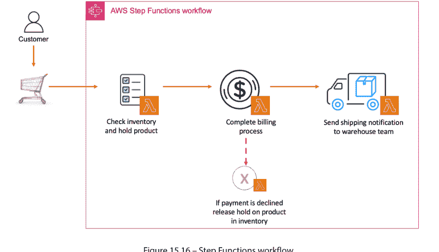

当需要正确管理这些事件并调用各项服务（例如Lambda函数）来完成每个步骤时，Step Functions非常有用。应用的工作流通过图形控制台或使用Amazon States Language（ASL）表示为事件驱动的步骤。Step Functions基于称为状态机和任务的概念。状态机本质上是应用的工作流，由一系列具有起点和终点的步骤表示。工作流中的每个步骤称为一个状态。状态可以接收数据、修改数据，然后输出数据。

有两种类型的状态机：

- **标准工作流** – 标准工作流恰好执行一次，最长可运行1年。标准工作流中的每一步只执行一次。这些工作流非常适合长时间运行的工作流。
- **快速工作流** – 这些工作流专为高吞吐量的事务性工作负载而设计，例如流式数据或IoT数据摄取。这些工作流最长可运行5分钟。

状态机可以通过各种服务启动，例如API Gateway、EventBridge、Lambda函数，甚至手动启动。在下一节中，您将了解状态机中不同的状态。

### 什么是状态？

AWS Step Functions使用ASL帮助您创建模板来定义状态机，其中包含一系列状态，例如任务状态（用于执行某些工作）、选择状态（决定转换到哪个状态）以及失败状态（如果需要在出错时停止执行）。ASL基于**JavaScript对象表示法（JSON）**结构化语言。

状态机中的状态可以执行多种功能。每个状态可以接收输入，根据输入执行特定操作，然后将输出传递给其他状态。以下是可用的状态：

- **成功状态** – 表示状态完成执行。
- **失败状态** – 停止状态机的执行，并被标记为失败状态。
- **等待状态** – 状态将等待特定时间段或特定日期和时间。它会暂停状态机的处理，直到特定时间或特定日期和时间。
- **选择状态** – 状态机可以根据输入在不同路径之间进行选择。例如，在电商应用中，您可能需要根据信用卡支付被接受还是拒绝来产生不同的输出。
- **并行状态** – 允许您根据某些输入添加单独的执行分支。选择状态可以导向并行状态。因此，例如，如果支付流程成功完成，您可能希望在多个并行分支中启动多项操作。
- **映射状态** – 此状态接受一个事物列表，例如订单列表。您可以针对该列表中的每一项运行一组步骤。
- **任务状态** – 状态机执行的一个工作单元。它可以是一个活动；一次Lambda函数调用；与DynamoDB、SNS或SQS等其他服务的集成；或调用外部API。状态机本身不执行任何工作；它只使用任务状态，这些任务状态与其他服务集成以执行实际工作。

接下来，我们回顾使用Step Functions设计工作流的流程。

### 使用Step Functions设计工作流

使用AWS Step Functions设计应用工作流时，该过程通常包括以下步骤：

- 1. **定义工作流步骤**：确定并概述必须执行的任务。每个任务都配置为Step Functions状态机中的一个状态。
- 2. **创建状态机**：使用AWS管理控制台、AWS CLI或SDK定义状态机。这涉及编写基于JSON的定义，该定义指定工作流步骤、其顺序、输入输出数据以及基于任务结果的分支逻辑。
- 3. **处理任务协调**：配置任务之间的数据传递方式，并管理任务之间的依赖关系，以确保它们按正确顺序并在正确条件下执行。
- 4. **监控和调试**：Step Functions提供了可视化工作流并实时监控执行的工具。这可以帮助您调试和优化应用工作流的性能。
- 5. **实现错误处理和重试**：为可能失败的任务定义重试策略，并设置捕获块以处理错误。这确保工作流执行能够妥善处理失败和异常。这将在下一节中讨论。

### 使用Step Functions进行错误处理

AWS Step Functions旨在通过一系列步骤编排您的应用工作流，并整合其他AWS资源的服务。需要考虑的一个重要概念是如何处理工作流中可能发生的错误。与其让您的应用（例如Lambda函数）处理和应对错误，不如将此类任务卸载给Step Functions。这样做的好处是简化应用代码，并使Step Functions能够维护重试和错误处理的历史记录。

错误可能由多种原因引起，例如状态机定义规则问题，其中Choice状态没有匹配规则可能触发错误。错误的另一个原因是Lambda函数中的异常导致任务失败，或者甚至是称为瞬时问题的网络分区事件。

Step Functions使用Amazon States Language识别错误，该语言由使用`States.`前缀的字符串组成。这些字符串构成错误名称，以下是一些示例：

- `States.TaskFailed`：任务状态在执行时失败
- `States.Timeout`：任务状态运行时间超过`TimeoutSeconds`值，或在超过`HeartbeatSeconds`值的时间段内未能发送心跳
- `States.Permission`：任务状态因缺少权限而失败
- `States.ALL`：这是一个通配符，用于匹配任何已知错误名称


Step Functions 提供了两种类型的错误处理选项：Retry，它会重试失败的状态；以及 Catch，它会将错误转换到你定义的一个失败路径中。

你可以为 Task、Parallel 和 Map 状态定义 Retry 字段。你必须定义一个对象数组，称为 retriers，其中单个 retrier 定义了若干次重试以及一个递增的间隔周期，称为 BackoffRate。当遇到错误且状态具有 Retry 字段时，Step Functions 会扫描错误名称并根据字段值进行重试尝试。

在图 15.17 中的以下示例中，为超时引起的错误配置了 Retry 字段。这是在 ErrorEquals 字段中定义的。

```
"Retry": [ {
  "ErrorEquals": [ "States.Timeout" ],
  "IntervalSeconds": 3,
  "MaxAttempts": 2,
  "BackoffRate": 1
} ]
```

图 15.17 – Step Functions 错误处理

在此 JSON 块中，Retry 最多进行两次重试尝试，如 MaxAttempts 字段所定义。此外，第一次重试在等待三秒后进行，如 IntervalSeconds 字段所定义。BackoffRate 将第一次和第二次重试之间的时间间隔增加一秒。

你还可以定义多个重试状态，例如先使用 States.Timeout 然后使用 States.All，后者是一个通配符，匹配任何错误名称。请注意，此状态必须单独出现，并且必须作为 Retry 数组中的最后一个 retrier，如图 15.18 所示：

```
"Retry": [
  {
    "ErrorEquals": [ "States.Timeout" ],
    "IntervalSeconds": 3,
    "MaxAttempts": 2,
    "BackoffRate": 1
  },
  {
    "ErrorEquals": [ "States.All" ],
    "IntervalSeconds": 5,
    "MaxAttempts": 5,
    "BackoffRate": 2
  }
]
```

图 15.18 – 多个 retriers

如果已尝试最大重试次数且错误仍然存在，则 Step Functions 会启动 Catch 错误处理选项。这也称为 fallback 状态，适用于 Task、Map 和 Parallel 状态。对于 Catch 字段，你必须定义一个对象数组，称为 catchers。

Catch 有两个关键字段，ErrorEquals 和 Next，如图 15.19 所示：

```
"HelloWorld": {
  "Type": "Task",
  "Resource": "arn:aws:lambda:REGION:ACCOUNT_ID:function:FUNCTION_NAME",
  "Catch": [
    {
      "ErrorEquals": ["States.Timeout"],
      "Next": "fallback"
    }
  ],
  "End": true
},
"fallback": {
  "Type": "Pass",
  "Result": "This is the fallback from the catch",
  "End": true
},
```

图 15.19 – Step Functions 错误处理 – Catch

在此示例中，如果遇到超时错误并且未提供重试选项或已尝试最大重试次数，则下一步是执行 Next 字段中指示的活动，即转到 fallback 状态。

此外，当你使用状态机捕获错误时，可以保留原始输入以及错误，该错误可以传递到 Next 字段指定的状态中。因此，在图 15.20 中，Catch 中的 ResultPath 将包含原始输入的错误。

```
"HelloWorld": {
  "Type": "Task",
  "Resource": "arn:aws:lambda:REGION:ACCOUNT_ID:function:FUNCTION_NAME",
  "Catch": [
    {
      "ErrorEquals": ["States.Timeout"],
      "Next": "fallback",
      "ResultPath": "$.error"
    }
  ],
  "End": true
},
"fallback": {
  "Type": "Pass",
  "Result": "This is the fallback from the catch",
  "End": true
},
```

图 15.20 – Catch 语句中的 ResultPath

因此，例如，如果你有一个输入 `{ "lorem": "ipsum" }`，捕获错误时你将得到如下状态输出：

```json
{
    "lorem": "ipsum",
    "error": {
        "Error": "Error here"
    }
}
```

ResultPath 帮助你将错误传递到下一个状态。这意味着你可以在下一个状态中访问错误并对其进行分析和必要的调试。

使用 Step Functions 进行错误处理可确保你无需过度加载 Lambda 函数，这可能会导致性能和超时问题。通过订阅 Step Functions 的功能，你可以无缝地将复杂的错误处理逻辑应用于你的应用程序架构。

在下一节中，我们将简要概述另一个功能，该功能将允许你处理工作流中外部 API 的响应。

## 等待任务令牌

有时，你的应用程序工作流可能依赖于与其他 AWS 服务、外部 API 或甚至人工审批流程的交互和响应。

例如，在电子商务应用程序的结账过程中，你可能必须等待支付网关确认信用卡支付已被接受或拒绝，然后再继续下一步。为了满足此需求，你可以将 `.waitForTaskToken` 附加到 Resource 字段，这告诉 Step Functions 等待任务令牌返回。

此 JSON 的示例片段如下：

```json
"States": {
    "Payment Gateway Process": {
        "Type": "Task",
        "Resource": "arn:aws:states:::lambda:invoke.waitForTaskToken",
        // more fields below
    }
}
```

`.waitForTaskToken` 将暂停任务并等待包含任务令牌以及 SendTaskSuccess 或 SendTaskFailure API 调用的响应。这使你能够依赖外部系统在继续工作流之前执行必要的处理。

最终，AWS Step Functions 通过将应用程序工作流分解为多个步骤、添加业务和流程逻辑、并跟踪步骤之间的输入和输出，来集中管理应用程序工作流。Step Functions 使你能够可视化此工作流，从而更好地了解你的应用程序。

在下一节中，你将了解 AWS 提供的一种流服务，名为 Amazon Kinesis，它允许你收集、处理和分析实时数据和视频流。

## 使用 Amazon Kinesis 摄取和消费流数据

Amazon Kinesis 使收集、处理和分析实时流数据变得容易，以便开发人员能够及时获得洞察并快速对新信息做出反应。该服务分为四个主要组件：

- **Kinesis Data Streams**：能够收集大量数据记录流，然后可由应用程序实时消费。
- **Kinesis Data Firehose**：能够自动将流数据加载到 AWS 数据存储中，例如 Amazon S3、Amazon Redshift、Amazon OpenSearch、Splunk、Datadog、MongoDB、HTTP 端点等。数据以接近实时的方式交付。
- **Kinesis Data Analytics**：通过标准 SQL 促进流数据处理，使查询流数据并获得洞察变得容易。
- **Kinesis Video Streams**：使你能够捕获、处理和存储视频流。

下一节将更详细地讨论 Kinesis Data Streams 的关键特性。

### Kinesis Data Streams

Kinesis Data Streams 是一种流服务，旨在实时捕获、处理和存储数据流。该服务促进了从 *producers* 到 *consumers* 的数据流。生产者可以是应用程序、客户端机器、使用 Kinesis agent 的服务等。消费该数据的主体可以是你在 AWS 账户中运行的应用程序、Lambda 函数、Kinesis Data Firehose 和 Kinesis Data Analytics（本章后面讨论）。

*图 15.21 说明了 Kinesis Data Streams 架构：*

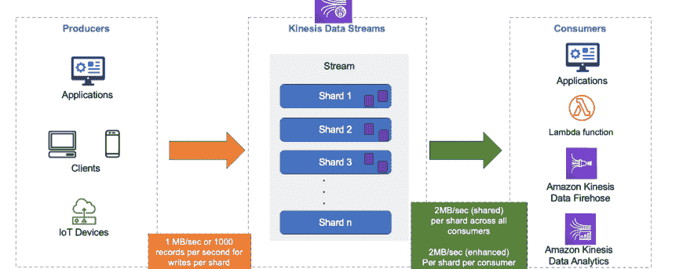

图 15.21 – Amazon Kinesis 架构

Kinesis Data Streams 默认可存储数据 24 小时，这也是最短保留期。这可使用 `IncreaseStreamRetentionPeriod` 操作增加到最长 365 天。

下一节将教你更多关于 Kinesis Data Streams 可扩展性的知识。

### Kinesis Data Streams 的扩展

Kinesis 通过部署一个或多个分片进行扩展。随着更多数据的摄取，会添加额外的分片。为了有效使用 Kinesis Data Streams，你必须设计数据摄取架构以处理数据源的量、速度和多样性。Amazon Kinesis Data Streams 使用分片作为基本吞吐量单位。每个分片提供 1 MB/秒和每秒 1,000 条记录的写入容量，以及 2 MB/秒的读取容量，如图 15.21 所示。此外，数据以记录的形式存储，记录由序列号、分区键和数据 blob 组成。该数据 blob 的最大大小为 1 MB。数据使用 `PutRecord` 和 `PutRecords` 操作、**Kinesis Producer Library (KPL)** 或 Kinesis Agent 添加到流中。

读取 Kinesis 流数据时，消费者可以在共享扇出类型和增强扇出类型之间选择。在共享扇出类型中，所有消费者共享一个分片的 2 MB/秒读取吞吐量，而在增强扇出类型中，每个消费者获得自己的 2 MB/秒读取吞吐量。

根据数据量计算适当的分片数量至关重要。这涉及了解应用程序每秒的数据生成速率，并将该速率除以每个分片的数据吞吐量。适当的分片管理可确保高效的数据处理而不产生不必要的成本。


分区键在数据在分片间的分布中发挥着至关重要的作用。当一条数据记录被放入流中时，与该记录关联的分区键决定了哪一个分片接收该记录。分区键应被选择以使数据在分片间均匀分布，避免“热点”——即过多的数据记录被导向单个分片，从而可能限制应用程序的处理能力。

在下一节中，你将了解有关数据流容量模式选项的更多信息。

## Kinesis Data Stream 容量模式

使用 Kinesis Data Streams，你可以在两种容量模式之间进行选择——**按需** 和 **预配置**。

**预配置** 容量模式要求你指定数据流的分片数量。如果需要更多容量，你必须在数据流中增加分片数量。每个分片为你提供 1 MB/秒 或 每秒 1,000 条记录的入站吞吐量，以及 2 MB/秒 的出站吞吐量。

你可以通过使用 `SplitShard` API 来拆分分片，从而创建额外的分片，以扩展容量；如果需要缩容，可以使用 `MergeShard` API 合并两个分片。

**按需** 容量模式提供 4 MB/秒 和 每秒 4,000 条记录的写入吞吐量，并可扩展至 200 MB/秒 和 每秒 200,000 条记录。它基于过去 30 天的观察吞吐量将容量翻倍。例如，如果你的写入流容量在 20 MB/秒 到 40 MB/秒 之间，则 Kinesis Data Streams 将确保你能够突发至两倍容量，即 80 MB/秒。

请注意，如果你的流量在 15 分钟内增加超过之前峰值的两倍，你可能会遇到 `ProvisionedThroughputExceeded` 错误。你必须然后限制流请求，这涉及降低请求的频率或大小。你也可以尝试使用指数退避进行重试。

在下一节中，你将了解如何使用 **Kinesis Client Library (KCL)** 开发自定义应用程序来消费和处理来自 Kinesis Data Streams 的数据。

## Kinesis Client Library

KCL 使你能够为自定义应用程序消费和处理来自 Kinesis 数据流的数据。KCL 客户端是一个基于 Java 的库，需要在你的实例上进行配置。它处理后端处理和与分布式计算相关的任务，例如负载均衡、管理消费者实例故障、从流中提取数据、检查点记录处理，以及在工作器实例数量发生变化或数据流因分片拆分或分片合并而重新共享时，将分片平衡到工作器关联，这些关联称为租约。

你的 Kinesis 数据流中的每个分片必须由一个 KCL 实例单独读取。该实例将安装 KCL 库，可以是 EC2 实例或本地实例。因此，如果你有八个分片，KCL 实例的最大数量为八个。KCL 实例可以共享来自多个分片的读取；然而，请记住，KCL 实例的数量受分片数量的限制。

KCL 还使用在 DynamoDB 中创建的租约表来跟踪流中的分片。随着从流中读取记录，检查点会在 DynamoDB 表中创建。使用 DynamoDB 中的检查点，你可以跟踪其他工作器并在工作器之间共享工作。

根据图 15.22，KCL 实例可以根据 DynamoDB 中的检查点确定从哪些分片读取。同样，如果一个实例失败并被替换，新实例可以使用此信息接管操作。

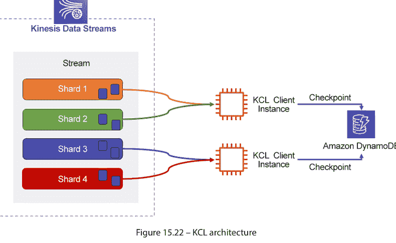

最后，KCL 客户端有两个版本。KCL 1.x 支持共享消费者，而 KCL 2.x 支持共享和增强扇出消费者模型。

在下一节中，你将了解 Kinesis Data Firehose 服务。

## 使用 Kinesis Data Firehose 消费数据

Kinesis Data Streams 并非设计用于持久存储数据，也无法原生将数据传递到其他 AWS 服务。如果你需要加载数据进行处理，同时也希望长期存储它，可以使用 Kinesis Data Firehose 服务。使用 Kinesis Data Firehose，你可以可靠地将大量流数据加载到 AWS 数据存储中，例如 OpenSearch Service、Splunk、Datadog、NewRelic、Dynatrace、Sumo Logic、LogicMonitor、MongoDB，以及作为目标的 HTTP 端点，*接近实时*。此外，你还可以将数据加载到 HTTP 端点，例如外部网站和 Splunk。*图 15.23* 提供了架构概述：

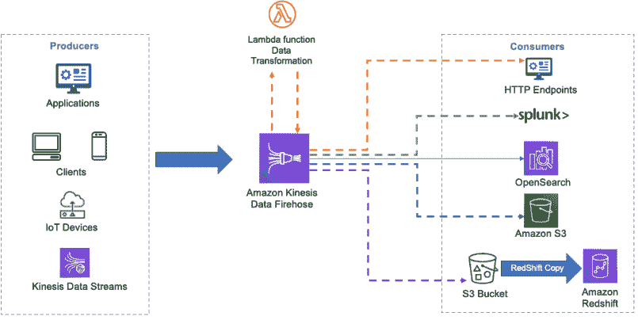

图 15.23 – Kinesis Firehose 架构

虽然 Kinesis Data Streams 以实时方式传递数据，但 Firehose 使用缓冲系统。数据默认每 60 秒交付一次，或当数据大小达到 1 MB 时交付。然而，你可以配置 S3 缓冲大小在 1 MB 到 128 MB 之间，以及缓冲间隔值在 60 到 900 秒之间以将数据交付到 Amazon S3。因此，Kinesis Firehose 被认为是 *接近实时*。此外，对于 RedShift，你必须先将数据加载到 Amazon S3 存储桶中，然后执行 RedShift Copy 命令将该数据加载到 Amazon RedShift。

在设置 Kinesis Data Firehose 时，一个关键考虑因素是如何处理数据转换。这通常涉及集成 AWS Lambda 以在数据到达目标之前对其进行转换，从而实现诸如转换格式或在传输中应用基本数据分析等任务。

接下来，你将了解有关 Amazon Kinesis Data Analytics 服务的更多信息。

## 使用 Kinesis Data Analytics 进行实时数据处理

Kinesis Data Analytics 通过使用 SQL 在流上启用复杂实时分析，从而扩展其功能，这可以显著简化流数据处理。

你编写标准 SQL 查询以在数据发送到将消费它的目标之前即时处理数据，从而能够对传入信息立即采取行动。这在诸如监控金融交易以进行欺诈检测和分析社交媒体流以进行情感分析等场景中特别有用。Kinesis Data Analytics 的一个重要方面是其处理“热流”的能力，即大量、连续的数据流。

如图 15.24 所示，Kinesis Data Analytics 的数据生产者是 Kinesis Firehose 或 Kinesis Data Streams。

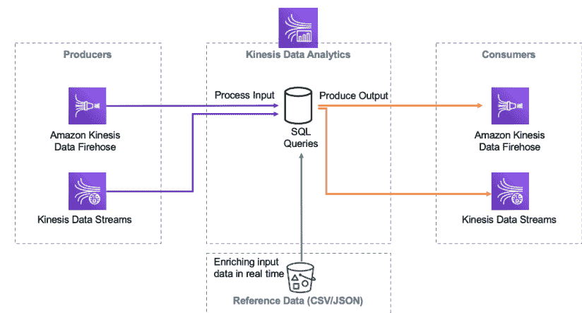

图 15.24 – Kinesis Data Analytics 架构

除了对输入数据运行实时查询外，你还可以包含存储在 S3 存储桶中的一些参考数据以进一步丰富输入数据，例如使用元数据。

该服务可自动扩展以适应传入数据的量和速度，确保在不同负载下数据处理保持稳定。你只需为处理的数据付费，无需管理任何底层基础设施。

理解 SQL 中的窗口函数使开发人员能够在数据记录集上执行计算并有效地管理事件时间序列。

下一节提供了本章的总结。

## 总结

本章探讨了在云架构中解耦应用程序组件和有效管理数据摄取的重要性，特别是使用 AWS 服务。使用 AWS 解决方案如 Amazon SQS、SNS、Kinesis 和 Step Functions，我们探讨了增强应用程序可扩展性、可靠性和可维护性的方法。

本章讨论了这些服务如何允许强大的实时数据处理和解耦组件之间的异步通信，使企业能够构建灵活且有弹性的系统。

本章提供了部署这些技术以简化工作流程、减少依赖性并提高基于云的应用程序整体效率和性能的战略见解。通过详细的讨论和实际示例，本章为你提供了构建更动态、响应更快且可独立扩展的云解决方案的知识。


# 考试准备演练 – 章节复习题

除了对关键概念有扎实的理解外，在时间压力下快速思考的能力也会帮助你顺利通过认证考试。这就是为什么在学习之旅早期就练习这些技能至关重要。

章节复习题旨在随着你学习和复习每一章而逐步提升你的应试技巧，同时检验你对本章关键概念的理解。你可以在每一章末尾找到这些题目。

> 如何访问这些资料
> 要了解如何访问这些资源，请前往题为 *第 17 章，访问在线资源* 的章节。

要打开本章的章节复习题，请执行以下步骤：

+   点击链接 – `https://packt.link/DVAC02_CH15`。
+   或者，你可以扫描以下 **二维码** (*图 15.25*)：


+   2. 登录后，你会看到一个与 *图 15.26* 所示类似的页面：

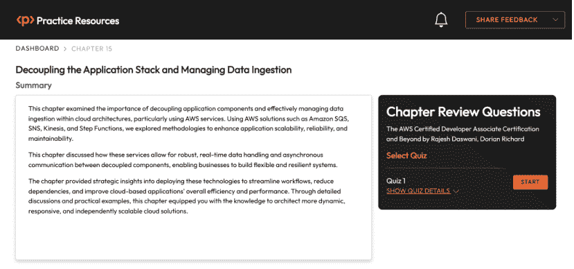

图 15.26 – 第 15 章的章节复习题

+   3. 准备好后，开始以下练习测验，并多次重做测验。

# 考试准备演练

前三次尝试时，不必担心时间限制。

# *尝试 1*

第一次，目标至少达到 40%。查看答错的题目并重新阅读章节中的相关部分，以弥补学习上的不足。

# *尝试 2*

第二次，目标至少达到 60%。查看答错的题目并重新阅读章节中的相关部分，以弥补剩余的学习不足。

# 尝试 3

第三次，目标至少达到 75%。一旦得分达到 75% 或以上，你就可以开始练习时间控制。

> 提示
> 你可能需要超过三次尝试才能达到 75%。这没关系。只要不断复习章节中的相关部分，直到达到目标为止。

# 练习时间控制

**目标：** 你的目标是在保持分数不变的同时，尽可能快速地回答这些问题。以下是你接下来几次尝试应有的示例：

| Attempt | Score | Time Taken |
| :------ | :---- | :--------- |
| Attempt 5 | 77% | 21 mins 30 seconds |
| Attempt 6 | 78% | 18 mins 34 seconds |
| Attempt 7 | 76% | 14 mins 44 seconds |

表 15.1 – 在线平台上的示例时间练习测验

> 注意
> 上表中显示的时间限制仅为示例。根据网站上测验的时间限制，为每次尝试设定自己的时间限制。

随着每次新的尝试，你的分数应保持在 75% 以上，而完成所需“用时”应“减少”。重复任意多次尝试，直到你有信心应对时间压力。
