# 使用 Amazon CloudWatch 和 AWS CloudTrail 进行监控

随着企业不断转向更复杂和分布式的架构，对精细化监控和审计系统的需求变得至关重要。从传统设置向现代云环境过渡，需要能够跟踪系统性能和健康状况，并在所有操作中确保合规性和安全性的工具。本章深入探讨 Amazon CloudWatch、AWS CloudTrail 和 AWS X-Ray 服务，这些服务旨在提供全面的监控和详细的审计功能，帮助在 AWS 中管理和优化以及保护应用程序。

这些工具的集成使组织能够增强运营监督、简化问题解决、保持严格的安全标准并识别与应用程序相关的问题。通过 AWS 强大的监控服务套件，开发人员和 IT 管理员可以掌握其系统健康状况、跟踪用户活动，并主动应对变化和潜在威胁。

本章的主题涵盖 AWS 认证开发者助理考试指南的 **第 4 域：故障排除和优化**，这将帮助你为考试做准备。

阅读完本章后，你将了解如何监控 AWS 资源运行状况并自动化修复操作以确保性能效率。此外，你将能够识别和配置可帮助你分析和排查应用程序性能问题的工具。最后，项目任务将使你获得监控虚拟私有网络进出网络流量的实践经验。

涵盖的关键主题如下：

+   - 使用 Amazon CloudWatch 监控和维护应用程序可用性
+   - 使用 AWS CloudTrail 进行审计和合规
+   - AWS X-Ray 简介

# 使用 Amazon CloudWatch 监控和维护应用程序可用性

Amazon CloudWatch 是一款专为 AWS 云资源和你在 AWS 上运行的应用程序设计的综合监控服务。它提供收集和跟踪指标、设置警报并自动响应 AWS 资源变化的功能。CloudWatch 还便于收集、查看和分析日志以进行故障排除并维护 AWS 资源的运行健康状况。本章将探讨 CloudWatch 在确保应用程序最佳性能和运行健康状况、增强其可用性方面的关键作用。

CloudWatch 提供两种监控选项 – 基础和详细（增强）监控：

+   - **基础监控** 免费提供一组默认的 CloudWatch 指标。例如，EC2 实例指标如 `CPUUtilization`、`DiskReadOps`、`DiskWriteOps`、`NetworkIn` 和 `NetworkOut` 只是基础监控下每五分钟发送到 CloudWatch 的指标中的几个例子。
+   - **详细监控** 由某些服务提供并收费。例如，对于某些服务，如 EC2 实例，指标以一分钟间隔发布，而不是基础指标的五分钟间隔。这为你提供了更多的数据点来分析趋势并快速响应变化或问题。其他服务提供更精细的指标，例如 Amazon S3。详细监控特别推荐用于生产工作负载和应用程序。

以下是 CloudWatch 的关键功能。

# CloudWatch 指标

CloudWatch 在你提供的所有 AWS 资源中收集指标数据。指标是按时间顺序排列的相关数据点的集合。针对某项服务收集的指标将取决于资源类型。例如，对于 EC2 实例，CloudWatch 收集 **CPU 利用率** 作为指标以识别实例的 CPU 消耗。同样，CloudWatch 会为弹性负载均衡器收集 `RequestCount` 和 `NewConnectCount` 等指标。

下图是 CloudWatch 仪表板的屏幕截图，视觉上展示了 EC2 核心指标和健康监控，如图 16.1 所示。

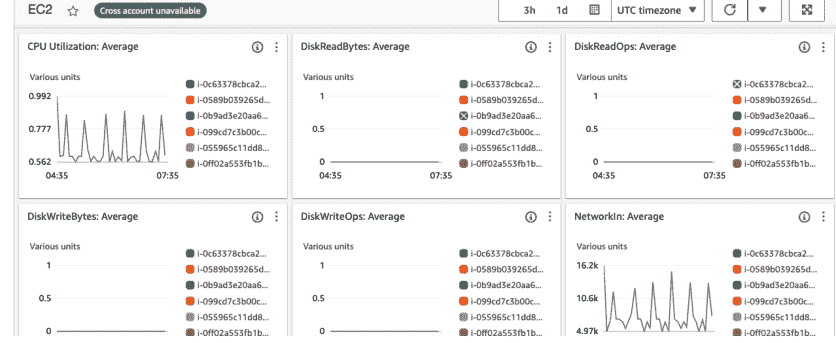

图 16.1：Amazon CloudWatch 仪表板

图 16.1 中的屏幕截图展示了一个仪表板，显示了多个 EC2 实例的指标。这些指标包括 CPU 利用率、DiskReadBytes 等。这些指标是 CloudWatch 提供的内置指标。仪表板提供了资源性能的快速视觉表示，以及它们是否过度使用或使用不足。

你也可以使用另一项服务 AWS Compute Optimizer，它与 Amazon CloudWatch 集成，提供有关优化计算资源配置的建议。该服务可帮助你避免在 EC2 实例、EBS 卷、在 Fargate 上运行的 ECS 服务、Lambda 函数和 RDS 数据库实例等计算资源上过度配置或配置不足。

该服务将分析你的计算使用模式、配置以及来自 Amazon CloudWatch 和应用程序监控工具的利用率数据以生成建议。这些建议可以导出到 Amazon S3 并与 AWS Cost Explorer 和 AWS Systems Manager 集成。根据这些建议，你可以重新配置资源以提高性能并发现节省成本的机会。

CloudWatch 可以收集两种类型的指标 – 内置指标和自定义指标。这些将在下一节中讨论。


## CloudWatch 内置指标

内置指标是由 AWS 生成的预定义指标，并发送到 CloudWatch。例如，内置指标包括监控 CPU 利用率和网络流量。磁盘活动，如磁盘读写，也包括在内。

CloudWatch 需要从许多 AWS 服务中摄取指标信息，这意味着它需要高效地管理指标信息。为了实现这一点，指标被分为三个不同的级别，如下所示：

- **命名空间：** 在顶层，你有命名空间，它是 CloudWatch 指标的容器。每个 AWS 服务都有一个命名空间，使 CloudWatch 能够区分该服务及其指标收集，如下图所示：

  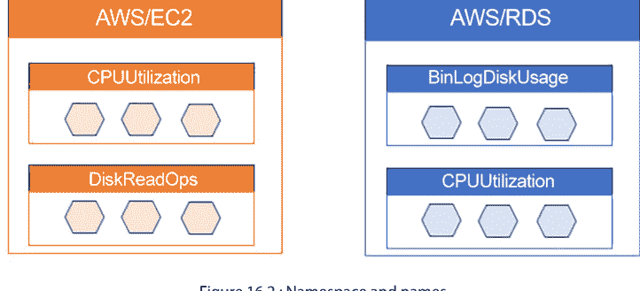

  例如，与 Amazon EC2 相关的指标被分组到定义为 `AWS/EC2` 的命名空间中，而 `AWS/RDS` 命名空间则包含数据库实例级别的指标。名称在命名空间内是唯一的；例如，对于 `AWS/EC2`，`CPUUtilization` 与 `DiskReadOps` 是不同的。你可以使用命名空间为你的应用程序定义任何其他外部服务。请注意，`AWS/` 命名空间仅保留给 AWS 服务使用。

- **维度：** 在你的命名空间内，指标根据维度进一步组织。维度有助于识别你的服务的各个资源以及每个资源的指标值。例如，如果你有一组六个 EC2 实例，你想要识别每个实例的 `CPUUtilization` 指标。维度是名称-值对，允许 CloudWatch 按资源或其他视角分离指标，以提供更多上下文信息。你最多可以向一个指标添加 30 个维度。当为你的 `AWS/EC2` 服务发送 `CPUUtilization` 指标的数据点时，AWS 还提供实例 ID 和实例类型等信息作为维度。因此，你现在可以查看你的账户中启动的每个 EC2 实例的 `CPUUtilization` 指标，如图 16.3 中的截图所示。

以下截图展示了 **TodoListApp** CloudWatch 仪表盘，该仪表盘展示了各种 AWS 资源中的一些指标。

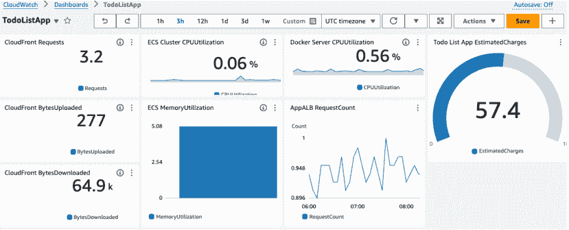

图 16.4 – TodoListApp CloudWatch 仪表盘开发环境

CloudWatch 使用命名空间、维度和指标的组合来洞察你的 AWS 资源的性能。你可以为你的资源集合创建一个仪表盘，以可视化资源消耗和性能。在下一节中，你将了解更多关于 CloudWatch 自定义指标的内容。

## CloudWatch 自定义指标

AWS 还允许你定义自定义指标。当你想要为 EC2 实例发送系统级指标（如内存和磁盘利用率）时，这尤其有用，而这些指标在 CloudWatch 提供的内置指标中不可用。使用自定义指标的另一个原因是，当你希望捕获应用级指标的数据点时，例如当前观看者人数或已完成的事务数。

要捕获系统级指标，如系统级别上的**内存和磁盘使用情况**数据点，你必须安装**统一的 CloudWatch 代理**。此代理可以安装在 EC2 实例和本地服务器上。该代理还允许你收集可以摄取到 CloudWatch 的日志文件。需要注意的是，除了在 EC2 实例或本地服务器上安装 CloudWatch 代理外，你还必须确保代理配置有 CloudWatch 的 IAM 权限。

此外，如果你希望在应用级别捕获自定义指标，你可以使用 CLI 或应用程序的 SDK 将指标发送到 CloudWatch，例如使用 `PutMetricData` API 调用。自定义指标有两种不同的分辨率，如下所示：

- **标准分辨率：** 数据以一分钟的粒度摄取
- **高分辨率：** 数据以一秒的粒度摄取

高分辨率指标可对亚分钟级活动提供及时洞察，并可根据 10 秒或 30 秒的间隔快速触发告警。你将在下一节中了解告警。

## CloudWatch 告警概述

当你捕获指标时，你可以使用这些指标在特定指标超过你为指定时间段定义的阈值时触发告警。当超过该时间段内的阈值时触发告警这一概念非常重要。你不想仅仅因为一次奇怪的尖峰而触发告警。

有两种类型的告警，如下所示：

- **指标告警：** 与单个 CloudWatch 指标或基于 CloudWatch 指标的数学表达式结果相关联。
- **复合告警：** 使用规则表达式并包含多个告警。使用复合告警有助于减少总体噪音。这是因为你可以将复合告警配置为仅在所有底层指标告警也处于 **ALARM** 状态时才进入 **ALARM** 状态。

告警可以处于以下三种状态之一：

- **OK：** 指标处于阈值范围内
- **ALARM：** 指标超出阈值范围
- **INSUFFICIENT_DATA：** 没有足够的数据，通常在你刚刚配置告警并需要等待指标数据点收集时发生

一旦告警进入 **ALARM** 状态，你可以自动执行各种操作以响应告警。你可以向 Amazon SNS 主题发送警报，然后该主题可以向开发人员发送电子邮件警报。你还可以触发自动扩缩组，该组可以根据触发的告警启动或终止实例，从而使你能够自动向外扩展或向内扩展。

此外，你还可以触发 Lambda 操作，允许你从与资源和 CloudWatch 指标相同的账户或从另一个账户调用 Lambda 函数，如图 16.5 中的截图所示。你必须提供 Lambda ARN，并确保你有足够的权限。

### Lambda 操作

- **告警状态触发器：** 定义将触发此操作的告警状态。
  - **处于告警状态：** 指标或表达式超出定义的阈值。
  - **OK：** 指标或表达式处于定义的阈值内。
  - **数据不足：** 告警刚刚开始或没有足够的数据可用。
  - **移除**
- **函数类型：** 选择 Lambda 函数的类型
  - **从已登录的账户中选择 Lambda 函数**
  - **输入跨账户函数的函数 ARN**
  - **选择函数：** 选择 Lambda 函数
  - **已登录账户上的现有 Lambda 函数，输入跨账户函数的函数 ARN**
  - **配置版本/别名**
  - **添加 Lambda 操作**

图 16.5 – 配置 CloudWatch 告警以触发 Lambda 操作

除了上述内容，专门针对 EC2 实例，CloudWatch 告警提供了一组你可以执行的 EC2 操作，如下所示：

- **停止此实例：** 当针对某个特定 EC2 实例触发告警时，你可以指示 CloudWatch 停止该实例。实例必须由 EBS 卷支持，因为实例存储卷在你关闭其所属的实例时会终止。
- **终止此实例：** 这允许你终止实例，前提是实例上未启用终止保护。
- **重启此实例：** 这与操作系统重启相同。
- **恢复此实例：** 这会尝试通过在另一台主机上启动实例来恢复该实例。当 AWS 在 `StatusCheckFailed_System` 失败错误后检测到底层硬件故障时，会触发此操作。
- 你还可以使用*简化自动恢复*，这是受支持实例默认启用的功能。如果检测到系统状态检查错误，AWS 将尝试将实例修复到健康状态。存在某些限制，例如不支持使用实例存储卷的实例或作为自动扩缩组成员的实例。


在下一节中，你将了解另一个名为 CloudWatch Logs 的功能。

## Amazon CloudWatch Logs

借助 CloudWatch Logs，你可以捕获、存储和监控日志数据。你可以从其他 AWS 服务捕获日志，例如 VPC Flow Logs、CloudTrail、Elastic Beanstalk、Lambda、IoT 设备以及本地服务器。你还可以存储 Route 53 DNS 日志请求。

CloudWatch Logs 还允许你从操作系统和应用程序捕获系统和应用程序日志数据，并将其导入 CloudWatch。对于此类日志数据，你必须安装 CloudWatch 代理或使用 AWS SDK、API 或 CLI。

你可以为日志文件定义过期策略，并对日志进行加密。你可以在 CloudWatch Logs 中查看日志数据，并将其发送到 Amazon S3、Kinesis Data Streams 和 Firehose。

*图 16.6* 中的图表说明了 CloudWatch 日志记录的工作原理。

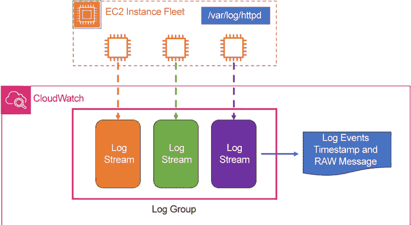

图 16.6 – CloudWatch Logs 架构

上图注明了 CloudWatch Logs 服务的各个组件。在此示例中，从三个与 Apache 访问日志数据相关的 EC2 实例捕获日志信息，并将其导入一个 CloudWatch Logs 日志组。

CloudWatch Logs 服务的核心组件包括以下部分：

- **日志事件：** 日志事件由时间戳和原始消息组成。事件消息必须采用 UTF-8 编码。日志文件中的每条记录称为一个日志事件。
- **日志流：** 一系列共享同一来源的日志事件。因此，在图 16.6 的示例中，你会看到三个日志流，分别对应每个正在捕获 Apache 日志访问文件数据的 EC2 实例。
- **日志组：** 对于给定的资源，你会有一个日志组，其中包含一个或多个日志流。在每个日志组中，日志流将共享相同的保留期、监控设置以及通过 IAM 角色和策略设置的任何访问权限。

使用 CloudWatch Logs 的一个重要好处是能够创建**指标筛选器**。这些筛选器允许你在日志流中的 CloudWatch Logs 事件里识别模式，然后从该筛选器创建一个指标并开始监控。例如，你可以使用指标筛选器提取并监控失败的登录或错误，一旦超过指定的阈值，就可以触发告警。

CloudWatch Logs 还附带其他功能，这些功能将在接下来的章节中进一步讨论。

### 导出和流式传输 CloudWatch Logs 数据

你还可以通过将日志数据发送到 Amazon S3 来从 CloudWatch 导出日志数据。这样可以长期保留日志数据，或供其他应用程序和系统用于分析和处理。此处，使用 `CreateExportTask` 操作导出日志数据。请注意，日志数据最多可能需要 12 小时才能用于导出。

除了将日志数据导出到 Amazon S3，你还可以使用订阅将 CloudWatch 日志数据配置为实时或近实时地处理并发送到其他目标。这些目标包括 Kinesis Data Streams、Firehose 或 AWS Lambda，可用于自定义处理或加载到其他 AWS 服务。你可以定义订阅筛选器，以筛选哪些日志事件被传送到目标资源。

### CloudWatch Logs Insights

CloudWatch Logs Insights 提供一种专用的查询语言，使你可以按照图 16.7 中的截图，以交互方式在 CloudWatch 中搜索和分析日志数据。

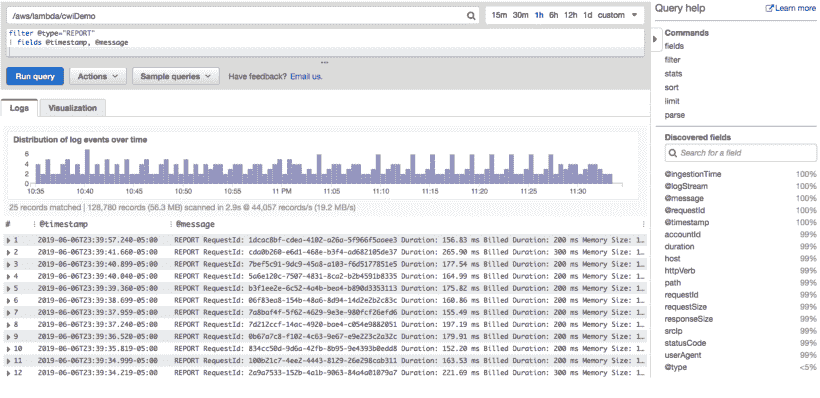

图 16.7 – CloudWatch Logs Insights

CloudWatch Logs Insights 可以快速发现来自各种 AWS 服务（如 Lambda、CloudTrail 和 VPC Flow Logs）日志中的字段，或任何提供日志事件（如 JSON）的自定义日志中的字段。

你还可以使用自然语言创建 CloudWatch Logs Insights 查询。你可以询问或描述你要查找的数据。AI 辅助功能会根据你的提示生成查询，并逐行解释该查询的工作原理。

> **重要说明**
>
> CloudWatch Logs Insights 无法访问时间戳早于日志组创建时间的日志事件。

在下一节中，你将进一步了解 CloudWatch Events。

## CloudWatch Events（Amazon EventBridge）

CloudWatch Events 现已发展成为一个成熟的产品，并更名为 **Amazon EventBridge**。这项完全托管的服务使构建事件驱动型应用程序成为可能，让你能够进一步设计松耦合架构，使其真正分布式，并避免单点故障。

从高层来看，EventBridge 可以监控你的 AWS 账户中何时发生事件，然后做出响应。EventBridge 使用事件总线（event bus）的概念，它本质上是你账户中任何 AWS 服务和资源所发生事件的流。该事件总线监控状态变化，如果发生变化，它可以触发一个事件来调用目标。目标可以是另一个受支持的 AWS 服务，例如 Lambda 函数或发送到 SNS 主题的通知。

例如，当你的某个用户停止特定 EC2 实例时，EventBridge 可以触发向 SNS 主题发送通知，如图 16.8 所示。你可能需要收到此类事件的通知，例如用于审计目的。

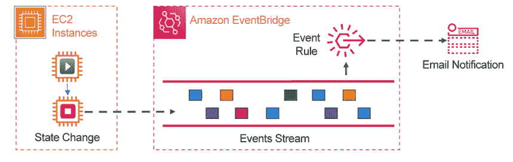

图 16.8 – 以 SNS 主题为目标的 EventBridge

使用 Cron Job 工具，你还可以配置 EventBridge，以安排在特定时间触发事件。例如，你可能希望触发一个事件来调用 Lambda 函数，在工作日结束时（下午 6 点）自动停止测试服务器。你可能还希望每天上午 9 点重新启动这些实例，并在每个工作日自动重复此操作。此外，你还可以配置事件按速率表达式发生，例如每 10 分钟触发一次操作。

Amazon CloudWatch 可以为你 AWS 账户及其资源的运行状况提供有价值的洞察。它提供广泛的日志记录、监控以及必要的修复操作能力。

在下一节中，你将了解另一项 AWS 服务 AWS CloudTrail，它帮助你从审计角度监控 AWS 账户，并确保合规性和安全性。

## AWS CloudTrail 简介

AWS CloudTrail 记录你 AWS 账户中的事件，提供用户操作、角色或 AWS 服务的详细记录。CloudTrail 捕获的每个事件都提供全面的信息，可用于安全分析、合规审计和运维故障排查。

你对 AWS 账户进行的每一次 API 调用，无论是通过管理控制台、CLI 还是使用 SDK，都会被记录在 AWS CloudTrail 中。这使你能够确定账户中发生了什么操作、由谁执行、何时执行，从而形成全面的审计跟踪。默认情况下，管理事件会被记录并保留 90 天。但是，你可以创建 CloudTrail 跟踪，将事件记录到 Amazon S3 存储桶并无限期保留。你还可以将捕获的事件发送到 CloudWatch Logs 和 Amazon EventBridge。

CloudTrail 跟踪可以为单个区域创建，也可以作为多区域跟踪创建。多区域跟踪捕获所有区域的事件，是推荐的最佳实践。如果 AWS 新建了一个区域，它会自动添加到你的多区域跟踪中，使你能够捕获全球基础设施中与资源相关的所有活动。使用 AWS Management Console 创建跟踪时，它会创建一个多区域跟踪。如果需要创建单区域跟踪，则必须使用 AWS CLI。

CloudTrail 可以捕获三种类型的事件，如下所示：

- **管理事件**提供有关对 AWS 账户中资源执行操作的信息，例如启动新的 EC2 实例、创建新的 IAM 角色、附加 IAM 策略或终止 RDS 数据库实例。默认情况下，跟踪配置为记录所有管理事件。
- **数据事件**提供有关对资源执行或在资源内部执行的资源操作的详细信息。例如，当用户尝试下载对象时，会对 S3 存储桶中的对象执行 GetObject 操作。你还可以在 Lambda 函数执行时捕获其执行活动，例如 Invoke API。
- **洞察事件**使你能够识别并响应由写 API 调用或读/写 API 的错误率引起的异常活动。CloudTrail Insights 通过分析正常 API 调用和 API 错误率来建立基线，并在这些调用量或错误率超出正常模式时生成事件。

管理 CloudTrail 事件的安全性至关重要，使用加密和 IAM 权限可以确保只有授权用户才能加密和解密 CloudTrail 日志文件。默认情况下，CloudTrail 使用带有 KMS 密钥的服务器端加密（SSE-KMS）将日志文件传送到你的存储桶，除非你未启用 KMS 加密。在这种情况下，CloudTrail 将使用 SSE-S3 加密日志文件。

请注意，要使用带有 S3 存储桶密钥的现有 S3 存储桶，你需要在密钥策略中授予 CloudTrail 执行 GenerateDataKey 和 DescribeKey AWS KMS 操作的权限。如果没有这些权限，你将无法创建或更新跟踪。

使用 KMS 进行加密的好处在于你可以自行管理密钥，并且可以使用同一密钥在所有区域的所有账户中加密和解密日志文件。要从 S3 存储桶访问日志文件，用户必须对该存储桶具有读取权限，并且应用了允许通过 KMS 密钥策略进行解密的策略或角色。这进一步增强了你的安全性。

在下一节中，你将学习如何使用 Amazon EventBridge 捕获特定 CloudTrail 事件并响应这些事件。


# Amazon EventBridge 与 AWS CloudTrail

在记录 CloudTrail 事件时，您可能希望通过触发 Lambda 函数或发送通知警报来对某些特定事件类型做出反应。在这种情况下，您可以将 Amazon EventBridge 与 CloudTrail 集成，以对 AWS 服务发出的特定 API 调用做出反应，该调用由 AWS CloudTrail 记录。

例如，您可能希望在用户停止 EC2 实例时触发由 Amazon SNS 生成的电子邮件警报以通知管理员。此设计架构可按照图 16.9 中的图表进行配置。

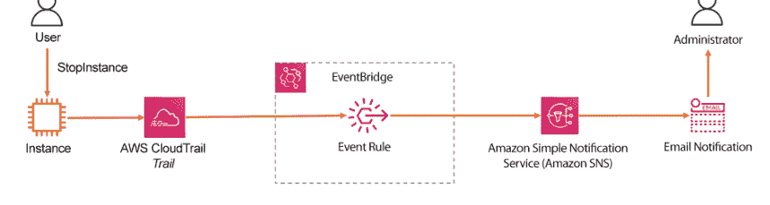

图 16.9 – EventBridge 与 CloudTrail 集成

要配置此架构，您需要创建一个 CloudTrail 轨迹，该轨迹可以使用管理控制台或 CLI 创建。作为创建轨迹的一部分，您必须创建或选择现有的 Amazon S3 存储桶来存储日志文件。以下屏幕截图说明了一个示例轨迹，显示了存储日志文件的存储桶位置：

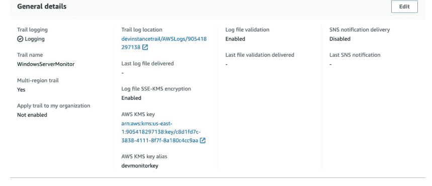

图 16.10 – CloudTrail 轨迹常规详细信息

接下来，您必须配置一个 SNS 主题，EventBridge 将向其发送警报。SNS 主题需要订阅者，在本例中将是管理员的电子邮件地址，通知类型为电子邮件通知。

接下来，您必须配置一个 EventBridge 事件规则。为此，您必须将事件源配置为 EC2，事件类型配置为通过 CloudTrail 的 AWS API 调用。在此示例中，您还可以捕获特定操作，在本例中为 StopInstances API 调用。以下屏幕截图说明了您将在 EventBridge 中配置的事件模式：

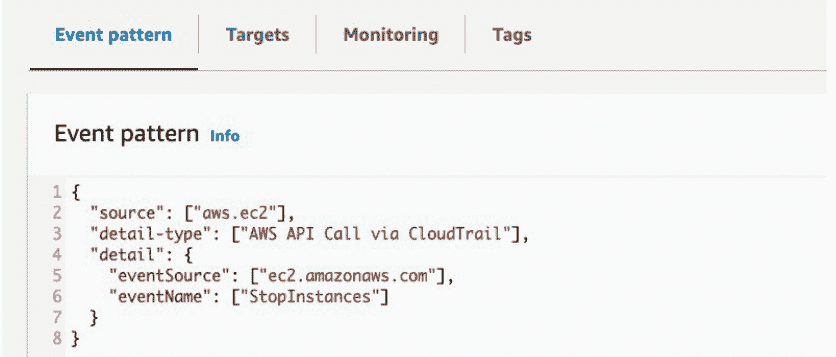

图 16.11 – EventBridge 事件模式

作为配置的一部分，您还必须配置目标，即您之前创建的 SNS 主题。这将确保当捕获到有人停止任何 EC2 实例的事件时，它会触发向 SNS 主题推送通知，从而向订阅者发送电子邮件。

实施 AWS CloudTrail 使您能够访问全面的事件日志信息，并确保您的组织保持高安全、合规和运营卓越标准。

在监控您的 AWS 账户时，账户内配置的资源的性能、健康和安全非常重要。您可能还想监控应用程序的健康状况和性能。这将在下一节中讨论，您将在其中了解 AWS X-Ray 服务。

## 使用 AWS X-Ray 进行分布式追踪

AWS X-Ray 是一款功能强大的服务，可帮助开发人员分析和调试分布式应用程序，例如使用微服务架构构建的应用程序。X-Ray 可提供应用程序请求在各种服务中传输的端到端可见性，提供有关应用程序性能和运行状况的见解。

AWS X-Ray 由以下各种组件组成：

- **Segments：** AWS X-Ray 以段的形式接收来自应用程序中运行的资源的数据。段提供了有关跟踪中请求的详细信息，包括主机 IP、开始和结束时间、持续时间以及请求方法，例如 POST 和 GET 请求。段还允许您识别任何问题，例如错误、故障和异常。在以下屏幕截图中，您可以看到跟踪的典型段详细信息：

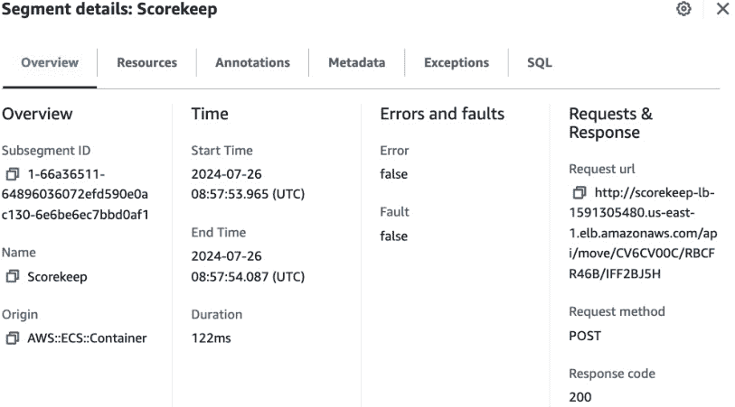

图 16.13 – 段详细信息

- **Annotations** 是用于向跟踪数据添加用户特定自定义属性的键值对。它们会被编入索引，可用于使用过滤器表达式进行查询。您可以使用注释为搜索提供更多上下文并创建组。通过将这些自定义属性添加为注释，您可以使用过滤器表达式根据这些属性限制返回的结果。您可以在控制台中使用它们对跟踪进行分组，或在调用 GetTraceSummaries API 时使用它们。
- **Metadata** 由未编入索引的键值对组成。值可以是任何类型，包括对象和列表。您可以使用元数据记录存储在跟踪中的其他数据，但不需要将其用于搜索。

最终，AWS X-Ray 是监控应用程序、调试跟踪以及通过处理跟踪检索服务映射和其他数据的绝佳工具。它还可以帮助您识别和排除微服务架构中性能问题和错误的根本原因，并在应用程序堆栈中识别瓶颈。

在下一节中，您将学习如何创建 VPC 流日志并将日志数据发送到 CloudWatch Logs。

## 项目任务 – 创建 VPC 流日志

Todo List 应用程序部署在跨多个 AWS Fargate 容器服务的 VPC 中。运行在这些容器上的应用程序会调用也在同一 VPC 私有子网中托管的 Amazon RDS 数据库。

VPC 已按照特定的最佳实践指南进行配置，纳入了安全协议和规则，以确保只有特定类型的流量被允许进入网络。

在此项目练习中，您将创建一个 VPC 流日志，并将日志数据摄取到 CloudWatch Logs。VPC Flow Logs 使您能够捕获进入和离开 VPC 中网络接口的 IP 数据包信息。该信息提供了有关 IP 流量的来源、目标 IP 地址、源端口、目标端口、使用的协议以及数据包是否被接受或拒绝的见解。

当您将流日志发布到 CloudWatch Logs 时，日志数据会发布到日志组。VPC 中的每个网络接口都有一个日志流，用于在日志组中捕获流日志记录。VPC Flow Logs 可帮助您识别潜在的恶意流量或安全组过于严格的情况，是您应用程序堆栈整体故障排除过程的一部分。

## 技术要求

要完成项目任务，您必须以 IAM 用户 Alice 的身份登录到您的 AWS **开发账户**。此外，您需要下载用于创建角色的 IAM 策略。这些策略可通过以下链接从我们的 GitHub 仓库下载：`https://packt.link/qAL04`

请注意，要完成本章的项目任务，您应已完成 *第 12 章，使用 AWS CI/CD 工具掌握 DevOps* 中的项目任务。

### 项目任务 16.1 – 创建用于将流日志发布到 CloudWatch Logs 的 IAM 角色

在此项目任务中，您必须创建一个 IAM 角色，使 VPC 流日志能够发布到 CloudWatch 日志组：

- 1. 确保您已根据 *技术要求* 部分从我们的 GitHub 仓库下载了 IAM 权限和信任策略。
- 2. 在 AWS 管理控制台中，使用网页顶部的搜索栏查找并导航到 IAM 仪表板。
- 3. 从左侧菜单中选择 **Policies**。
- 4. 在右侧窗格中，单击 **Create policy** 按钮。
- 5. 选择 **JSON** 选项作为 **Policy editor**。
- 6. 用您从 GitHub 仓库下载的 IAM `Permissions Policy VPC Flow Logs.json` 文档的内容替换此窗口的内容，如以下屏幕截图所示：

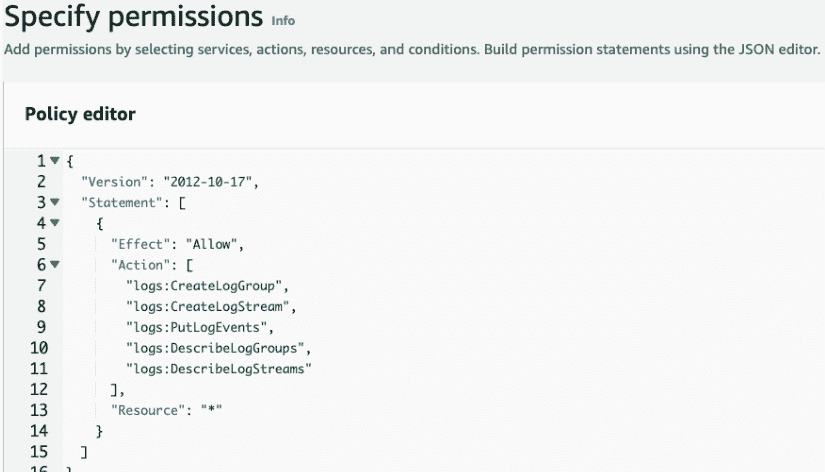

```
```json
{
  "Version": "2012-10-17",
  "Statement": [
    {
      "Effect": "Allow",
      "Action": [
        "logs:CreateLogGroup",
        "logs:CreateLogStream",
        "logs:PutLogEvents",
        "logs:DescribeLogGroups",
        "logs:DescribeLogStreams"
      ],
      "Resource": "*"
    }
  ]
}
```
```

图 16.16 – 策略的 IAM 权限


该策略为您的流日志授予足够的权限，以便将日志条目发布到 CloudWatch Logs 中的指定日志组。

+   7. 单击 **Next（下一步）**。
+   8. 为策略提供一个名称，例如 `IAM-Policy-VPC-Flowlogs`。
+   9. 单击页面底部的 **Create Policy（创建策略）** 按钮。
+   10. 从左侧菜单中，选择 **Roles（角色）**。
+   11. 在右侧窗格中，单击 **Create role（创建角色）**。
+   12. 对于 **Trusted entity type（可信实体类型）**，选择 **Custom trust policy（自定义信任策略）**。
+   13. 将默认信任策略替换为您从我们的 GitHub 仓库下载的 `Trust Policy for IAM Role.json` 文档中的内容，如下方截图所示：

## 策略编辑器

```
1  {
2    "Version": "2012-10-17",
3    "Statement": [
4      {
5        "Effect": "Allow",
6        "Action": [
7          "logs:CreateLogGroup",
8          "logs:CreateLogStream",
9          "logs:PutLogEvents",
10         "logs:DescribeLogGroups",
11         "logs:DescribeLogStreams"
12       ],
13       "Resource": "*"
14     }
15   ]
16 }
```

图 16.17 – VPC 流日志的信任策略

+   14. 单击 **Next（下一步）**。
+   15. 在 **Add permissions（添加权限）** 网页上，搜索并选择您之前创建的策略（例如，`IAM-Policy-VPC-Flowlogs`）。单击 **Next（下一步）**。
+   16. 为角色提供一个名称，例如 `todolist-role-vpcflowlogs`。
+   17. 根据您的选择，提供适当的描述。

18. 单击页面底部的 **Create role（创建角色）** 按钮。

您应该会收到一条确认信息，表明角色已成功创建。

## 项目任务 16.2 – 创建 VPC 流日志并发布到 CloudWatch Logs

在此项目任务中，您将创建一个 VPC 流日志，并配置其发布到 CloudWatch Logs 日志组：

+   1. 在 AWS 管理控制台顶部的搜索栏中，搜索并导航到 VPC 仪表盘。
+   2. 从左侧菜单中，选择 **Your VPCs（您的 VPC）**。
+   3. 在右侧窗格中，选中 **todolist-vpc** 旁边的复选框（如果您为 VPC 命名了其他名称，请确保它是您用于部署 Todo List 应用程序的那个 VPC）。
+   4. 从 **Actions（操作）** 下拉列表中，选择 **Create flow log（创建流日志）**。
+   5. 为您的流日志提供一个名称，例如 `todolist-vpcflowlog`。
+   6. 接下来，对于 **Filter（筛选）**，选择 **All（全部）**。
+   7. 将 **Maximum aggregation interval（最大聚合间隔）** 设置为 **10 minutes（10分钟）**。
+   8. 接下来，对于 **Destination（目标）**，选择 **Send to CloudWatch Logs（发送到 CloudWatch Logs）** 选项。
+   9. 在 **Destination log group（目标日志组）** 中，为您的日志组输入一个名称，例如 `todolist-flowlog-group`。系统将为您创建一个新的 CloudWatch 日志组。
+   10. 对于 **IAM role（IAM 角色）**，从下拉列表中选择您在 *项目任务 16.1* 中创建的角色。
+   11. 对于 **Log record format（日志记录格式）**，选择 **AWS default format（AWS 默认格式）**。
+   12. 对于 **Additional metadata（其他元数据）**，选择 **Include Amazon ECS metadata（包含 Amazon ECS 元数据）** 选项。
+   13. 单击网页底部的 **Create flow log（创建流日志）** 按钮。

您应该会收到一条确认信息，表明您的 VPC 的流日志已成功创建。

## 项目任务 16.3 – 查看流日志数据

+   1. 在管理控制台的搜索栏中，搜索并导航到 CloudFront 控制台。
+   2. 从左侧菜单中选择 **Distributions（分发）**。
+   3. 在右侧窗格中，单击您之前创建的 CloudFront 分发。
+   4. 在 **General（常规）** 选项卡中，复制 **Distribution（分发）** 域名，并将其粘贴到新的浏览器标签页/窗口中。

+   5. 这将连接到 *todo Web 应用程序*。登录并执行一些活动，例如创建一些新的待办事项。等待大约 10 分钟，让所有日志记录完成聚合。
+   6. 在 Web 控制台顶部的搜索栏中，在另一个浏览器标签页中搜索并导航到 Amazon ECS。
+   7. 单击 **todo-plus-cluster**（请注意，您的集群可能使用了不同的名称）。
+   8. 在右侧窗格中，单击 Task（任务）选项卡。
+   9. 您应该会发现自己有一个正在运行的任务，如下方截图所示：

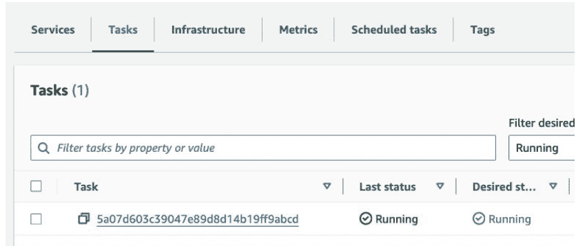

图 16.18 – Amazon ECS 任务

+   10. 单击该任务，这将打开任务的详细信息页面。
+   11. 在 **Configuration（配置）** 部分，记下您任务的 **Private IP（私有 IP）** 地址，如下方截图所示：

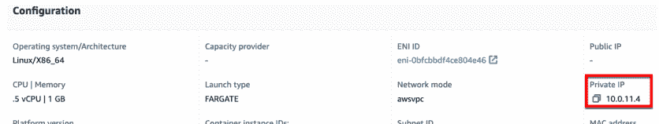

图 16.19 – ECS 任务的私有 IP

+   12. 在网页顶部的搜索栏中，在另一个浏览器标签页中搜索并导航到 CloudWatch 控制台。

+   13. 从左侧菜单中，展开 **Logs（日志）** 部分并单击 **Log groups（日志组）**。

+   14. 在右侧窗格中，单击您在之前的 *项目任务* 16.2 中创建的日志组，您可能已将其命名为 `todolist-flowlog-group`。这将打开 **Log group details（日志组详细信息）** 网页。您还会注意到窗格下半部分生成的日志流列表。

+   15. 单击网页右上角的 **Search log group（搜索日志组）** 按钮。

+   16. 您将看到一个日志事件列表。

+   17. 在 **Log events（日志事件）** 下的搜索框中，输入您之前记下的 ECS 任务的私有 IP，然后按 *Enter* 键。这将筛选日志事件，列出与您的任务相关的事件。

+   18. 浏览各种日志事件，并注意允许的入站和出站流量类型，如下方截图所示：

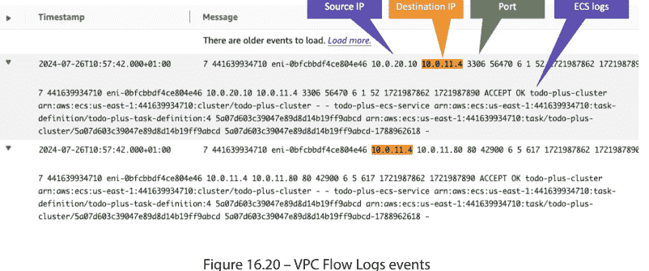

在此项目任务中，您学习了如何创建 VPC 流日志，并将该日志数据摄取到 Amazon CloudWatch Logs 中以供进一步分析。

流日志可以帮助开发人员执行多项监控和故障排除任务，例如：

+   - 诊断限制性的安全组规则

+   - 监控和跟踪到达您的实例、容器和其他资源的流量

+   - 排查问题并识别潜在的恶意攻击

下一节将提供本章的总结。

## 总结

本章探讨了 AWS 为您的 AWS 基础设施和资源提供的两个最强大的监控工具：Amazon CloudWatch 和 AWS CloudTrail。这些服务对于在 AWS 环境中保持运营效率、确保安全性和实现合规性至关重要。

Amazon CloudWatch 是一个强大的监控平台，可提供对 AWS 资源和应用程序的全面可见性。它实时收集和跟踪指标、日志和事件数据，使管理员能够高效地监督 AWS 部署的运行状况。CloudWatch 支持从基本指标收集和自定义指标到高级日志分析和仪表盘可视化等一系列功能。这些功能有助于性能优化、实时事件响应和主动的系统可用性管理。

AWS CloudTrail 是对 CloudWatch 的补充，它提供了对 AWS 账户内所有操作的详细审计跟踪。该服务对于满足监管合规要求至关重要，因为它会记录每个 API 调用，包括 API 调用者的身份、调用时间和源 IP 地址。CloudTrail 通过识别可能表明安全威胁的异常活动来增强安全监控，并确保所有用户操作都可追究责任，从而有助于取证调查和合规性审计。

本章还介绍了 AWS X-Ray，该服务旨在帮助您分析和调试分布式应用程序及微服务架构。虽然强烈建议摆脱单体设计，但分布式应用程序也带来了自身的挑战。使用 X-Ray，您可以快速、直观地识别性能问题和瓶颈，使开发人员能够迅速找到问题的根本原因。

## 考试准备练习 – 章节复习题

除了对关键概念的扎实理解外，在时间压力下快速思考的能力也是帮助您在认证考试中取得优异成绩的一项技能。这就是为什么在学习旅程的早期就培养这些技能至关重要。

章节复习题旨在随着您学习每一章，逐步提高您的应试技巧，同时复习您对本章关键概念的理解。您会在每章的末尾找到它们。

> **如何访问这些材料**
> 
> 要了解如何访问这些资源，请前往标题为 *第 17 章，访问在线资源* 的章节。

要打开本章的章节复习题，请执行以下步骤：

+   1. 单击链接 – `https://packt.link/DVAC02_CH16`。
+   
+      或者，您可以扫描以下 **QR 码**（*图 16.21*）：


图 16.21 – 为登录用户打开章节复习题的 QR 码


## 第3次尝试

第三次尝试时，目标是至少达到75%。一旦你取得75%或更高的分数，就可以开始练习答题速度了。

> **提示**
> 你可能需要**三次**以上的尝试才能达到75%。这没关系。反复复习章节中的相关内容，直到你达到这个分数为止。

## 提升答题速度

**目标**：你的目标是在保持相同分数的情况下，尽可能快速地回答这些问题。以下是你后续几次尝试应达到的效果示例：

| 尝试次数 | 分数 | 所用时间 |
|---|---|---|
| 第5次尝试 | 77% | 21分30秒 |
| 第6次尝试 | 78% | 18分34秒 |
| 第7次尝试 | 76% | 14分44秒 |

表16.1 – 在线平台上的计时练习示例

> **注意**
> 上表中显示的时间限制仅为示例。请根据网站测验的时间限制，自行设定每次尝试的时间目标。

每一次新的尝试，你的分数应保持在75%以上，而完成测验所用的“时间”则应逐步“减少”。你可以根据需要多次练习，直到自己有信心应对时间压力为止。
