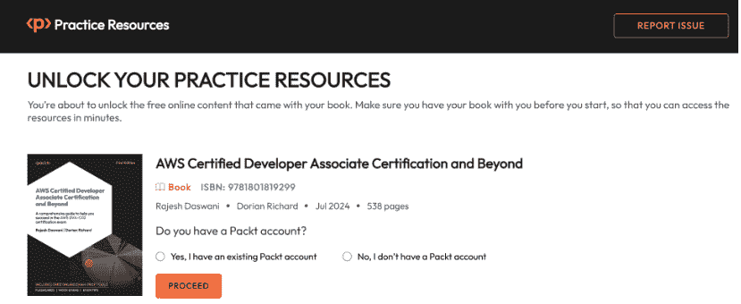
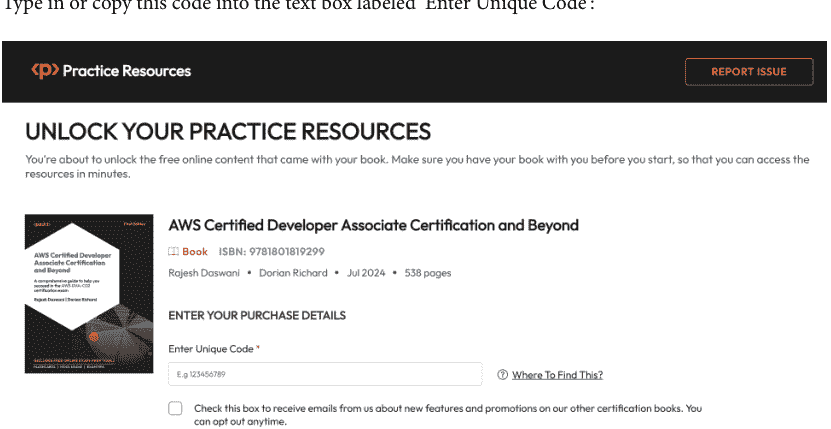
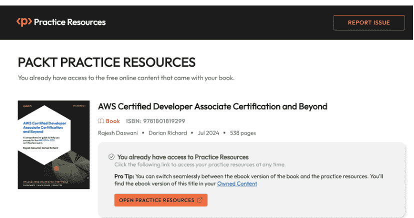
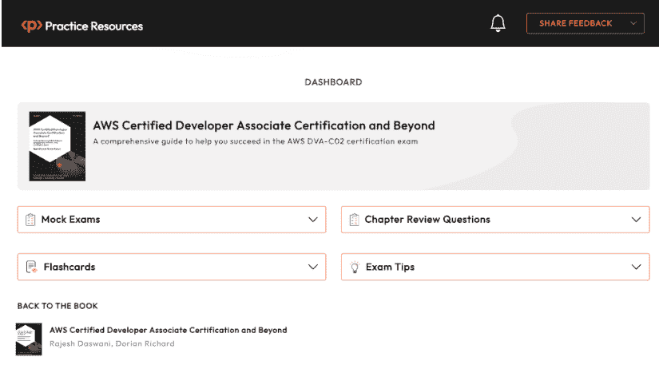
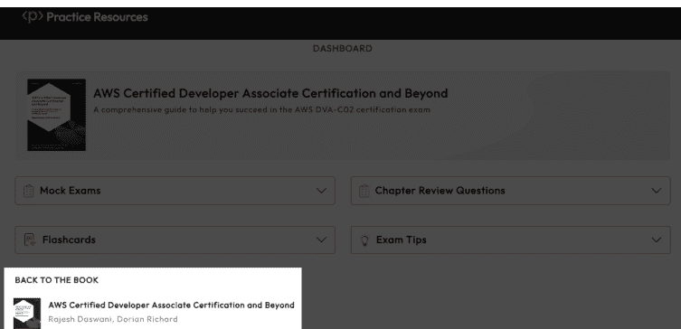

## 访问在线练习资源

你的《AWS认证开发者助理认证及进阶》一书附带了免费的在线练习资源。通过在配套网站上练习测验题，你可以进一步完善备考准备。该网站界面友好，可通过移动设备、台式机和平板电脑访问。它还提供交互式计时器，打造贴近真实考试的体验。

## 如何访问这些资源

以下是根据你的购买渠道开始访问这些资源的方式。

## 从Packt商店购买（packtpub.com）

如果你从Packt商店（`packtpub.com`）购买了电子书或纸质书，请访问 `https://packt.link/dvac02unlock`。然后，使用你创建或购买此书时所用的Packt账户登录即可。

## Packt+订阅用户

如果你是*Packt+订阅用户*，你可以直接访问同一链接（`https://packt.link/dvac02practice`），使用你的`Packt ID`登录后即可开始使用这些资源。只要你的订阅处于有效状态，你就可以随时访问它们。

如果在访问免费资源时遇到任何问题，请通过 `customercare@packt.com` 联系我们。

## 从亚马逊及其他渠道购买

如果你从上述渠道之外的渠道（如*亚马逊*）购买，你需要先使用本节提供的唯一注册码解锁这些资源。**解锁过程不到10分钟，可在任何设备上完成，且只需操作一次。** 按照以下五个简单步骤完成解锁：

## 步骤 1

打开链接 `https://packt.link/dvac02unlock`，或者扫描以下**二维码**（*图17.1*）：


图17.1 – 用于解锁本书免费在线内容的页面二维码。

上述任一方式都会带你进入如图17.2所示的页面：



图17.2 – 在线练习资源解锁页面

## 步骤 2

如果你已有Packt账户，请选择“是，我有现有的Packt账户”选项。如果没有，请选择“不，我没有Packt账户”选项。

如果你没有Packt账户，系统会在下一页提示你创建一个新账户。创建账户是免费的，且只需一分钟即可完成。

选择完相应选项后，点击“继续”。

## 步骤 3

在你创建新账户或登录现有账户后，你将被引导至如图17.3所示的页面。

请记下你唯一的解锁码：

```
RTR1919
```

在标有“输入唯一代码”的文本框中输入或复制此代码：



图17.3 – 输入你的唯一注册码以解锁资源

## 故障排查提示

创建账户后，如果你的网络连接断开或不小心关闭了页面，你可以重新打开图17.2所示的页面，并选择“是，我有现有的账户”。然后，使用你关闭页面之前创建的账户登录。你将被重新引导至图17.3所示的界面。

## 步骤 4

## 注意

你可以选择订阅我们其他认证书籍的功能更新和优惠相关的电子邮件。我们不会发送垃圾邮件，并且你可以随时轻松退订。

点击“请求访问”。

## 步骤 5

如果你输入的代码正确，你将看到一个显示“打开练习资源”的按钮，如图17.4所示：



图17.4 – 解锁成功后显示的页面

点击“打开练习资源”链接即可开始使用你的免费在线内容。你将被重定向到如图17.5所示的仪表板页面：



图17.5 – AWS DVA-C02练习资源的仪表板页面

## 收藏此链接

完成资源解锁后，你可以随时通过访问 `https://packt.link/dvac02practice` 或扫描图17.6中提供的二维码来返回这些资源：


图17.6 – 用于收藏练习资源网站的二维码

## 故障排查提示

如果你在解锁时遇到问题，你可以尝试以下三种方法：

+   - 仔细核对你的唯一代码。我们所有书中的唯一代码均区分大小写，你的代码需要与*步骤3*中显示的完全一致。
+   - 如果仍然不行，请使用页面右上角的“报告问题”按钮。
+   - 如果你根本无法打开解锁页面，请写信至 `customercare@packt.com` 并告知书名。

## 分享反馈

如果你发现平台、书籍或任何练习材料存在任何问题，你可以点击任意页面上的“分享反馈”按钮与我们联系。如果你有任何改进建议，也欢迎分享给我们。

## 返回书籍

为了方便你在书籍和练习资源之间切换，我们添加了一个带你返回书籍的链接（*图17.7*）。点击它即可在Packt的在线阅读器中打开你的书籍。你的阅读位置会同步，因此你可以直接回到上次阅读的进度处。



图17.7 – AWS DVA-C02练习资源的仪表板页面

> **注意**
> 网站的某些元素可能会随着时间而变化，因此最终显示效果可能与本书截图中的表现有所不同。
