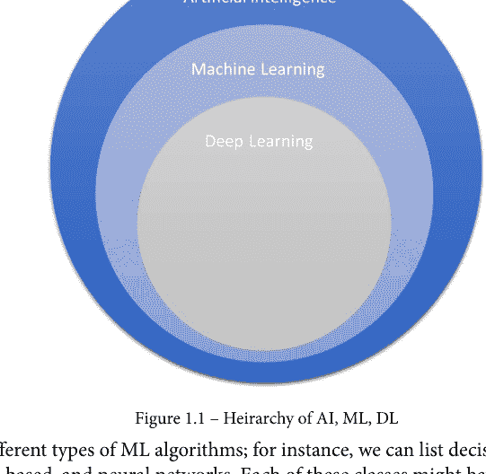
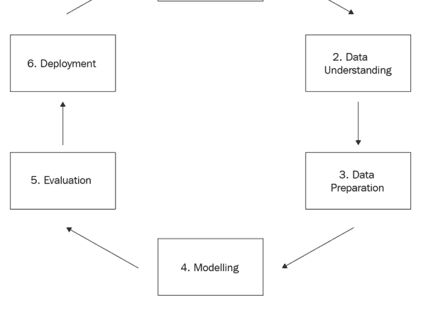
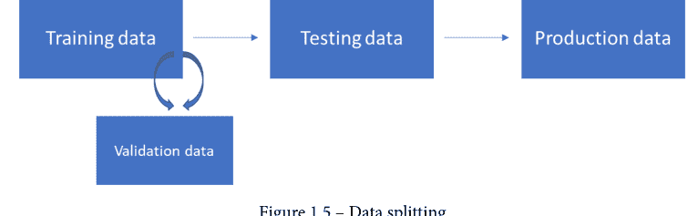
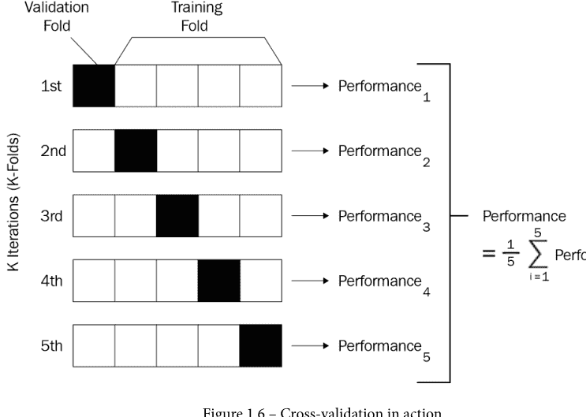

## 1
机器学习基础

几十年来，研究人员一直在尝试通过被称为**人工智能，简称 AI**的领域来模拟人类大脑活动。1956 年，一群人在达特茅斯人工智能夏季研究项目上会面，这一事件被广泛认为是关于我们今天所知的人工智能的首次集体讨论。研究人员试图证明学习过程的许多方面都可以被精确描述，因此可以被机器自动化和复制。今天，我们知道他们是对的！

在这个领域还出现了许多其他术语，例如**机器学习 (ML)** 和**深度学习 (DL)**。这些人工智能的子领域也已发展了数十年（当然，这里没有什么对科学来说是新的）。然而，随着信息社会的自然发展，以及最近**大数据**平台的出现，人工智能应用以更强大的力量和适用性重生。力量在于，现在我们有更多计算资源来模拟和实现它们；适用性在于，现在信息无处不在。

更近期的发展是，云服务提供商已将人工智能推向云端。这有助于各种规模的公司降低运营成本，甚至让他们尝试人工智能应用（考虑到对于一家小公司来说维护自己的数据中心可能成本过高）。

这就引出了本章的目标：能够描述 AI、ML 和 DL 这些术语的含义，以及理解机器学习管道的所有细微差别。避免对这些术语产生混淆并了解机器学习管道到底是什么，将使您能够正确选择服务、开发应用程序并掌握 AWS 机器学习 Specialty 考试。

本章的主要主题如下：

- 比较 AI、ML 和 DL
- 分类监督学习、无监督学习和强化学习
- CRISP-DM 建模生命周期
- 数据拆分
- 建模期望
- 介绍机器学习框架
- 云中的机器学习

### 比较 AI、ML 和 DL

AI 是一个广泛的领域，研究创建系统和机器以通过模拟人类智能来解决问题的方法。创建这些程序和机器的复杂程度不同，从简单的基于规则的引擎到复杂的自学习系统不等。AI 涵盖但不限于以下子领域：

- 机器人技术
- 自然语言处理
- 基于规则的系统
- ML

我们现在特别感兴趣的领域是 ML。

### 审视 ML

ML 是 AI 的一个子领域，旨在创建能够从经验中学习而无需显式编程的系统和机器。正如名称所示，系统能够观察其运行环境、学习并在没有人工干预的情况下自我适应。ML 系统背后的算法通常从可用的数据中提取和改进知识，以及条件（例如**超参数**），并在尝试不同方法解决特定问题后反馈：

图 1.1 – AI、ML、DL 的层级结构

有不同类型的 ML 算法；例如，我们可以列出基于决策树、基于概率和神经网络。每类可能有数十种特定算法。其中大多数将在本书后面的章节中介绍。

正如您可能在图 1.1 中注意到的，我们可以更具体地将 ML 领域细分为机器学习 Specialty 考试的另一个非常重要的主题：DL。

### 审视 DL

DL 是 ML 的一个子集，旨在提出连接多个层以解决特定问题的算法。知识随后逐层传递，直到找到最佳解决方案。最常见的 DL 算法类型是深度神经网络。

在撰写本书时，DL 在机器学习领域是一个非常热门的话题。当前用于机器翻译、图像描述和计算机视觉的许多最先进算法都是在过去几年中提出的，并且是 DL 的一部分。

现在我们对 AI 的类型有了概述，让我们看看我们可以如何对 ML 进行分类。

### 分类监督学习、无监督学习和强化学习

ML 是一个非常广泛的研究领域；因此，清楚地定义其子划分非常重要。从非常广阔的角度来看，我们可以将 ML 算法分为两个主要类别：监督学习和无监督学习。

### 介绍监督学习

监督算法使用类或标签（来自输入数据）作为支持来寻找和验证最佳解决方案。在图 1.2 中，有一个数据集旨在从银行中分类欺诈交易：

| 星期几 | EST 小时 | 交易金额 | 商户类型 | 是否欺诈？ |
|---|---|---|---|---|
| 周一 | 09:00 | $1000 | 零售 | 否 |
| 周二 | 23:00 | $5500 | 电子商务 | 是 |
| 周五 | 14:00 | $500 | 旅行 | 否 |
| 周一 | 10:00 | $100 | 零售 | 否 |
| 周二 | 22:00 | $100 | 电子商务 | 否 |
| 周二 | 22:00 | $6000 | 电子商务 | 是 |

图 1.2 - 监督学习的示例数据集

前四列被称为**特征**，或**自变量**，可被监督算法用于寻找欺诈模式。例如，通过组合这四个特征（星期几、EST 小时、交易金额和商户类型）和六个观测值（每一行在技术上是一个观测值），您可以推断出在夜间处理的价值超过 5,000 美元的电子商务交易可能是潜在的欺诈案例。

> **重要提示**
> 在真实场景中，我们应该有更多观测值，以便对这种类型的推断提供统计支持。

关键点在于，我们之所以能够推断出潜在的欺诈模式，正是因为我们*a priori*知道什么是欺诈，什么不是欺诈。此信息存在于图 1.2 的最后一列中，通常被称为目标变量、标签、响应变量或因变量。如果输入数据集具有目标变量，您应该能够应用监督学习。

在监督学习中，目标变量可能存储不同类型的数据。例如，它可以是二元列（是或否）、多类列（A、B 或 C 类），甚至是数值列（任何实数，例如交易金额）。根据目标变量的数据类型，您将找到适用于您问题的监督学习类型。图 1.3 显示了如何根据目标变量将监督学习分为两大组：**分类**和**回归**算法：

| 目标变量的数据类型 | 目标变量的子数据类型 | 适用的监督学习类型 |
|---|---|---|
| 分类 | 二元 | 二元分类 |
| 分类 | 多类 | 多分类 |
| 数值 | N/A | 回归 |

图 1.3 – 根据目标变量选择合适的监督学习类型

虽然分类算法预测一个类别（可能是二元或多个类别），回归算法预测一个实数（可能是连续或离散的）。

理解数据类型对于在 ML 项目上做出正确的决策非常重要。我们可以将数据类型分为两大类：数值型和类别型。数值型数据可以进一步分为连续型或离散型子类，而类别型数据可能指有序型或名义型数据：

- *Numerical/discrete data* 指的是单独且可计数的项目（例如，教室里的学生人数或在线购物车中的商品数量）。
- *Numerical/continuous data* 指的是无限多种可能的测量值，它们通常带有小数点（例如，温度）。
- *Categorical/nominal data* 指的是具有标签但没有定量值的变量（例如，姓名或性别）。
- *Categorical/ordinal data* 为带标签的变量增加了顺序感（例如，受教育程度或员工职称级别）。

换句话说，在为你的项目选择算法时，你应该问自己：我有目标变量吗？它存储的是类别型还是数值型数据？回答这些问题将使你更好地选择能够解决问题的潜在算法。

然而，如果你没有目标变量怎么办？在这种情况下，我们面临的是无监督学习。无监督问题不会提供标记数据；相反，它们提供所有独立变量（或特征），以便无监督算法能在数据中发现模式。最常见的无监督学习类型是 **clustering**，它旨在仅基于特征，将数据集的观测值纯粹地分组到不同的簇中。同一簇中的观测值预计彼此相似，但与来自其他簇的观测值差异很大。聚类将在本书的后续章节中更详细地介绍。

**Semi-supervised learning** 也存在于 ML 文献中。这种类型的算法能够从部分标记的数据中学习（某些观测值包含标签，而其他观测值不包含）。

最后，另一类 ML 算法采用的另一种学习方法是 **reinforcement learning**。这种方法根据系统自主做出的良好决策来奖励系统；换句话说，系统通过经验学习。

我们一直在非常宽泛的层面上讨论学习方法和算法类别。然而，现在是时候具体化并引入 **model** 这一术语了。

### The CRISP-DM modeling life cycle

**Modeling** 是 ML 中常用的一个术语，当我们想要指定为解决特定问题而采取的步骤时。例如，我们可以创建一个二元分类模型来预测图 1.2 中的那些交易是否欺诈。

在这种情况下，模型代表了创建解决方案的全部步骤的集合，其中包括（但不限于）算法。**Cross-Industry Standard Process for Data Mining**，更 commonly referred to as **CRISP-DM**，是提供创建模型时应遵循的常见步骤指导的方法论之一。该方法论被市场广泛使用，并在 AWS Machine Learning Specialty 考试中有所涉及：

Figure 1.4 – CRISP-DM methodology

一切始于业务理解，它将产生业务目标（包括成功标准）、情况评估、数据挖掘目标以及项目计划（包括对工具和技术的初步评估）。在情况评估期间，我们还应查看资源清单、需求、假设和约束、风险、术语、成本和收益。在建模时，每一个假设和成功标准都很重要。

然后我们进入数据理解阶段，在此阶段我们将收集原始数据、描述它、探索它并检查其质量。这是用于创建模型的数据的初步评估。同样，数据科学家必须保持怀疑。你必须确保你理解数据的所有细微差别及其来源。

数据准备阶段实际上通常是建模过程中花费时间最多的阶段。在此阶段，我们需要选择和过滤数据，根据需要执行的任务对其进行清理，提出新的属性，将数据与其他数据源集成，并将其格式化为所应用的算法所期望的形式。这些任务通常被称为 **feature engineering.**

一旦数据准备就绪，我们就可以最终开始建模阶段。这里就是算法登场的地方。我们应首先确保选择正确的技术。记住：根据目标变量的存在与否（及其数据类型），我们将有不同的算法可供选择。每种建模技术都可能带有一些我们必须注意的隐含假设。例如，如果你选择多元线性回归算法来预测房价，你应该意识到这种类型的模型期望你的数据变量之间存在线性关系。

有数百种算法，每种算法可能都有自己的假设。在选择要在项目中测试的算法后，你应该花一些时间检查它们的细节。在本书的后续章节中，我们将介绍其中一些算法。

**Important note**
一些算法在其逻辑中包含了我们所称的 **feature selection.** 这是一个步骤，在此步骤中将选择最重要的特征来构建你的最佳模型。决策树就是自动执行特征选择的算法示例。我们将在后面更详细地介绍特征选择，因为有不同的方法来为你的模型选择最佳变量。

在建模阶段，你还应为模型设计测试方法，定义将使用的评估指标以及数据如何分割。有了这些，你就可以通过设置算法的超参数并用数据为模型提供数据来最终构建模型。将数据提供给算法以找到良好估计器的过程被称为 **training process.** 用于为模型提供数据的已知为 **training data.** 有不同的方式来组织训练和 **testing data**，我们将在本章中介绍。

**Important note**
ML 算法由参数和超参数构建。这些是从数据中学习的。例如，基于决策树的算法可能会从训练数据中学习，某个特定特征应基于信息增益评估构成其根节点。另一方面，超参数用于控制学习过程。以决策树为例，我们可以通过指定任何决策树算法的预定义超参数来指定树的允许最大深度（无论底层训练数据如何）。超参数调优是考试中非常重要的话题，将在后面以精细的细节介绍。

一旦模型训练完成，我们可以评估和审查结果以提出下一步。如果结果不可接受（基于我们的业务成功标准），我们应回到之前的步骤，检查还能做些什么来改进模型结果。它可能是算法超参数的小幅调整、新的数据准备步骤，甚至是业务驱动因素的重新定义。另一方面，如果模型质量可接受，我们可以进入部署阶段。

在 CRISP-DM 方法论的最后阶段，我们必须考虑部署计划、模型的监控和维护。我们通常从两个角度来看待这一步骤：训练和推理。**training pipeline** 包括训练模型所需的步骤，其中包括数据准备、超参数定义、数据分割以及模型训练本身本身。我们必须以某种方式将所有模型工件存储在某个地方，因为它们将被下一个需要开发的管道使用：**inference pipeline.**

推理管道只是使用模型工件来对全新观测值（在训练阶段从未被模型见过的数据）执行模型。例如，如果模型被训练来识别欺诈交易，那么这就是新交易将通过模型进行分类的时候。

通常，模型通过训练管道训练一次，并通过推理管道执行多次。然而，经过一段时间后，预计会出现模型退化，也称为 **model drift**。这种现象发生的原因是模型通常在旨在代表特定时间点业务场景的静态训练集上进行训练；然而，业务会演变，可能需要对更近期的数据重新训练模型以捕捉新的业务方面。这就是为什么即使在模型部署后，也必须继续跟踪模型性能。

CRISP-DM 方法论对 AWS Machine Learning Specialty 考试的上下文如此重要，以至于，如果你查看 AWS 涵盖的四个领域，你会意识到它们是从 CRISP-DM 阶段概括而来的：数据工程、探索性数据分析、建模，以及机器学习实施和运维。

我们现在已经了解了建模管道的所有关键阶段，并且我们知道算法本身只是更广泛流程的一部分！接下来，让我们看看如何拆分数据来创建和验证机器学习模型。

### 数据拆分

训练和评估机器学习模型是建模管道的关键任务。机器学习算法需要数据来寻找特征之间的关系以做出推断，但这些推断需要在投入生产环境之前得到验证。

用于训练机器学习模型的数据集通常称为训练集。此训练数据必须能够代表模型将被使用的真实环境；如果不满足该要求，它将毫无用处。

回到我们在图 1.2 中介绍的欺诈示例，基于训练数据，我们发现价值大于 $5,000 且在夜间处理的电子商务交易可能是潜在的欺诈案例。考虑到这一点，在生产环境中应用模型后，模型应该标记在训练过程中学到的类似案例。

因此，如果这些案例只存在于训练集中，模型将在生产环境中标记**假阳性**案例。相反的情况也成立：如果生产数据中存在训练数据中未反映的特定欺诈案例，模型将标记大量**假阴性**案例。假阳性和假阴性比率只是我们可用于模型验证的众多质量指标中的两个。这些指标将在后面更详细地介绍。

到目前为止，你应该已经清楚地了解拥有一个良好的训练集的重要性。现在，假设我们确实有一个有效的训练集，我们如何才能有一定信心认为该模型在生产环境中表现良好？答案是：使用测试集和验证集：

图 1.5 – 数据拆分

*图 1.5 显示了在训练和推理管道期间我们可以进行的不同类型的数据拆分。训练数据是用于创建模型的，而测试数据是用于提取最终模型质量指标的。测试数据在训练过程中不能出于任何原因被使用，只能用于提取模型指标。*

避免在训练期间使用测试数据的理由很简单：我们不能让模型在将用于验证它的数据之上进行学习。这种将数据的一部分保留用于测试的技术通常称为**留出验证**。

图 1.5 右侧的框代表生产数据。生产数据通常会持续到来，我们必须执行推理管道以从中提取模型结果。对生产数据不进行任何训练，也不会进行任何其他类型的重新计算；我们只需将其原样通过推理管道即可。

从技术角度来看，大多数机器学习库使用 `.fit` 方法实现训练步骤，而推理步骤则由 `.transform` 或 `.predict` 方法实现。再次强调，这只是大多数机器学习库常用的模式，但请注意，你可能会在不同的机器学习库中发现不同的命名约定。

仍然参考图 1.5，靠近训练数据的还有一个名为**验证数据**的框。这是训练集的一个子集，通常用于在进入测试阶段之前支持创建最佳模型。我们将更详细地讨论这个框，但首先，让我们解释为什么需要它们。

### 过拟合和欠拟合

机器学习模型可能遭受两种类型的拟合问题：**过拟合**和**欠拟合**。过拟合意味着你的模型在训练数据上表现非常好，但无法推广到其他数据集，例如测试数据，甚至更糟的是生产数据。换句话说，如果你有一个过拟合的模型，它只适用于你的训练数据。

当我们构建机器学习模型时，我们希望创建能够泛化其所学知识并对遵循相同数据分布的其他数据集进行推断决策的解决方案。仅在训练数据上工作的模型毫无用处。过拟合通常是由于特征数量过多或算法超参数配置不足造成的。

另一方面，欠拟合模型在训练阶段无法拟合数据。因此，它们过于通用，无法在训练、测试或生产数据上表现良好。欠拟合通常是由于缺乏良好的特征/观测值或训练时间不足造成的（某些算法需要更多迭代才能正确拟合模型）。

过拟合和欠拟合都应避免。有许多建模技术可以解决这个问题。例如，让我们关注常用的**交叉验证**技术及其与图 1.5 中所示验证框的关系。

### 应用交叉验证并衡量过拟合

交叉验证是一种将训练集拆分为训练集和验证集的技术。然后在训练集上训练模型，并在验证集上测试模型。最常见的交叉验证策略被称为 **k 折交叉验证**，其中 *k* 是训练集拆分的次数。

使用 k 折交叉验证并假设 *k* 的值等于 10，我们将训练集拆分为 10 个折。模型将被训练和测试 10 次。在每次迭代中，它使用九个拆分进行训练，并留下一个拆分用于测试。经过 10 次执行后，从每次迭代中提取的评估指标的平均值将代表训练阶段期间的最终模型性能，如图 1.6 所示：

图 1.6 – 交叉验证的实际应用

另一种常见的交叉验证技术被称为留一法交叉验证（LOOCV）。在此方法中，模型被执行多次，每次迭代中一个观测值被分离用于测试，其余所有观测值用于训练。

在训练期间使用交叉验证有许多优点：
- 我们缓解了训练数据中的过拟合，因为模型始终在一个数据块上训练，并在另一个未用于训练的数据块上测试。
- 我们避免了测试数据中的过拟合，因为没有必要不断使用测试数据来优化模型。
- 我们暴露了过拟合或欠拟合的存在。如果模型在训练/验证数据中的性能与在测试数据中观察到的性能差异很大，就说明有问题。

让我们更详细地阐述该列表中的第三项，因为这在 AWS Machine Learning Specialty 考试中有所涉及。假设我们正在创建一个二元分类模型，在训练期间使用交叉验证，并使用测试集来提取最终指标（留出验证）。如果我们在交叉验证结果中得到 80% 的准确率，而在测试集中得到 50% 的准确率，这意味着模型对训练集过拟合，无法推广到测试集。

另一方面，如果我们在训练集中得到 50% 的准确率，而在测试集中得到 80% 的准确率，则数据存在系统性问题。训练集和测试集很可能不遵循相同的分布。

**重要说明**
准确率是分类模型常用的模型评估指标。它衡量模型在其推理过程中做出正确决策的频率。我们只是为了举例而选择了该指标，但请注意，对于每种类型的模型，都有许多其他适用的评估指标（将在适当的时候介绍）。

### 自助法

交叉验证是验证机器学习模型的好策略，你应该在日常数据科学家工作中尝试它。然而，你也应该了解其他可用的重采样技术。**自助法**就是其中之一。

虽然交叉验证是**不放回**进行的，而自助法则是**放回**进行的。放回意味着，在从总体数据集中抽取多个随机样本时，同一个观测值可能会在样本中重复出现。

通常，自助法不像传统交叉验证方法那样用于验证模型。原因很简单：由于它采用放回抽样，用于训练的同一观测值也可能用于测试。这会导致模型性能指标被夸大，因为估计器在预测训练集中已见过的观测值时很可能正确。

自助法通常以嵌入方式被机器学习算法使用，这些算法需要重采样能力来处理数据。在这种情况下，自助法不是用于*验证*模型，而是用于*创建*模型。**随机森林**将在算法章节中介绍，它是内部使用自助法进行模型构建的算法之一。

设计良好的数据拆分/采样策略对模型或算法的成功至关重要。你应该提出不同的拆分数据的方法，检查模型在每个拆分上的表现，并确保这些拆分代表模型将被使用的真实场景。

### 方差与偏差的权衡

任何 ML 模型都注定会包含错误。我们可以在模型上找到三种类型的错误：**偏差**错误、**方差**错误和**无法解释**的错误。最后一种错误正如预期，无法解释。它通常与问题的上下文以及变量之间的关系有关，我们无法控制它。

另外两种错误可以在建模过程中得到控制。我们通常说偏差和方差错误之间存在权衡，因为一个会影响另一个。在这种情况下，增加偏差会降低方差，反之亦然。

偏差错误与模型为学习目标函数所做的假设有关，即我们想要解决的函数。某些类型的算法，例如线性算法，通常会产生这种类型的错误，因为它们在模型训练期间做了很多假设。例如，线性模型假设数据中存在的关系是线性的。线性回归和逻辑回归是通常包含高偏差的算法类型。另一方面，决策树是关于数据做出较少假设且偏差较少的算法类型。

方差与模型在不同训练数据上执行的估计差异有关。高方差的模型通常会对训练集过拟合。决策树是高方差算法的例子（它们通常严重依赖训练集的特定情况，无法泛化），而线性/逻辑回归是低方差算法的例子。这并不意味着决策树是糟糕的估计器；这只是意味着我们在训练期间需要对其进行修剪（优化）。

话虽如此，任何模型的目标都是最小化偏差和方差。然而，正如前面提到的，每一个都会以相反的方向影响另一个。为了演示的目的，让我们使用决策树来理解这种权衡是如何工作的。

决策树是非线性算法，通常包含低偏差和高方差。为了降低方差，我们可以修剪树并将 max_depth 超参数（树允许的最大深度）设置为 10。这将强制生成一个更通用的模型，从而降低方差。然而，这一改变也会迫使模型做出更多假设（因为它现在更通用）并增加偏差。

### 打乱你的训练集

现在你已经了解了方差和数据拆分，让我们更深入地探讨训练数据集的要求。你在考试中很可能会遇到关于数据打乱的问题。此过程包括在开始使用数据拟合算法之前对训练数据集进行随机化。

数据打乱将帮助算法通过创建更具泛化能力的模型来降低方差。例如，假设你的训练集代表一个二分类问题，并且按目标变量排序（所有属于类别“0”的案例先出现，然后是所有属于类别“1”的案例）。

当你在这种排序数据上拟合算法时（尤其是一些依赖于**批处理**的算法），它会对其中一个类别的模式做出强假设，因为它很可能无法创建包含两个类别良好表示的随机数据批次。一旦算法对训练数据建立了强假设，就可能很难改变它们。

> **重要说明**
> 一些算法能够通过分块拟合数据来执行训练过程，也称为批次。这种方法让模型能够更频繁地学习，因为它会在处理完每个数据批次后做出部分假设（而不是在处理完整个数据集后才做出决定）。

另一方面，没有必要打乱测试集，因为它只会被推理过程用来检查模型性能。

### 建模期望

到目前为止，我们已经讨论了模型构建、验证和管理。让我们通过讨论建模时的另外几个期望来完善 ML 的基础。

第一个是**简约性**。简约性描述的是提供最简单解释并且与其它模型相比拟合结果最好的模型。举个例子：在创建线性回归模型时，你意识到再添加 10 个特征会使模型性能提高 0.001%。在这种情况下，你应该考虑这种性能提升是否值得简约性的成本（因为你的模型会变得更复杂）。有时是值得的，但大多数时候不是。你需要保持怀疑并根据你的业务案例思考。

简约性直接支持**可解释性**。你的模型越简单，就越容易解释它。然而，可解释性与**预测性**之间存在斗争：如果专注于预测能力，你很可能会失去一些可解释性。再次，成为一名合格的数据科学家并选择最适合你使用场景的内容。

### 介绍 ML 框架

了解一些 ML 框架将使你处于通过 AWS Machine Learning Specialty 考试的更有利位置。没有必要精通这些框架，因为这不是框架特定的认证；然而，了解一些常见术语和解决方案将帮助你理解问题/问题的上下文。

**scikit-learn**可能是你应该最了解的 ML 框架。这是一个开源 Python 包，提供了诸如决策树、支持向量机、线性回归等 ML 算法的实现。它还实现了数据预处理类，例如独热编码、标签编码器、主成分分析等等。所有这些预处理方法（以及许多其他方法）将在本书后面的章节中介绍。

scikit-learn 的缺点是它需要定制才能通过多台机器扩展。还有另一个 ML 库因为可以直接处理多处理而非常流行：**Spark 的 ML 库**。

顾名思义，这是一个在**Apache Spark**之上运行的 ML 库，Apache Spark 是一个统一的分析多处理框架，用于在多台机器上处理数据。AWS 提供了一个特定的服务，允许开发人员只需点击几下即可创建 Spark 集群，称为**EMR**。

Spark ML 库处于不断开发中。截至撰写本文时，它支持许多 ML 类算法，例如分类和回归、聚类和协同过滤。它还支持基本统计计算，例如相关性和一些假设检验，以及许多数据转换，例如独热编码、主成分分析、最小-最大缩放等。

另一个非常流行的 ML 框架被称为**TensorFlow**。该 ML 框架由 Google 团队创建，用于数值计算和大规模 ML 模型开发。TensorFlow 不仅实现传统的 ML 算法，还实现 DL 模型。

TensorFlow 被认为是一个用于模型开发的低级 API，这意味着开发更复杂的模型，例如用于文本挖掘的**transformers**会非常复杂。为了便于模型开发，其他 ML 框架建立在 TensorFlow 之上以使其更易于使用。其中一个高级框架是**Keras**。使用 Keras，开发人员只需几行代码即可创建复杂的 DL 模型。最近，Keras 被整合到 TensorFlow 中，现在可以在 TensorFlow 库内部调用。

**MXNet**是另一个开源 DL 库。使用 MXNet，我们可以使用在多台机器上运行的多个 GPU 来扩展基于神经网络的模型。它还支持不同的编程语言，例如 Python、R、Scala 和 Java。

**图形处理单元 (GPU)** 支持在 TensorFlow 和 MXNet 等 DL 库中尤其重要。这些库允许开发人员创建和部署具有多层神经网络的模型。神经网络的训练过程在很大程度上依赖于矩阵运算，而矩阵运算在 GPU 上比在 CPU 上性能更好。这就是为什么这些 DL 库提供 GPU 支持的原因。AWS 还提供启用 GPU 的 EC2 实例。

这些 ML 框架需要一个特殊的通道与 GPU 单元通信。NVIDIA 是目前最常见的 GPU 供应商，已创建了一个名为**计算统一设备架构 (CUDA)**的 API。CUDA 用于在 NVIDIA 设备上配置 GPU 单元，例如设置缓存内存和训练神经网络模型所需的线程数。对于 AWS Machine Learning Specialty 考试，没有必要精通 CUDA 或 GPU 架构，但你绝对需要知道它们是什么以及 DL 模型如何利用它们。

最后但并非最不重要的一点是，你还应该了解数据科学社区广泛使用的一些开发框架，但不一定用于 ML。这些框架与 ML 库互操作以促进数据操作和计算。例如，**pandas**是一个 Python 库，提供数据处理功能，而**NumPy**是一个开源 Python 库，提供数值计算。

这些术语和库已如此融入数据科学家日常工作中，以至于它们可能会在考试中出现，用来为你解释某个问题域。了解它们是什么将帮助你快速理解问题的上下文。

### 云上的 ML

ML 已进入云端，开发者现在可以将其作为服务使用。AWS 在不同抽象层级实现了 ML 服务。例如，ML 应用服务旨在为特定问题域提供开箱即用的解决方案。AWS Lex 就是一个非常清晰的 ML 应用即服务示例，人们可以用最少的开发工作实现聊天机器人。

AWS Rekognition 是另一个示例，其旨在识别图像和视频中的物体、人、文本、场景和活动。AWS 提供了许多其他 ML 应用服务，将在本章后续内容中介绍。

除了应用服务之外，AWS 还提供了 ML 开发平台，SageMaker 就是这种情况。与 AWS Lex 和 Rekognition 等开箱即用服务不同，SageMaker 是一个开发平台，可让你以更大的灵活性构建、训练和部署自己的模型。

SageMaker 通过自动处理模型训练和推理管道所需的必要基础设施，加快了开发和部署流程。在幕后，SageMaker 协调其他 AWS 服务（如 EC2 实例、负载均衡器、自动扩展等）来为 ML 项目创建可扩展的环境。SageMaker 很可能是你为 AWS 机器学习 Specialty 考试需要掌握的最重要的服务，它将在单独的部分中详细介绍。目前，你应专注于理解 AWS 用于提供 ML 相关服务的不同方法。

AWS 为部署 ML 模型提供的第三种选择是最通用和最灵活的：你可以通过组合不同的 AWS 服务并单独管理它们来部署 ML 模型。这本质上就是 SageMaker 为你所做的工作，从头开始构建你的应用程序。例如，你可以使用 EC2 实例、负载均衡器、自动扩展和 API 网关为特定模型创建推理管道。如果你愿意，也可以使用 AWS 无服务器架构部署你的解决方案，例如使用 AWS Lambda 函数。

### 总结

我们现在正接近本章的尾声，在本章中我们涵盖了关于 ML 基础的若干重要主题。我们从关于 AI、ML 和 DL 的理论讨论开始，并探讨了由于大数据平台和云服务提供商的出现，这一整个领域在过去几年中是如何发展的。

随后我们转向了监督学习、无监督学习和强化学习之间的差异，并强调了与每种学习方法相关的一些用例。这很可能出现在 AWS 机器学习 Specialty 考试中。

我们讨论了 ML 模型是在许多不同的阶段构建的，算法本身只是建模过程的一部分。我们还介绍了良好模型的预期行为。

我们深入探讨了数据分割，讨论了训练和验证模型的各种方法，并涵盖了方差与偏差之间的神话般的较量。我们通过讨论 ML 框架和服务完成了本章。

接下来，你将学习 AWS 用于 ML 的应用服务，例如 Amazon Polly、Amazon Rekognition、Amazon Transcribe 以及许多其他 AI 相关 AWS 服务。但首先，让我们看一些示例问题，以便你了解考试中可能出现的内容。

### 问题

- 1. 你受雇于一家呼叫中心公司，自动化其语音应答单元。每当有新客户来电时，系统必须能够理解服务的当前负载以及来电的目的，并推荐语音应答单元中的正确路径。该公司没有标记数据来监督模型；它必须采用通过经验学习的方法，即通过试错，每当算法做出良好的路径推荐时，它就会得到奖励。哪种机器学习方法最适合此项目？
  
  a) 无监督学习
  b) 强化学习
  c) 监督学习
  d) DL

Answer
b, 由于没有标记数据且代理需要通过经验学习，强化学习更适合此用例。问题中的另一个重要事实是，代理会因做出良好决策而获得奖励。

- 2. 你在一家大公司的市场部工作，需要根据客户的购买行为对客户进行细分。哪种 ML 方法最适合此项目？
  
  a) 无监督学习
  b) 强化学习
  c) 监督学习
  d) DL

Answer
a, 聚类（这是一种无监督学习方法）是处理数据细分/聚类时最常见的算法类型。

- 3. 你在一家零售公司工作，需要预测未来几个月的销售额。哪种 ML 方法最适合此项目？
  
  a) 无监督学习
  b) 强化学习
  c) 监督学习
  d) DL

Answer
c, 预测是一种监督学习，旨在预测数值；因此，它可能被表述为回归问题和监督学习。

- 4. 一家制造公司需要了解他们在生产链的每个阶段花费了多少钱。哪种 ML 方法最适合此项目？
  
  a) 无监督学习。
  b) 强化学习。
  c) 监督学习。
  d) ML 不需要。

**Answer**
d, ML 无处不在，但并非所有事情都需要 ML。在这种情况下，无需使用 ML，因为公司应该能够从生产链的每个阶段收集成本并将其汇总。

- 5. 以下哪种学习方法为我们提供了实现聊天机器人的最先进算法？
  
  a) 无监督学习
  b) 强化学习
  c) 监督学习
  d) DL

**Answer**
d, DL 在自然语言处理领域提供了最先进的算法。

- 6. 你从另一个团队收到一个训练集，用于创建二分类模型。他们告诉你数据集已经被洗牌并准备好建模。你决定快速查看基于神经网络的特定算法在该数据集上的表现。然后你将数据拆分为训练集和测试集并运行算法。然而，结果看起来很奇怪。似乎算法无法收敛到最优解。对此问题的首要调查方向是什么？
  
  a) 确保所用算法能够处理二分类模型。
  b) 查看每个类别的数据比例并确保它们是平衡的。
  c) 在开始工作之前洗牌数据集。
  d) 确保你使用的是所选算法的正确超参数。

**Answer**
c, 数据科学家必须对自己的工作保持怀疑。不要在事先验证之前对数据做出假设。在本书的这一点上，你可能还不了解神经网络的具体细节，但你知道 ML 模型对它们训练的数据非常敏感。你应该在做出其他决定之前重新检查传递给你的假设。顺便说一下，在洗牌训练数据是应该做的第一件事。这很可能出现在考试中。

- 7. 你创建了一个分类模型来预测银行交易是否为欺诈。在建模阶段，你的模型在训练集和测试集上表现都非常好。当你在生产环境中执行模型时，人们开始抱怨模型的准确率低。假设在训练阶段没有过拟合/欠拟合问题，你的首要调查方向是什么？
  
  a) 训练集和测试集不遵循相同的分布。
  b) 用于创建此模型的训练集不能代表模型部署的真实环境。
  c) 最终解决方案中使用的算法无法足够泛化以在生产中识别欺诈案例。
  d) 由于所有 ML 模型都包含错误，我们无法推断它们在生产系统中的性能。

Answer
b, 数据采样非常具有挑战性，你应始终确保训练数据能够尽可能精确地代表生产数据。在本例中，训练集和测试集并未被证明无效，因为模型在两组数据上都能表现良好且稳定。由于问题仅在生产系统中出现，可能训练中存在系统性问题导致了该问题。

8. 你正在训练一个包含 500 个特征的分类模型，在训练集上达到了 90% 的准确率。然而，当你在测试集上运行它时，仅得到 70% 的准确率。以下哪些选项是解决此问题的有效方法（多选）？

+   a) 减少特征数量。
+   b) 增加额外特征。
+   c) 在训练过程中实施交叉验证。
+   d) 选择另一种算法。

Answer
a, c, 这明显是一个过拟合问题。为了解决此类问题，你可以减少过多的特征数量（这将降低模型的复杂度，使其对训练集的依赖性降低）。此外，你也可以在训练过程中实施交叉验证。

9. 你正在训练一个神经网络模型，并希望尽可能快速地执行训练过程。以下哪种硬件架构最有助于加快神经网络的训练过程？

+   a) 使用实现多线程处理的 CPU 机器。
+   b) 使用 GPU 处理的机器。
+   c) 增加机器的 RAM 容量。
+   d) 使用 SSD 存储的机器。

**Answer**
b, 虽然你可能从多线程处理和大量 RAM 中获得一些好处，但使用 GPU 训练神经网络将为你带来最佳性能。你将在本书后面的章节中更深入地了解神经网络，但你已经知道它们在训练期间会执行大量矩阵计算，而 GPU 比 CPU 更能支持这些计算。

## 

+   a) 交叉验证是一种数据重采样技术，有助于在模型训练期间避免过拟合。
+   b) 自助法是一种数据重采样技术，通常嵌入在需要重采样能力来估计目标函数的 ML 模型中。
+   c) k 折交叉验证中的参数 k 指定将创建多少个样本。
+   d) 自助法是无放回抽样。

**Answer**
d, 关于交叉验证和自助法的所有陈述都是正确的，除了选项 d，因为自助法是有放回抽样（相同的观测值可能会出现在不同的划分中）。
