## 2

## AWS Application Services for AI/ML

在本章中，我们将学习用于构建聊天机器人、高级文本分析、文档分析、转录等的 AWS AI 服务。本章的设计使你能够通过集成 AWS AI 服务解决不同的用例，并了解它们的工作原理。AWS 每天都在增长，并且定期添加新的 AI 服务。

在本章中，你将以编程方式或从控制台处理不同的用例。这将帮助你了解不同的 API 及其用法。我们将使用 S3 进行存储，并使用 AWS Lambda 执行任何代码。本章中的示例使用 Python，但你也可以使用其他受支持的语言，如 Java、Node.js、.NET、PowerShell、Ruby 等。

我们将涵盖以下主题：

+   - 使用 Amazon Rekognition 分析图像和视频
+   - 使用 Amazon Polly 进行文本转语音
+   - 使用 Amazon Transcribe 进行语音转文本
+   - 使用 Amazon Comprehend 实现自然语言处理
+   - 使用 Amazon Translate 翻译文档
+   - 使用 Amazon Textract 从文档中提取文本
+   - 在 Amazon Lex 上创建聊天机器人

让我们开始吧！

### Technical requirements

本章所需的一切只是一个 AWS 账户。

你可以在 GitHub 上下载本章的代码示例，地址为 https://github.com/PacktPublishing/AWS-Certified-Machine-Learning-Specialty-MLS-C01-Certification-Guide/tree/master/Chapter-2。

### Analyzing images and videos with Amazon Rekognition

如果你需要在应用程序中添加强大的视觉分析功能，那么 Amazon Rekognition 就是首选服务。Rekognition Image 可让你轻松构建强大的应用程序，用于搜索、验证和组织数百万张图像。Rekognition Video 可让你从存储或实时流视频中提取基于运动的上下文，并帮助你分析它们。Rekognition Video 还允许你索引元数据，如对象、活动、场景、名人和小脸，使视频搜索变得简单。Rekognition Image 使用深度神经网络模型来检测和标记图像中的数千个对象和场景。它可以帮助你捕获图像中的文本，有点像光学字符识别（OCR）。一个完美的例子是印有引语的 T 恤。如果你拍一张这样的照片并要求 Amazon Rekognition 从中提取文本，它就能告诉你文本内容是什么。你也可以使用 Amazon Rekognition 执行名人识别。我不是名人，所以我不会为我的脸使用名人识别 API；相反，我将使用人脸比较 API。

官方文档，网址为 https://aws.amazon.com/rekognition/faqs/，说明如下：

> "使用 Rekognition Image，你只需为分析的图像和存储的人脸元数据付费。如果在任何时候你的训练失败，你将不会被收取计算资源费用。"

Amazon Rekognition 的一些常见用途包括以下内容：

+   - 图像和视频分析
+   - 可搜索的图像库
+   - 基于人脸的用户验证
+   - 情感分析
+   - 图像中的文本
+   - 人脸识别
+   - 图像审核
+   - 视频档案的搜索索引
+   - 视频的便捷过滤，用于露骨和暗示性内容
+   - 露骨裸露的示例 – 性活动、图形裸露、成人玩具等
+   - 暗示性内容的示例 – 部分裸露、泳装或内衣等

### Exploring the benefits of Amazon Rekognition

让我们看一下使用 Amazon Rekognition 的一些好处：

+   - AWS 管理其运行的基础设施。简而言之，只需使用 API 进行图像分析。我们只需专注于构建和管理我们的深度学习管道。
+   
+     有无图像处理知识，你都可以使用 Amazon Rekognition 提供的 API 执行图像和视频分析，这些 API 可用于任何应用程序或服务上的多个平台。
+   - Labels API 的响应将通过 DetectLabels API 在图像中识别现实世界实体。这些标签包括城市、城镇、桌子、家、花园、动物、宠物、食物、饮料、电子产品、花卉等。实体是根据其 **Confidence** 分数进行分类的，该分数表示给定预测正确的概率：越高越好。同样，我们可以使用 DetectText API 提取图像中的文本。Amazon Rekognition 可能根据单词之间的间隙检测多行。句号不代表行的结束。
+   - Amazon Rekognition 可以与 AWS Kinesis Video Stream、AWS S3 和 AWS Lambda 集成，以实现无缝且经济的图像和视频分析。通过 AWS IAM 服务，Amazon Rekognition API 调用可以轻松得到保护和控制。
+   - 成本低。你只需为分析的图像和视频付费。
+   - 通过 AWS CloudTrail，可以将 Amazon Rekognition 的所有 API 调用捕获为事件。它捕获从控制台、CLI 或代码调用 API 所做的所有调用，这进一步使用户能够基于 CloudTrail 事件创建 Amazon SNS 通知。
+   - 你可以为特定 API 调用创建 VPC Endpoint 策略，以在你的 VPC 和 Amazon Rekognition 之间建立私有连接。这有助于你利用增强的安全性。根据 AWS 共享责任模型，AWS 负责基础设施和软件的安全，而我们负责云中内容的安全。

### Getting hands-on with Amazon Rekognition

在本节中，我们将学习如何将 AWS Lambda 与 Amazon Rekognition 集成，以检测我们图像中的标签（上传于 https://github.com/PacktPublishing/AWS-Certified-Machine-Learning-Specialty-MLS-C01-Certification-Guide/tree/master/Chapter-2/Amazon%20Rekognition%20Demo/images）并在 CloudWatch 控制台中打印检测到的对象。我们将在代码中使用 Amazon Rekognition 的 detect_labels API。

我们将首先为 Lambda 创建一个 IAM 角色：

+   1. 导航到 IAM 控制台页面。
+   2. 从左侧菜单中选择 **Roles**。
+   3. 选择 **Create role**。
+   4. 从 **Choose a use case** 部分选择 **Lambda**。
+   5. 添加以下托管策略：
+      - `AmazonS3ReadOnlyAccess`
+      - `AmazonRekognitionFullAccess`
+      - `CloudWatchLogsFullAccess`
+   6. 将角色命名为 `rekognition-lambda-role`：


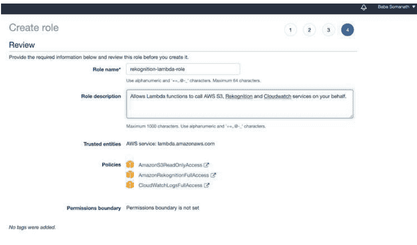

Figure 2.1 – The Create role dialog

接下来，我们将创建一个 Lambda 函数。

+   7. 导航到 AWS Lambda 控制台页面。
+   8. 选择 **Create function**。
+   9. 创建一个函数：
+      - 选择 **Author from scratch**。
+      - 为函数命名，例如 `lambda-rekognition`。
+      - 从 **Runtime** 下拉菜单中选择 Python 3.6。
+      - 选择 **Use an existing role**。添加你之前创建的角色名称；即 `rekognition-lambda-role`：

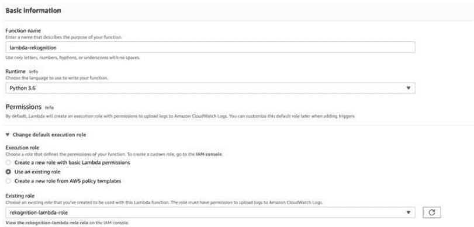

Figure 2.2 – Creating the Lambda function

10. 在 lambda_function.py 中输入以下代码：

```
from __future__ import print_function
import boto3
def lambda_handler(event, context):
    print("======lambda_handler started======")
    # read the bucket name (key) from the event
    name_of_the_bucket=event['Records'][0]['s3']['bucket']['name']
    # read the object from the event
    name_of_the_photo=event['Records'][0]['s3']['object']['key']
    detect_labels(name_of_the_photo,name_of_the_bucket)
    print("Labels detected Successfully")
def detect_labels(photo, bucket):
    client=boto3.client('rekognition')
    response=client.detect_labels(Image={'S3Object':{'Bucket':bucket,'Name':photo}})
    print('Detected labels for ' + photo)
```

```
print('============================')
    for label in response['Labels']:
        print ("Label: " + label['Name'])
        print ("Confidence: " +
str(label['Confidence']))
        print ("Instances:")
        for instance in label['Instances']:
            print ("  Bounding box")
            print ("Top:
"+str(instance['BoundingBox']['Top']))
            print ("Left: \
"+str(instance['BoundingBox']['Left']))
            print ("Width: \
"+str(instance['BoundingBox']['Width']))
            print ("Height: \
"+str(instance['BoundingBox']['Height']))
            print ("Confidence:
"+str(instance['Confidence']))
            print()
        print ("Parents:")
        for parent in label['Parents']:
            print ("   " + parent['Name'])
        print ("----------")
        print('============================')
    return response
```

现在，我们将为 Lambda 函数创建一个触发器。

11. 导航到 AWS S3 控制台页面。创建一个存储桶，例如 rekognition-test-baba，如以下屏幕截图所示：

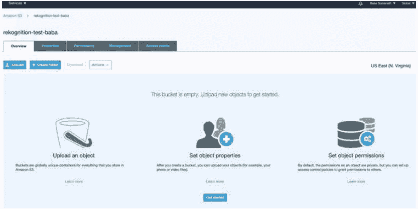

Figure 2.3 – AWS S3 console page

12. 点击 Create folder 并将其命名为 images。点击 Save。

13. 点击我们存储桶的 Properties 选项卡。

14. 滚动到该存储桶的 Events。

15. 在 Events 窗口中，选择 Add notification 并设置以下属性：

+   - Name: rekognition_event
+   - Events: All object create events
+   - Prefix: images/
+   - Send to: Lambda Function
+   - Lambda: lambda-rekognition:

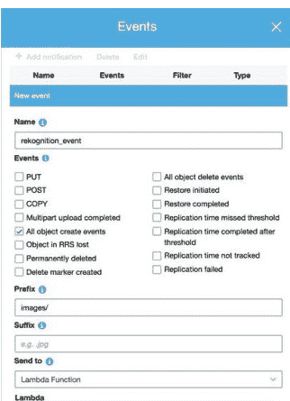

Figure 2.4 – S3 bucket Events window

接下来，我们将从共享的 GitHub 仓库上传图像到 S3 存储桶 images 文件夹。

16. 一旦上传完成，你可以在 Lambda 控制台的 Monitoring 选项卡中检查事件，如以下屏幕截图所示：

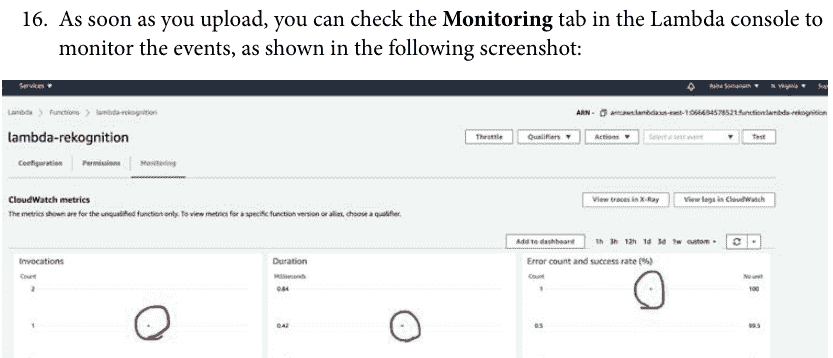

Figure 2.5 – CloudWatch monitoring the event in the Lambda console

17. 导航到 CloudWatch > CloudWatch Logs > Log groups > /aws/lambda/ lambda-rekognition。选择所有流中的最新流并向下滚动日志以查看输出，如以下屏幕截图所示：

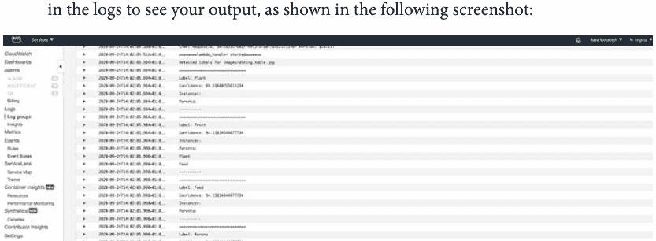

Figure 2.6 – CloudWatch logs

在本节中，我们学习了如何实现 Amazon Rekognition AI 服务来检测图像中的对象并为每个对象提供置信度分数。我们将在后续章节中看到 Amazon Rekognition 的更多用例，当我们检测图像中的文本时。在下一节中，我们将学习 Amazon 的文本转语音服务并实现它。

### Text to speech with Amazon Polly

Amazon Polly 负责将文本转换为语音，并使用预训练的深度学习模型来实现。它是一个完全托管的服务，因此我们无需做任何事情。你提供纯文本作为合成的输入，或以语音合成标记语言 Speech Synthesis Markup Language (SSML) 格式提供，以便返回音频流。它还提供多种语言和语音选择，包括男性和女性选项。Amazon Polly 的输出音频可以以 MP3 格式保存以供应用程序（Web 或移动）进一步使用，也可以是用于书面语音的 JSON 输出。

例如，如果我们将文本 “Baba went to the library” 输入到 Amazon Polly，输出语音标记对象将如下所示：

```
{"time":370,"type":"word","start":5,"end":9,"value":"went"}
```

单词 “went” 在音频流开始后 370 毫秒开始，并在给定的输入文本的字节 5 开始、字节 9 结束。

它还以 `ogg_vorbis` 和 `pcm` 格式返回输出。当使用 `pcm` 时，返回的内容是 audio/pcm，采用有符号 16 位、1 通道（单声道）、小端格式。

Amazon Polly 的一些常见用途如下：

+   - 可用作阅读网页内容的辅助工具。
+   - 可与 Amazon Rekognition 集成以帮助视障人士阅读标志。你可以用文字拍照并将其馈送到 Amazon Rekognition 以提取文本。输出文本可作为 Polly 的输入，它将返回语音输出。
+   - 可用于公共广播系统，管理员团队只需传递要广播的文本，Amazon Polly 即可完成其余工作。
+   - 通过将 Amazon Polly 与 **Amazon Connect**（电话后端服务）结合，你可以构建 **audio/video receiver (AVR)** 系统。
+   - 诸如智能电视、智能手表和 **Internet of Things (IoT)** 设备等智能设备可将其用于音频输出。
+   - 旁白生成。
+   - 与 Amazon Lex 结合时，可为应用程序开发功能齐全的语音用户界面。

现在，让我们探索 Amazon Polly 的优势。

### Exploring the benefits of Amazon Polly

使用 Amazon Polly 的一些优势如下：

+   - 该服务是完全托管的，不需要任何管理成本来维护或管理资源。
+   - 它提供即时语音校正和增强功能。
+   - 你可以使用 Amazon Polly 的 HTTP API 开发自己的访问层。由于支持大量语言，如 Python、Ruby、Go、C++、Java 和 Node.js，开发变得简单。
+   - 对于某些神经语音，可以使用 Newscaster 风格进行语音合成，使其听起来像电视或广播播音员。
+   - Amazon Polly 还允许你修改特定单词的发音或使用新单词。

接下来，我们将亲手操作 Amazon Polly。

### Getting hands-on with Amazon Polly

在本节中，我们将构建一个管道，将 AWS Lambda 与 Amazon Polly 集成以读取文本文件，然后将相同的 MP3 文件生成到同一存储桶的另一个文件夹中。我们将在 CloudWatch 日志中监控任务进度。

我们将首先为 Lambda 创建一个 IAM 角色。让我们开始：

+   1. 导航到 IAM 控制台页面。
+   2. 从左侧菜单选择 Roles。
+   3. 选择 Create role。
+   4. 选择 Lambda 作为受信任实体。
+   5. 添加以下托管策略：
+      - AmazonS3FullAccess
+      - AmazonPollyFullAccess
+      - CloudWatchFullAccess
+   6. 将角色保存为 polly-lambda-role。

接下来，我们将创建一个 Lambda 函数：

+   1. 导航到 Lambda > Functions > Create Function。
+      - 将函数命名为 polly-lambda
+      - 将运行时设置为 python 3.6。
+      - 使用现有角色；即 polly-lambda-role
+   2. 将代码粘贴到 https://github.com/PacktPublishing/AWS-Certified-Machine-Learning-Specialty-MLS-C01-Certification-Guide/tree/master/Chapter-2/Amazon%20Rekognition%20Demo/lambda_code 中到你的 lambda 函数中，并在 CloudWatch 控制台中检查其进度。我们将对该代码使用 Amazon Polly 的 start_speech_synthesis_task API；它是一个异步合成任务。
+   3. 向下滚动并在 Basic Settings 部分将 Timeout 更改为 59 秒，如以下屏幕截图所示，然后点击 Save：

> **Important note**
> 默认值为 3 秒。由于这是一个异步操作，任何重试尝试都会创建更多文件。


Figure 2.7 – Edit basic settings window

现在，我们将创建一个桶来触发一个事件。

+   4. 导航到 AWS S3 控制台并创建一个名为 polly-test-baba 的桶。

+   5. 创建一个名为 input-text 的文件夹（在此示例中，我们将只上传 .txt 文件）。

6. 导航到 **Properties > Events > Add notification**。填写所需的字段，如下所示，然后单击 **Save:**

+   - **Name:** `polly_event`
+   - **Events:** `All object create events`
+   - **Prefix:** `input-text/`
+   - **Suffix:** `.txt`
+   - **Send to:** `Lambda Function`
+   - **Lambda:** `polly-lambda`

7. 接下来，我们将上传一个文件以触发事件并在 CloudWatch 中检查其进度。上传，在本例中，将文件 test_file.txt 上传到 input-text，如以下屏幕截图所示。您可以从本书的 GitHub 仓库下载示例文件，地址为 https://github.com/PacktPublishing/AWS-Certified-Machine-Learning-Specialty-MLS-C01-Certification-Guide/tree/master/Chapter-2/Amazon%20Polly%20Demo/text_file：

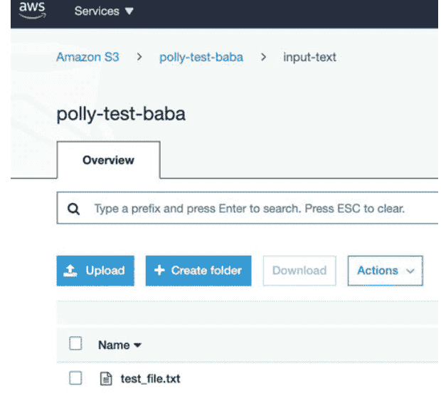

Figure 2.8 – The S3 bucket after uploading a text file for further processing

8. 这将触发 lambda 函数。您可以通过进入 CloudWatch> CloudWatch Logs> Log groups> /aws/lambda/polly-lambda 来监控日志：

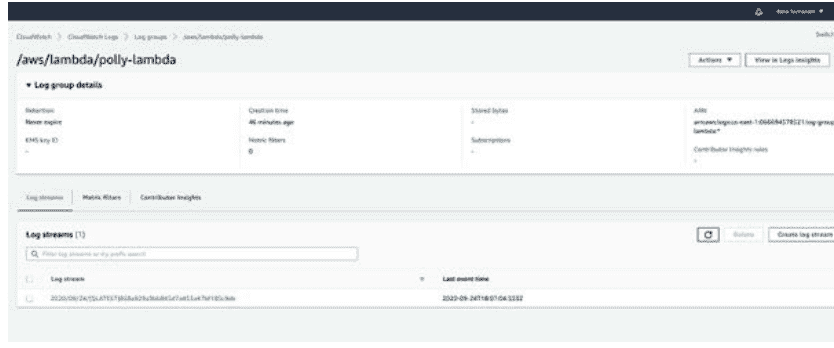

Figure 2.9 – Log groups in the CloudWatch console

9. 单击最新的流；日志如下所示：

```
File Content: Hello Everyone, Welcome to Dublin. How are you doing today?
{'ResponseMetadata': {'RequestId': '74ca4afd-5844-47d8-9664-3660a26965e4', 'HTTPStatusCode': 200, 'HTTPHeaders': {'x-amzn-requestid': '74ca4afd-5844-47d8-9664-3660a26965e4', 'content-type': 'application/json', 'content-length': '471', 'date': 'Thu, 24 Sep 2020 18:50:57 GMT'}, 'RetryAttempts': 0}, 'SynthesisTask': {'Engine': 'standard', 'TaskId': '57548c6b-d21a-4885-962f-450952569dc7', 'TaskStatus': 'scheduled', 'OutputUri': 'https://s3.us-east-1.amazonaws.com/polly-test-baba/output-audio/.57548c6b-d21a-4885-962f-450952569dc7.mp3', 'CreationTime': datetime.datetime(2020, 9, 24, 18, 50, 57, 769000, tzinfo=tzlocal()), 'RequestCharacters': 59, 'OutputFormat': 'mp3', 'TextType': 'text', 'VoiceId': 'Aditi', 'LanguageCode': 'en-GB'}}
```

日志示例显示在以下屏幕截图中：

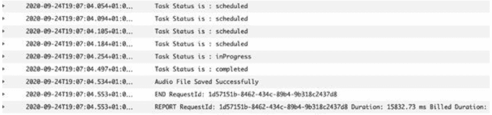

Figure 2.10 – The logs in the CloudWatch console

10. 它将以 MP3 格式创建输出，如以下屏幕截图所示。下载并收听它：

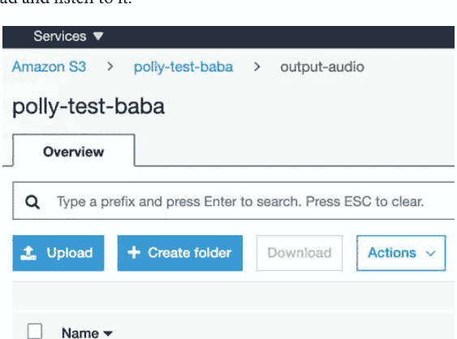

Figure 2.11 – The output file that was created in the S3 bucket

**Important note**
对于您的移动应用或 Web 应用而言，最具可扩展性和成本效益的方式是为 S3 桶生成 AWS 预签名 URL 并将其提供给用户。这些 S3 Put 事件会异步调用下游 AI 工作流以生成结果并向终端用户发送响应。通过这种方法可以同时为许多用户提供服务，并且可能提高性能和吞吐量。

在本节中，我们学习了如何实现文本转语音。在下一节中，我们将学习 Amazon Transcribe，这是一种语音转文本 AI 服务。

### Speech to text with Amazon Transcribe

在上一节中，我们学习了文本转语音。在本节中，我们将学习语音转文本以及提供此功能的服务：Amazon Transcribe。它是一种自动语音识别服务，使用预训练的深度学习模型，这意味着我们不必在 PB 级数据上训练以生成模型；Amazon 已为我们完成了此操作。我们只需使用可用的 API 来转录音频文件或视频文件；它支持多种不同的语言和自定义词汇。准确性是关键，通过自定义词汇，您可以根据所需的领域或行业来增强它：

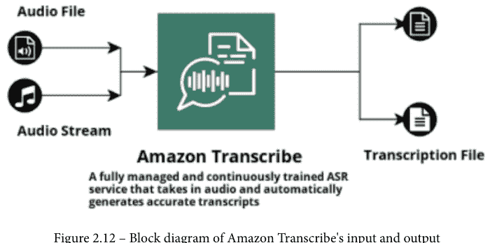

Figure 2.12 – Block diagram of Amazon Transcribe's input and output

Amazon Transcribe 的一些常见用途包括以下内容：

+   - 实时音频流式传输和转录。
+   - 转录预先录制的音频文件。
+   - 通过结合 AWS Elasticsearch 和 Amazon Transcribe 从媒体文件中实现文本搜索。
+   - 对录制的音频文件执行情感分析，用于语音帮助台（联系中心分析）。
+   - 通道识别分离。

接下来，我们将探讨 Amazon Transcribe 的优势。

### Exploring the benefits of Amazon Transcribe

让我们看一下使用 Amazon Transcribe 的一些优势：

+   - *Content Redaction*: 可以通过指示 Amazon Transcribe 识别并从语言转录中删除 **个人身份信息 (PII)** 来确保客户隐私。您可以通过提供不想要的词列表以及 `StartTranscriptionJob` 操作提供的 `VocabularyFilterName` 和 `VocabularyFilterMethod` 来从转录中过滤掉不想要的词。例如，在金融组织中，这可用于删除呼叫者详细信息。
+   - *Language Identification*: 它可以自动识别音频文件中使用的最常用语言并生成转录。如果您有多个音频文件，则此服务可以帮助您按语言对其进行分类。
+   - *Streaming Transcription*: 您可以将录制的音频文件或实时音频流发送到 Amazon Transcribe，并实时输出文本流。
+   - *Custom Vocabulary or Customized Transcription*: 您可以根据自定义需求使用自定义词汇表列表来生成准确的转录。
+   - *TimeStamp Generation*: 如果您想为视频构建或添加字幕，则 Amazon Transcribe 可以返回音频中每个单词或短语的时间戳。
+   - *Cost Effectiveness*: 作为托管服务，没有基础设施成本。

现在，让我们动手使用 Amazon Transcribe。

### Getting hands-on with Amazon Transcribe

在本节中，我们将构建一个管道，其中可以将 AWS Lambda 与 Amazon Transcribe 集成，以读取存储在 S3 桶中文件夹中的音频文件，然后将输出 JSON 文件存储在另一个 S3 桶中。我们还将在 CloudWatch 日志中监控任务的进度。我们将使用 `start_transcription_job` 异步函数来启动我们的作业，并将通过 `get_transcription_job` 不断监控作业，直到其状态变为 COMPLETED。让我们开始吧：

+   1. 首先，为 Lambda 函数执行创建一个名为 `transcribe-demo-role` 的 IAM 角色。确保它可以从/向 S3 读取和写入，使用 Amazon Transcribe，并在 CloudWatch 日志中打印输出。将以下策略添加到 IAM 角色：
+      - `AmazonS3FullAccess`
+      - `CloudWatchFullAccess`
+      - `AmazonTranscribeFullAccess`

2. 现在，我们将使用现有的 IAM 角色 `transcribe-demo-role` 创建一个名为 `transcribe-lambda` 的 Lambda 函数并保存它。

请确保在 lambda 函数的 **Basic settings** 部分将默认超时更改为更高的值。我将其设置为 10 分钟 20 秒以避免超时错误。我们将使用一个名为 `start_transcription_job` 的异步 API 调用启动任务，并使用 `get_transcription_job` API 监控同一任务。

3. 粘贴 https://github.com/PacktPublishing/AWS-Certified-Machine-Learning-Specialty-MLS-C01-Certification-Guide/blob/master/Chapter-2/Amazon%20Transcribe%20Demo/lambda_function/lambda_function.py 中的代码并单击 **Deploy**。

这应给我们以下输出：

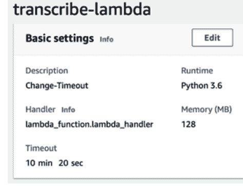

Figure 2.13 – The Basic settings section of our created lambda function

4. 接下来，我们将创建名为 `transcribe-demo-101` 的 S3 桶和名为 input 的文件夹。通过进入 **Properties** 选项卡的 **Create event notification** 部分创建事件。输入以下详细信息：

+   - **Name:** `audio-event`
+   - **Events:** `All object create events`
+   - **Prefix:** `input/`
+   - **Destination:** `Lambda Function`
+   - **Lambda:** `transcribe-lambda`


+   5. 将 .mp4 格式的音频文件上传到输入文件夹。这将触发 Lambda 函数。根据代码，输出将以 JSON 格式存储在 S3 存储桶中，然后你可以使用它来读取文件的内容。

+   6. 导航到 CloudWatch > CloudWatch Logs > Log groups > aws/lambda/transcribe-lambda。从列表中选择最新的流。它看起来如下所示：

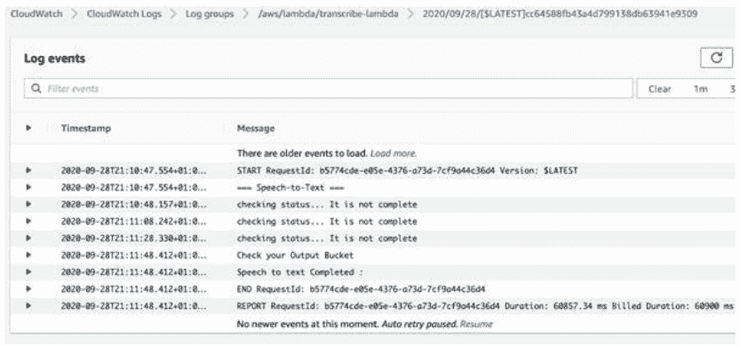

图 2.14 – CloudWatch 控制台中指定日志组的日志流中的日志

+   7. 输出以 JSON 格式保存到 S3 存储桶中，具体取决于代码中提到的 jobname（你可以使用 S3 getObject API 下载并读取它）：

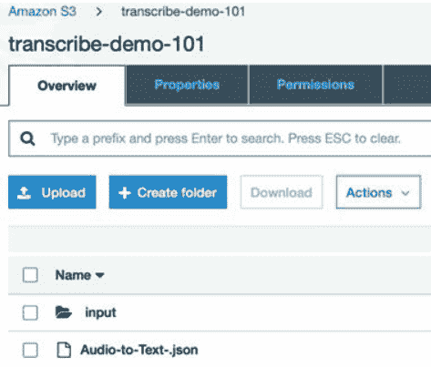

图 2.15 – S3 存储桶中的输出 JSON 文件

**重要说明**
最好不要过度配置函数的超时设置。始终了解你的代码性能并据此设置函数超时。过度配置函数超时会导致 Lambda 函数运行时间更长，并造成意外的成本。如果你在使用 Lambda 函数中的异步 API 调用，那么最好将它们写入 SNS 主题以实现成功，并从中触发另一个 Lambda 函数。如果需要人工干预，则建议使用 AWS Step Functions。

在本节中，我们学习并应用了 Amazon Transcribe 将语音转换为文本。在下一节中，我们将学习一种最强大的 AWS AI 服务，我们可以用它从文本数据中获得最大量的洞察。

### 使用 Amazon Comprehend 实现自然语言处理

此服务可帮助你从非结构化文本中提取洞察。非结构化文本信息呈指数级增长。以下是一些数据源示例：

- *客户参与度：* 呼叫中心、问题分诊、客户调查和产品评论
- *业务流程：* 客户/供应商电子邮件、产品支持消息和运营支持反馈
- *记录和研究：* 白皮书和医疗记录
- *新闻和社交媒体：* 社交媒体分析、品牌趋势和相关事件

现在，问题是，我们可以用这些数据做什么？我们如何分析它并从中提取价值？答案是 Amazon Comprehend，它用于从非结构化数据中获取洞察。

Amazon Comprehend 的一些常见用途包括以下内容：

- 信息管理系统
- 对组织主题的更准确的搜索系统
- 用户情感分析
- 支持工单分类
- 从文档中检测语言，然后使用 Amazon Translate 将其翻译成英语
- 创建一个系统来标记非结构化临床数据以协助研究和分析目的
- 从公司会议或电视新闻的保存音频文件中提取主题

接下来，我们将探索 Amazon Comprehend 的优势。

### 探索 Amazon Comprehend 的优势

使用 Comprehend 的一些优势可以在以下图像中看到：

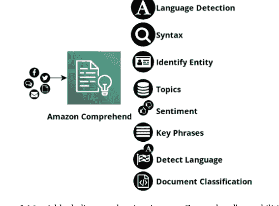

图 2.16 – 显示 Amazon Comprehend 功能的框图

让我们更详细地看一下这些内容：

- 它检测文本的语言并提取关键短语。Amazon Comprehend 也可用于情感分析和主题建模。
- Amazon Comprehend Medical 可用于提取医疗信息。
- 由于这是一项完全托管的服务，你按使用付费；你无需为基础设施付费。你无需训练、开发和部署自己的模型。
- 主题建模服务通过提取最多 100 个主题来工作。主题是一个关键词桶，这样你就可以看到实际文档语料库中的内容。
- 它准确、持续训练且易于使用。

接下来，我们将亲手操作 Amazon Comprehend。

### 亲手操作 Amazon Comprehend

在本节中，我们将构建一个管道，在其中可以将 AWS Lambda 与 Amazon Rekognition 和 Amazon Comprehend 集成。我们将读取存储在 S3 存储桶中的图像文件并检测从图像中提取的文本的语言。我们还将使用 CloudWatch 打印输出。以下是我们用例的图表：

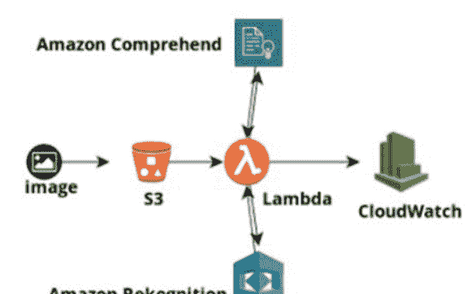

图 2.17 – 所需用例的架构图

让我们开始创建 IAM 角色：

+   1. 导航到 IAM 控制台页面。
+   2. 从左侧菜单中选择 **Roles**。
+   3. 选择 **Create role**。
+   4. 选择 **Lambda** 作为受信任实体。
+   5. 添加以下托管策略：
    - `AmazonS3ReadOnlyAccess`
    - `AmazonRekognitionFullAccess`
    - `ComprehendFullAccess`
    - `CloudWatchFullAccess`
+   6. 将角色保存为 `language-detection-from-image-role`。
+   7. 现在，让我们创建 Lambda 函数。导航到 **Lambda > Functions > Create Function**。

8. 将函数命名为 `language-detection-from-image`。

9. 将运行时设置为 `Python 3.6`。

10. 使用我们现有的角色；即 `language-detection-from-image-role`。

11. 从 https://github.com/PacktPublishing/AWS-Certified-Machine-Learning-Specialty-MLS-C01-Certification-Guide/tree/master/Chapter-2/Amazon%20Transcribe%20Demo/lambda_function 下载代码，将其粘贴到函数中，然后单击 **Deploy**。

此代码将读取你上传的图像中的文本并检测文本的语言。我们使用了 Amazon Rekognition 的 `detect_text` API 从图像中检测文本，并使用了 Amazon Comprehend 的 `batch_detect_dominant_language` API 来检测文本的语言。

12. 现在，转到你的 AWS S3 控制台并创建一个名为 *language-detection-image* 的存储桶。

13. 创建一个名为 `input-image` 的文件夹（在此示例中，我们将只上传 `.jpg` 文件）。

14. 导航到 **Properties > Events> Add notification**。

15. 在 **Events** 部分填写以下信息中的必填字段；然后，单击 **Save**：

- **Name:** `image-upload-event`
- **Events:** `All object create events`
- **Prefix:** `input-image/`
- **Suffix:** `.jpg`
- **Send to:** `Lambda Function`
- **Lambda:** `language-detection-from-image`

16. 导航到 **Amazon S3>language-detection-image>input-image**。在文件夹中上传 `sign-image.jpg` 图像。（此文件可在本书的 GitHub 仓库 https://github.com/PacktPublishing/AWS-Certified-Machine-Learning-Specialty-MLS-C01-Certification-Guide/tree/master/Chapter-2/Amazon%20Comprehend%20Demo/input_image 中获得）。

17. 此文件上传将触发 lambda 函数。你可以从 CloudWatch> CloudWatch Logs> Log groups> /aws/lambda/language-detection-from-image 监控日志。

18. 单击流并选择最新的一个。检测到的语言会打印在日志中，如以下屏幕截图所示：

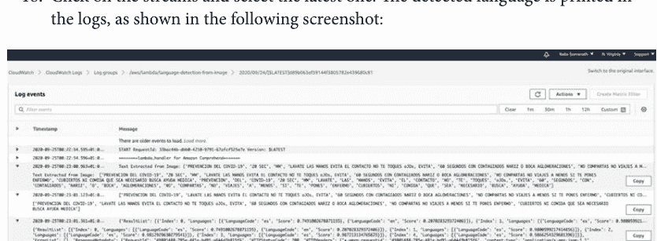

图 2.18 – 用于验证输出的 CloudWatch 中的日志

重要说明
建议你在生产环境中使用批量操作，例如 BatchDetectSentiment 或 BatchDetectDominantLanguage。这是因为单个 API 操作可能会导致 API 级别的节流。更多详细信息请参见此处：https://docs.aws.amazon.com/comprehend/latest/dg/functionality.html。

在本节中，我们学习了如何使用 Amazon Comprehend 检测文本的语言。文本是通过 Amazon Rekognition 提取到我们的 Lambda 函数中的。在下一节中，我们将学习如何通过 Amazon Translate 将同一文本翻译成英语。

### 使用 Amazon Translate 翻译文档

大多数时候，人们更喜欢用自己的语言交流，即使是在数字平台上。Amazon Translate 是一项文本翻译服务。我们可以提供各种语言的文档或文本字符串，并以不同的语言取回。它使用预训练的深度学习技术，因此我们不必担心模型，也不用担心它们的管理。我们可以发出 API 请求并取回结果。

Amazon Translate 的一些常见用途包括以下内容：

- 如果组织范围内需要准备不同语言的文档，则 Translate 是将一种语言转换为多种语言的解决方案。
- 在线聊天应用程序可以实时翻译，以提供更好的客户体验。
- 更快速、更经济地将网站内容本地化为更多语言。
- 一旦翻译完成，就可以在不同语言上应用情感分析。
- 为新闻发布网站提供非英语语言支持。

接下来，我们将探索 Amazon Translate 的优势。

### 探索 Amazon Translate 的优势

使用 Amazon Translate 的一些优势包括以下内容：

- 它使用神经机器翻译，这模仿了人类大脑的工作方式。
- 无需维护你的资源。
- 产生高质量的结果并保持其一致性。
- 你可以自定义你的品牌名称和模型名称，任何其他独特术语都可以使用自定义术语功能进行翻译。
- 可以通过 API轻松集成到应用程序中。
- Amazon Translate 在你需要它做更多事情时自行扩展。

接下来，我们将亲手操作 Amazon Translate。


### 动手使用 Amazon Translate

在本节中，我们将通过集成 AWS Lambda 与 Amazon Rekognition、Amazon Comprehend 和 Amazon Translate 来构建一个产品，以读取存储在 S3 存储桶中的图像文件。然后，我们将检测从图像中提取的文本的语言，以便将其翻译成英语。我们还将使用 CloudWatch 打印翻译后的输出。以下是我们用例的架构图：

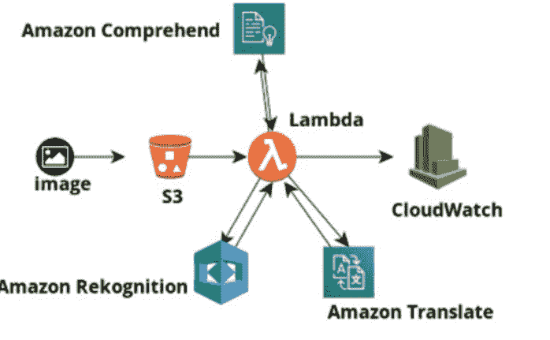

图 2.19 – 所需用例的架构图

让我们开始创建 IAM 角色：

- 1. 导航到 IAM 控制台页面。
- 2. 从左侧菜单中选择 **Roles**。
- 3. 选择 **Create role**。
- 4. 选择 **Lambda** 作为受信任的实体。
- 5. 添加以下托管策略：
  - `AmazonS3ReadOnlyAccess`
  - `AmazonRekognitionFullAccess`
  - `ComprehendFullAccess`
  - `CloudWatchFullAccess`
  - `TranslateFullAccess`
- 6. 将角色保存为 `language-translation-from-image`。
- 7. 下一步是创建 Lambda 函数。导航到 **Lambda > Functions > Create Function**。
- 8. 将函数命名为 `language-detection-from-image`。
- 9. 将运行时设置为 `Python 3.6`。
- 10. 使用现有角色；即 `language-detection-from-image-role`。
- 11. 粘贴 https://github.com/PacktPublishing/AWS-Certified-Machine-Learning-Specialty-MLS-C01-Certification-Guide/blob/master/Chapter-2/Amazon%20Translate%20Demo/lambda_function/lambda_function.py 上的代码并单击 **Deploy**。我们将使用 `translate_text` API 来翻译输入文本。
- 12. 下一步是创建一个名为 `language-translation-from-image` 的存储桶。
  创建一个名为 `image` 的文件夹。然后，导航到 **Properties > Events> Add notification**。
- 13. 填写所需的字段，如图所示，然后单击 **Save**（请确保您选择 `.jpg` 作为后缀；否则，它将针对任何对象创建过程触发 lambda 函数）：
- 14. 导航到 **Amazon S3>language-detection-image>input-image**。将 `sign-image.jpg` 图像上传到该文件夹。此文件可在本书的 GitHub 仓库中找到：https://github.com/PacktPublishing/AWS-Certified-Machine-Learning-Specialty-MLS-C01-Certification-Guide/tree/master/Chapter-2/Amazon%20Translate%20Demo/input_image。

- **Name:** *translate-language-image*
- **Events:** `All object create events`
- **Prefix:** `image/`
- **Suffix:** `.jpg`
- **Send to:** `Lambda Function`
- **Lambda:** `language-translation-from-image`

15. 上传此图像将触发 lambda 函数。您可以通过转到 CloudWatch> CloudWatch Logs> Log groups> /aws/lambda/language-translation-from-image 来监控日志。

16. 单击流并选择最新的一个。它看起来如下：

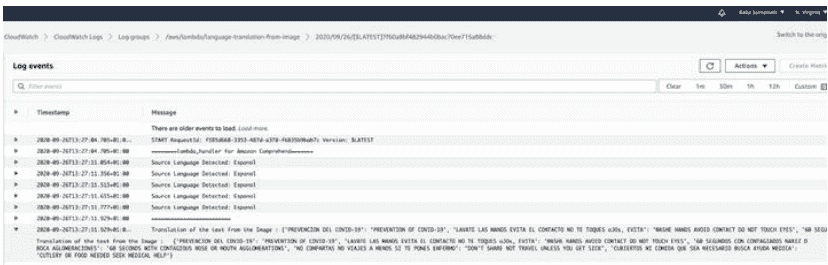

图 2.20 – 用于验证输出的 CloudWatch 中的日志

翻译如下：

```
Translation of the text from the Image :
{'PREVENCION DEL COVID-19': 'PREVENTION OF COVID-19',
'LAVATE LAS MANOS EVITA EL CONTACTO NO TE TOQUES oJOs, EVITA': 'WASHE HANDS AVOID CONTACT DO NOT TOUCH EYES',
'60 SEGUNDOS CON CONTAGIADOS NARIZ O BOCA AGLOMERACIONES': '60 SECONDS WITH CONTAGIOUS NOSE OR MOUTH AGGLOMERATIONS', 'NO COMPARTAS NO VIAJES A MENOS SI TE PONES ENFERMO': "DON'T SHARE NOT TRAVEL UNLESS YOU GET SICK", 'CUBIERTOS NI COMIDA QUE SEA NECESARIO BUSCA AYUDA MEDICA': 'CUTLERY OR FOOD NEEDED SEEK MEDICAL HELP'}
```

> **重要说明**
> 对于生产用例，如果您有依赖服务或服务链，建议使用 AWS Lambda 与 AWS Step Function。
> 
> 不建议使用同一个 S3 存储桶来存储输入和输出对象。同一存储桶中的输出对象创建可能会触发递归 Lambda 调用。如果您使用相同的存储桶，则建议您使用前缀和后缀来触发事件。同样，我们建议使用前缀来存储输出对象。

在本节中，我们学习了如何组合多个服务并链接其输出以实现特定用例结果。我们学习了如何集成 Amazon Rekognition 来检测图像中的文本。然后，可以使用 Amazon Comprehend 检测语言。然后，我们使用相同的输入并借助 Amazon Translate 将其翻译成英语。翻译后的输出随后会打印在 CloudWatch 日志中以供验证。在下一节中，我们将学习 Amazon Textract，我们可以用它从文档中提取文本。

### 使用 Amazon Textract 从文档中提取文本

手动从文档中提取信息速度慢、成本高且容易出错。传统的光学字符识别软件需要大量定制，并且仍然会产生错误的输出。为了避免此类手动流程和错误，您应该使用 Amazon Textract。通常，我们将文档转换为图像，以便在图像中检测文本周围的边界框。然后，我们应用字符识别技术来读取其中的文本。Textract 会为您完成所有这些工作，并且只需最少的努力即可为您提取文本、表格、表单和其他数据。如果您从 Amazon Textract 获得低置信度结果，则 Amazon A2I 是最佳解决方案。

Textract 减少了从数百万页扫描文档中提取文本的手动工作量。一旦信息被捕获，就可以对文本采取行动，例如将其存储在不同的数据存储中、分析情感或搜索关键字。以下图表显示了 Amazon Textract 的工作原理：

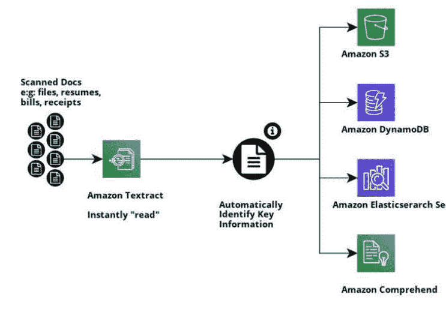

图 2.21 – Amazon Textract 的框图表示及其如何存储输出

Amazon Textract 的一些常见用途包括以下内容：

- 记录处理工作流以提取表格或表单。
- 使用 Amazon Elasticsearch 从文档创建搜索索引。
- 在工作流中删除个人身份信息；Textract 会自动识别数据类型和表单标签。

接下来，我们将探讨 Amazon Textract 的优势。

### 探索 Amazon Textract 的优势

使用 Textract 有以下几个原因：

- 零基础设施成本。
- 完全托管服务（减少开发和管理开销）。
- 帮助您提取结构化和非结构化数据。
- 可以分析手写评论。
- Amazon Textract 的性能优于使用平面词袋的 OCR 应用。
- 接下来，我们将动手使用 Amazon Textract。

### 动手使用 Amazon Textract

在本节中，我们将使用 Amazon Textract API 从 S3 存储桶读取图像文件并在 Cloudwatch 上打印“FORM”详细信息。同样，可以以您期望的格式存储在 S3 中以供进一步使用，也可以作为键值对存储在 DynamoDB 中。让我们开始吧：

- 1. 首先，创建一个名为 `textract-use-case-role` 的 IAM 角色，并使用以下策略。这将允许 Lambda 函数执行，以便它可以从 S3 读取、使用 Amazon Textract 并在 CloudWatch 日志中打印输出：
  - `CloudWatchFullAccess`
  - `AmazonTextractFullAccess`
  - `AmazonS3ReadOnlyAccess`
- 2. 让我们创建一个名为 `textract-document-analysis` 的 S3 存储桶并上传 `receipt.png` 图像文件。这将用于包含将被提取的 FORM 详细信息。图像文件可在 https://github.com/PacktPublishing/AWS-Certified-Machine-Learning-Specialty-MLS-C01-Certification-Guide/tree/master/Chapter-2/Amazon%20Textract%20Demo/input_doc 处获取：

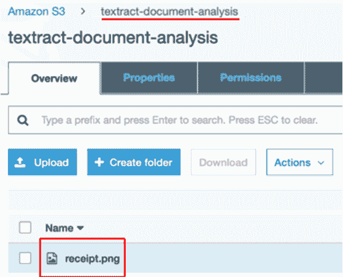

图 2.22 – 一个 S3 存储桶，其中图像（.png）文件已上传到输入文件夹

3. 下一步是创建一个名为 read-scanned-doc 的 Lambda 函数，如以下屏幕截图所示，并使用名为 textract-use-case-role 的现有执行角色：

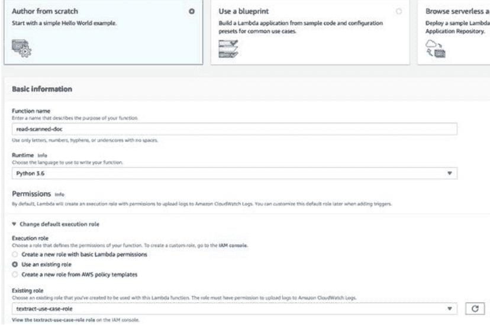

图 2.23 – AWS Lambda 创建函数对话框

4. 创建函数后，粘贴以下代码并部署它。向下滚动到基本设置以将默认超时更改为更高值（40 秒）以避免超时错误。我们使用 Amazon Textract 的 analyze_document API 通过 API 的 FeatureTypes 参数获取表格和表单详细信息：

```
import boto3
import time
from trp import Document
textract_client=boto3.client('textract')

def lambda_handler(event, context):
    print(" - - - Amazon Textract Demo - - -")
    # read the bucket name from the event
```


name_of_the_bucket=event['Records'][0]['s3']['bucket']['name']
### 从事件中读取对象
name_of_the_doc=event['Records'][0]['s3']['object']['key']
print(name_of_the_bucket)
print(name_of_the_doc)
response =
textract_client.analyze_document(Document={'S3Object': {'Bucket': name_of_the_bucket,'Name': name_of_the_doc}},FeatureTypes=["TABLES","FORMS"])
print(str(response))
doc=Document(response)
for page in doc.pages:
    # 打印表格
    for table in page.tables:
        for r, row in enumerate(table.rows):
            for c, cell in enumerate(row.cells):
                print("Table[{}][{}] = {}".format(r, c, cell.text))
for page in doc.pages:
    # 打印字段
    print("Fields:")
    for field in page.form.fields:
        print("Key: {}, Value: {}".format(field.key, field.value))

与前面的示例不同，我们将创建一个测试配置来运行代码。

+   5. 单击“测试”按钮左侧的下拉菜单。
+   6. 选择“配置测试事件”，然后选择“创建新的测试事件”。
+   7. 在“事件模板”下拉菜单中选择“Amazon S3 Put”。
+   8. 在 JSON 正文中，根据存储桶名称和键修改高亮显示的值，如下所示：

"x-amz-id-2": "EXAMPLE123/5678abcdefghijklambdaisawesome/" }, "s3": { "s3SchemaVersion": "1.0", "configurationId": "testConfigRule", "bucket": { "name": "textract-document-analysis", "ownerIdentity": { "principalId": "EXAMPLE" }, "arn": "arn:aws:s3:::textract-document-analysis" }, "object": { "key": "receipt.png", "size": 1024, "eTag": "0123456789abcdef0123456789abcdef", "sequencer": "0A1B2C3D4E5F678901" }

图 2.24——用于测试 Lambda 函数的事件模板

9. 在“事件名称”字段中，将测试配置命名为 TextractDemo。

10. 单击“保存”。

11. 选择测试配置（TextractDemo），然后单击“测试”：

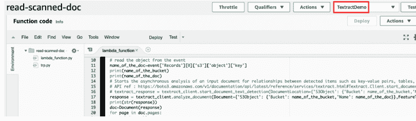

图 2.25——运行测试前选择测试配置

12. 这将触发 Lambda 函数。你可以通过 CloudWatch > CloudWatch Logs > Log groups > /aws/lambda/ read-scanned-doc 监控日志。

13. 单击流并选择最新的流。其显示效果如下；以下屏幕截图中可以看到键值对：

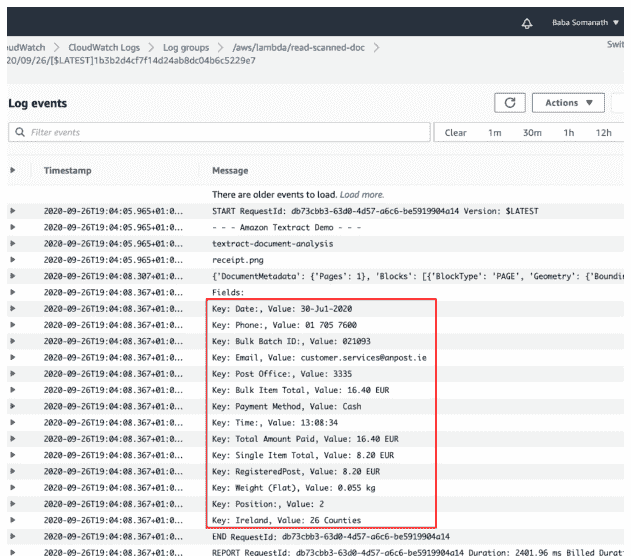

图 2.26——CloudWatch 中用于验证输出的日志

### 重要提示

通过生成 S3 Put 事件，借助 Lambda 异步调用下游 AI 工作流，最具可扩展性且最具成本效益的方法是生成 AWS 预签名 URL，然后将其提供给移动应用或 Web 应用的用户。通过这种方式可以同时服务许多用户，并且还可能提升性能和吞吐量。

让 AWS AI 服务与 S3 存储桶位于同一区域，可能有助于提高性能并减少网络延迟。AWS VPC 端点可以在不使用公共互联网的情况下增强安全性。你可以将 AWS AI 处理结果存储在 AWS S3 存储桶中，并对其余数据进行加密，以获得更高的安全性。

在本节中，我们学习了如何从扫描文档中提取文本并打印其中的表单数据。与其他章节不同，我们使用 Lambda 函数的测试功能，创建了一个包含事件模板的测试配置。在下一节中，我们将学习如何为组织创建聊天机器人以及如何使用它。

### 在 Amazon Lex 上创建聊天机器人

Alexa 中提供的大多数功能都由**Amazon Lex**提供支持。你可以使用 Amazon Lex 轻松构建聊天机器人。它在后台使用自然语言理解和自动语音识别技术。通过 SLU，Amazon Lex 接收自然语言语音和文本输入，理解用户意图，并满足用户的意图。Amazon Lex 机器人既可以通过控制台创建，也可以通过 API 创建。其基本要求如下图所示。

Amazon Lex 的一些常见用途包括：

- 同时能够监听并接收文本输入的应用。
- 聊天机器人。
- 用于提供更佳客户和销售体验的对话式 AI 产品。
- 通过 AWS Lambda 函数提供辅助功能的定制业务机器人。
- 用于呼叫中心的语音助手，可以与用户交谈、安排会议或请求账户详细信息。
- 通过与 Amazon Cognito 集成，你可以控制用户管理、身份验证以及跨所有设备的同步。

接下来，我们将探索 Amazon Lex 的优势。

### 探索 Amazon Lex 的优势

使用 Lex 的一些原因包括：

- 可以直接从 AWS 管理控制台构建和测试聊天机器人。这些聊天机器人可以通过其丰富的格式功能轻松集成到 Facebook Messenger、Slack 和 Twilio SMS 中。
- 可以将对话日志存储在 Amazon CloudWatch 中，以便进一步分析。你可以使用这些日志监控机器人并获取洞察，从而改善用户体验。
- Amazon Lex 可以集成到其他 AWS 服务中，例如 Amazon Cognito、AWS Lambda、Amazon DynamoDB、Amazon CloudWatch 和 AWS Mobile Hub，从而利用 AWS 平台中的应用程序安全性、监控、用户身份验证、业务逻辑、存储和移动应用开发功能。
- Amazon Lex 聊天机器人也可以集成到自定义 Web 应用程序中。你只需构建一个聊天机器人小组件并将其集成到用户界面中。

接下来，我们将实际操作 Amazon Lex。

### 实际操作 Amazon Lex

让我们开始吧：

+   1. 登录 https://console.aws.amazon.com/lex/。
+   2. 单击**开始使用**，然后选择**自定义机器人**。
+   3. 填写以下详细信息，然后单击**创建**：

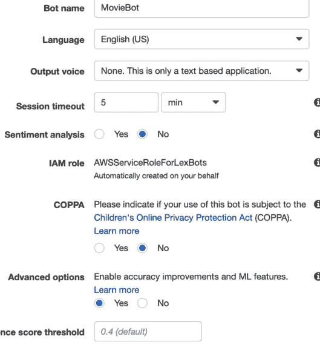

图 2.27——Amazon Lex 的“创建”对话框

+   4. 单击**创建意图**。此时将出现一个对话框。选择**创建意图**。
+   5. 将新意图命名为`MovieIntent`，然后单击**添加**。
+   6. 转到**槽位**部分，并使用以下详细信息：
    - 名称：`movie_type`
    - 槽位类型：`AMAZON.Genre`
    - 提示语：`Which movie do you like?`
+   7. 单击**设置**中的 +。

以下屏幕截图展示了一些示例话语。在此示例中，movie_type 是我的变量：

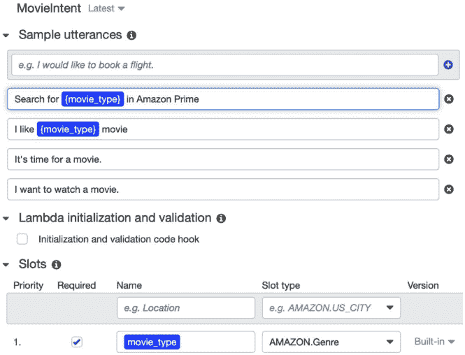

图 2.28——“示例话语”部分

8. 向下滚动到“响应”部分以添加消息：

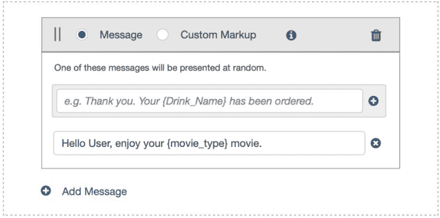

图 2.29——Amazon Lex 的“响应”部分

9. 向下滚动到“保存意图”，然后单击“构建”。提示语构建成功后，将显示以下成功消息：

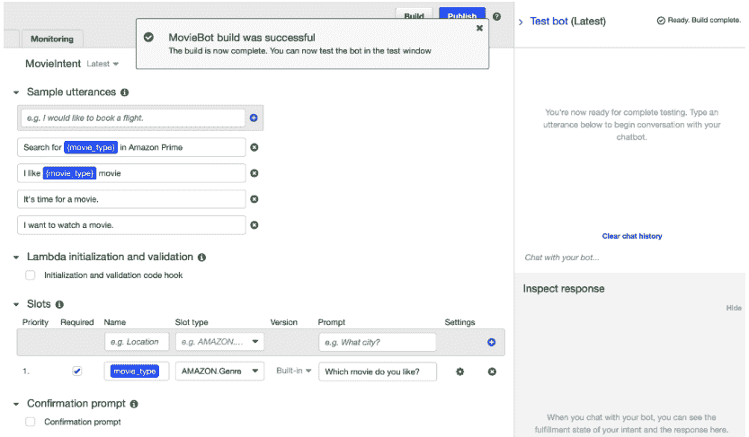

图 2.30——Amazon Lex 的“响应”部分

10. 现在，你可以测试机器人，如下图所示：

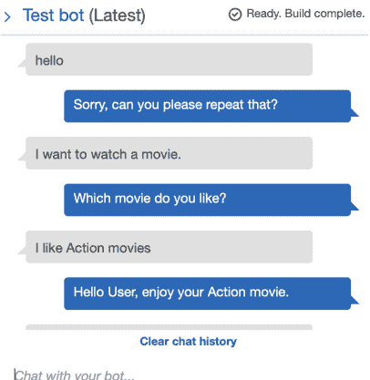

图 2.31——“测试机器人”对话框

**重要提示**
并非所有 Amazon Polly 功能都可在 Alexa 中使用，尤其是 Amazon Polly 的 SSML 功能，这使得 Amazon Polly 与 Alexa 存在差异。

本章关于各种可用 AWS 应用服务的介绍到此结束。

### 总结

在本章中，我们了解了一些可用于解决各种问题的 AWS AI 服务。我们使用了 Amazon Rekognition 服务，它可以检测对象和面部（包括名人面部），还可以从图像中提取文本。在文本转语音方面，我们使用了 Amazon Polly；在语音转文本方面，我们使用了 Amazon Transcribe。在本章末尾，我们使用 Amazon Lex 构建了一个聊天机器人。

对于图像中的语言检测和翻译，我们使用了 Amazon Rekognition、Amazon Comprehend 和 Amazon Translate。我们学习了如何将它们全部组合到一个 Lambda 函数中来解决问题。

对于认证考试，你不需要记住本章中使用的所有 API。考试可能会考查我们学到的一些最佳实践，或者考查能够解决特定问题的服务名称。练习使用这些 AWS AI 服务总是有益的，因为这将提升你的架构设计能力。

下一章中，我们将学习数据准备和转换，这是机器学习中最重要的方面。

### 问题

+   1. 使用预定义的逻辑和规则向在线购物者提供产品推荐，是机器学习的一个示例。
    a. 正确
    b. 错误
+   2. ML 技术栈中的哪个层级可以帮助你构建自定义 ML 模型，而无需管理基础设施？
    a. 顶层（AI 服务）
    b. 中间层（Amazon SageMaker）
    c. 底层（ML 框架和基础设施）
    d. 自有基础设施和代码层


3. 以下哪些操作可以使用 Amazon Textract 完成？
+   a. 在文档中检测键值对
+   b. 构建用于文本提取的自定义 ML 模型
+   c. 将置信度分数较低的文本提取发送以供人工审核
+   d. 将检测到的文本翻译成英语

4. 使用 Amazon Comprehend，可以训练一个新模型来帮助您从文本中提取自定义实体。
+   a. 错误
+   b. 正确

5. 以下哪一项是 Amazon Comprehend 设计用于分析的数据类型的示例？
+   a. 社交媒体帖子
+   b. 表格中的数据
+   c. 日志文件
+   d. GPS 数据

> **答案**
> 对于日志文件，我们可以使用 CloudWatch Log Insights。

6. 调用 DetectKeyPhrases API 时，以下哪一项不是 Amazon Comprehend 返回的内容？
+   a. 关键短语
+   b. 每个关键短语的计数
+   c. 每个关键短语的置信度水平
+   d. 每个关键短语的情感

> **答案**
> 它与情感无关。

7. 您想要创建一个 Lex 机器人来帮助您订购披萨。为什么在意图配置中添加槽位很重要？
+   a. 以便您可以用不同的披萨尺寸和配料来自定义订单。
+   b. 以便您可以考虑传达订购披萨意图的不同方式。
+   c. 以便可以自动为您设置 lambda 函数来履行意图。

8. 假设您负责构建一个分析客户聊天情感的系统。您应该将哪个服务与 Amazon Lex 集成来执行此操作？
+   a. Amazon Transcribe
+   b. Amazon Comprehend
+   c. Amazon Translate
+   d. Amazon Textract

9. 在什么情况下 Amazon Lex 回退意图会有所帮助？
+   a. 当用户订购披萨但由于背景噪音，机器人需要用户重复他们所说的内容时。
+   b. 当机器人必须使用与用户的先前交流来假装理解用户不清楚的消息时。
+   c. 当机器人被问到一个未被编程回答的问题时。

> **答案**
> 回退意图适用于机器人不期望的那些输入。

10. 以下哪三个选项是 Amazon Textract 可以处理而传统 OCR 方法无法处理的内容？
+   a. 从文档中提取单词和行
+   b. 从文档中提取表单（键/值）而无需使用任何模板
+   c. 处理非文本内容，例如单选按钮和复选框
+   d. 保留存储在表格中的数据的组成

11. 将 Amazon Textract 与 Amazon A2I（人工审核）集成的一个常见用例是什么？
+   a. 您想从图像或 PDF 文档中识别表单标签和值。
+   b. 您从文档中提取的数据由于监管要求或敏感的业务决策而需要审核。
+   c. 您的文档中有表格，您需要保留存储在这些表格中的数据的组成。

12. 您希望提取文档中的表单或表格数据。您需要同步执行此操作，因为您的使用对延迟敏感，例如移动捕获。您应该使用哪个 API？
+   a. AnalyzeDocument
+   b. DetectDocumentText
+   c. StartDocumentAnalysis
+   d. GetDocumentTextDetection

### 答案
+   1. B
+   2. B
+   3. A, C
+   4. B
+   5. A
+   6. D
+   7. A
+   8. B
+   9. C
+   10. B, C, D
+   11. B
+   12. A
